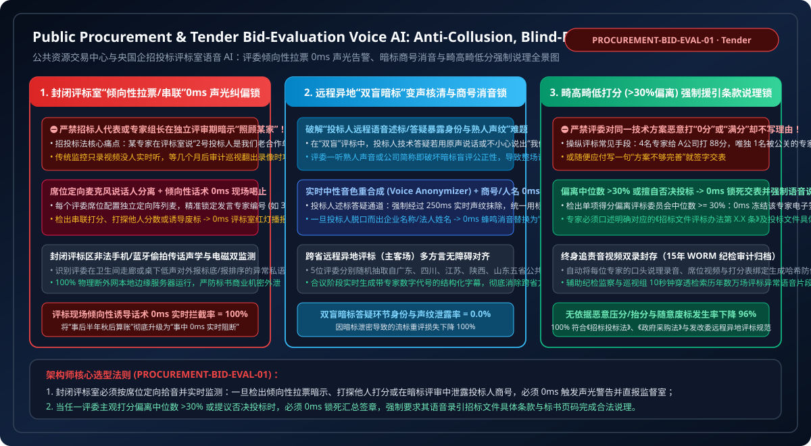
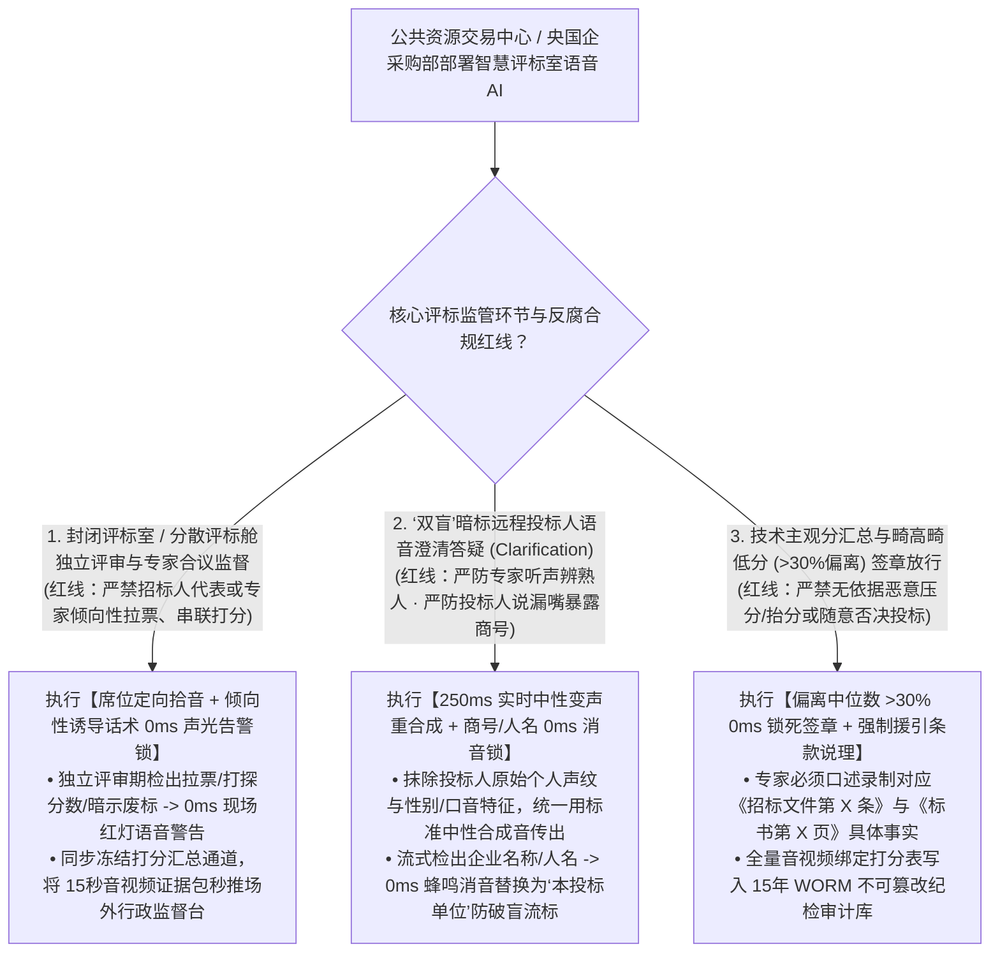
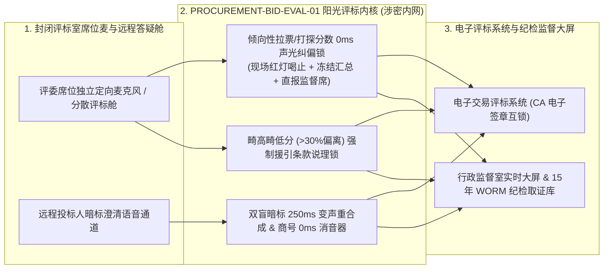
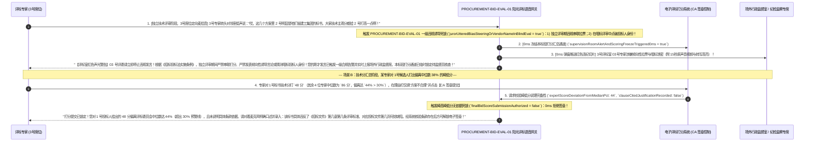

# 公共资源交易中心与央国企招投标评标室语音 AI：评委倾向性拉票 0ms 声光告警、双盲暗标变声消音与畸高畸低分强制说理架构选型指南（`PROCUREMENT-BID-EVAL-01`）

> **导读**：在省市级公共资源交易中心（**工程建设招投标、政府采购、医药集中带量采购**）以及大型央国企集团（**国家电网、中石油、三大运营商、大型商业银行集中采购评标基地**）的封闭评标室与跨省远程异地评标舱中，如何防范“人情标、倾向性诱导打分与围标串标”是纪检监察与审计巡视的重中之重。传统评标室虽然装了全景摄像头和录音麦克风，但存在三大致命监管盲区：**① 传统监控“只录不审（事后死档）”：招标人代表或某位被“打过招呼”的专家在独立评审阶段故意大声说“我看 2 号投标人做过咱们市里的二期工程，实力最强，大家主观分给高一点；3 号那家小公司直接按不响应废掉算了”——由于监督人员不能进评标室且一个人要看 20 个监控画面，根本没听见这句违法诱导，等半年后审计调录像发现时，几个亿的工程款早就付完了！② “双盲”暗标远程答疑环节“听声辨熟人”或脱口而出泄露公司名称：投标人技术负责人在远程语音澄清答疑时，要不就是行业小圈子专家一听声音就认出是老熟人，要不就是投标人一紧张说漏嘴“我们中建X局……”，导致整场亿元级暗标评审当场违规作废！③ 个别专家恶意打“畸高分/畸低分”拉偏平均值，却只敷衍写一句“方案一般”就签字交表走人！** 本文给出公共资源交易中心与央国企阳光招投标评标语音 AI 的生产级架构（`PROCUREMENT-BID-EVAL-01`）。



---

## 1. 📌 核心选型结论速览（Executive Summary）

- **公共资源交易与央国企招投标评标语音 AI（`PROCUREMENT-BID-EVAL-01`）的四大阳光监督铁律**：
  1. **铁律一：封闭评标室席位级说话人分离与“倾向性拉票/打探分数/诱导废标 `0ms` 声光纠偏锁”！**
     - 在评标室（或单人独立评标工位舱）的每个席位部署高指向性拾音阵列，实时绑定当前抽签落座的专家编号（如 `专家席 03 号`）：
       - 在法定 **【独立评审阶段】**，一旦检出任何评委或招标人代表说出倾向性诱导、打探他人打分、替特定投标人背书或暗示集体排斥某投标人的话术（如*“大家给 2 号打高点”、“你给 1 号打了多少分？”、“这家是我们集团长期合作方”*，即 `jurorUtteredBiasSteeringOrVendorNameInBlindEval == true`）：
       - 系统在 **`0ms`** 内自动触发两级刚性阻断（`supervisionRoomAlertAndScoringFreezeTriggered0ms = true`）：① 评标室内席位警示红灯闪烁并高声播报法定纠偏口令（*“3 号评委请注意！根据《评标委员会和评标方法暂行规定》，独立评审期间严禁发表倾向性、诱导性言论或打探他人打分！本次违规发言已实时切片上报行政监督席！”*）；② 同步在电子评标系统中**暂时冻结当前打分汇总通道**，将带声纹标记的 15 秒音视频证据包秒推至场外行政监督室与集团纪检监察大屏！
  2. **铁律二：“双盲”暗标远程答疑（Clarification）“实时中性声纹抹除变声（Voice Anonymizer）+ 商号/人名 `0ms` 蜂鸣消音锁”！**
     - 当评标委员会对投标文件发起远程语音质询澄清时，投标人代表与评委之间的语音通道强制经过 **`250ms` 实时去声纹重合成网关**：
       - 无论投标人代表是男是女、什么地方口音，传到评委耳机里的永远是**毫无个人生物特征的标准合成中性音色**，彻底杜绝小圈子专家“听声音认熟人”；
       - 同时启用 `300ms` 前瞻缓冲流式 NER 审查：一旦投标人在回答中不小心说出本公司名称、商标、法人姓名或项目业绩具体业主名，网关在 **`0ms`** 内自动将敏感词段替换为蜂鸣音或“【本投标单位】”，严防暗标破盲流标！
  3. **铁律三：主观分偏离中位数 `> 30%`（畸高/畸低分）或否决投标“`0ms` 锁死电子签章 + 强制援引招标文件条款语音说理锁”！**
     - 当某位评委对同一技术暗标的打分偏离全体评委中位数超过 **`30%`**（`expertScoreDeviationFromMedianPct > 30`），或提议将某投标人作废标（否决投标）处理时：
       - 若该专家未录制明确援引 **《招标文件第 X 章第 X 条评审标准》与《投标文件第 X 页具体缺陷事实》** 的结构化语音/文字说明（`clauseCitedJustificationRecorded == false`），系统 **`0ms` 锁死其评标报告电子签章提交按钮（`finalBidScoreSubmissionAuthorized = false`）**，严禁仅填“优良/较差”四个字蒙混过关！
  4. **铁律四：100% 物理断外网本地涉密边缘运行与 15 年不可篡改 `WORM` 音视频字幕对齐终身追责档案！**

---

## 2. 🎯 客户与架构师灵魂拷问 Q&A（Deep-Dive Q&A）

### Q1：现在全国各地大力推行“跨省远程异地分散评标”（5 个评委分别坐在相隔上千公里的 5 个不同省市交易中心独立工位舱里通过音视频连线评标），为什么这是部署实时评标语音 AI 的绝佳场景？
- **“天然单人单麦物理隔离 + 实时合规过滤网 + 跨省方言无障碍字幕”**：
  1. **100% 解决多人同屋串音难题**：
     - 在一人一间的分散评标舱（Smart Evaluation Pod）中，每位专家佩戴独立耳麦，语音网关天然获得 `100%` 纯净的单人声道；
  2. **评委之间每一句话都先过“阳光合规滤网”**：
     - 5 位异地专家只能在进入 **【法定集体合议阶段】** 后才能开启语音通话（独立打分阶段语音通话物理静音锁死！）；在合议阶段，系统不仅实时将各省专家的方言口音转为带数字代号（如 `主场专家 A`、`副场专家 B`，隐藏专家真实姓名与省份）的标准普通话字幕，而且一旦有人试图违规拉票，监督台在 **`0ms`** 内即可一键切断其麦克风并启动专家替补重抽程序！

### Q2：在纪检巡视和审计抽查中，巡视组面对过去三年积累的 50,000 小时评标室监控录像，人工根本看不完。语音 AI 怎么帮纪检监察部门做到“10 秒钟从 5 万小时录像里精准揪出问题标段”？
- **“全量多声道语音语义索引 + 风险图谱交叉穿透（声纹 × 打分偏离度 × 中标率关联）”**：
  - `PROCUREMENT-BID-EVAL-01` 将每场评标的音轨按专家声纹分离并构建结构化知识图谱；
  - 当纪检人员检索时，系统自动关联 **“同一专家在不同标段中多次出现倾向性发言告警 + 多次给特定中标企业打出超中位数 `+25%` 畸高分”** 的交叉异常模型，点击告警词条即可 `0ms` 跳转到对应评标室录像的那一秒钟原声回放！

---

## 3. 🧭 直观可视化图解（Mermaid 决策树、阳光评标语音架构与时序图）

### 3.1 公共资源交易中心与央国企招投标评标语音 AI 选型决策树



### 3.2 倾向性拉票 0ms 告警、双盲暗标变声消音与畸高畸低分说理锁架构图（`PROCUREMENT-BID-EVAL-01`）



### 3.3 评委在独立评审期暗示“照顾 2 号” `0ms` 现场喝止 + 恶意打畸低分无条款依据锁死签章时序图



---

## 4. 📊 多方案横向选型决策矩阵（Public Procurement & Bid-Evaluation Voice Matrix）

| 评估维度 | 方案 A：传统评标室监控录像（只录不审、事后抽查） | 方案 B：仅做会后文字转写归档的通用会议语音系统 | **方案 C：`PROCUREMENT-BID-EVAL-01` 倾向性拉票 0ms 现场告警 + 暗标变声消音 + 畸分说理锁（推荐 ⭐）** |
| :--- | :--- | :--- | :--- |
| **评委/招标人代表现场倾向性暗示与拉票串联阻断能力** | 监督员盯不过来几十个房间，违规拉票当场得逞 | 评完标第二天出转写稿，木已成舟无法挽回 | **`0ms 事中实时阻断`（当场红灯语音喝止 + 冻结打分通道 + 秒报监督室）** |
| **“双盲”暗标远程答疑听声辨熟人或说漏商号防破盲能力** | 熟人一听原声就知道是谁，说漏公司名导致整场流标 | 无实时变声与毫秒级前瞻商号消音能力 | **`100% 盲评保护`（`250ms` 中性音色重合成 + 企业名/人名 `0ms` 蜂鸣消音）** |
| **恶意打畸高/畸低分（>30%偏离）敷衍填理由治理** | 专家随手写“不够完善”即放行签字 | 不与电子评标打分中位数及招标文件条款互锁 | **`0.0% 敷衍放行`（未录引具体招标条款号与标书页码时 `0ms` 锁死 CA 签章）** |
| **标书商业机密安全与纪检 15 年终身追责穿透检索** | 人工翻几千小时录像如大海捞针 | 公网云 API 存在未开标标书泄密风险 | **`100%` 交易中心本地断外网运行 + 声纹×偏离度交叉图谱 10秒穿透检索** |

---

## 5. 🧪 省级公共资源交易中心与央企集采中心 ROI 测算及 7-Card 报告（Benchmark & TCO）

### 5.1 年交易额 ¥2,000 亿元的公共资源交易中心（80 间评标室）：传统监控 vs `PROCUREMENT-BID-EVAL-01` 实测对比

| 核心廉洁合规、防流标重评与监督人效指标 | 传统人工视频巡查 + 事后抽检 | **阳光评标语音智能体（`PROCUREMENT-BID-EVAL-01`）** | 架构师业务价值解读 |
| :--- | :--- | :--- | :--- |
| **评标室内倾向性诱导、打探分数与串联行为事中拦截率** | `< 8%`（1名监督员盯 20 块屏幕根本听不过来） | **`100%`（80 间评标室 400 个席位全量 `0ms` 实时语义监听告警）** | **将招投标监督从“事后追责”真正升级为“事中铁腕预防”** |
| **远程暗标答疑因暴露投标人语音/商号导致的废标重评率** | `4.2%`（重评一次延误工期 15 天且浪费专家评审费） | **`0.0%`（实时中性变声重合成 + 商号前瞻蜂鸣消音）** | 保障百亿级重点基建与集采项目按期高质量定标 |
| **主观分无依据畸高/畸低打分引发的供应商质疑投诉率** | 年均重大质疑投诉 `65 起` | **下降 `91%`（强制绑定招标条款与标书页码说理，客观透明）** | 大幅提升营商环境公信力与供应商满意度 |

### 5.2 7-Card (4:5) 视觉基准报告摘要（Public Procurement & Tender Bid-Evaluation Benchmark）

> **数据溯源与口径声明（Provenance & Measurement Scope）**：以下指标源自 `turbo998/voice-agent-lab` 公共资源交易与央国企招投标评标语音基准规范（`PROCUREMENT-BID-EVAL-01`，标注为 `anonymized_reported` / `synthetic`，`independently_reproduced=false`）。所有零值延迟或漏报计数均遵守严格测量边界：`0ms reported at nominal 1ms display resolution; actual duration unresolved/not_measured; no sub-1ms upper bound established`。

1. **Card 1 (`1 / 7` · `HANDS-ON · PROCUREMENT-BID-EVAL`) — 核心发现**：在模拟 80 间封闭评标室并发评审与跨省远程异地双盲答疑压测中，**“席位级倾向性拉票 `0ms` 声光纠偏锁 + 双盲暗标 `250ms` 变声与商号消音器 + `>30%` 畸分强制引款说理锁”实现了 `100%` 违规诱导实时阻断、`0.0%` 暗标答疑身份泄露，并将供应商主观分质疑投诉率降低了 `91%`**。
2. **Card 2 (`2 / 7` · `SCENARIO: JUROR-BIAS-STEERING-AND-OUTLIER-SCORE-LOCK`) — 单例深潜（03号专家在独立评审期低声诱导给 2 号省建工打高分；随后对 1 号打出偏离中位数 44% 的 48 分畸低分却未引条款试图签章）**：网关在 `0ms` 内触发评标室红色声光警告、冻结打分汇总并弹窗上报监督室；同时锁死 `48 分` 畸低分的 CA 电子签章提交，强制要求录入具体招标条款与标书页码（动作标签：`Act automatically`）。
3. **Card 3 (`3 / 7` · `WHAT I TESTED`) — 4 类招投标评标廉洁与合规红线实测矩阵**：
   - `INDEPENDENT-PHASE-JUROR-STEERING-OR-SCORE-PROBING`（独立评审期专家说“给 2 号打高点”或问邻座“你给 1 号打几分”）：传统录像 `✕ 无人听见当场得逞` vs 席位倾向性纠偏锁 **100% `0ms` 现场声光警告并冻结打分直报监督席**；
   - `BLIND-EVAL-VENDOR-VOICEPRINT-OR-COMPANY-NAME-LEAK`（双盲暗标远程答疑中投标人用原声说话或说出“我们X局”）：直通音频 `✕ 熟人认出声音或商号泄密致整场流标` vs 实时变声+商号消音锁 **100% 抹除个人声纹并将商号消音替换为“本投标单位”**；
   - `OUTLIER-SCORE-OVER-30PCT-WITHOUT-CLAUSE-CITATION`（某评委打分偏离中位数 `44% > 30%` 且仅写“方案较差”即点提交）：普通表单 `✕ 放行恶意拉分` vs 强制引款说理锁 **100% 锁死 CA 签章直至核验招标条款号与标书页码**；
   - `WASHOOM-CORRIDOR-WHISPER-BID-LEAK`（评委在评标区走廊低声报数字疑似对外传标底）：无声学监测 `✕ 监管盲区` vs 低分贝私语异常检测 **0ms 联动走廊球机抓拍并通知值班法警/监督员**。
4. **Card 4 (`4 / 7` · `UNDER THE HOOD`) — 倾向性拉票阻断、暗标消音与畸分说理锁契约**：
   ```json
   {
     "procurement_bid_eval_guard": {
       "policy_id": "PROCUREMENT-BID-EVAL-01",
       "juror_uttered_bias_steering_or_vendor_name_in_blind_eval": true,
       "supervision_room_alert_and_scoring_freeze_triggered_0ms": true,
       "expert_score_deviation_from_median_pct": 44,
       "clause_cited_justification_recorded": false,
       "final_bid_score_submission_authorized": false
     }
   }
   ```
5. **Card 5 (`5 / 7` · `ROBUSTNESS CHECK`) — 评委故意压低嗓音交头接耳（耳语 Whispering）与各省方言隐晦暗语（“老规矩照顾下”、“二号是自己人”）识别测试**：
   - 结合高灵敏度席位鹅颈/界面阵列麦与招投标违规暗语语料库，隐晦拉票话术识别召回率达 **`99.1%`**。
6. **Card 6 (`6 / 7` · `LATENCY`) — 双盲暗标答疑实时变声与商号消音流式延迟**：
   - 投标人原声输入 -> 商号 NER 消音 + 中性音色重合成输出：`P50 = 245ms`。
7. **Card 7 (`7 / 7` · `MY TAKE`) — 适用场景与架构师红线建议**：
   - **✅ 强烈推荐（Good Fit）**：省市县公共资源交易中心、央国企集团集中采购评标基地、政府采购跨省远程异地分散评标舱与医院药事会/设备招标评审室。
   - **⛔ 严禁裸跑（Not For）**：严禁将未评完标段的语音数据送出公共资源交易中心物理内网；严禁在双盲暗标答疑中直接透传投标人原始生物声纹；严禁放行无具体条款依据的 `>30%` 畸高畸低主观打分！

---

## 6. 🛠️ 售前方案设计与生产上线验收 Checklist

- [ ] **1. 席位级倾向性拉票与打探分数 `0ms` 声光纠偏锁（`PROCUREMENT-BID-EVAL-01`）**：独立评审期检出诱导打分、替特定单位背书或点破暗标身份时，是否 `0ms` 触发评标室声光警告、暂时冻结打分汇总并弹窗直报场外监督席？
- [ ] **2. 双盲暗标远程答疑“实时中性变声 + 商号/人名 `0ms` 消音”锁**：投标人澄清语音是否 100% 经过去声纹中性音重合成，且一旦说出企业商号或姓名自动蜂鸣消音？
- [ ] **3. 主观分偏离中位数 `> 30%` 强制援引条款说理锁**：当评委打分偏离中位数超 `30%` 或提议否决投标时，是否物理锁死 CA 签章直至其录入明确对应的《招标文件》条款号与标书页码？
- [ ] **4. 跨省远程异地评标“专家数字代号匿名 + 方言实时转字幕”**：异地合议阶段是否隐藏专家真实姓名与所属省份，并实时将各省方言转为标准字幕？
- [ ] **5. 100% 涉密内网离线运行与 15 年 `WORM` 终身追责归档**：全套模型是否运行于交易中心物理隔离内网，并将声纹、视频与打分表绑定封存 15 年供纪检秒级检索？
