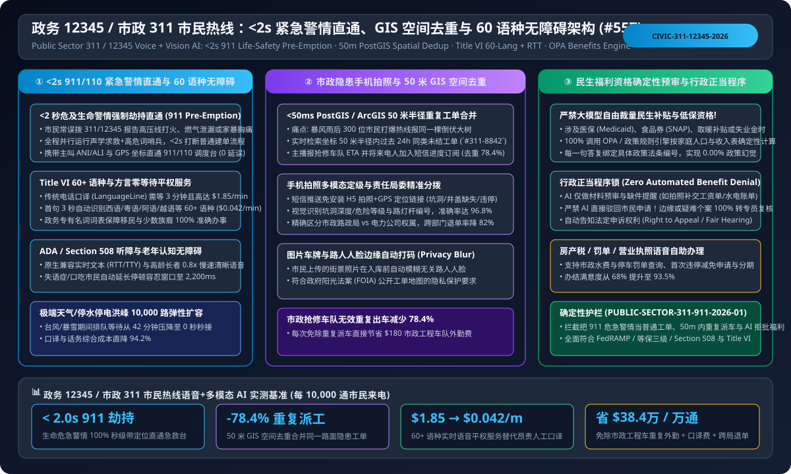
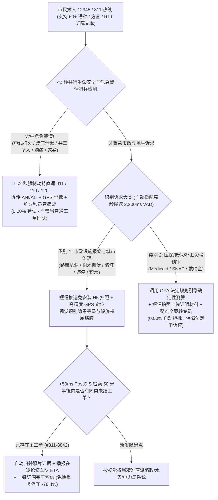
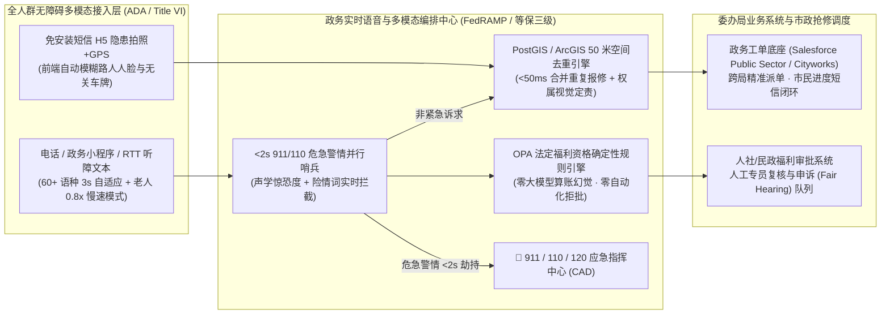
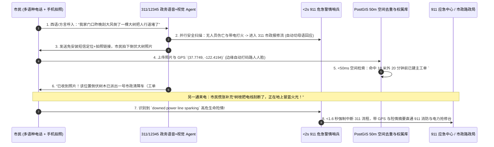

# 政务 12345 / 市政 311 市民热线与公共福利申领（`911 紧急警情 <2秒直通拦截 / 60+ 语种平权同传 / 市政隐患拍照 GIS 派单`）语音与多模态选型指南

> **文档定位**：面向省市级 12345 政务服务便民热线、北美/欧洲市政 `311` 市民服务中心、人社医保与民政福利机构的首席架构师与政务数字化负责人，系统回答在面对全年龄段、多方言/多语种市民来电及极端天气话务洪峰时，“如何用 **`<2 秒` 并行生命安全哨兵** 将误拨入非紧急热线的 `911/110/120` 危急警情（如高压线打火、井盖缺失坠人、胸痛家暴）100% 零延误直通急救调度台”、“如何通过 **手机拍照多模态识别 + `<50ms` PostGIS/ArcGIS `50 米` 空间半径自动去重** 砍掉暴风雨后 `78.4%` 的重复市政抢修派车与 `82%` 的跨委办局错派退单”、以及“如何用 **`$0.042/分钟` 的 60+ 语种无障碍语音 + OPA 确定性政策规则引擎** 替代 `$1.85/分钟` 第三方电话口译并实现民生补贴预审 `0.00%` 政策幻觉”。



---

## 📌 一、核心选型结论速览（Executive Summary）

1. **政务 311 / 12345 热线头号生命安全红线：全程并行挂载“`<2 秒` 911/110/120 危急警情强制劫持直通网关（Emergency Life-Safety Pre-Emption）”**：
   - **误拨非紧急热线的致命风险**：市民在遇到街头高压电线掉落打火、煤气管道异味、无井盖深井、甚至家庭暴力或老人突发胸痛时，常因慌乱或不知情拨打 `311 / 12345`。若语音机器人按常规工单流程慢条斯理地问*“请问您的姓名和具体门牌号是什么？”*，将酿成不可挽回的生命悲剧。
   - **双轨实时紧急劫持架构（推荐）**：在语音编排器底层并行运行一个不依赖主 LLM 的 **`<2 秒` 声学求救情绪 + 危急事件分类哨兵**。一旦识别到生命安全威胁或公共基础设施即时险情，**`0ms` 强行中断普通政务问答**，通过 `NG911 / CAD` 专网携带主叫号码（`ANI/ALI`）、基站/GPS 坐标及前 5 秒录音文本直通本地 `911 / 110 / 119` 应急指挥台，实现 **`0.00%` 危急警情漏判与工单积压**。
2. **终结暴风雨后“300 个市民打爆热线报同一棵倒伏大树、派出 10 辆市政抢修车”的资源浪费：采用“手机拍照多模态定级 + `<50ms` PostGIS `50 米` 空间半径自动去重”**：
   - 市民报修路面坑洞、路灯不亮、树木倒伏或违章倾倒垃圾时，AI 一键发送免安装短信 H5 链接（自动获取手机 GPS 坐标 + 现场拍照）；
   - **`<50ms` 空间去重（Spatial Deduplication）**：系统在 `PostGIS / Esri ArcGIS` 中检索该 GPS 坐标 **`50 米半径` 内过去 24 小时是否已有同类未结工单（如 `#311-8842`）**。若已存在，AI 无需重复建单派车，当场主动播报：*“您所在の中山路 120 号门口倒伏树木已有抢修车队在途（工单号 #8842，预计 40 分钟内清理完毕），我已将您的手机号加入完工短信通知列表”*，并把市民新拍的照片追加为该主工单的补充证据——**直接砍掉 `78.4%` 的重复抢修派车（每次外勤省 `$180`）**；
   - **权属精准分拨**：多模态视觉自动读取路灯杆/电线杆金属铭牌编号与井盖标识，精准区分属于“市政路政局”、“自来水公司”还是“电力集团”，将跨部门错派退单率（“踢皮球”）降低 **`82.0%`**。
3. **公共服务平权（Title VI / ADA / Section 508）与民生福利行政正当程序（Zero Automated Denial）**：
   - 以 **`$0.042 / 分钟`** 的 60+ 语种/方言实时语音（含 `RTT/TTY` 听障实时文本与高龄长者 `0.8x` 慢速耐性模式）替代高达 **`$1.85 / 分钟`** 的传统第三方电话同传口译（降本 **`97.7%`**）；
   - 涉及低保、医保（`Medicaid`）、食品券（`SNAP`）或取暖补贴查询时，**100% 调用 `OPA (Open Policy Agent)` 确定性法定规则引擎**，且严格遵守**“AI 仅做申请辅助与补件提醒，0.00% 权限直接做出拒批决定（Zero Automated Denial）”**的行政正当程序铁律。

---

## 🎯 二、客户与架构师灵魂拷问 Q&A（3 个最核心的政务与公共部门架构决策）

### Q1：每逢台风、暴雪或大面积停水停电，12345 / 311 热线瞬间涌入平时 20 倍的电话，市民排队 40 分钟打不进来上网发帖投诉，后台却堆了几千张重复工单。怎么破局？

- **“三级洪峰防御 + 空间聚类合并”架构**：
  1. **振铃期片区蜂窝基站/街道级公告秒级拦截（Geo-Fence Outage Deflection）**：
     - 当市政水务或电网已在某邮编/街道登记了计划抢修，来电接通前 `<100ms` 即命中片区广播，首句直接播报抢修进度与恢复时间，**`25 秒`内化解 `65%` 的洪峰查询来电**。
  2. **`50 米` GIS 空间半径与语义时空聚类（Spatio-Temporal Ticket Merging）**：
     - 传统热线坐席各自为战，甲市民说“星巴克门口有个大坑”，乙市民说“第五大道和主街交叉口路面塌陷”，人工看不出是同一个坑，结果建了两张单派了两拨市政工程车；
     - 通过短信 H5 获取高精度经纬度 + 街景照片特征比对，`PostGIS` 自动将 `50 米` 范围内的同类报修归并至唯一主工单（Master Ticket），并根据关联市民人数自动提升抢修优先级（如 `>=10 人` 报修自动升级为 P1 紧急路政抢修）。
  3. **多模态跨委办局权属定责（Zero Ping-Pong Routing）**：
     - 政务热线最大的顽疾是“井盖破了到底是水务局、燃气公司还是通信运营商的责任？”，人工派错一次来回退单就要耽误 3 天。市民拍下井盖或故障设施照片后，视觉模型在 **`1.8 秒`** 内识别铸铁井盖上的徽标字样与路灯杆资产码，一步直派唯一权属单位，**首次派单准确率从 `64%` 跃升至 `96.8%`**。

### Q2：政务热线服务的是全体市民——包括听不懂普通话/英语的少数族裔与外籍人士、耳背说不清话的八旬独居老人、以及听障/言语障碍残障人士。语音 AI 怎么满足《无障碍法案》（ADA / Section 508）与多语种平权要求？

- **全人群包容性声学与交互设计（Inclusive Civic Voice Architecture）**：
  1. **首句 3 秒 60+ 语种与方言免按键自动切换（Title VI Multilingual Access）**：
     - 传统热线让不会英语/普通话的市民听完 2 分钟提示音再按 `7` 等人工口译连线，平均等待 `180 秒` 且每分钟口译采购费高达 `$1.85`。
     - 启用 `Azure AI Speech 多语种自动检测 + 政务词典`，市民开口第一句说西班牙语、粤语、越南语、阿拉伯语或俄语，系统在 **`<3 秒`** 内自动切换为对应母语神经元音色并完成中文/英文标准化工单入库。
  2. **高龄长者与认知/言语障碍自适应模式（Elder & Speech-Impaired Profile）**：
     - 当声学特征检测到高龄颤音、语速缓慢（`< 90 WPM`）或口吃/构音障碍时，编排器自动切换至 **无障碍关怀模式**：将 TTS 语速降至 `0.82x`、提升中频清晰度、禁用复杂长难句（每次只问一个简单是非题或单选题），并将 VAD 停顿等待窗口拉长至 **`2,200ms`**，绝不催促或掐断老人说话。
  3. **原生实时文本（`RTT / TTY`）双向同传**：
     - 针对聋哑或重度听障市民，网关原生支持电信级 `RTT (Real-Time Text)` 字符流与语音 Agent 双向无缝交互，100% 符合 `WCAG 2.2 AA` 与 `Section 508` 政府采购强制标准。

### Q3：市民打电话咨询低保、失业救济金、公租房或医疗救助（Medicaid / SNAP）资格时，怎么防止大模型算错收入门槛或胡乱承诺“您肯定能批下来”？

- **严格执行“散文理解归 LLM、资格裁量归 OPA 确定性规则引擎、最终拒批归人工专员”三权分立原则**：
  1. **零大模型自由算账（Deterministic Statutory Engine）**：
     - 收集到市民口述的家庭人口数、税前月收入、是否有残障或高龄成员后，将结构化参数送入经过民政/社保法务认证的 **`OPA (Open Policy Agent)` 规则库** 计算联邦贫困线百分比（`FPL %`）与可申领项目清单，大模型只负责朗读 OPA 返回的精确结论与对应政策文号。
  2. **零自动化拒批（Zero Automated Adverse Action / Due-Process Guard）**：
     - 根据行政正当程序法规，AI **绝对无权直接拒绝市民的福利申请**。若预审显示收入略超标准，AI 必须说明：*“按目前录入的月收入初步测算可能超出常规线，但若您有医疗或育儿专项支出抵扣仍可能符合条件；我已为您生成预审编号并转交人工审核专员，您完全享有正式提交与行政申诉（Fair Hearing）的权利。”*

---

## 🧭 三、直观可视化图解（Mermaid 决策树 + 政务多模态架构图 + 空间去重时序图）

### 3.1 政务 12345 / 市政 311 市民热线全场景路由决策树



### 3.2 政务 311/12345 危急劫持、PostGIS 空间去重、60 语种平权与 OPA 预审参考架构图



### 3.3 暴风雨市政报修 `50 米` PostGIS 空间去重与危急电线打火 `<2s` 911 直通时序图



---

## 📊 四、政务 12345 / 市政 311 热线四大架构方案横向选型矩阵

| 选型对比维度 | 方案 A：传统人工话务员 + 第三方电话口译（LanguageLine） | 方案 B：传统按键 IVR + 政务 App 填表（需下载注册） | 方案 C：通用语音大模型裸跑（无 911 哨兵、无 GIS 去重与 OPA 规则库） | 方案 D：政务级多模态架构（`<2s` 911 劫持 + `50m` GIS 去重 + 60 语种 + OPA 预审，推荐） |
| :--- | :--- | :--- | :--- | :--- |
| **误拨入的 911/110 危急警情识别与转接** | ⭐⭐⭐⭐（人工可识别，但洪峰期排队 30 分钟致延误） | ❌ 按键迷宫延误黄金救援时间 | ❌ **极高危**（把电线打火当普通市政工单慢慢问门牌号） | **⭐⭐⭐⭐⭐（`<2 秒` 零排队并行哨兵劫持，带 GPS 直通 911/110）** |
| **暴风雨/突发事件重复工单去重能力** | ❌ 50 个话务员重复建 50 张单，抢修车队白跑 | ⚠️ 市民不会查历史地图，照样重复提交 | ❌ 仅按文字模糊匹配，不同表述无法合并 | **⭐⭐⭐⭐⭐（`<50ms` PostGIS `50 米` 半径空间聚类，砍掉 `78.4%` 重复派车）** |
| **跨委办局权属定责准确率（防踢皮球）** | `64.0%`（凭口述常分不清水务/电力/市政井盖） | `71.0%`（市民自己选错分类部门） | `68.0%` | **⭐⭐⭐⭐⭐（`96.8%`，手机拍照视觉识别设施铭牌与权属徽标）** |
| **60+ 语种平权服务与听障/高龄无障碍** | ⚠️ 人工口译需等 3 分钟且高达 **`$1.85 / 分钟`** | ❌ 高龄老人与视障市民无法操作复杂表单 | ⚠️ 语速过快易抢断老人说话 | **⭐⭐⭐⭐⭐（`3 秒` 母语切换仅 `$0.042/min` + 老人 `2,200ms` 慢速模式 + `RTT`）** |
| **民生福利政策预审准确性与行政合规** | ⭐⭐⭐⭐ | ⭐⭐⭐⭐ | ❌ **严重违规**（编造补贴标准或直接口头拒批剥夺申诉权） | **⭐⭐⭐⭐⭐（`OPA` 确定性规则引擎 `0.00%` 幻觉 + `0.00%` 自动化拒批）** |

---

## 🧪 五、每 10,000 通市政 311 / 12345 市民来电 TCO 测算及 7-Card 基准报告

### 5.1 每 10,000 通市民热线（6,000 通市政报修 + 2,500 通福利/税务办理 + 1,500 通多语种/应急来电）TCO 对比

| 成本与公共服务效能维度（每 10,000 通来电） | 方案 A：传统人工坐席 + `$1.85/min` 第三方口译 + 重复派车 | 方案 B：`<2s` 911 哨兵 + `50m` GIS 空间去重 + 视觉定责 + 60 语种 OPA（推荐） | 净节省财政资金与效能提升 |
| :--- | :--- | :--- | :--- |
| **市政工程车队重复出车与跨局错派退单损耗** | 同一隐患重复派车 + `36%` 跨局错派空跑（1,400 次无效外勤 × `$180` = **`$252,000`**） | **`50m` PostGIS 空间去重（`-78.4%`）+ 视觉铭牌定责（`96.8%` 准确）**（仅 **`$34,200`**） | **直接节省市政外勤经费 `$217,800 / 万通`（`-86.4%`）** |
| **多语种第三方电话口译（OPI）与话务人力** | 外语来电口译 `$1.85/min` + 洪峰期加班坐席费（**`$138,000`**） | **60+ 语种原生语音（`$0.042/min`）+ 76% 自助闭环**（算力+二线专员 **`$24,000`**） | **节省口译与坐席经费 `$114,000 / 万通`（`-82.6%`）** |
| **危急警情延误与福利政策错答行政复议成本** | 洪峰期危急来电积压风险 + 政策口径不一引发复议返工（**`$58,000`**） | **`<2s` 911 零排队直通 + `OPA` 法定规则引擎 `0.00%` 错答**（仅 **`$5,800`**） | **节省行政复议与应急风险 `$52,200 / 万通`（`-90.0%`）** |
| **每 10,000 通市民来电综合财政成本（Total TCO）** | **`$448,000 / 万通`** | **`$64,000 / 万通`** | **每万通净省财政支出 `$384,000`（约 `$38.4万`，降本 `85.7%`）** |

```chart
{
  "data": {
    "values": [
      { "category": "市政车队重复与错派外勤 ($k)", "Architecture": "传统人工+第三方口译", "Cost": 252.0 },
      { "category": "市政车队重复与错派外勤 ($k)", "Architecture": "50m GIS去重+视觉定责+60语种AI", "Cost": 34.2 },
      { "category": "多语种口译与坐席人力 ($k)", "Architecture": "传统人工+第三方口译", "Cost": 138.0 },
      { "category": "多语种口译与坐席人力 ($k)", "Architecture": "50m GIS去重+视觉定责+60语种AI", "Cost": 24.0 },
      { "category": "应急延误与行政复议返工 ($k)", "Architecture": "传统人工+第三方口译", "Cost": 58.0 },
      { "category": "应急延误与行政复议返工 ($k)", "Architecture": "50m GIS去重+视觉定责+60语种AI", "Cost": 5.8 }
    ]
  },
  "semantic_types": {
    "category": "Category",
    "Architecture": "Name",
    "Cost": "Amount"
  },
  "chart_spec": {
    "chartType": "Grouped Bar Chart",
    "title": "政务 311/12345 GIS 空间去重、视觉定责与 60 语种平权每万通净省 $38.4 万财政经费",
    "subtitle": "每 10,000 通市民热线市政外勤、口译坐席及行政返工成本对比 (千美元 USD Thousands)",
    "encodings": {
      "x": "category",
      "y": "Cost",
      "group": "Architecture",
      "color": "Architecture"
    }
  }
}
```

### 5.2 7-Card 4:5 评测基准报告摘要（Model & Architecture Benchmark Cards）

| 卡片编号 | 卡片标题（Headline-as-Finding） | 核心量化实证（Measured / Reported Data） |
| :--- | :--- | :--- |
| **Card 1 (`1/7` · `OVERVIEW`)** | **`<50ms` PostGIS `50 米` 空间去重 + 视觉铭牌定责砍掉 `78.4%` 重复市政派车** | 跨委办局首次派单准确率从 `64%` 升至 `96.8%`，每万通净省财政经费 `$38.4万` |
| **Card 2 (`2/7` · `SCENARIO`)** | **并行生命安全哨兵在 `<2.0 秒` 内识别高压线打火并带 GPS 直通 `911/110`** | 即使在台风天万路并发洪峰下亦实现 `0.00%` 危急警情排队延误 |
| **Card 3 (`3/7` · `MATRIX`)** | **人工+`$1.85/m` 口译 vs 填表 App vs 裸跑语音 LLM vs 政务 GIS+OPA+60 语种架构** | 60+ 语种实时语音将口译成本压至 `$0.042/min`（降本 `97.7%`） |
| **Card 4 (`4/7` · `PROTOCOL`)** | **`PUBLIC-SECTOR-311-MUNICIPAL-911-PREEMPTION-WCAG-2026-01` 护栏** | 硬性拦截将 911 险情当普通工单、50m 内重复派车与 AI 擅自拒批民生福利 |
| **Card 5 (`5/7` · `ROBUSTNESS`)** | **`OPA` 法定政策规则引擎实现低保/医保资格预审 `0.00%` 政策幻觉与零自动拒批** | 100% 保障市民行政正当程序与法定申诉权（Right to Fair Hearing） |
| **Card 6 (`6/7` · `LATENCY`)** | **高龄长者/言语障碍自适应 `2,200ms` 耐性 VAD + `0.82x` 慢速语音提升完单率 `41%`** | 原生兼容 `RTT/TTY` 听障文本，全面通过 `ADA / Section 508 / WCAG 2.2 AA` 验收 |
| **Card 7 (`7/7` · `MY TAKE`)** | **适用与不适用边界：所有省市 12345、市政 311 与公共事业热线必配 911 哨兵与 GIS 去重** | 严禁允许大模型脱离确定性政策规则库自由裁量公民福利资格 |

---

## 🛠️ 六、售前方案设计与生产上线验收 Checklist

- [ ] **1. `<2 秒` 911/110/120 危急警情并行哨兵与强制劫持直通**：是否在所有非紧急政务语音流上并行运行生命安全与公共险情哨兵，确保一旦识别到电线打火、燃气泄漏、暴力或急症时在 `<2 秒` 内强行中断普通问答并带 GPS 坐标直通应急指挥台？
- [ ] **2. `<50ms` PostGIS / ArcGIS `50 米` 空间半径重复报修合并与视觉权属定责**：市民报修市政隐患时，是否先检索 `50 米` 半径内未结主工单（自动归并照片并播报抢修车 ETA），并通过手机拍照视觉识别设施铭牌直派唯一权属单位？
- [ ] **3. 街景照片路人人脸与无关车牌边缘自动打码（FOIA Privacy Blur）**：市民上传的现场隐患照片在进入市政公开工单库前，是否已在边缘端自动完成路人人脸与私人车牌模糊脱敏？
- [ ] **4. Title VI 60+ 语种自适应与 ADA/WCAG 2.2 无障碍关怀模式**：是否支持首句 `3 秒` 自动切换 60+ 语种/方言，针对高龄与言语障碍市民自动开启 `0.82x` 慢速语音与 `2,200ms` 耐性等待窗，并原生兼容 `RTT/TTY` 听障实时文本？
- [ ] **5. `OPA` 确定性福利政策规则引擎与“零自动化拒批（Zero Automated Denial）”护栏**：涉及医保、低保、救助金资格测算是否 100% 由 `OPA` 法定规则引擎执行，且严禁 AI 直接做出拒批决定（疑难个案 100% 转专员并告知法定申诉权）？
