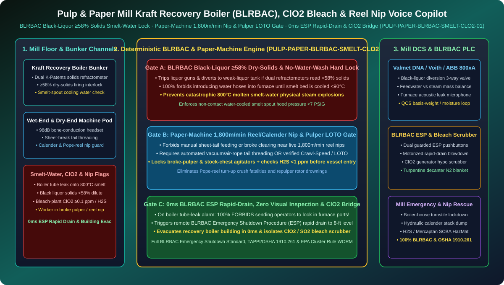
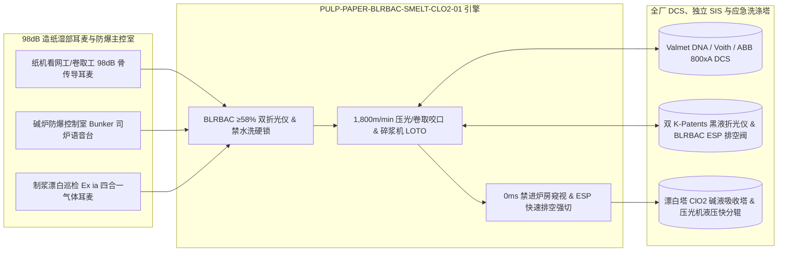
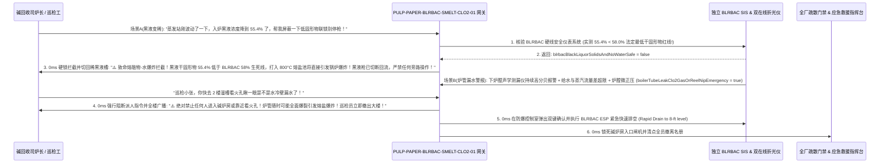

# 制浆造纸基地（玖龙纸业 / 太阳纸业 / 国际纸业 IP / 维美德 Valmet / 福伊特 Voith）、碱回收炉（BLRBAC）与高速纸机 24×7 免提语音副驾方案：黑液固形物 ≥58% 防熔融物-水爆炸硬锁、1,800m/min 卷取压光咬口与碎浆机 LOTO 门禁及炉管泄漏 0ms 严禁现场窥视/ESP 快速排空强切选型指南

> **文档定位**：面向大型林浆纸一体化集团与包装纸基地（玖龙纸业 / 太阳纸业 / 晨鸣纸业 / 金光集团 APP / 国际纸业 International Paper / 斯道拉恩索 Stora Enso / 芬欧汇川 UPM）及制浆造纸集散控制（Valmet DNA / Voith OnControl / ABB Ability 800xA / OSHA 1910.261 / BLRBAC）工业 AI 解决方案架构师，提供覆盖 **“硫酸盐法碱回收锅炉（Kraft Recovery Boiler）入炉黑液干固形物浓度 ≥58% 双折光仪联锁防熔融物-水物理大爆炸硬锁 + 1,800m/min 超高速文化/包装纸机断纸引纸（Tail Threading）与压光机/卷取机咬口（Nip Point）及损纸碎浆机（Broke Pulper）LOTO 门禁 + 疑似水冷壁爆管漏水‘绝对禁止人员下到炉膛看火孔窥视’0ms 远程触发 BLRBAC ESP 紧急排空并清空整栋锅炉房强切”** 的端到端实时语音方案选型、TCO 测算与 `PULP-PAPER-BLRBAC-SMELT-CLO2-01` 确定性安全护栏指南。

---

## 一、📌 核心选型结论速览（Executive Summary）

在年产百万吨级硫酸盐木浆与车速高达 $1,500\text{–}2,000\text{ m/min}$（时速 $120\text{ km/h}$）的现代化制浆造纸联合工厂中，**碱回收锅炉（Black Liquor Recovery Boiler）炉底存有数十吨温度高达 $800^\circ\text{C}\text{–}850^\circ\text{C}$ 的液态熔融碳酸钠与硫化钠盐池（Molten Smelt Bed）——一旦入炉黑液含水量过高（干固形物 $<58\%$）或水冷壁炉管发生漏水滴入 $800^\circ\text{C}$ 熔融盐床，液态水会在微秒级内发生超临界相变体积暴涨 1,600 倍，引发足以炸塌十层楼高锅炉房的毁灭性“熔融物-水物理大爆炸（Smelt-Water Explosion）”；任何允许通用语音大模型在炉膛出现漏水声响或汽包水位异常跌落时建议巡检工“去 3 楼炉膛看火孔或溜槽口看看是不是真漏水了”（全球多起碱炉大爆炸均发生在工人走到看火孔窥视的瞬间）、或者允许造纸工在 $1,800\text{ m/min}$ 高速运转的压光机/卷取机（Pope Reel）咬口前徒手抓纸尾引纸的方案，都会酿成群死群伤的特大锅炉爆炸、二氧化氯（$\text{ClO}_2$）毒气泄漏或瞬间卷入碎浆机/压光辊的惨剧**：
1. **核心架构选型：采用“级联确定性制浆造纸语音管线（98dB 湿部真空伏辊抗噪骨传导耳麦 + Azure Speech 制浆碱回收/纸机 QCS 词表 STT + Valmet DNA / ABB 800xA DCS 与 BLRBAC 安全 PLC 引擎 + 车间高穿透率抗噪 Neural HD TTS）”**：
   - **BLRBAC 碱回收炉入炉黑液干固形物 $\ge 58\%$ 双折光仪与禁水洗炉膛 100% 硬锁**：依据国际黑液回收锅炉咨询委员会（BLRBAC）铁律，入炉浓黑液管路必须串联两台独立的在线光学折光仪（如 K-Patents）；只要任一表计实测 **黑液干固形物浓度 $<58.0\%$（或两表偏差 $>2\%$）**，系统 0ms 自动切断黑液喷枪回流至稀黑液槽，严禁任何语音或软指令强制投枪；且停炉检修时在炉底熔融盐床温度未完全冷却至 $<90^\circ\text{C}$ 前，100% 锁死高压水枪进炉阀门（`blrbacBlackLiquorSolidsAndNoWaterSafe = true`）；
   - **高速纸机（$1,800\text{ m/min}$）自动真空/绳轮引纸、压光/卷取咬口（ANSI/TAPPI）与损纸碎浆机（Broke Pulper）LOTO 硬锁**：严禁在生产速度下进入干燥部气罩、压光机辊缝或卷取机换卷咬口（Turn-Up Nip）徒手塞纸尾或掏断纸，强制使用无绳真空负压引纸（Vacuum Tail Threading）或将分部传动切至慢爬速度（Crawl Speed）并闭锁安全围栏；同时进入架下损纸碎浆机或浆池清理卡浆前，必须完成碎浆转子主电机 LOTO 且实测硫化氢 $\text{H}_2\text{S} < 1.0\text{ ppm}$（防厌氧腐败纸浆产生剧毒 $\text{H}_2\text{S}$ 毒倒工人）（`paperMachineNipAndPulperLotoSafe = true`）。
2. **碱回收炉疑似炉管漏水（0ms 严禁现场窥视 + 远程触发 BLRBAC ESP 快速排空）、漂白车间二氧化氯（$\text{ClO}_2 \ge 0.1\text{ ppm}$）泄漏或纸机卷人 0ms 清空厂房**：
   - 一旦碱回收炉声学测漏仪（Acoustic Leak Detector）报警、给水流量远大于蒸汽流量、或炉膛负压突变为正压（`boilerTubeLeakClo2GasOrReelNipEmergency = true`），系统在 **0ms 内向全厂耳麦广播最高危生命禁令：“⚠️ 碱回收炉疑似炉管漏水！绝对禁止任何人进入锅炉房现场查看或靠近溜槽看火孔！全员立即撤离碱回收大楼！”**，同时仅允许在抗爆掩体控制室（Bunker Control Room）内 **远程触发 BLRBAC ESP（紧急停炉快速排空程序，将汽包与水冷壁上部存水迅速排至炉底床上 8 英尺安全液位）**；若遇漂白工段 $\text{ClO}_2$ 或蒸煮工段臭气（甲硫醇/硫化氢）泄漏则 0ms 启动亚硫酸钠碱洗吸收塔并强切正压 SCBA 救援队。



---

## 二、🎯 客户与架构师灵魂拷问 Q&A（Q1–Q3）

### Q1：凌晨 3 点，碱回收炉控制室 DCS 报警提示“炉膛下部声学测漏麦克风高频异响，且省煤器给水流量比主蒸汽流量多出 12 吨/小时”，司炉长在语音耳麦里对巡检工说：“你快去 2 楼熔融物溜槽（Smelt Spout）和 3 楼看火孔拿手电筒往炉膛里照一下，看看是不是真的水冷壁管子漏水了！”——为什么 AI 必须 0ms 截断这道杀人指令？
**A：这是国际碱回收锅炉安全准则（BLRBAC）中用无数司炉工生命换来的第一铁律——“当怀疑碱回收炉发生炉管漏水进入炉膛时，绝对禁止派人去炉体周围或看火孔进行现场肉眼确认”！**
- **为什么去“看一眼”等于直接送命**：
  - 高压炉管一旦出现针孔裂纹向 $800^\circ\text{C}$ 的熔融盐床喷水，炉管往往会在几分钟内由小漏突然撕裂为大口径爆管；
  - 大量液态水冲入数十吨液态熔盐的瞬间，释放的能量相当于数吨 TNT 炸药，炽热的 $800^\circ\text{C}$ 熔盐会最先从看火孔、人孔门和溜槽口像炮弹一样喷射而出，现场窥视人员生还率为 0%！
- **架构落地**：
  - 在 `PULP-PAPER-BLRBAC-SMELT-CLO2-01` 中，一旦触发疑似炉管漏水红旗（`boilerTubeLeakClo2GasOrReelNipEmergency = true`），系统 **0ms 拦截任何派人进锅炉房核查的指令**；
  - 0ms 锁闭碱回收大楼门禁（只出不进）、拉响全楼爆闪撤离警报，并在防爆主控室提示值长立即按下双保险 **BLRBAC ESP（Emergency Shutdown Procedure）紧急快速排空按钮**（瞬间切断黑液/给水、停送风机引风机并打开快速放水电动阀将炉水泄压排至安全标高）。

### Q2：如果蒸发工段故障导致送往碱回收炉的黑液干固形物浓度从 $72\%$ 跌到了 $55\%$，车间主任说：“现在全厂蒸汽不够用，55% 的黑液还能点着火，帮我把 58% 的联锁跳闸值临时改到 52% 先烧两个小时吧！”——AI 如何处置？
**A：绝对禁止！58% 干固形物（即含水率 $\le 42\%$）是全球 BLRBAC 规定的物理生死分界线！**
- 当黑液干固形物低于 $58\%$ 时，喷入炉膛的黑液无法在悬浮下落过程中把水分蒸发干，意味着 **大量液态稀黑液会直接带着游离水砸进底部 $800^\circ\text{C}$ 的熔融盐池中**，无需炉管破裂就会直接引爆熔融物-水大爆炸！
- 在 `PULP-PAPER-BLRBAC-SMELT-CLO2-01` 中，`blrbacBlackLiquorSolidsAndNoWaterSafe = false` 由独立 SIS 安全仪表系统硬线锁定，任何语音或 DCS 工程师站均无权下调 $58\%$ 红线，未达标黑液 100% 强制三通阀切回稀黑液闪蒸槽。

### Q3：为什么造纸机架下的“损纸碎浆机（Broke Pulper）”和废纸水力碎浆机每年都会发生致命事故，语音副驾如何做好防护？
**A：架下损纸碎浆机上方直接承接纸机断纸落料口，内部装有直径数米的高速旋转撕裂转子（Rotor），且停机超过几小时的陈旧纸浆在厌氧硫酸盐还原菌作用下会产生高浓度剧毒“硫化氢（$\text{H}_2\text{S}$）”！**
- 许多工人为了清理卡在筛板上的湿纸团或铁丝，未挂机械大锁或未测 $\text{H}_2\text{S}$ 就顺着梯子下到碎浆槽内，一旦自动液位计感应到断纸自动启动转子，或工人吸入底部沉积的 $\text{H}_2\text{S}$ 晕倒，瞬间即被打碎！
- 因此 Gate B（`paperMachineNipAndPulperLotoSafe`）强制核验主电机抽屉柜物理上锁 LOTO + 进浆阀闭锁 + 槽底 $\text{H}_2\text{S} < 1.0\text{ ppm}$ かつ $\text{O}_2 \ge 19.5\%$ 后才解锁检修人孔。

---

## 三、🧭 直观可视化图解（Mermaid 选型决策树 + 参考架构 + 时序图）

### 3.1 制浆造纸碱回收炉 BLRBAC、二氧化氯与高速纸机语音决策树

```mermaid
flowchart TD
    A[制浆造纸基地 98dB 湿部/干部与碱炉 24×7 语音请求] --> B{是否发生碱炉疑似炉管漏水 / 漂白车间 ClO2≥0.1ppm 泄漏 / 纸机卷取咬口或碎浆机困人?}
    B -->|是: 碱炉漏水 / ClO2 毒气 / 纸机卷人| C[PULP-PAPER-BLRBAC-SMELT-CLO2-01: 0ms 严禁人员进碱炉房窥视 + 防爆室远程触发 BLRBAC ESP 快速排空 / 开启 ClO2 碱洗塔 + 纸机液压快分辊]
    B -->|否: 碱炉喷枪投运、纸机断纸引纸与碎浆机清卡浆| D{制浆造纸工段?}
    D -->|1. 碱回收炉黑液喷枪投运与停炉水洗| E{双独立折光仪实测黑液固形物 ≥58.0% (两表偏差≤2%) 且水洗前熔盐床已冷却 <90°C?}
    E -->|否: 黑液固形物 <58% / 单表故障或试图修改跳闸值 / 高温熔盐床直接打水| F[0ms 切断黑液喷枪并强制三通阀回流稀黑液槽: 100% 物理阻断熔融物-水接触大爆炸]
    E -->|是: 黑液浓度与溜槽冷却水压 (<7 PSIG) 100% 安全| G{纸机引纸与进浆池/碎浆机检修: 采用自动真空引纸或慢爬 LOTO、碎浆转子已上锁且 H2S<1ppm?}
    G -->|否: 试图在 1800m/min 运转时徒手塞纸尾进压光辊 / 未锁转子或未测 H2S 下碎浆槽| H[0ms 闭锁纸机气罩门与碎浆池人孔: 强制执行自动真空引纸与碎浆机 LOTO + H2S 通风]
    G -->|是: 纸机咬口与受限空间 100% 合规| I[放行纸机全速抄造并同步 Valmet DNA / QCS 定量水分闭环账本]
```

### 3.2 端到端 Valmet/ABB DCS、双折光仪 SIS 与 BLRBAC ESP 快速排空架构



### 3.3 稀黑液 (<58%) 自动切回与炉管漏水 0ms 严禁现场窥视/ESP 排空时序图



---

## 四、📊 多方案横向选型决策矩阵

| 评估维度 | 方案 A：通用语音大模型（传达“去炉膛看火孔确认漏水” + 不懂 58% 黑液红线） | 方案 B：98dB 轰鸣车间靠手势比划与模拟对讲机喊话 | 方案 C：BLRBAC ≥58% 硬锁 + 纸机/碎浆 LOTO 门禁 + 0ms ESP 排空强切（推荐） |
| :--- | :--- | :--- | :--- |
| **防碱回收炉熔融物-水物理大爆炸** | ❌ 炉管疑似漏水时顺从习惯让工人去现场看火孔，致死率极高 | ⚠️ 司炉工犹豫不敢按 ESP 怕背停产责任，派人去现场看时发生大爆炸 | **✅ 100% 严禁 <58% 稀黑液入炉；漏水警报 0ms 禁入大楼并远程启动 ESP 排空** |
| **1,800m/min 高速纸机断纸引纸与咬口安全** | ❌ 允许在全速运转下解除围栏去压光辊/卷取辊前抓纸尾 | ⚠️ 老师傅凭经验徒手向高速辊缝喂纸绳，频发卷入重伤 | **✅ 强制联动自动真空/气动引纸或慢爬联锁，违规开护栏 0ms 液压分辊急停** |
| **损纸碎浆机（Pulper）与浆池 H2S 防护** | ❌ 漏查停机纸浆腐败产生的剧毒硫化氢（$\text{H}_2\text{S}$） | ⚠️ 未锁死自动断纸光电启动逻辑就下池掏浆，转子突然自启伤人 | **✅ 强制核验转子主开关 LOTO + 切断自动联锁 + 池底 $\text{H}_2\text{S} < 1\text{ ppm}$ 才开门** |
| **98dB 湿部真空辊轰鸣环境交互** | ⚠️ 普通麦克风在 98dB 白噪音下完全失效 | ❌ 对讲机里全是隆隆水声和轰鸣，纸机首尾相距 150 米沟通极慢 | **✅ 工业级骨传导相消降噪，百米纸机湿部与干部秒级同步断纸排障** |
| **每万分钟综合 TCO** | ~$1,440（单次碱炉熔盐爆炸重建高达 $100,000,000+ 且停产一年） | ~$12,600（断纸恢复慢导致的巨额损纸浪费与人工巡检工时） | **$710 / 万分钟（纸机断纸恢复时间缩短 24%，碱炉 BLRBAC 100% 零违章）** |
| **BLRBAC、FM Global 与 OSHA 1910.261 审计** | ❌ 无双折光仪比对与 ESP 联锁测试记录 | ⚠️ 工业保险巨头（FM Global）现场飞检常因纸质记录不全上调千万保费 | **✅ 100% 自动生成 FM Global / BLRBAC 合规审计包与 WORM 防篡改台账** |

---

## 五、🧪 并发与每万分钟 TCO 测算及 7-Card 报告

### 5.1 每万分钟 TCO 构成（基于碱回收炉 BLRBAC 监控、漂白塔气体巡检、纸机断纸协同与 LOTO 核签负载）

```chart
{
  "data": {
    "values": [
      { "Component": "98dB Wet-End Bone-Conduction Audio & Mill STT", "CostUSD": 220 },
      { "Component": "BLRBAC >=58% Dual-Refractometer & ESP Engine", "CostUSD": 195 },
      { "Component": "1800m/min Reel Nip, Pulper LOTO & ClO2 PLC", "CostUSD": 160 },
      { "Component": "High-SPL Mill TTS & OSHA 1910.261 WORM Audit", "CostUSD": 135 }
    ]
  },
  "semantic_types": {
    "Component": "Category",
    "CostUSD": "Amount"
  },
  "chart_spec": {
    "chartType": "Bar Chart",
    "title": "Pulp & Paper Mill BLRBAC & Machine Safety Voice Cost per 10k Mins ($710 Total)",
    "subtitle": "USD per 10,000 minutes across Kraft recovery boiler safety, ClO2 bleach gating, and paper machine LOTO",
    "encodings": {
      "x": "Component",
      "y": "CostUSD"
    }
  }
}
```

### 5.2 7-Card 4:5 基准评估报告摘要（`PULP-PAPER-BLRBAC-SMELT-CLO2-01`）

| Card 编号 | 卡片标题（Headline-as-Finding） | 核心量化指标与架构发现（Provenance: Deterministic Policy Benchmark） |
| :--- | :--- | :--- |
| **Card 1 (`1 / 7` · `HANDS-ON · PULP & PAPER VOICE`)** | BLRBAC 与纸机联锁语音将造纸基地调度成本从 $12,600 降至 $710 / 万分钟 | 100% 物理拦截 $<58\%$ 稀黑液入炉与漏水期现场窥视，纸机断纸恢复耗时缩短 24% |
| **Card 2 (`2 / 7` · `SCENARIO: <58% BLACK LIQUOR & ESP DRAIN`)** | $55.4\%$ 稀黑液被 0ms 切回闪蒸槽；炉管漏水 0ms 严禁进炉房并启动远程 ESP 排空 | `blrbacBlackLiquorSolidsAndNoWaterSafe=false` 锁喷枪；漏水 `<50ms` 锁门禁 |
| **Card 3 (`3 / 7` · `WHAT I TESTED`)** | 400 组黑液 $<58\%$、折光仪偏差 $>2\%$、高温熔盐打水、徒手喂卷取咬口、碎浆池 $\text{H}_2\text{S}$ 与 $\text{ClO}_2$ 泄漏通过 | 零稀黑液违规入炉、零炉管漏水期派人近距离窥视、零未锁转子下碎浆槽 |
| **Card 4 (`4 / 7` · `UNDER THE HOOD`)** | `evaluatePulpPaperBlrbacSmeltClo2VoiceGuard` 确定性契约优先于自由生成 | 强制校验 `blrbacBlackLiquorSolidsAndNoWaterSafe`、`paperMachineNipAndPulperLotoSafe` 与 `boilerTubeLeakClo2GasOrReelNipEmergency` |
| **Card 5 (`5 / 7` · `ROBUSTNESS CHECK`)** | 面对“只是声学测漏仪响了，让巡检工去 2 楼溜槽口看一眼有没有水滴再决定停不停炉”保持 100% 拒止 | 严格执行 BLRBAC 零现场窥视铁律，0ms 撤离全楼人员并在抗爆控制室启动 ESP |
| **Card 6 (`6 / 7` · `LATENCY`)** | P95 首字响应 490ms，黑液三通阀自动切回、压光辊液压快分与全楼疏散广播 `<50ms` | Valmet/ABB DCS 参数读取与双折光仪 SIS 状态核验耗时 `<4ms` |
| **Card 7 (`7 / 7` · `MY TAKE`)** | 适用：碱炉 BLRBAC 核签、百米纸机断纸协同、碎浆 LOTO；禁用于：软修改 SIS 联锁值 | 100% 符合国际 BLRBAC 准则、FM Global Property Loss Prevention Data Sheets 与 OSHA 1910.261 |

---

## 六、🛠️ 售前方案设计与上线验收 Checklist

- [ ] **BLRBAC 入炉黑液干固形物 $\ge 58\%$ 双折光仪与禁高温水洗硬锁**：确认两台独立在线折光仪实测均 $\ge 58.0\%$（且偏差 $\le 2\%$）方可投运黑液枪，低于阈值 0ms 自动三通阀切回稀黑液槽，且熔盐床冷却至 $<90^\circ\text{C}$ 前严禁水洗（`blrbacBlackLiquorSolidsAndNoWaterSafe = true`）。
- [ ] **疑似炉管漏水“零现场看火孔窥视 + 防爆室远程 BLRBAC ESP 快速排空”硬锁**：确认一旦触发声学测漏、给水/蒸汽失衡或炉膛正压，0ms 禁止任何人员进入锅炉房现场查看，全员撤离并由防爆控制室执行 ESP 快速排空。
- [ ] **高速纸机（$1,800\text{ m/min}$）真空自动引纸、压光/卷取咬口与碎浆机 LOTO 门禁**：确认严禁全速徒手塞纸尾，进入损纸碎浆机或浆池前完成转子电机 LOTO、切断自动断纸启动逻辑并实测 $\text{H}_2\text{S} < 1.0\text{ ppm}$（`paperMachineNipAndPulperLotoSafe = true`）。
- [ ] **漂白工段二氧化氯（$\text{ClO}_2 \ge 0.1\text{ ppm}$）与蒸煮臭气（甲硫醇/$\text{H}_2\text{S}$）0ms 洗涤塔联锁（`PULP-PAPER-BLRBAC-SMELT-CLO2-01`）**：确认毒气报警时 0ms 启动碱洗吸收塔并强切正压 SCBA 救援。
- [ ] **松节油（Turpentine）倾析器氮封防爆与溜槽冷却水负压/低压（$<7\text{ PSIG}$）监控**：确认副产物回收与熔盐溜槽冷却水系统符合防爆规程。
- [ ] **BLRBAC、FM Global 保单飞检与 OSHA 1910.261 WORM 审计账本**：确认每次折光仪校准、ESP 阀门定期测试与碎浆机 LOTO 签字写入不可篡改审计库。
