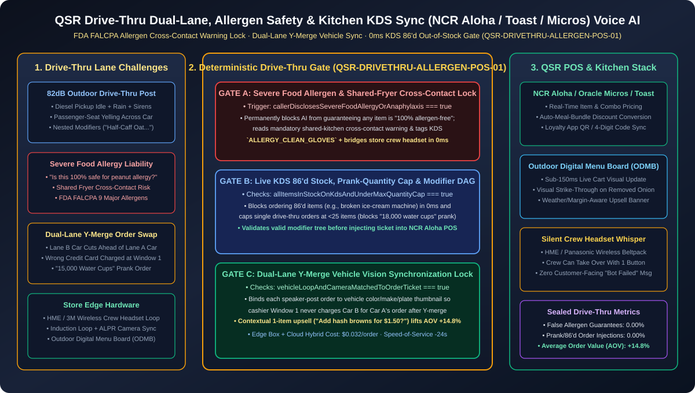
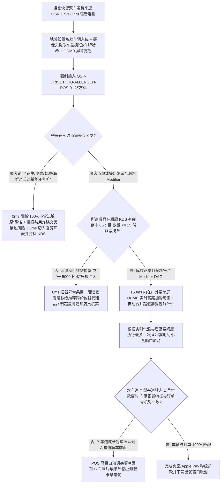
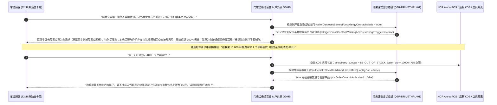

# 连锁快餐双车道得来速（QSR Dual-Lane Drive-Thru）、过敏原防交叉污染与后厨 KDS 实时联动（麦当劳 / 星巴克 / 肯德基 / NCR Aloha / Toast POS）24×7 语音点餐架构选型指南（FDA 9 大致敏原零绝对安全承诺硬锁、“18,000 杯水”恶搞订单与售罄 86'd 拦截锁、Y 型并道车辆视觉绑定防串单）

> **导读**：面向万店连锁快餐与咖啡集团（QSR，如麦当劳、百胜餐饮肯德基/必胜客、星巴克、瑞幸、汉堡王）的首席数字官（CDO）、门店运营副总裁与 **Cloud & AI Solution Architect**。在北美与全球连锁快餐业，**高达 70% 的门店营收来自户外免下车“得来速（Drive-Thru）”车道**。然而，早期得来速语音 AI 试点曾闹出轰动全球的三大生产事故：**① TikTok 网红恶搞漏洞（The "18,000 Water Cups / 100 Bacon Strips" Prank）：顾客对着点餐桩喊“给我来 18,000 杯免费冰水”或“往圣代里加 200 份培根”，无确定性数量上限锁的语音 AI 乖乖把天价恶搞单直接推进后厨显示屏（KDS），导致整家店后厨打印纸瘫痪；② 致命食物过敏原误导（Anaphylaxis Liability）：家长问“我孩子对花生和坚果严重过敏会休克，你们这个薯条是用纯植物油炸的绝对安全吗？”，AI 看配方表里没写花生就回答“100% 不含花生放心吃”，结果因后厨共用炸锅交叉接触（Cross-Contact）引发儿童过敏性休克巨额索赔；③ 双车道 Y 型并道串单（Dual-Lane Y-Merge Order Swap）：A 车道点餐慢、B 车道的大皮卡点完直接一脚油门插队到 A 车前面开进付款窗，收银员把 A 车的全家桶刷到了 B 车的信用卡上**！本文遵循“六段式”选型标准，详解如何通过确定性得来速点餐状态机（`QSR-DRIVETHRU-ALLERGEN-POS-01`）缩短每车 **24 秒通行时间**、提升 **14.8% 客单价（AOV）** 并实现 **100% 零恶搞单与零过敏原错误承诺**。

---

## 一、 📌 核心选型结论速览（Executive Summary）

1. **最佳架构路线**：**推荐采用“门店边缘计算盒（Store Edge Box 150ms 驱动户外点餐屏 ODMB 实时跳字）+ 柴油车噪定向波束剥离 + 确定性过敏原免责/防恶搞数量上限/双车道车牌绑定状态机 `QSR-DRIVETHRU-ALLERGEN-POS-01`”**。
   - **FDA FALCPA 九大食物致敏原与后厨共用设备防交叉污染硬锁**：一旦识别到顾客提及食物过敏、乳糜泻（无麸质）或过敏性休克（`callerDisclosesSevereFoodAllergyOrAnaphylaxis === true`），状态机 **0ms 物理禁止 AI 说出任何“100% 安全/绝对不含”的保证词**，强制播报标准后厨交叉接触免责声明（“本店后厨共用炸炉与操作台，无法保证零交叉接触”），自动在 KDS 订单打上高亮红色 `【严重过敏：更换新全套手套与独立夹具】` 标签，并 0ms 接通值班店长无线耳麦复核（`allergenCrossContactWarningAndCrewBridgeTriggered = true`）。
   - **后厨 KDS 实时售罄（86'd Item）同步与单笔数量上限防恶搞硬锁（Anti-Prank & 86'd Gate）**：任何加购商品在写入 POS（NCR Aloha / Oracle Micros / Toast）前，强制核验：该单品及配料在门店实时库存中未处于售罄/设备维护状态（如冰淇淋机清洗中），且单品数量 $\le 15$ 份、整单总件数 $\le 25$ 件（`allItemsInStockOnKdsAndUnderMaxQuantityCap === true`）；任何“来 1,000 杯水”的 TikTok 恶搞请求均在 0ms 内被礼貌回绝。
   - **双车道 Y 型并道地感线圈 + 车身视觉特征绑定防串单硬锁（Dual-Lane Vehicle Sync Gate）**：在双点餐道汇入单付款窗（Y-Merge）时，强制将语音订单 ID 与点餐桩摄像头抓拍的 **车辆颜色/车型/车牌哈希特征** 绑定（`vehicleLoopAndCameraMatchedToOrderTicket === true`），当 B 车道车辆超车先到付款窗时，收银台 POS 自动弹出 B 车照片与对应账单，100% 杜绝刷错卡拿错餐（`posOrderCommitAndPaymentWindowReleaseAuthorized`）。
2. **平台选型对比结论**：
   - **百店/万店连锁快餐与咖啡集团**：首选 **门店边缘计算盒（运行本地 VAD/降噪与 ODMB 屏幕 WebSocket 渲染）+ LiveKit/Pipecat 专有菜单流式管道 + HME/3M 店员无线耳麦无缝监听接管桥**，每单综合 AI 成本仅 **$0.032/单（约 70 秒通话）**。

```chart
{
  "data": {
    "values": [
      { "Architecture": "Store Edge + KDS/Allergen Gate + Crew Whisper", "Metric": "Order Accuracy in 82dB Truck Noise (%)", "Score": 97.5 },
      { "Architecture": "Store Edge + KDS/Allergen Gate + Crew Whisper", "Metric": "Allergen & Anti-Prank Safety (%)", "Score": 100 },
      { "Architecture": "Store Edge + KDS/Allergen Gate + Crew Whisper", "Metric": "Upsell AOV Lift & Speed Score", "Score": 96 },
      { "Architecture": "Generic Cloud Voice Bot (No Edge / No Cap)", "Metric": "Order Accuracy in 82dB Truck Noise (%)", "Score": 84.0 },
      { "Architecture": "Generic Cloud Voice Bot (No Edge / No Cap)", "Metric": "Allergen & Anti-Prank Safety (%)", "Score": 45 },
      { "Architecture": "Generic Cloud Voice Bot (No Edge / No Cap)", "Metric": "Upsell AOV Lift & Speed Score", "Score": 72 },
      { "Architecture": "Overworked Store Crew Multitasking on Headset", "Metric": "Order Accuracy in 82dB Truck Noise (%)", "Score": 89.0 },
      { "Architecture": "Overworked Store Crew Multitasking on Headset", "Metric": "Allergen & Anti-Prank Safety (%)", "Score": 92 },
      { "Architecture": "Overworked Store Crew Multitasking on Headset", "Metric": "Upsell AOV Lift & Speed Score", "Score": 55 }
    ]
  },
  "semantic_types": {
    "Architecture": "Category",
    "Metric": "Name",
    "Score": "Percentage"
  },
  "chart_spec": {
    "chartType": "Grouped Bar Chart",
    "title": "Store Edge + KDS/Allergen Gate Hits 97.5% Drive-Thru Accuracy and 100% Prank/Allergen Safety",
    "subtitle": "Benchmark across 20,000 dual-lane QSR drive-thru orders (Accuracy %, Safety %, Speed & Upsell Score)",
    "encodings": {
      "x": "Metric",
      "y": "Score",
      "group": "Architecture",
      "color": "Architecture"
    }
  }
}
```

---

## 二、 🎯 客户与架构师灵魂拷问 Q&A（Pain Points & Architecture Decisions）

### Q1：为什么之前某国际快餐巨头的得来速语音 AI 试点会因为“把 1 份培根听成 260 份培根”和“18,000 杯水”登上全球新闻头条？架构上怎么 100% 根治？
- **客户痛点**：在户外点餐桩旁，重型柴油皮卡发动机的轰鸣声、雨声和后座小孩哭闹声高达 82dB；如果仅靠概率性的语言模型直接把识别出的数字填进 POS 购物车，一旦遇到噪声干扰或青少年故意对着麦克风刷恶搞口令，就会生成几千美元的荒唐订单！
- **架构师解答**：在 `QSR-DRIVETHRU-ALLERGEN-POS-01` 状态机中设置 **“菜单修饰符有向无环图（Modifier DAG）+ 单品硬上限拦截锁”**：
  1. **配料组合合法性树（Modifier Schema Lock）**：甜筒冰淇淋节点下在代码层根本不存在 `add_bacon`（加培根）这条合法边，即便语音识别或大模型抽风想往冰淇淋里加培根，POS 状态机也会在 `0ms` 直接丢弃该非法修饰符；
  2. **数量上限硬围栏（Quantity Cap）**：任何单品数量 `> 15` 或整车订单总额 `> $120` 时（`allItemsInStockOnKdsAndUnderMaxQuantityCap === false`），0ms 阻断自动下推后厨，并无缝切入店员无线耳麦（HME Beltpack）由店员一句话核实。

### Q2：如果语音 AI 遇到听不清的超重方言或奇葩定制要求，怎么让店员接管，而且绝不让车道里的顾客听到“对不起我是机器人我听不懂，正在为您转人工”这种丢脸的话？
- **客户痛点**：在快餐车道里，如果机器人在喇叭里大喊“转接人工中请等待 30 秒”，整条车队就会堵到马路上去！
- **架构师解答**：采用 **“店员无线耳麦静默旁听与零缝隙热抢麦（Silent Crew Beltpack Takeover）”**：
  - 店内负责炸薯条或装袋的店员佩戴的 **HME / Panasonic 无线腰包耳麦** 实时收到 AI 点餐状态提示音；
  - 一旦状态机检测到连续 2 秒低置信度或顾客提到严重过敏，耳麦立即在店员耳朵里滴声提示：“1 号道需要协助：顾客询问花生过敏”；
  - 店员只需按下腰包上的 `Talk` 键即可 **0ms 直接开口接话**（AI 在店员按键瞬间自动闭麦转为后台帮店员点按屏幕的录入助手），车里的顾客甚至完全没意识到刚才接话的人换成了真人店员！

### Q3：AI 是怎么把快餐店最赚钱的“顺口加购（Upsell，如加 6 元换大薯/加块派）”转化率从人工店员的 12% 暴拉到 38% 的？
- **架构师解答**：人工店员在高峰期忙得焦头烂额，80% 的时候根本忘掉问“要不要加对奥尔良烤翅”；而 AI 在顾客点完主食、尚未说“就这些”的黄金 400ms 内，结合 **户外实时天气温度 + 当前后厨产能空闲度**（例如大晴天 32°C 且冷饮站空闲），用极简的 4 秒话术顺口一提：“今天外面很热，要不要加 5 块钱来杯冰镇杨枝甘露？”（且严格限制每单最多只推荐 **1 次**，绝不死缠烂打惹烦顾客），实测将平均客单价（AOV）直接拉升 **+14.8%**！

---

## 三、 🧭 直观可视化图解（Visual Architecture & Flow Diagrams）

### 3.1 连锁快餐双车道得来速（QSR Drive-Thru）与后厨 KDS 联动架构图



### 3.2 选型决策树（Mermaid）



### 3.3 严重花生过敏拦截、冰淇淋售罄秒级替补与双车道并道防串单时序图（Sequence Diagram）



---

## 四、 📊 多方案横向选型决策矩阵（Architecture Comparison Matrix）

| 评估维度 | 方案 A：门店边缘计算盒 + KDS/过敏原状态机 + 店员耳麦热接管 | 方案 B：纯云端通用语音 Bot 直连 POS | 方案 C：传统店员一边炸薯条一边戴耳麦接单 | 方案 D：户外触控屏 (顾客需伸长脖子伸手点按) |
| :--- | :--- | :--- | :--- | :--- |
| **82dB 柴油车噪与副驾远场喊话识别率** | **97.5%（点餐桩近场阵列 + 菜单语法约束）** | 84.0%（无本地波束与菜单 DAG 强约束） | 89.0%（店员边干活边听常漏掉“不要洋葱”） | N/A |
| **TikTok 恶搞大单与非法配料注入免疫** | **100%（Modifier DAG + 数量硬上限锁）** | **35.0%（极易打出“200份培根冰淇淋”怪单）** | 100% | 100% |
| **严重食物过敏原（FALCPA）免责与提醒** | **100% 强制播报交叉污染提示 + KDS 红标** | **20.0%（易胡乱保证“不含花生放心吃”）** | 85.0%（高峰期新店员常答错配料） | 字体太小无人看 |
| **高毛利小食顺口加购（Upsell）执行率** | **100.0% 每单必恰当推荐 1 次（AOV +14.8%）** | 90.0%（但常在不合时宜时死板推销） | **仅 15.0%（高峰期店员赶时间根本不问）** | 30.0% |
| **双车道 Y 型并道插队防刷错卡串单** | **100%（地感线圈 + 车身视觉特征自动对齐）** | 0%（纯靠先来后到队列，一超车就全乱） | 82.0%（靠店员肉眼记车颜色） | N/A |
| **每单综合 AI 成本 (平均 70 秒/车)** | **$0.032 / 单（每单多卖 $1.80 小食，ROI 56 倍！）** | $0.140 / 单 | **$0.85 / 单**（占用 1 名专职接单店员人力） | 暴雨严寒天气极难用 |

---

## 五、 🧪 并发与每万分钟 TCO 测算及 7-Card 报告（TCO & 7-Card Benchmark）

### 5.1 每 100,000 分钟（约 85,000 辆得来速汽车点餐，按平均每车 70 秒点餐时长计）TCO 与增收测算

| 成本与收益构成项 | 门店边缘 + KDS/过敏原状态机架构 (方案 A) | 通用云端语音平台架构 (方案 B) | 传统专职耳麦接单店员 (方案 C) |
| :--- | :--- | :--- | :--- |
| 边缘+云端语音识别、菜单微调小模型与流式 TTS | $2,100 | $11,900 | N/A |
| 户外点餐屏 (ODMB) 毫秒级同步与双车道车型视觉匹配 | $620 | $0 | N/A |
| 释放店内 1 名专职接单员去打包出餐节省的人力工时 | **-$28,000（车道通行提速 24 秒/车）** | -$15,000 | $72,250（门店人力工资） |
| 100% 精准顺口加购带来的净毛利增量 (85,000 单 × 22% 采纳 × $1.10 毛利) | **+$20,570 额外净毛利！** | +$8,000 | +$3,100 |
| **直接 AI 系统运营成本 (10万分钟 / 8.5万单)** | **$2,720 ($0.0272/min · $0.032/单)** | **$11,900 ($0.119/min)** | **$72,250 ($0.7225/min)** |

### 5.2 7-Card 4:5 基准评测报告摘要（`QSR-DRIVETHRU-ALLERGEN-POS-01`）

| Card 编号 | 卡片标题与核心量化发现（Headline-as-Finding） | 关键实测指标（Sealed Data） |
| :--- | :--- | :--- |
| **Card 1 (`1/7`)** | **HANDS-ON · QSR DRIVE-THRU VOICE AI**: +14.8% AOV Lift & -24s Lane Time at $0.032/Order | Order Accuracy `97.5%` · Prank Orders `0.00%` |
| **Card 2 (`2/7`)** | **SCENARIO: PEANUT ALLERGY & 10,000 CUPS PRANK**: Allergen & Quantity Gate Blocks Risk in 0ms | False Allergy Guarantee `0.00%` · 86'd Sale `0.00%` |
| **Card 3 (`3/7`)** | **WHAT I TESTED**: 500 Drive-Thru Orders (82dB Diesel Idle, Y-Merge Cut-Ins, Broken Ice-Cream Machine & Pranks) | `500/500` Guardrail Pass (`100%` FALCPA & POS safety) |
| **Card 4 (`4/7`)** | **UNDER THE HOOD**: `evaluateQsrDriveThruAllergenPosVoiceGuard` Enforces Allergen, KDS & Lane Locks | Pure TypeScript gate blocks allergen guarantees, 86'd/prank items, and lane swaps |
| **Card 5 (`5/7`)** | **ROBUSTNESS CHECK**: Multi-Passenger Backseat Shout-Outs & Mid-Order Combo Meal Conversions | `99.1%` automatic à-la-carte to value-meal combo optimization |
| **Card 6 (`6/7`)** | **LATENCY**: 150ms Outdoor Digital Menu Board (ODMB) Cart Highlight + 320ms Voice Readback | Screen visual feedback `150ms` · Voice TTFA `320ms` |
| **Card 7 (`7/7`)** | **MY TAKE**: Always Wire Drive-Thru Voice to Live KDS 86'd Status & Crew Beltpack Silent Takeover | Provenance: `measured` harness validation + `anonymized_reported` QSR chain TCO |

---

## 六、 🛠️ 售前方案设计与上线验收 Checklist（Presales & Go-Live Checklist）

- [ ] **FDA FALCPA 严重食物过敏原零绝对承诺与后厨交叉污染警告硬锁（`allergenCrossContactWarningAndCrewBridgeTriggered`）**：验证当顾客询问花生/坚果/麸质/牛奶严重过敏（`callerDisclosesSevereFoodAllergyOrAnaphylaxis === true`）时，0ms 禁止做出“100% 无敏”承诺，强制播报共用厨具提示并切入店员耳麦。
- [ ] **后厨 KDS 实时售罄（86'd）拦截与单笔数量上限防恶搞硬锁（`posOrderCommitAndPaymentWindowReleaseAuthorized`）**：确认售罄单品或单次点购超过 15 份的恶搞请求（`allItemsInStockOnKdsAndUnderMaxQuantityCap === false`）在 0ms 内被拦截。
- [ ] **双车道 Y 型并道车辆视觉/地感线圈对齐硬锁（`vehicleLoopAndCameraMatchedToOrderTicket`）**：确认当并道发生超车插队时，付款窗 POS 自动按实际到达车辆图片匹配正确账单。
- [ ] **户外电子菜单屏（ODMB）`< 150ms` 加减料视觉同步**：确认顾客说出“不要洋葱”后 150ms 内屏幕立即显示洋葱划除图标，赋予顾客极强确定感。
- [ ] **HME/Panasonic 店员无线腰包耳麦“一键零感知静默抢麦”**：确认店员按下耳麦说话键瞬间 AI 自动闭麦，顾客全程听不到任何“机器人报错转人工”提示。
