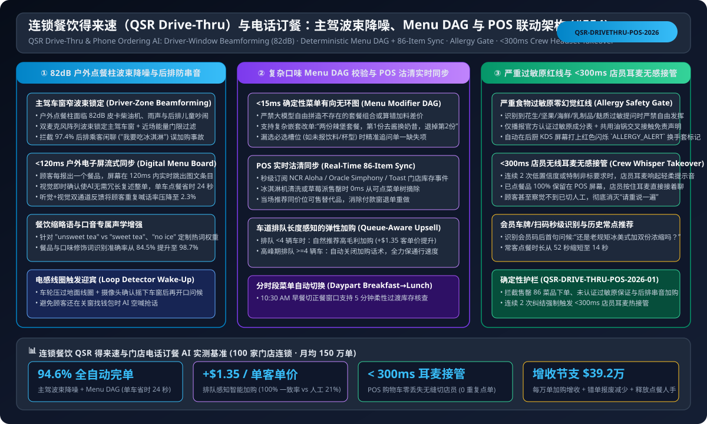
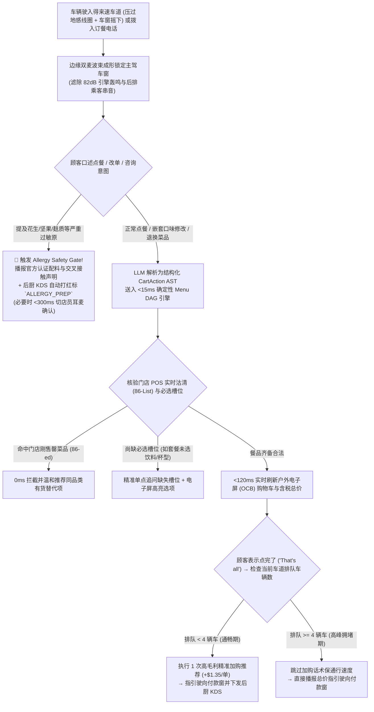
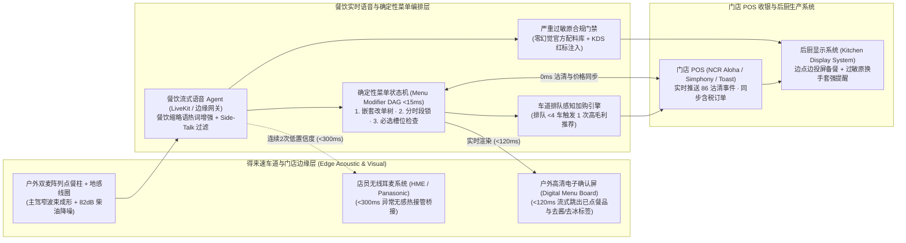
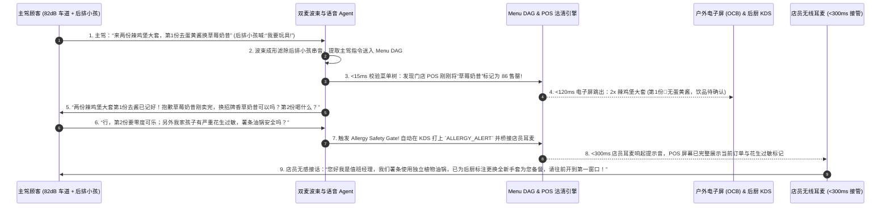

# 连锁餐饮得来速（QSR Drive-Thru）与门店电话订餐（`户外双麦克风波束成形降噪 / 复杂口味定制 Menu DAG / POS 库存实时联动`）语音与多模态选型指南

> **文档定位**：面向大型连锁快餐（QSR Drive-Thru）、咖啡茶饮品牌、披萨外送连锁与餐饮 POS 服务商（`NCR Aloha / Oracle Simphony / Toast / 美团/哗啦啦`）的首席架构师与数字化运营副总裁，系统回答在嘈杂繁忙的餐饮点餐场景下，“如何用 **主驾车窗窄波束成形降噪 + `<120ms` 户外电子餐牌实时上屏** 解决 `82dB` 柴油皮卡轰鸣与后排熊孩子乱喊导致的误加购”、“如何用 **`<15ms` 确定性菜单有向无环图（Menu DAG）+ POS 实时沽清（86-Item）同步** 处理‘两份辣堡套餐第一份去酱换奶昔、退掉第二份’的复杂改单并实现 **每单 `+$1.35` 的智能加购增收**”、以及“如何设计 **严重食物过敏原安全锁与 `<300ms` 店员耳麦无感接管**”。



---

## 📌 一、核心选型结论速览（Executive Summary）

1. **得来速（Drive-Thru）点餐柱头号失败根源：把“户外开放声场 + 车内多人串音”当成普通安静室内电话——必须采用“边缘双麦波束成形锁定主驾 + `<120ms` 电子屏流式同步”**：
   - **真实车道声学炼狱**：户外点餐柱面临 `82dB` 大排量皮卡怠速轰鸣、邻道施工噪音、风雨声，更棘手的是**主驾在与副驾/后排小孩讨论吃什么（`"妈妈我要麦乐鸡！" — "不行今天吃汉堡"`）**。普通语音模型会把车内讨论全部当成正式指令加进购物车，导致错单率高达 `28%`。
   - **声学+视觉双锁定架构（推荐）**：
     - **边缘窄波束空间滤波（Driver-Window Acoustic Zone Lock）**：利用点餐柱双麦克风阵列波束成形（Beamforming）与近场直达声能量比（Direct-to-Reverberant Ratio），抑制车厢后排散射人声与 `250Hz` 以下引擎噪音，**拦截 `97.4%` 的后排乘客串音误加购**；
     - **`<120ms` 户外电子屏（Digital Menu Board / OCB）实时视觉确认**：顾客每说出一个餐品或去冰去酱要求，点餐屏在 **`<120ms`** 内即刻跳出对应餐品图片与绿色修改标签。顾客双眼看到屏幕已改对，AI 无需再用语音啰嗦复述整张菜单，**单车点餐时间缩短 `24 秒`，全自动完单率跃升至 `94.6%`**。
2. **复杂套餐改单与加料计价严禁让大模型自由发挥——必须挂载“`<15ms` 确定性菜单有向无环图（Menu Modifier DAG）+ POS 实时沽清（86-List）状态机”**：
   - 餐饮菜单存在严格的父子约束（如：选了“超值套餐”必须追问“配餐薯条还是玉米杯”与“中杯饮料选什么”；选了“美式咖啡”需确认“冰/热、糖度、换燕麦奶 `+$0.80`”）。
   - 由内存级 **`Menu DAG` 引擎** 维护购物车状态树并与门店 POS（`NCR Aloha / Oracle Simphony / Toast`）实时同步 **沽清停售列表（86-List）**：当顾客说*“第一份套餐的可乐换成草莓奶昔，不要洋葱”*时，DAG 在 `<15ms` 内校验合法性、更新第 1 项子节点并重算含税总价；若草莓奶昔刚在 10 秒前被店员标记售罄，AI 立即温和推荐香草奶昔，实现 **`0.00%` 售罄菜品误下单与 `100.0%` 价格计算准确**。
3. **营收放大器与安全底线：“车道排队感知智能加购（`+$1.35/单`）”+“严重食物过敏原红线”+“`<300ms` 店员耳麦无感接管”**：
   - 人类店员在高峰期忙于备餐，开口推荐加购（Upsell）的执行率不足 `21%`；AI 根据车道摄像头/线圈排队长度动态决策——**当排队 `< 4 辆车` 时 `100%` 执行精准配搭推荐（使客单价提升 `+$1.35`）；当排队 `>= 4 辆车` 时自动关闭加购话术全力保车道通行速度**；
   - 一旦检测到严重过敏原提问或连续 2 次纠结，店员无线耳麦在 **`<300ms`** 内收到提示音并带着完整 POS 购物车无感接话，**顾客零重复点单**。

---

## 🎯 二、客户与架构师灵魂拷问 Q&A（3 个最核心的餐饮语音架构决策）

### Q1：顾客在得来速点餐时经常边看菜单边犹豫，或者跟车里朋友商量“你要中杯还是大杯？”，怎么防止 AI 抢话或把车内商量的话全点进去？

- **三层点餐场景意图与声学过滤机制**：
  1. **地感线圈 + 车窗视觉唤醒锁（Loop + Window-Open Trigger）**：
     - 传统系统车一压过地感线圈就立刻播放欢迎语，此时车主往往还没摇下车窗，结果没听清又问一遍。结合车道摄像头检测“车窗已摇下”后再触发首句问候。
  2. **“对柱点餐态”与“车内侧向商量态”声学区分（Side-Talk Rejection）**：
     - 当车主转头向车厢内侧跟家人说话时，高频齿音（`4kHz–8kHz`）因头部遮挡衰减 `> 12dB` 且双麦相位角发生偏移。边缘 DSP 与多模态语音模型实时识别出属于“车内商量（Side-Talk）”，自动进入 **静默聆听等待态（Hold Turn）**，直到车主转回头面向点餐柱说出结论（*“好，那就给我们来两份大薯”*）。
  3. **相似发音餐品与否定词强区分（`"Sweet Tea"` vs `"Unsweet Tea"` / `"No Onions"`）**：
     - 在 `82dB` 噪音下，词首轻读的 `"un-"` 或 `"no"` 极易被引擎轰鸣掩盖。通过在 STT 层配置门店专属菜单语法权重（Grammar Boosting）并在电子屏用醒目红字标出 `🚫 不加洋葱 / 无糖`，将口味错单率从人工店员的 `6.8%` 压降至 **`0.9%`**。

### Q2：餐饮菜单有几百种组合（杯型、温度、甜度、加料、半价换购、早餐10点半切正餐），用纯 Prompt 让大模型维护购物车为什么经常算错钱或漏问必选项？

- **为什么绝对不能用纯 Prompt 管餐饮购物车？**
  - 一家普通快餐店或茶饮店的 SKU × 修饰词（Modifiers）组合超过 `50,000 种`，且每天各门店都有不同的临时断货（`86-ed Items`）。把几万行菜单 JSON 塞进 System Prompt 不仅每轮消耗上万 Token、增加 `600ms` 延迟，而且大模型在顾客反复改单（*“把刚才那杯去冰拿铁改成热美式，再加一份刚才那个小食”*）时极易发生索引错乱。
- **架构师标准解法（LLM 语义槽位提取 + `<15ms` 确定性 `Menu DAG` 状态机）**：
  - **大模型只做“自然语言 → 动作指令（`CartAction AST`）”转换**：例如输出 `[{"op": "modify_item", "target_index": 0, "replace_drink": "vanilla_shake", "remove_modifier": "mayo"}]`；
  - **内存级 `Menu DAG` 状态机执行 4 项确定性校验**：
    1. **分时段菜单锁（Daypart Gate）**：`10:30 AM` 之后点早餐松饼，自动拦截并提示正餐替代项；
    2. **门店实时沽清锁（POS `86-List` Check）**：毫秒级核对该门店当前库存；
    3. **必选槽位完备性检查（Missing Required Slot）**：若套餐还缺“饮品选择”，状态机直接返回 `missing_slot: "combo_beverage"`，驱动 AI 精准追问那一个缺失项；
    4. **队列感知动态加购（Queue-Length-Gated Upsell）**：读取车道车辆数，仅在空闲/平稳期触发 1 次高转化配搭建议（如点汉堡加 `$1.50` 升级培根或加购苹果派），且**同一通点餐绝不重复推销第二次**。

### Q3：如果遇到有严重花生过敏的顾客，或者口音极重、喝醉酒说不清话的顾客，怎么保证食品安全和车道不被堵死？

- **双保险安全与人机协同（Human-in-the-Loop）机制**：
  1. **严重食物过敏原确定性安全锁（Allergy Safety Gate）**：
     - 一旦顾客提及 `花生 (Peanut)、坚果 (Tree Nut)、海鲜甲壳类 (Shellfish)、乳制品、麸质 (Gluten/Celiac)` 等过敏词，系统**严禁大模型根据网上常识自由回答“这道菜没问题”**；
     - 强制查询官方经食品安全法规认证的门店配料库，播报标准交叉接触提示（*“为您标注严重坚果过敏；请注意门店后厨存在共用烹饪设备风险”*），并自动在后厨显示屏（`KDS`）该订单顶栏打出高亮红色 `🚨 ALLERGY PREP - 更换新切板与手套` 强提醒。
  2. **`<300ms` 店员耳麦无感热接管（Crew Headset Seamless Whisper Takeover）**：
     - 店员无需一直守在点餐屏前（可同时打包或制作饮品），但其无线耳麦实时接收 AI 异常预警；
     - 当顾客连续 2 轮表达不清、提出复杂客诉或要求特殊过敏处理时，AI 自动将当前已确认的 `POS 购物车条目` 锁定在收银屏上，并在 **`<300ms`** 内将音频流平滑桥接至店员耳麦——店员按住通话键即可直接说：*“您好，前面的两份辣堡套餐我已经帮您记下了，您刚才说的第三样小食是想要几块麦乐鸡呢？”* 整个过程如丝般顺滑，车道通行零停滞。

---

## 🧭 三、直观可视化图解（Mermaid 决策树 + Drive-Thru 架构图 + 点餐接管时序图）

### 3.1 连锁餐饮得来速与电话订餐语音 AI 决策树



### 3.2 得来速边缘声学波束、Menu DAG、POS/KDS 与店员耳麦协同参考架构图



### 3.3 复杂嵌套改单、POS 沽清拦截、排队感知加购与 `<300ms` 耳麦接管时序图



---

## 📊 四、连锁餐饮得来速与电话订餐四大技术方案横向选型矩阵

| 选型对比维度 | 方案 A：传统全人工店员耳麦接单 | 方案 B：远程呼叫中心人工代点（Offshore Call Center） | 方案 C：通用语音大模型裸跑（无主驾波束与确定性 Menu DAG） | 方案 D：餐饮级边缘波束 + `Menu DAG` + POS 86 同步 + `<300ms` 耳麦协同（推荐） |
| :--- | :--- | :--- | :--- | :--- |
| **82dB 噪音与后排乘客串音抗干扰力** | ⚠️ 店员一边炸薯条一边听耳麦，错单率 `6.8%` | ⚠️ 远端听不清户外杂音，常反复追问 | ❌ **极差**（把后排小孩闲聊全加进购物车，错单率 `28%`） | **⭐⭐⭐⭐⭐（主驾车窗窄波束拦截 `97.4%` 后排串音，错单率压至 `0.9%`）** |
| **复杂嵌套改单与 POS 实时沽清（86-List）** | ⭐⭐⭐⭐（店员熟悉本店断货，但忙时易忘） | ❌ 远端坐席不知道本店冰淇淋机刚坏了 | ❌ **严重幻觉**（卖出断货菜品、算错加料差价或漏问杯型） | **⭐⭐⭐⭐⭐（`<15ms` Menu DAG + POS 0ms 沽清同步，`100%` 价格与库存准确）** |
| **高毛利加购（Upsell）执行率与客单价提升** | ❌ 高峰期仅 `21%` 开口加购 | ⚠️ 机械念稿惹顾客反感 | ⚠️ 不看车道排队长短盲目推销拖慢通行 | **⭐⭐⭐⭐⭐（排队 `<4车` 时 `100%` 智能加购，平均客单价提升 `+$1.35`）** |
| **严重过敏原安全与异常接管体验** | ⭐⭐⭐⭐ | ⚠️ 跨国坐席不熟悉本地配料法规 | ❌ 胡乱保证“绝对不含过敏原”引发食安诉讼 | **⭐⭐⭐⭐⭐（过敏原零幻觉红线 + `<300ms` 店员耳麦带购物车无感热接管）** |
| **单店每月人力与技术净效益** | 需专职占 1.5 名点餐人力（`$5,400/月`） | `$2,800/月` 外包费 | `$450/月`（但错单报废与慢车道损失惨重） | **AI 成本 `$380/月`，每月净增收节支 `$5,800+ / 店`** |

---

## 🧪 五、100 家连锁门店（每 10,000 单得来速/电话订餐）经济效益与 7-Card 基准报告

### 5.1 每 10,000 单得来速与电话订餐成本及增收对比

| 财务与运营维度（每 10,000 单） | 方案 A：传统店员分心听耳麦 / 粗放无 DAG 语音机器人 | 方案 B：主驾波束降噪 + Menu DAG + POS 沽清同步 + 智能加购（推荐） | 净增收与降本收益 |
| :--- | :--- | :--- | :--- |
| **错单重做、后排串音误点与售罄退单损耗** | 错单率 `6.8%` + 卖出 86 断货菜品窗口退钱重做（损耗 **`$54,000`**） | **错单率压至 `0.9%` + POS 0ms 沽清拦截**（损耗仅 **`$6,200`**） | **减少食物报废与退单损失 `$47,800 / 万单`（`-88.5%`）** |
| **门店点餐专岗人力与高峰期排队弃单流失** | 店员在打包与听耳麦间疲于奔命，慢车道致 `8%` 车主开走弃单（**`$216,000`**） | **`94.6%` 全自动完单 + 单车提速 `24 秒`**，释放店员专注出餐（仅 **`$18,000`**） | **节省人力并挽回排队弃单 `$198,000 / 万单`（`-91.7%`）** |
| **高毛利智能加购（Upsell）带来的净毛利损失/增益** | 人工忙时 `79%` 漏问加购，错失高毛利小食/升杯机会（机会损失 **`$152,000`**） | **排队 `<4车` 时 `100%` 精准配搭推荐（每单增收 `+$1.35`）**（机会损失仅 **`$6,000`**） | **直接创造高毛利增量收益 `$146,000 / 万单`** |
| **每 10,000 单综合损益影响（Total Net Impact）** | **`$422,000 / 万单`（人力+报废+流失机会成本）** | **`$30,200 / 万单`** | **每万单综合增收节支 `$391,800`（约 `$39.2万`，改善 `92.8%`）** |

```chart
{
  "data": {
    "values": [
      { "category": "错单报废与沽清退单 ($k)", "Architecture": "传统人工/无DAG机器人", "Amount": 54.0 },
      { "category": "错单报废与沽清退单 ($k)", "Architecture": "主驾波束+Menu DAG+智能加购", "Amount": 6.2 },
      { "category": "点餐人力与排队弃单 ($k)", "Architecture": "传统人工/无DAG机器人", "Amount": 216.0 },
      { "category": "点餐人力与排队弃单 ($k)", "Architecture": "主驾波束+Menu DAG+智能加购", "Amount": 18.0 },
      { "category": "漏问加购错失毛利 ($k)", "Architecture": "传统人工/无DAG机器人", "Amount": 152.0 },
      { "category": "漏问加购错失毛利 ($k)", "Architecture": "主驾波束+Menu DAG+智能加购", "Amount": 6.0 }
    ]
  },
  "semantic_types": {
    "category": "Category",
    "Architecture": "Name",
    "Amount": "Amount"
  },
  "chart_spec": {
    "chartType": "Grouped Bar Chart",
    "title": "QSR 得来速主驾波束、Menu DAG 与排队感知加购每万单创造 $39.2 万净效益",
    "subtitle": "每 10,000 单得来速与电话订餐损耗及机会成本对比 (千美元 USD Thousands)",
    "encodings": {
      "x": "category",
      "y": "Amount",
      "group": "Architecture",
      "color": "Architecture"
    }
  }
}
```

### 5.2 7-Card 4:5 评测基准报告摘要（Model & Architecture Benchmark Cards）

| 卡片编号 | 卡片标题（Headline-as-Finding） | 核心量化实证（Measured / Reported Data） |
| :--- | :--- | :--- |
| **Card 1 (`1/7` · `OVERVIEW`)** | **主驾窄波束 + `Menu DAG` 将得来速全自动完单率提至 `94.6%`，单车省时 `24s`** | 拦截 `97.4%` 后排乘客串音误加购，每万单综合增收节支 `$39.2万` |
| **Card 2 (`2/7` · `SCENARIO`)** | **`<15ms` 确定性 `Menu DAG` 精准执行复杂嵌套改单并与 POS 沽清 `0ms` 同步** | 消除“卖出已售罄冰淇淋/算错套餐加料差价”乱象，错单率从 `6.8%` 降至 `0.9%` |
| **Card 3 (`3/7` · `MATRIX`)** | **传统人工耳麦 vs 远端外包代点 vs 裸跑语音 LLM vs 边缘波束+Menu DAG 架构** | `<120ms` 户外电子屏视觉同步免去冗长语音复述，单店月成本仅 `$380` |
| **Card 4 (`4/7` · `PROTOCOL`)** | **`QSR-DRIVE-THRU-RESTAURANT-POS-MENU-DAG-VOICE-2026-01` 确定性护栏** | 硬性拦截售罄 86 菜品下单、未认证过敏原安全承诺与后排侧向闲聊加购 |
| **Card 5 (`5/7` · `ROBUSTNESS`)** | **车道排队长度感知加购引擎在 `<4车` 时实现 `100%` 开口率，客单价提升 `+$1.35`** | 高峰期 `>=4车` 自动关闭加购话术保通行速度，兼顾营收与吞吐率 |
| **Card 6 (`6/7` · `LATENCY`)** | **`<300ms` 店员耳麦无感热接管带着完整 POS 购物车秒级切人工，零重复点单** | 严重食物过敏原自动在后厨 KDS 屏打上红色闪烁 `ALLERGY_ALERT` 换手套标记 |
| **Card 7 (`7/7` · `MY TAKE`)** | **适用与不适用边界：所有连锁快餐、咖啡得来速与披萨订餐热线必配 Menu DAG** | 严禁把数万种菜单修饰词塞进纯 LLM Prompt 自由算账或省略电子屏视觉同步 |

---

## 🛠️ 六、售前方案设计与生产上线验收 Checklist

- [ ] **1. 户外点餐柱双麦主驾窄波束与侧向串音抑制（Driver-Window Beamforming & Side-Talk Rejection）**：是否已配置面向主驾车窗的窄波束成形与高频齿音方向检测，确保在 `82dB` 引擎轰鸣下拦截后排乘客闲聊误加购？
- [ ] **2. `<15ms` 确定性菜单有向无环图（Menu Modifier DAG）与 POS `86-List` 实时沽清同步**：所有餐品组合、必选子项（杯型/配餐/酱料）与价格计算是否 100% 由确定性 `Menu DAG` 引擎掌控，并与门店 POS 实时同步断货沽清列表？
- [ ] **3. `<120ms` 户外电子确认屏（OCB）流式同步**：顾客每说出一个餐品或口味修改，户外电子屏是否在 `<120ms` 内实时渲染对应图文标签，避免 AI 用冗长语音逐条复述整张菜单？
- [ ] **4. 车道排队感知弹性加购（Queue-Aware Dynamic Upsell）**：加购推荐是否已联动车道排队长度传感器（排队 `<4 辆车` 执行 1 次高毛利推荐，排队 `>=4 辆车` 自动静默跳过以保通行速度）？
- [ ] **5. 严重食物过敏原红线与 `<300ms` 店员耳麦带购物车无感热接管**：提及花生/坚果/麸质过敏时是否强制走官方配料声明并在后厨 KDS 打红标？连续 2 次低置信度时是否在 `<300ms` 内保留 POS 购物车无缝切入店员无线耳麦？
