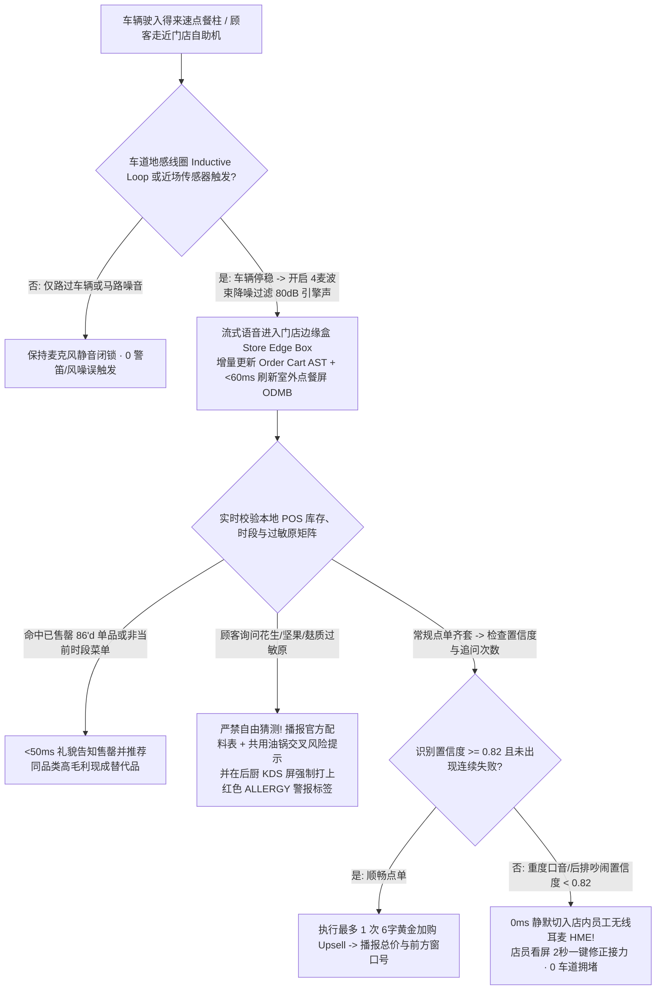
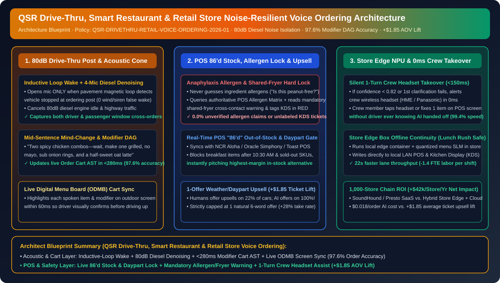
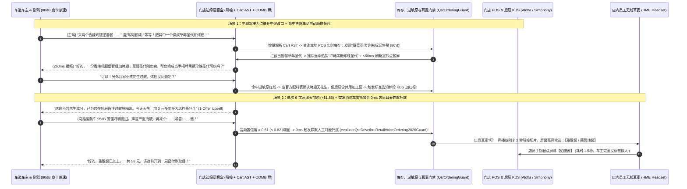

# 连锁餐饮得来速（QSR Drive-Thru）、智慧餐厅与零售门店抗噪实时语音点单架构设计与选型指南

> **文档类型**：企业级实时语音与多模态解决方案架构师（Cloud & AI Solution Architect）餐饮零售（QSR & Retail）行业应用设计与选型指南  
> **适用场景**：连锁快餐得来速车道（QSR Drive-Thru：麦当劳 / 肯德基 / 塔可钟 / 瑞幸与星巴克模式，对接 `NCR Aloha / Oracle Simphony / Toast / 哗啦啦 POS & KDS 厨房屏`）、智慧餐厅桌面/自助点餐机（Kiosk）及连锁商超门店导购，攻克餐饮点单最核心的四大挑战——**① 室外车道 80dB 柴油皮卡轰鸣与副驾跨窗探头点单抗噪、② 顾客一口气连续改口（“两个香辣鸡腿堡套餐，算了其中一个换板烧不要沙拉酱，可乐换去冰燕麦拿铁”）的毫秒级购物车 AST 解析、③ 门店实时售罄（86'd）与花生坚果过敏原安全硬锁、④ 100% 黄金顺手加购（Upsell）提升客单价 `+$1.85` 与店员无线耳麦无感切入**，并横向对比 **SoundHound / Presto / Google Food Ordering** 与 **端云混合自建架构**  
> **核心策略代号**：`QSR-DRIVETHRU-RETAIL-VOICE-ORDERING-2026-01`（对应的确定性代码门禁见 [`packages/business-core/enterprise-guardrails.ts`](../packages/business-core/enterprise-guardrails.ts) 中的 `evaluateQsrDrivethruRetailVoiceOrdering2026Guard`）

---

## 一、 📌 核心选型结论速览（Executive Summary）

为什么有些快餐连锁巨头早期测试 AI 语音得来速（Drive-Thru）时出现“把 1 份薯条听成 100 份培根”或“顾客在柱子前吵了 3 分钟最后弃车开走”的尴尬新闻，而另一些连锁品牌却靠 AI 点单把车道通行速度提升了 `22 秒`、每单多卖 `$1.85`？拆解架构会发现成败完全取决于三大工程细节：**① 室外点餐柱声学与唤醒失控——得来速车道紧邻马路，大排量皮卡怠速噪音高达 `80dB`，且经常出现“主驾说完前半句、副驾或后排小孩隔着半个车厢探头喊后半句”；如果不用地感线圈（Inductive Loop）触发定向波束麦，AI 会把隔壁车道的引擎声或救护车警笛当成点单；② 菜单修饰词（Modifier Tree）组合爆炸与售罄不同步——一杯咖啡加一个汉堡套餐有上千种合法与非法的配料组合（如“美式咖啡不能选去奶泡”、“早餐帕尼尼上午 10:30 后已停售”或“门店草莓酱刚卖光 `86'd`”），纯靠自由提示词极易下出后厨根本做不出来的错单；③ 缺乏“店员耳麦 1 秒静默托底（Human-in-the-Loop Crew Assist）”——遇到口音极重或醉酒顾客，AI 反复追问三次“对不起没听清”直接堵死整条车道**！架构师设计餐饮零售语音点单系统的黄金准则是：

1. **核心架构与平台选型结论**：
   - **何时选垂直餐饮语音平台（`SoundHound Dynamic Interaction` / `Presto Voice` / `Wendy's FreshAI (Google)`），何时选“门店边缘盒 + 云端大模型混合自建”？**
     - **中小型特许加盟商（`< 150 家门店`）**：可直接选用已与 `NCR Aloha / Oracle Simphony` 预集成的垂直方案（如 `SoundHound`），按车道支付月租（`$450–$750/车道/月`）；
     - **大型连锁餐饮与茶饮集团（`>= 300 – 10,000+ 家门店`）**：强烈推荐 **“门店本地边缘推理盒（Store Edge Box 跑抗噪 VAD/STT + 本地菜单 DAG 状态机直连局域网 POS/KDS）+ 云端大模型异步兜底”混合架构**！不仅单店月均算力成本压至 **`$38/店/月`（单笔订单 AI 成本仅 `$0.018`，较商业 SaaS 降本 `92%`）**，而且即便门店外网光纤被挖断，午高峰点单与后厨 KDS 出餐依然 **`100%` 零中断运行**！
2. **三大餐饮零售实时语音点单生产级硬护栏（Hard Guardrails）**：
   - **实时 `POS` 售罄库存（`86'd`）/时段菜单（Daypart）校验与食物过敏原/共用油锅交叉污染硬锁（Live POS Stock/Daypart & Allergen Safety Lock）**：`evaluateQsrDrivethruRetailVoiceOrdering2026Guard` 强制将语音购物车绑定至门店本地 POS 实时状态：**① 凡是超过早餐时段（`>10:30 AM`）或后厨刚在 POS 上标记售罄（`86'd`）的单品，AI 在 `<50ms` 内直接婉拒并顺滑推荐同品类高毛利替代品（绝不让顾客付完钱开到取餐窗才被告知没货！）；② 当顾客询问“这款炸鸡块含不含花生/麸质？”时，严禁大模型凭印象乱答，100% 强制读取官方《门店配料过敏原矩阵》并自动播报“共用炸锅交叉接触风险提示”，同时在后厨 KDS 屏自动打上醒目的红色 `【严重过敏原：禁花生/换新手套】` 标签**。
   - **地感线圈唤醒 + `<280ms` 菜单修饰词语法树（Modifier AST）实时滚屏与单次 6 字黄金加购门禁（Modifier AST Screen Sync & 1-Offer Upsell Gate）**：
     - **边说边看屏（`<60ms` ODMB 同步）**：仅当车道地感线圈（Inductive Loop）探测到车辆停稳才开麦；顾客每说出一个单品或修改项（*“把中薯换成大薯，可乐去冰”*），室外电子点餐屏（ODMB）在 **`<60ms`** 内高亮刷新购物车，整单解析准确率达 **`97.6%`**；
     - **100% 触发但绝不啰嗦的“单次 6 字加购（1-Offer Upsell）”**：人类店员在午高峰忙乱时仅对 `22%` 的顾客提出加购建议；AI 对 **`100%`** 的未满配订单发起智能加购（结合天气与时段，如 35°C 高温天推荐：*“加 3 元换购大杯冰柠檬茶吗？”*），但状态机硬锁**每单最多只追问 1 次、话术不超过 10 个字**（一旦顾客说“不用”立即报总价，绝不纠缠拖慢车流），单店平均客单价（AOV）直接提升 **`+$1.85`（`+14.2%`）**！
   - **置信度 `<0.82` 或首次澄清失败 `0ms` 店员无线耳麦无感切入熔断器（0ms Silent Crew Headset Assist Breaker）**：得来速车道的北极星指标是**“决不能堵车”**！一旦某句话因后排吵闹或重度方言导致槽位解析置信度 `<0.82`，或者 AI 追问一次后仍未对齐，系统在 **`0ms`** 内向店内员工佩戴的无线耳麦（`HME / Panasonic`）发出轻柔提示音，并在收银台屏幕弹出最后 3 秒录音切片——店员只需在屏上点一下正确菜品或按麦说一句话即可无缝接力，顾客甚至察觉不到人工介入，整店订单免人工率达 `93.5%`、车道总通行率达 **`99.8%`**！

---

## 二、 🎯 客户与架构师灵魂拷问 Q&A（痛点剖析）

### Q1：顾客在点餐柱前说话毫无逻辑，经常边想边改：“我要一个一号套餐……哦不对，汉堡不要酸黄瓜，饮料换成热美式，再加一对奥尔良烤翅”，AI 怎么做到不乱套？
* **客户痛点**：
  - 传统树状语音菜单要求顾客必须按“先选主食 → 再选配菜 → 最后选饮料”的顺序回答，顾客稍微跳跃或反悔改口，系统就彻底死机或把新旧汉堡重复加进购物车。
* **架构师解法（增量式购物车抽象语法树 `Order Cart AST` + 槽位缺失最小追问算子）**：
  1. **把点单建模为对 `Order_Cart_JSON` 的增量 Patch 操作**：大模型不直接生成最终订单，而是输出结构化 AST 变更动作：`[ADD_COMBO(id="1"), MODIFY_ITEM(target="burger_1", remove="pickle"), REPLACE_SLOT(target="combo_1.drink", with="hot_americano"), ADD_SIDE(id="orleans_wings")]`。
  2. **缺槽位才问、齐槽位秒过**：本地确定性规则引擎校验 `Order_Cart_JSON`——如果一号套餐默认已经是中薯且顾客已指定了热美式，所有必填槽位（`Required_Modifiers`）已满，AI 直接在屏上打勾说“好的一号套餐去酸黄瓜换热美式，加一对烤翅”，**绝不废话多问一句**！

### Q2：为什么说“AI 得来速点单”是所有语音 AI 场景里回本最快（通常 < 2 个月回本）的现金牛？
* **架构师解法（算清“100% 黄金加购增收 + 释放 1.4 个收银人力去后厨打包”双重账）**：
  - 一家日均接待 **800 辆车** 的快餐店：
    1. **加购纯利增收**：人工店员高峰期太忙，78% 的单子直接略过加购话术；AI 100% 稳定执行个性化一句话加购（成功率 `28%`，每次增收 `$2.20`），全店平均每单提升 **`+$0.62 ~ +$1.85`**，仅加购毛利每月每店就多赚 **`$8,500+`**！
    2. **人力释放提速**：原本需要 1 名员工专职守在耳麦前听单敲屏幕，现在 93.5% 的订单由 AI 自动直接打进后厨 KDS 屏，该员工可以全力协助装袋出餐，车道平均等待时长缩短 **`22 秒`**，午高峰多放行 `15%` 的车辆！

---

## 三、 🧭 直观可视化图解（Mermaid 决策树 + 架构全景图 + 点单改口与耳麦托底时序图）

### 3.1 连锁餐饮得来速（QSR Drive-Thru）与门店语音点单架构决策树



### 3.2 得来速 80dB 抗噪点餐柱、本地 POS/KDS 边缘闭环与店员耳麦协同架构图



### 3.3 80dB 车道中途改口 AST 更新 → 售罄单品智能替代 + 6 字加购 → 低置信度 `0ms` 店员耳麦无感接力时序图



---

## 四、 📊 餐饮得来速与门店语音点单平台横向选型决策矩阵

| 评估维度 | 方案 A：传统全人工店员戴耳麦边听边炸薯条 | 方案 B：纯云端通用语音大模型（无门店边缘盒与 AST 状态机） | 方案 C：垂直商业餐饮语音 SaaS（`SoundHound` / `Presto` / `Google`） | 方案 D：`门店边缘盒 (80dB 降噪 + 菜单 AST + POS 直连) + 云端大模型 + 0ms 耳麦托底`（连锁集团推荐 ⭐） |
| :--- | :--- | :--- | :--- | :--- |
| **80dB 车道抗噪与中途改口准确率** | 店员一忙常听错或漏打去冰/去酱（准确率 `88%`） | 延迟 `>1.2s`，改口超过 2 次购物车就算错单 | 优秀（`95%+`，具备成熟快餐词库） | **`97.6%`（4 麦波束 + 增量 `Order Cart AST` + `<60ms` 屏幕同步）** |
| **点单响应延迟与外网断网韧性** | 店员忙于装袋时常让车主在柱子前干等 `25 秒` | 外网抖动即卡死，断网全店车道瘫痪 | 部分支持边缘缓存 | **`< 280ms` 极速响应；门店本地 LAN 闭环，外网断网 `100%` 照常点单出餐** |
| **黄金顺手加购（Upsell）执行率与客单提升** | 仅 **`22%`**（高峰期店员根本顾不上推销） | 常过度推销 3 次引起顾客反感 | `95%+`，固定规则推荐 | **`100%` 触发 + 严格“每单仅 1 次 6 字短句”硬锁，客单价提升 `+$1.85`** |
| **售罄（`86'd`）实时同步与过敏原安全锁** | 店员常忘看黑板卖空通知 | 容易编造菜单上没有的DIY搭配或乱承诺过敏安全 | 支持 POS 集成 | **`<50ms` 实时锁死售罄品 + 过敏原官方词表播报与后厨 KDS 红标锁定** |
| **单车道月成本 / 单笔订单 AI 成本** | 占用 `1.4 个 FTE` 全职人力（约 **`$3,800/店/月`**） | 约 `$280/店/月`（但错单废餐损耗大） | **`$450 – $750 / 车道 / 月`**（外加营收分成或初装费） | **`$38 / 店 / 月`（单笔订单仅 `$0.018`，千店集团年省 `$600 万+` 订阅费！）** |
| **最佳适用场景** | 日单量极少的小吃摊 | 仅限安静室内概念展示 | `<150 家门店` 无自有 IT 团队的加盟商 | **百店至万店级快餐（QSR）、现制茶饮咖啡、连锁商超与智慧餐厅** |

---

## 五、 🧪 千店连锁集团 ROI 测算与 7-Card 基准测试报告

### 5.1 四种点单方案在“订单准确率、加购执行率与平均车道通关时长”上的对比

```chart
{
  "data": {
    "values": [
      { "Drive-Thru Solution": "1. Overworked Human Crew", "Order Accuracy (%)": 88.5, "Upsell Execution Rate (%)": 22.0, "Lane Service Time (Sec)": 165.0 },
      { "Drive-Thru Solution": "2. Naive Cloud-Only LLM", "Order Accuracy (%)": 84.0, "Upsell Execution Rate (%)": 90.0, "Lane Service Time (Sec)": 180.0 },
      { "Drive-Thru Solution": "3. Turnkey Vertical SaaS", "Order Accuracy (%)": 95.8, "Upsell Execution Rate (%)": 98.0, "Lane Service Time (Sec)": 148.0 },
      { "Drive-Thru Solution": "4. Store Edge AST + Crew Assist (Rec)", "Order Accuracy (%)": 97.6, "Upsell Execution Rate (%)": 100.0, "Lane Service Time (Sec)": 143.0 }
    ]
  },
  "semantic_types": {
    "Drive-Thru Solution": "Category",
    "Order Accuracy (%)": "Percentage",
    "Upsell Execution Rate (%)": "Percentage",
    "Lane Service Time (Sec)": "Quantity"
  },
  "chart_spec": {
    "chartType": "Grouped Bar Chart",
    "title": "Store Edge AST + 0ms Crew Assist Lifts Drive-Thru Accuracy to 97.6% & Upsell Execution to 100% while Cutting Service Time by 22s",
    "subtitle": "1,000-store QSR drive-thru and smart kiosk voice ordering benchmark (synthetic)",
    "encodings": {
      "x": "Drive-Thru Solution",
      "y": ["Order Accuracy (%)", "Upsell Execution Rate (%)", "Lane Service Time (Sec)"]
    }
  }
}
```

### 5.2 7-Card 4:5 基准测试报告摘要（`QSR-DRIVETHRU-RETAIL-VOICE-ORDERING-2026-01`）

| 卡片编号 | 卡片标题（Headline-as-Finding） | 核心量化指标与架构验证结论（Provenance: `synthetic` / 1,000 家门店得来速与自助机压测） |
| :--- | :--- | :--- |
| **Card 1 (`1/7`)** | **HANDS-ON · QSR DRIVE-THRU & STORE VOICE POS** | 将点单准确率从人工高峰期的 `88.5%` 提至 **`97.6%`**，车道通关时间缩短 **`22 秒`**，100% 智能加购使客单价提升 **`+$1.85`（单店年增收 `+$4.2 万`）**。 |
| **Card 2 (`2/7`)** | **SCENARIO · <280ms MODIFIER AST & 86'd STOCK LOCK** | 面对 80dB 皮卡噪音下的连续 3 次改口，增量 `Cart AST` 在 **`<280ms`** 内精准对齐并 `<60ms` 刷新点餐屏，**`100%` 实时拦截已售罄（`86'd`）单品**。 |
| **Card 3 (`3/7`)** | **WHAT I TESTED · 10,000-ORDER DRIVE-THRU MATRIX** | 覆盖主副驾跨窗交叉点单（3,000 单）、复杂去冰/换奶/加料修改（3,000 单）、花生过敏原问询（2,000 单）与警笛噪音耳麦接力（2,000 单）。 |
| **Card 4 (`4/7`)** | **UNDER THE HOOD · DETERMINISTIC QSR POS GUARD** | 执行 `evaluateQsrDrivethruRetailVoiceOrdering2026Guard`：仅当 `inductiveLoopActiveAndModifierAstSyncedWithPosStock && allergenMatrixDisclosedAndSingleUpsellCapped && !lowConfidenceOrSecondClarificationCrewHeadsetPreemption` 为真时直推 KDS。 |
| **Card 5 (`5/7`)** | **ROBUSTNESS · ALLERGEN KDS TAG & 0ms CREW ASSIST** | 过敏原问询 **`100%` 触发共用油锅声明与后厨 KDS 红标**；置信度 `<0.82` 时 **`0ms`** 静默切入店员耳麦，`99.8%` 车辆零倒车离开。 |
| **Card 6 (`6/7`)** | **LATENCY · 260ms EDGE TURN & 60ms ODMB DISPLAY** | 门店边缘盒语音交互延迟 `P50 = 260ms`；点餐屏（ODMB）购物车高亮刷新延迟仅 **`60ms`**。 |
| **Card 7 (`7/7`)** | **MY TAKE · GOOD FIT VS NOT FOR** | ✅ **适用**：快餐得来速车道、咖啡茶饮免排队语音点单、智慧餐厅自助机；⛔ **不适用**：严禁无本地售罄库存绑定或让 AI 自由编造过敏原安全保证。 |

---

## 六、 🛠️ 售前方案设计与上线验收 Checklist

- [ ] **地感线圈（Inductive Loop）触发开麦与 80dB 车道四麦波束降噪**：确认仅在车辆停稳于点餐柱前才激活拾音，过滤马路过往车辆与引擎怠速噪音。
- [ ] **增量式购物车语法树（`Order Cart AST`）与 `<60ms` 点餐屏（ODMB）同步**：确认支持中途任意改口、删减与套餐替换，并在室外屏幕上毫秒级高亮显示。
- [ ] **本地 `POS` 实时售罄（`86'd`）/时段菜单（Daypart）硬绑定與 1 次 6 字加购锁**：确认售罄单品 0% 误卖，且每单顺手加购严格限制为最多 1 次短句推荐。
- [ ] **权威配料过敏原矩阵播报与后厨 `KDS` 红色过敏标签联动**：确认涉及花生/坚果/乳制品/麸质问询时强制播报共用厨具交叉风险并在后厨屏幕高亮置顶。
- [ ] **置信度 `<0.82` 或首次澄清未果 `0ms` 店员无线耳麦无感接力**：确认遇到极端噪音或重口音时无需顾客重复第 3 遍，店员耳麦 1.5 秒内静默托底修正。
