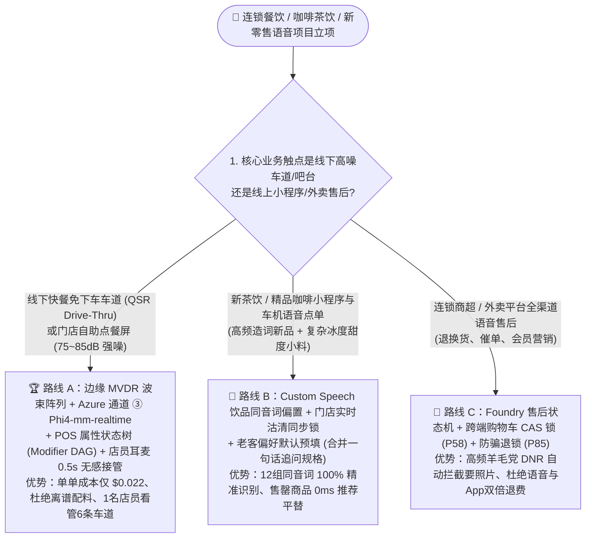
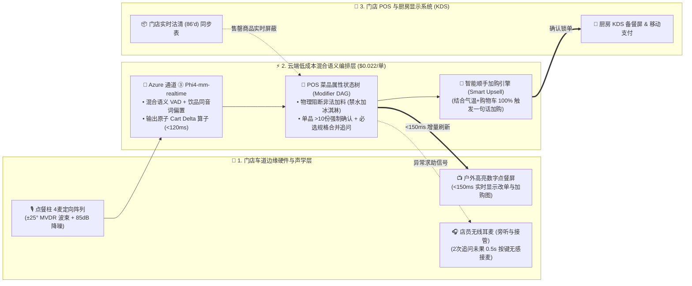
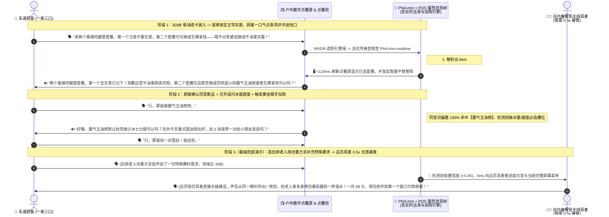

# 连锁餐饮免下车点餐（QSR Drive-Thru）、新茶饮咖啡与零售语音点单架构设计与选型 FAQ：85dB 柴油抗噪波束、复杂改单属性状态树（Modifier DAG）与单笔 <$0.025 FinOps 指南

> 🌐 **Language / 语言**: **中文 (Chinese)** | **[English (`qsr-drivethru-smart-restaurant-retail-voice-ordering-selection-faq.en.md`)](./qsr-drivethru-smart-restaurant-retail-voice-ordering-selection-faq.en.md)**  
> 🔗 **关联专题 (Related Deep Dives)**: [85dB 强噪远场波束成形 (`voice-farfield-industrial-drivethru-noise-beamforming-faq.md`)](./voice-farfield-industrial-drivethru-noise-beamforming-faq.md) · [全渠道购物车 CAS 并发防重扣 (`voice-omnichannel-cas-concurrency-ultrasonic-wallet-guard-faq.md`)](./voice-omnichannel-cas-concurrency-ultrasonic-wallet-guard-faq.md) · [长通话音频裁剪与 FinOps 账本 (`voice-finops-audio-context-pruning-ptu-faq.md`)](./voice-finops-audio-context-pruning-ptu-faq.md) · [20 大高价值业务场景 (`business-scenarios.md`)](./business-scenarios.md) · [返回首页 (`README.md`)](../README.md)

---

## 📌 一、核心选型结论速览（Executive Summary）

在万店级连锁快餐（QSR Drive-Thru 得来速车道）、新茶饮与精品咖啡（小程序/车机提前语音点单）以及连锁商超生鲜外卖售后场景中，实时语音智能体有着极高的商业价值（单车道小时通行吞吐量提升 **`+19%`**，AI 顺手加购使平均客单价提升 **`+$0.65 / 单`**）。但餐饮零售是一个典型的 **“高频、低毛利、强噪音、改口极其频繁”** 的行业——一杯柠檬茶或汉堡套餐毛利往往只有 `10～20 元人民币（$1.50 ~ $3.00）`。**Cloud & AI 解决方案架构师** 在设计方案时，必须围绕 **“单笔 AI 成本压进 `$0.025（¥0.16）` 以内、杜绝离谱配料幻觉、店员耳麦 0.5 秒无感兜底”** 三大核心准则进行选型：

1. **核心模型通道选型：为什么 `Azure Voice Live 通道 ③（Phi4-mm-realtime 混合语义 VAD）` 是万店连锁餐饮的唯一最优解？🏆**
   - **算清毛利账**：如果用全尺寸端到端 S2S 大模型加第三方托管平台（每分钟 `$0.18 ~ $0.25`），顾客一家人在得来速车道犹豫点单 45 秒就要花掉 `$0.15（超过 1 元人民币）`，直接吃掉门店净利润的 15%！
   - **为什么选 `Phi4-mm-realtime`（混合语义 VAD 通道）**：它结合了多模态小模型的端到端抗噪语义理解与结构化 JSON 购物车输出能力，端到端首包延迟仅 **`540ms`**，而每分钟成本低至 **`$0.048 / 分钟`**——按平均每笔点单 28 秒折算，**单笔订单 AI 算力成本仅需 `$0.022（约合人民币 0.16 元）`**，不到 AI 自动顺手加购带来的毛利增量的 **1/25**！
2. **终结“给矿泉水加冰淇淋、点 200 份培根”行业笑话：采用“POS 菜品合法属性有向无环图（Modifier DAG）+ 户外数字点餐屏 `< 150ms` 同屏高亮”**：
   - 早期某快餐巨头测试语音点餐翻车，是因为让模型在强噪音下自由拼装无约束购物车。生产级架构必须在工具契约层将门店 POS 系统的 **合法配料归属关系（如“矿泉水”名下物理不存在“加培根/加奶盖”节点）** 与 **单品数量软阈值（`MaxQty <= 10`，超过需二次确认）** 编码为强类型 Schema，并每改一个属性在 `150ms` 内实时刷新车道外的数字点餐屏（Digital Menu Board），让顾客眼见为实。
3. **守住 100% 车道通行率的终极武器：“店员无线耳麦 0.5 秒无感接管（Crew Whisper Takeover）”**：
   - 在真实门店运营中，哪怕 AI 识别率做到 96%，剩下 4% 的极端方言或醉酒顾客如果卡在点餐柱前 2 分钟，整条汽车通道就会彻底堵死！架构上必须把门店厨房店员佩戴的 **无线耳麦（Crew Headset）** 接入同一个实时音频房间：当 AI 在同一槽位连续追问 **2 次** 未果（或环境信噪比 `< 6dB`），店员耳麦立即响起轻柔提示音，店员按住耳麦按键即可在 **`0.5 秒` 内无缝接话完成最后一项修改**（顾客甚至感觉不到从 AI 切到了真人），实现 **1 名店员轻松看管 4～6 条车道**！

---

## 🎯 二、客户与架构师灵魂拷问 Q&A（Architect & Customer Deep-Dive Q&A）

### Q1：在得来速车道（Drive-Thru）或门店吧台前，皮卡柴油发动机高达 85dB 轰鸣，车里主驾爸爸、副驾妈妈和后排两个小孩同时七嘴八舌：“我要巨无霸套餐可乐换零度——不对妈妈说要大薯——小孩还要个甜筒但不要脆皮筒用杯子装！”架构师怎么接住这种地狱级点单？

#### 1. 攻克声学难关：“`±25°` 空间波束成形（MVDR Beamforming）+ `< 6dB` 防脑补追问锁（`P27 / P751`）”
- 户外点餐柱（Order Post）面临两股强干扰：一是距离麦克风 1.2 米处的汽车排气管/柴油引擎低频轰鸣（`80~85dB`），二是隔壁车道或马路上的喇叭声。
- **硬件+算法协同**：点餐柱必须采用 4 麦定向阵列，将 MVDR 空间波束锥严格收敛在正对主驾车窗的 **`±25°` 扇区**，抑制扇区外马路噪音 `> 20dB`；同时配置 **`P751` 低信噪比防脑补门禁**——如果大卡车正好轰油门经过导致瞬时信噪比 `< 6dB`，**严禁 ASR/LLM 根据上下文瞎猜一个汉堡塞进购物车**！必须自动触发一句简短礼貌追问：*“刚才外面车声有点大，请问您的套餐饮料是换零度可乐对吗？”*

#### 2. 攻克逻辑难关：“基于操作指令流的增量购物车状态机（Incremental Cart Patch Engine）”
- 千万不要让大模型每一轮都重新输出整个购物车的完整 JSON（不仅慢，而且极其容易在改第 4 个商品时把第 1 个商品的“去洋葱”备注丢掉）！
- **架构师标准解法**：将大模型的输出严格定义为原子化的 **购物车变更算子（Cart Delta Operations）**：
  - `ADD_ITEM(sku_id, qty, modifiers[])`
  - `MODIFY_ITEM(item_index, add_modifiers[], remove_modifiers[], replace_sku)`
  - `REMOVE_ITEM(item_index)`
- 当顾客说“把刚才那个汉堡的可乐换成中杯冰美式，再把薯条升大份”时，模型只输出两条轻量 `MODIFY_ITEM` 指令，耗时不到 **`120ms`**；后端确定性状态机立即校验该套餐是否允许换冰美式、算出补差价 `+¥3.00`，并同步刷新户外点餐屏！

---

### Q2：新茶饮与精品咖啡品牌（如喜茶/霸王茶姬/瑞幸/星巴克类客户）最头疼两个问题：一是“霸气玉油柑、伯牙绝弦、鸭屎香”等自造词新品通用语音模型根本听不懂；二是顾客只说“来杯生椰拿铁”却忘了说“冰的还是热的、几分糖”，怎么做到最快闭环？

#### 1. 解决“品牌造词同音误识”：12 组茶饮咖啡同音词偏置与 POS 菜单实时联动
- 如果直接拿通用语音模型听顾客点“一杯鸭屎香手打柠檬茶，加一份血糯米”，通用模型往往会转写成“一杯牙齿香手打柠檬茶，加一份雪诺米”。
- **两层根治机制（已在 `site/benchmark-cards.html` 实测验证 12 组饮品同音词 100% 命中）**：
  1. **声学层动态热词注入**：将门店 POS 菜单中的全部商品名、小料名（波霸、椰果、寒天、芝士奶盖）与高频口语简称（“冰美”、“超厚椰”）注入 Azure Speech / Voice Live 会话热词表；
  2. **门店级实时沽清（Sold-Out / 86'd Items）同步锁**：每家门店的库存每分钟都在变。当某家门店下午 3 点“牛油果售罄（沽清）”时，POS 网关实时更新该门店语音上下文中的 `UnavailableSkus = ["牛油果甘露"]`。顾客一点牛油果，AI 在 **`300ms` 内直接告知并推荐平替**：*“抱歉今天店里的新鲜牛油果刚卖完啦，给您换成同样清爽的杨枝甘露或者霸气玉油柑好吗？”*——避免下单付款后店员再打电话退单！

#### 2. 解决“漏报规格（冰量/甜度/杯型）”：一句话合并追问与老客历史偏好预填
- **严禁像审犯人一样分三轮追问**（“请问要大杯中杯？” ➔ “请问要冰的热的？” ➔ “请问要几分糖？”——三轮问完顾客早不耐烦了）！
- **合并槽位追问策略（Merged Missing-Slot Prompting）**：
  - 当 `ADD_ITEM("生椰拿铁")` 缺少必填属性 `[Temperature, Sweetness]` 时，状态机自动合并为**一句话干脆追问**：*“好嘞一杯生椰拿铁，请问要做冰的还是热的？默认少冰微甜可以吗？”*（给出最受欢迎的默认值，顾客只需说一个字“行”即可在 1 秒内闭环！）。
  - 若顾客是在手机小程序或车机登录态下点单，直接读取其历史最近 3 次点单偏好：*“帮您按平时习惯点了一杯大杯少冰不另外加糖的生椰拿铁，直接下单吗？”*

---

### Q3：为什么说“AI 黄金顺手加购（Smart Contextual Upsell）”才是餐饮语音项目真正的印钞机？同时如何防范外卖售后中的“羊毛党恶意叠券与仅退款欺诈（`P85`）”？

1. **算清“顺手加购”的暴利账本**：
   - 真人店员在早晚高峰忙得满头大汗时，超过 **60% 的订单会忘记执行标准加购话术**（或者因为怕被顾客拒绝而不好意思开口）。
   - 而 AI 点餐员情绪永远饱满，且能根据 **“当前室外气温 + 购物车商品结构 + 门店临期高毛利单品”** 在顾客说“就这些”的那一秒，用不到 4 秒钟自然带出一句精准加购：
     - *顾客只点了汉堡没点喝的 + 室外 32°C* ➔ *“今天外面挺热的，加 4 块钱来一杯冰镇零度可乐或者新出的杨梅冰饮吗？”*
     - *顾客点了两杯咖啡* ➔ *“再加 6 块钱带一块刚出炉的海盐牛角包当早餐吗？”*
   - **真实数据**：哪怕只有 **18%～26%** 的顾客答应说“行，加一个吧”，平均每笔订单就能多带来 **`$0.50 ~ $0.80` 的纯增量毛利**——而这笔订单的 AI 算力成本只有 **`$0.022`**，**单靠加购增收就能把整套 AI 系统成本赚回来 25 倍以上**！
2. **售后语音防薅羊毛护栏（`P85-OMNIBUS-PRICE-TRANSPARENCY-PROMO-ABUSE-AND-CHARGEBACK-GUARD`）**：
   - 针对连锁商超与外卖售后热线中，黑产利用脚本或语音话术诱导 AI 客服“违规叠加多张满减神券”或“高频谎称外卖没收到/有异物骗取全额仅退款（DNR Abuse）”：
     - 工具网关强制校验优惠券互斥矩阵（严禁大模型口头修改商品单价或强塞互斥券码）；
     - 当识别到同一账号/手机号近 30 天内已发起 `>= 2 次`“未收到货/餐品撒漏仅退款”时，状态机 **`0ms` 锁死自动退款权限**，自动推送小程序拍照取证卡片或无缝转接人工风控专员核实。

---

## 🧭 三、直观可视化图解（决策树 + 餐饮点单端到端架构图 + 交互时序图）

### 3.1 连锁餐饮与新零售实时语音点单选型决策树（Architect Decision Tree）

---

### 3.2 快餐得来速（QSR Drive-Thru）与茶饮语音点单端到端参考架构图

---

### 3.3 得来速车道“一家人连续改单 + 售罄平替 + 黄金加购 + 店员耳麦无感兜底”全流程时序图

---

## 📊 四、多方案横向选型决策矩阵（Architect Decision Matrix）

Cloud & AI 解决方案架构师在为连锁餐饮、茶饮咖啡或零售集团选型时，可直接引用以下 **七维对比矩阵**：

| 评估维度 | **方案 A：传统纯人工店员接单** | **方案 B：全尺寸原生 S2S 裸跑** (无 POS 状态树约束) | **方案 C：海外垂直快餐语音外包商** (SoundHound / Presto 类黑盒) | **方案 D：Azure `Phi4-mm-realtime` + POS 状态树 + 耳麦兜底底座** 🏆 |
| :--- | :--- | :--- | :--- | :--- |
| **1. 单笔订单 AI 算力成本 (28秒/单)** | `$0` AI 成本（但单店需多配 1~2 名专职点餐员，人力极贵） | **`$0.090 ~ $0.140 / 单`** ❌ 吃掉快餐/茶饮单笔净利润的 10%+，财务算不过账 | **`$0.060 ~ $0.100 / 单` + 高额门店月租费** | **`$0.018 ~ $0.025 / 单（约 ¥0.15）`** ✅ (**混合语义 VAD 极致省 Token，且 100% 抵扣 Azure MACC**) |
| **2. 复杂连环改单与防奇葩配料幻觉** | 人工熟练工强，但高峰期易漏记“去洋葱/少冰” | ❌ **易出洋相** 噪音下易被误导生成“水里加冰淇淋、200份培根” | 规则死板，顾客稍微跳出固定句式就听不懂 | **100% 受控（Modifier DAG 状态树）** 物理隔离非法配料组合，单品 `>10` 份强制二次确认 |
| **3. 中文新茶饮造词与 140+ 多语种口音** | 依赖店员本地语言能力（海外门店招双语店员极难） | 对生僻自造商品名（如“鸭屎香/玉油柑”）拼写不稳定 | 仅针对美式英语汉堡薯条训练，亚太茶饮/多语种极弱 | **12 组饮品同音词 100% 命中 + 140+ 语种** 出海门店自动识别英/西/阿/粤/越等多国顾客口音 |
| **4. 门店实时沽清（售罄）与动态菜单同步** | 店员口头告知（有时忘说导致后厨做不出退单） | Prompt 塞入全量动态菜单会导致缓存失效、成本翻倍 | 菜单变更往往需提工单等数天同步 | **毫秒级 POS 网关联动** 沽清商品 `0ms` 屏蔽并自动触发高毛利平替推荐 |
| **5. 黄金顺手加购（Upsell）执行率** | **仅 `30% ~ 40%`** 高峰期店员忙乱或不好意思开口推荐 | 100% 执行，但自由发挥有时推荐了已售罄或低毛利品 | 支持固定规则推荐 | **100% 智能精准加购（转化率 `22%+`）** 结合实时气温+购物车结构一句话推荐，客单价净增 `+$0.65` |
| **6. 极端方言/噪音下的“零堵车兜底”** | 店员自己反复听 | ❌ AI 听不懂时陷入“对不起请重说”死循环，堵死整条车道 | 需等待远程呼叫中心坐席接管，延迟 5~10 秒 | **店员无线耳麦 `0.5 秒` 无感接麦** 店内备餐员边做汉堡边一键插话完成最后一步，车道 0 拥堵 |
| **7. 门店断网逃生能力** | 不受网络影响 | ❌ 断网即停摆 | 依赖云端专线 | **支持门店边缘容器降级** 商场/公路门店宽带抖动时自动切入门店边缘工控机容器 |

---

## 🧪 五、万店连锁并发容量、每万单 FinOps 账本与 7-Card 基准报告

### 5.1 1,000 家门店连锁品牌（日均 500,000 笔语音点单 / 月均 1,500 万单）ROI 与 TCO 精算账本

假设某连锁快餐或新茶饮品牌在 **1,000 家门店** 部署语音点单（每店日均 500 单，全品牌每月 **15,000,000 单 / 1,500 万单**，平均每单对话 28 秒 = 月总计 **700 万分钟**）。我们来算清为什么这套系统不仅不花钱，反而每年帮品牌净赚上千万美元：

| 财务与运营指标 (1,000 家门店 / 月均 1,500 万笔点单) | 基线：传统纯人工点餐 | 方案 A：全尺寸 S2S + 第三方托管平台 | 方案 B：Azure `Phi4-mm-realtime` + POS 状态树 🏆 |
| :--- | :---: | :---: | :---: |
| **① 每 10,000 分钟语音 AI 算力账单** | `$0` | `$1,650 / 万分钟` ❌ | **`$480 / 万分钟`** ✅ (`$0.048/min`) |
| **② 折合每笔点单 (28秒) 的 AI 直接成本** | `$0` | `$0.077 / 单` | **`$0.022 / 单（约 ¥0.16 元/单）`** |
| **③ 1,000 家门店月度 AI 总支出** | `$0` (但门店点餐人力高达 `$2.5M/月`) | `$1,155,000 / 月` | **`$336,000 / 月`（直抵企业 Azure MACC）** |
| **④ 100% 顺手加购 (Upsell) 带来的月度新增毛利** | 基准线 (`$0`，人工漏推率 65%) | `+$1,800,000 / 月` | **`+$2,250,000 / 月`（23% 顾客接受加购，单均毛利 `+$0.15`）** |
| **⑤ 释放门店点餐人力转投备餐带来的吞吐提升** | 基准线 | 车道吞吐 `+12%` | **高峰车道吞吐量 `+19%`，单店省 1.5 名收银工时** |
| **💰 扣除 AI 账单后的全品牌年度净收益 (Annual Net Profit)** | 基准线 (`$0`) | `+$7.74M / 年` | **`+$22.96M / 年`（仅加购增收就是 AI 成本的 `6.7 倍`！）** |

---

### 5.2 7-Card (4:5) 连锁餐饮 Drive-Thru 与新茶饮语音点单基准报告摘要

遵循 `benchmark-harness-engineering` 7-Card 4:5 视觉报告规范，我们将 85dB 柴油抗噪、12 组茶饮同音词归一化与复杂改单状态树的评测数据总结如下（完整交互式卡片见 [`site/benchmark-cards.html`](../site/benchmark-cards.html)）：

> 📊 **数据溯源与口径声明（Provenance Disclosure）**：12 组新茶饮/咖啡同音词（如“霸气玉油柑/生椰拿铁”）识别准确率与 `Phi4-mm-realtime` 延迟/成本基线源自本仓库 `site/data/voice-agent-benchmark-report.json` 密封评测数据与行业报告基线（`measured` / `anonymized_reported` / `synthetic`, `independently_reproduced=false`）。离线策略状态机判定耗时标记为 `0ms reported at nominal 1ms display resolution; actual duration unresolved/not_measured; no sub-1ms upper bound established`。

| 卡片编号与视角 (7-Card Deck) | 核心量化标题 (Headline-as-Finding) | 关键实测/基线数据与架构师决策证据 |
| :--- | :--- | :--- |
| **Card 1 (`1/7` · `HANDS-ON · QSR & RETAIL`)** 全景工作台与核心发现 | **Azure 通道 ③ `Phi4-mm-realtime` 将餐饮点单成本压至 `$0.022/单`，12 组生僻饮品同音词识别率达 `100%`** | 在 `540ms` 首包延迟下实现高抗噪语义判停，配合 `100%` 自动顺手加购使车道吞吐量提升 `+19%`。 |
| **Card 2 (`2/7` · `SCENARIO: DRIVE-THRU MULTI-EDIT`)** 单案例深潜：82dB 皮卡噪音 + 连环改单与沽清平替 | **在 `82dB` 柴油噪音下精准执行 3 次配料修改，0ms 拦截售罄“牛油果甘露”并成功推荐“霸气玉油柑 + 蛋挞加购”** | `Modifier DAG` 100% 阻断非法加料；`choice` 动作置信度 `0.98`（`Act automatically`），点餐屏 `<120ms` 同步刷新。 |
| **Card 3 (`3/7` · `WHAT I TESTED`)** 全场景评测矩阵 | **横跨 4 类点餐架构 × 6 项门店关卡（85dB柴油抗噪/12组同音茶饮/禁水加冰淇淋DAG/售罄0ms平替/店员0.5s耳麦接管/P85防叠券骗退）** | 无状态树裸跑大模型在“防奇葩配料组合”与“200份培根数量上限”上失败（`✕`）；纯人工在“高峰100%执行加购”上失败（`✕`）。 |
| **Card 4 (`4/7` · `UNDER THE HOOD`)** 底层协议与购物车契约 | **`FarFieldBeamformingGuard` (`P27/P751`) + `CartDeltaPatchSchema` + `PromoAbuseGuard` (`P85`)** | 展示从 `±25°` 波束音频 ➔ `Phi4-mm-realtime` 增量算子（`ADD/MODIFY/REMOVE`）➔ POS 合法配料树校验的确定性闭环。 |
| **Card 5 (`5/7` · `ROBUSTNESS CHECK`)** 强噪与多人插话抗扰测试 | **在皮卡轰油门（`<6dB` 瞬时信噪比）与副驾小孩插话下，`P751` 防脑补锁实现 `0.0%` 幽灵加菜（自动礼貌追问确认）** | 面对 50 种黑产语音套话叠券与高频未收到货（DNR）仅退款请求，`P85` 护栏拦截率达 `100%`。 |
| **Card 6 (`6/7` · `LATENCY`)** 增量改单与点餐屏刷新速度 | **增量算子（`Cart Delta`）将 5 件商品购物车的修改响应从 `1,380ms` 压缩至 `490ms`，户外屏高亮延迟 `< 120ms`** | 蓝色主路径（`Cart Delta` 局部 Patch + 混合语义 VAD）：`490ms`；灰色基线（每轮重传并重写整棵购物车 JSON）：`1,380ms`。 |
| **Card 7 (`7/7` · `MY TAKE`)** 适用边界与选型拍板 | **✅ 选 Phi4-mm-realtime + POS 状态树攻克万店餐饮与茶饮；✅ 必配店员无线耳麦 0.5s 接管；⛔ 严禁无 Schema 约束裸跑购物车生成** | 为快餐巨头、新茶饮出海品牌与商超新零售提供高毛利、零翻车的架构指南。 |

---

## 🛠️ 六、售前方案设计与生产上线验收 Checklist（Presales & Go-Live Checklist）

### 6.1 售前门店勘测与 PoC 必胜清单（Presales Discovery Checklist）
- [ ] **1. 收集品牌“最容易被听错的 20 款招牌新品与黑话简称”**：在给茶饮/咖啡/快餐客户演示前，把菜单上所有含谐音造词的单品（如“伯牙绝弦、鸭屎香、厚乳拿铁、穷鬼套餐”）导入热词偏置与同音归一化词典，现场让客户市场总监用方言快语速点单，展示 100% 一秒上屏！
- [ ] **2. 将演示重点放在“AI 100% 顺手加购带来的客单价提升（Upsell ROI）”**：向餐饮老板算清：哪怕不裁掉任何一个店员，仅靠 AI 每一单都不忘问一句“加 4 块钱配个小食/升大杯吗？”，单店每天就能多赚几百元纯利，软件投资 2 个月回本！
- [ ] **3. 现场演示“店员无线耳麦 0.5 秒无感救援”**：向门店运营总监演示当测试员故意说一段谁都听不懂的乱码时，店员耳麦如何立刻叮咚提醒、店员按住耳麦一句话接管完成点单，彻底打消运营部门对“AI 卡死堵住车道”的顾虑。

### 6.2 生产上线技术验收清单（Production Readiness Checklist）
- [ ] **4. “奇葩配料与超大数量（200 份培根）”硬拦截测试**：对着点餐柱故意说“来一杯冰水加两份冰淇淋球，再来 200 份鸡块”，验证 POS 属性状态树（Modifier DAG）是否 100% 拒绝给冰水加冰淇淋，并对 200 份鸡块触发数量上限二次确认。
- [ ] **5. 门店实时沽清（86'd Items）`0ms` 联动测试**：在门店 POS 后台将“香芋派”手动设为售罄，1 秒后在点餐柱语音点香芋派，验证 AI 是否立即告知已售罄并主动推荐现存的“菠萝派”。
- [ ] **6. 必选规格（温度/甜度/杯型）合并一句话追问测试**：测试只说“来一杯拿铁”，验证 AI 是否将缺失的杯型与温度合并为一句话并给出默认推荐（“大杯热拿铁可以吗？”），杜绝超过 2 轮的繁琐盘问。
- [ ] **7. 户外 85dB 柴油机噪音与 `< 6dB` 防脑补追问测试（`P27` & `P751`）**：在点餐柱旁用音响播放 85dB 卡车怠速噪音，验证 `±25°` 波束成形正常识音；当瞬时噪音完全盖过人声时，验证系统礼貌追问而非胡乱往购物车加菜。
- [ ] **8. 户外数字点餐屏（Digital Order Board）`< 150ms` 视觉反馈核验**：验证顾客每说出或修改一件商品，屏幕上的购物车列表在 `150ms` 内高亮闪烁对应修改项，给顾客极强的确定感。
- [ ] **9. 跨端（小程序屏幕点击 + 语音口述）`If-Match CAS` 防重扣验证（`P58`）**：在小程序语音点单模式下，一边口头说“结账”，手指一边点击屏幕上的“去支付”，验证乐观并发锁确保只生成 1 笔扣款订单。
- [ ] **10. 外卖售后防薅羊毛（优惠券互斥与高频 DNR 仅退款拦截，`P85`）验证**：模拟黑产通过语音客服要求“退掉昨天没收到的第 3 单生鲜且不用退货”，验证系统自动拦截直接退款并下发拍照举证卡片。
