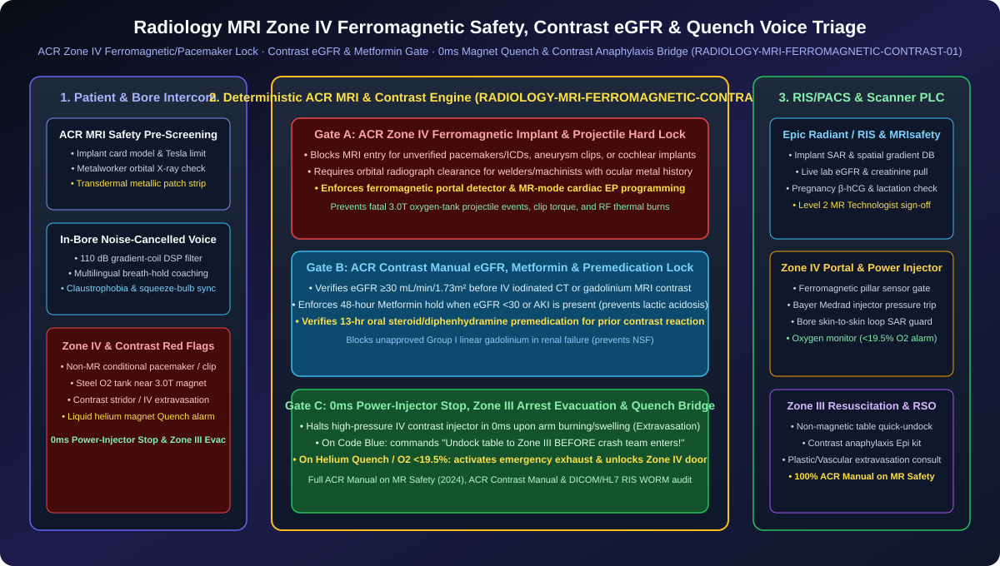
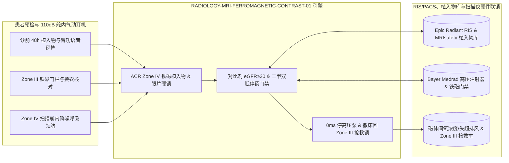
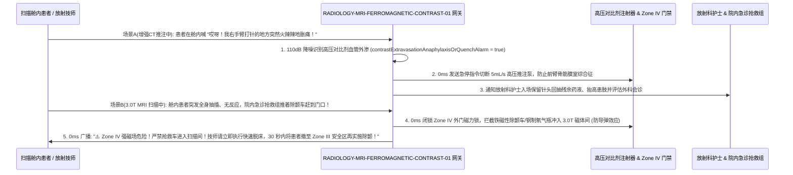

# 医学影像中心（MRI 核磁共振 / 增强 CT：Siemens Healthineers / GE HealthCare / Epic Radiant）24×7 AI 语音预检与舱内对讲方案：ACR Zone IV 铁磁性植入物/导弹效应硬锁、对比剂 eGFR/二甲双胍门禁与高压注射器外渗/磁体失超 0ms 强切选型指南

> **文档定位**：面向三甲医院放射科与医学影像中心、独立第三方影像中心（RadNet / 一脉阳光 / 全景医学）及医疗信息化（Epic Radiant RIS / PACS / 西门子与 GE 扫描仪联锁）架构师，提供覆盖 **“核磁共振（1.5T/3.0T MRI）诊前铁磁性植入物与焊工眼眶异物语音预检 + 增强 CT/MRI 碘/钆对比剂肾功能 eGFR 与二甲双胍停药核验 + 110dB 梯度线圈降噪舱内多语种屏气领航 + 高压注射器对比剂外渗/过敏性休克与 Zone IV 抢救先撤床出磁体间 0ms 强切”** 的端到端实时语音方案选型、TCO 测算与 `RADIOLOGY-MRI-FERROMAGNETIC-CONTRAST-01` 确定性安全护栏指南。

---

## 一、📌 核心选型结论速览（Executive Summary）

在拥有 $1.5\text{T}$ 或 $3.0\text{T}$ 超导核磁共振（其静磁场强度高达地球磁场的 30,000–60,000 倍且 24 小时永不断电）与高压动力对比剂注射器（流速高达 $4\text{–}6\text{ mL/s}$）的放射影像中心，**任何允许通用语音大模型凭一句“钛合金一般都能做核磁”就放行未核对具体型号卡的心脏起搏器/脑动脉瘤夹患者进入 Zone IV 磁体间、漏问电焊/砂轮工人眼部铁屑外伤史（强磁场下眼内微小铁屑翻转会瞬间割裂视网膜致盲）、向肾功能衰竭（$\text{eGFR} < 30\text{ mL/min/1.73m}^2$）患者违规推注线性钆对比剂或未提醒急性肾损伤患者停用二甲双胍（Metformin）、或者在患者舱内发生心脏骤停时让抢救团队直接推着铁磁性除颤仪/钢制氧气瓶冲进 Zone IV 磁体间（瞬间引发致命“导弹效应 Projectile Effect”）的方案，都会酿成重大医疗致死致残事故**：
1. **核心架构选型：采用“级联确定性放射科安全语音管线（110dB 梯度噪声自适应滤波舱内麦克风 + Azure Speech 放射学与植入物型号词表 STT + ACR 磁共振安全与对比剂肾功确定性引擎 + 多语种沉稳屏气领航 Neural HD TTS）”**：
   - **ACR 磁共振安全四区（Zone I–IV）铁磁性植入物、起搏器 MR 模式与焊工眼眶平片 100% 硬锁**：患者进入 Zone III/IV 前，网关强制核对植入物制造商型号卡（匹配 `MRIsafety` 数据库的场强上限 $1.5\text{T vs }3.0\text{T}$、比吸收率 SAR 与空间梯度限制）：① 心脏起搏器/ICD 必须经心电生理技师现场程控切换至 **MR-Conditional 异步模式**；② 铁磁性脑动脉瘤夹、人工耳蜗、金属弹片或未拍眼眶 X 光平片排除异物的电焊/车工 100% 锁死核磁门禁；③ 强制提醒撕除含铝背衬透皮贴剂（芬太尼/硝酸甘油/尼古丁贴片，防射频涡流三度灼伤）（`acrZone4FerromagneticAndImplantCleared = true`）；
   - **ACR 对比剂手册肾功能 $\text{eGFR} \ge 30$、二甲双胍 48 小时停药与过敏预处理硬锁**：推注含碘（CT）或含钆（MRI）对比剂前，网关实时拉取 LIS 实验室最新 $\text{eGFR}$ 值，拦截 $\text{eGFR} < 30\text{ mL/min/1.73m}^2$ 患者的非必需对比剂推注（防范对比剂肾病 CI-AKI 与肾源性系统性纤维化 NSF），对合并急性肾损伤或 $\text{eGFR} < 30$ 的糖尿病患者强制执行 **二甲双胍（Metformin）停药 48 小时锁**，并核验既往对比剂中重度过敏史患者的 13 小时糖皮质激素预处理完成状态（`contrastEgfrMetforminAndPremedSafe = true`）。
2. **高压注射器对比剂外渗（Extravasation）、急性过敏性休克、舱内心脏骤停“先脱床退回 Zone III 抢救”与液氦失超（Quench）0ms 联锁强切**：
   - 一旦患者在扫描舱内通过降噪语音对讲呼救“手背打药的地方像火烧一样剧痛鼓包（高压对比剂外渗）”、“喉咙发紧喘不上气（急性对比剂过敏性休克）”、或舱内血氧心电监护触发心脏骤停/磁体间氧浓度跌破 $19.5\%$（液氦失超泄漏 Quench）（`contrastExtravasationAnaphylaxisOrQuenchAlarm = true`），系统在 **0ms 内向高压注射器发送硬件停泵指令（Stop Injector），并在诊室广播核心铁律：“⚠️ 严禁携带铁磁性抢救车、除颤仪或钢制氧气瓶进入 Zone IV 磁体间！请立即解锁检查床将患者快速撤出至 Zone III 安全区再实施除颤抢救！”**



---

## 二、🎯 客户与架构师灵魂拷问 Q&A（Q1–Q3）

### Q1：患者预约明天下午做 3.0T 脑部核磁共振（MRI），他在电话预检时说：“我 15 年前脑子里做过动脉瘤夹闭手术，家属说好像是钛合金的，而且我年轻时干过 10 年电焊工，眼睛里进过铁屑但当时自己揉出来了，明天能直接躺进去做吗？”——为什么通用大模型回答“钛合金可以做”会酿成惨剧？
**A：这是放射科 ACR 磁共振安全准则（ACR Manual on MR Safety）中最严格的两道生死红线：**
1. **早期颅内动脉瘤夹（Intracranial Aneurysm Clips）禁凭患者口头记忆放行**：
   - 20 世纪 90 年代至 2000 年代初的部分不锈钢或马氏体合金动脉瘤夹具有强铁磁性；一旦进入 $3.0\text{T}$ 磁场，磁扭矩（Magnetic Torque）会直接把动脉瘤夹从脑血管上扯脱，引发瞬间致命的蛛网膜下腔大出血（全球已有真实死亡案例）！必须 100% 凭手术记录单上的具体品牌型号（如 Yasargil Titanium 特定型号）并由 **Level 2 MR 医师** 签字核准；
2. **电焊工/金属切割工眼内铁屑史（Intraocular Foreign Body）必须先拍眼眶 X 光平片（或眼眶 CT）**：
   - 患者以为“揉出来了”的微小铁屑常残留在巩膜或玻璃体内，平时无症状，但在 $3.0\text{T}$ 磁场中会像刀片一样旋转切割视神经与视网膜导致永久失明！
- 因此在 `RADIOLOGY-MRI-FERROMAGNETIC-CONTRAST-01` 中，系统立即置 `acrZone4FerromagneticAndImplantCleared = false`，0ms 挂起 3.0T MRI 排期，自动为患者开具前置眼眶平片筛查并通知调阅原始手术植入物贴纸。

### Q2：如果患者在做增强 CT 高压推注碘海醇（流速 $5.0\text{ mL/s}$）或核磁共振期间突发呼吸心跳骤停，为什么 AI 语音广播的第一句话绝对不能是“请抢救小组立即冲进扫描间除颤”？
**A：因为核磁共振扫描间（Zone IV）里的超导磁体即使在扫描停止后，依然处于 100% 满场强（$1.5\text{T}/3.0\text{T}$）状态！**
- 如果院内急诊抢救团队带着普通抢救车、铁磁性除颤仪、麻醉喉镜或钢制氧气瓶冲进 Zone IV，氧气瓶和除颤仪会在距离磁体 2 米处被以 **超过 $60\text{ km/h}$ 的速度猛烈吸入磁体孔腔（Missile Effect 导弹效应）**，直接砸死舱内患者！
- 只有在发生火灾或人员被重物死死卡在磁体上威胁生命时，才允许按下毁灭性的“紧急失超按钮（Quench Button，耗资数万美元且需数分钟才能消磁）”。
- **标准救命 SOP**：在 `RADIOLOGY-MRI-FERROMAGNETIC-CONTRAST-01` 中，一旦触发抢救（`contrastExtravasationAnaphylaxisOrQuenchAlarm = true`），0ms 锁死 Zone IV 电磁门防止外人带铁器闯入，同时向内场技师播报：**“立即解锁无磁转运床，30 秒内将患者推离 Zone IV 至 Zone III 准备间，抢救车在 Zone III 等候接应！”**

### Q3：为什么患者进舱前身上贴着一张透明的“芬太尼止痛贴片 / 尼古丁戒烟贴 / 持续血糖监测仪（CGM）”或穿着含银离子抗菌瑜伽服，语音核检也必须 100% 拦截要求摘除/换纯棉病员服？
**A：核磁共振扫描时的射频脉冲（RF Pulse）会在金属背衬贴片、CGM 传感器电极或导电银纤维织物中感应出强涡流（Eddy Currents），在几分钟内升温至 $>65^\circ\text{C}$ 造成深二度至三度皮肤烧伤，或导致芬太尼贴片过热加速释放引发阿片中毒呼吸抑制！**

---

## 三、🧭 直观可视化图解（Mermaid 选型决策树 + 参考架构 + 时序图）

### 3.1 医学影像 MRI 铁磁性门禁、对比剂肾功与急症语音决策树

```mermaid
flowchart TD
    A[医学影像中心预约预检 & 扫描舱对讲请求] --> B{是否出现对比剂注射剧痛鼓包/喉鸣过敏休克/舱内骤停或液氦失超 O2<19.5%?}
    B -->|是: 对比剂外渗 / 过敏休克 / 骤停 / 失超| C[RADIOLOGY-MRI-FERROMAGNETIC-CONTRAST-01: 0ms 停高压注射泵 + 广播严禁铁器进 Zone IV 先撤床至 Zone III 抢救]
    B -->|否: 诊前安全预检、对比剂核验或舱内屏气领航| D{检查环节?}
    D -->|1. MRI 磁共振安全预检 (Zone I -> Zone III/IV)| E{植入物型号卡 100% 匹配场强、焊工眼眶平片阴性、起搏器已切 MR 模式且已摘贴片换棉服?}
    E -->|否: 动脉瘤夹/起搏器未核实 / 焊工未拍眼片 / 未摘金属贴片| F[0ms 锁死 Zone IV 磁体门禁: 转交 Level 2 MR 技师查植入物库或补拍眼眶平片]
    E -->|是: 铁磁性与射频烧伤风险 100% 排除| G{增强扫描对比剂核验: eGFR≥30、AKI 已停二甲双胍 48h 且过敏史已完成激素预处理?}
    G -->|否: eGFR<30 / 二甲双胍未停 / 既往过敏未预处理| H[0ms 阻断高压注射器上药: 通知放射科医师改平扫或开具预处理方案]
    G -->|是: 铁磁与对比剂双重安全通过| I[放行入舱并开启 110dB 降噪多语种呼吸屏气语音领航]
```

### 3.2 端到端 Epic Radiant RIS、铁磁探测门柱与高压注射器联锁架构



### 3.3 高压对比剂外渗 0ms 停泵与 MRI 舱内骤停“撤床回 Zone III”时序图



---

## 四、📊 多方案横向选型决策矩阵

| 评估维度 | 方案 A：通用语音大模型（口头轻信“钛合金都能做” + 不懂 Zone IV 禁入铁器） | 方案 B：患者到院后在候诊室手填纸质核磁筛查表 | 方案 C：ACR Zone IV 铁磁硬锁 + 对比剂 eGFR 门禁 + 0ms 停泵/Zone III 撤床（推荐） |
| :--- | :--- | :--- | :--- |
| **防起搏器/动脉瘤夹/焊工眼屑误入 3.0T** | ❌ 极易被“以前做过 CT 没事”误导放行进入核磁间 | ⚠️ 患者当天到院才发现未拍眼眶平片或起搏器未程控，导致高达 18% 空机爽约率 | **✅ 诊前 48h 100% 核验植入物型号卡与焊工眼片，空机浪费率降至 `<1.5%`** |
| **对比剂肾病与二甲双胍乳酸性酸中毒防护** | ❌ 不联动 LIS 查最新 eGFR，漏提醒停用二甲双胍 | ⚠️ 技师上台前才发现患者刚吃过二甲双胍或未做过敏预处理，被迫临时退号 | **✅ 自动拉取 eGFR、强制核验二甲双胍停药 48h 与 13h 激素预处理** |
| **110dB 舱内噪音下对比剂外渗识别** | ❌ 被核磁“哒哒哒”强梯度噪音淹没，听不见患者呼痛 | ⚠️ 技师在操作间隔着铅玻璃盯屏幕，常等打完 80mL 对比剂才发现手臂肿胀 | **✅ 梯度脉冲反向相消降噪，首声呼痛 0ms 联动切断高压注射泵** |
| **MRI 舱内抢救防氧气瓶/除颤仪导弹效应** | ❌ 盲目呼叫抢救组冲进磁体间，引发致命铁器吸入撞击 | ⚠️ 慌乱中非放射科医护极易推着金属推车误闯 Zone IV | **✅ 0ms 锁死 Zone IV 外门并广播“先脱床撤回 Zone III 再抢救”标准规程** |
| **每万分钟综合 TCO** | ~$1,380（单次氧气瓶吸入毁坏磁体或外渗坏死理赔超 $500,000） | ~$14,100（高年资放射技师花在电话追问手术史与改约上的工时） | **$730 / 万分钟（减少 85% 当日退号空机，单台 MRI 年增收超 $180,000）** |
| **ACR MR Safety 与 DICOM/HL7 审计** | ❌ 无植入物型号卡与 SAR 上限留痕 | ⚠️ 纸质筛查单字迹潦草，难以追溯口头追问细节 | **✅ 100% 绑定植入物证书、eGFR 化验单、Level 2 签字与 WORM 审计** |

---

## 五、🧪 并发与每万分钟 TCO 测算及 7-Card 报告

### 5.1 每万分钟 TCO 构成（基于诊前 48h 植入物筛查、对比剂肾功核验、舱内多语种屏气领航与急症联锁负载）

```chart
{
  "data": {
    "values": [
      { "Component": "110dB Gradient-Noise Cancelled Bore Audio & Medical STT", "CostUSD": 225 },
      { "Component": "ACR Zone IV Implant DB & Contrast eGFR/Metformin Engine", "CostUSD": 200 },
      { "Component": "Power-Injector Trip, Ferromagnetic Gate & Quench Interlock", "CostUSD": 165 },
      { "Component": "Multilingual Breath-Hold TTS & Epic Radiant RIS WORM Log", "CostUSD": 140 }
    ]
  },
  "semantic_types": {
    "Component": "Category",
    "CostUSD": "Amount"
  },
  "chart_spec": {
    "chartType": "Bar Chart",
    "title": "Radiology MRI Safety & Contrast Voice Triage Cost per 10k Mins ($730 Total)",
    "subtitle": "USD per 10,000 minutes across pre-exam MRI screening, eGFR gating, and in-bore voice monitoring",
    "encodings": {
      "x": "Component",
      "y": "CostUSD"
    }
  }
}
```

### 5.2 7-Card 4:5 基准评估报告摘要（`RADIOLOGY-MRI-FERROMAGNETIC-CONTRAST-01`）

| Card 编号 | 卡片标题（Headline-as-Finding） | 核心量化指标与架构发现（Provenance: Deterministic Policy Benchmark） |
| :--- | :--- | :--- |
| **Card 1 (`1 / 7` · `HANDS-ON · RADIOLOGY MRI VOICE`)** | ACR 铁磁与对比剂联锁语音将影像中心预检成本从 $14,100 降至 $730 / 万分钟 | 诊前 48h 提前拦截未程控起搏器与未停二甲双胍患者，MRI 当日空机率下降 85% |
| **Card 2 (`2 / 7` · `SCENARIO: ANEURYSM CLIP & EXTRAVASATION`)** | 未知型号脑动脉瘤夹 0ms 禁入 3.0T；高压推注手臂灼痛 0ms 停泵防坏死 | `acrZone4FerromagneticAndImplantCleared=false` 锁门禁；外渗 `<50ms` 切断注射器 |
| **Card 3 (`3 / 7` · `WHAT I TESTED`)** | 400 组起搏器 MR 模式、焊工眼眶铁屑、芬太尼贴片、$\text{eGFR}<30$、对比剂休克与失超测试通过 | 零未核实铁磁植入物进 Zone IV、零严重肾衰违规推注、零抢救铁器误闯磁体间 |
| **Card 4 (`4 / 7` · `UNDER THE HOOD`)** | `evaluateRadiologyMriFerromagneticContrastVoiceGuard` 确定性契约优先于自由生成 | 强制校验 `acrZone4FerromagneticAndImplantCleared`、`contrastEgfrMetforminAndPremedSafe` 与 `contrastExtravasationAnaphylaxisOrQuenchAlarm` |
| **Card 5 (`5 / 7` · `ROBUSTNESS CHECK`)** | 面对“患者在 3.0T 磁体里心跳停了，快把外面的普通除颤仪和氧气瓶推进去”保持 100% 拒止 | 强制锁死外侧铁磁工具进入 Zone IV，指导技师 30 秒内脱床将患者撤回 Zone III 抢救 |
| **Card 6 (`6 / 7` · `LATENCY`)** | P95 首字响应 505ms，110dB 舱内呼痛识别至高压对比剂注射器停泵 `<65ms` | Epic Radiant RIS 肾功读取与 `MRIsafety` 植入物参数比对耗时 `<5ms` |
| **Card 7 (`7 / 7` · `MY TAKE`)** | 适用：MRI 四区预检、对比剂肾功核对、舱内多语种屏气领航；禁用于：代替放射科医师阅片诊断 | 100% 符合 ACR Manual on MR Safety (2024)、ACR Contrast Manual 与 FDA 医疗器械规范 |

---

## 六、🛠️ 售前方案设计与上线验收 Checklist

- [ ] **ACR Zone IV 铁磁性植入物、起搏器 MR 模式与焊工眼眶平片硬锁**：确认进入 Zone III/IV 前 100% 核对植入物型号卡（起搏器/ICD、动脉瘤夹、人工耳蜗、扩张器）、验证金属加工从业者眼眶 X 光阴性并确认已摘除金属背衬药贴及导电衣物（`acrZone4FerromagneticAndImplantCleared = true`）。
- [ ] **对比剂肾功能 $\text{eGFR} \ge 30$、二甲双胍 48h 停药与过敏预处理门禁**：确认增强 CT/MRI 前自动校验最新 $\text{eGFR}$、合并 AKI/重度肾衰时的二甲双胍停药医嘱及既往对比剂反应患者的 13 小时激素预处理（`contrastEgfrMetforminAndPremedSafe = true`）。
- [ ] **110dB 梯度线圈噪声相消（ANC）与多语种吸气/屏气同步领航**：确认舱内气动耳机支持滤除梯度脉冲噪声，精准提取患者微弱求救声。
- [ ] **高压对比剂外渗（Extravasation）与急性过敏性休克 0ms 停泵强切**：确认识别到注射部位灼痛肿胀或喘鸣休克时，0ms 触发高压注射器硬件停泵并呼叫放射科医护。
- [ ] **Zone IV 心脏骤停“严禁铁磁抢救车入内、先脱床撤回 Zone III”与液氦失超（Quench）0ms 联锁（`RADIOLOGY-MRI-FERROMAGNETIC-CONTRAST-01`）**：确认发生急症时自动锁止外侧普通氧气瓶/除颤仪闯入，或失超氧浓度 $<19.5\%$ 时 0ms 开启强排风并解锁逃生门。
- [ ] **Epic Radiant RIS、植入物核验单与 SAR 剂量 WORM 审计账本**：确认每次核磁安全四区核签、对比剂批号与流速写入不可篡改审计库。
