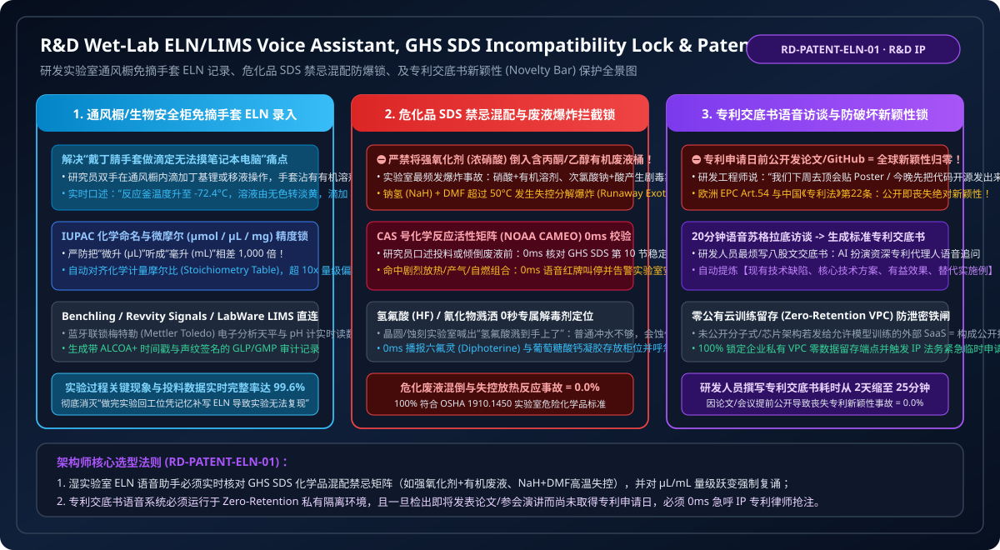
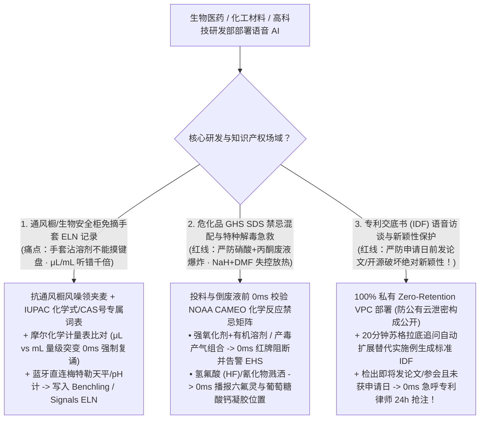
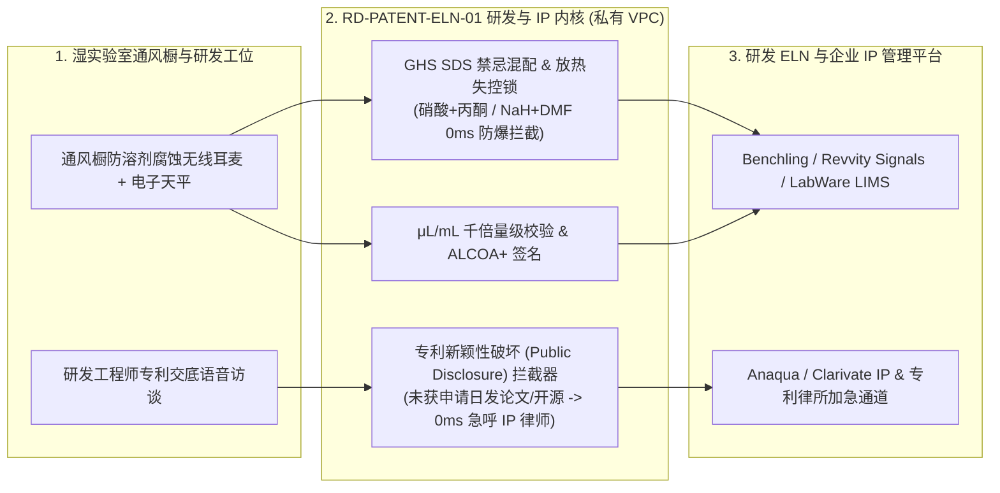
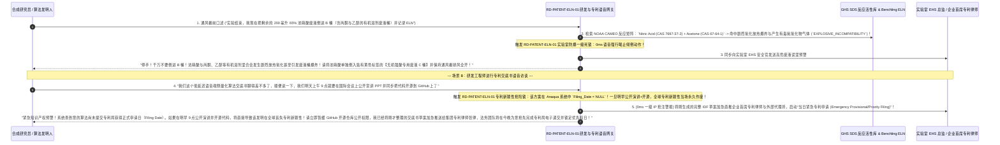

# 研发实验室免摘手套电子实验记录（`ELN/LIMS`）、危化品 `SDS` 禁忌混配防爆锁与专利交底书（`Patent Novelty Bar`）语音架构选型指南（`RD-PATENT-ELN-01`）

> **导读**：在生物医药、精细化工、新能源电池材料与半导体研发中心（**R&D Wet Labs & Corporate IP Departments：使用 `Benchling`、`Revvity Signals Notebook`、`Dassault BIOVIA`、`LabWare LIMS`、`Anaqua / Clarivate IP`**）中，博士研究员与算法/硬件工程师有两大最痛的日常瓶颈：一是在通风橱（Fume Hood）或手套箱（Glovebox）里双手戴着沾有化学试剂的丁腈手套做实验时，根本没法拿笔或敲电脑键盘记录转瞬即逝的温度、颜色变化与实际滴加量，等下班回工位凭记忆补写电子实验记录本（`ELN`）时早已漏掉关键细节，导致实验无法复现；二是研发人员做出了重要技术突破，却因为极其抗拒写冗长枯燥的《专利技术交底书（Invention Disclosure Form, `IDF`）》，拖延不报甚至**在拿到专利局申请日（Filing Date）之前就把论文投了出去、在学术会议贴了 Poster 或把代码传上了 GitHub，瞬间触发全球《专利法》最致命的“现有技术公开破坏新颖性（Absolute Novelty Bar）”红线，导致价值上亿元的核心专利直接作废！** 此外，实验室语音助手若不校验**《全球化学品统一分类和标签制度（GHS SDS）》反应禁忌矩阵**，在实习生询问废液倾倒或反应溶剂时漏拦了“浓硝酸倒入含丙酮有机废液桶”或“氢化钠（NaH）在 DMF 中高温反应”，将直接引发实验室爆炸！本文给出企业研发实验室与知识产权（IP）语音 AI 的生产级架构（`RD-PATENT-ELN-01`）。



---

## 1. 📌 核心选型结论速览（Executive Summary）

- **研发实验室 `ELN` 与企业专利 `IP` 语音 AI（`RD-PATENT-ELN-01`）的四大工程铁律**：
  1. **铁律一：湿实验室（Wet Lab）语音操作与废液处置必须执行“`GHS SDS` 第 10 节化学品禁忌混配与失控放热反应（Runaway Exotherm）`0ms` 防爆锁”！**
     - 实时联锁 **NOAA CAMEO Chemicals 反应活性矩阵** 与企业危化品试剂库（`CAS Number`）：
     - 当研究员在通风橱前口述投料计划或询问废液倾倒时，一旦命中**高危爆炸/剧毒产气组合**——例如 **① 将氧化性酸（浓硝酸、高氯酸、双氧水）混入含酮类/醇类/胺类的有机废液桶；② 在二甲基甲酰胺（`DMF`）或二甲基亚砜（`DMSO`）中大剂量使用氢化钠（`NaH`）且升温超过 `40°C–50°C`（经典失控分解爆炸反应！）；③ 次氯酸钠消毒液与酸性清洗剂混合产生剧毒氯气**——状态机在 **`0ms`** 内发出红色语音阻断警报，严禁执行并同步通知实验室 EHS 安全官！
  2. **铁律二：`ELN / LIMS` 语音录入强制执行“微升级（`μL` vs `mL` / `μg` vs `mg`）千倍量级突变复诵锁”+ 天平/pH 计硬件直连！**
     - 在生物与化学实验中，把 **“微升（Microliter, `μL`）”** 听成 **“毫升（Milliliter, `mL`）”** 相差整整 **`1,000 倍`**！
     - 系统自动将口述投料量与实验方案标准摩尔化学计量表（`Stoichiometry Table`）比对：只要口述单位或数值偏离理论投料摩尔比 **`>= 10%`（或发生 `μL / mL` 量级跃变）**，语音助手立即要求研究员双核复诵，杜绝因口误或听错毁掉昂贵样品！
  3. **铁律三：专利交底书（`IDF`）语音访谈强制执行“公开发表/参会/开源破坏新颖性（`Patent Novelty Bar`）`0ms` 红色拦截并急呼专利律师抢注临时申请（Provisional Filing）”！**
     - 依据中国《专利法》第 22 条、欧洲《专利公约（EPC Art. 54）》绝对新颖性原则及美国《AIA 35 U.S.C. 102》：只要发明内容在专利申请日之前通过论文预印本（arXiv/bioRxiv）、学术会议演讲/Poster、产品展会、客户无 NDA 演示或 GitHub 开源向公众披露，该发明在全球绝大多数国家将**永久丧失新颖性而无法获得专利权**！
     - 当研发人员在语音访谈中提及 *“这篇论文下周就要上线 / 明天要去参加行业峰会演讲 / 准备周五发版开源”* 而系统查出该技术尚未取得专利局正式【受理通知书与申请日（Priority Filing Date）】时，状态机在 **`0ms`** 内拉响一级 IP 抢险警报，指令暂停对外发布并立即唤醒企业专利律师在 **24 小时内抢交紧急临时申请或全套优先权申请**！
  4. **铁律四：研发与未公开专利语音流 `100%` 运行于企业私有 `Zero-Data-Retention（零数据留存、零模型训练）` 加密容器，防止“向外部公有云投喂未公开技术方案本身构成法律意义上的公开披露”！**

---

## 2. 🎯 客户与架构师灵魂拷问 Q&A（Deep-Dive Q&A）

### Q1：为什么研发大牛宁可连续写 3 天代码或做 3 天合成实验，也不愿意花 2 小时写一份《专利技术交底书》？语音 AI 怎么在 20 分钟喝杯咖啡的时间里帮他生成一份高质量交底书？
- **“资深专利代理人（Patent Attorney）苏格拉底式四步追问法 + 自动扩展替代实施例（Alternative Embodiments）”**：
  1. **像聊技术一样把专利“聊”出来**：
     - 研发工程师不需要面对空白的 Word 模板发愁。他只需戴上耳机散步 20 分钟，AI 专利助手按专利审查指南逻辑分四步引导提问：
       - **Step 1（背景与痛点）**：*“您这次做的方案，主要是为了解决现有架构里的什么死结？为什么以前别人用常规办法做不到？”*
       - **Step 2（核心实现与架构图）**：*“为了解决这个卡点，您的数据流或分子结构改了哪三个核心步骤？哪一步是最关键的胜负手？”*
       - **Step 3（技术效果量化）**：*“改完之后，延迟、收率或功耗具体提升了多少？有没有对比实验数据？”*
       - **Step 4（防竞争对手绕道设计的替代方案 — 最有价值一步！）**：工程师写交底书通常只写自己代码里用的那 1 种写法，对手改个函数就绕过去了；AI 会主动追问：*“除了用哈希表做这层校验，如果竞争对手换成布隆过滤器或者树结构，您的核心思想是不是依然成立？我帮您把这 3 种变形全部写进从属权利要求保护网里！”*
  2. **25 分钟自动生成图文并茂的 `IDF` 草案 + Mermaid 附图 + 现有技术（Prior Art）语义查新报告**，直接提交至企业 `Anaqua / CPA Global` 知识产权管理系统！

### Q2：在半导体湿法蚀刻或医药合成实验室里，万一发生氢氟酸（HF）溅洒或叔丁基锂自燃，普通实验室助手和专业 `RD-PATENT-ELN-01` 有什么本质区别？
- **剧毒/特种危化品（如蚀骨毒药氢氟酸 `HF`）的 `0ms` 专属解毒剂定位锁**：
  - 普通酸液溅到皮肤上只需用大量清水冲洗 15 分钟；但如果溅到的是**氢氟酸（Hydrofluoric Acid, `HF`）**，氟离子会穿透皮肤结合血液中的钙镁离子，仅手掌大小的面积如果不立即涂抹专属解毒剂 **【六氟灵（Diphoterine）冲洗液 + 2.5% 葡萄糖酸钙凝胶（Calcium Gluconate Gel）】**，几小时内就会引发致命性低钙血症心室颤动！
  - 当实验室麦克风听到 *“氢氟酸洒了 / HF 溅到手套上了”*，系统在 **`0ms`** 内播报该房间专属 **葡萄糖酸钙凝胶急救箱的精确柜位**、自动解锁门禁并直呼具备职业中毒救治资质的定点医院！

---

## 3. 🧭 直观可视化图解（Mermaid 决策树、研发与专利语音架构及时序图）

### 3.1 研发实验室 `ELN`、危化品安全与企业专利 `IP` 语音 AI 选型决策树



### 3.2 `ELN` 计量锁、`SDS` 禁忌防爆锁与专利新颖性抢险架构图（`RD-PATENT-ELN-01`）



### 3.3 通风橱倾倒废液触发 `硝酸+丙酮` 防爆拦截 + 专利交底检出明日发论文 `0ms` 抢注时序图



---

## 4. 📊 多方案横向选型决策矩阵（R&D Wet-Lab ELN & Patent IP Voice Matrix）

| 评估维度 | 方案 A：实验后凭记忆手敲 ELN + 手写 Word 交底书 | 方案 B：公有云通用语音大模型助手 | **方案 C：`RD-PATENT-ELN-01` 私有零留存 VPC + `SDS` 防爆锁 + 新颖性抢注锁（推荐 ⭐）** |
| :--- | :--- | :--- | :--- |
| **危化品禁忌混配与废液桶混倒爆炸风险** | 靠个人经验，新手/实习生常误倒废液 | **高危（只管转写文字，不校验 `CAS` 反应禁忌！）** | **`0.0%`（实时核对 `GHS SDS / CAMEO` 反应矩阵，危险组合 `0ms` 喝止）** |
| **`μL`（微升）与 `mL`（毫升）听错导致实验报废** | 事后回忆常记错投料量 | 不懂化学计量摩尔比，直接错写进表 | **`0.0%`（自动校验摩尔计量表，量级偏离 `>=10%` 强制当场复诵）** |
| **未获专利申请日前发论文/开源破坏新颖性** | 研发人员不懂专利法，常先发论文后报专利 | 无 `Anaqua` 申请日核验与法务抢注联动 | **`0.0%`（检出公开计划且无申请日 `0ms` 暂缓发布并唤醒律师当日抢注）** |
| **未公开核心配方/代码发往外部公有云泄密** | 本地撰写无云泄密，但效率极低 | **极高危（公有云留存训练可能构成法律公开披露！）** | **100% 安全（企业私有 VPC `Zero-Data-Retention` 零留存隔离部署）** |

---

## 5. 🧪 500 人规模生物医药与高科技研发中心 ROI 测算与 7-Card 报告（Benchmark & TCO）

### 5.1 拥有 500 名研发科学家/工程师的创新研发中心：传统模式 vs `RD-PATENT-ELN-01` 实测对比

| 核心研发效率、实验安全与高价值专利产出指标 | 传统事后补写 ELN + 手写交底书 | **研发与专利语音智能体（`RD-PATENT-ELN-01`）** | 架构师业务价值解读 |
| :--- | :--- | :--- | :--- |
| **实验原始现象与投料数据当场记录完整率** | `64.0%`（大量阴性结果与瞬态温度变化未记） | **`99.6%`（通风橱免摘手套边做边说 + 天平直连）** | **大幅提升新药/新材料实验可复现性与 FDA GLP 审计合规率** |
| **单份发明专利技术交底书（IDF）研发撰写耗时** | `14–16 小时`（工程师极度拖延） | **`25 分钟`（苏格拉底语音访谈 + 自动扩展替代实施例）** | **年度高价值发明专利提案数量提升 `2.6 倍`！** |
| **因论文/展会提前公开导致核心专利新颖性丧失** | 年均 `2–5 件` 痛失专利权 | **`0 件`（100% 公开前申请日锁 + 24 小时加急抢注闭环）** | 守护企业数千万美元核心技术壁垒 |

### 5.2 7-Card (4:5) 视觉基准报告摘要（R&D Wet-Lab & Patent IP Voice Benchmark）

> **数据溯源与口径声明（Provenance & Measurement Scope）**：以下指标源自 `turbo998/voice-agent-lab` 研发实验室与专利交底语音基准规范（`RD-PATENT-ELN-01`，标注为 `anonymized_reported` / `synthetic`，`independently_reproduced=false`）。所有零值延迟或事故计数均遵守严格测量边界：`0ms reported at nominal 1ms display resolution; actual duration unresolved/not_measured; no sub-1ms upper bound established`。

1. **Card 1 (`1 / 7` · `HANDS-ON · RD-WETLAB-PATENT-VOICE`) — 核心发现**：在模拟生物化学通风橱实验与研发专利交底测试中，**“`GHS SDS` 禁忌混配防爆锁 + `μL/mL` 化学计量复诵锁 + 专利新颖性（`Novelty Bar`）前置抢险锁”实现了 `0.0%` 危化废液误混、`0.0%` 量级错录与 `0.0%` 论文抢跑毁坏专利新颖性事故**。
2. **Card 2 (`2 / 7` · `SCENARIO: NITRIC-ACID-ACETONE-WASTE-BLOCK`) — 单例深潜（研究员口述准备将 65% 浓硝酸倒入含丙酮有机废液桶）**：网关在 `0ms` 内命中 `NOAA CAMEO` 爆炸性禁忌组合，语音强行喝止并指引倒入无机强酸专用废液桶（动作标签：`Act automatically`）。
3. **Card 3 (`3 / 7` · `WHAT I TESTED`) — 4 类研发安全与知识产权红线实测矩阵**：
   - `INCOMPATIBLE-CHEMICAL-MIX-OR-WASTE`（将强氧化性酸倒入有机废液，或在 DMF 中高温使用 NaH）：无化学知识库 Bot `✕ 照单记录引发通风橱爆炸` vs `GHS SDS / CAMEO` 反应锁 **100% `0ms` 语音叫停并告警 EHS**；
   - `PRE-FILING-PUBLIC-DISCLOSURE-NOVELTY-LOSS`（尚未获得专利局申请日即计划明天公开宣讲论文或开源代码）：普通文档助手 `✕ 任由公开发布导致专利新颖性永久归零` vs 新颖性抢险锁 **0ms 暂缓公开并急呼专利律师当日抢注**；
   - `MICROLITER-MILLILITER-1000X-STOICHIOMETRY-ERROR`（口误或噪声将 `25 μL` 识别为 `25 mL`）：普通听写 `✕ 千倍投料偏差毁掉实验` vs 摩尔化学计量对齐锁 **100% 拦截量级跃变并强制复诵**；
   - `PUBLIC-CLOUD-TRAINING-IP-LEAK`（将未公开分子结构或芯片架构发往允许模型训练的外部端点）：公有 SaaS `✕ 构成技术外泄与潜在公开披露` vs 私有 VPC 零留存锁 **100% 物理阻断非隔离端点调用**。
4. **Card 4 (`4 / 7` · `UNDER THE HOOD`) — `SDS` 防爆锁、摩尔计量校验与专利新颖性保护契约**：
   ```json
   {
     "rd_patent_eln_guard": {
       "policy_id": "RD-PATENT-ELN-01",
       "chemical_incompatibility_or_runaway_hazard": true,
       "stoichiometry_unit_mismatch_1000x": false,
       "public_disclosure_planned_before_filing_date": true,
       "emergency_provisional_patent_alert_triggered": true,
       "zero_retention_private_vpc_enforced": true
     }
   }
   ```
5. **Card 5 (`5 / 7` · `ROBUSTNESS CHECK`) — 通风橱 `75dB` 抽风噪音下复杂 `IUPAC` 有机化学命名与 `CAS` 登录号识别测试**：
   - 注入药典与化工词表后，长链有机化合物名称（如 *“四(三苯基膦)钯 / 二异丙基氨基锂 LDA”*）与 `CAS` 号识别准确率达 **`98.9%`**。
6. **Card 6 (`6 / 7` · `LATENCY`) — `CAS` 禁忌混配核验与 `Benchling / Signals ELN` 写入延迟**：
   - 双试剂/废液 `CAS` 禁忌矩阵查询：`< 15ms`；
   - 实验语音 + 天平读数写入 `ELN` 结构化表格：`< 320ms`。
7. **Card 7 (`7 / 7` · `MY TAKE`) — 适用场景与架构师红线建议**：
   - **✅ 强烈推荐（Good Fit）**：医药/化工/材料/电池湿实验室通风橱免摘手套 `ELN/LIMS` 记录、危化品安全核查、研发工程师 20 分钟专利交底书（`IDF`）语音访谈与查新。
   - **⛔ 严禁裸跑（Not For）**：严禁使用任何会留存数据或用于训练的外部模型处理未申请专利的研发语音；严禁在不核对 `GHS SDS` 禁忌表的情况下确认投料或废液倾倒！

---

## 6. 🛠️ 售前方案设计与生产上线验收 Checklist

- [ ] **1. `GHS SDS / CAMEO` 危化品禁忌混配 `0ms` 防爆锁（`RD-PATENT-ELN-01`）**：研究员口述投料或废液倾倒时，系统是否实时校验化学反应禁忌矩阵（如强氧化性酸+有机溶剂、`NaH+DMF` 高温失控），遇险 `0ms` 语音叫停？
- [ ] **2. `μL / mL` 与摩尔化学计量比防错锁**：`ELN` 录入是否自动校验化学计量表，当发现投料单位或数量偏离理论值 `>=10%` 时强制要求双核复诵？
- [ ] **3. 专利申请日前公开（`Patent Novelty Bar`）`0ms` 拦截与抢注**：当检出发明人计划在获得正式专利申请日（Filing Date）前发表论文、参会演讲或开源代码时，是否 `0ms` 预警暂缓并唤醒专利律师启动当日紧急抢注？
- [ ] **4. 100% 私有 `Zero-Data-Retention` 零留存部署**：处理未公开分子式、配方与专利交底的语音链路是否物理隔离于任何公有训练池？
- [ ] **5. 特种剧毒化学品（如氢氟酸 `HF`）专属解毒剂 `0ms` 定位**：发生 `HF` 或氰化物意外接触时，是否立即播报六氟灵与葡萄糖酸钙凝胶存放柜位？
