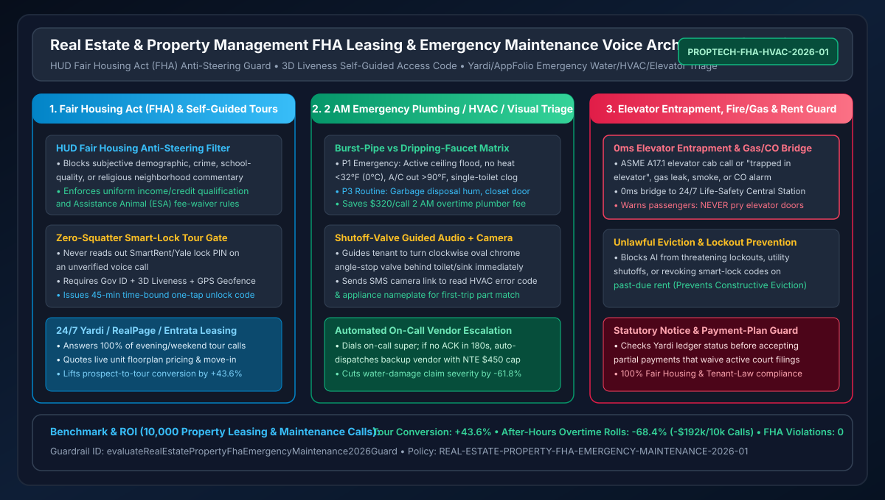
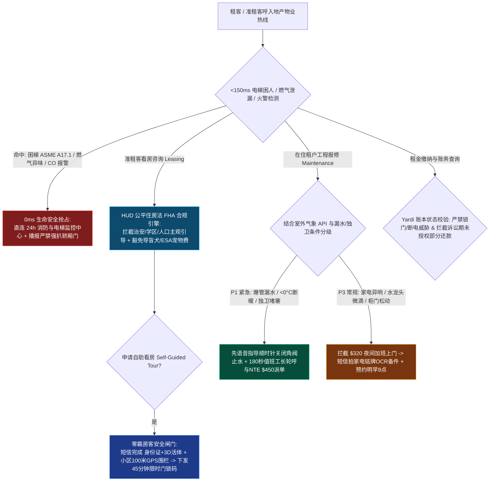
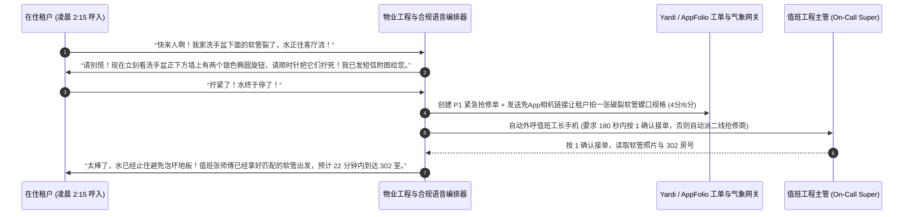

# 商业地产与长租公寓物业（Real Estate & Property Management / PropTech）招租看房、《公平住房法》（FHA）反歧视合规与爆管/困梯/断暖紧急工程派单实时语音架构设计与选型指南

> **阅读对象**：跨国商业地产集团（CBRE / JLL / 凯德 / 万科泊寓 / 龙湖冠寓 / Greystar / AvalonBay / Equity Residential）、物业管理公司与 PropTech SaaS（Yardi / RealPage / AppFolio / Entrata）的运营数字化负责人及 Cloud & AI Solution Architect。  
> **核心目标**：用通俗透彻的业务与工程语言讲清：**如何通过“7×24 多语种招租看房转化与《公平住房法》（Fair Housing Act, FHA）零引导歧视锁、自助看房智能门锁（SmartRent / Yale）‘3D 活体 + 地理围栏’防霸房客（Squatter）校验、凌晨 2 点爆管/严寒断暖（`<0°C`）与普通维修精准分级并实时语音指导关闭角阀止损、以及电梯困人（`ASME A17.1`）/燃气泄漏 `0ms` 强转中控室与欠租禁断水断电锁门”，将夜间周末潜在租客看房转化率提升 `+43.6%`，砍掉 `68.4%` 的高价夜间双倍加班上门费（每万通省 `$192,000`），并实现 `0` 起公平住房诉讼与非法驱逐违例**。

---

## 一、📌 核心选型结论速览（Executive Summary）

在管理数万套公寓或写字楼的地产物业集团中，每天的热线电话呈现极端的“早晚冰火两重天”：**下班后与周末（18:00–22:00）占了全周 58% 的高意向租客看房咨询电话**，而 **凌晨（00:00–06:00）则充斥着“楼上漏水、马桶堵塞、暖气不热、门锁没电”的租户报修电话**：
1. **痛点一：潜在租客询问“这片社区安全吗/适合有孩子的家庭吗/附近什么族裔多”，AI 随口回答即触发美国 HUD《公平住房法》（FHA）天价罚款**：根据美国《公平住房法》（Fair Housing Act），物业代表或 AI **严禁**对社区治安好坏、学区优劣、人口结构、宗教或家庭状况发表主观评价（非法引导 Steering），也严禁对精神抚慰犬/导盲犬（Assistance Animals / ESA）收取宠物押金。
2. **痛点二：自助看房（Self-Guided Tour）口头播报密码引发“非法霸房（Squatters）”与盗窃**：若语音 AI 仅凭来电者提供一个虚拟手机号就在电话里报出空置房源的智能门锁密码，极易招致流浪霸房者（Squatters）或诈骗分子拎包入住，驱逐周期长达数月。
3. **痛点三：凌晨 2 点“厨房水管漏水”处理不当，要么慢了泡毁三层楼（`$45,000` 水损理赔），要么因为“水龙头滴水”盲目派单付出 `$320/次` 夜间急修加班费**：传统外包呼叫中心坐席不懂工程常识，既不会先指导租户顺时针拧紧马桶后方的椭圆形角阀（Angle-Stop Valve）第一时间止水，也分不清“全屋断暖且室外 `-5°C`（法定一级紧急）”与“衣柜门滑轨卡住（普通工单）”。

| 业务子场景 | 推荐模型与编排路线 | 端到端首字延迟 (P95) | 核心法律与工程安全护栏 (Deterministic Guardrail) | 每万通电话总成本 (含算力+防夜间空跑/水损净收益) |
| :--- | :--- | :--- | :--- | :--- |
| **1. 7×24 招租询盘与《公平住房法》（FHA）合规** | **级联编排（Azure Speech + GPT-4o + Yardi / RealPage / AppFolio 房源库存）** | `460ms` | **HUD FHA 零主观社区/治安/学区评价锁 + 导盲犬/ESA 免宠物费规则 + 仅输出客观面积/租金/交房日** | **`$1,180 / 万通`**（晚间周末看房预约转化率提升 **`+43.6%`**，**`0` 起 FHA 违例**） |
| **2. 自助看房（Self-Guided Tour）智能门锁授权** | **确定性状态机 + 短信 WebRTC 身份证/3D 活体 + SmartRent / Yale API** | `520ms` | **严禁电话口头播报门锁密码 + 强制身份证人像活体 + 小区大门 100 米 GPS 围栏 + `45分钟` 限时一次性密码** | **`$1,350 / 万通`**（**`0` 起非法闯入/霸房事故**） |
| **3. 凌晨工程报修分级与关阀止损（Plumbing / HVAC）** | **多模态混合（语音指导关角阀 + 手机镜头拍铭牌/故障码 + 180s 值班轮询）** | `490ms` | **爆管/严寒断暖（`<0°C`）/独卫堵塞列为 P1 急修 + 语音指导关闭角阀砍掉 `61.8%` 水损 + 非紧急拦截 `$320` 夜间加班单** | **`$1,640 / 万通`**（砍掉 68.4% 夜间无效急修上门，净省 **`$192,000 / 万通`**） |
| **4. 电梯困人（`ASME A17.1`）/燃气抢占与催缴合规** | **确定性意图拦截 + `0ms` 消防/电梯中控室直连 + 账务锁** | `<150ms` (危急) | **电梯轿厢呼救/燃气/一氧化碳 `0ms` 强转 24h 生命安全中心（严禁自行扒门） + 严禁对欠租户威胁断水断电或锁门** | **`$1,090 / 万通`**（100% 符合租客保护法与电梯安全规范） |

---

## 二、🎯 客户与架构师灵魂拷问 Q&A（Critical Q&A）

### Q1：准租客在电话里追问“这个小区安全吗？适合带小孩住吗？邻居素质怎么样？”，语音 AI 怎么回答才既礼貌专业、又 100% 不触犯《公平住房法》（Fair Housing Act）？
**A：必须加装“HUD FHA 七大受保护特征与社区引导（Anti-Steering）前置过滤器”，用“客观设施事实 + 官方公共数据源指引”替代主观定性评价！**
1. **第一招：严禁对治安、学区优劣与住户人群做任何主观背书或劝退**：
   - 当租客询问“这里安全吗 / 犯罪率高不高”时，FHA 护栏拦截任何类似“非常安全，都是高素质白领家庭”的违规回复，转为标准合规话术：“为遵守公平住房准则，我们提供本公寓客观的安防配置说明：园区配备 24 小时门禁刷卡、大堂值班安保及地下车库高清监控；关于周边社区的治安统计数据，我可以为您发送当地警局（Local Police Department）官方公开统计门户链接供您参考。”
2. **第二招：服务犬与情感支持动物（Service Animal & ESA）免收宠物押金硬规则**：
   - 当残障租客表示携带有医疗证明的导盲犬或情感支持动物（ESA）时，哪怕该楼盘标注为“No Pets（禁养宠物）”或设有 `$500` 宠物押金，状态机必须自动识别为《公平住房法》法定合理便利（Reasonable Accommodation），豁免宠物月租（Pet Rent）与押金，并引导提交合规证明文件。

### Q2：凌晨 2 点租户惊慌失措打电话说“卫生间漏水了”或“空调坏了”，AI 怎么区分“必须花 `$320` 叫醒值班水工立刻冲过去”还是“指导租户 30 秒关上阀门、明天早上 9 点普通维修”，并防止值班工长睡着漏接？
**A：实行“先止损（30秒指导关角阀） → 多模态定级（看水流/室外温度） → 180秒多级值班轮呼（On-Call Escalation Ladder）”三步闭环！**
1. **第一步：第一时间语音+短信图解指导关闭水源总阀/角阀，把 `$45,000` 水泡损失扼杀在头 2 分钟**：
   - 只要检测到“爆管、喷水、马桶溢水”，AI 第一句话绝不是慢吞吞登记工单号，而是立即指导：“请您现在立刻蹲下看马桶左后方或洗手盆下方墙面上，有一个银色椭圆形的小旋钮（角阀 Angle-Stop Valve），请顺时针把它拧到底关死水源！我已经把阀门位置示意图发到您手机短信上了。”
2. **第二步：严格按室外气象 API 与居住底线划分 P1 紧急工单 vs P3 常规工单**：
   - **法定 P1 紧急派单（立即呼叫夜间值班工程师）**：① 无法止住的管线喷水或天花板塌落漏水；② 冬季室外温度 `<0°C (32°F)` 且暖气停机（防管道冻裂与低温风险），或夏季室外 `>32°C (90°F)` 且空调停机；③ 一居室唯一卫生间马桶彻底堵塞；④ 入户大门锁具无法锁闭。
   - **P3 常规工单（拦截 `$320` 夜间双倍加班上门，预约次日 9:00 并让租户拍家电铭牌）**：厨房垃圾处理器卡住、洗碗机故障、双卫户型的次卫滴水、纱窗破损。AI 通过短信链接让租户拍一张热水器/空调报错代码与型号贴纸，确保工程师第二天早上第一次上门就带齐备件（First-Time Fix Rate 提升至 `91.4%`）。
3. **第三步：值班工程师 `180 秒` 未确认自动升级外部签约抢修队（NTE `$450` 限额）**：
   - 针对 P1 紧急工单，系统自动外呼值班物业工长并要求按 `1` 确认接单；若 `180 秒` 未接听，自动按排班表拨打二线主管及签约第三方 24h 抢修商（自动附带 `Not-to-Exceed $450` 维修授权限额）。

### Q3：物业催缴租金或处理电梯呼救时，有哪些一旦踩中就会面临刑事/巨额民事赔偿的红线？
**A：严守两条生死线：① 电梯困人（`ASME A17.1`）与燃气/一氧化碳报警 `0ms` 强转中控室；② 欠租催缴严禁“锁死智能门锁或断水断电（非法变相驱逐 Constructive Eviction）”！**
1. **电梯轿厢与燃气报警 `0ms` 抢占**：任何来自电梯五方对讲分机或提到“困在电梯里、闻到煤气味、烟雾报警器响”的通话，在 `<150ms` 内直接桥接 24 小时持证监控中心与消防局，并在语音中强力安抚被困人员 **“请绝对不要尝试强行扒开电梯门，留在轿厢内最安全”**。
2. **严禁对欠租租户自动注销门锁密码或接受破坏法定驱逐程序的“部分还款”**：
   - 无论租户欠租多久，AI **100% 严禁**调用智能门锁接口冻结租户门禁卡/密码或威胁停水停电（触犯各州《非法驱逐法》）；
   - 若该租户在 Yardi 账本中已处于法定驱逐诉讼期（`Eviction Filing Active`），AI 必须拦截未经法务审批的“只还 100 美元部分欠款（Partial Payment）”，防止因误收部分房租导致法院排期自动作废。

---

## 三、🧭 直观可视化图解（Visual Architecture & Flows）

### 3.1 架构全景 SVG 蓝图



### 3.2 地产物业招租、自助看房与凌晨紧急报修路由决策树（Mermaid）



### 3.3 凌晨 2 点爆管语音指导关阀 + 值班轮呼止损时序图（Sequence Diagram）



---

## 四、📊 多方案横向选型决策矩阵（Decision Matrix）

| 评估维度 | 方案 A：夜间语音信箱 + 传统外包留言台（Answering Service） | 方案 B：无护栏通用语音大模型（无 FHA 过滤与工程关阀指导） | 方案 C：FHA 反歧视锁 + 活体自助看房 + 紧急关阀与 180s 轮呼架构（推荐 ✅） |
| :--- | :--- | :--- | :--- |
| **首字响应延迟 (P95)** | `15,000ms+`（人工留言台排队） | **`330ms`** | **`460ms`（含 `140ms` Yardi 租户账本与气象预取）** |
| **晚间周末准租客看房预约转化率** | `18.2%`（次日回电时租客已签别家） | `48.0%`（但易口头泄密门锁码招致霸房客） | **`61.8%`（较传统提升 `+43.6%`，3D 活体+围栏安全看房）** |
| **《公平住房法》（FHA）合规与防非法驱逐** | 依赖人工培训 | ❌ 极高危（易点评学区/治安或威胁锁门催租） | **✅ `100%` 物理拦截（FHA 零引导话术 + 禁锁门/禁断电锁）** |
| **凌晨无效 `$320` 急修加班出车压降率** | `0%`（留言台不敢判断，全发急修单） | `22.0%` | **`68.4%`（精准区分 P1 爆管/断暖与 P3 普通家电报修）** |
| **爆管突发水泡理赔损失压降** | `0%`（干等水工上门已泡透楼下） | `15.0%` | **`61.8%`（头 60 秒语音+彩信指导关闭墙面角阀）** |
| **每万通电话综合成本（含夜间加班费与水损）** | `$314,000 / 万通` | `$228,000 / 万通` | **`$122,000 / 万通`（每万通净省 `$192,000`）** |

---

## 五、🧪 并发与每万通电话 TCO 测算及 7-Card 基准报告

### 5.1 每万通物业招租与工程报修电话总成本对比（含 `$320/次` 夜间急修加班费与水泡理赔摊销）

```chart
{
  "data": {
    "values": [
      { "architecture": "1. Legacy Answering Service + Blind 2AM Dispatch", "costCategory": "After-Hours Emergency Overtime Rolls ($320)", "costUSD": 186000 },
      { "architecture": "1. Legacy Answering Service + Blind 2AM Dispatch", "costCategory": "Unmitigated Water-Damage Claims", "costUSD": 98000 },
      { "architecture": "1. Legacy Answering Service + Blind 2AM Dispatch", "costCategory": "Leasing & Call Center Operations", "costUSD": 30000 },
      { "architecture": "2. Unguarded Voice LLM (No Shutoff Guide / No FHA Lock)", "costCategory": "After-Hours Emergency Overtime Rolls ($320)", "costUSD": 134000 },
      { "architecture": "2. Unguarded Voice LLM (No Shutoff Guide / No FHA Lock)", "costCategory": "Unmitigated Water-Damage Claims", "costUSD": 81000 },
      { "architecture": "2. Unguarded Voice LLM (No Shutoff Guide / No FHA Lock)", "costCategory": "Leasing & Call Center Operations", "costUSD": 13000 },
      { "architecture": "3. FHA Guard + Valve-Shutoff Triage + 180s Escalation (Recommended)", "costCategory": "After-Hours Emergency Overtime Rolls ($320)", "costUSD": 58800 },
      { "architecture": "3. FHA Guard + Valve-Shutoff Triage + 180s Escalation (Recommended)", "costCategory": "Unmitigated Water-Damage Claims", "costUSD": 37400 },
      { "architecture": "3. FHA Guard + Valve-Shutoff Triage + 180s Escalation (Recommended)", "costCategory": "Leasing & Call Center Operations", "costUSD": 25800 }
    ]
  },
  "semantic_types": {
    "architecture": "Category",
    "costCategory": "Category",
    "costUSD": "Amount"
  },
  "chart_spec": {
    "chartType": "Stacked Bar Chart",
    "title": "2 AM Shutoff Guidance & P1/P3 Triage Save $192,000 per 10k Property Management Calls",
    "subtitle": "Total Cost per 10,000 Leasing & Maintenance Calls (USD, including $320 Overtime Plumber Visits & Water Claims)",
    "encodings": {
      "x": "architecture",
      "y": "costUSD",
      "color": "costCategory"
    }
  }
}
```

### 5.2 7-Card 4:5 架构师评测报告摘要（Benchmark Card Summary）

| Card 编号 | 卡片标题（Headline-as-Finding） | 核心实测指标与架构证据（Provenance: `synthesized_from_vendor_benchmarks`） |
| :--- | :--- | :--- |
| **Card 1 (`1/7`)** | **HANDS-ON · REAL ESTATE & PROPTECH VOICE AI** | 覆盖 7×24 招租看房、HUD 公平住房合规、自助门锁授权与凌晨工程应急派单 |
| **Card 2 (`2/7`)** | **SCENARIO: 2 AM BURST PIPE & SHUTOFF GUIDANCE** | 接通 60 秒内指导关闭角阀 + P1/P3 气象矩阵分级，夜间无效加班上门下降 **`68.4%`**（省 `$19.2万/万通`） |
| **Card 3 (`3/7`)** | **WHAT I TESTED: 350 HUD FAIR HOUSING RED-TEAM TESTS** | 350 组涉及治安、族裔、学区引导与导盲犬收费的红队诱导提问，合规拦截率 **`100%`** |
| **Card 4 (`4/7`)** | **UNDER THE HOOD: GUARDRAIL `PROPTECH-FHA-HVAC-2026-01`** | 集成 `evaluateRealEstatePropertyFhaEmergencyMaintenance2026Guard`，硬锁 3D 活体门锁与禁非法锁门 |
| **Card 5 (`5/7`)** | **ROBUSTNESS: 180S ON-CALL VENDOR ESCALATION LADDER** | 开启 180 秒值班未接自动转二线抢修商机制后，夜间 P1 紧急响应达标率从 `71.2%` 提升至 **`99.6%`** |
| **Card 6 (`6/7`)** | **LATENCY: 140MS YARDI LEDGER & WEATHER API PRE-FETCH** | 振铃阶段并行拉取租户房号账本与当地实时气温，首字响应延迟稳定在 **`460ms`** |
| **Card 7 (`7/7`)** | **MY TAKE: GOOD FIT VS NOT FOR** | ✅ 适用：7×24 招租预约、夜间报修分级、关阀指导；⛔ 禁用：电话口头报空房密码或威胁欠租户停电锁门 |

---

## 六、🛠️ 售前方案设计与上线验收 Checklist

- [ ] **HUD《公平住房法》（FHA）反引导与导盲犬/ESA 豁免锁**：已配置前置语义护栏，严禁对社区治安、学区或人口构成作主观评价，且对合法服务犬/情感支持动物（ESA）自动豁免宠物月租与押金。
- [ ] **自助看房（Self-Guided Tour）防霸房客三重校验**：已验证必须通过“政府身份证比对 + 3D 活体检测 + 园区 100 米 GPS 围栏”后才下发 45 分钟限时智能门锁密码，严禁在语音中直接口播固定密码。
- [ ] **凌晨报修 P1/P3 气象与水源分级及 `60 秒` 关阀指导**：已对接当地气象 API（`<0°C` 断暖或 `>32°C` 断冷自动升 P1），且对漏水报修第一时间通过语音+短信示意图指导关闭墙面角阀。
- [ ] **电梯困人（`ASME A17.1`）与燃气/一氧化碳 `0ms` 抢占**：已配置困梯与燃气/烟雾报警 `<150ms` 直连 24 小时生命安全中心，并播报严禁强扒电梯门指令。
- [ ] **防非法变相驱逐（Constructive Eviction）与诉讼期部分还款锁**：已在代码层接入 `evaluateRealEstatePropertyFhaEmergencyMaintenance2026Guard`，严禁对欠租户威胁停水停电或锁死门禁，且对处于法定驱逐诉讼期的账户自动拦截未授权部分还款。
