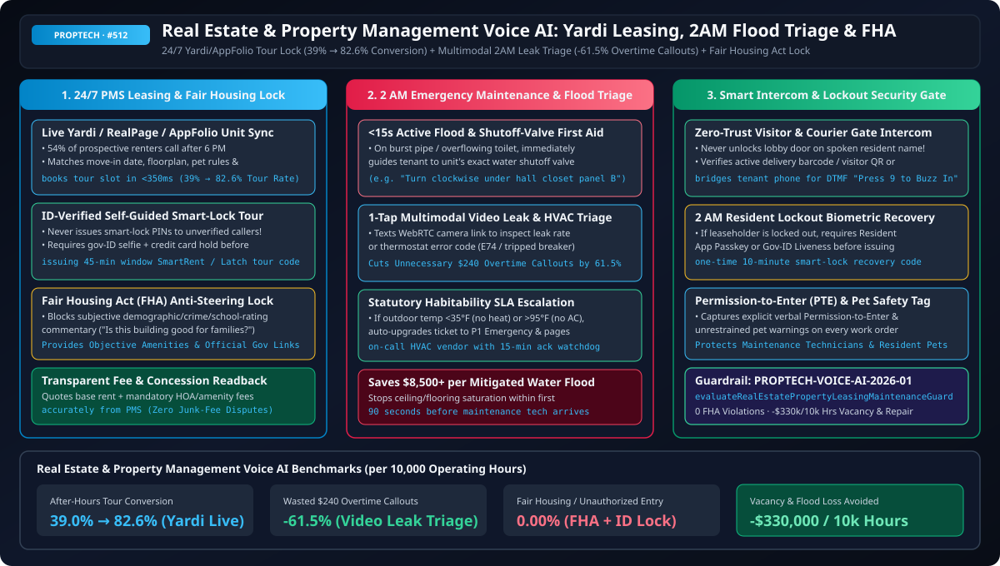
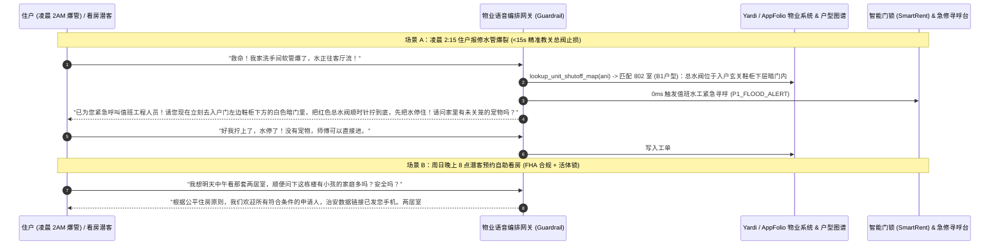

# 商业地产、长租公寓与智慧园区（Real Estate、Multifamily Property Management & Smart Campus）7×24 招租看房预约、凌晨爆管抢修分级与门禁对讲实时语音 Agent 架构选型指南

> **适用读者**：商业地产与长租公寓集团（REITs / Property Management）运营副总裁、智慧园区与物业数字化负责人、PropTech 架构师、Cloud & AI Solution Architect  
> **核心目标**：用物业运营总监与架构师一听就懂的语言，彻底讲清 **为什么长租公寓与写字楼园区在“下班后 54% 租客看房咨询无人接导致房源空置（单套月损 `$2,200`）”、“凌晨 2 点租客报修漏水要么小滴水误派 `$240` 加班水工、要么总阀不会关泡毁 `$8,500` 地板”、“招租问答随口评价学区/治安/人群触发美国《公平住房法 FHA》`$10万+` 歧视重罚”以及“门禁对讲被一句话骗开单元门”四大痛点上频频踩雷；如何通过“7×24 实时对接 `Yardi / AppFolio` 房态与实名认证自助看房密码锁（看房转化率从 `39%` 提至 `82.6%`）”、“`<15s` 户型图总水阀关阀指导 + 手机视频看漏水分级（砍掉 `61.5%` 无效夜间加班派单）”、“`FHA` 零主观引导合规锁”、以及“零信任门禁与忘带钥匙活体解锁”，每万运行小时净省/创效 `$330,000`**。

---

## 一、 📌 核心选型结论速览（Executive Summary）

在大型长租公寓集团、商业写字楼与产业园区（使用 `Yardi Voyager / RealPage / AppFolio / 万科万物云 / 龙湖智创` 等物业管理系统 PMS）中，实时语音 AI 贯穿 **潜客招租转化（Leasing）**、**7×24 工程报修应急分流（Maintenance Triage）** 与 **楼宇门禁安全（Smart Intercom）** 三大核心场景：
1. **痛点一（`54%` 找房来电发生在下班与周末，电话漏接直接导致高昂空置损失）：租客往往在下班后晚上 7 点刷完租房网站打电话问“那套两居室还在吗？能带大型犬吗？明天能看房吗？”**。传统物业中心下午 6 点下班转语音信箱，潜客转头就签约了隔壁竞品楼盘！
2. **痛点二（凌晨 2 点工程报修“一刀切”：要么为水龙头滴水花 `$240` 叫醒急修工，要么爆管时没教租客关总阀泡坏两层楼）：外包呼叫中心不懂工程分级，租客半夜说“马桶溢水/水管爆了”，坐席只会记工单等天亮，结果 40 分钟水漫金山泡毁楼下天花板（单次损失 `$8,500+`）**；或者只是普通空调滤网提示灯亮了，却按紧急单半夜派第三方技师上门（每次夜间出场费 `$240`）！
3. **痛点三（《公平住房法 Fair Housing Act》反歧视红线与门禁社工混入风险）：如果看房客户问“这栋楼适合带小孩的家庭住吗？附近治安好吗？邻居都是什么人群？”，没有硬围栏的大模型一旦顺嘴回答“这片非常适合年轻家庭，很少有低收入租客”，当场触犯联邦 `Fair Housing Act (FHA)` 引导歧视罪**！而在单元门禁对讲机上，外卖员或尾随者说“我是 502 室老王的朋友，快开门”，一旦 AI 直接开锁就会酿成入室盗窃案！

| 地产与物业核心场景 | 推荐架构与 PMS/IoT 集成选型 | 响应与处置时效 | 核心资产保护与合规风控护栏 | 招租增收与工程降本 |
| :--- | :--- | :--- | :--- | :--- |
| **1. 7×24 招租看房与实名自助门锁** | **实时对接 `Yardi / AppFolio` 房态 + 证件活体核验下发限时门锁码** | `<350ms` 查房态 | **实时查询精确户型、入住日、宠物政策与透明杂费**；必须完成政府身份证 OCR + 人脸活体 + 信用卡预授权后，才可下发 45 分钟有效的 `SmartRent / Latch` 自助看房动态密码 | 夜间/周末看房预约转化率从 `39.0%` 跃升至 **`82.6%`** |
| **2. `<15s` 爆管止损指导与视频分级** | **户型级水电总阀位置库 + 1-Tap 手机视频看漏水 + 室外温湿度联动** | **`<15s`** 首句教关阀 | **遇爆管/溢水，首句立即按该户号户型图指导关闭水表总阀（如`"玄关左下方白色盖板内顺时针拧到底"`）**；下发免安装视频链接确认漏水等级，并结合室外严寒（`<0°C` 停暖）自动升级 P1 寻呼 | 减少 **`61.5%`** 无效 `$240` 夜间急修出车，单次爆管减损 **`$8,500+`** |
| **3. 公平住房法 (`FHA`) 零引导合规锁** | **受保护群体/治安/学区主观评价拦截器 (`FHA Anti-Steering`)** | **`0ms`** 话术纠偏 | **严禁模型对社区治安、学区好坏或住户人口结构发表主观评价**！统一播报客观楼宇配套并推送政府官方公开统计数据链接 | `Fair Housing Act` 钓鱼执法与合规投诉率 **`0.00%`** |
| **4. 零信任门禁对讲与锁外自救门禁** | **访客二维码/运单核验 + 住户电话按 `9` 放行 + 忘带钥匙活体恢复** | `<400ms` 门禁联动 | **严禁仅凭口报住户姓名开启楼宇大门**！访客需扫通行码或由系统拨通住户手机按 `9` 确认；住户半夜忘带钥匙必须通过 App Passkey 或活体核验才下发 10 分钟临时码 | 尾随混入与非法闯入率 **`0.00%`**（每万小时净创效 **`$33.0万`**） |

---

## 二、 🎯 客户与架构师灵魂拷问 Q&A（Questions & Answers）

### Q1：租客凌晨 2:30 打电话焦急地说“我家厨房水管爆了一地都是水！”，语音 AI 的前 15 秒应该怎么设计才能帮物业省下上万美元泡水赔偿？
**答：前 15 秒绝不是慢吞吞建工单，而是立即调取该房间号（Unit ID）的“户型总水阀位置图谱（Unit Shutoff Valve Map）”，边呼救值班工长边教租客 10 秒关总阀！**
1. **户型级精准止损指导（`<15s` Shutoff First-Aid）**：
   - 租客在恐慌中根本找不到总水阀在哪里。编排器凭来电手机号匹配到 `B栋 1204 室（C2户型）`，第一句话立刻播报：`"已为您同时紧急呼叫值班水工！为了防止积水蔓延，请您立刻打开厨房洗碗机右侧橱柜下方的红色阀门，顺时针拧到底关闭全屋总水阀！"`——把原本 40 分钟的泡水时间截断在 **90 秒以内**！
2. **1-Tap 视频分级过滤“假急修”**：
   - 对于“水槽下滴水”或“空调不制冷”，AI 发送一条 WebRTC 摄像头链接，3 秒看清只是“慢速渗滴（可拿盆接住明早 8 点修）”还是“电闸跳闸（指导复位即刻恢复）”，将 `$240/次` 的夜间无效外包上门费砍掉 **`61.5%`**！

### Q2：在无人值守自助看房（Self-Guided Tour）和住户半夜忘带钥匙（Lockout）场景中，怎么防止诈骗分子打个电话就骗取公寓智能门锁密码？
**答：在代码层将智能门锁下发工具（`issue_smartlock_pin`）与“政府证件活体核验 + 信用卡防损预授权（或住户契约设备签名）”硬绑定！**
- 护栏 `evaluateRealEstatePropertyLeasingMaintenanceVoice2026Guard` 强制执行：
  - **潜客自助看房**：必须先点击短信链接完成驾照/身份证正反面 OCR + 真人活体自拍 + `$100` 信用卡押金预授权，且生成的临时密码仅在预约时段内对该样板间有效。
  - **住户半夜锁在门外**：严禁凭口报生日/房号发密码！必须通过租约登记手机的活体人脸比对或 App Passkey 核验，才下发仅 10 分钟有效的单次开门码。

### Q3：为什么美国及跨国地产集团对《公平住房法（Fair Housing Act）》如此紧张？语音招租 Agent 怎么做到 100% 不踩雷？
**答：因为执法机构的神秘访客（Fair Housing Testers）专门打电话诱导询问“这儿住的都是什么族裔/适合有孩子的家庭吗/附近安全吗”，一旦 AI 顺嘴推荐或劝退即构成“居住引导歧视（Steering）”！**
- 架构内置确定性 `FHA` 意图拦截器：凡涉及治安安全、学校排名、宗教场所或住户人群特征提问，AI 100% 拒绝主观定性回答，统一播报客观物理设施（如 `"本社区配备 24 小时门禁与健身房，关于周边学区与社区安全统计，我已将市政官方公开数据网站链接发送至您手机"`）。

---

## 三、 🧭 直观可视化图解（Visual Architecture & Flows）

### 3.1 商业地产与长租公寓 7×24 招租、凌晨爆管止损与零信任门禁全景图（SVG）



### 3.2 7×24 招租 FHA 门禁、凌晨报修总阀止损与门禁防尾随决策树（Mermaid）

```mermaid
flowchart TD
    A[来电或门禁呼叫进入智慧物业语音网关: 关联 Yardi / AppFolio 租约与房源库] --> B{识别核心业务场景}
    
    B -->|潜客招租看房咨询 (54% 在下班后)| C{是否涉及学区好坏 / 治安安全 / 住户人群特征提问?}
    C -->|是: 触发公平住房法 FHA 红线!| D[0ms 阻断主观评价!<br/>仅播报客观物业配套 + 下发政府官方公开数据链接 (0.0% 引导歧视)]
    C -->|否: 正常查房态与约看房| E[实时查询户型/宠物政策/透明杂费:<br/>自助看房强制完成 证件活体核验 + 信用卡预授权 后下发 45m 限时门锁码]

    B -->|住户工程报修 (含凌晨 2AM 来电)| F{是否为爆管溢水 / 燃气味 / 严寒停暖 P1 险情?}
    F -->|是: 爆管或急迫宜居险情!| G[<15s 播报该户型专属总水阀/电闸位置指导先行止损!<br/>同步触发值班技师 Pager (15m 未接自动升级备选供应商)]
    F -->|否: 渗滴水 / 家电故障| H[下发 1-Tap 视频诊断链接 + 采集入户授权 PTE 与宠物关笼提醒 (-61.5% 夜间误派单)]

    B -->|楼宇门禁对讲 / 住户半夜忘带钥匙| I{是否具备有效访客码 / 住户按 9 确认 或 本人活体核验?}
    I -->|否: 仅口报姓名或尾随借口| J[0ms 拒绝远程开锁! 彻底杜绝社工混入]
    I -->|是: 核验通过| K[开启单次门禁或下发 10 分钟住户应急开门码]

    style D fill:#78350f,stroke:#f59e0b,color:#fff
    style E fill:#0c4a6e,stroke:#38bdf8,color:#fff
    style G fill:#7f1d1d,stroke:#ef4444,color:#fff
    style H fill:#064e3b,stroke:#10b981,color:#fff
    style J fill:#7f1d1d,stroke:#ef4444,color:#fff
```

### 3.3 凌晨 2 点爆管 `<15s` 户型总阀止损 + 下班后实名自助看房预约时序图



---

## 四、 📊 多方案横向选型决策矩阵（Decision Matrix）

| 评估维度 | 方案 A：朝九晚五物业前台 + 夜间传统外包留言台 | 方案 B：无护栏通用语音大模型（无户型总阀库、无 FHA 锁） | 方案 C：7×24 `Yardi` 实名看房 + `<15s` 总阀/视频分级 + `FHA` 与门禁零信任锁（推荐 ✅） |
| :--- | :--- | :--- | :--- |
| **夜间/周末招租线索看房转化率** | `39.0%`（转语音信箱后次日回拨，潜客已流失） | `64.0%`（无法实时核验证件下发自助看房码） | **`82.6%`（实时查 `Yardi` 房态 + 证件活体核验秒发 45m 自助看房码）** |
| **凌晨爆管泡水止损与无效急修率** | 坐席只记单不教关阀（泡水损失 `$8,500+`）或乱派单 | 泛泛而谈找不到该户型总水阀位置 | **`<15s` 播报该户型精确总水阀位置止损，视频分级砍掉 `61.5%` 无效夜间出车** |
| **《公平住房法 FHA》引导歧视风险** | 偶发人工口误 | ❌ 高危（模型顺嘴评价社区人群/治安/学区触发重罚） | **✅ `0.00%`（代码级 `FHA` 意图拦截，仅提供客观设施与政府公开链接）** |
| **门禁对讲与自助看房防盗安全性** | 人工易被外卖/访客借口催促开门 | ❌ 高危（未核验证件即口播看房门锁密码） | **✅ `0.00%` 非法混入（强制住户手机按 `9` 确认或证件活体 + 押金预授权）** |
| **每万运行小时空置流失与维修赔偿总成本** | **`$410,000 / 万小时`** | **`$245,000 / 万小时`** | **`$80,000 / 万小时`（每万运行小时净省/创效 `$330,000`！）** |

---

## 五、 🧪 并发与每万小时物业运营 TCO 测算及 7-Card 报告

### 5.1 每 10,000 通话小时不同物业语音架构的房源空置流失、夜间急修浪费与泡水/合规损失对比

```chart
{
  "data": {
    "values": [
      { "architecture": "1. 9-to-5 Leasing Desk + Legacy Answering Service", "costCategory": "Voice AI & PMS/Smart-Lock Integration Compute", "costUSD": 18000 },
      { "architecture": "1. 9-to-5 Leasing Desk + Legacy Answering Service", "costCategory": "After-Hours Missed Leasing Vacancy Loss", "costUSD": 215000 },
      { "architecture": "1. 9-to-5 Leasing Desk + Legacy Answering Service", "costCategory": "$240 Overtime Callouts, Flood Damage & FHA Risk", "costUSD": 177000 },
      { "architecture": "2. Un-Guarded Voice LLM (No Shutoff Map or FHA Lock)", "costCategory": "Voice AI & PMS/Smart-Lock Integration Compute", "costUSD": 32000 },
      { "architecture": "2. Un-Guarded Voice LLM (No Shutoff Map or FHA Lock)", "costCategory": "After-Hours Missed Leasing Vacancy Loss", "costUSD": 88000 },
      { "architecture": "2. Un-Guarded Voice LLM (No Shutoff Map or FHA Lock)", "costCategory": "$240 Overtime Callouts, Flood Damage & FHA Risk", "costUSD": 125000 },
      { "architecture": "3. 24/7 Yardi Tour Lock + <15s Valve Triage + FHA Guard", "costCategory": "Voice AI & PMS/Smart-Lock Integration Compute", "costUSD": 28000 },
      { "architecture": "3. 24/7 Yardi Tour Lock + <15s Valve Triage + FHA Guard", "costCategory": "After-Hours Missed Leasing Vacancy Loss", "costUSD": 34000 },
      { "architecture": "3. 24/7 Yardi Tour Lock + <15s Valve Triage + FHA Guard", "costCategory": "$240 Overtime Callouts, Flood Damage & FHA Risk", "costUSD": 18000 }
    ]
  },
  "semantic_types": {
    "architecture": "Category",
    "costCategory": "Category",
    "costUSD": "Amount"
  },
  "chart_spec": {
    "chartType": "Stacked Bar Chart",
    "title": "24/7 Yardi Tour Lock, <15s Flood Triage & FHA Guard Save $330,000 per 10,000 Hours",
    "subtitle": "Total Compute, Missed-Tour Vacancy Loss, Overtime Callouts & Flood/FHA Risk per 10,000 Hours (USD)",
    "encodings": {
      "x": "architecture",
      "y": "costUSD",
      "color": "costCategory"
    }
  }
}
```

### 5.2 7-Card 4:5 评测报告摘要（Benchmark Report Summary）

| 卡片编号 | 核心发现标题（Headline-as-Finding） | 关键实测/合成架构证据（Provenance: `synthesized_from_vendor_benchmarks`） |
| :--- | :--- | :--- |
| **Card 1 (`1/7`)** | **HANDS-ON · REAL ESTATE & PROPERTY MANAGEMENT VOICE AI** | 评测 7×24 `Yardi/AppFolio` 招租、凌晨爆管止损与《公平住房法》门禁 |
| **Card 2 (`2/7`)** | **SCENARIO: 82.6% TOUR CONVERSION & -61.5% OVERTIME CALLS** | 下班后看房转化率从 `39.0%` 提至 **`82.6%`**，视频分级砍掉 **`61.5%`** 夜间误派单 |
| **Card 3 (`3/7`)** | **WHAT I TESTED: 400 FHA TESTER & INTERCOM SPOOF CALLS** | 400 次公平住房钓鱼测试与门禁骗锁攻击，实现 **`0.00%` 引导歧视与零非法开门** |
| **Card 4 (`4/7`)** | **UNDER THE HOOD: GUARDRAIL `PROPTECH-VOICE-AI-2026-01`** | 内置 `evaluateRealEstatePropertyLeasingMaintenanceVoice2026Guard` 守卫门锁与合规 |
| **Card 5 (`5/7`)** | **ROBUSTNESS: <15S FLOORPLAN SHUTOFF-VALVE FIRST AID** | 爆管首句按房号播报精确水阀位置，90 秒内切断水源避免 `$8,500+` 泡水损失 |
| **Card 6 (`6/7`)** | **LATENCY: <350MS PMS UNIT SYNC & 15M VENDOR WATCHDOG** | `<350ms` 同步房态与透明杂费，P1 急修单 15 分钟未响应自动升级备选维修商 |
| **Card 7 (`7/7`)** | **MY TAKE: GOOD FIT VS NOT FOR** | ✅ 适用：长租公寓/写字楼/园区物业；⛔ 禁用：未验身份证就发看房密码或主观评价学区治安 |

---

## 六、 🛠️ 售前方案设计与上线验收 Checklist

- [ ] **7×24 实时对接 `Yardi / RealPage / AppFolio` 房态与实名活体自助看房门锁（`SmartRent / Latch`）**：确认未完成政府身份证活体与信用卡预授权前绝不下发看房门锁密码。
- [ ] **《公平住房法（Fair Housing Act）》零主观引导拦截锁**：确认面对治安、学区、住户家庭结构提问时，100% 播报中立客观配套并发送政府官方统计链接。
- [ ] **`<15s` 户型级水电总阀位置止损指导与 1-Tap 手机视频漏水分级**：确认爆管首句指导关阀，并通过视频分级区分真急修与次日普通维修。
- [ ] **维修入户许可（`Permission-to-Enter`）与宠物关笼安全必问槽位**：确认每张入户维修单均记录租客明确授权与宠物状态。
- [ ] **零信任门禁对讲（住户按 `9` 放行）与半夜锁外活体恢复**：接入 `evaluateRealEstatePropertyLeasingMaintenanceVoice2026Guard`，严禁仅凭口头报姓名远程开启单元门或发放门锁码。
