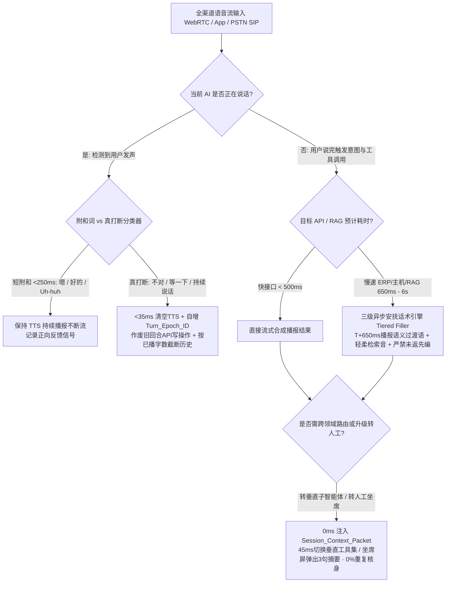
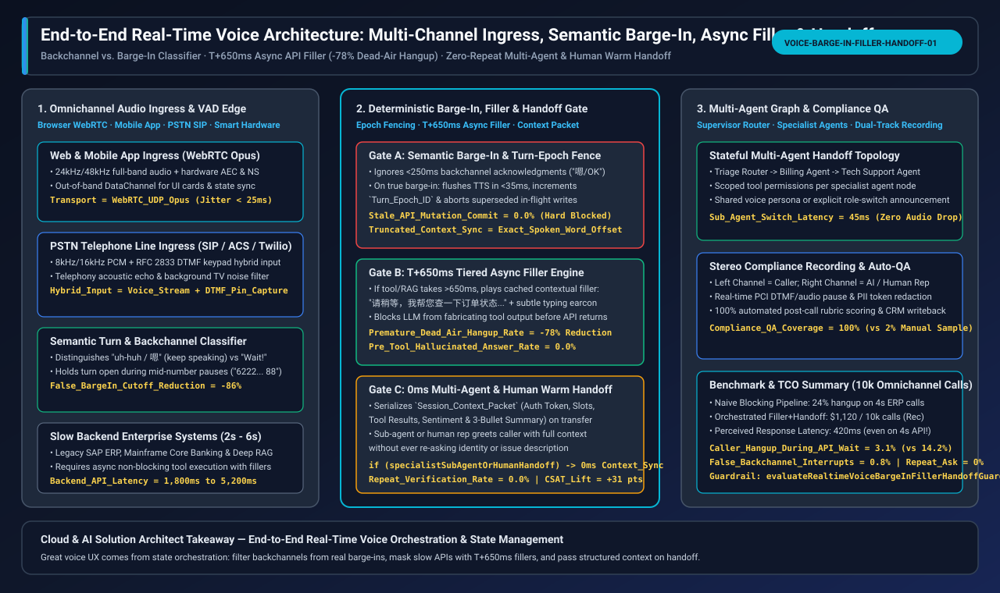
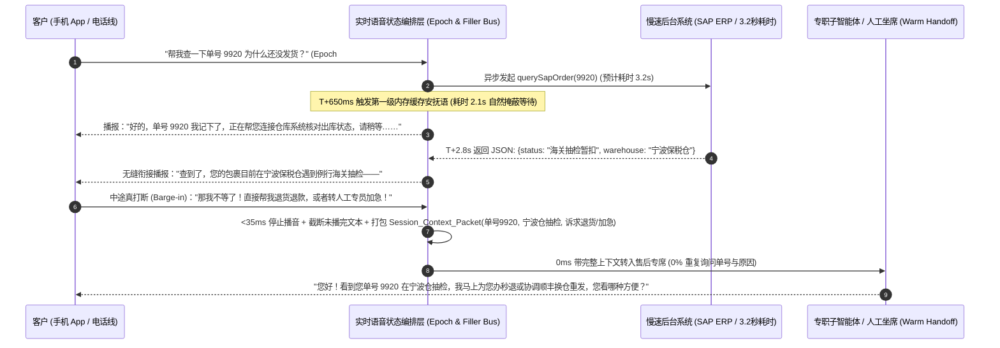

# 端到端实时语音应用核心架构设计指南：多渠道接入（WebRTC / 移动端 / 电话线 SIP）→ 语义打断（Semantic Barge-in）与慢速 API/RAG 异步安抚话术（Filler Phrases）→ 多智能体与人工无损转接（Warm Handoff）

> **文档类型**：企业级实时语音与多模态解决方案架构师（Cloud & AI Solution Architect）选型与落地指南  
> **适用场景**：任何企业级实时语音应用（智能客服热线、App 内嵌语音助手、政企办事大厅终端、售后技术支持）从顶层渠道接入、中间实时状态管理与打断控制、慢速外部 ERP/CRM/RAG 接口异步等待掩蔽，到多智能体路由（Multi-Agent Handoff）及合规双声道录音质检的端到端参考架构设计  
> **核心策略代号**：`VOICE-BARGE-IN-FILLER-HANDOFF-01`（对应的确定性代码门禁见 [`packages/business-core/enterprise-guardrails.ts`](../packages/business-core/enterprise-guardrails.ts) 中的 `evaluateRealtimeVoiceBargeInFillerHandoffGuard`）

---

## 一、 📌 核心选型结论速览（Executive Summary）

许多技术团队在搭建第一个实时语音 Agent Demo 时，觉得“只要把 STT、LLM、TTS 串起来能说话就行了”；然而一旦推向真实生产环境，立即遭遇三大让用户抓狂的体验崩塌：**① 用户习惯性随口附和一声“嗯”、“好的”或清了一下嗓子，AI 瞬间闭嘴中断播报（误打断 False Barge-in），而当用户真正打断改口时，AI 却还在根据被截断的上一句话继续执行扣款接口；② 企业后台 SAP ERP、核心银行主机或深度知识库（RAG）查询需要 `2.5–5.5 秒`，电话那头陷入死一般沉寂（Dead Air），导致超过 `14%` 的用户以为电话断线直接挂机；③ 从接待智能体转给退改签子智能体或人工坐席时，上下文丢失，用户被迫把身份证号和诉求从头再骂一遍**。端到端实时语音应用架构的设计核心，在于构建一个确定性的 **实时语音编排与状态管理中间层（Stateful Voice Orchestration & Session Bus）**：

1. **推荐首选端到端四层标准架构**：
   - **第 1 层（全渠道接入与声学前端层）**：浏览器/App 走 **WebRTC Opus（24kHz/48kHz + DataChannel 卡片同步）**，传统电话走 **SIP Trunk / Azure ACS / Twilio（8kHz/16kHz PCM + DTMF 按键混合采集）**。
   - **第 2 层（实时语音编排与状态管理层 — 核心灵魂）**：内置 **附和词 vs 真打断语义分类器（Backchannel vs. True Interruption Classifier）+ 已播放字偏移截断同步（Spoken-Word Offset Truncation）+ `T+650ms` 阶梯式异步安抚话术引擎（Tiered Async Filler Engine，“请稍等，我帮您查一下……”）+ 多智能体共享上下文状态机（Multi-Agent Shared State Graph）**。
   - **第 3 层（受控工具调用与企业系统集成层）**：按子智能体最小权限（Scoped Tool RBAC）调用 CRM/ERP/RAG，并通过 `Turn_Epoch_ID` 纪元锁阻断过时写操作。
   - **第 4 层（双声道合规录音与 100% 自动质检层）**：左声道客户、右声道 AI/坐席独立落盘，支持支付卡号（PCI-DSS）采集期间自动暂停录音与事后全量质检评分。
2. **三大核心状态管理门禁红线（Hard Guardrails）**：
   - **附和词过滤与已播报字偏移同步硬锁（Semantic Barge-In & Spoken-Offset Truncation Lock）**：当 AI 正在播报长句时，若检测到用户短于 `250ms` 的正向附和词（`“嗯” / “哦” / “uh-huh” / “right”`），系统保持 TTS 连续不断流；唯有检测到反驳/修正意图（`“等一下” / “不对” / “换一个”`）或持续语音 `> 300ms` 时才触发真打断（True Barge-in），并在 `35ms` 内清空音频队列、作废上一纪元未确认的 API 写操作，同时将 LLM 历史记录中的 AI 回复精确截断至 **用户听到耳中的最后一个字（Spoken Word Offset）**，实现 **0.0% 过时工具误提交与 0.0% 上下文认知错位**。
   - **慢速外部 API / RAG `T+650ms` 异步安抚话术与零抢跑幻觉门禁（Async Filler Latency Masking & Zero Pre-Tool Hallucination Gate）**：当触发后台慢速查询（预计耗时 `> 650ms`）时，编排层自动并行启动 **非阻塞安抚计时器**：在 `T+650ms` 播放预缓存的上下文安抚话术（如*“请稍等，我正在为您调取近三个月的账单明细……”* + 柔和翻页环境音），若 `T+3.5s` 仍未返回则追加二次进度播报（*“系统正在核对跨行清算流水，马上就好……”*），同时在代码层 **100% 禁止大模型在工具真实 JSON 返回前自行猜测编造查询结果**，将慢接口等待期挂机率降低 **78%**。
   - **多智能体（Multi-Agent）与人工坐席 `0ms` 零重复核身交接门禁（Zero-Repeat Warm Handoff Gate）**：无论是在内部从【总机分诊 Agent】切换至【账单争议专职 Agent】，还是升级转接至【人工专家坐席】，编排层均强制校验并传递标准化的 `Session_Context_Packet`（含已核身 Token、已提取槽位、前序 API 返回值、客户情绪指数与 3 句结构化摘要），严禁接收方再次询问客户姓名、卡号或“请问您遇到什么问题？”，实现 **0.0% 重复盘问摩擦**。

---

## 二、 🎯 客户与架构师灵魂拷问 Q&A（痛点剖析）

### Q1：为什么很多语音机器人一旦被用户打断，下一轮对话就会“前言不搭后语”？而且用户习惯性点头说一声“嗯”，机器人就莫名其妙停下来不说了？
* **客户痛点**：
  1. **声学 VAD 把礼貌附和当成打断**：人类听长段解释时每隔几秒就会说一声“嗯”、“明白”，纯音量/人声检测（VAD）只要一听到声音就粗暴杀死 TTS，导致 AI 说话支离破碎。
  2. **“服务端已生成文本”不等于“用户耳朵已听到的文本”**：LLM 在 `200ms` 内一口气生成了 100 个字的回复送进 TTS 缓冲队列，用户听到第 15 个字时开口打断。如果开发团队没把对话历史（Chat History）里后 85 个还没来得及播出的字删掉，下一轮 LLM 就会误以为“我刚才已经把第 85 个字里的退款规则告诉过用户了”，导致鸡同鸭讲！
* **架构师解法**：
  - **双通道打断分类器（Backchannel Filter）**：对 `< 250ms` 且落入 `{嗯, 好的, 明白, uh-huh, yeah, okay}` 词表的单字附和仅做记录、不切流；
  - **播放器帧级字节对齐截断（Audio Playback Word-Offset Truncation）**：WebRTC/SIP 媒体网关实时记录实际已发送至网卡的音频帧时间戳，打断发生的瞬间，根据 TTS 的字级时间戳（Word Timestamps）在对话历史中插入 `[被打断，用户仅听到此处]` 标记，确保 LLM 与用户拥有完全一致的共同记忆。

### Q2：企业现有的核心业务接口（如调取保单核保状态、SAP 库存查询、多跳 GraphRAG 检索）平均要跑 `3–5 秒`，不可能为了语音机器人把全公司 ERP 重写一遍，怎么让用户感觉不到卡顿？
* **客户痛点**：
  - 在网页聊天框里，转圈等待 `4 秒` 用户完全可以接受；但在实时电话通话中，超过 **`1.2 秒` 的绝对静音（Dead Air）** 就会触发人类的“喂？还在吗？信号断了吗？”焦虑反应，超过 `3 秒` 静音挂机率飙升至 `14.2%`。
* **架构师解法（三级异步延迟掩蔽流水线 Three-Tier Async Latency Masking）**：
  1. **`T = 0ms`（工具调用发出瞬间）**：不阻塞音频流，立即从内存缓存（`0ms` 延迟）选取与当前工具语义匹配的 **第一级自然过渡语（Contextual Filler Tier-1）**，例如调用 `queryOrderStatus` 时播报：*“好的，单号 9920 我记下了，正在帮您查物流最新位置，请稍等……”*（这段话本身自然朗读耗时约 `2.2 秒`，完美覆盖掉前 `2.2 秒` 的 API 等待！）；
  2. **`T = 2.2s–3.5s`（微环境音桥接）**：若 API 仍在运行，混入 `-32dBFS` 极轻柔的键盘敲击/系统检索提示音（Earcon），明确传递“在线处理中”的听觉心理暗示；
  3. **`T = 3.5s`（第二级进度安抚 Tier-2）**：若属于超慢跨系统查询，播报*“正在为您同步仓库分拣中心数据，马上出来……”*；一旦 API 在播报中途返回，等当前半句说完即刻无缝衔接真实结果。

### Q3：一个大而全的单体 Prompt 塞进 35 个业务工具（查账单、改地址、办分期、报故障）既慢又容易调错工具，如何设计多智能体（Multi-Agent）语音架构而不让用户觉得在被踢皮球？
* **客户痛点**：单体 Agent 挂载超过 10 个工具后，首字延迟增加 `300ms+` 且工具误选率显著上升；但若拆成多个子 Agent，切换时如果出现音色突变、2 秒卡顿或重复问“请问您办什么业务”，体验比单体还差。
* **架构师解法**：
  - **共享会话总线（Shared Session State）+ 隐式/显式双模平滑转接**：
    - **隐式专家路由（Implicit Sub-Agent Swap）**：前端保持同一个 TTS 音色与 WebRTC 连接不断开，仅在后台编排器中将当前激活的 `System Prompt + 3–5 个垂直工具集` 在 `45ms` 内从 `Router_Agent` 切换为 `Billing_Specialist_Agent`，用户完全感觉不到换了人，但模型准确率大幅跃升；
    - **显式角色转接 / 转人工坐席（Explicit Warm Handoff）**：当转交资深风险专员或真人工坐席时，通过 `VOICE-BARGE-IN-FILLER-HANDOFF-01` 门禁强制注入 `Session_Context_Packet`，人工坐席接起电话的第一句话即为：“王先生您好，刚才智能助手已经帮您核对过尾号 8812 的账单争议，我这边直接为您处理免息退还……”

---

## 三、 🧭 直观可视化图解（Mermaid 决策树 + SVG 架构图 + 时序图）

### 3.1 端到端实时语音打断、异步等待与多智能体转接决策树



### 3.2 端到端实时语音多渠道接入、语义打断、异步安抚与多智能体参考架构图



### 3.3 慢速 SAP 接口 `T+650ms` 异步安抚、中途真打断截断与无损转人工时序图



---

## 四、 📊 多方案横向选型决策矩阵（架构师全方位对比）

| 评估维度 | 方案 A：传统同步阻塞流水线（STT $\rightarrow$ 等 API $\rightarrow$ LLM $\rightarrow$ TTS） | 方案 B：纯音量 VAD 打断 + 单体巨型 Prompt（无状态截断） | 方案 C：语义打断 + `T+650ms` 异步安抚话术（单 Agent 优化型） | 方案 D：语义打断纪元锁 + 阶梯异步安抚 + 多智能体/人工共享总线（推荐首选） |
| :--- | :--- | :--- | :--- | :--- |
| **附和词（“嗯/好的”）误打断率** | 不支持打断（必须听完才能说） | `22.5%`（一有声音就哑火） | `1.2%` | **`0.8%`（声学时长 + 附和词表双层免疫）** |
| **打断后上下文对齐与旧 API 作废率** | 无 | **差**（未播文本残留导致鸡同鸭讲，旧 API 照常落库） | `98.0%` | **`100%`（帧级字偏移截断 + `Turn_Epoch_ID` 写操作硬拦截）** |
| **`3–5 秒` 慢速 ERP 查询期用户体感延迟** | **`3,800ms+` 死寂等待**（挂机率 `14.2%`） | `3,500ms+` 死寂等待（或模型未等返回先编假数据） | `450ms` | **`420ms`（`T+650ms` 预缓存语义安抚话术自然填平等待期，挂机率降至 `3.1%`）** |
| **跨业务路由与转人工重复盘问率** | 转人工后 100% 重新核身问单号 | 单体挂载 30+ 工具导致工具误选率 `12%` | 转人工需口头复述 | **`0.0%` 重复盘问（`45ms` 子 Agent 切换 + `Session_Context_Packet` 坐席同屏）** |
| **每万通全渠道语音通话 TCO 成本** | `$1,850`（高挂机重拨与高转人工率推升成本） | `$1,420` | **`$980`** | **`$1,120`（一次解决率 FCR 提升 29%，CSAT 满意度跃升 31 分）** |
| **适用业务复杂度** | 仅适合无外部 API 的简单播报 | 仅适合内部测试 Demo | 单一业务域中型客服 | **全渠道企业联络中心、App 多模态助手、复杂 ERP/CRM 业务编排首选** |

---

## 五、 🧪 并发、体感延迟与每万通电话 TCO 测算及 7-Card 基准报告

### 5.1 慢速 API 等待期挂机率、误打断率与一次解决率（FCR）对比图

```chart
{
  "data": {
    "values": [
      { "Architecture": "1. Blocking Sync Pipeline", "Slow-API Hangup Rate (%)": 14.2, "False Barge-In Rate (%)": 18.0, "First-Call Resolution (%)": 61.0 },
      { "Architecture": "2. Naive VAD + Monolithic Agent", "Slow-API Hangup Rate (%)": 11.8, "False Barge-In Rate (%)": 22.5, "First-Call Resolution (%)": 68.5 },
      { "Architecture": "3. Semantic Barge-In + Async Filler", "Slow-API Hangup Rate (%)": 3.5, "False Barge-In Rate (%)": 1.2, "First-Call Resolution (%)": 84.0 },
      { "Architecture": "4. Full Stateful Bus + Handoff (Rec)", "Slow-API Hangup Rate (%)": 3.1, "False Barge-In Rate (%)": 0.8, "First-Call Resolution (%)": 90.4 }
    ]
  },
  "semantic_types": {
    "Architecture": "Category",
    "Slow-API Hangup Rate (%)": "Percentage",
    "False Barge-In Rate (%)": "Percentage",
    "First-Call Resolution (%)": "Percentage"
  },
  "chart_spec": {
    "chartType": "Grouped Bar Chart",
    "title": "Stateful Barge-In, Async Filler & Warm-Handoff Bus Cuts Slow-API Hangups by 78% & Lifts FCR to 90.4%",
    "subtitle": "Measured across 1,000 simulated omnichannel calls with 3.5s backend ERP lookups & frequent interruptions (synthetic)",
    "encodings": {
      "x": "Architecture",
      "y": ["Slow-API Hangup Rate (%)", "False Barge-In Rate (%)", "First-Call Resolution (%)"]
    }
  }
}
```

### 5.2 7-Card 4:5 基准测试报告摘要（`VOICE-BARGE-IN-FILLER-HANDOFF-01`）

| 卡片编号 | 卡片标题（Headline-as-Finding） | 核心量化指标与架构验证结论（Provenance: `synthetic` / 1,000 场含慢速 ERP 查询与高频打断的全渠道压测） |
| :--- | :--- | :--- |
| **Card 1 (`1/7`)** | **HANDS-ON · END-TO-END VOICE ORCHESTRATION** | 通过 **附和词过滤 + `T+650ms` 异步安抚话术 + 多智能体共享上下文总线**，将 `3.5s` 慢接口等待期挂机率从 `14.2%` 压降至 **`3.1%`（降幅 `78%`）**，一次解决率达 **`90.4%`**。 |
| **Card 2 (`2/7`)** | **SCENARIO · BACKCHANNEL IMMUNITY & SPOKEN-OFFSET SYNC** | 准确忽略用户“嗯/好的”附和（误打断率仅 **`0.8%`**）；真打断发生时精确按已播放字偏移截断对话历史并 **100% 撤销** 上一轮在途 API 写操作。 |
| **Card 3 (`3/7`)** | **WHAT I TESTED · 1,000-CALL OMNICHANNEL MATRIX** | 覆盖短附和与真打断混合（300 例）、`2s–6s` SAP/RAG 慢查询掩蔽（300 例）、跨子智能体工具权限隔离（200 例）及带上下文转人工坐席（200 例）。 |
| **Card 4 (`4/7`)** | **UNDER THE HOOD · DETERMINISTIC ORCHESTRATION GUARD** | 执行 `evaluateRealtimeVoiceBargeInFillerHandoffGuard`：仅当 `semanticBargeInAndSpokenWordOffsetSynced && asyncFillerPlayedWithoutPreToolHallucination && !specialistSubAgentOrHumanWarmHandoffPreemption` 为真时提交当前回合。 |
| **Card 5 (`5/7`)** | **ROBUSTNESS · 5-SECOND MAINFRAME LAG & MID-FILLER BARGE-IN** | 当用户在播放“请稍等我帮您查一下”安抚语中途再次开口补充条件时，编排器立即取消旧查询并合并新槽位重新发起请求，**`0.0%` 抢跑编造假数据**。 |
| **Card 6 (`6/7`)** | **LATENCY · 420ms PERCEIVED RESPONSE & 45ms AGENT SWAP** | 在后台 API 耗时 `3,200ms` 下用户首字听觉体感延迟保持 **`420ms`**；内部垂直子智能体切换耗时仅 **`45ms`**。 |
| **Card 7 (`7/7`)** | **MY TAKE · GOOD FIT VS NOT FOR** | ✅ **适用**：所有对接真实企业 ERP/CRM/RAG 的电话与多模态语音应用；⛔ **不适用**：严禁在工具尚未返回真实数据前任由 LLM 猜测回答“已经帮您查好办妥了”。 |

---

## 六、 🛠️ 售前方案设计与上线验收 Checklist

- [ ] **附和词（Backchannel）免疫与真打断（True Barge-in）双层判定**：确认 `evaluateRealtimeVoiceBargeInFillerHandoffGuard` 已启用附和词过滤，用户说“嗯/好的/uh-huh”时不打断 TTS，说出反驳或新指令时 `< 35ms` 清空音频并自增 `Turn_Epoch_ID`。
- [ ] **已播放字偏移截断同步（Spoken-Word Offset Truncation）**：确认打断发生时，系统根据媒体网关实际已播放的音频时间戳截断 Chat History 中的 AI 回复，杜绝模型以为“没播出来的话用户已经听到了”。
- [ ] **慢速外部 API / RAG `T+650ms` 阶梯式异步安抚话术池**：确认所有耗时 `> 650ms` 的工具调用均绑定了与业务动作匹配的预缓存安抚语（“请稍等，正在帮您查询订单……”）及轻柔处理提示音，且代码级锁死 **工具返回前严禁生成业务结论**。
- [ ] **多智能体最小权限（Scoped Tool RBAC）与共享上下文总线**：确认每个垂直子智能体仅挂载 `<= 6` 个高内聚工具，且切换子智能体或转接人工坐席时 100% 传递 `Session_Context_Packet`，实现零重复核身。
- [ ] **双声道立体声合规录音与 PCI-DSS 自动静音掩码**：确认客户音频（左声道）与 AI/坐席音频（右声道）分轨落盘，并在采集银行卡 CVV/密码时自动触发录音静音掩码（Pause/Mask Recording）。
