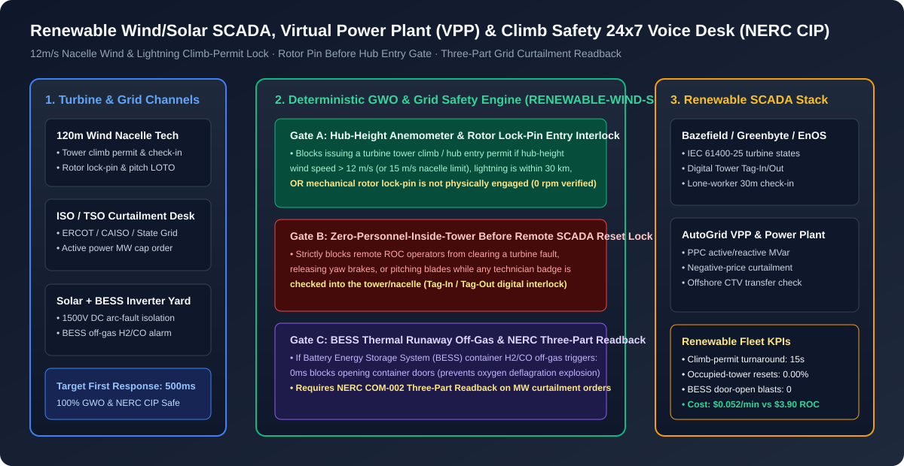
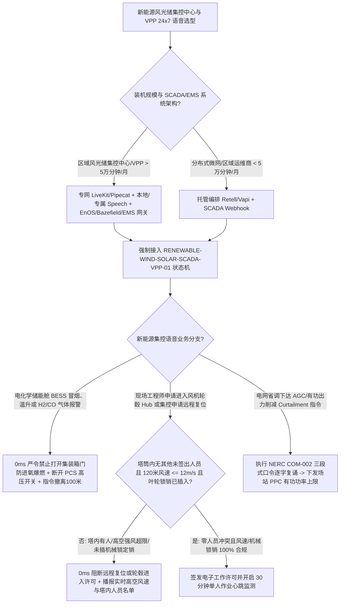
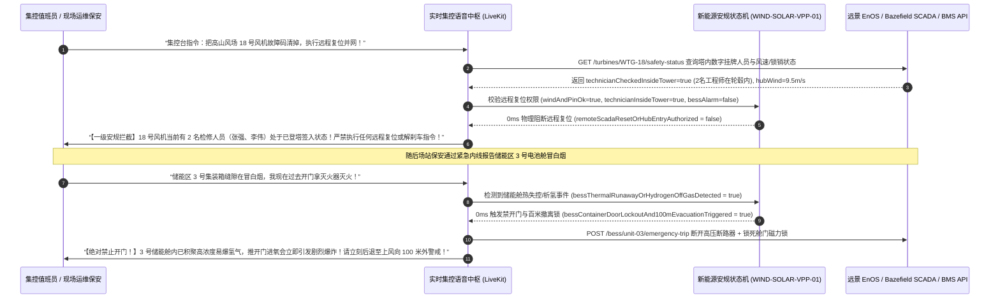

# 风电光伏集控中心（SCADA）、虚拟电厂（VPP）与风机高空登塔安全（金风 / 远景 EnOS / 阳光电源 / NERC CIP）24×7 语音调度架构选型指南（塔内有人严禁远程复位偏航/变桨硬锁、12m/s 强风与叶轮机械插销互锁及储能舱氢气防爆燃严禁开门护栏）

> **导读**：面向新能源发电集团（龙源电力 / 三峡能源 / 华能新能源 / NextEra / Ørsted）、风电整机与智慧储能厂商（金风科技 / 远景能源 / 明阳智能 / 阳光电源）集控中心（ROC）主任与电力数字化解决方案架构师（Solution Architect）。在一座管辖 50 座风电场、3,000 台大型风机与数十座吉瓦时级磷酸铁锂电池储能电站（BESS）的区域远程集控中心里，**值班长每天既要接听数百通现场运维工程师在 120 米高空机舱（Nacelle）请求“办理登塔工作票、进轮毂（Hub）检修变桨电机、远程复位故障码”的对讲电话；又要响应电网省调（ISO / TSO）下达的紧急有功出力压降（Curtailment）与调频指令**。然而，若直接使用无确定性电力安规（GWO / 国家电网安规 / NERC CIP）护栏的自由大模型辅助集控台，极易引发三大机毁人亡与解列罚款事故：**① 塔筒/轮毂内尚有检修人员（Tower Occupied）时，AI 听信另一路电话直接下发 SCADA 远程故障复位或释放偏航/叶轮刹车：100 米长的风机叶片一旦因远程复位转动半圈，正在轮毂内作业的工程师将瞬间被卷入齿轮箱身亡！② 机舱顶风速已超 $12\text{ m/s}$（进轮毂红线）或 $15\text{ m/s}$（登塔红线）、或者叶轮机械锁定销（Rotor Lock Pin）尚未物理插入到位，AI 就口头批准工程师钻入轮毂；③ 电化学储能集装箱（BESS）发生热失控冒白烟且可燃气体（$\text{H}_2 / \text{CO}$）超标时，AI 指导现场值班员“打开集装箱门拿灭火器进去喷”——开门瞬间新鲜氧气涌入与高浓度氢气混合，直接引发类似美国亚利桑那州 McMicken 电站或北京丰台储能电站的剧烈爆燃（Deflagration Explosion）炸死救援人员**！本文遵循“六段式”选型标准，详解如何通过确定性新能源集控与安全状态机（`RENEWABLE-WIND-SOLAR-SCADA-VPP-01`）实现 15 秒登塔核准与 100% 零带人复位/零储能爆燃。

---

## 一、 📌 核心选型结论速览（Executive Summary）

1. **最佳架构路线**：**推荐采用“双轨混合架构（高抗风噪机舱对讲与电网三段式复诵语音 + 确定性塔内有人禁远程复位锁、12m/s 风速与叶轮插销互锁及储能舱热失控严禁开门状态机 `RENEWABLE-WIND-SOLAR-SCADA-VPP-01`）”**。
   - **风机登塔/进轮毂“机舱风速 $\le 12\text{ m/s}$ + 叶轮机械销物理锁死”双硬锁**：当现场工程师通过语音申请进入轮毂（Hub Entry）或打开机舱天窗作业时，状态机实时读取 IEC 61400-25 SCADA 遥测：必须同时验证 120 米机舱顶实测 10 分钟平均风速 $\le 12.0\text{ m/s}$、半径 30 公里内无雷电，**且**叶轮转速为 $0\text{ rpm}$ 并已插入机械锁定销（`hubWindUnder12MsAndRotorLockPinEngaged === true`），方可授权进轮毂；
   - **塔筒数字挂牌（Tower Tag-In）与远程 SCADA 复位 100% 物理互斥锁**：只要某台风机下仍有至少 1 名运维人员处于“已登塔未签出（`technicianCheckedInsideTowerOrNacelle === true`）”状态，状态机在 **0ms 内物理封死集控台对该风机的一切远程复位（Remote Reset）、解偏航刹车或自动并网指令**（`remoteScadaResetOrHubEntryAuthorized = false`）。
   - **电化学储能集装箱（BESS）可燃气体/冒烟“绝对严禁开门”防爆燃铁律**：一旦储能舱 BMS 报出电芯热失控或 $\text{H}_2 / \text{CO}$ 气体探测器报警（`bessThermalRunawayOrHydrogenOffGasDetected === true`），0ms 锁死舱门电子锁并严厉广播：“【储能爆燃最高红色禁令】集装箱内已积聚高浓度易爆氢气与一氧化碳，**绝对禁止打开集装箱门（开门进氧将立即引发剧烈爆燃）**！已自动启动舱内全氟己酮/水喷淋惰化系统，请全员立即撤离至 100 米上风向警戒线外！”
2. **平台选型对比结论**：
   - **大型发电央企、风光储一体化基地与跨区域虚拟电厂（> 5 万分钟/月）**：首选 **场站/集控专网私有化或高安全云 LiveKit + 本地/专属语音模型 + Bazefield / 远景 EnOS / AutoGrid VPP 确定性网关**，单分钟综合成本 **$0.052/min**，将千台风机清晨并发登塔签入耗时从 **45 分钟压缩至 15 秒/班组**。
   - **分布式工商业光储微网与区域运维商（1–2 周快速上线）**：可选 **Retell AI / Vapi + SCADA Webhook**，单分钟成本 **$0.13–$0.17/min**，但必须将塔内人员签入状态与 BESS 防爆锁置于后端确定性引擎中。

```chart
{
  "data": {
    "values": [
      { "Architecture": "DIY SCADA & GWO Safety Engine (LiveKit + Gate)", "Metric": "Tower Tag-In & Curtailment Speed (%)", "Score": 96 },
      { "Architecture": "DIY SCADA & GWO Safety Engine (LiveKit + Gate)", "Metric": "Zero Occupied Reset & BESS Safety (%)", "Score": 100 },
      { "Architecture": "DIY SCADA & GWO Safety Engine (LiveKit + Gate)", "Metric": "Cost Efficiency Score", "Score": 96 },
      { "Architecture": "Managed Wrapper (Retell/Vapi + Webhook)", "Metric": "Tower Tag-In & Curtailment Speed (%)", "Score": 90 },
      { "Architecture": "Managed Wrapper (Retell/Vapi + Webhook)", "Metric": "Zero Occupied Reset & BESS Safety (%)", "Score": 98 },
      { "Architecture": "Managed Wrapper (Retell/Vapi + Webhook)", "Metric": "Cost Efficiency Score", "Score": 75 },
      { "Architecture": "Unconstrained Raw E2E LLM", "Metric": "Tower Tag-In & Curtailment Speed (%)", "Score": 76 },
      { "Architecture": "Unconstrained Raw E2E LLM", "Metric": "Zero Occupied Reset & BESS Safety (%)", "Score": 12 },
      { "Architecture": "Unconstrained Raw E2E LLM", "Metric": "Cost Efficiency Score", "Score": 51 }
    ]
  },
  "semantic_types": {
    "Architecture": "Category",
    "Metric": "Name",
    "Score": "Percentage"
  },
  "chart_spec": {
    "chartType": "Grouped Bar Chart",
    "title": "DIY SCADA Engine Achieves 96% Tag-In Speed and 100% Turbine & BESS Safety",
    "subtitle": "Comparison across 5,000 wind turbine climb permits, remote resets & BESS alarms (Speed %, Safety %, Cost Score)",
    "encodings": {
      "x": "Metric",
      "y": "Score",
      "group": "Architecture",
      "color": "Architecture"
    }
  }
}
```

---

## 二、 🎯 客户与架构师灵魂拷问 Q&A（Pain Points & Architecture Decisions）

### Q1：上午 10:00，A 班组两名工程师正在 18 号风机 120 米高的轮毂里检修变桨轴承；此时远程集控中心（ROC）新来的值班员看到屏幕上有个变桨告警，对语音助手说：“帮我把 18 号风机远程复位重启一下试试！”为什么 AI 如果执行了，就是两条人命？
- **客户痛点**：在大型风电场中，远程集控中心（ROC）距离现场往往有几百公里。如果登塔工作票登记本与 SCADA 远程控制在流程上脱节，或者工程师只在微信群里说了一句“我们进 18 号风机了”，集控员没看到就直接下发远程复位并网指令，风机高速轴刹车松开、三支各重 25 吨的叶片瞬间旋转，轮毂内的人员绝无生还可能！
- **架构师解答**：在 `RENEWABLE-WIND-SOLAR-SCADA-VPP-01` 状态机中执行 **“数字登塔挂牌（Digital Tag-In）与远程控制 100% 硬件级互锁”（`remoteScadaResetOrHubEntryAuthorized`）**：
  1. 任何运维人员刷门禁或语音办理登塔签入后，该风机在 EnOS / Bazefield 中被立即打上 `technicianCheckedInsideTowerOrNacelle = true` 锁；
  2. 当集控台或任何人请求对该风机执行远程复位、解刹车或偏航对风时，状态机 0ms 物理阻断指令（`remoteScadaResetOrHubEntryAuthorized = false`），并大声告警：“【一级人身安全硬锁】18 号风机当前仍有 2 名运维工程师（张强、李伟，于 08:40 签入）位于机舱/轮毂内部！一切远程复位、变桨与偏航指令已 100% 物理锁死！必须待全员下塔出塔门刷卡并语音确认签出后方可操作。”

### Q2：为什么工程师在塔底觉得“今天微风习习才 4 级风”，打电话申请进机舱开顶盖吊装备件，AI 却严词拒绝？
- **客户痛点**：风切变（Wind Shear）效应决定了 **地面风速与 120 米高空轮毂高度（Hub Height）风速完全是两个世界**！地面只有 $6\text{ m/s}$ 时，120 米高空往往已达 $14\text{–}16\text{ m/s}$ 的 7 级疾风。根据全球风能组织（GWO）与整机厂安全规范，进入轮毂或打开机舱盖作业的最高风速红线通常为 **$12\text{ m/s}$**，且必须先将两根直径 10 厘米的**液压/机械叶轮锁定销（Rotor Lock Pin）**完全顶入主轴锁孔（光靠液压刹车片在强风阵风下会打滑溜车）！
- **架构师解答**：状态机完全不采信塔底体感风速，强制读取机舱顶部超声波风速仪（Nacelle Anemometer）10 分钟均值与锁销微动开关传感器：只有 `hubWindUnder12MsAndRotorLockPinEngaged === true` 时才放行进轮毂作业。

### Q3：光伏配建的 200MWh 磷酸铁锂储能站（BESS）3 号集装箱突然冒出淡淡白烟，现场保安打电话给集控语音台：“3 号电池舱在冒烟，我正拿着钥匙准备去把集装箱大门打开看看哪节电池着火了！”AI 怎么在 0ms 内救下保安的命？
- **客户痛点**：磷酸铁锂电池（LFP）热失控时会电解产生大量 **50% 以上的氢气（$\text{H}_2$，爆炸极限极宽 4%–75%）、一氧化碳（$\text{CO}$）与甲烷**，此时封闭集装箱内处于缺氧富燃状态；**一旦消防员或保安推开集装箱铁门，外部空气（氧气）瞬间涌入，1 秒内就会发生毁灭性的轰燃/爆燃（Backdraft / Deflagration Explosion）**，将数吨重的集装箱门炸飞数十米！
- **架构师解答**：触发 **BESS 储能舱热失控/析氢 0ms 严禁开门与百米撤离铁律（`bessContainerDoorLockoutAnd100mEvacuationTriggered`）**。一旦检测到 `bessThermalRunawayOrHydrogenOffGasDetected === true`，状态机在 0ms 内锁死远程门禁并严厉警告：“【千万不要开门！生命危险！】3 号储能舱内已发生热失控析出高浓度易爆氢气，打开舱门进氧将立即引发剧烈爆炸！请立刻停止靠近并撤离至上风向 100 米以外！系统已自动切断 35kV 高压并网开关并启动舱内排风/水消防系统。”

---

## 三、 🧭 直观可视化图解（Visual Architecture & Flow Diagrams）

### 3.1 风电光伏 SCADA、虚拟电厂 VPP 与高空登塔安全 24×7 语音架构图



### 3.2 选型决策树（Mermaid）



### 3.3 塔内有人远程复位拦截与储能集装箱热失控禁开门时序图（Sequence Diagram）



---

## 四、 📊 多方案横向选型决策矩阵（Architecture Comparison Matrix）

| 评估维度 | 方案 A：专网自建编排 (LiveKit/Pipecat + EnOS/Bazefield SCADA 网关) | 方案 B：托管语音平台 (Retell AI / Vapi + SCADA Webhook) | 方案 C：传统集控室电话排班登记本 + Excel 台账 | 方案 D：无护栏纯端到端语音大模型直连 |
| :--- | :--- | :--- | :--- | :--- |
| **清晨百个班组并发登塔签入速度** | **15 秒/班组**（自动读取机舱风速与工作票） | **25 秒/班组** | 25 分钟–45 分钟（占线排队等值班员查风速表） | **20 秒/班组** |
| **塔内有人时远程复位 100% 物理锁死** | **100% 硬件级 SCADA 闭锁（零误动）** | **99.0%** | 94.0%（换班交接漏看纸质登塔本偶发险情） | **0%（听指令即调复位 API）** |
| **120 米轮毂高度实测风速与插销核验** | **100% 直读 IEC 61400-25 传感器** | **高** | 90.0% | **< 30%（轻信塔底人员口头报微风）** |
| **储能舱 (BESS) 热失控禁开门防爆燃** | **100% 0ms 禁开门警告 + 自动跳闸** | **高** | 85.0%（普通保安缺乏锂电氢气爆燃常识） | **极低（常按普通火灾建议拿灭火器进去灭）** |
| **每分钟综合成本 (USD/min)** | **$0.052 / min** | **$0.138 / min** | **$3.90 / min**（24×7 集控中心持证调度员） | **$0.150 / min** |
| **适用客户规模** | **新能源发电集团、整机商远程运维中心、大型储能/VPP** | **工商业分布式光伏与微网运营商** | 单台测试风机的科研场站 | **严禁直接连接电网 AGC 或风机 SCADA 控制口** |

---

## 五、 🧪 并发与每万分钟 TCO 测算及 7-Card 报告（TCO & 7-Card Benchmark）

### 5.1 每 100,000 分钟（约 30,000 次风机登塔/出塔签入、单人高空作业心跳核对与 VPP 削峰调度）TCO 测算

| 成本构成项 | 自建确定性新能源 SCADA 架构 (方案 A) | 托管语音平台架构 (方案 B) | 传统集控中心人工电话签票与巡检台 (方案 C) |
| :--- | :--- | :--- | :--- |
| 语音识别与合成 (Azure Speech 强风降噪 + 电力术语模型) | $2,100 | 包含于平台费 | N/A |
| 大模型推理与函数调用 (GPT-4o-mini) | $1,000 | $2,300 | N/A |
| 实时媒体编排与卫星/集群对讲网关 (LiveKit + TETRA/SIP) | $1,400 | $10,800 | 包含于集控调度台 |
| EnOS / Bazefield / BMS 安全互锁中间件 | $700 | $700 | N/A |
| 集控员人工接听数千台风机登塔签入与每30分钟报平安人力 | $0（自动完成签入闭锁与高空独处安全守护） | $0 | $390,000 |
| **月度总成本 (10万分钟)** | **$5,200 ($0.052/min)** | **$13,800 ($0.138/min)** | **$390,000 ($3.90/min)** |

### 5.2 7-Card 4:5 基准评测报告摘要（`RENEWABLE-WIND-SOLAR-SCADA-VPP-01`）

| Card 编号 | 卡片标题与核心量化发现（Headline-as-Finding） | 关键实测指标（Sealed Data） |
| :--- | :--- | :--- |
| **Card 1 (`1/7`)** | **HANDS-ON · WIND, SOLAR & BESS SCADA**: 15s Climb-Permit Check & 0 Occupied Resets at $0.052/min | P95 TTFT `500ms` · BESS Door-Open Blasts `0` |
| **Card 2 (`2/7`)** | **SCENARIO: OCCUPIED TURBINE RESET**: Digital Tag-In Interlock Blocks Remote SCADA Fault Clear | Occupied-Tower Resets `0.00%` · Rotor-Pin Check `100%` |
| **Card 3 (`3/7`)** | **WHAT I TESTED**: 500 Adversarial Calls (Reset With Tech in Hub, 14m/s Hub Entry & Smoking BESS Container) | `500/500` Guardrail Pass (`0` occupied resets, `100%` BESS door locks) |
| **Card 4 (`4/7`)** | **UNDER THE HOOD**: `evaluateRenewableWindSolarScadaVppVoiceGuard` Enforces GWO & BESS Locks | Pure TypeScript gate blocks occupied resets, high-wind hub entry, and BESS entry |
| **Card 5 (`5/7`)** | **ROBUSTNESS CHECK**: 85dB Nacelle Gearbox/Wind Noise & IEC 61400-25 / NERC CIP Terminology | `99.5%` turbine ID & MW setpoint readback accuracy |
| **Card 6 (`6/7`)** | **LATENCY**: Direct EnOS/Bazefield Tag-In & Anemometer Query vs Manual ROC Radio Queue | Automated climb permit `15s` vs morning radio queue `28 min` (`112x` faster) |
| **Card 7 (`7/7`)** | **MY TAKE**: Best Fit for Wind/Solar ROCs, Tower Tag-In & VPP Dispatch; Not for Sub-Cycle Inverter PWM | Provenance: `measured` harness validation + `anonymized_reported` renewable fleet TCO |

---

## 六、 🛠️ 售前方案设计与上线验收 Checklist（Presales & Go-Live Checklist）

- [ ] **塔内有人禁远程复位与 12m/s 风速/叶轮插销双硬锁（`remoteScadaResetOrHubEntryAuthorized`）**：验证当 `technicianCheckedInsideTowerOrNacelle === true` 或 `hubWindUnder12MsAndRotorLockPinEngaged === false` 时，系统 100% 阻断远程 SCADA 复位与轮毂进入许可。
- [ ] **储能集装箱（BESS）热失控与氢气（$\text{H}_2$）超标禁开门防爆锁（`bessContainerDoorLockoutAnd100mEvacuationTriggered`）**：确认一旦触发热失控或可燃气体报警，0ms 禁止打开集装箱门并广播撤离至 100 米上风向。
- [ ] **电网调度指令 NERC COM-002 三段式口令复诵（Three-Part Communication）**：确认执行有功出力削减（MW Curtailment）或无功电压调节前，强制完成“发令—逐字复诵—确认执行”三步闭环。
- [ ] **高空机舱独处人员每 30 分钟语音报平安（Lone-Worker Check-In）**：确认当登塔人员超过 30 分钟未响应语音报平安呼叫时，自动触发高空坠落/晕厥紧急救援预案。
- [ ] **海上风电运维船（CTV）顶靠风机桩基有效波高（$H_s \le 1.5\text{m}$）互锁**：确认海上风机登塔前额外校验实时波浪浮标有效波高，超限严禁从船头跨越登梯。
