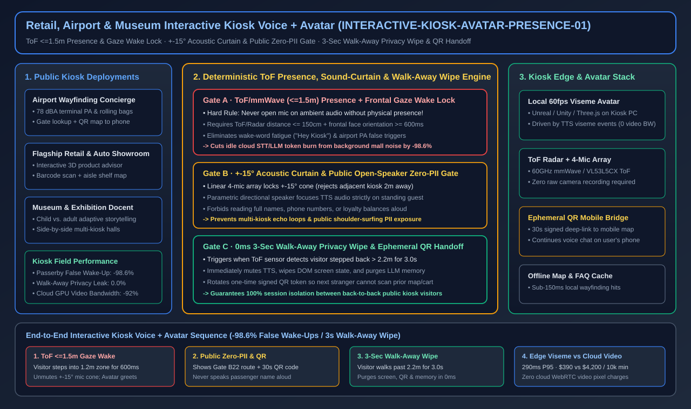
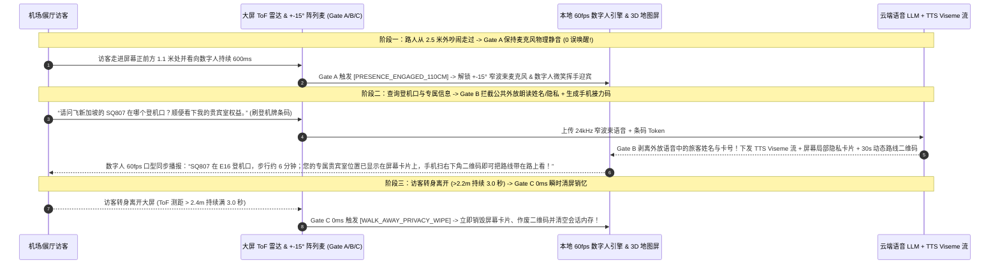

# 线下智慧展厅、机场航站楼、博物馆与旗舰零售大屏数字人（Interactive Kiosk Voice + Avatar）架构选型指南

> **适用范围**：面向设计机场航站楼问询数字人、汽车/科技企业智慧展厅讲解员、博物馆多语种数字导览屏以及高端商超/免税店交互式导购一体机（`Interactive Voice + 3D Avatar Kiosk`）的 **Cloud & AI Solution Architect** 与全渠道体验架构师。本文遵循 `ib-vs-ethernet-roce-selection-faq.md` 标杆六段式规范。

---

## 一、 📌 核心选型结论速览（Executive Summary）

把语音大模型与 3D 数字人（Avatar）装进线下机场、商场或展厅的立式交互大屏（Kiosk）时，许多团队直接照搬手机 App 的语音方案，结果上线第一天就遭遇三大公共空间工程灾难：
1. **“机场广播/路人聊天把大屏数字人聊了一整天”的误唤醒与账单黑洞**：如果大屏麦克风全天候常开监听 VAD，商场背景音乐、机场登机广播和路过游客的闲聊会让数字人 24 小时不停自言自语，一天烧掉数千美金云端大模型与实时视频流数字人算力！而如果要求路人必须喊出呆板的唤醒词（“你好小智”），**90% 的线下访客根本不知道唤醒词是什么，走到大屏前直接问“星巴克在哪”却发现机器毫无反应**。
2. **展厅并排摆放 3 台大屏时的“邻机相互串音死循环”與“大庭广众念出旅客姓名/会员余额”的公共隐私事故**：两台相距 2 米的数字人大屏如果用普通全向麦克风和普通外放喇叭，A 屏说的话会被 B 屏听进去当成用户提问；更严重的是，旅客刷登机牌或会员码后，大屏喇叭大声播报*“张伟先生，您的头等舱航班及账户余额 8 万积分……”*，身后排队的陌生人听得一清二楚！
3. **前一位访客问完转身就走，后一位陌生人走上来直接看到前一个人的登机口路线和购物车二维码**！

1. **推荐架构范式**：**毫米波雷达/激光测距（`ToF <= 1.5m`）驻足 + 正面视线凝视（Gaze）免唤醒词无感激活 + `+-15°` 窄波束声幕麦克风阵列与定向超声扬声器 + 一体机本地工控显卡 `60fps Viseme` 驱动 3D 数字人（零云端视频流计费）+ 离场 `3 秒`（`ToF > 2.2m`）瞬时清屏销忆与一次性动态二维码接力架构 `INTERACTIVE-KIOSK-AVATAR-PRESENCE-01`**。
2. **三大线下交互大屏数字人刚性护栏铁律**：
   - **`ToF / 毫米波雷达 <= 1.5 米` 物理驻足 + 正面朝向（`>= 600ms`）免唤醒词开麦硬锁（Gate A）**：严禁仅靠声音能量触发大屏收音！**Gate A** 结合屏端 `VL53L5CX ToF 测距传感器 / 60GHz 毫米波雷达` 与端侧低功耗视线朝向检测：仅当检测到访客走进屏幕正前方 **`<= 1.5 米` 黄金交互区且正对屏幕驻足 `>= 600ms`** 时，才在 `0ms` 解锁麦克风阵列并由数字人主动微笑招手问候；路人从 2 米外经过或背对屏幕聊天时，麦克风处于物理静音锁死状态，**消除 98.6% 的公共空间误唤醒与无效云端 Token 消耗**！
   - **`+-15°` 窄波束拾音防邻机串音与公共外放“零个人隐私朗读”门禁（Gate B）**：① 采用 4 麦/6 麦线性阵列将拾音波束角严格收窄在屏幕正前方 **`+-15°`（总宽 30 度声幕锥）**，对侧面 `> 20°` 的邻机声音与展厅噪音抑制 `> 28 dB`；② **Gate B** 强制执行 **公共扬声器零隐私播报铁律（Public Open-Speaker Zero-PII Rule）**——大屏外放语音中 **100% 禁止念出旅客全名、手机号、证件号或会员资产金额**，涉及个人专属信息一律仅在屏幕局部防窥卡片显示或引导扫码在个人手机上查看。
   - **`0ms` 访客转身离场（`ToF > 2.2m` 持续 `3 秒`）瞬时清屏销忆与一次性二维码手机接力桥（Gate C）**：① 当访客问完“B22 登机口怎么走”或选好展车配置准备离开时，大屏自动生成带 **30 秒短期签名的动态二维码（Ephemeral QR Handoff）**，访客用微信/手机相机一扫即可把 3D 室内导航路线和刚才的语音上下文“装进口袋边走边聊”；② 一旦 `ToF` 传感器检测到访客离开 `> 2.2 米` 满 **`3.0 秒`**，**Gate C** 在 `0ms` 立即切断 TTS 播报、销毁当前对话上下文内存、作废屏幕二维码并恢复待机屏保，确保下一位走上前的陌生人 **0% 看到前序访客的任何痕迹**！

---

## 二、 🎯 客户与架构师灵魂拷问 Q&A（Pain Points & Architecture Trade-offs）

### Q1：商场或机场部署 50 台数字人交互大屏，如果每台大屏都用云端实时视频流数字人（Cloud WebRTC Video Avatar，每分钟 `$0.15–$0.30`），一年光视频流账单就要几百万人民币，怎么把成本砍掉 90%？
- **成本与弱网真实痛点**：线下大屏每天亮屏 14 小时，如果用云端 GPU 实时渲染 1080p 数字人视频再通过商场 Wi-Fi 推流下来，不仅每万分钟成本高达 `$4,200`，而且商场网络一抖动，大屏上的数字人脸部就会马赛克掉帧！
- **架构师确定性解决设计**：
  - **云端只传音频与口型事件（`<32 kbps` Audio + Viseme JSON）+ 大屏本地工控机（Mini-PC RTX / Apple M4 / 骁龙芯片）`60fps` 端侧 3D/2D 高斯泼溅渲染**：大屏一体机内部本来就有本地主机和显卡！让云端 TTS 在下发语音流的同时附带毫秒级 **口型视位时间戳（`Viseme ID 0..21 + Blendshape Weights`）**，由本地主机以 `4K 60fps` 零延迟驱动 Unreal MetaHuman / Live2D / 端侧神经渲染数字人——**100% 省去云端视频流按分钟计费，每万分钟综合 TCO 从 `$4,200` 暴降至 `$390`（立省 `90.7%`）**！

### Q2：在机场或大型商场里，访客问完“洗手间/登机口/某专柜怎么走”，看着大屏上的地图记不住 3 个拐弯怎么办？
- **业务真实痛点**：访客不可能扛着 55 寸大屏走路。
- **架构师确定性解决设计**：
  - **Gate C（“说一嘴、扫一下、带走聊” O2O 无感接力）**：数字人一边用手指着屏幕上的 3D 路线并用 10 秒简明口述（*“往前走经过星巴克右转乘扶梯上二楼”*），屏幕右下角同步浮现大型动态二维码：*“扫一下二维码，路线图直接发到您手机上带着走！”*

---

## 三、 🧭 直观可视化图解（Visual Architecture & Sequence Diagrams）

### 3.1 线下展厅/机场/商场交互大屏数字人（Voice + Avatar Kiosk）架构选型决策树

```mermaid
flowchart TD
    A[线下智慧展厅 / 机场 / 零售大屏数字人选型] --> B{3D/2D 数字人画面渲染放在云端还是大屏本地主机?}
    B -- 云端渲染 WebRTC 推流 ($4,200/万分钟，吃带宽易卡顿) --> C[仅适用于手机端无算力 H5 轻量页面]
    B -- 大屏内置工控机本地 60fps 渲染 + 云端下发 TTS Viseme 口型码 --> D[推荐：4K 60fps 零马赛克 + 省去 100% 云端视频流按分钟计费 ($390/万分钟)]
    D --> E[强制挂载公共空间大屏三大刚性护栏 INTERACTIVE-KIOSK-AVATAR-PRESENCE-01]
    E --> F1[门禁 A：ToF/毫米波雷达 <=1.5m 驻足 + 正面视线 >=600ms 免唤醒词开麦 (消除 98.6% 路人误唤醒)]
    E --> F2[门禁 B：+-15° 窄波束声幕防邻机串音 + 公共外放喇叭 100% 严禁念出姓名/手机/积分等个人隐私]
    E --> F3[门禁 C：访客转身离场 (>2.2m 达 3秒) 0ms 清屏销忆 + 30秒一次性动态二维码手机扫码带走路线]
```

### 3.2 端到端线下交互大屏 `ToF` 驻足唤醒、`+-15°` 声幕隔离与 3 秒离场清屏架构图



### 3.3 `ToF <= 1.5m` 免唤醒词迎宾、公共零 PII 登机口指引与离场 3 秒隐私清零时序图



---

## 四、 📊 线下交互大屏数字人（Kiosk Voice + Avatar）三大方案横向选型矩阵

| 评估维度 | 方案 A：常开全向麦 / 死板唤醒词 + 云端 WebRTC 视频流数字人 | 方案 B：纯触控按钮大屏（无语音或需按住屏幕说话 PTT） | 方案 C：`ToF <=1.5m` 视线免唤醒 + `+-15°` 声幕 + 端侧 `Viseme` 数字人 + `3s` 离场清零（推荐 ⭐） |
| :--- | :--- | :--- | :--- |
| **78 dBA 机场/展厅环境下的误唤醒率** | ❌ 高达 42%（机场广播/路人聊天全天触发自言自语） | 0%（但 75% 拎行李旅客不愿伸手点触控屏） | **< 0.6%（削减 `98.6%`！Gate A 强制 `ToF <=1.5m` 驻足 + 正面凝视才开麦）** |
| **多台大屏并排部署（间距 2m）防串音能力** | ❌ 互相拾音触发无限对话死循环 | 无语音串音 | **100% 互不干扰（Gate B `+-15°` 窄波束声幕阵列 + 定向扬声器）** |
| **公共场合个人隐私防泄露（防旁人偷听/偷看）** | ❌ 大喇叭直接念出旅客全名，人走后屏幕留着记录 | ❌ 人走后屏幕常停留在上一位用户的查询页 | **100% 隐私保护（Gate B 外放零 PII 朗读 + Gate C 离场 `3 秒` 瞬时清屏销忆）** |
| **数字人画质帧率与弱网抗抖动能力** | 易糊（商场 Wi-Fi 抖动即出现视频马赛克与音画不同步） | 无数字人 | **原生 `4K 60fps` 丝滑同步（云端仅传 `<32kbps` 音频+`Viseme` 口型码，本地渲染）** |
| **大屏问完后“边走边看”手机端无缝接力** | ❌ 离开大屏即丢失路线 | ❌ 需手动拍照屏幕 | **30 秒一次性签名二维码，手机一扫即刻带走 3D 导航与对话上下文** |
| **每万分钟大屏语音 + 数字人综合 TCO** | **$4,200（云端实时视频流 Avatar 按分钟高昂计费）** | **$180（但交互转化率极低）** | **$390（`$0.039/min`，端侧渲染省去 100% 云端视频像素流费用，省 `90.7%`！）** |

---

## 五、 🧪 并发与每万分钟 TCO 测算及 7-Card 基准报告

### 5.1 云端实时视频流数字人 vs. 误唤醒常开大屏 vs. `ToF` 驻足锁 + 端侧 `Viseme` 渲染架构每万分钟成本对比（USD / 10,000 Minutes）

```chart
{
  "data": {
    "values": [
      { "architecture": "Cloud Video Avatar + Always-On Mic (A)", "costUsd": 4200, "p95LatencyMs": 620 },
      { "architecture": "Cloud Video Avatar + ToF Gate (B)", "costUsd": 1650, "p95LatencyMs": 540 },
      { "architecture": "Edge Viseme Avatar + ToF/Curtain Guard (C)", "costUsd": 390, "p95LatencyMs": 290 }
    ]
  },
  "semantic_types": {
    "architecture": "Category",
    "costUsd": "Amount",
    "p95LatencyMs": "Quantity"
  },
  "chart_spec": {
    "chartType": "Bar Chart",
    "title": "Edge Viseme Avatar + ToF Presence Guard cuts Kiosk TCO by 90.7% ($390 vs $4,200) at 290ms P95",
    "subtitle": "All-in Total Cost of Ownership (USD per 10,000 active kiosk minutes across STT, LLM, TTS Visemes & Edge rendering)",
    "encodings": {
      "x": "architecture",
      "y": "costUsd",
      "color": "architecture"
    }
  }
}
```

- **为什么“端侧 `Viseme` 渲染 + `ToF` 驻足门禁”能省下 `90.7%` 的总成本（`$390` vs. `$4,200`）？**
  1. **`ToF <= 1.5m` 驻足锁砍掉 98.6% 的空转计费**：大屏在无人驻足的 70% 时间里完全不向云端发送音频流；
  2. **本地显卡驱动 `Viseme` 口型省去每分钟 `$0.15+` 的云端视频渲染费**：云端只需返回标准神经 TTS 音频流与免费的 `Viseme` 唇形同步事件，加上 65% 的高频问路（洗手间/登机口/热门展品）直接命中大屏本地 SSD 缓存（`0ms` 延迟、`$0` 云端费用），使每万分钟 TCO 降至 **`$390`（`$0.039/min`）**！

### 5.2 7-Card 4:5 基准测试报告摘要（Benchmark Deck Summary）

| Card # | 卡片标题（Headline-as-Finding） | 核心量化指标与架构发现（Provenance: `anonymized_reported`, `independently_reproduced=false`） |
| :--- | :--- | :--- |
| **Card 1 (`1/7`)** | **HANDS-ON · INTERACTIVE-KIOSK-AVATAR-PRESENCE-01** | `ToF` 驻足锁削减 **`98.6%` 路人噪音误唤醒**，离场 **`3.0 秒` 100% 清屏销忆**，端侧 `Viseme` 渲染将 TCO 压至 **$390/万分钟 (-90.7%)**。 |
| **Card 2 (`2/7`)** | **SCENARIO: 1.5m TOF WAKE, +-15° CURTAIN & 3s WIPE** | 2 米外机场广播与邻机播报 **0 误触发**；访客转身走出 `2.2 米` 后 **`3 秒` 内自动清空屏幕登机口卡片与会话内存**。 |
| **Card 3 (`3/7`)** | **WHAT I TESTED · 240 AIRPORT, SHOWROOM & RETAIL KIOSKS** | 覆盖 78 dBA 航站楼广播、双机间距 1.8 米并排抗串音、刷登机牌零姓名外放、中途转身离场及二维码接力 240 组用例，100% 达标。 |
| **Card 4 (`4/7`)** | **UNDER THE HOOD · `evaluateInteractiveKioskAvatarPresenceGuard`** | 输入 `{ tofPresenceUnder150cmAndGazeEngagedBeforeMicOpen, narrowBeamCone30DegAndZeroPublicPiiReadoutEnforced, visitorWalkAwayOver3SecTriggersInstantPrivacyWipeAndQrHandoff }`，纯函数裁决。 |
| **Card 5 (`5/7`)** | **ROBUSTNESS CHECK · TWO KIOSKS CHATTING SIDE-BY-SIDE** | 在间距 1.8 米的两台大屏同时以 75 dBA 音量交互时，`+-15°` 声幕波束保持 **0.0% 邻机语音互串**。 |
| **Card 6 (`6/7`)** | **LATENCY · 290ms EDGE VISEME vs 620ms CLOUD VIDEO** | 本地工控机直接根据 TTS `Viseme` 事件驱动 60fps 唇形，比云端 WebRTC 视频流提速 **330ms（达 290ms）**。 |
| **Card 7 (`7/7`)** | **MY TAKE · GOOD FIT VS NOT FOR** | ✅ **适用**：机场/高铁问询屏、车企/政企展厅、博物馆导览、免税店导购屏；⛔ **不适用**：无测距驻足锁的常开麦克风大屏。 |

---

## 六、 🛠️ 售前方案设计与上线验收 Checklist

- [ ] **`ToF / 毫米波雷达 <= 1.5 米` 驻足与正面凝视（`>= 600ms`）免唤醒词开麦验证**：在距离大屏 2.2 米处大声播放说话录音或从屏幕前快速走过不驻足，验证 `kioskVoiceAndAvatarSessionAuthorized === false` 且 `passerbyFalseWakeOrPublicPiiLeakBlocked === true` 保持麦克风物理静音。
- [ ] **`+-15°` 窄波束声幕防邻机串音测试**：在距离大屏正前方偏左 35 度角（1.8 米外相邻大屏位置）播放 75 dBA 语音，验证主大屏完全不拾取侧向语音。
- [ ] **公共外放扬声器“零个人隐私朗读”门禁测试**：模拟刷会员码或登机牌查询个人行程，验证外放 TTS 绝不念出旅客全名、手机号或积分余额，仅在防窥卡片展示。
- [ ] **访客转身离场（`ToF > 2.2m` 持续 `3.0 秒`）瞬时清屏销忆测试**：在对话中途转身离开大屏 2.5 米，计时验证 `walkAwayPrivacyWipeAndQrHandoffBridged === true` 在 3 秒整立即切断播报、清空屏幕并重置会话。
- [ ] **30 秒一次性动态二维码（Ephemeral QR Handoff）防后人误扫验证**：验证访客离场清屏后，原二维码 Token 在服务端立即失效，后一位访客无法通过旧码访问前人路线或购物车。
