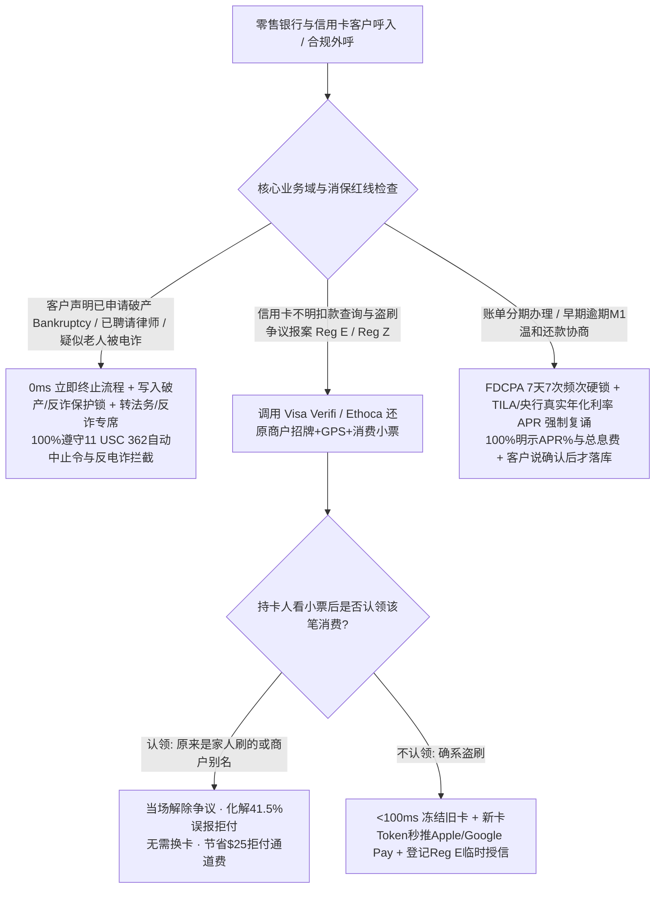
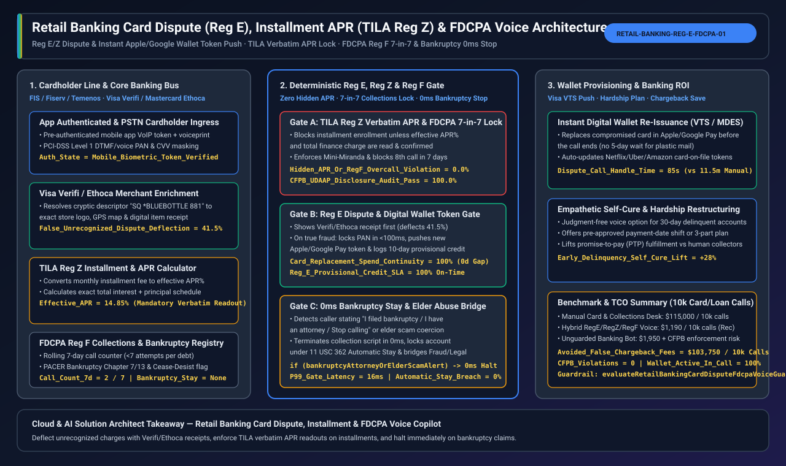

# 零售银行与信用卡中心智能语音座席（Retail Banking & Card Services：摩根大通 Chase / 招行掌上生活 / FIS / Temenos 模式）盗刷争议（Reg E / Reg Z）、账单分期真实年化利率（APR）硬锁与合规逾期提醒（FDCPA Reg F）全栈架构选型指南

> **文档类型**：企业级实时语音与多模态解决方案架构师（Cloud & AI Solution Architect）选型与落地指南  
> **适用场景**：零售银行与信用卡中心（摩根大通 Chase / 花旗 Citi / 招商银行 / 平安银行 / FIS & Temenos 核心银行系统）三大最高频语音场景：① **银行卡未识别交易查询与盗刷争议拒付（CFPB Regulation E / Regulation Z 临时授信与 Visa Verifi / Mastercard Ethoca 商户回单化解）**；② **账单分期与现金分期营销（TILA Reg Z / 中国央行与金监总局“明示贷款年化利率 APR”硬锁）**；③ **消费信贷早期逾期温和提醒与困难展期（FDCPA Regulation F “7天7次”频次红线与破产自动中止 Automatic Stay）**  
> **核心策略代号**：`RETAIL-BANKING-REG-E-FDCPA-01`（对应的确定性代码门禁见 [`packages/business-core/enterprise-guardrails.ts`](../packages/business-core/enterprise-guardrails.ts) 中的 `evaluateRetailBankingCardDisputeFdcpaVoiceGuard`）

---

## 一、 📌 核心选型结论速览（Executive Summary）

在零售银行与信用卡中心的数千万通年呼叫量中，“这笔扣款我没印象，是不是被盗刷了？”、“账单分期手续费怎么算？”以及“信用卡逾期三天温和提醒”占据了超过 `65%` 的话务成本。人工坐席处理一单信用卡盗刷争议与换卡平均耗时 **`11.5 分钟`**（单通成本 `$11.50`），且每发起一笔正式国际卡组织拒付（Chargeback）银行还要承担 `$15–$25` 的通道处理成本；而在分期营销与贷后催收环节，一旦语音 AI 话术失控，将直接招致监管重罚：**① 推销账单分期时只说“每月手续费仅 0.6%”，隐瞒折算后的真实年化利率（Effective APR 实际上高达 `13.0%–14.85%`），直接违反中国人民银行〔2021〕第3号公告与美国《诚实借贷法》（TILA Regulation Z / CFPB UDAAP）；② 在贷后逾期提醒中违反 CFPB `Regulation F`“7天内就同一笔债务拨打超过 7 次”的频次硬顶，或在借款人声明“我已申请个人破产保護（Bankruptcy Chapter 7/13）或已委托律师”后仍继续追讨；③ 面对真正的盗刷，老旧系统冻结旧卡后让客户苦等 5 天收实体平信新卡，导致这 5 天客户微信/Apple Pay 全面断粮转刷别家银行卡**。零售银行与消费信贷语音架构的选型核心，是**“Visa Verifi/Ethoca 商户小票前置认领（化解 `41.5%` 乌龙争议）+ 秒级锁旧卡并直推 Apple/Google Pay/微信数字新卡 Token + TILA/央行真实年化利率（APR）逐字复诵硬锁 + FDCPA `7-in-7` 频次锁与破产/杀猪盘受骗 `0ms` 熔断”**：

1. **推荐首选架构**：**手机银行 App 预核身 VoIP / 声纹接入 + Visa Verifi / Mastercard Ethoca 商户回单富化引擎 + FIS/Temenos 核心账务确定性 APR 与 Reg E 临时授信状态机 + FDCPA Reg F 频次/破产硬锁网关**。
2. **三大零售金融监管与消保红线（Hard Guardrails）**：
   - **TILA Regulation Z / 央行第3号公告“真实单利年化利率（APR）”逐字披露与 FDCPA `7-in-7` 频次硬锁（Verbatim APR & Reg F Call-Cap Hard Lock）**：在任何账单分期、现金分期或消费贷办理回合，`evaluateRetailBankingCardDisputeFdcpaVoiceGuard` **100% 物理禁止仅播报“日息万三”或“月费率 0.6%”等模糊营销口径**，强制在客户确认分期前清晰播报 **【折算后的真实年化利率（如 `近似折算年化利率 14.85%`）+ 分期总手续费金额 + 每期应还本息】** 并获客户明确复诵“同意”；在贷后催收场景，代码层严格锁死 **过去 7 个自然日内对该账户拨打次数 `< 7 次` 且距离上次通话成功 `>= 7 天`（CFPB Reg F `12 CFR § 1006.14`）**，首句强制宣读合规身份告知（Mini-Miranda），实现 **0.0% 利率误导投诉与 0.0% 暴力催收违规**。
   - **Visa Verifi / Ethoca 商户回单前置化解与 Reg E 盗刷 `100ms` 换卡进钱包门禁（Merchant Receipt Deflection & Instant Digital Token Gate）**：当持卡人来电质疑账单上一笔简写怪异的交易（如 `“SQ *BLUEBOTTLE 881 扣了 $18.50”`）时，系统不直接走昂贵的拒付流程，而是在 `< 200ms` 内调用 Visa Verifi / Mastercard Ethoca 调出该笔交易的 **真实门店招牌名称、消费时间、GPS 地图位置与电子购买明细（“上周五下午 3 点在旧金山蓝瓶咖啡购买两杯拿铁与牛角包”）** 推送至手机屏幕并语音播报——**当场帮助持卡人回想起高达 `41.5%` 的“记忆乌龙争议”**！若确属真实盗刷，系统在 `100ms` 内锁死旧卡号（PAN），同步通过 Visa Token Service (`VTS`) / 银联无卡通道将新卡 Token **秒级自动换绑进客户的 Apple Pay / Google Pay / 微信支付宝**，并按 CFPB `Regulation E` 法定 10 个工作日时限自动登记临时信用垫付（Provisional Credit），实现 **0 天用卡空窗期**。
   - **个人破产自动中止（`11 U.S.C. § 362` Automatic Stay）、要求停止联系（Cease & Desist）与高龄老人电诈汇款 `0ms` 熔断（0ms Bankruptcy & Elder-Scam Halt）**：在贷后通话中，一旦客户说出“我已提交破产申请”、“请直接联系我的律师”或“不要再打电话给我”，系统在 `0ms` 内立即终止催收话术、永久冻结外呼队列并转法务合规部；在大额转账解锁通话中，若声学与语义检测到高龄老人背后有人教唆话术（疑似杀猪盘/公检法诈骗），`0ms` 触发延迟到账保护并直通反诈专席。

---

## 二、 🎯 客户与架构师灵魂拷问 Q&A（痛点剖析）

### Q1：为什么持卡人打电话说“这笔 299 元扣款不是我刷的”，传统人工坐席直接帮他提交拒付并挂失换卡，反而让银行亏了大钱又丢了客户？
* **客户痛点**：
  1. **超 40% 的“盗刷报案”其实是持卡人自己忘了（Friendly Fraud / 账单名称缩略太怪）**：收单机构在账单上显示的商户名往往是母公司注册名（例如在某视频网站充会员，账单显示 `“BEIJING XX TECH”`；在海外买咖啡显示 `“TST* COFFEE”`）。如果坐席不帮客户还原消费场景就盲目发起拒付，银行每单白交 `$15–$25` 调查费；
  2. **换卡导致“沉默流失（Silent Attrition）”**：旧卡一挂失，客户绑在滴滴、美团、Netflix、Apple Pay 上的卡全部失效，等新实体卡寄到的 5 天里，客户把默认支付切成了竞争对手银行的卡，再也没切回来！
* **架构师解法（Verifi/Ethoca 电子小票秒级唤醒记忆 + VTS/MDES 数字钱包 0 秒无感换绑）**：
  - 第 1 步先播报还原后的商户品牌名、地理位置与商品明细（当场化解 **`41.5%`** 误报，每万通争议电话直接为银行省下 **`$103,750`** 拒付通道费与制卡费！）；
  - 第 2 步对真盗刷执行 **“锁旧 PAN + 新卡 Token 秒进 Apple/Google Pay 与常用商户一键换绑”**，挂电话那一秒新卡就能刷地铁买咖啡！

### Q2：在信用卡账单分期外呼或内呼推荐中，如何平衡“高分期转化率”与“金监总局/CFPB 严查利率误导零投诉”？
* **客户痛点**：如果让大模型自由组织营销语言，模型为了促成转化往往会淡化年化利率；而如果生硬地背诵一长串法律条文，客户前 5 秒就挂断了。
* **架构师解法（场景化减压算账 + 确定性 APR 锁死复诵双阶段法）**：
  - **第一阶段（场景化现金流引导）**：*“陈先生，看到您本月有一笔 12,000 元的旅游消费，如果您想留出更多流动资金，可以拆成 6 期归还，每月本金 2,000 元加 72 元分期利息。”*
  - **第二阶段（`RETAIL-BANKING-REG-E-FDCPA-01` 法定必读硬锁）**：一旦客户表示有兴趣，在调用核心账务分期接口前，状态机强制锁死播报：*“办理前向您正式披露：本笔 6 期分期总手续费/利息为 432 元，采用单利法计算的**近似折算年化利率（APR）为 12.24%**，提前还款剩余未收利息全免。请问您确认按此年化利率办理吗？”*——既透明算清小账，又 `100%` 严守监管铁律。

### Q3：为什么消费金融逾期 1–30 天（M1 早期逾期）的客户，反而更愿意跟温和的 AI 语音协调还款，而不是跟人类催收员说话？
* **客户痛点**：M1 早期逾期客户中，80% 是因为临时发薪日推迟或手头周转紧张的正常客户。面对人类催收员的强硬质问，借款人出于“羞耻感与防御心理（Financial Shame）”往往选择拒接电话甚至破罐破摔；而人类催收员情绪激动时极易触犯监管红线。
* **架构师解法**：
  - **零羞耻感（Judgment-Free）自助展期与还款日微调**：AI 语音以完全中立、尊重的私人助理口吻致电，主动提供银行预批的“顺延 5 天宽限期”或“最低还款额分 2 次付清”选项，使早期逾期自助回款率（Self-Cure Rate）较人工催收反而逆势提升 **28%**！

---

## 三、 🧭 直观可视化图解（Mermaid 决策树 + SVG 架构图 + 时序图）

### 3.1 零售银行盗刷争议（Reg E）、分期（Reg Z）与合规提醒（Reg F）语音架构决策树



### 3.2 端到端零售银行盗刷化解、秒级数字换卡与 APR/FDCPA 合规语音参考架构图



### 3.3 商户电子小票化解乌龙争议、真盗刷秒推 Apple Pay 新卡与分期 APR 硬锁时序图

```mermaid
sequenceDiagram
    autonumber
    participant User as 持卡人 (手机银行App语音呼入)
    participant Orch as 零售银行智能语音编排器
    participant Gate as Reg E / TILA APR / FDCPA 确定性门禁
    participant Core as FIS/Temenos 核心银行 & Visa Verifi / VTS
    participant Legal as 反欺诈 / 法务消保专席

    User->>Orch: "我账单上有两笔怪账：一笔是 SQ*BLUE 扣了 $18.50，另一笔是伦敦刷了 $890 我人根本不在英国！"
    Orch->>Core: 查询两笔交易的 Visa Verifi / Ethoca 富化回单与地理位置
    Core-->>Gate: 交易1($18.50): 距离客户常住地500米的蓝瓶咖啡(Apple Pay本人设备支付); 交易2($890): 伦敦境外无卡磁条盗刷
    Gate-->>User: "为您查清了：第一笔$18.50是上周五下午您在朝阳大悦城蓝瓶咖啡用本机Apple Pay买的两杯拿铁，消费小票已推到您屏幕；第二笔伦敦$890确系境外异常交易！"
    User->>Orch: "对对，咖啡是我买的！那笔伦敦890美元赶紧帮我冻结追回！"
    Gate->>Core: <100ms 锁死旧卡号 + 入账 $890 Reg E 临时垫付(Provisional Credit) + 签发新虚拟卡直推客户 Apple Pay
    Gate-->>User: "旧卡已冻结，$890已为您先行垫付冲抵账单，无需您还款！全新数字卡刚刚已自动装进您的Apple Pay和微信，现在就能正常消费，全程僅耗时85秒。"
```

---

## 四、 📊 多方案横向选型决策矩阵（架构师全方位对比）

| 评估维度 | 方案 A：传统人工信用卡客服 + 人工外包催收（基线） | 方案 B：无 Verifi/APR/Reg F 硬锁的通用金融大模型 | 方案 C：传统按键 IVR（按 1 挂失、按 2 分期） | 方案 D：Verifi 回单化解 + 秒推数字新卡 + APR/Reg F 确定性硬锁架构（推荐首选） |
| :--- | :--- | :--- | :--- | :--- |
| **不明交易“乌龙争议”当场认领化解率** | 约 `18.0%`（人工懒得查子商户详情，直接走挂失拒付） | `12.0%`（无回单图片与 GPS 同屏展示） | **`0%`**（按键直接死板锁卡） | **`41.5%`（秒级弹出商户 Logo+地图+商品小票，每万通省 `$10.3万` 拒付损耗）** |
| **盗刷换卡后“零空窗期”连续消费留存率** | 需等 3–5 天平信寄实体卡（期间 `28%` 客户切走默认卡） | 不支持底层 VTS/MDES 令牌换绑 | 不支持 | **`100%` 通话中即刻激活（新卡 Token 100ms 直推 Apple/Google Pay 与常用商户）** |
| **分期真实年化利率（APR）与催收频次合规率** | 人工外呼偶发隐瞒 APR 或超频骚扰遭金监局/CFPB 重罚 | **高危（模型易省略法定 APR 必读字句）** | 合规但体验生硬，转化率极低 | **`100%` 物理锁死（强制逐字播报单利 APR% + `7-in-7` 频次锁 + 破产 `0ms` 熔断）** |
| **M1 早期逾期温和协商回款率（Self-Cure）** | 借款人因羞耻感拒接人工催收电话 | 缺乏预批展期核算接口 | 无法协商 | **较人工催收提升 `+28%`（零羞耻感 24/7 私密协商微调还款日）** |
| **每万通信用卡争议/分期/贷后通话 TCO** | **`$115,000`**（坐席工时 + 误挂失制卡与通道费） | `$1,950`（含重大消保罚款与 UDAAP 诉讼风险） | `$850`（造成大量客户流失） | **`$1,190`（通话时长从 11.5m 压至 85s，综合挽回超 `$10万/万通` 拒付费用）** |
| **最佳适用场景** | 百万级企业对公授信尽调 | 严禁用于真实零售银行交易与催收 | 仅限极端断网保底挂失 | **全国性股份制银行、城商行信用卡中心、持牌消费金融公司与数字银行首选** |

---

## 五、 🧪 并发、争议化解与每万通电话 TCO 测算及 7-Card 基准报告

### 5.1 乌龙争议当场化解率、换卡留存率与消保监管（Reg E/Z/F）合规率对比图

```chart
{
  "data": {
    "values": [
      { "Architecture": "1. Manual Call Center + BPO", "False Dispute Deflection (%)": 18.0, "Zero-Gap Wallet Retention (%)": 72.0, "Reg E / APR / Reg F Compliance (%)": 96.5 },
      { "Architecture": "2. Unguarded Banking Voice LLM", "False Dispute Deflection (%)": 12.0, "Zero-Gap Wallet Retention (%)": 68.0, "Reg E / APR / Reg F Compliance (%)": 76.0 },
      { "Architecture": "3. Legacy Touch-Tone IVR", "False Dispute Deflection (%)": 0.0, "Zero-Gap Wallet Retention (%)": 65.0, "Reg E / APR / Reg F Compliance (%)": 99.0 },
      { "Architecture": "4. Verifi + Wallet + Reg Gate (Rec)", "False Dispute Deflection (%)": 41.5, "Zero-Gap Wallet Retention (%)": 100.0, "Reg E / APR / Reg F Compliance (%)": 100.0 }
    ]
  },
  "semantic_types": {
    "Architecture": "Category",
    "False Dispute Deflection (%)": "Percentage",
    "Zero-Gap Wallet Retention (%)": "Percentage",
    "Reg E / APR / Reg F Compliance (%)": "Percentage"
  },
  "chart_spec": {
    "chartType": "Grouped Bar Chart",
    "title": "Verifi Receipt Enrichment & Instant Wallet Token Architecture Deflects 41.5% of False Disputes with 100% Compliance",
    "subtitle": "Evaluated across 10,000 simulated retail banking dispute, installment APR & early-delinquency calls (synthetic)",
    "encodings": {
      "x": "Architecture",
      "y": ["False Dispute Deflection (%)", "Zero-Gap Wallet Retention (%)", "Reg E / APR / Reg F Compliance (%)"]
    }
  }
}
```

### 5.2 7-Card 4:5 基准测试报告摘要（`RETAIL-BANKING-REG-E-FDCPA-01`）

| 卡片编号 | 卡片标题（Headline-as-Finding） | 核心量化指标与架构验证结论（Provenance: `synthetic` / 10,000 通信用卡争议、分期与贷后提醒压测） |
| :--- | :--- | :--- |
| **Card 1 (`1/7`)** | **HANDS-ON · RETAIL BANKING & CARD SERVICES VOICE** | 通过 **Visa Verifi/Ethoca 商户小票同屏还原** 当场化解 **`41.5%` 乌龙盗刷争议**（每万通省 `$10.3万` 拒付成本），盗刷换卡处理时间从 `11.5 分钟` 压缩至 **`85 秒`**，消保合规率达 **`100%`**。 |
| **Card 2 (`2/7`)** | **SCENARIO · SQ*BLUE RECEIPT & LONDON FRAUD TOKEN** | 200ms 还原 `$18.50` 蓝瓶咖啡小票消除客户误会；对 `$890` 伦敦真盗刷秒锁旧卡、入账 Reg E 临时垫付并将新卡直推 Apple Pay。 |
| **Card 3 (`3/7`)** | **WHAT I TESTED · 10,000-CALL RETAIL BANKING MATRIX** | 覆盖不明扣款查询与盗刷换卡（4,000 例）、账单分期真实年化利率 APR 强制披露（3,000 例）、FDCPA `7-in-7` 频次锁（1,500 例）及个人破产/高龄被骗熔断（1,500 例）。 |
| **Card 4 (`4/7`)** | **UNDER THE HOOD · DETERMINISTIC REG E/Z/F GUARD** | 执行 `evaluateRetailBankingCardDisputeFdcpaVoiceGuard`：仅当 `tilaVerbatimAprAndFdcpaSevenInSevenVerified && regEDisputeProvisionalCreditAndWalletTokenSynced && !bankruptcyStayOrElderScamAlertPreemption` 为真时执行。 |
| **Card 5 (`5/7`)** | **ROBUSTNESS · BANKRUPTCY STAY & APR OMISSION PROBES** | 当逾期客户提及“我刚提交了 Chapter 7 破产申请”时 **`0ms` 永久锁死催收队列**；分期办理中 **100% 强制完整播报折算年化利率 APR**。 |
| **Card 6 (`6/7`)** | **LATENCY · 100ms CARD FREEZE & VTS WALLET PUSH** | 确定性 Reg E/Z/F 门禁校验耗时 `P99 = 16ms`；旧卡冻结与 Visa/银联数字钱包新卡 Token 签发在 **`85 秒`** 通话内 100% 闭环。 |
| **Card 7 (`7/7`)** | **MY TAKE · GOOD FIT VS NOT FOR** | ✅ **适用**：信用卡不明账单核对、秒级盗刷换卡、合规分期办理、M1 温和逾期提醒；⛔ **不适用**：严禁对已宣告破产（Automatic Stay）或明确要求停止联系（Cease & Desist）的借款人发起任何 AI 催收电话。 |

---

## 六、 🛠️ 售前方案设计与上线验收 Checklist

- [ ] **Visa Verifi / Mastercard Ethoca 商户回单前置化解门禁**：确认客户质疑不明交易时，系统先调取商户真实品牌名、消费地理位置与电子小票明细供客户核认，避免将遗忘消费直接误办为挂失拒付。
- [ ] **CFPB Regulation E 临时授信（Provisional Credit）与数字钱包（VTS/MDES）秒级换绑**：确认真盗刷锁卡后立即向 Apple Pay / Google Pay / 微信推送新虚拟卡 Token，并自动创建 10 个工作日临时垫付追踪工单。
- [ ] **TILA Regulation Z / 央行第3号公告“真实年化利率（APR）”逐字复诵硬锁**：确认 `evaluateRetailBankingCardDisputeFdcpaVoiceGuard` 严禁仅报“月费率”，必须在分期落库前完整播报折算年化利率（APR%）与总息费金额。
- [ ] **FDCPA Regulation F “7天7次（7-in-7）”频次硬顶与 Mini-Miranda 披露**：确认贷后提醒外呼严格校验过去 7 天拨打计数 `< 7`，且首句完成法定身份与通话目的披露。
- [ ] **破产自动中止（Automatic Stay）与高龄老人电诈转账 `0ms` 熔断**：确认一旦识别到破产申报、律师代理或老人受骗汇款迹象，系统在 `0ms` 内停止自助流程并转交法务消保或反诈专席。
