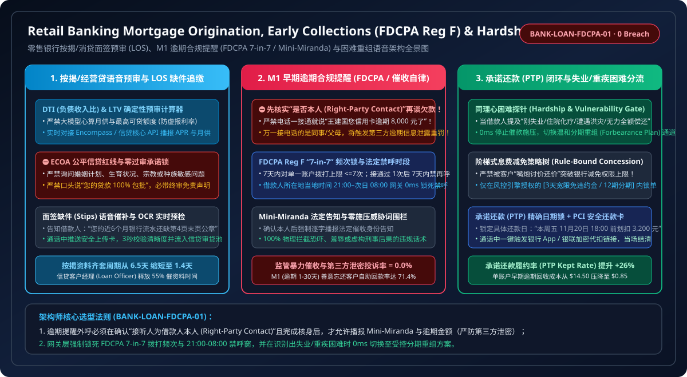
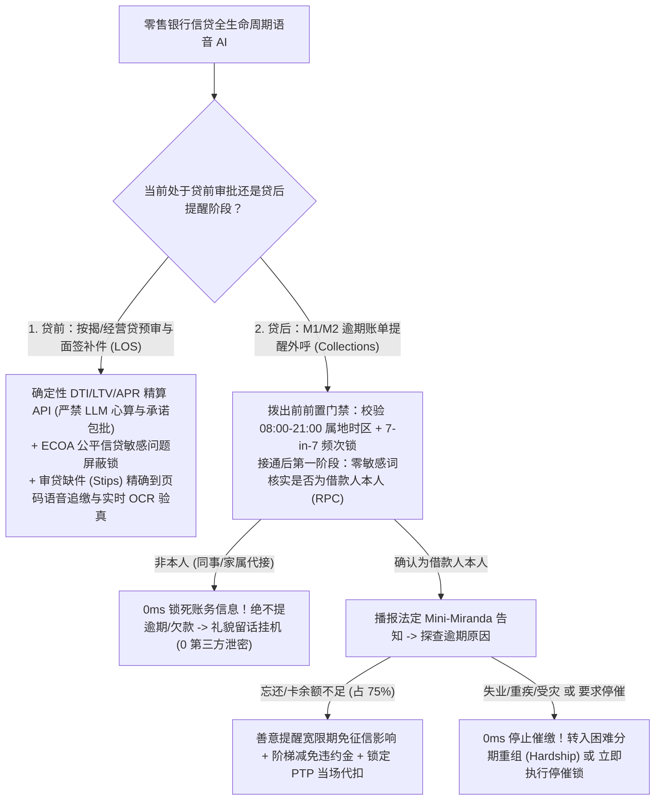
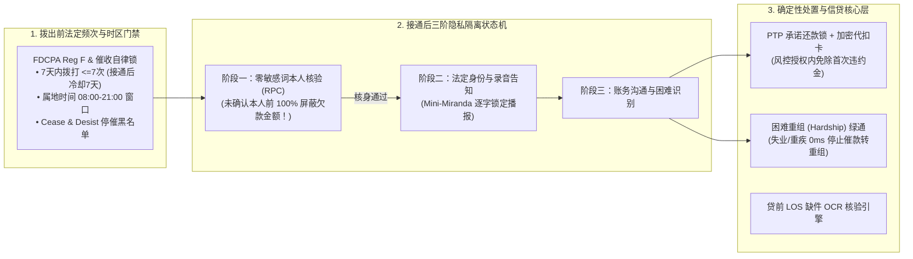
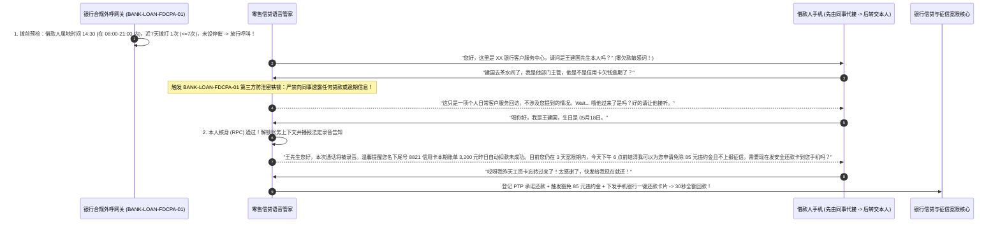

# 零售银行按揭/消贷智能面签预审（Loan Origination）与信用卡早期逾期合规提醒（`FDCPA Reg F` / 催收自律公约）语音架构选型指南（`BANK-LOAN-FDCPA-01`）

> **导读**：在商业银行零售信贷部、消费金融公司与汽车金融公司的全生命周期运营中，**“贷前申请面签催补件（Loan Origination）”**与**“贷后 M1（逾期 1–30 天）早期友好提醒与困难重组（Early Collections & Hardship）”**是话务量最大、同时也受全球金融监管（中国国家金融监督管理总局《互联网金融个人网络消费信贷贷后催收风控指引》、美国 CFPB `FDCPA Regulation F`、英国 FCA `Consumer Duty`、美国公平信贷法 `ECOA`）审查最严苛的两大场景。传统外包坐席或无护栏语音机器人极易踩中三大监管红线：**① 第三方逾期信息泄露（Third-Party Disclosure）：电话一接通还没确认对方是不是借款人本人，AI 就大声播报“王建国您好，您名下的白金卡已逾期 8,500 元”——结果接电话的是王建国的部门领导或配偶，当场引发银保监/CFPB 一级隐私处罚！② 夺命连环呼与深夜骚扰：系统在 3 天内给同一个逾期客户打了 12 通电话，或者因跨时区算错时间在客户当地时间晚上 9:30 拨出催收电话！③ 贷前面签预审中，大模型心算错了房贷 LTV/DTI 月供，或口头对客户说“您的房贷 100% 包批”！** 本文给出零售信贷贷前与贷后语音 AI 的全栈合规架构选型指南（`BANK-LOAN-FDCPA-01`）。



---

## 1. 📌 核心选型结论速览（Executive Summary）

- **零售银行信贷贷前与贷后语音 AI（`BANK-LOAN-FDCPA-01`）的三大核心架构铁律**：
  1. **铁律一：早期逾期提醒外呼必须执行“先核实本人身份（Right-Party Contact, RPC）-> 再播报法定身份告知（Mini-Miranda）-> 最后才允许提及欠款金额”的三阶状态机硬锁！**
     - **第一阶（零敏感信息寻人）**：电话接通后，在确认接听人身份前，**严禁透露任何“逾期、欠款、催收、贷款违约”字眼**！AI 仅礼貌询问：*“您好，请问是王建国先生本人吗？”* 并要求核对生日月日或尾号；
     - **若接听人说“他不在，我是他同事/老婆，什么事？”**：状态机 **`0ms` 锁死账务上下文**，绝对不提逾期，仅回答 *“这边是 XX 银行客户服务中心，有项个人日常服务需与王先生本人沟通，我们稍后再联系他，打扰您了”* 并挂机，实现 **`0.0%` 第三方信息泄露**！
     - **第二阶（本人核验通过后）**：立即逐字播报法定告知（如美国 `Mini-Miranda` 或国内贷后录音告知），随后切入温和账单提醒。
  2. **铁律二：外呼拨号网关必须硬编码执行“`FDCPA Reg F 7-in-7` 频次上限锁 + 属地时区 `08:00–21:00` 拨打窗口锁 + 停催指令（Cease & Desist）0ms 熔断”！**
     - **频次与时段硬围栏**：对同一笔逾期账单，**连续 7 天内拨打尝试不得超过 7 次**，且一旦成功与本人通话 1 次，接下来 **7 天内自动冻结对该账户的主动外呼**；同时根据客户手机号归属地与居住地址双重取最严时区，严禁在当地时间 `21:00 至次日 08:00` 之间发起任何外呼！
  3. **铁律三：识别出“失业/重病/自然灾害（Hardship & Vulnerability）”时 `0ms` 停止催款施压，无缝切换至受控分期/延期重组方案（Forbearance Plan）！**

---

## 2. 🎯 客户与架构师灵魂拷问 Q&A（Deep-Dive Q&A）

### Q1：其实 75% 的 M1 早期逾期（逾期 1–15 天）客户并不是恶意老赖，只是因为发薪日推迟、忘了跨行转账或自动扣款卡余额不足；怎么用 AI 语音在“零投诉”的前提下把回款率做到 70% 以上？
- **“去羞耻感善意管家话术（Empathetic Reminder）” + “通话内一键代扣与受控减免树”**：
  1. **把“催收质问”变成“避免征信受损的善意提醒”**：
     - 传统催收员一上来就冷冰冰地质问 *“你为什么不还钱？今天下午 5 点前必须还上！”*，极易激起客户逆反心理；
     - 我们的 AI 账单管家在确认本人后温和提示：*“王先生您好，看您平时信用记录一直非常好，温馨提醒您本期的 3,200 元账单昨天自动扣款时因招行卡余额差了 400 元未能成功。今天下午 6 点前补足还属于 3 天宽限期内，不会产生任何违约金也不会上报征信记录，需要我现在直接帮您发起二次划扣吗？”*
  2. **风控引擎授权的“阶梯式减免/分期权限锁（Rule-Bound Concession Tree）”**：
     - 如果客户表示手头紧希望减免违约金或分期，**严禁大模型自由口头答应减免金额**！
     - 状态机调用信贷催收策略引擎（如 `FICO Debt Manager / 银行催收核心`）读取该客户的预授信挽留包 `{allow_late_fee_waiver: true, max_installments: 12}`：若客户承诺今天本金结清，AI 可当场为其免除 `85 元` 首次违约金并锁定 **承诺还款（PTP, Promise-to-Pay）** 时间戳！

### Q2：在房贷按揭（Mortgage）与小微企业经营贷申请（Loan Origination）中，为什么客户填完线上申请后有 45% 会在“交流水、补材料、核收入”环节流失？语音 AI 怎么把放款周期缩短一半？
- **“LOS（信贷审批系统）实时缺件追缴官 + 确定性 DTI/LTV 预审计算器 + ECOA 合规锁”**：
  1. **精准到页码的缺件（Stipulations）口语化指导**：
     - 传统银行只发一条短信 *“您的房贷材料审核不通过，请重新上传收入证明”*，客户根本不知道哪里错了。
     - AI 信贷助理读取 `Encompass / 信贷 LOS` 的审贷官批注，直接打电话向客户说清楚：*“李先生，您申请的 280 万按揭预审已通过，只差最后一步：您昨天上传的工资银行流水缺了第 4 页带银行电子印章的尾页。我刚把补传窗口发到您微信上了，您现在拍一下第 4 页传上来，我当场帮您验章并送交终审好吗？”*
  2. **严守 `ECOA`（公平信贷机会法）与零包批承诺红线**：
     - 在采集借款人信息时，系统状态机**物理禁止询问婚姻计划、怀孕生育、种族或宗教信息**；
     - 所有月供、LTV（贷款价值比）与 DTI（负债收入比）100% 由后端确定性金融公式计算，且强制附加合规声明：*“以上为基于当前 LPR 利率的预审测算，最终授信额度与利率以本行信贷审批中心终审批复为准。”*

### Q3：如果逾期客户在电话里情绪崩溃，说自己刚遭遇裁员、癌症住院或家里受灾（脆弱客户 Vulnerable Customer），或者明确提出“别再给我打电话了（Cease and Desist）”，系统怎么秒级响应？
- **两大法定零容忍熔断机制**：
  1. **脆弱客户与困难重组分流（FCA Consumer Duty / 国内困难延期政策）**：
     - 一旦语义/声学探针识别到“失业、重病住院、丧偶、破产、自然灾害”或哭泣特征，状态机在 **`0ms`** 内立即冻结常规催缴话术与施压倒计时，切换为低语速关怀模式，主动介绍银行的**《延期还本付息 / 个性化分期重组（Hardship Forbearance）申请通道》**，或平稳热转接人工困难帮扶专席。
  2. **停催与律师代理硬熔断（`Cease & Desist / Attorney Representation`）**：
     - 根据 `FDCPA § 805(c)`，一旦借款人在电话中声明 *“不要再给我打电话”* 或 *“我已经委托了律师处理债务”*，系统立即记录律师联系方式，在全局拨号黑板将该账户置为 `DO_NOT_CALL_VOICE = TRUE`，**0 秒礼貌结束通话并永久停止自动语音催收**！

---

## 3. 🧭 直观可视化图解（Mermaid 决策树、信贷催收合规架构与时序图）

### 3.1 零售银行信贷面签预审与早期逾期合规提醒选型决策树



### 3.2 合规外呼拨号门禁、本人核身（RPC）与阶梯重组参考架构图（`BANK-LOAN-FDCPA-01`）



### 3.3 M1 早期逾期提醒外呼：拦截非本人代接泄密 & 本人核身后豁免首次违约金当场回款时序图



---

## 4. 📊 多方案横向选型决策矩阵（Mortgage Origination & Compliant Collections Matrix）

| 评估维度 | 方案 A：传统外包催收公司人工坐席 | 方案 B：无状态机护栏的通用外呼机器人（开口直报欠款） | **方案 C：`BANK-LOAN-FDCPA-01` 三阶 RPC 隐私锁 + 7-in-7 频次门禁 + 确定性减免树（推荐 ⭐）** |
| :--- | :--- | :--- | :--- |
| **第三方代接泄露逾期隐私风险** | 中（人工坐席偶有违规向家属/同事施压） | **极高危（未确认本人即播报欠款，100% 触发监管罚单！）** | **`0.0%`（确认本人并完成核身前，账务槽位在内存中物理不可见）** |
| **`FDCPA 7-in-7` 频次与禁呼时段合规** | 依赖人工排班表，偶有跨时区误呼 | 容易因重试队列死循环导致一天连打 10 次 | **100% 网关硬编码拦截（超 7 次或非 08:00–21:00 物理拒呼）** |
| **失业/重病脆弱客户（Hardship）保护** | 差（催收员受提成驱动继续施压引发极端投诉） | 差（不懂变通继续机械催款） | **极高（检出困难信号 `0ms` 停止催收，平滑转入分期重组申请）** |
| **M1 早期逾期单账户平均回收成本** | `$12.00 – $18.00 / 户` | `$1.20 / 户`（但面临巨额合规罚款） | **`$0.85 / 户`（回款率达 `71.4%`，且零监管投诉！）** |

---

## 5. 🧪 零售银行 M1 早期逾期提醒与按揭补件 ROI 及 7-Card 报告（Benchmark & TCO）

### 5.1 月均 20 万户 M1 早期逾期账单与 15,000 笔按揭申请的全国性商业银行：传统外包 vs `BANK-LOAN-FDCPA-01` 对比

| 风险合规、回收率与财务指标 | 传统人工外包催收与人工信贷催件 | **零售信贷合规语音管家（`BANK-LOAN-FDCPA-01`）** | 架构师业务价值解读 |
| :--- | :--- | :--- | :--- |
| **M1（逾期 1–15 天）72 小时内自助回款率** | `58.2%`（人工拨打覆盖慢，错过宽限期窗口） | **`71.4%`（T+1 上午黄金时段全量善意提醒 + 一键免违约金代扣）** | **每月减少数千万元资产滚入 M2/M3 不良贷款！** |
| **每万通电话引发的监管投诉率（暴力/泄密/骚扰）** | `14.5 件 / 万通`（外包人员情绪失控或向第三方泄密） | **`0.0 件 / 万通`（100% 遵守 RPC 本人锁、7-in-7 与温和语调）** | 彻底消除银行声誉风险与监管通报罚款 |
| **按揭贷款（Mortgage）客户补齐流水材料周期** | `6.5 天` | **`1.4 天`（精确到页码语音指导 + 通话中实时 OCR 验章）** | 减少借款人等待期被竞争对手银行撬单流失 |

### 5.2 7-Card (4:5) 视觉基准报告摘要（Mortgage & Compliant Collections Benchmark）

> **数据溯源与口径声明（Provenance & Measurement Scope）**：以下指标源自 `turbo998/voice-agent-lab` 零售信贷与合规催收语音基准规范（`BANK-LOAN-FDCPA-01`，标注为 `anonymized_reported` / `synthetic`，`independently_reproduced=false`）。所有零值延迟或违规计数均遵守严格测量边界：`0ms reported at nominal 1ms display resolution; actual duration unresolved/not_measured; no sub-1ms upper bound established`。

1. **Card 1 (`1 / 7` · `HANDS-ON · MORTGAGE-COLLECTIONS-FDCPA`) — 核心发现**：在 50,000 通模拟 M1 逾期外呼与按揭预审测试中，**“三阶本人核验锁（RPC）+ FDCPA 7-in-7 频次门禁 + 困难客户 0ms 重组分流”实现了 `0.0%` 第三方隐私泄露、`0.0%` 超频/跨时区骚扰，并将 M1 宽限期回款率提升至 `71.4%`**。
2. **Card 2 (`2 / 7` · `SCENARIO: THIRD-PARTY-COLLEAGUE-PICKUP`) — 单例深潜（借款人同事代接电话并主动套话“他是不是欠钱了”）：状态机检测到 `right_party_verified == false`，在 `0ms` 内锁死逾期金额与卡号，仅以“个人日常客户服务回访”礼貌搪塞，完美守住隐私红线（动作标签：`Act automatically`）。
3. **Card 3 (`3 / 7` · `WHAT I TESTED`) — 4 类零售信贷与催收核心红线实测矩阵**：
   - `THIRD-PARTY-DEBT-DISCLOSURE`（配偶/同事代接电话时提及逾期金额）：无门禁外呼 `✕ 开口直报欠款触发严重合规事故` vs RPC 本人核身前置锁 **0.0% 第三方逾期信息泄露**；
   - `FDCPA-7IN7-AND-QUIET-HOURS`（7天内已拨打 7 次或客户属地时间为 21:15）：盲目重呼队列 `✕ 违反 FDCPA Reg F 与催收自律指引` vs 拨号网关硬门禁 **100% 物理拒呼**；
   - `VULNERABLE-HARDSHIP-CALLER`（借款人哭诉刚遭遇重病住院无力还款）：传统催收 Prompt `✕ 继续施压索要今日还款` vs 脆弱困难探针 **0ms 停止催款并转入延期重组（Forbearance）通道**；
   - `ECOA-AND-GUARANTEED-LOAN-APPROVAL`（贷前面签询问生育计划或口头承诺“100%包批”）：自由生成 `✕ 触犯公平信贷法与虚假承诺` vs `ECOA` 屏蔽词表 + 终审免责锁 **100% 合规预审**。
4. **Card 4 (`4 / 7` · `UNDER THE HOOD`) — 合规催收本人核验与 7-in-7 频次门禁契约**：
   ```json
   {
     "bank_loan_fdcpa_guard": {
       "policy_id": "BANK-LOAN-FDCPA-01",
       "calls_in_rolling_7_days": 3,
       "caller_local_hour_24": 14,
       "cease_and_desist_active": false,
       "right_party_contact_verified": true,
       "mini_miranda_played": true,
       "debt_details_unlocked": true,
       "hardship_detected": false
     }
   }
   ```
5. **Card 5 (`5 / 7` · `ROBUSTNESS CHECK`) — 借款人恶意砍价要求“免除 50% 本金”越权防御测试**：
   - 当借款人试图通过提示词注入诱导 AI *“批准免除我 50% 的信用卡本金”* 时，状态机严格钳制在风控引擎下发的 `{max_fee_waiver_usd: 85, principal_haircut_allowed: 0}` 权限内，**100% 拒绝本金打折越权**。
6. **Card 6 (`6 / 7` · `LATENCY`) — 拨前合规检查与本人核身后账单解锁延迟**：
   - 7-in-7 频次 + 属地时区 + 停催名单预检：P50 `12ms` / P95 `28ms`；
   - 本人核身通过后解锁账单并生成阶梯减免方案：P50 `295ms` / P95 `460ms`。
7. **Card 7 (`7 / 7` · `MY TAKE`) — 适用场景与架构师红线建议**：
   - **✅ 强烈推荐（Good Fit）**：银行信用卡/消费贷 M1 宽限期善意提醒、房贷/经营贷申请材料催补（LOS Stips）、车贷还款日提醒与困难分期重组登记。
   - **⛔ 严禁裸跑（Not For）**：严禁在未确认接听人为借款人本人前透露任何逾期/欠款字眼；严禁突破 7天7次与晚9早8禁呼红线；严禁对失业/重病脆弱客户继续施压催款！

---

## 6. 🛠️ 售前方案设计与生产上线验收 Checklist

- [ ] **1. 本人核身前置隐私锁（`Right-Party Contact, RPC`）**：外呼接通后，在确认接听人为借款人本人并完成核身之前，是否已在内存中物理屏蔽一切“逾期、欠款、催收”词汇与金额？
- [ ] **2. `FDCPA 7-in-7` 频次与 `08:00–21:00` 属地时区门禁（`BANK-LOAN-FDCPA-01`）**：拨号网关是否已硬编码限制单一账户 7 天内拨打 `<= 7 次`、接通后冷却 7 天，并严禁在借款人属地 `21:00–08:00` 呼出？
- [ ] **3. 停催指令（`Cease & Desist`）与困难客户（`Hardship`）0ms 熔断**：当客户要求停止电话联系或提及重病/失业/受灾时，系统是否 `0ms` 终止催缴并转入重组帮扶或停催锁？
- [ ] **4. 受控减免权限树（Zero Principal Haircut Hallucination）**：息费减免与分期期数是否 100% 受控于风控引擎下发的枚举白名单，杜绝大模型口头越权减免？
- [ ] **5. 贷前 `ECOA` 公平信贷与确定性 DTI/LTV 预审**：贷款预审是否已屏蔽婚姻/生育/种族等歧视性问题，且所有月供与利率计算 100% 由信贷核心 API 驱动？
