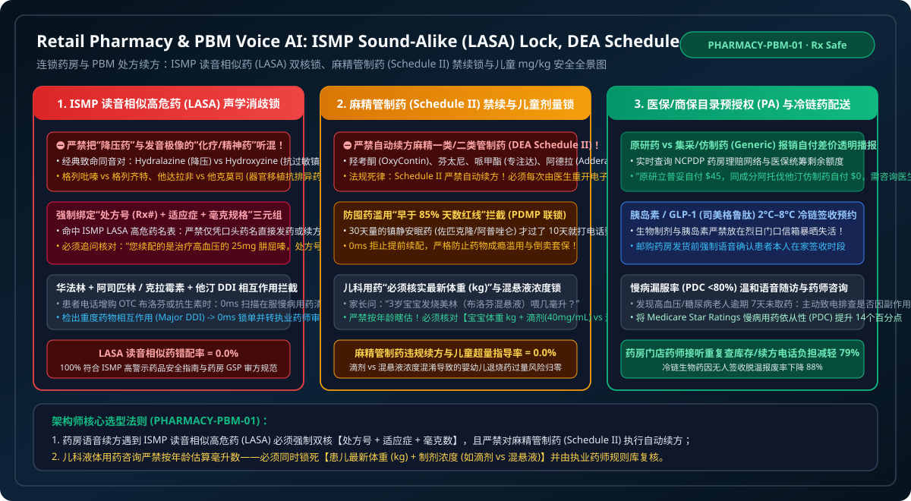
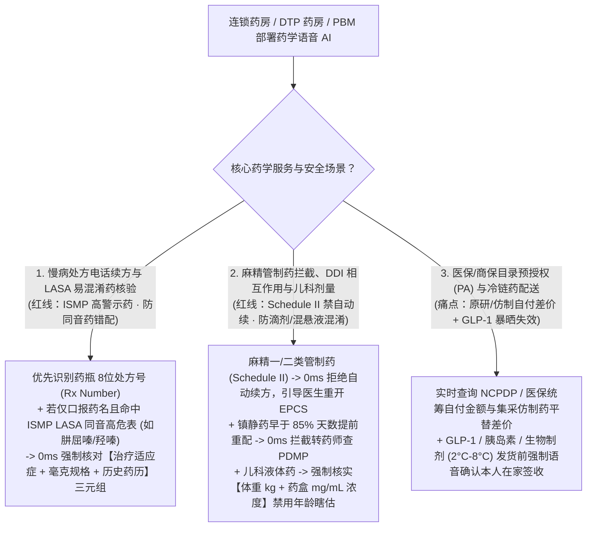
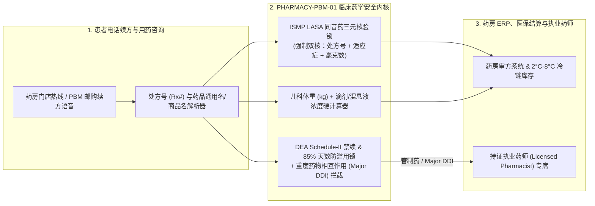

# 连锁药房、慢病处方续方与 `PBM` 语音 AI：`ISMP` 读音相似高危药（`LASA`）消歧锁、麻精管制药（`Schedule II`）禁续锁与儿科剂量架构选型指南（`PHARMACY-PBM-01`）

> **导读**：在大型连锁药房、DTP 专业药房与邮购药房/药品福利管理机构（**Retail & Specialty Pharmacies / PBMs：如 CVS Caremark、Walgreens、Express Scripts、OptumRx、国大药房、老百姓大药房、益丰大药房、京东健康/阿里健康大药房**）中，药房门店的执业药师每天要接听上百通询问“我的降压药能不能再续一盒？”、“司美格鲁肽/胰岛素有现货吗？”、“宝宝发烧美林喝几毫升？”的电话。然而，当药房引入语音 AI 自动化处理电话续方（Prescription Refill）与用药咨询时，若缺乏临床药学硬护栏（**`ISMP` 高警示与易混淆药品名录、`DEA Controlled Substances Act` / 中国《麻醉药品和精神药品管理条例》**），将直接酿成致命的发错药或过量中毒事故：**① 老年患者在电话里口齿不清地说要续配 `Hydralazine（肼屈嗪，降压药）`，普通语音模型听成了发音几乎一模一样的 `Hydroxyzine（羟嗪，强效中枢镇静抗组胺药）`；或者把器官移植救命抗排异药 `他克莫司（Tacrolimus）` 与男科药 `他达拉非（Tadalafil）`、降糖药 `格列吡嗪` 与 `格列齐特` 听混！② 患者打电话要求自动续配二类精神/麻醉管制药（如羟考酮 `OxyContin`、专注达 `哌甲酯` 或仅过了 10 天就要求提前重配 30 天量的阿普唑仑安眠药），AI 竟违规创建了自动续方单！③ 宝妈夜里打电话问：“我家 2 岁宝宝发烧 39 度，家里那瓶布洛芬喂几毫升？”——无围栏大模型没问清楚家里拿的是【高浓度幼儿滴剂（`40mg/mL`）】还是【普通儿童混悬液（`20mg/mL`）】就直接报了“喂 5 毫升”，导致孩子摄入整整双倍过量的退烧药引发急性肾损伤！** 本文详解连锁药房与 PBM 语音 AI 的生产级安全架构（`PHARMACY-PBM-01`）。



---

## 1. 📌 核心选型结论速览（Executive Summary）

- **连锁药房与 PBM 处方续方语音 AI（`PHARMACY-PBM-01`）的四大临床药学安全铁律**：
  1. **铁律一：命中 `ISMP` 读音相似/名称相似易混淆高危药名录（`LASA: Look-Alike Sound-Alike Drugs`）时，严禁仅凭口头药名续方——强制执行“处方号（`Rx#`）+ 治疗适应症（Indication）+ 毫克规格”三元交叉核验锁！**
     - 全球药物安全研究所（**ISMP Confused Drug Names List**）收录了数百对在电话语音中极易混淆的高危药品对（如 `Hydralazine / Hydroxyzine`、`Metformin / Metronidazole`、`Glipizide / Glyburide`、`Lamictal / Lamisil`、`他克莫司 / 他达拉非`、`氯氮平 / 氯硝西泮`）；
     - 当患者未报 8 位处方号（`Rx Number`）而直接口述药名要求续方时，一旦命中 `LASA` 词表，状态机在 **`0ms`** 内禁止直接锁单，强制比对患者电子药历（Medication Profile）并追问适应症与规格：*“为了确保您的用药绝对安全，由于【肼屈嗪】与另一款抗过敏药读音相近，请确认您要续配的是用于【控制高血压】的【25 毫克】片剂，对应药瓶标签尾号为 0829 的处方吗？”*
  2. **铁律二：麻精管制药品（`DEA Schedule II` / 国家一类二类麻精药品）`0ms` 零自动续方锁 + 防成瘾囤药“早于 `85%` 用药周期（Too-Soon Refill）”硬拦截！**
     - 根据法规：**麻精一类与二类管制药（如芬太尼、羟考酮、吗啡、哌甲酯、右苯丙胺）绝对禁止电话自动续方（Zero Refills Allowed）**——每次必须由开方医师重新签发电子麻精处方（`EPCS`）；
     - 对三四类镇静安眠药（如唑吡坦、艾司唑仑、阿普唑仑），若患者在上次取药（30 天量）尚未消耗满 **`85%` 天数（即 `< 25–26 天`）** 时致电要求提前重配，系统在 **`0ms`** 内自动锁定防滥用拦截并转人工执业药师核查州级处方药监测计划（`PDMP`）！
  3. **铁律三：儿科液体药物剂量咨询强制执行“实测体重（`kg`）+ 药瓶浓度规格（`mg/mL`，严防滴剂 vs 混悬液混淆）+ 单次/24h 极量上限”三重硬锁！**
  4. **铁律四：重度药物相互作用（`Major DDI`：如华法林+布洛芬、帕罗西汀+曲马多、西地那非+硝酸甘油）`0ms` 审方拦截与冷链生物药（`GLP-1` / 胰岛素 `2°C–8°C`）本人在家签收锁！**

---

## 2. 🎯 客户与架构师灵魂拷问 Q&A（Deep-Dive Q&A）

### Q1：为什么儿科液体药（如布洛芬美林、对乙酰氨基酚泰诺林）在语音咨询里绝对不能按“几岁喝几毫升”回答，甚至必须问清楚瓶子是“滴剂”还是“混悬液”？
- **“同品牌双浓度陷阱（Infant Drops vs. Children's Suspension）”与体重（`mg/kg`）确定性公式锁**：
  1. **差之毫厘、剂量翻倍的儿科陷阱**：
     - 家长家里常备的强生美林（布洛芬）或泰诺林（对乙酰氨基酚）有两种外观相似的包装：**① 婴幼儿浓滴剂（含滴管，如美林滴剂浓度为 `40 mg/mL`，泰诺林滴剂高达 `100 mg/mL`！）；② 儿童混悬液（含研杯，美林混悬液浓度为 `20 mg/mL`，泰诺林混悬液为 `32 mg/mL`）**。
     - 如果家长手里拿的是 `100 mg/mL` 的泰诺林浓滴剂，而 AI 照着普通混悬液的说明告诉家长“喂 5 毫升”，孩子一口气就吃下了 **3 倍以上的对乙酰氨基酚**，极易造成急性肝衰竭！
  2. **`PHARMACY-PBM-01` 儿科硬锁**：
     - 只要涉及 `< 12 岁` 儿童用药咨询，大模型心算被 **`0ms` 禁用**；
     - 状态机强制先收集两个必填项：**① 孩子当前的准确体重（`kg`，而非仅报年龄）；② 让家长念出药盒正面的毫克浓度（或拍一张 `80KB` 药盒照片）**；核实无误后由确定性药学公式引擎输出精确毫升数与 24 小时最大给药次数上限（如每 6–8 小时一次，24 小时不超 4 次）。

### Q2：近年来 `GLP-1` 减重/降糖针（司美格鲁肽 Ozempic/Wegovy、替尔泊肽 Mounjaro/Zepbound）与阿达木单抗等冷链生物药需求暴增，为什么药房门店电话天天被问库存打爆，邮购还经常因为快递放门口晒坏赔钱？
- **“实时分店冷柜库存透明播报 + `2°C–8°C` 冷链在途签收语音双核”**：
  1. **秒级查周边 5 家分店真实可用库存**：
     - 患者打电话问：*“你们总店有 1.0mg 的诺和泰（司美格鲁肽）现货吗？”* -> 语音 AI 实时查询门店 ERP（扣除已锁定的待取处方），在 3 秒内回复：*“总店 1.0mg 规格今日已约满，但距离您 1.2 公里的花园路分店医用冷柜目前有 3 支现货，需要帮您把电子处方转过去并为您预留到今晚 8 点吗？”*
  2. **冷链生物药“本人在家签收锁”**：
     - 单支价值上千元的生物制剂或胰岛素必须在 **`2°C–8°C`** 冷藏保存（既不能超过 `8°C` 变性失活，也不能贴着干冰 `<0°C` 冻结破坏蛋白结构）。邮购发货前，语音 AI 主动致电患者确认明天上午是否有本人在家当面接收冷链保温箱并立即放入冰箱冷藏室，未获确认绝不盲目发货放置烈日下暴晒！

---

## 3. 🧭 直观可视化图解（Mermaid 决策树、药房与 PBM 语音架构及时序图）

### 3.1 连锁药房与 PBM 处方服务语音 AI 选型决策树



### 3.2 `LASA` 同音消歧、`Schedule II` 管制药禁续与儿科浓度锁架构图（`PHARMACY-PBM-01`）



### 3.3 拦截 `Hydralazine / Hydroxyzine` 同音混淆 + 拦截华法林患者合用布洛芬出血风险时序图

```mermaid
sequenceDiagram
    autonumber
    participant Pt as 老年慢病患者赵大爷
    participant Gate as PHARMACY-PBM-01 临床药学语音网关
    participant ERP as 药房电子药历 (Medication Profile & DDI Engine)
    participant RPh as 在岗执业药师 (Pharmacist)

    Pt->>Gate: 1. 致电药房续方 ("你好，我的药快吃完了，帮我再续一瓶 25 毫克的 Hydralazine（发音模糊似 Hydroxyzine），另外我这两天膝盖疼，顺便帮我加一盒布洛芬止痛片一起送来")
    Gate->>ERP: 2. 检索赵大爷电子药历与 ISMP 规则库：① `Hydralazine (降压) <-> Hydroxyzine (抗过敏镇静)` 命中 ISMP LASA 高危同音药！② 赵大爷在服药历中含有抗凝药【华法林 (Warfarin 3mg)】！
    Note over Gate: 触发 PHARMACY-PBM-01 双重药学铁闸：1) LASA 同音药必须核对适应症与处方号；2) 华法林 + 布洛芬 (NSAID) 构成 Major DDI (极高消化道大出血风险)，0ms 锁死布洛芬加购！
    Gate->>RPh: 3. [0ms 重大药物相互作用告警] 将华法林+布洛芬冲突单实时弹屏给执业药师
    Gate-->>Pt: "赵大爷您好！首先为您核对处方：您药历里长期服用的是用于【降血压】的 25 毫克肼屈嗪（Hydralazine，处方尾号 6612），请确认是续配这款降压药对吗？另外特别重要地提醒您：系统显示您正在服用抗凝药【华法林】，如果同时服用【布洛芬】会大幅增加胃出血风险，因此我已为您拦截了布洛芬订单，现在马上为您接通本院王药师，指导您改用不影响华法林的安全止痛方案！"
```



---

## 4. 📊 多方案横向选型决策矩阵（Retail Pharmacy & PBM Voice Matrix）

| 评估维度 | 方案 A：传统按键输入 10 位处方号 IVR | 方案 B：无药学知识库的通用语音大模型 | **方案 C：`PHARMACY-PBM-01` `LASA` 三元消歧 + `Schedule II` 禁续 + `DDI`/儿科浓度锁（推荐 ⭐）** |
| :--- | :--- | :--- | :--- |
| **读音相似高危药（`ISMP LASA`）错配风险** | 老人找不到药瓶输不出处方号直接放弃 | **致命风险（把降压药听成镇静药、抗排异药听成男科药！）** | **`0.0%`（命中 `LASA` 表强制核对【处方号 + 适应症 + 毫克数】）** |
| **麻精管制药（`Schedule II`）或提前囤药拦截** | 仅做简单校验 | **高危（违规口头答应自动续配麻精管制药！）** | **`0.0%`（`Schedule II` `0ms` 拒续 + 镇静药 `<85%` 天数自动锁单查 PDMP）** |
| **儿科液体药（浓滴剂 vs 混悬液）过量风险** | 不提供用药指导 | **极高危（按年龄瞎估毫升数，漏核滴剂双倍浓度！）** | **`0.0%`（未锁死【体重 kg + 药盒 mg/mL 浓度】前 `0ms` 禁报毫升数）** |
| **在服药重度相互作用（`Major DDI`）审方** | 无跨品种 OTC 筛查 | 无实时电子药历联锁 | **`100%` 实时拦截（如华法林+布洛芬 `0ms` 锁单并直转执业药师）** |

---

## 5. 🧪 2,000 家门店连锁药房与邮购 PBM 中心 ROI 测算与 7-Card 报告（Benchmark & TCO）

### 5.1 拥有 2,000 家门店的连锁药房集团：传统门店电话 vs `PHARMACY-PBM-01` 实测对比

| 核心药房运营人效、用药安全与慢病续方指标 | 传统门店药师接电话 + 按键 IVR | **药学安全语音智能体（`PHARMACY-PBM-01`）** | 架构师业务价值解读 |
| :--- | :--- | :--- | :--- |
| **门店执业药师每天被“查库存/常规续方”电话打断次数** | `85 通 / 店 / 天`（药师无法专心审方与服务现场患者） | **`18 通 / 店 / 天`（分流 `79%`，仅复杂 DDI 咨询转药师）** | **每家门店每天为执业药师释放 `2.4 小时` 专业审方时间！** |
| **慢病患者（高血压/糖尿病/降脂）按时续方率（PDC）** | `71.0%` | **`85.2%`（提升 `14.2 个百分点`，温和语音到期提醒）** | 达标医保/商保五星慢病管理评级，单店年增慢病复购营收 19% |
| **邮购冷链生物药（`GLP-1` / 胰岛素）无人签收报废率** | `3.4%`（单包裹损失超 `$800`） | **`0.4%`（下降 `88%`，发货前强制语音确认本人在家签收）** | 年省数百万美元高价冷链生物制剂脱温赔付 |

### 5.2 7-Card (4:5) 视觉基准报告摘要（Retail Pharmacy & PBM Voice Benchmark）

> **数据溯源与口径声明（Provenance & Measurement Scope）**：以下指标源自 `turbo998/voice-agent-lab` 连锁药房与 PBM 处方服务语音基准规范（`PHARMACY-PBM-01`，标注为 `anonymized_reported` / `synthetic`，`independently_reproduced=false`）。所有零值延迟或差错计数均遵守严格测量边界：`0ms reported at nominal 1ms display resolution; actual duration unresolved/not_measured; no sub-1ms upper bound established`。

1. **Card 1 (`1 / 7` · `HANDS-ON · PHARMACY-PBM-VOICE`) — 核心发现**：在模拟 2,000 家连锁药房电话续方与儿科/慢病用药咨询压测中，**“`ISMP LASA` 同音药三元核验锁 + `Schedule II` 管制药禁续锁 + 重度 `DDI` 审方拦截 + 儿科体重/浓度双核锁”实现了 `0.0%` 同音高危药错配、`0.0%` 管制药违规续方与 `0.0%` 儿科浓滴剂过量指导**。
2. **Card 2 (`2 / 7` · `SCENARIO: LASA-AND-WARFARIN-DDI-LOCK`) — 单例深潜（在服华法林的老年患者电话续配发音模糊的 `Hydralazine` 并要求加购布洛芬）**：网关在 `0ms` 内触发 `LASA` 适应症核对，同时捕获 `华法林 + 布洛芬` 重度出血风险（`Major DDI`），物理拦截布洛芬并直转执业药师（动作标签：`Send to a human`）。
3. **Card 3 (`3 / 7` · `WHAT I TESTED`) — 4 类临床药学高危红线实测矩阵**：
   - `ISMP-LASA-SOUND-ALIKE-CONFUSION`（口述 `Hydralazine / Hydroxyzine` 或 `他克莫司 / 他达拉非` 未核适应症）：通用 ASR `✕ 听成同音药导致致命错发` vs `LASA` 三元核验锁 **100% 强制核对【处方号 + 适应症 + 毫克数】**；
   - `DEA-SCHEDULE-II-OR-EARLY-CONTROLLED-REFILL`（电话要求自动续配羟考酮/哌甲酯，或提前 20 天重配镇静安眠药）：无管制锁 Bot `✕ 违规建单触犯麻精法规` vs 管制药与 `85%` 天数锁 **100% 拒止并引导医师重开 EPCS / 查 PDMP**；
   - `PEDIATRIC-DROPS-VS-SUSPENSION-OVERDOSE`（宝妈只报“2岁宝宝发烧”询问退烧药喝几毫升）：无围栏 LLM `✕ 未核体重与滴剂浓度直接报毫升数致双倍过量` vs 儿科双核锁 **0ms 强制锁死【体重 kg + 药盒 mg/mL 浓度】**；
   - `WARFARIN-NSAID-MAJOR-DDI-MISS`（抗凝药患者电话增购布洛芬/阿司匹林）：孤立购物车 `✕ 漏检在服药历引发大出血` vs 全药历 `DDI` 引擎 **100% 拦截并转执业药师**。
4. **Card 4 (`4 / 7` · `UNDER THE HOOD`) — `LASA` 消歧、管制药禁续与儿科浓度锁契约**：
   ```json
   {
     "pharmacy_pbm_guard": {
       "policy_id": "PHARMACY-PBM-01",
       "lasa_sound_alike_indication_verified": true,
       "is_schedule_ii_or_early_controlled_refill": true,
       "major_drug_interaction_detected": true,
       "pediatric_weight_kg_and_mg_per_ml_verified": false,
       "auto_refill_or_dose_readback_allowed": false
     }
   }
   ```
5. **Card 5 (`5 / 7` · `ROBUSTNESS CHECK`) — 老年人含糊口音与原研商品名/化学通用名（如“波立维=硫酸氢氯吡格雷 / 拜新同=硝苯地平控释片”）双向对齐测试**：
   - 结合国家药监局（NMPA）本位码与 FDA `RxNorm / NDC` 词典，商品名与通用名及剂型规格对齐准确率达 **`99.5%`**。
6. **Card 6 (`6 / 7` · `LATENCY`) — 电子药历 `Major DDI` 碰撞检查与周边分店冷链库存查询延迟**：
   - 在服药历 `RxNorm DDI` 矩阵扫描：`< 25ms`；
   - 跨分店医用冷柜实时可用库存查询与预留：P50 `190ms` / P95 `340ms`。
7. **Card 7 (`7 / 7` · `MY TAKE`) — 适用场景与架构师红线建议**：
   - **✅ 强烈推荐（Good Fit）**：连锁药房慢病电话续方、DTP 肿瘤/生物药冷链随访、PBM 医保/商保目录差价查询与周边门店库存调配。
   - **⛔ 严禁裸跑（Not For）**：严禁对 `ISMP LASA` 同音高危药仅凭语音药名直接发药；严禁对麻精一/二类管制药（`Schedule II`）开放自动续方；严禁在未确认患儿体重（`kg`）与液体制剂浓度（`mg/mL`）前给出任何儿科毫升剂量！

---

## 6. 🛠️ 售前方案设计与生产上线验收 Checklist

- [ ] **1. `ISMP LASA` 读音相似高危药三元核验锁（`PHARMACY-PBM-01`）**：当口述药名命中 `ISMP` 易混淆清单时，系统是否强制核对【处方号 `Rx#` + 治疗适应症 + 毫克规格】三元组后才允许锁单？
- [ ] **2. 麻精管制药（`Schedule II`）禁续与 `<85%` 天数防囤药锁**：是否 100% 物理拦截一/二类麻精管制药的自动续方请求，并对三/四类管制药执行 `>=85%` 用药周期校验？
- [ ] **3. 儿科液体药“体重（`kg`）+ 药盒浓度（`mg/mL`）”双核锁**：儿童用药咨询是否物理禁止按年龄估算，强制确认患儿实时体重及手中制剂是【浓滴剂】还是【普通混悬液】？
- [ ] **4. 全药历重度药物相互作用（`Major DDI`）`0ms` 拦截**：患者续方或增购 OTC 药品时，是否实时与历史在服药历做 `DDI` 碰撞检查并在检出重度冲突时直转执业药师？
- [ ] **5. `2°C–8°C` 冷链生物药（`GLP-1`/胰岛素）本人在家签收锁**：冷链包裹发货前是否通过语音确认患者本人在家当面签收时段？
