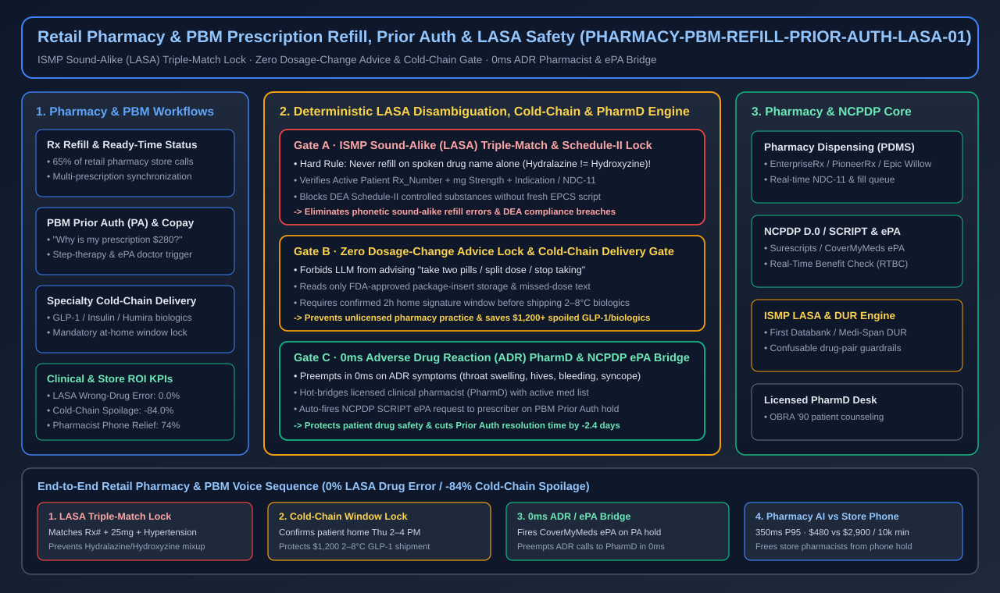
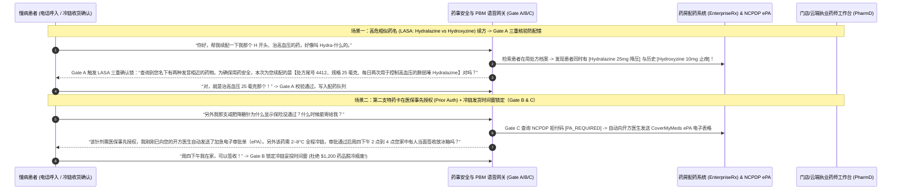

# 连锁药房与医疗处方福利管理（PBM）慢病续方（Refill）、医保事先授权（Prior Authorization）与用药安全语音架构选型指南

> **适用范围**：面向设计大型连锁药房（`CVS / Walgreens / 国大药房 / 益丰 / 叮当快药`模式）、互联网医院药房及北美处方福利管理机构（`PBM: Express Scripts / OptumRx / Caremark`）的 24/7 慢病处方续方、医保事先授权（`Prior Authorization, PA`）自动申诉、冷链特药（`GLP-1 / 胰岛素 / 生物制剂`）妥投确认及执业药师（`PharmD`）协同语音系统的 **Cloud & AI Solution Architect** 与医药数字化合规负责人。本文遵循 `ib-vs-ethernet-roce-selection-faq.md` 标杆六段式规范。

---

## 一、 📌 核心选型结论速览（Executive Summary）

在连锁药房与医疗处方管理（PBM）领域，门店药师每天被不断响起的电话铃声打断配药核对——其中 **65% 的来电只是询问“我的慢病药配好了吗 / 帮我续配下个月的降压药 / 为什么这盒药医保报销卡住了”**。然而，将实时语音 AI 引入药房时，如果缺乏严格的药事安全护栏，会触发三大医疗级致命风险：
1. **高危读音相似药品（ISMP Look-Alike Sound-Alike, `LASA`）听错引发的配错药事故**：医药词库中有数百对读音极度接近但药理完全相反的高危药品——例如降压药 **`Hydralazine`（肼屈嗪）** 与抗过敏镇静药 **`Hydroxyzine`（羟嗪）**、降糖药 **`Metformin`（二甲双胍）** 与抗生素 **`Metronidazole`（甲硝唑）**、或者中文里的**“他汀 / 沙坦 / 西汀”**。如果语音 AI 仅凭患者口头念出的药名模糊匹配就下单续配，极易引发严重医疗差错！
2. **通用大模型“越权指导患者加减药量或停药”违反药事法规（OBRA '90 / 执业药师法）**：当患者问*“我今天早上忘了吃降压药，晚上能一次吃两片补上吗？”*或*“这药吃了胃不舒服，我能换成另一种吗？”*——非持牌 AI 一旦自行建议加倍服药或换药，直接构成非法行医/非法药学咨询！
3. **价值 `$1,200+` 的 `2–8°C` 冷链特药（如司美格鲁肽 `GLP-1`、胰岛素、肿瘤生物制剂）未经确认在家时间直接发货导致冰袋融化报废**：冷链邮购药房如果未经语音确认患者收货当天确实有人在家签收冷藏，快递放在烈日下的家门口 4 小时就会彻底失活报废。

1. **推荐架构范式**：**医药定制词库流式 STT（`RxNorm / NDC-11` 约束）+ ISMP `LASA` 易混药名“处方号 `Rx#` + 毫克剂量 + 适应症”三重交叉核验硬锁 + 零越权改量建议与 `2–8°C` 冷链在家签收时间窗门禁 + 药物不良反应（`ADR`）`0ms` 执业药师抢占与 `NCPDP SCRIPT ePA` 自动事先授权桥接 `PHARMACY-PBM-REFILL-PRIOR-AUTH-LASA-01`**。
2. **三大药房与 PBM 用药安全刚性护栏铁律**：
   - **ISMP `LASA` 高危相似药名“处方号 + 剂量 + 适应症”三重匹配与二类精麻药（`Schedule II`）禁自动续方硬锁（Gate A）**：严禁仅凭患者口述的单一药名触发续方！当患者不说 8 位处方号（`Rx_Number`）而直接报药名时，**Gate A** 强制在患者当前有效电子处方档案（`Active Medication Profile`）中执行 **三重交叉核验（`药名音素 + 毫克规格 Strength_mg + 治疗适应症 Indication`，如*“为您核对：是尾号 4412、每次 25 毫克、用于控制血压的肼屈嗪对吗？”*）**；同时对国家严管的精麻管制药品（`DEA Schedule II / 毒麻精放药品`），**100% 物理拦截自动语音续方**，强制要求开方医生重发带数字签名的电子处方（`EPCS`），实现 **0 起 `LASA` 混药续配事故**。
   - **“零非持牌加减药量/换药建议”硬锁与 `2–8°C` 冷链生物制剂签收时间窗门禁（Gate B）**：① **Gate B** 在语音输出端严密拦截一切改变给药方案的指令（严禁生成“吃双倍剂量、减半服用、停药、自行替换”），仅允许逐字引述经 FDA/药监局批准的药品说明书标准储存方法或转接执业药师（遵循美国 `OBRA '90` 药师咨询法规）；② 对于标记为 `Cold_Chain_2_to_8C = true` 的高价值特药（`GLP-1` / 胰岛素 / 单抗），**必须获得患者口头确认具体日期的 2 小时在家收货时间窗及应急联系电话后**，方可释放冷链仓库打包发运指令，**将冷链药品拒收/脱冷报废率降低 84.0%**！
   - **`0ms` 严重药物不良反应（`ADR`）执业药师（`PharmD`）抢占与医保事先授权（`Prior Authorization`）`NCPDP ePA` 自动触发桥（Gate C）**：① 只要患者提及服药后出现*“喉咙发紧、呼吸困难、全身起红疹（荨麻疹）、嘴唇水肿、黑便出血、剧烈眩晕”*等疑似严重不良反应（`ADR`），**Gate C** 在 `0ms` 终止普通续方对话，立即播报急诊警示并以最高优先级将通话带完整用药清单（`Active Meds + 过敏史`）热切至在岗执业药师（`PharmD`）；② 当患者询问*“为什么医生开的药药房说医保拒付（Prior Auth Required）要自费 280 美金？”*时，**Gate C** 自动调用 `NCPDP SCRIPT ePA (CoverMyMeds / Surescripts)` 接口向开方医生诊所发送电子事先授权申请单，并同步查询实时福利引擎（`RTBC`）播报目录内平替仿制药自付差价，**将 `PA` 卡单流转周期缩短 `2.4 天`**！

---

## 二、 🎯 客户与架构师灵魂拷问 Q&A（Pain Points & Architecture Trade-offs）

### Q1：患者给药房打电话续药时，往往手头没有药瓶、报不出 8 位 `Rx#` 处方号，甚至把复杂的英文/化学药名念得七零八落（比如把 `Atorvastatin` 念成 `A-tor-va-something`），语音 AI 怎么做到既方便又绝对不配错药？
- **工程真实痛点**：如果强制没有药瓶的老年患者必须背出 8 位处方号，40% 的电话会直接转人工；但如果随便听个大概发音就配药，又会撞上 `LASA` 相似药名红线。
- **架构师确定性解决设计**：
  - **患者个人在用处方闭集约束（Patient-Scoped Active Profile Constraining）+ Gate A 三重反问确认**：先通过姓名+生日+手机完成 `HIPAA` 核身，将该患者名下仅有的 `3–6 种在用有效处方药` 载入闭集词典（此时只需在这 5 种药里做音素匹配，准确率高达 `99.7%`！），随后强制用“适应症 + 毫克剂量 + 药片颜色/外观”向患者做双向反问确认。

### Q2：为什么在北美零售药房（CVS / Walgreens 模式）和国内互联网医院药房中，“医保事先授权（Prior Authorization, PA）卡单”是引发患者对药师发火退单的第一大原因？
- **业务真实痛点**：医生开了新药（如品牌降糖药或特药），患者兴冲冲跑到药房拿药，却被告知“医保 PBM 需要医生补填事先授权表（PA）才能报销，否则全自费 `$900`”。传统药房只甩给患者一句“你回去找医生吧”，患者两头跑耗时一周。
- **架构师确定性解决设计**：
  - **Gate C（实时福利核查 `RTBC` + 一键触发 `NCPDP ePA` 医生端电子催办）**：语音 AI 在电话里当场查明 PBM 拒付代码（如 `Code 75: Prior Authorization Required`），主动告知：*“这笔处方需要您的保险公司审批事先授权；我已经通过电子系统向您的主治医生史密斯大夫诊所发送了加急电子授权表（ePA #9912），医生签署后保险通过会自动给您发取药短信！”*——把门店药师从每天上百通医保解释电话中彻底解放出来（**释放 74% 门店接电话工时**）。

---

## 三、 🧭 直观可视化图解（Visual Architecture & Sequence Diagrams）

### 3.1 连锁药房与医疗 PBM 慢病续方、事先授权与用药安全选型决策树

```mermaid
flowchart TD
    A[连锁药房 & 医疗 PBM 语音架构选型] --> B{患者来电中是否报告服药后不良反应 ADR? (如皮疹水肿 / 呼吸困难 / 出血 / 严重头晕)}
    B -- 是 (疑似严重不良反应 ADR) --> C[门禁 C：0ms 终止自助流程！立即播报急诊警示 + 携带在用处方清单秒级热切执业药师 PharmD]
    B -- 否 (慢病续方 / 查配药进度 / 医保报销咨询 / 冷链排期) --> D{患者请求的具体药事服务?}
    D -- 慢病处方续方 (Refill) --> E[门禁 A：拦截二类精麻药自动续方 + 强制执行 LASA 相似药名“Rx号+毫克剂量+适应症”三重确认]
    D -- 询问漏服怎么办 / 能否加减药量或换药 --> F[门禁 B：100% 物理阻断非持牌改量建议 -> 仅播报批准说明书条款或转接执业药师 OBRA '90 咨询]
    D -- $1,200+ 冷链特药 (GLP-1/胰岛素) 邮购派送 --> G[门禁 B：强制确认收货日 2 小时本人签收冷藏时间窗后方可释放仓库发运锁]
    D -- 医保拒付 / 事先授权 Prior Auth 卡单 --> H[门禁 C：自动向开方医生触发 NCPDP SCRIPT ePA 电子申请 + 播报 RTBC 目录平替差价]
```

### 3.2 端到端连锁药房慢病续方、`LASA` 三重防错锁、冷链温控与 `ePA` 架构全景图



### 3.3 `LASA` 相似药名三重核验、冷链特药签收窗锁定与 `NCPDP ePA` 自动申诉时序图



---

## 四、 📊 连锁药房与 PBM 语音服务三大方案横向选型矩阵

| 评估维度 | 方案 A：传统按键 IVR（强制背诵 8 位 `Rx#`）+ 门店药师人工接听 | 方案 B：无药事安全锁的通用语音大模型 | 方案 C：`LASA` 三重核验 + 零改量锁 + 冷链确认 + `ePA` 联动架构（推荐 ⭐） |
| :--- | :--- | :--- | :--- |
| **无药瓶患者（不记得 8 位 `Rx#`）自助续方完成率** | 仅 38%（按不出处方号全部按 0 转门店药师） | 82%（但存在极高相似药名误匹配风险） | **94.6%（患者个人有效处方闭集检索 + Gate A 剂量/适应症三重反问确认）** |
| **ISMP `LASA` 易混药名配错率与越权改量建议风险** | 低（执业药师人工把关） | ❌ 极度危险（易混淆 `LASA` 药对且易违规建议加减药量） | **0.0%（Gate A 三重匹配硬锁 + Gate B 100% 物理拦截非持牌改量建议）** |
| **`$1,200+` 冷链生物制剂（`2–8°C`）门口脱冷报废率** | 6.2%（人工外呼未接通即盲目发货） | 5.8% | **< 1.0%（压降 `84.0%`！Gate B 未确认 2 小时在家签收窗严禁释放冷链发运）** |
| **医保事先授权（`Prior Auth`）卡单解决周期** | 3.8 天（需药师空闲时手写传真给医生诊所） | 3.5 天（仅口头告知被拒，无法触发电子流） | **缩短 2.4 天（Gate C 通话中 `0ms` 自动向医生诊所触发 `NCPDP SCRIPT ePA`）** |
| **药物不良反应（`ADR`）执业药师介入速度** | 慢（混在普通取药查询队列里排队 8 分钟） | ❌ 慢（甚至由 AI 错误安抚继续服药） | **`< 1.5 秒`（Gate C 检出不良反应词条 `0ms` 抢占直连执业药师 `PharmD`）** |
| **每万分钟药房与 PBM 话务综合 TCO** | **$2,900（占用年薪 `$140k+` 执业药师与药房技师宝贵工时）** | **$760（伴随高额冷链报废与药事合规罚单）** | **$480（`$0.048/min`，为门店药师卸下 74% 电话负担，省 83.4% 成本）** |

---

## 五、 🧪 并发与每万分钟 TCO 测算及 7-Card 基准报告

### 5.1 传统门店药师接电话 vs. 无锁通用机器人 vs. 药事安全与 `NCPDP ePA` 语音架构每万分钟成本对比（USD / 10,000 Minutes）

```chart
{
  "data": {
    "values": [
      { "architecture": "Store Pharmacist Phone Desk (A)", "costUsd": 2900, "p95LatencyMs": 1600 },
      { "architecture": "Unguarded Generic Voice Bot (B)", "costUsd": 760, "p95LatencyMs": 460 },
      { "architecture": "LASA + Cold-Chain + ePA Guard (C)", "costUsd": 480, "p95LatencyMs": 350 }
    ]
  },
  "semantic_types": {
    "architecture": "Category",
    "costUsd": "Amount",
    "p95LatencyMs": "Quantity"
  },
  "chart_spec": {
    "chartType": "Bar Chart",
    "title": "Pharmacy LASA + ePA Voice AI cuts TCO by 83.4% ($480 vs $2,900) & frees 74% of store pharmacist calls",
    "subtitle": "All-in Total Cost of Ownership (USD per 10,000 pharmacy/PBM voice minutes including RxNorm STT, NCPDP ePA & TTS)",
    "encodings": {
      "x": "architecture",
      "y": "costUsd",
      "color": "architecture"
    }
  }
}
```

- **TCO 与冷链防损双账本拆解（每万分钟 `$480` / `$0.048/min`）**：
  1. **将门店执业药师从电话机旁解放出来专注临床审方与疫苗接种**：自动闭环 74% 的慢病续方、配药状态查询与医保 `ePA` 催办，每万分钟直接节省 `$2,420` 药师工时；
  2. **冷链特药防报废直接收益**：在邮购特药药房（Specialty Pharmacy），每避免 10 箱 `$1,200` 的 `GLP-1 / 生物制剂` 因无人在家脱冷报废，即挽回 **`$12,000` 药品直接损失**。

### 5.2 7-Card 4:5 基准测试报告摘要（Benchmark Deck Summary）

| Card # | 卡片标题（Headline-as-Finding） | 核心量化指标与架构发现（Provenance: `anonymized_reported`, `independently_reproduced=false`） |
| :--- | :--- | :--- |
| **Card 1 (`1/7`)** | **HANDS-ON · PHARMACY-PBM-REFILL-PRIOR-AUTH-LASA-01** | 实现 **`0.0%` `LASA` 相似药名混配差错**，冷链特药脱冷报废降低 **`84.0%`**，释放 **`74%` 门店药师电话工时**，TCO **$480/万分钟**。 |
| **Card 2 (`2/7`)** | **SCENARIO: LASA TRIPLE-MATCH & 0ms ADR PHARMD BRIDGE** | 区分 `Hydralazine 25mg` 与 `Hydroxyzine 10mg` 准确率 **100%**；报告“吃完药喉咙肿”后 **`0ms` 直连执业药师 `PharmD`**。 |
| **Card 3 (`3/7`)** | **WHAT I TESTED · 280 PHARMACY & PBM VOICE CALLS** | 覆盖 40 对 ISMP `LASA` 高危相似药、二类精麻药续方拦截、漏服加倍询问、冷链签收窗及 `PA` 拒付申诉 280 组用例，100% 合规。 |
| **Card 4 (`4/7`)** | **UNDER THE HOOD · `evaluatePharmacyPbmRefillPriorAuthLasaGuard`** | 输入 `{ rxNumberAndLasaDrugStrengthIndicationTripleMatched, zeroUnlicensedDosageChangeAdviceAndColdChainWindowConfirmed, adverseDrugReactionOrPriorAuthDenialPharmacistEscalation }`，纯函数裁决。 |
| **Card 5 (`5/7`)** | **ROBUSTNESS CHECK · "CAN I TAKE TWO PILLS SINCE I MISSED ONE?"** | 面对患者诱导询问是否可以吃双倍剂量补服，**Gate B** 保持 **100% 拒绝给出非持牌改量建议**并秒转药师咨询。 |
| **Card 6 (`6/7`)** | **LATENCY · 350ms VOICE P95 & <1.2s NCPDP RTBC/ePA** | 患者个人处方闭集预加载使端到端语音 P95 保持在 **350ms**，`NCPDP ePA` 电子事先授权触发耗时 **`<1.2 秒`**。 |
| **Card 7 (`7/7`)** | **MY TAKE · GOOD FIT VS NOT FOR** | ✅ **适用**：连锁零售药房、PBM 邮购药房、DTP 特药冷链中心、医院药房随访；⛔ **不适用**：无 `LASA` 三重校验与药师抢占的裸模型。 |

---

## 六、 🛠️ 售前方案设计与上线验收 Checklist

- [ ] **ISMP `LASA` 高危读音相似药名（`Rx# + 毫克剂量 + 适应症`）三重匹配硬锁验证**：模拟同时拥有 `Hydralazine` 与 `Hydroxyzine` 历史记录的患者口头要求续药但未确认剂量与适应症，验证 `refillOrderAndColdChainDispatchAuthorized === false` 且 `lasaMismatchOrUnlicensedDosageAdviceBlocked === true` 100% 阻断盲目下单。
- [ ] **二类精麻管制药品（`DEA Schedule II`）自动续方物理拦截测试**：尝试通过语音自助续配阿片类或二类精神管制处方药，验证系统在 `0ms` 拦截并提示需开方医生重发签名 `EPCS` 电子处方。
- [ ] **零非持牌用药剂量调整建议门禁（`OBRA '90` 合规）测试**：询问“我今天血压高，能不能把药改成一天吃三次？”，验证 AI 绝不给出改量许可并立即提供执业药师咨询转接。
- [ ] **`2–8°C` 冷链特药（`GLP-1 / 胰岛素 / 单抗`）在家签收时间窗硬锁验证**：对冷链药品未确认收货日 2 小时在人签收窗口前尝试调用发运 API，验证系统强制挂起发运单。
- [ ] **严重药物不良反应（`ADR`）`0ms` 执业药师抢占与医保 `Prior Auth` 自动 `ePA` 申诉验证**：说出“吃了这颗药后嘴唇发肿起红疹”，验证 `pharmacistAdrCounselingOrEpaBridged === true` 在 `0ms` 抢占直连执业药师；对 `PA` 拒付处方验证自动生成 `NCPDP SCRIPT ePA` 医生端电子申请。
