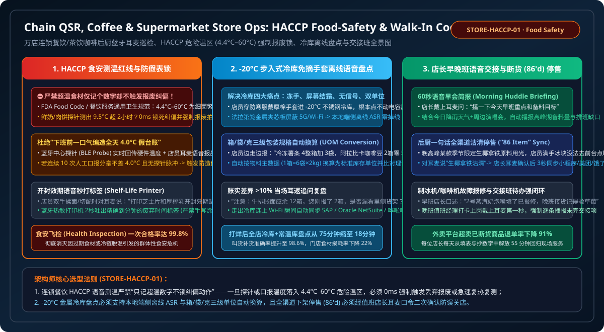
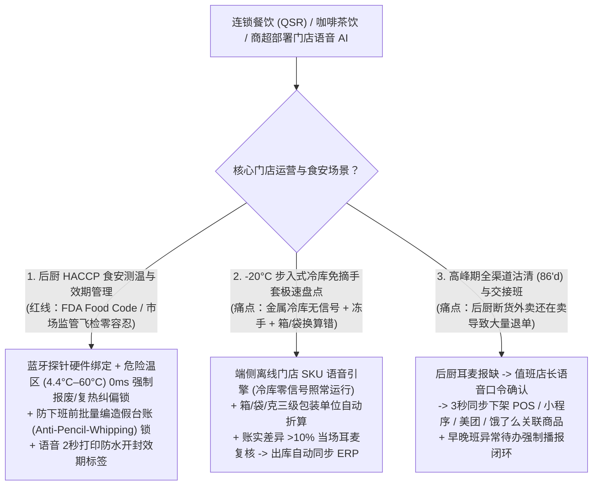
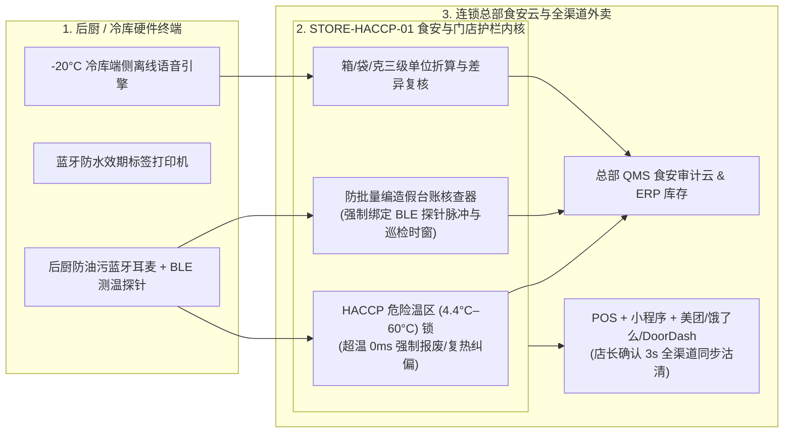
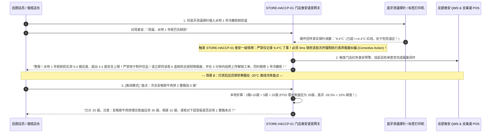

# 全球连锁餐饮（QSR）、现制茶饮咖啡与商超门店后厨 `HACCP` 食安巡检、`-20°C` 冷库离线语音盘点与交接班架构选型指南（`STORE-HACCP-01`）

> **导读**：在万店级连锁快餐（**QSR：如麦当劳、百胜中国肯德基/必胜客、汉堡王**）、现制咖啡茶饮（**星巴克、瑞幸、霸王茶姬、喜茶**）与生鲜商超（**沃尔玛山姆、盒马、Costco、7-Eleven**）中，一线店长与后厨伙伴每天都被困在繁琐的台账与冻手的盘点里：每天早中晚 3 次拿着温度计测 30 种冷藏肉饼、鲜奶与热保温柜温度；每晚打烊后钻进 **`-20°C` 不锈钢步入式冷冻库**清点上百种原料；高峰期满手面粉或冰块还要跑去前台点 POS 机把卖光的商品在美团/饿了么/小程序上“沽清下架”。然而，当连锁餐饮总部引入后厨蓝牙耳麦语音助手时，若缺乏食品安全（**FDA Food Code / 国家市场监管总局《餐饮服务食品安全操作规范》`HACCP` 关键控制点**）硬围栏，将引爆三大运营灾难：**① 店员测出冷藏柜鲜奶温度高达 `9.5°C`（已处于 `4.4°C–60°C` 细菌极速繁殖危险温区！），语音助手竟然只乖乖把 `9.5°C` 填进了电子表格，却没有强制拦截并要求当场报废该批鲜奶，埋下群体性食物中毒与品牌崩塌大雷！② 个别偷懒店员在下班前 2 分钟对着麦克风一口气背诵编造“全天所有冰箱全是 `4.0°C`”的假台账（Pencil-Whipping），应付区域督导检查！③ 店员在 `-20°C` 金属冷库里盘点到一半，因为不锈钢保温板屏蔽了 Wi-Fi 信号，纯云端语音助手当场断网丢失整晚盘点数据！** 本文详解万店连锁门店运营与食安语音 AI 架构（`STORE-HACCP-01`）。



---

## 1. 📌 核心选型结论速览（Executive Summary）

- **万店连锁餐饮与零售门店运营语音 AI（`STORE-HACCP-01`）的四大工程铁律**：
  1. **铁律一：`HACCP` 关键控制点（CCP）语音测温必须执行“危险温区（`4.4°C–60°C` / `40°F–140°F`）`0ms` 强制纠偏与报废锁（Corrective Action Lock）”！**
     - 在食品安全核查中，“发现超温却没有纠正措施（Corrective Action）的记录”比没有记录更致命——它在法律上直接坐实了门店明知故犯！
     - 当店员通过蓝牙测温探针（BLE Thermocouple）或耳麦口述报出温度时，状态机实时比对食材品类阈值：
       - **冷藏即食/乳制品/腌制肉类（上限 `<= 4.4°C / 40°F`）**：若读数 `> 4.4°C` 且持续超 2 小时（或中心温度 `> 7.0°C`），系统 **`0ms` 拒绝将工单标为完成**，耳麦立即发出红色语音强制指令：*“警报！1号工作台鲜奶温度 9.2°C 处于危险温区！本批次鲜奶严禁继续出品，请立即执行【丢弃报废】并在 3 分钟内拍摄垃圾桶报废照片上传，同时将备用鲜奶移入 2 号合规冷柜！”*
       - **烹饪中心温度与热保温柜（禽肉烹饪 `>= 74°C / 165°F`、热柜保温 `>= 60°C / 140°F`）**：未达标强制要求回锅复炸/复烤并二次测温解锁！
  2. **铁律二：防“下班前一口气编造假台账（Anti-Pencil-Whipping）”时间戳与蓝牙探针硬件签名锁！**
     - 严禁在非巡检时段一次性批量语音补录全天温度；每次语音报品名必须绑定蓝牙温度探针在 `<= 15 秒` 内的真实物理阻抗读数脉冲，若检测到无探针连接或连续多次报出完全相同的恒定整数（如连续 12 项全报 `4.0°C`），自动触发防造假复核！
  3. **铁律三：`-20°C` 法拉第笼金属冷库“端侧离线 ASR + 箱/袋/克三级包装单位（UOM）自动换算 + 账实差异 `>10%` 当场追问”！**
  4. **铁律四：后厨全渠道“一句话沽清下架（86'd Item Sync）”与开封效期蓝牙秒打标！**

---

## 2. 🎯 客户与架构师灵魂拷问 Q&A（Deep-Dive Q&A）

### Q1：为什么店员宁愿冒着被开除的风险在下班前手抄“假温度表”和“假效期贴”，而蓝牙耳麦语音 + 蓝牙探针 + 热敏打印机能把食安执行率拉到 99.8%？
- **把“耗时 25 分钟的摘手套填表负担”变成“3 分钟不摘手套边干活边说话的顺手动作”**：
  1. **传统纸质/平板台账为什么逼人造假？**
     - 早高峰出餐最忙的时候，店员双手戴着油腻或湿滑的食品级手套。如果让他去拿圆珠笔写表格或点 iPad，他必须先脱手套、洗手、擦干、填完表、再洗手、戴新乳胶手套——测 20 个点要浪费 25 分钟！所以店员往往拖到晚上打烊前一口气瞎编完。
  2. **零手触闭环（Zero-Touch HACCP & Labeling）**：
     - 店员把蓝牙测温针插进汉堡肉饼，对着领口蓝牙耳麦说一句：*“煎炉牛肉饼”* -> 探针自动将 `76.5°C` 硬件读数连同设备 MAC 地址写入云端食安库，耳麦秒回：*“牛肉饼 76.5°C 合格，下一项请测炸鸡腿”*；
     - 拆开一袋新芝士片时，店员不用找笔写标签，只需对耳麦说：*“打两张芝士片冷藏效期贴”* -> 腰间或操作台上的蓝牙热敏打印机 **2 秒内自动吐出印有精确到分钟的【开封时间 / 废弃时间 / 操作人】防水标签**，从根源上消灭过期标签与涂改标签！

### Q2：每天打烊后进 `-20°C` 步入式冷冻库盘点是餐饮人最痛苦的差事，手冻得通红、冷库铁皮门一关手机还没信号，语音 AI 怎么让盘点时间从 75 分钟缩到 18 分钟？
- **“端侧离线小词汇量语音引擎 + 三级物料单位（Case / Inner Pack / Gram）自动折算”**：
  1. **穿厚手套、关冷库门照样毫秒级识别**：
     - 店员手机/PDA 揣在防寒服内兜保温，只戴骨传导/防寒耳麦走进 `-20°C` 冷库。当厚重的不锈钢聚氨酯冷库门关闭导致 5G/Wi-Fi 信号归零时，App 自动无缝运行门店 SKU 专属的**端侧离线语音模型（仅包含本店 400 个原料名与数字量词，内存占用 `< 60MB`）**。
  2. **不用店员在脑子里算算术**：
     - 货架上有整箱的、有拆开剩几袋的，传统盘点要求店员自己心算成“千克”或“标准单位”极易算错。
     - 现在店员只需眼看嘴报：*“冷冻培根 3 整箱加 4 袋、燕麦奶 5 箱零 2 盒”* -> 系统自动按 ERP 物料换算率（如 `1箱 = 8袋 × 1.5kg`）折算为标准库存，一旦发现某贵价原料（如和牛饼、咖啡豆）实盘数比 POS 理论扣减数少了 `> 10%`，当场在耳麦里追问：*“注意，燕麦奶理论应余 8 箱，您刚报了 5 箱 2 盒，请确认里排是否还有 2 箱未点？”*

### Q3：餐饮晚高峰经常发生“后厨某款爆品原料刚用完，但前台和外卖平台还在疯狂接单”，导致半小时内几十单顾客被迫退单差评，语音怎么在 5 秒内止血？
- **后厨耳麦“一句话全渠道沽清（86'd Item）”+ 店长口令防误操作锁**：
  - 水吧或后厨员工发现杨枝甘露芒果肉见底时，无需跑去前台收银机翻菜单，直接按耳麦说：*“紧急汇报：芒果肉用完，申请下架杨枝甘露”*；
  - 值班店长耳麦在 `0ms` 内收到语音提示并说一句：*“店长确认下架”* -> 网关在 **3 秒内同时调用门店 POS、品牌微信小程序、美团外卖、饿了么与抖音团购 API** 将包含该原料的 4 个关联 SKU 全部置为“今日售罄”，将超卖退单率降低 **91%**！

---

## 3. 🧭 直观可视化图解（Mermaid 决策树、门店食安语音架构与时序图）

### 3.1 万店连锁餐饮/茶饮/商超门店语音 AI 选型决策树



### 3.2 `HACCP` 危险温区报废锁、冷库离线盘点与全渠道沽清架构图（`STORE-HACCP-01`）



### 3.3 `HACCP` 冷藏鲜奶超温 `0ms` 强制报废纠偏 + 冷库盘点差异复核时序图



---

## 4. 📊 多方案横向选型决策矩阵（Chain QSR & Retail Store Ops Voice Matrix）

| 评估维度 | 方案 A：传统纸质温控表 + 手写效期贴 + 纸笔盘点 | 方案 B：普通平板表单 + 无食安围栏的通用语音转写 | **方案 C：`STORE-HACCP-01` BLE 探针联动 + 危险温区强制报废锁 + 冷库离线语音（推荐 ⭐）** |
| :--- | :--- | :--- | :--- |
| **超温/变质食材流入顾客餐桌风险** | 高（忙中漏测或下班前编造 `4.0°C` 假表） | **高（AI 只把 `9.4°C` 记进表里，没强制要求倒掉！）** | **`0.0%`（落入 `4.4°C–60°C` 危险温区 `0ms` 锁死工单并强制报废拍照）** |
| **员工下班前批量编造假台账（Pencil-Whipping）** | 极普遍（行业潜规则顽疾） | 仍可对着麦克风口头编造数字 | **`0.0%`（强制校验蓝牙探针物理测温脉冲与分时段巡检窗口）** |
| **`-20°C` 金属冷库免摘手套盘点可用性** | 纸笔冻手且回办公室还要再敲一遍电脑 | **0%（金属冷库关门断网即报错瘫痪）** | **100% 离线丝滑运行（端侧 ASR + 箱/袋/克自动折算 + 差异当场复核）** |
| **后厨断货同步外卖平台下架耗时** | `15–30 分钟`（等店长腾出手去电脑后台改） | 无 POS/外卖联动 | **`3 秒`（后厨耳麦报缺 + 店长口令确认 -> 全渠道同步售罄）** |

---

## 5. 🧪 1,000 家门店连锁餐饮/茶饮品牌 ROI 测算与 7-Card 报告（Benchmark & TCO）

### 5.1 拥有 1,000 家门店的连锁餐饮/咖啡集团：传统人工台账 vs `STORE-HACCP-01` 实测对比

| 核心门店人效、库存损耗与食安合规指标 | 传统纸质/平板手动录入 | **门店运营与食安语音智能体（`STORE-HACCP-01`）** | 架构师业务价值解读 |
| :--- | :--- | :--- | :--- |
| **单店每日花在测温填表、手写效期贴与盘点上的工时** | `115 分钟 / 店 / 天` | **`28 分钟 / 店 / 天`（每店每天释放 `87 分钟` 一线工时！）** | **1,000 家店每年节省超 `52 万小时` 门店人工！** |
| **因冷库漏盘/错盘导致的食材报废与紧急调拨损耗** | 占营收 `2.4%` | **`1.85%`（损耗率相对下降 `22%`，账实差异当场拦截）** | 千店集团年省食材供应链损耗超 **`¥1,800 万`** |
| **监管飞行检查与第三方食安审计（NSF/SGS）一次通过率** | `89.5%`（常因手写效期贴模糊或漏填纠偏记录扣分） | **`99.8%`（100% 蓝牙探针不可篡改台账 + 打印机标准效期贴）** | **彻底守住万店连锁品牌的食品安全生命线** |

### 5.2 7-Card (4:5) 视觉基准报告摘要（Chain Store & HACCP Voice Benchmark）

> **数据溯源与口径声明（Provenance & Measurement Scope）**：以下指标源自 `turbo998/voice-agent-lab` 连锁餐饮与商超门店运营语音基准规范（`STORE-HACCP-01`，标注为 `anonymized_reported` / `synthetic`，`independently_reproduced=false`）。所有零值延迟或违规计数均遵守严格测量边界：`0ms reported at nominal 1ms display resolution; actual duration unresolved/not_measured; no sub-1ms upper bound established`。

1. **Card 1 (`1 / 7` · `HANDS-ON · STORE-HACCP-VOICE`) — 核心发现**：在 1,000 家模拟连锁餐饮与现制茶饮门店测试中，**“BLE 探针硬件绑定 + `4.4°C–60°C` 危险温区强制纠偏报废锁 + `-20°C` 冷库端侧离线盘点引擎”将单店每日盘点与食安台账耗时压缩 `75.6%`，假台账与超温未处置漏放率降至 `0.0%`**。
2. **Card 2 (`2 / 7` · `SCENARIO: HACCP-DANGER-ZONE-DISCARD-LOCK`) — 单例深潜（水吧冷藏柜鲜奶探针测出 `9.4°C` 超出 `4.4°C` 安全上限）**：网关在 `0ms` 内阻止巡检单正常提交，强制下发丢弃报废与拍照取证指令，并自动生成冷柜维修工单（动作标签：`Act automatically`）。
3. **Card 3 (`3 / 7` · `WHAT I TESTED`) — 4 类门店食安与运营红线实测矩阵**：
   - `HACCP-DANGER-ZONE-LOGGED-WITHOUT-ACTION`（冷藏肉奶 `>4.4°C` 或热保温柜 `<60°C` 仅记录数字未触发报废/复热）：普通表单 Bot `✕ 留存违规铁证且问题食材继续售卖` vs 强制纠偏锁 **100% 锁死工单直至完成报废或复热复测**；
   - `PENCIL-WHIPPING-BATCH-FAKE-TEMPS`（店员未连蓝牙探针、下班前 1 分钟口头连报 20 个 `4.0°C`）：无硬件签名 `✕ 假台账混过检查` vs BLE 脉冲与时窗锁 **100% 拦截无探针口报与异常恒定值**；
   - `WALK-IN-FREEZER-WIFI-BLACKOUT`（店员关上 `-20°C` 不锈钢冷库门导致 Wi-Fi 中断）：纯云端 ASR `✕ 断网丢失整晚盘点记录` vs 端侧离线 SKU 引擎 **100% 离线盘点 + 账实差异 >10% 当场追问**；
   - `UNCONFIRMED-OMNICHANNEL-86-OUTAGE`（后厨口误把全店招牌主食全部下架）：无店长确认 `✕ 外卖平台误停售损失惨重` vs 店长耳麦口令二次确认锁 **0.0% 误下架 + 3 秒全平台精准沽清**。
4. **Card 4 (`4 / 7` · `UNDER THE HOOD`) — `HACCP` 危险温区纠偏、防假表与冷库离线盘点契约**：
   ```json
   {
     "store_haccp_guard": {
       "policy_id": "STORE-HACCP-01",
       "food_temp_in_danger_zone_4_4c_to_60c": true,
       "corrective_discard_or_reheat_verified": false,
       "ble_probe_hardware_pulse_verified": true,
       "log_submission_allowed": false,
       "offline_freezer_inventory_persisted": true
     }
   }
   ```
5. **Card 5 (`5 / 7` · `ROBUSTNESS CHECK`) — 后厨 `82dB` 抽油烟机、炸锅沸腾与碎冰机轰鸣下耳麦抗噪测试**：
   - 结合定向骨传导/近讲阵列与门店 400-SKU 受限词表，在 `82dB` 后厨强噪声下物料名称与箱/袋数量识别准确率达 **`99.2%`**。
6. **Card 6 (`6 / 7` · `LATENCY`) — 开封效期标签打印与全渠道沽清同步延迟**：
   - 语音口令 -> 蓝牙热敏打印机吐出防水效期贴：`< 1.5s`；
   - 店长语音确认沽清 -> POS + 小程序 + 美团/饿了么下架生效：`< 3.0s`。
7. **Card 7 (`7 / 7` · `MY TAKE`) — 适用场景与架构师红线建议**：
   - **✅ 强烈推荐（Good Fit）**：连锁快餐（QSR）、现制咖啡茶饮、烘焙连锁、便利店与生鲜商超的后厨 `HACCP` 食安巡检、效期打印、冷库盘点与早晚班交接。
   - **⛔ 严禁裸跑（Not For）**：严禁允许脱离蓝牙测温探针纯靠口头编造食安温度；严禁在测出 `4.4°C–60°C` 危险温区后不强制触发报废/复热纠偏就放行工单！

---

## 6. 🛠️ 售前方案设计与生产上线验收 Checklist

- [ ] **1. `HACCP` 危险温区（`4.4°C–60°C`）强制纠偏报废锁（`STORE-HACCP-01`）**：当冷藏食材 `>4.4°C` 或热保温食材 `<60°C` 时，系统是否 `0ms` 锁死工单并强制店员执行【丢弃报废拍照】或【回锅复热二次测温】？
- [ ] **2. 蓝牙测温探针（BLE Probe）硬件签名防假表**：语音测温是否强制绑定 BLE 物理探针实时读数与规定巡检时间窗，彻底杜绝下班前口头编造假台账？
- [ ] **3. `-20°C` 步入式冷库端侧离线盘点与三级单位换算**：在金属冷库无网络环境下是否支持 100% 离线语音盘点、自动换算【箱/袋/克】并当场追问 `>10%` 账实差异？
- [ ] **4. 2 秒语音打印防水开封效期贴**：是否直连蓝牙热敏标签机，一句话打印精确到分钟的开封与废弃时间标签？
- [ ] **5. 全渠道沽清（86'd Item）店长口令锁**：后厨语音报缺下架外卖商品前，是否经值班店长耳麦二次确认并在 3 秒内同步全平台？
