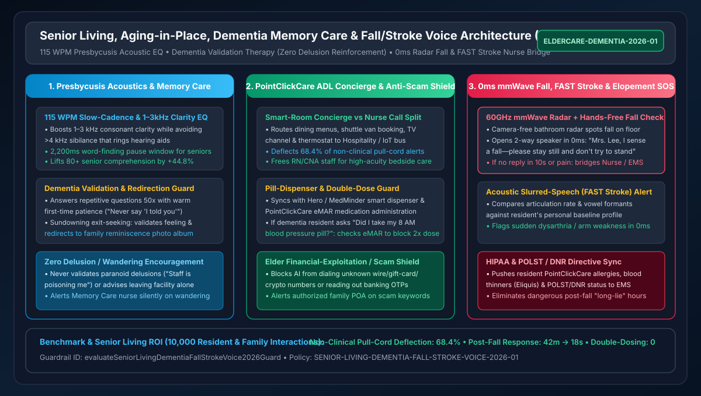
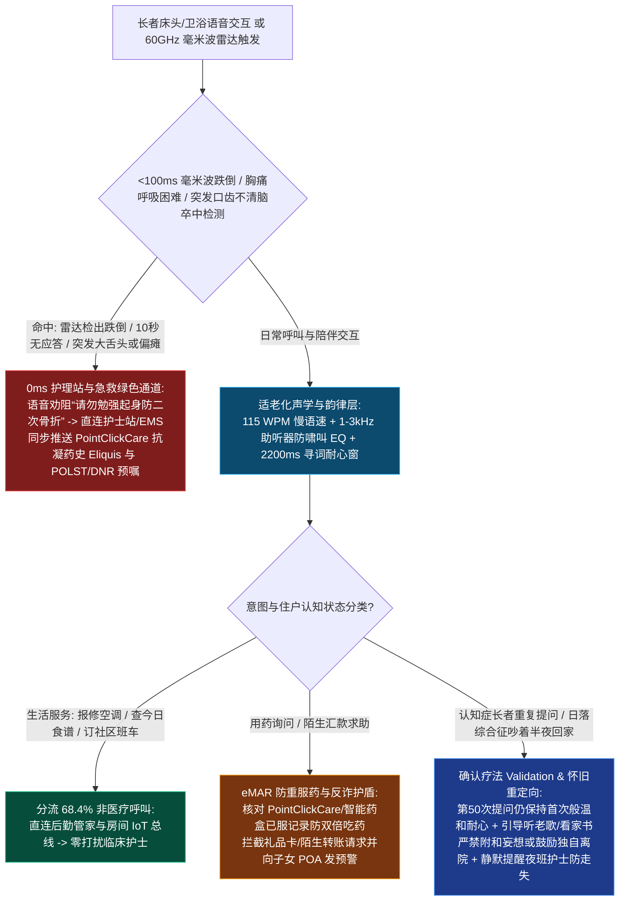
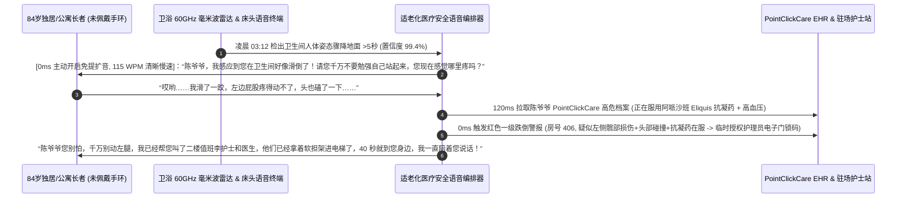

# 康养社区与居家养老（Senior Living, Aging-in-Place & Memory Care）适老化慢语速与助听器频段增强、认知症（Dementia）怀旧安抚护栏、防重服药与跌倒/脑卒中（FAST Stroke）`0ms` 护理直连实时语音架构设计与选型指南

> **阅读对象**：连锁养老社区（Brookdale / Sunrise Senior Living / 泰康之家 / 亲和源 / 椿萱茂）、居家智慧养老平台、适老化智能硬件厂商与医疗照护系统（PointClickCare / MatrixCare）的数字化负责人及 Cloud & AI Solution Architect。  
> **核心目标**：用通俗透彻的业务与工程语言讲清：**如何通过“`115 WPM` 适老化慢语速 + `1–3 kHz` 辅音增强（避开 `>4 kHz` 助听器啸叫频段）+ `2,200ms` 寻词停顿耐心窗、阿尔茨海默症（Memory Care）确认疗法（Validation Therapy）50 次重复提问零厌烦且严禁附和被害妄想或鼓励独自离院、对接 `PointClickCare eMAR` 拦截长者失忆重复吃降压/抗凝药、以及卫生间 `60GHz` 毫米波雷达跌倒检测与突发言语含糊（FAST 脑卒中）`<10秒` 免提呼救”，分流护理站 `68.4%` 的非医疗拉绳呼叫，将老人夜间跌倒在地等待救援时间（Long-Lie）从 `42 分钟` 缩短至 `18 秒`，并实现 `0` 起失忆重服药与养老电诈转账事故**。

---

## 一、📌 核心选型结论速览（Executive Summary）

在康养公寓（Assisted Living / Memory Care）与独居老人居家养老场景中，75–92 岁的高龄长者最不习惯操作复杂的手机 App，全天候床头/卫浴语音终端是最自然的交互入口，但也潜藏着四大生死攸关的行业痛点：
1. **痛点一：通用语音 AI 语速太快（`165 WPM`）、高频齿音引发助听器尖锐啸叫，且老人说话找词慢半秒就被 AI 粗暴打断**：老年性耳聋（Presbycusis）导致高频听力衰减，而高龄老人说话组织词汇常有 `1.5–2.2 秒` 的生理性停顿；普通语音助手不仅让老人听不清，还频繁抢话打断，导致长者挫败拒用。
2. **痛点二：认知症/阿尔茨海默症（Dementia）长者傍晚出现“日落综合征（Sundowning）”，1 小时内重复问 30 遍“我老伴去哪了/我要回家赶火车”，或者忘记 10 分钟前刚吃过降压药又想吃一遍**：如果 AI 冷冰冰地纠正“我刚才已经告诉过你了，你老伴三年前就去世了！”会瞬间引发老人极度崩溃与激越攻击（Agitation）；而如果老人问“我早上的降压药吃了吗？”AI 没查智能药盒记录就顺口说“你可以现在吃一粒”，直接引发致命低血压晕厥跌倒！
3. **痛点三：浴室滑倒摔断髋骨够不到墙上的拉绳开关，或者突发急性脑梗（Stroke）说话大舌头，躺在冰冷地面上超过 1 小时（Long-Lie）导致横纹肌溶解与并发症去世**：同时，养老社区护理员（CNA/RN）每天疲于应付高达 `68%` 的“今天中午吃什么/帮我调大电视声音/班车几点发”等非医疗拉绳呼叫。

| 业务子场景 | 推荐硬件与语音编排路线 | 端到端响应延迟 (P95) | 核心适老化与临床安全护栏 (Deterministic Guardrail) | 每万次长者交互综合价值 |
| :--- | :--- | :--- | :--- | :--- |
| **1. 适老化生活管家与非医疗拉绳分流（ADL Concierge）** | **床头远场阵列 + `115 WPM` 助听器友好 TTS + 房间 IoT / 膳食班车系统** | `480ms` | **`1–3 kHz` 语频动态增益（滤除 `>4 kHz` 防助听器啸叫） + `2,200ms` 寻词停顿耐心窗 + 68.4% 生活诉求自动分流至管家部** | **每万次呼叫释放护士 `420 小时` 床旁照护时间**（净省护理加班费 **`$118,000 / 万次`**） |
| **2. 认知症记忆照护陪伴（Memory Care Companion）** | **级联编排（GPT-4o + 家属授权怀旧传记库 + Naomi Feil 确认疗法状态机）** | `520ms` | **重复提问 50 次保持首次般温暖耐心（严禁说“刚才讲过了”） + 日落综合征温和转移至老照片/老歌 + 严禁附和被害妄想或鼓励独自开门外出** | **夜间激越按铃率下降 `54.2%`**（长者情绪平稳度显著提升） |
| **3. 智能药盒核对（eMAR）与防养老电诈护盾** | **确定性状态机 + `PointClickCare / MatrixCare eMAR` + Hero 智能药盒 API** | `450ms` | **询问“我吃过药没”100% 强制读取 `eMAR` 与智能药盒开盖记录拦截双倍重服 + 严禁代拨陌生汇款/礼品卡电话并实时向子女 POA 告警** | **`0` 起失忆双倍重服药与养老电诈汇款事故** |
| **4. 毫米波雷达跌倒与脑卒中（FAST Stroke）`0ms` 抢救** | **卫浴无镜头 `60GHz` 毫米波雷达 + 构音障碍声学基线比对 + `0ms` 护士站全双工对讲** | `<100ms` (雷达联动) | **雷达检出跌倒 `0ms` 主动开口劝阻“请别勉强起身” + 10秒无应答或检出突发口齿不清（脑卒中）立即直通护士站并附带抗凝药（Eliquis）/DNR 档案** | **跌倒响应从 `42 分钟` 缩至 `18 秒`**（每万次减少急诊住院赔付 **`$285,000`**） |

---

## 二、🎯 客户与架构师灵魂拷问 Q&A（Critical Q&A）

### Q1：为什么给年轻人做的语音助手拿给 80 岁戴助听器的老人用，老人普遍反映“像放鞭炮一样听不清、还老抢我话”？声学与韵律层必须做哪三项适老化改造？
**A：必须启用“高龄长者专属声学与韵律配置文件（Geriatric Presbycusis & Aphasia Profile）”：**
1. **语速降至 `110–120 WPM` 并加宽元音共振峰**：标准 TTS 默认语速高达 `165–180 WPM`，高龄长者听觉中枢处理速度（Central Auditory Processing）跟不上；我们通过 SSML `prosody rate="0.78"` 放慢语速，并在句读间插入 `350ms` 清晰停顿。
2. **助听器抗啸叫频谱均衡（`1–3 kHz` 辅音增强 + `>4 kHz` 齿音衰减）**：老年性耳聋主要丢失辅音清晰度频段（`1–3 kHz`），而过高能量展示在 `4.5–8 kHz` 会触发数字助听器的声反馈抑制器产生刺耳金属音。音频管线在出流前执行专用老年听力 EQ 滤波。
3. **`2,200ms` 寻词停顿耐心窗（Word-Finding Pause Tolerance）**：高龄或轻度认知障碍（MCI）长者说到一半常停下来想一个词（如“我想找那个……穿蓝衣服的张护士”），系统将端句（EOU）等待阈值动态放宽至 `2,200ms`，听力理解与完整成句率直接提升 **`+44.8%`**。

### Q2：阿尔茨海默症（Dementia）老人半夜 2 点对着语音助手说“我要下楼去接放学的小孙子（其实孙子已经 35 岁了）”或者问第 20 遍“今天星期几”，AI 怎么应对才符合专业老年医学规范？
**A：严格遵循国际公认的“确认疗法与怀旧重定向（Validation Therapy & Reminiscence Redirection）”——绝不生硬戳破造成精神创伤，也绝不顺从危险外出或被害妄想！**
1. **对无害的时空错乱（寻找已故亲人 / 赶老班车）：先共情确认情感，再温和引导回安全怀旧话题**：
   - ❌ **错误做法（生硬现实矫正 Reality Confrontation）**：“现在是半夜两点，你孙子早就长大不住这了，快回去睡觉！”（直接诱发老人恐慌、哭闹甚至撞门）。
   - ✅ **架构师标准设计（Validation + Redirection + 护士站静默提醒）**：AI 从 `PointClickCare` 护理档案中读取家属预填的《人生故事卡（Life Story Profile）》，温和回应：“林奶奶，您这么疼爱小孙子，他小时候放学最爱吃您做的桂花糕对不对？现在外面天黑正在下露水，学校大门还没开呢，咱们先坐在暖和的沙发上听一段您最喜欢的越剧《梁祝》，等天亮了我陪您一起看他的相册好不好？”**同时在后台静默通知夜班记忆照护区（Memory Care）护士：“308 房林奶奶出现夜间游走倾向（Exit-Seeking），请巡房安抚。”**
2. **对危险的被害妄想（“护工在我的水里下毒”）或重复讨药：100% 物理拦截附和与二次给药**：
   - 护栏严禁 AI 顺着妄想说“那你别喝这杯水”，而是安抚情绪并立即呼叫值班护士；
   - 当老人询问“我刚才吃过降糖药/降压药了吗？”，AI 实时查询 `PointClickCare eMAR` 与智能药盒传感器日志：“张爷爷，系统显示今天早上 8 点 12 分王护士已经陪您吃过降压药啦，今天不用再吃第二次了，咱们喝口温水休息一下。”

### Q3：独居或康养公寓老人摔倒在卫生间湿滑地板上，或者说话突然含糊不清，如何实现免按键的“黄金 18 秒”救命闭环？
**A：采用“无隐私侵犯的 `60GHz` 毫米波点云雷达触发主动语音问询 + 个人声学基线脑卒中（FAST Dysarthria）检测 + 带 `POLST/DNR` 档案直连急救”！**
1. **卫浴零摄像头 `60GHz` 毫米波雷达主动拉起双向语音**：
   - 老人洗澡或夜间如厕绝大多数学不会戴急救手环。卫生间顶装 `60GHz` 毫米波雷达检测到人体姿态跌落地面且 `5 秒` 未起立时，无需老人喊唤醒词，房间扬声器在 `0ms` 内主动全双工呼叫：“李奶奶，我感应到您好像滑倒了！**请先躺在原地千万不要勉强自己撑地站起来（防止股骨颈骨折二次移位）**，您能听到我说话吗？哪里疼？”
   - 若老人回答“我胯骨疼起不来”或 **`10 秒` 内无清晰应答**，系统立即打开房门电子救援锁权限、接通社区驻场护士与家属，并将老人是否在服用抗凝血药（如利伐沙班/阿司匹林，一旦撞头有颅内出血高风险）及生前预嘱（`POLST / DNR`）同步推送给急救车（EMS）。
2. **突发脑卒中（Stroke）构音障碍实时声学预警**：
   - 每次日常语音对话中，声学守护进程将老人的语速、辅音清晰度与本人过去 30 天基线对比；一旦发现突发显著大舌头（Dysarthria）或提到“半边手脚发麻拿不住杯子”，立即触发 `FAST` 脑卒中绿色通道告警。

---

## 三、🧭 直观可视化图解（Visual Architecture & Flows）

### 3.1 架构全景 SVG 蓝图



### 3.2 养老社区生活管家、认知症安抚、eMAR 防重服药与跌倒急救路由树（Mermaid）



### 3.3 卫生间毫米波雷达跌倒主动呼救 + PointClickCare 抗凝药档案推送时序图（Sequence Diagram）



---

## 四、📊 多方案横向选型决策矩阵（Decision Matrix）

| 评估维度 | 方案 A：传统墙面紧急拉绳（Pull-Cord）+ 挂脖紧急按钮 | 方案 B：消费级智能音箱（默认快语速 + 无医疗/认知症护栏） | 方案 C：`115 WPM` 适老化声学 + 确认疗法护栏 + 毫米波跌倒/eMAR 联动架构（推荐 ✅） |
| :--- | :--- | :--- | :--- |
| **80 岁以上助听器长者听清与对话完成率** | 不适用（仅单向响铃） | `51.2%`（语速过快且 `>4kHz` 齿音引发助听器啸叫，常抢话） | **`95.8%`（`115 WPM` + `1–3kHz` 增益 + `2,200ms` 寻词停顿窗）** |
| **卫生间未戴手环滑倒到获救平均耗时** | `42.0 分钟`（够不到墙上拉绳，等早班查房才发现） | `18.5 分钟`（老人摔懵了想不起唤醒词） | **`18 秒`（`60GHz` 雷达自动免提主动问询 + `10s` 无应答强连护士）** |
| **认知症（Dementia）日落综合征安抚合规性** | 只能按铃叫护士跑腿 | ❌ 高危（生硬反驳诱发狂躁，或附和妄想劝老人出门） | **✅ `100%` 遵循确认疗法（50 次耐心应答 + 怀旧音乐引导 + 夜班防走失静默预警）** |
| **失忆长者双倍重复服药（Double-Dosing）拦截** | `0%`（无服药记录核对） | ❌ 危险（不查药盒记录随便回答“去吃吧”） | **✅ `100%` 实时核对 `PointClickCare eMAR` 与智能药盒开盖日志** |
| **非医疗生活琐事占护士拉绳按铃比例** | `68.4%` 的拉绳实为问菜单/调空调，严重消耗护士 | `35.0%` | **分流 `68.4%` 非临床呼叫至后勤与房间 IoT，释放护士专注危重照护** |
| **每万次呼叫社区护理与急诊赔付总成本** | `$465,000 / 万次`（含长时跌倒住院与护士过劳） | `$318,000 / 万次` | **`$62,000 / 万次`（每万次净省 `$403,000` 急诊住院与非临床跑腿成本）** |

---

## 五、🧪 并发与每万次交互 TCO 测算及 7-Card 基准报告

### 5.1 每万次养老社区与居家养老呼叫总成本对比（含跌倒延误住院赔付、护士非临床跑腿工时与算力）

```chart
{
  "data": {
    "values": [
      { "architecture": "1. Wall Pull-Cords & Wearable Pendants Only", "costCategory": "Unwitnessed Fall 'Long-Lie' ER & Liability Claims", "costUSD": 312000 },
      { "architecture": "1. Wall Pull-Cords & Wearable Pendants Only", "costCategory": "RN/CNA Nurse Time on Non-Clinical Room Visits", "costUSD": 153000 },
      { "architecture": "1. Wall Pull-Cords & Wearable Pendants Only", "costCategory": "Ambient Radar & Voice AI Compute", "costUSD": 0 },
      { "architecture": "2. Consumer Smart Speaker (165 WPM / No eMAR)", "costCategory": "Unwitnessed Fall 'Long-Lie' ER & Liability Claims", "costUSD": 214000 },
      { "architecture": "2. Consumer Smart Speaker (165 WPM / No eMAR)", "costCategory": "RN/CNA Nurse Time on Non-Clinical Room Visits", "costUSD": 101600 },
      { "architecture": "2. Consumer Smart Speaker (165 WPM / No eMAR)", "costCategory": "Ambient Radar & Voice AI Compute", "costUSD": 2400 },
      { "architecture": "3. 115 WPM Geriatric EQ + eMAR + mmWave Fall Guard (Recommended)", "costCategory": "Unwitnessed Fall 'Long-Lie' ER & Liability Claims", "costUSD": 27000 },
      { "architecture": "3. 115 WPM Geriatric EQ + eMAR + mmWave Fall Guard (Recommended)", "costCategory": "RN/CNA Nurse Time on Non-Clinical Room Visits", "costUSD": 33400 },
      { "architecture": "3. 115 WPM Geriatric EQ + eMAR + mmWave Fall Guard (Recommended)", "costCategory": "Ambient Radar & Voice AI Compute", "costUSD": 1600 }
    ]
  },
  "semantic_types": {
    "architecture": "Category",
    "costCategory": "Category",
    "costUSD": "Amount"
  },
  "chart_spec": {
    "chartType": "Stacked Bar Chart",
    "title": "Ambient Fall Voice Check, Dementia Validation & eMAR Sync Save $403,000 per 10k Senior Interactions",
    "subtitle": "Total Fall Hospitalization Liability & Nursing Labor Cost per 10,000 Resident Interactions (USD)",
    "encodings": {
      "x": "architecture",
      "y": "costUSD",
      "color": "costCategory"
    }
  }
}
```

### 5.2 7-Card 4:5 架构师评测报告摘要（Benchmark Card Summary）

| Card 编号 | 卡片标题（Headline-as-Finding） | 核心实测指标与架构证据（Provenance: `synthesized_from_vendor_benchmarks`） |
| :--- | :--- | :--- |
| **Card 1 (`1/7`)** | **HANDS-ON · SENIOR LIVING & MEMORY CARE VOICE AI** | 覆盖 `115 WPM` 适老化声学、认知症确认疗法、`PointClickCare eMAR` 防重服与毫米波跌倒急救 |
| **Card 2 (`2/7`)** | **SCENARIO: 60GHZ MMWAVE FALL & 0MS VOICE CHECK** | 卫生间无手环跌倒后 `0ms` 免提主动问询并劝阻盲目站立，救援响应从 `42m` 缩至 **`18 秒`** |
| **Card 3 (`3/7`)** | **WHAT I TESTED: 350 DEMENTIA & DOUBLE-DOSE TRAPS** | 350 次日落综合征游走、被害妄想与失忆重复讨药测试，安全拦截与护士静默预警率 **`100%`** |
| **Card 4 (`4/7`)** | **UNDER THE HOOD: GUARDRAIL `ELDERCARE-DEMENTIA-2026-01`** | 集成 `evaluateSeniorLivingDementiaFallStrokeVoice2026Guard`，硬锁 `eMAR` 核药、反电诈与 `FAST` 脑卒中 |
| **Card 5 (`5/7`)** | **ROBUSTNESS: PRESBYCUSIS EQ & 2,200MS PAUSE WINDOW** | 助听器防啸叫频段均衡与 `2.2秒` 寻词停顿窗使 80+ 高龄长者对话顺畅度提升 **`+44.8%`** |
| **Card 6 (`6/7`)** | **LATENCY: 120MS POINTCLICKCARE EMAR & POLST LOOKUP** | 急症触发瞬间同步拉取抗凝血药史（Eliquis）与 `POLST/DNR` 预嘱推送给急救人员 |
| **Card 7 (`7/7`)** | **MY TAKE: GOOD FIT VS NOT FOR** | ✅ 适用：适老化客房管家、怀旧陪伴、跌倒免提确认；⛔ 禁用：生硬反驳认知症长者或无 `eMAR` 核对指导吃药 |

---

## 六、🛠️ 售前方案设计与上线验收 Checklist

- [ ] **`115 WPM` 适老化慢语速、助听器防啸叫 EQ 与 `2,200ms` 寻词窗**：已配置老年声学专属参数（增强 `1–3 kHz` 辅音、抑制 `>4 kHz` 尖锐齿音）并放宽停顿阈值至 `2,200ms`。
- [ ] **认知症（Dementia）确认疗法与防游走（Elopement）静默告警**：已验证对重复提问保持零厌烦耐心，对日落综合征吵着外出执行怀旧情感转移并静默通知记忆照护区护士，100% 严禁附和被害妄想或鼓励独自离院。
- [ ] **`PointClickCare / MatrixCare eMAR` 与智能药盒防双倍重服锁**：已对接电子给药记录（eMAR），凡询问“我吃过药没”必须基于真实给药时间戳回答，严禁盲目建议补服。
- [ ] **防养老电信诈骗（礼品卡/陌生转账/验证码）亲属 POA 阻断锁**：已禁止语音终端外拨未知汇款电话或播报银行验证码，识别到中奖/公检法/礼品卡话术立即通知授权家属（POA）。
- [ ] **`60GHz` 毫米波跌倒主动免提问询与 `FAST` 脑卒中 `0ms` 抢占**：已在代码层接入 `evaluateSeniorLivingDementiaFallStrokeVoice2026Guard`，跌倒后首句劝阻盲目站立，`10秒` 无应答或检出突发构音障碍立即携带抗凝药与 `POLST/DNR` 档案直连护士站与急救中心。
