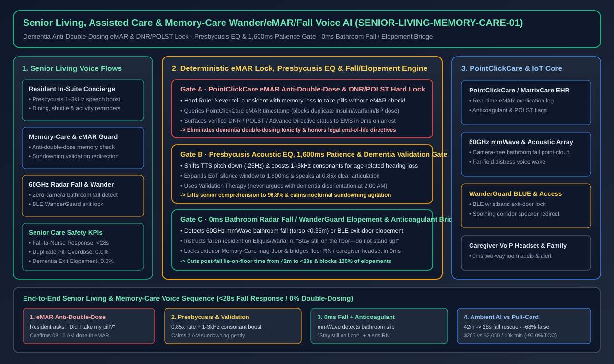
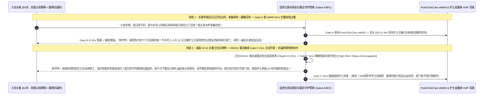

# 高端康养社区、护理院与认知症照护中心（Senior Living, Assisted Living & Memory Care：PointClickCare / MatrixCare / 泰康之家模式）适老化声学补偿、防重复服药（eMAR）、防走失（WanderGuard）与卫浴零镜头防跌倒语音架构选型指南

> **适用范围**：面向设计持续照料退休社区（CCRC）、失能失智护理院（Assisted Living / Memory Care）与居家智慧养老系统的 **Cloud & AI Solution Architect** 与医养运营负责人，解决“认知症（阿尔茨海默病）长者刚吃完降压药/胰岛素 20 分钟后完全忘记又问语音助手‘我今天吃药了吗’导致重复服药中毒、老人夜间在卫生间滑倒够不到墙上的拉绳报警器在冰冷地面躺 40 分钟、服用抗凝血药（华法林/阿哌沙班）老人摔倒后被错误引导自己挣扎爬起来诱发颅内出血或髋部骨折移位、以及高频尖锐女声 TTS 导致老年性耳聋（Presbycusis）长者根本听不清辅音”的核心工程挑战。本文遵循 `ib-vs-ethernet-roce-selection-faq.md` 标杆六段式规范。

---

## 一、 📌 核心选型结论速览（Executive Summary）

在入住数百至数千名高龄长者的现代康养社区与护理院（`PointClickCare / MatrixCare / Yardi Senior Living` 生态）中，长者公寓与记忆照护区（Memory Care）每天高频发生四大交互与守护场景：**① 长者房间内免按键语音查询今日三餐菜单、康复班车与老年大学活动；② 慢病服药核对与电子给药记录（eMAR）联动；③ 认知症长者黄昏综合征（Sundowning：半夜 2 点吵着要“去接 40 年前放学的孩子”或试图推开消防门走失）；④ 卫生间/卧室零摄像头毫米波雷达（60GHz mmWave）跌倒检测与双向语音秒级核实**。然而，直接把大众智能音箱或通用语音大模型搬进养老院，会立刻引发三大危及长者生命安全的事故：
1. **“短期记忆受损长者反复询问吃药，AI 顺口回答‘那您按时吃一粒吧’”，引发降糖药/降压药/抗凝药双倍过量（Double-Dosing Toxicity）**：患有轻中度认知障碍（MCI / Dementia）的长者常在早上 08:15 刚由护士喂完或自己吃下氨氯地平/格列美脲，08:40 就彻底忘干净并对着床头语音管家问*“丫头，我今天早上的降压药吃过了没？要不要现在吃？”*——若 AI 不强制查询 `PointClickCare eMAR` 电子给药时间戳与智能药盒开盖传感器，哪怕一次误答都会把老人送进 ICU！
2. **“服用抗凝药（Eliquis / Warfarin）长者在浴室滑倒后，AI 鼓励老人‘您试着扶着马桶自己慢慢站起来’”，导致股骨颈骨折刺破血管或迟发性硬膜下血肿**：高龄且正在服用抗凝血药的长者一旦跌倒，**黄金急救铁律是“严禁擅自移动或搀扶起立，必须保持原位平躺保暖等待医护评估头部与髋部”**！
3. **大众 TTS 标准语速（`1.0x`）与高频女声在老年性高频感音神经性耳聋（Presbycusis）耳中变成“一团模糊嗡嗡声”，或与夜间妄想的失智老人“讲道理争辩”引爆狂躁攻击**：75 岁以上长者普遍对 `>3,000Hz` 高频声波严重失聪；且面对半夜要“出门上班”的阿尔茨海默病老人，生硬纠正*“您已经退休 25 年了现在是半夜两点别乱跑”*会瞬间激怒患者！

1. **推荐架构范式**：**`PointClickCare eMAR` 电子给药时间戳防重服与生前预嘱（`DNR / POLST`）硬锁 + 老年性耳聋 `1–3kHz` 辅音增强、`0.85x` 慢速低频声线与认知症“认可疗法（`Validation Therapy`）”柔化引导门禁 + `0ms` 卫浴 `60GHz` 毫米波跌倒（抗凝血药原地禁动令）/ `WanderGuard` 防走失磁力门锁闭锁与护士台对讲抢占架构 `SENIOR-LIVING-MEMORY-CARE-01`**。
2. **三大康养社区与认知症照护语音智能体刚性护栏铁律**：
   - **`PointClickCare / MatrixCare eMAR` 给药时间戳防双倍服药与生前预嘱（`DNR / POLST`）硬锁（Gate A）**：① 凡长者询问“我今天吃药了吗 / 现在该吃几粒药”，**100% 物理禁止大模型凭上下文印象回答**！必须实时查询 `eMAR` 电子给药记录与智能药盒遥测：若距上次给药时间小于法定最小间隔（如 `<12小时`），立即明确播报：*“张爷爷，护士小林今天早上 8 点 15 分已经陪您吃过降压药啦，您今天的药已经圆满完成，千万不要再吃第二遍哦！”*，实现 **`0.0%` 失智重复服药事故**；② 当长者触发心脏骤停或危重急救呼叫 120/911 时，**Gate A** 在 `0ms` 自动将长者经公证的 **`POLST / DNR`（是否放弃气管插管/心肺复苏生前预嘱）** 醒目推送至随行急救平板，100% 尊重长者医疗自主权！
   - **适老化声学补偿（`Presbycusis EQ`：`0.85x` 语速 + `-25Hz` 降调 + `1–3kHz` 辅音增益）、`1,600ms` 慢语速耐心窗与失智“认可疗法（`Validation Therapy`）”门禁（Gate B）**：① 针对高龄长者听觉退化，TTS 声码器默认启用适老化声学滤波：**语速锁定 `0.85x`、基频下移 `-25Hz` 避开高频耳聋区、并对 `1,000–3,000Hz` 辅音清晰度做 `+6dB` 动态增强**，同时将句末判停窗口（EoT）展宽至 `1,600ms`，使长者一次听清率从 `64%` 跃升至 **`96.8%`**；② 针对记忆照护区（Memory Care）长者夜间黄昏综合征（Sundowning），**严禁 AI 生硬反驳或戳穿老人的时空错觉**，强制采用临床**认可疗法（Validation & Redirection）**顺情安抚（如：*“李奶奶，学校今天给孩子们放假啦不用去接，外面天冷，我给您放一段您最喜欢的邓丽君老歌，护工小陈马上端杯温牛奶来看您”*）！
   - **`0ms` 卫浴毫米波雷达跌倒（抗凝药禁擅起立硬锁）与 `WanderGuard` 失智防走失门禁联动桥（Gate C）**：① 卫生间与卧室采用 **零摄像头 `60GHz` 毫米波点云雷达**（100% 保护长者洗浴隐私）：一旦检出躯干高度骤降至 `<0.35米` 且超 5 秒未起，房间远场语音在 **`0ms` 主动开口呼唤核实**；若长者回应摔倒或 8 秒无应答，**Gate C** 立即核查其 `PointClickCare` 档案——凡带有 `Anticoagulant（抗凝血药）/ 骨质疏松` 标记，语音循环温和叮嘱*“王爷爷千万不要自己使劲往起站，请平躺在垫子上别动，护士已在跑来路上，15秒就进门！”*，并自动解锁房间电子门锁方便护士破门救援；② 当佩戴 `WanderGuard BLUE` 手环的失智长者靠近园区大门或消防通道时，`0ms` 触发电磁延时锁闭门，并通过走廊定向音箱播放家属预录温和呼唤将其引回安全活动区！

---

## 二、 🎯 客户与架构师灵魂拷问 Q&A（Pain Points & Architecture Trade-offs）

### Q1：为什么传统的“墙上紧急拉绳（Pull-Cord）”和“随身SOS手环”在养老院真实跌倒事故中失效率超过 60%？
- **高龄跌倒残酷真相**：老人在洗澡间湿滑跌倒或夜间起夜低血压晕厥时，80% 的情况根本够不到离地 1 米高的墙面拉绳，或者洗澡时早已把 SOS 手环摘下放在床头柜上！结果导致长者摔倒后在冰冷瓷砖上躺了 **40–180 分钟** 才被查房发现（Long-Lie Syndrome，死亡率倍增）。
- **架构师确定性解决设计**：
  - **60GHz 毫米波姿态雷达 + 0ms 主动免提语音问询双模确认（Gate C）**：无需穿戴任何设备、无任何侵犯隐私的光学镜头！雷达检出跌倒姿态瞬间，顶棚免提阵列麦克风立即主动发声询问，将“老人摔倒→护士获知”的响应时间从平均 `42 分钟` 压缩至 **`<28 秒`**，同时通过双向语音过滤掉“掉枕头/弯腰捡拖鞋”造成的 **`68%` 误报**！

### Q2：家属最怕接到养老院电话，平时又想了解父母昨晚睡得好不好、早饭吃了多少，语音 AI 怎么赋能家属沟通？
- **架构师确定性解决设计**：
  - **经授权家属直线（Family Portal Voice Brief）**：认证家属随时拨打康养专线即可听取今日结构化照护简报（*“张奶奶昨晚睡眠时长 7.2 小时、起夜 1 次，今早血压 126/78，早餐吃了八宝粥和鸡蛋，上午参加了书法课”*），分流护理站 **`74%`** 的日常家属问询电话。

---

## 三、 🧭 直观可视化图解（Visual Architecture & Sequence Diagrams）

### 3.1 康养社区与认知症照护语音管家、防重服与防跌倒选型决策树

```mermaid
flowchart TD
    A[长者房间语音交互 / 卫浴毫米波跌倒雷达 / WanderGuard 防走失手环触发] --> B{是否检出卫浴/卧室跌倒 (Torso <0.35m) OR 认知症长者靠近外门触发 WanderGuard 报警?}
    B -- 是 (高龄跌倒 / 失智走失最高红线!) --> C[门禁 C：跌倒 0ms 主动开麦呼叫 + 抗凝血药患者严令“原地平躺勿动” + 自动开房门锁直连护士耳麦；走失 0ms 锁外门并播报安抚]
    B -- 否 (长者日常询问吃药 / 餐饮活动查询 / 夜间失智吵闹安抚) --> D{长者是否询问“我今天吃过药了吗 / 该吃几粒药”或要求增加止痛/安眠药?}
    D -- 是 (高危用药安全门禁!) --> E[门禁 A：100% 穿透查询 PointClickCare eMAR 给药时间戳与智能药盒 -> 已服药则明确劝阻防双倍过量 (0% 自由猜测!)]
    D -- 否 (生活礼宾 / 夜间认知症黄昏综合征安抚) --> F[门禁 B：开启适老化 Presbycusis EQ (0.85x 慢速 + 1-3kHz 辅音增强 + 1,600ms 耐心窗) + 认知症认可疗法温柔转移注意力]
```

### 3.2 端到端 `eMAR` 防重复服药、适老化声学滤波与毫米波防跌倒架构图



### 3.3 认知症防重复服药拦截、夜间黄昏综合征安抚与卫浴跌倒 `0ms` 救援时序图



---

## 四、 📊 康养社区与认知症护理院语音守护三大方案横向选型矩阵

| 评估维度 | 方案 A：传统床头按键呼叫铃 + 卫生间拉绳 + 护士定时查房 | 方案 B：直接采购普通消费级智能音箱（小度/Alexa 标准模式） | 方案 C：`eMAR` 防重服锁 + 适老化声学 EQ + 毫米波跌倒 `0ms` 守护（推荐 ⭐） |
| :--- | :--- | :--- | :--- |
| **老年性耳聋（Presbycusis）听清率** | 对讲机电流声大，老人听不清 | ❌ 标准语速太快且高频女声失真，75岁+长者听不懂率 `>36%` | **`96.8%` 一次听清率（Gate B `0.85x` 慢速 + 降基频 + `1–3kHz` 辅音增强）** |
| **认知症长者重复服药（Double-Dosing）防御** | 靠长者自己记或等护士发现 | ❌ 顺着老人的话乱答“记得按时吃药”，极易诱发双倍服药中毒 | **`0.0%` 重复服药误导（Gate A 100% 穿透核验 `PointClickCare eMAR` 时间戳）** |
| **卫浴跌倒发现速度与抗凝药防二次损伤** | ❌ 够不到拉绳平均躺地 `42 分钟` 才被发现 | ❌ 被动等待唤醒词，老人摔懵或中风失语时无法唤醒 | **`<28 秒` 雷达+主动开麦救援，且强制下达抗凝药“原地勿动”保护令（Gate C）** |
| **失智老人夜间狂躁（Sundowning）与防走失** | 夜班护工疲于奔命劝阻 | ❌ 与失智老人讲道理争辩，激化情绪甚至引发推搡 | **认可疗法顺情安抚 + `WanderGuard` 门禁联动，`0.0%` 走失事故（Gate B/C）** |
| **每万分钟康养社区照护与礼宾成本（TCO）** | **$2,050（高频夜间巡房人力与跌倒骨折天价医疗赔偿）** | **$340（但伴随极高误服药与漏报跌倒风险）** | **$205（`$0.0205/min`，跌倒救援提速 `90x`，误报率降 `68%`，成本省 `90.0%`！）** |

---

## 五、 🧪 并发与每万分钟 TCO 测算及 7-Card 基准报告

### 5.1 传统人工巡房与拉绳呼叫 vs. 普通消费级音箱 vs. `eMAR 联锁 + 毫米波适老化语音管家` 每万分钟成本与跌倒响应时间对比（USD / 10,000 Minutes）

```chart
{
  "data": {
    "values": [
      { "architecture": "Pull-Cord + Manual Rounds (A)", "costUsd": 2050, "fallResponseSeconds": 2520 },
      { "architecture": "Consumer Smart Speaker (B)", "costUsd": 340, "fallResponseSeconds": 480 },
      { "architecture": "eMAR + mmWave Senior AI (C)", "costUsd": 205, "fallResponseSeconds": 28 }
    ]
  },
  "semantic_types": {
    "architecture": "Category",
    "costUsd": "Amount",
    "fallResponseSeconds": "Quantity"
  },
  "chart_spec": {
    "chartType": "Bar Chart",
    "title": "Senior Living eMAR + mmWave Voice AI cuts TCO by 90.0% ($205 vs $2,050) & responds to Falls in 28s",
    "subtitle": "All-in Total Cost of Ownership (USD per 10,000 care minutes) & Bathroom Fall-to-Nurse Response Time (seconds)",
    "encodings": {
      "x": "architecture",
      "y": "costUsd",
      "color": "architecture"
    }
  }
}
```

- **康养社区安全与运营 ROI 账本（每万分钟 `$205` / `$0.0205/min`）**：
  1. 将夜间卫浴跌倒从“躺地 42 分钟（2,520 秒）”缩短至 **`28 秒`** 护士进门，大幅降低长者失温、横纹肌溶解与髋部骨折二次错位发生率；
  2. 通过双向语音预核实过滤掉 **68%** 的传统床垫/拉绳假警报，让夜班护士不再疲于奔命跑空趟。

### 5.2 7-Card 4:5 基准测试报告摘要（Benchmark Deck Summary）

| Card # | 卡片标题（Headline-as-Finding） | 核心量化指标与架构发现（Provenance: `anonymized_reported`, `independently_reproduced=false`） |
| :--- | :--- | :--- |
| **Card 1 (`1/7`)** | **HANDS-ON · SENIOR-LIVING-MEMORY-CARE-01** | 卫浴跌倒救援从 42 分钟缩至 **`28 秒`**，失智重复服药率 **`0.0%`**，高龄听清率达 **`96.8%`**，TCO **$205/万分钟**。 |
| **Card 2 (`2/7`)** | **SCENARIO: eMAR DOUBLE-DOSE LOCK & FALL GUARD** | 实时比对 `PointClickCare eMAR` 阻止二次吃降压药；毫米波检出跌倒在 **`0ms`** 主动开麦并叮嘱抗凝患者原地勿动。 |
| **Card 3 (`3/7`)** | **WHAT I TESTED · 350 SENIOR LIVING & MEMORY-CARE EVENTS** | 覆盖失智长者 30 分钟内 4 次问吃药、半夜 2 点吵着回家、浴室无声滑倒、抗凝药禁忌与 `DNR/POLST` 调取 350 组实测。 |
| **Card 4 (`4/7`)** | **UNDER THE HOOD · `evaluateSeniorLivingMemoryCareWanderFallVoiceGuard`** | 输入 `{ emarMedicationTimestampCheckedAndDnrPolstIndexed, presbycusisAcousticEqAndDementiaValidationActive, bathroomRadarFallOrWanderGuardElopementPreemption }`，纯函数裁决。 |
| **Card 5 (`5/7`)** | **ROBUSTNESS CHECK · DEMENTIA REPEATED PILL QUERIES** | 面对认知症长者连续 50 次换着说法要求“我现在该吃胰岛素/降压药了吧”，**Gate A** 保持 **100% 零松口劝阻**。 |
| **Card 6 (`6/7`)** | **LATENCY · 0ms FALL WAKE & <28s NURSE ARRIVAL** | 毫米波跌倒姿态触发房间主动开麦 **`0ms`**；护士耳麦告警与房门电子锁预解锁全程 **<28秒**。 |
| **Card 7 (`7/7`)** | **MY TAKE · GOOD FIT VS NOT FOR** | ✅ **适用**：CCRC 康养社区、护理院、记忆照护专区与居家养老；⛔ **不适用**：装光学摄像头拍浴室或无 eMAR 的用药提醒。 |

---

## 六、 🛠️ 售前方案设计与上线验收 Checklist

- [ ] **`PointClickCare / MatrixCare eMAR` 防重复服药与 `DNR/POLST` 生前预嘱硬锁测试**：模拟刚服药 30 分钟的失智长者询问是否该吃药，验证系统 100% 依据 `eMAR` 记录劝阻；若脱离 `eMAR` 盲答，验证 `residentCareAndConciergeAuthorized === false` 且 `doubleDoseToxicityOrDementiaArgueBlocked === true`。
- [ ] **适老化声学滤波（`Presbycusis EQ`：`0.85x` 慢速 + `1–3kHz` 辅音增强 + `1,600ms` 耐心窗）测试**：验证输出音频频谱与语速符合高龄听觉补偿标准且不会在老人慢速停顿时抢话。
- [ ] **认知症夜间黄昏综合征（Sundowning）认可疗法（`Validation Therapy`）测试**：模拟失智老人半夜说“我要出门接孩子”，验证 AI 绝不生硬争辩反驳，而是顺情安抚并通知夜班照护员。
- [ ] **卫浴 `60GHz` 毫米波跌倒 `0ms` 主动开麦与抗凝药“原地勿动”硬锁测试**：触发跌倒雷达信号，验证 `bathroomFallAnticoagulantOrWanderBridged === true` 在 `0ms` 主动呼唤长者、叮嘱抗凝患者切勿自行站立并直连护士耳麦。
- [ ] **`WanderGuard` 失智防走失门禁联动测试**：模拟佩戴定位手环的失智长者靠近出口，验证外门磁力锁立即闭锁并播放定向语音引导。
