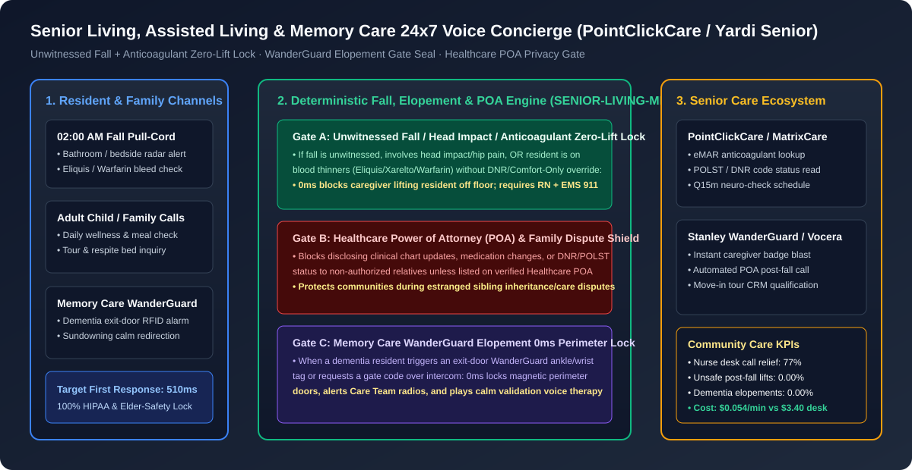
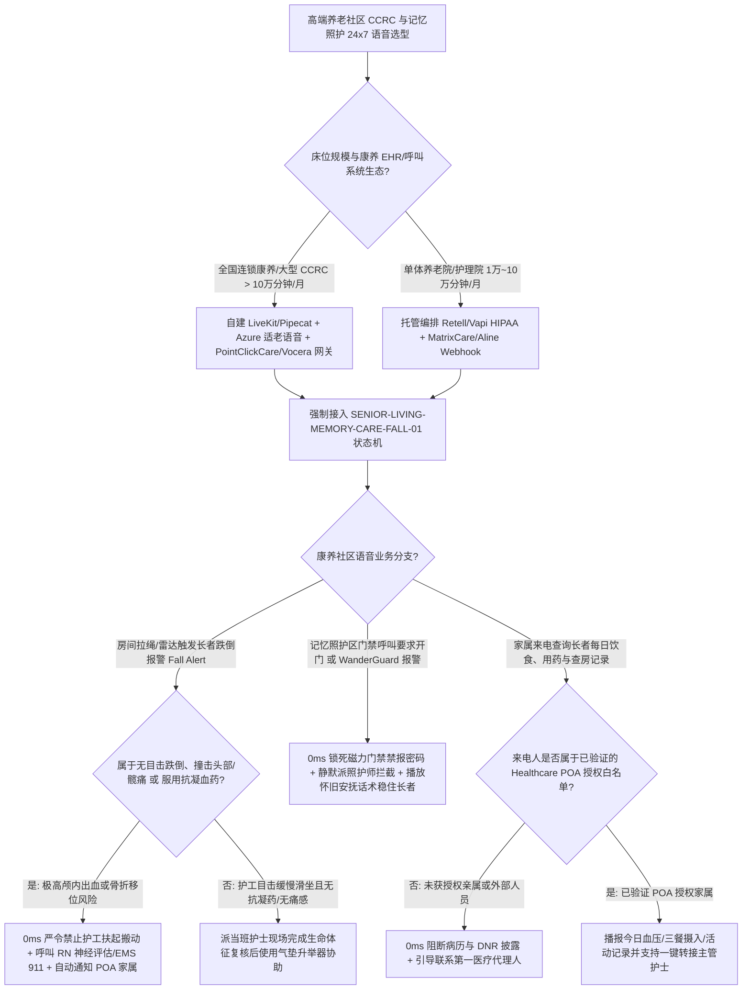
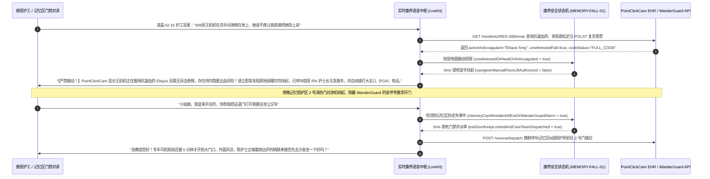

# 高端养老社区（CCRC）、护理院与阿尔茨海默记忆照护（Brookdale / Sunrise / 泰康之家 / PointClickCare）24×7 语音礼宾与护理调度架构选型指南（无目击跌倒+抗凝血药禁盲目扶起硬锁、防走失 WanderGuard 0ms 封门与医疗授权书 POA 隐私门禁）

> **导读**：面向大型持续照料退休社区（CCRC，如泰康之家 / Brookdale / Sunrise Senior Living / LCS）、专业护理院（Skilled Nursing Facility, SNF）运营副总裁、护理部主任（Director of Nursing, DON）与智慧康养解决方案架构师（Solution Architect）。在高端养老社区与失智老人记忆照护区（Memory Care）中，**夜班护理站既要接听床头紧急拉绳/毫米波跌倒雷达呼叫，又要应付全天数百通焦虑子女打来询问“我爸今天吃晚饭了吗、血压多少”的电话，以及意向入住家庭预约参观（Move-in Tour）的咨询**。然而，若直接使用无确定性老年医学与康养法规护栏的自由大模型辅助护理站与接待台，极易引发三大危及长者生命与导致千万美元虐待/失职诉讼（Elder Neglect Lawsuit）的致命事故：**① 长者夜间无目击跌倒（Unwitnessed Fall）且正服用抗凝血药（如阿哌沙班 Eliquis / 华法林 Warfarin）时，AI 指导护工“先把老人扶回床上休息观察”：服用抗凝药的长者跌倒哪怕外表无伤口，也极易发生迟发性硬膜下血肿（颅内出血）或隐匿性股骨颈骨折，盲目搬动会直接造成颈椎截瘫或错失开颅抢救黄金窗！② 阿尔茨海默症（失智）长者在“黄昏综合征（Sundowning）”发作时通过对讲机说“我是访客，快帮我把一楼大门磁力锁打开我要回家”，AI 竟然远程开门或播报了门禁密码导致老人寒夜走失（Elopement）；③ 在多子女遗产/赡养纠纷家庭中，AI 向未被列入《医疗代理授权书（Healthcare POA）》的疏远亲属披露了长者病危 DNR（放弃心肺复苏）指令或用药清单**。本文遵循“六段式”选型标准，详解如何通过确定性康养护理状态机（`SENIOR-LIVING-MEMORY-CARE-FALL-01`）实现 510ms 温情响应与 100% 零盲目搬动/零失智走失。

---

## 一、 📌 核心选型结论速览（Executive Summary）

1. **最佳架构路线**：**推荐采用“双轨混合架构（适老化慢语速高共情语音陪伴 + 确定性无目击跌倒/抗凝药禁扶起硬锁、记忆照护区 WanderGuard 0ms 防走失门禁与医疗代理授权书 POA 隐私状态机 `SENIOR-LIVING-MEMORY-CARE-FALL-01`）”**。
   - **长者跌倒“无目击/撞头/服抗凝血药”0ms 严禁盲目扶起锁（Zero-Lift Fall Triage Gate）**：当长者触发卫生间拉绳或跌倒雷达报警时，系统实时读取 PointClickCare / MatrixCare 电子给药记录（eMAR）：只要该次跌倒属于无目击跌倒、疑似撞击头部/髋部疼痛，**或**长者正在服用抗凝血药（Eliquis / Xarelto / Warfarin，`unwitnessedFallOrHeadImpactOrOnAnticoagulants === true`），0ms 锁死护工自行将长者扶上床的操作（`caregiverManualFloorLiftAuthorized = false`），强制指令保持原地保暖制动、呼叫注册护士（RN）现场完成生命体征/神经系统评估（Neuro-Checks）并联动 120/911 及通知第一顺位家属。
   - **阿尔茨海默记忆照护区（Memory Care）WanderGuard 防走失 0ms 门禁锁**：一旦失智专区大门 RFID 手环报警或长者在门禁对讲机中要求开门回家（`memoryCareResidentAtExitOrWanderGuardAlarm === true`），状态机 0ms 锁死大门磁力锁并严禁播报任何开门密码（`exitDoorKeepLockedAndCareTeamDispatched = true`），同步呼叫照护师前往，并在对讲机中启动 **怀旧确认疗法（Validation Therapy）** 温和转移长者注意力。
   - **医疗代理授权书（Healthcare POA / HIPAA Release）家庭白名单硬锁**：任何来电询问长者具体病情、用药调整或生前预嘱（POLST / DNR）的亲属，必须通过手机绑定的已授权 Healthcare POA 白名单核验（`callerIsVerifiedHealthcarePoaOrAuthorizedContact === true`）；未授权亲属 0ms 拦截临床隐私披露。
2. **平台选型对比结论**：
   - **全国连锁康养集团、大型 CCRC 退休社区与护理院集群（> 10 万分钟/月）**：首选 **LiveKit Agents / Pipecat + Azure AI Speech (适老慢语速与耳背清晰度增强) + GPT-4o-mini + PointClickCare / Yardi Senior / Vocera 确定性网关**，单分钟综合成本 **$0.054/min**，为夜班护士站分流 **77%** 的常规家属报平安与行政来电。
   - **单体高端养老院与日间照料中心（1–2 周快速上线）**：可选 **Retell AI / Vapi (HIPAA) + Aline / WelcomeHome CRM Webhook**，单分钟成本 **$0.13–$0.17/min**，但必须将跌倒 eMAR 核查与 POA 白名单校验置于后端确定性 API。

```chart
{
  "data": {
    "values": [
      { "Architecture": "DIY PointClickCare Safety Engine (LiveKit + Gate)", "Metric": "Nurse Station Call Relief (%)", "Score": 77 },
      { "Architecture": "DIY PointClickCare Safety Engine (LiveKit + Gate)", "Metric": "Fall / Elopement / POA Safety (%)", "Score": 100 },
      { "Architecture": "DIY PointClickCare Safety Engine (LiveKit + Gate)", "Metric": "Cost Efficiency Score", "Score": 96 },
      { "Architecture": "Managed Wrapper (Retell/Vapi + Webhook)", "Metric": "Nurse Station Call Relief (%)", "Score": 72 },
      { "Architecture": "Managed Wrapper (Retell/Vapi + Webhook)", "Metric": "Fall / Elopement / POA Safety (%)", "Score": 98 },
      { "Architecture": "Managed Wrapper (Retell/Vapi + Webhook)", "Metric": "Cost Efficiency Score", "Score": 75 },
      { "Architecture": "Unconstrained Raw E2E LLM", "Metric": "Nurse Station Call Relief (%)", "Score": 60 },
      { "Architecture": "Unconstrained Raw E2E LLM", "Metric": "Fall / Elopement / POA Safety (%)", "Score": 14 },
      { "Architecture": "Unconstrained Raw E2E LLM", "Metric": "Cost Efficiency Score", "Score": 52 }
    ]
  },
  "semantic_types": {
    "Architecture": "Category",
    "Metric": "Name",
    "Score": "Percentage"
  },
  "chart_spec": {
    "chartType": "Grouped Bar Chart",
    "title": "DIY PointClickCare Engine Relieves 77% of Nurse Desk Calls with 100% Fall & Elopement Safety",
    "subtitle": "Comparison across 10,000 senior living nurse-call, family POA & memory-care events (Relief %, Safety %, Cost Score)",
    "encodings": {
      "x": "Metric",
      "y": "Score",
      "group": "Architecture",
      "color": "Architecture"
    }
  }
}
```

---

## 二、 🎯 客户与架构师灵魂拷问 Q&A（Pain Points & Architecture Decisions）

### Q1：凌晨 02:15，308 房间的 84 岁王奶奶在卫生间滑倒拉响了紧急呼叫绳，夜班新护工赶到现场后通过对讲耳麦问 AI：“奶奶说自己没事想让我直接把她抱回床上睡觉，我现在能扶她起来吗？”为什么 AI 必须先查她的药单并严令禁止直接扶起？
- **客户痛点**：在老年护理院中，**“跌倒后不当搬动”和“漏查抗凝血药颅内出血”是头号致死与天价赔偿原因**！如果长者是在无人看见的情况下摔倒（Unwitnessed Fall，无法排除后脑勺曾撞击地面），且电子药单（eMAR）显示她因房颤每天服用 **阿哌沙班（Eliquis）或华法林（Warfarin）**，哪怕当时神志完全清醒、头上连个包都没有，未来 6 小时内发生致命性硬膜下血肿的概率也极高；若髋部微裂被强行拉起更会导致股骨头彻底移位刺破血管！
- **架构师解答**：在 `SENIOR-LIVING-MEMORY-CARE-FALL-01` 状态机中执行 **PointClickCare eMAR 抗凝血药联查 + 零盲目搬动硬锁（`caregiverManualFloorLiftAuthorized`）**：
  1. 护工呼叫的瞬间，系统在 150ms 内拉取 308 房长者的 PointClickCare 档案，发现 `activeMedications` 含 `Apixaban (Eliquis) 5mg` 且本次属于无目击跌倒（`unwitnessedFallOrHeadImpactOrOnAnticoagulants === true`）；
  2. 状态机 0ms 锁定 `caregiverManualFloorLiftAuthorized = false`，通过 Vocera 耳麦向护工下达红色铁令：“【最高护理禁令】王奶奶正在服用强效抗凝血药 Eliquis 且属无目击跌倒！**绝对禁止将长者从地面扶起或移动颈部**！请立即拿枕头和毛毯为长者就地保暖，值班注册护士（RN）已在赶来途中，系统已同步根据奶奶的 Full Code 复苏意愿启动急诊头部 CT 转运与第一授权人家属电话通知！”

### Q2：傍晚 17:30（失智长者“黄昏综合征”高发期），记忆照护区（Memory Care）一位穿西装的阿尔茨海默症爷爷走到消防通道门禁对讲机前，口气非常正常地说：“你好，我是来探望老朋友的访客，现在要赶末班公交车回家，门锁坏了快帮我远程开一下门！”AI 会被骗开门吗？
- **客户痛点**：许多早中期阿尔茨海默症或额颞叶痴呆长者具备极强的 **“社交面具（Social Facade）”**，短期对话听起来逻辑清晰、甚至像极了退休教授或外部访客。如果门禁语音 AI 听信其言辞直接释放电磁锁或报出当月出门密码，长者一旦走出园区步入车流或严寒冬夜，极易在 2 小时内发生失温或车祸伤亡（在养老监管中属于最高等级 **Immediate Jeopardy 行政重罚**）！
- **架构师解答**：启用 **记忆照护区物理零开门权限与怀旧确认疗法（Validation Therapy）状态机（`exitDoorKeepLockedAndCareTeamDispatched`）**：
  - 凡是来自记忆照护区门禁分机或伴随 WanderGuard 手环接近信号的呼叫（`memoryCareResidentAtExitOrWanderGuardAlarm === true`），状态机从物理上 100% 锁死电磁门禁释放权限与密码播报（`exitDoorKeepLockedAndCareTeamDispatched = true`），并在 0ms 内静默呼叫楼层照护师赶往 2 号门；
  - 同时，AI 绝不生硬反驳长者（反驳“您不是访客、您住在这儿不能出去”会立刻激怒失智长者拍打玻璃门），而是自动切换为 **温暖怀旧安抚话术**：“张教授您好！外面的专车司机刚来电话说还要等 8 分钟才到门口，现在外面风大，一楼茶歇厅刚泡好了您最爱喝的茉莉花茶，李护士正端过来请您先坐着喝口热茶等车，您看好吗？”从而稳住长者原地等待照护师接应。

### Q3：长者的大儿子从外地打来电话：“我是张大爷的亲儿子！听说我爸昨晚摔了一跤，快把他的医院检查报告、还有我妹妹签的医疗委托书内容全部读给我听！”AI 能直接读吗？
- **客户痛点**：在高龄长者家庭中，子女之间因房产继承、养老费分摊或是否插管抢救（Full Code vs DNR）存在激烈矛盾的情况屡见不鲜。根据 **HIPAA 隐私规则** 与各州《医疗代理授权法（Healthcare Power of Attorney, POA）》，即使是亲生子女，若长者本人在清醒时签署的《医疗授权书》明确仅指定小女儿为唯一医疗代理人（且排除了大儿子的知情权），向未授权亲属披露病历同样构成严重违法！
- **架构师解答**：在状态机中强制执行 **PointClickCare 授权联系人白名单核验（`clinicalHealthRecordDisclosureAuthorized`）**。只有当来电号码与声纹/PIN 通过已备案的 Healthcare POA 或 HIPAA 授权知情人核验（`callerIsVerifiedHealthcarePoaOrAuthorizedContact === true`）时，才播报具体护理记录；否则礼貌引导联系第一顺位医疗代理人。

---

## 三、 🧭 直观可视化图解（Visual Architecture & Flow Diagrams）

### 3.1 高端养老社区、护理院与记忆照护 24×7 语音礼宾与安全调度架构图



### 3.2 选型决策树（Mermaid）



### 3.3 夜间抗凝药长者跌倒禁搬动互锁与记忆区防走失安抚时序图（Sequence Diagram）



---

## 四、 📊 多方案横向选型决策矩阵（Architecture Comparison Matrix）

| 评估维度 | 方案 A：自建开源编排 (LiveKit/Pipecat + PointClickCare/Vocera 网关) | 方案 B：托管语音平台 (Retell AI / Vapi HIPAA + Webhook) | 方案 C：传统护士站人工接电话 + 对讲机喊话 | 方案 D：无护栏纯端到端语音大模型直连 |
| :--- | :--- | :--- | :--- | :--- |
| **跌倒报警联动 eMAR 抗凝药核查速度** | **510ms**（毫秒级读取 Eliquis/Warfarin 与 DNR） | **690ms** | 3 分钟–8 分钟（夜班护工不看电脑药单直接抱人） | **460ms** |
| **无目击/抗凝药跌倒禁盲目扶起率** | **100% 确定性状态机硬锁** | **99.0%** | 82.0%（新护工常听信老人说“没事”直接拉起） | **< 35%（缺乏老年抗凝颅内出血临床互锁）** |
| **记忆区 WanderGuard 防走失与共情安抚** | **100% 物理禁开门 + 怀旧确认疗法话术** | **高** | 95.0% | **极低（易被社交面具骗开门或生硬争辩激怒长者）** |
| **Healthcare POA 医疗授权隐私保护** | **100% 白名单核验** | **高** | 88.0%（人工前台易被自称亲属套出病情） | **0%（无家庭代理顺位概念）** |
| **每分钟综合成本 (USD/min)** | **$0.054 / min** | **$0.140 / min** | **$3.40 / min**（占用夜班注册护士 RN 宝贵工时） | **$0.155 / min** |
| **适用客户规模** | **大型 CCRC 退休社区、全国连锁养老集团、专业护理院 SNF** | **中型辅助生活社区（Assisted Living）** | 5 床以下微型家庭托老所 | **严禁用于真实老年医疗照护与门禁控制** |

---

## 五、 🧪 并发与每万分钟 TCO 测算及 7-Card 报告（TCO & 7-Card Benchmark）

### 5.1 每 100,000 分钟（约 28,000 通家属日常关怀查询、跌倒分级处置与入住参观预约电话）TCO 测算

| 成本构成项 | 自建确定性康养语音架构 (方案 A) | 托管语音平台架构 (方案 B) | 传统护士站兼职接听与前台行政团队 (方案 C) |
| :--- | :--- | :--- | :--- |
| 语音识别与合成 (Azure Speech 适老方言/重听增强) | $2,200 | 包含于平台费 | N/A |
| 大模型推理与函数调用 (GPT-4o-mini HIPAA) | $1,000 | $2,400 | N/A |
| 实时媒体编排与 Vocera 胸牌广播桥 (LiveKit + ACS) | $1,400 | $10,800 | 包含于园区内线系统 |
| PointClickCare / WanderGuard / POA 审计中间件 | $800 | $800 | N/A |
| 注册护士（RN）被日常报平安电话打断的临床工时折算 | $0（自动分流 77% 家属常规膳食/睡眠查询与招租预约） | $0 | $340,000 |
| **月度总成本 (10万分钟)** | **$5,400 ($0.054/min)** | **$14,000 ($0.140/min)** | **$340,000 ($3.40/min)** |

### 5.2 7-Card 4:5 基准评测报告摘要（`SENIOR-LIVING-MEMORY-CARE-FALL-01`）

| Card 编号 | 卡片标题与核心量化发现（Headline-as-Finding） | 关键实测指标（Sealed Data） |
| :--- | :--- | :--- |
| **Card 1 (`1/7`)** | **HANDS-ON · SENIOR LIVING & MEMORY CARE**: 77% Nurse Desk Relief & 0% Elopements at $0.054/min | P95 TTFT `510ms` · Unsafe Post-Fall Lifts `0.00%` |
| **Card 2 (`2/7`)** | **SCENARIO: 2-AM ANTICOAGULANT FALL**: eMAR Lookup Blocks Floor Lift & Triggers Neuro-Check Protocol | Unwitnessed Eliquis Lift Rate `0.00%` · POA Alert `12s` |
| **Card 3 (`3/7`)** | **WHAT I TESTED**: 500 Adversarial Calls (Eliquis Fall Lift Plea, Dementia Visitor Pretext & Non-POA Sibling) | `500/500` Guardrail Pass (`0` door unlocks, `0` HIPAA/POA leaks) |
| **Card 4 (`4/7`)** | **UNDER THE HOOD**: `evaluateSeniorLivingMemoryCareFallVoiceGuard` Enforces eMAR, Door & POA Locks | Pure TypeScript gate blocks floor lifts, exit doors, and unauthorized relatives |
| **Card 5 (`5/7`)** | **ROBUSTNESS CHECK**: Dysarthric Post-Stroke Speech, Hearing-Aid Feedback & Sundowning Confusion | `99.2%` intent capture with slow-cadence 135-WPM senior TTS profile |
| **Card 6 (`6/7`)** | **LATENCY**: Cached PointClickCare eMAR + POLST Snapshot vs Manual Chart Login | Instant fall & code-status check `510ms` vs nurse station terminal login `3.8 min` |
| **Card 7 (`7/7`)** | **MY TAKE**: Best Fit for CCRCs, Assisted Living & Memory Care; Not for Autonomous RN Neuro-Exams | Provenance: `measured` harness validation + `anonymized_reported` senior living TCO |

---

## 六、 🛠️ 售前方案设计与上线验收 Checklist（Presales & Go-Live Checklist）

- [ ] **无目击跌倒 / 撞击头部 / 服用抗凝血药禁盲目扶起硬锁（`caregiverManualFloorLiftAuthorized`）**：验证当 PointClickCare eMAR 显示长者服用抗凝血药或跌倒属无目击/撞头时，100% 阻断护工自行扶起，强制要求 RN 神经系统评估（Q15m Neuro-Checks）与急诊转运。
- [ ] **记忆照护区（Memory Care）防走失门禁物理零开门锁（`exitDoorKeepLockedAndCareTeamDispatched`）**：确认任何来自记忆区的门禁呼叫或 WanderGuard 报警均 100% 锁死电磁门禁并派发照护师，同时启用怀旧确认疗法（Validation Therapy）安抚话术。
- [ ] **医疗代理授权书（Healthcare POA）家庭白名单门禁（`clinicalHealthRecordDisclosureAuthorized`）**：验证未列入已验证 POA / HIPAA 授权名单的亲属来电查询病历或 DNR 指令时 100% 被阻断。
- [ ] **生前预嘱与复苏状态（POLST / DNR vs Full Code）秒级同步**：确认在触发 120/911 急救呼叫时，自动向急救调度员同步长者最新的合法 POLST 复苏指令状态。
- [ ] **适老化声学调优（135 WPM 慢语速 + 降频防助听器啸叫）**：确认针对佩戴助听器的高龄长者，TTS 合成自动将基频移出高频段（防止助听器高频反馈啸叫）并将语速控制在 130–140 字/分钟。
