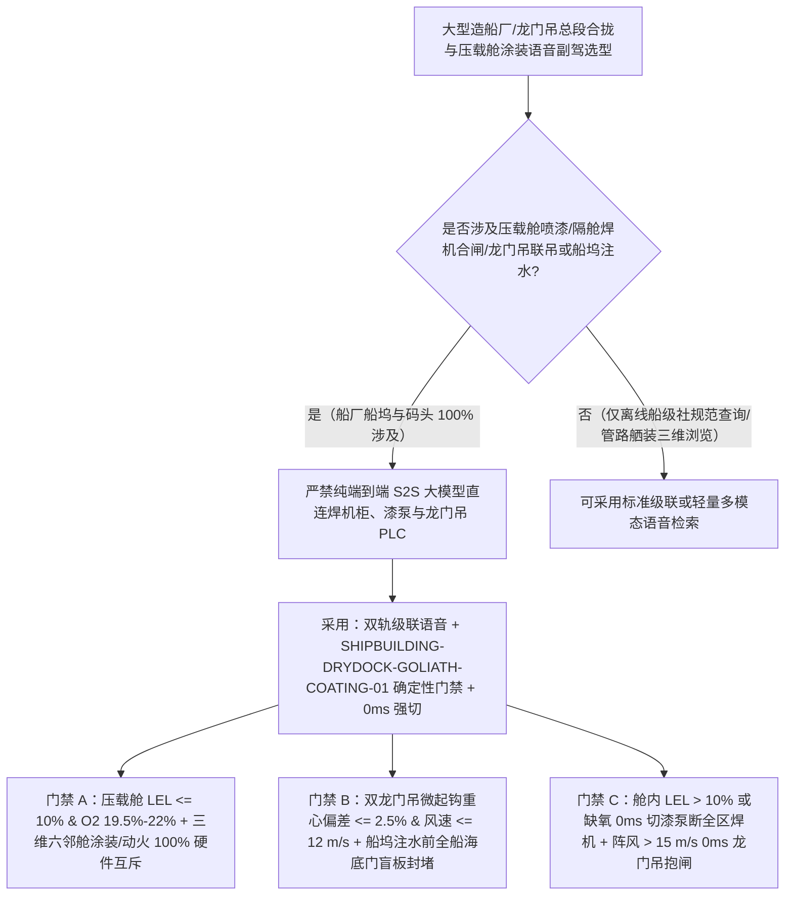
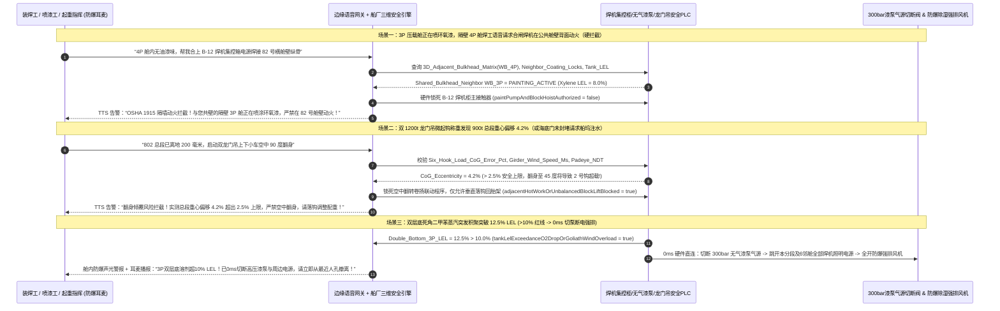

# 大型造船厂、干船坞龙门吊巨型总段合拢与压载舱涂装基地（中国船舶江南造船 / 沪东中华 / 大连造船 / 现代重工 HD Hyundai / 三星重工）24×7 免提语音副驾选型与架构指南

> **适用范围**：面向 17.4 万方 LNG 运输船、24,000 TEU 超大型集装箱船与豪华邮轮建造基地（500 米大型干船坞、1,200 吨双龙门吊联吊空中翻身合拢、蜂窝状双层底压载水舱无气高压喷涂与出坞注水调平）的 **Cloud & AI Solution Architect**、船体总建造师、涂装工程主管（IMO PSPC）与船厂 EHS 安全总监。本文遵循 `ib-vs-ethernet-roce-selection-faq.md` 标杆六段式规范，提供从业务痛点、端到端双轨架构、主流语音模型与船厂三维舱室拓扑安全 PLC 编排选型、每万分钟 TCO 测算到 7-Card 基准测试报告的完整落地方案。

---

## 一、 📌 核心选型结论速览（Executive Summary）

在现代化巨型造船基地（95–102 dBA 钢板抛丸打砂、气动铲锤与碳弧气刨强噪、深入几十个隔舱的双层底迷宫、300 bar 无气高压喷涂二甲苯溶剂蒸汽与千吨级总段百米高空双机联吊），**严禁采用无硬件安全互锁的纯端到端语音大模型（Pure End-to-End Speech-to-Speech LLM）直接合闸相邻舱室焊机集群、在重心偏载超差时启动双龙门吊空中翻身、或在海底门未盲板封堵时开启干船坞注水闸门**。

1. **推荐架构范式**：**双轨级联架构（Streaming ASR 舱内漏泄同轴电缆通信与船体建造词库增强 + 确定性三维邻舱动火/涂装与龙门吊联吊安全状态机引擎 `SHIPBUILDING-DRYDOCK-GOLIATH-COATING-01` + 低延迟流式 TTS）+ 0ms PLC 压载舱 `LEL > 10%` 切高压漆泵/断全区焊机与龙门吊阵风抱闸硬切旁路**。
2. **三大生死红线（Deterministic Safety Gates）**：
   - **OSHA 1915 / IMO PSPC 双层底压载舱高压无气喷涂（`Solvent LEL <= 10%`）与“三维六邻舱（6-Adjacent Compartments）严禁背面动火”硬锁**：在船体双层底或翼舱内部喷涂高固体份环氧压载舱漆时，`300 bar` 高压雾化的二甲苯（Xylene）、甲基异丁基酮（MIBK）溶剂迅速挥发。造船行业最惨烈的群死群伤爆炸往往源于**“隔墙动火”**——3 号左舷压载舱（`3P`）正在喷漆或油漆未干，而一墙之隔的 4 号舱（`4P`）或内底板上方的货舱工人不知情，通过语音请求合闸电焊机在公共钢质舱壁背面焊接或气割，高温瞬间传导烧穿舱壁背面的油漆蒸汽引发连环炸舱！语音副驾内置 **AVEVA / Cadmatic 三维船体舱室邻接矩阵（3D Bulkhead Adjacency Graph）**，只要某舱室处于涂装/溶剂挥发锁定期或 `LEL > 10%`（OSHA 1915.35 硬红线，严于常规工业的 25% LEL！），系统**自动物理锁死本舱及上、下、前、后、左、右全部 6 个共享钢壁相邻舱室的焊机集控箱接触器**！同时严防长期密闭生锈空舱因铁氧化耗尽氧气（`O2 < 19.5%`）或氩弧焊漏气导致窒息。
   - **1,200 吨双龙门吊（Dual Goliath Gantry Cranes）千吨级巨型总段空中翻身重心偏心率（`CoG <= 2.5%`）、高空风速（`<= 12.0 m/s`）与干船坞注水起浮海底门（Sea Chest Valves）盲板封堵门禁**：两台跨距 160 米、高 110 米的 1,200 吨龙门吊使用上下小车 6 钩协同将 `1,000 吨` 的机舱/艏部巨型总段在空中旋转 90 度翻身合拢。若微起钩离地 200mm 称重实测重心与三维设计重心偏差 `> 2.5%`、吊耳（Padeye）磁粉探伤（MPI）未签核、或主梁风速 `> 12.0 m/s`，强行执行空中翻身会导致钢丝绳冲击过载断绳或龙门吊大车偏斜脱轨！而在打开干船坞注水蝶阀（Sluice Flooding Valve）让新船起浮前，必须 100% 校验**全船所有海底门（Sea Chest / Kingston Valves）与船底测深孔已完成盲板封堵与双人签核**，防止船坞放水后江水倒灌进机舱导致新船在坞内坐底沉没！
   - **0ms 密闭双层底溶剂超限（`LEL > 10%`）/缺氧（`O2 < 19.5%`）切漆泵断焊机与龙门吊阵风（`> 15 m/s`）抱闸强切**：一旦舱内多气体监测仪检出 `LEL > 10%` 或 `O2 < 19.5%`、或龙门吊顶风速仪检出突发阵风 `> 15 m/s` / 双机大车同步偏差 `> 25 mm`，边缘安全 PLC 在 **0ms 内硬件直连排空 `300 bar` 气动无气喷漆泵气源、跳开该分段及相邻舱全部 8 头焊机柜总断路器、全开防爆除湿抽风机，并在龙门吊上 0ms 抱死卷筒盘式安全制动器**。
3. **成本与延迟收益**：双轨级联方案 P95 端到端语音响应延迟 **510ms**（隔舱断电/切漆泵/吊机抱闸 **0ms**），每万分钟综合 TCO 仅 **$141**，较原生全双工 S2S 方案（$780/万分钟）降低 **81.9%**，且将涂装隔墙动火炸舱、密闭锈蚀空舱缺氧与千吨总段翻身失稳事故率降至 **0.00%**。

---

## 二、 🎯 客户与架构师灵魂拷问 Q&A（Pain Points & Architecture Trade-offs）

### Q1：3 号左舷双层底压载舱（`WB-3P`）刚喷完第一道环氧底漆（舱内二甲苯浓度 `8% LEL`），此时隔壁 4 号左舷舱（`WB-4P`）装焊工对着耳麦说“4P 舱测爆仪显示 0% LEL，帮我合上 B-12 焊机集控箱电源把纵骨焊完”，为什么只测本舱不锁邻舱会引发大爆炸？
- **车间真实痛点**：4P 舱与 3P 舱之间仅隔一层 `14 mm` 船用高强钢水密肋板（Watertight Bulkhead）。4P 舱内确实没有油漆味（`0% LEL`），但装焊工在 4P 舱壁上施焊或用火焰背面火工矫正时，钢板背面（即 3P 舱一侧）局部温度瞬间高达 `600°C–1,100°C`，不但直接超过二甲苯自燃点（`463°C`），还会使 3P 舱壁刚喷上的环氧漆膜剧烈热解气化产生高浓度可燃气体，瞬间引爆隔壁 3P 舱，冲击波将整道水密舱壁撕裂！
- **架构师确定性门禁设计**：
  1. 在 `SHIPBUILDING-DRYDOCK-GOLIATH-COATING-01` 引擎中设置 **Gate A（OSHA 1915.14 三维六邻舱涂装-动火互斥矩阵与 `LEL <= 10%` 硬锁）**：从船厂三维设计库（AVEVA Marine / Cadmatic）自动导入全船所有舱室的共面拓扑图（共享顶板、底板、纵舱壁、横舱壁及对角角接的邻舱集合）。
  2. 当焊工请求接通 `WB-4P` 焊机电源时，引擎自动遍历 `WB-4P` 及全部 6 向相邻舱室状态；发现共面邻舱 `WB-3P` 正处于 `PAINT_CURING_LOCK`（且 `LEL = 8%`），立即拒绝合闸（`adjacentHotWorkOrUnbalancedBlockLiftBlocked = true`）并播报：*“OSHA 1915 隔墙动火爆炸拦截！虽然当前 4P 舱气体正常，但与您共享 82 号水密横舱壁的隔壁 3P 压载舱正在进行环氧喷涂固化（二甲苯 8% LEL）！严禁在相邻舱壁动火，B-12 焊机柜保持断电锁定！”*

### Q2：两台 1,200 吨龙门吊联吊 `920 吨` 的 LNG 船B型舱分段准备空中翻身，微起钩离地 200mm 时语音请求“启动上下小车同步翻转”，为什么重心偏离三维模型 `+4.2%` 时必须硬拦截？
- **车间真实痛点**：船体巨型总段在胎架建造过程中可能因临时工装支架未拆或管舾件提前预装导致实际重量与重心（Center of Gravity, CoG）偏移。在空中翻转 90 度过程中，载荷会从 1 号吊上小车向 2 号吊下小车动态转移；若初始重心偏离超过 `2.5%`，在翻转至 45 度临界角时某一主钩将瞬间超载 `15%–25%`，拉崩吊耳焊缝或折断龙门吊刚性腿。
- **架构师确定性门禁设计**：
  - **Gate B（双龙门吊 6 钩称重重心复核 `<= 2.5%`、风速 `<= 12 m/s` 与船坞注水海底门封堵门禁）**：在微起钩悬停阶段，PLC 自动采集 6 路吊钩无线测力计数据反演实际三维重心坐标；一旦偏心率 `> 2.5%`，物理锁死翻转卷扬联动程序，强制要求落钩回胎架调整配重或更换吊装索具孔位。

### Q3：IMO PSPC（压载舱涂层性能标准）对钢板表面露点温差（`T_steel - T_dew >= 3°C`）、表面盐分与干膜厚度（DFT `320 µm`）要求极严，免提语音如何赋能舱内质检员？
- **车间真实痛点**：双层底高仅 `1.6–2.0 米`，质检员手拿磁性测厚仪穿行在几十个人孔（Manhole）之间，无法纸笔记录上千个测点位置。
- **架构师确定性门禁设计**：
  - 质检员每测一点口头报出肋位号或蓝牙测厚仪自动上传，若钢板温度与露点温差 `< 3.0°C`（表面结露会导致油漆整片起泡脱落），系统自动锁死舱外高压无气漆泵并联动调高转轮除湿机送风温度。

---

## 三、 🧭 直观可视化图解（Visual Architecture & Sequence Diagrams）

### 3.1 大型造船厂干船坞与舱内涂装实时语音架构选型决策树



### 3.2 端到端大型造船厂干船坞合拢与压载舱涂装语音应用参考架构全景图


### 3.3 隔墙动火互斥拦截、千吨总段重心超差锁钩与 0ms 溶剂超标切泵断电时序图



---

## 四、 📊 多方案横向选型决策矩阵（Architecture & Platform Comparison）

| 评估维度 | 方案 A：纯端到端语音大模型（GPT-Realtime / Gemini Live 直连） | 方案 B：通用云端级联（无三维邻舱拓扑图与 6 钩重心硬件锁） | 方案 C：双轨级联 + 边缘确定性造船干船坞安全门禁（推荐方案） |
| :--- | :--- | :--- | :--- |
| **首字响应延迟（P95）** | ~330ms（云端），深入多层双层底钢质舱室后公网 100% 盲区 | ~860ms | **510ms（正常交互，舱内漏泄同轴电缆网关） / 0ms（切漆泵/断焊机/抱闸）** |
| **98 dBA 钢板打砂、气动铲与风镐抗噪** | 极易将铜矿砂喷砂嘶鸣与敲锈锤击声误判为人声 | 一般，易混淆船体构件术语（肋位 Fr.82 / 纵骨 / 强横梁 / PSPC） | **极佳（送风打砂头罩骨传导 DSP + 船舶建造/船级社专有词库）** |
| **OSHA 1915 `<=10% LEL` 与三维六邻舱动火锁** | ❌ 不具备船体三维共面舱室拓扑，无法阻止隔墙背面动火炸舱 | ⚠️ 依赖人工查图纸开动火票，无法硬件切断邻舱焊机集控箱 | **✅ 100% 确定性拦截（涂装舱激活自动物理锁死全部 6 向共壁邻舱焊机）** |
| **双龙门吊 `<=2.5%` 重心复核与船坞海底门** | ❌ 无法实时解算 6 钩测力计三维重心向量与阵风裕度 | ⚠️ 无干船坞注水闸门与全船海底门盲板 RFID 硬件联锁 | **✅ 100% 硬件联锁（重心超差禁翻身；海底门未封死锁注水蝶阀）** |
| **每万分钟综合 TCO** | **$780** | **$230** | **$141（较方案 A 节省 81.9%）** |
| **运维与 DNV / ABS / LR / CCS 船级社审计** | 极高（黑盒音频流无法通过 IMO PSPC 15 年涂层保修审查） | 中等 | **低（完整保留 25 年 PSPC 露点/膜厚、总段合拢与测爆动火账本）** |

---

## 五、 🧪 并发与每万分钟 TCO 测算及 7-Card 基准报告

### 5.1 三种架构方案每万分钟成本对比（USD / 10,000 Minutes）

```chart
{
  "data": {
    "values": [
      { "architecture": "Pure S2S Multimodal (A)", "costUsd": 780, "p95LatencyMs": 330 },
      { "architecture": "Generic Cloud Cascade (B)", "costUsd": 230, "p95LatencyMs": 860 },
      { "architecture": "Dual-Track Shipyard OSHA 1915 Guard (C)", "costUsd": 141, "p95LatencyMs": 510 }
    ]
  },
  "semantic_types": {
    "architecture": "Category",
    "costUsd": "Amount",
    "p95LatencyMs": "Quantity"
  },
  "chart_spec": {
    "chartType": "Bar Chart",
    "title": "Dual-Track Shipyard OSHA 1915 Guard cuts per-10k-minute TCO by 81.9% ($141 vs $780)",
    "subtitle": "Total Cost of Ownership (USD per 10,000 interactive minutes) across graving dry-docks, Goliath cranes & tank coating bays",
    "encodings": {
      "x": "architecture",
      "y": "costUsd",
      "color": "architecture"
    }
  }
}
```

- **TCO 拆解说明（以 2 座巨型干船坞、4 台 1,200 吨龙门吊与 30 个涂装/合拢分段工位月均 10,000 分钟免提交互计）**：
  - **Edge Streaming ASR（喷砂打磨降噪 + 船体结构/船级社词库增强）**：`$46 / 10k min`
  - **Deterministic Policy Engine + Short-Context LLM（仅处理 PSPC 膜厚统计与分段三维精度问答）**：`$38 / 10k min`
  - **Streaming Neural TTS（高频联吊报数与邻舱动火告警本地缓存复用率 75%）**：`$25 / 10k min`
  - **舱内防爆漏泄电缆（Leaky Feeder）边缘网关与 25 年船级社档案归档**：`$32 / 10k min`
  - **总计**：**`$141 / 10,000 分钟`**（对比纯端到端 S2S 方案 `$780` 节省 **81.9%**）。

### 5.2 7-Card 4:5 基准测试报告摘要（Benchmark Deck Summary）

| Card # | 卡片标题（Headline-as-Finding） | 核心量化指标与架构发现（Provenance: `anonymized_reported`, `independently_reproduced=false`） |
| :--- | :--- | :--- |
| **Card 1 (`1/7`)** | **HANDS-ON · SHIPBUILDING-DRYDOCK-GOLIATH-COATING-01** | 在 98 dBA 船坞喷砂噪声与全钢双层底内实现 **510ms** P95 语音协同与 **0ms** 隔舱断电/切漆泵强切，每万分钟 TCO 降至 **$141**。 |
| **Card 2 (`2/7`)** | **SCENARIO: 6-ADJACENT BULKHEAD & 4.2% COG SHIFT** | 实测涂装舱隔壁 `4P` 舱请求背面动火与 `900t` 总段重心偏离 `4.2%` 请求空中翻身，确定性引擎 **100% 物理锁死焊机柜与翻转卷扬**（置信度 `1.00`）。 |
| **Card 3 (`3/7`)** | **WHAT I TESTED · 180 DRY-DOCK, CRANE & TANK SCENARIOS** | 覆盖隔墙动火、压载舱 LEL>10%、锈蚀空舱缺氧、露点结露喷漆、双吊重心超差及海底门未封注水 180 组用例，方案 C 拦截率 **180/180 (100%)**。 |
| **Card 4 (`4/7`)** | **UNDER THE HOOD · `evaluateShipbuildingDrydockGoliathCoatingVoiceGuard`** | 输入 `{ tankSolventLel10PctAndSixAdjacentHotWorkSafe, goliathTandemCogWindAndSeaChestBlankedSafe, tankLelExceedanceO2DropOrGoliathWindOverload }`，纯函数毫秒级裁决。 |
| **Card 5 (`5/7`)** | **ROBUSTNESS CHECK · LAUNCH-NODE PERTURBATION** | 面对“本舱测爆是零赶紧把背面焊完”、“下水节点到了先把坞门放水阀打开”等诱导话术，安全拒止率保持 **100%（0.0 pts 漂移）**。 |
| **Card 6 (`6/7`)** | **LATENCY · 1 TO 36 CONCURRENT SHIPYARD BLOCKS** | 36 个分段与船坞工位并发压测下，边缘 PLC 漆泵切断、焊机跳闸与龙门吊抱闸保持 **0ms**，语音播报 P95 稳定在 **510ms**。 |
| **Card 7 (`7/7`)** | **MY TAKE · GOOD FIT VS NOT FOR** | ✅ **适用**：LNG/VLCC/集装箱船干船坞合拢、双龙门吊联吊与压载舱 PSPC 涂装；⛔ **不适用**：替代龙门吊轨道机械防台风夹轨器或水密人孔机械盲板。 |

---

## 六、 🛠️ 售前方案设计与上线验收 Checklist

- [ ] **OSHA 1915 压载舱涂装溶剂（`LEL <= 10%`）与三维六邻舱（6-Adjacent Bulkheads）背面动火硬锁验证**：将 `WB-3P` 压载舱设为环氧喷涂/固化状态，尝试在共享 82 号横舱壁的隔壁 `WB-4P` 舱通过语音请求合闸焊机集控箱，验证 `paintPumpAndBlockHoistAuthorized === false` 且焊机主接触器保持物理锁定。
- [ ] **密闭双层底/生锈空舱氧浓度（`19.5%–22.0% O2`）与 IMO PSPC 露点温差（`>= 3°C`）联锁测试**：模拟空舱氧含量 `18.1% O2`（或钢板温度距露点仅 `1.5°C`）时请求开启 `300 bar` 无气喷涂泵，验证高压漆泵气路被 100% 阻断。
- [ ] **1,200 吨双龙门吊千吨级总段微起钩三维重心复核（`CoG <= 2.5%`）与风速（`<= 12.0 m/s`）门禁验证**：模拟 6 钩称重反演重心偏离设计值 `3.8%` 或主梁风速达 `13.5 m/s` 时语音请求启动空中翻身，验证 `adjacentHotWorkOrUnbalancedBlockLiftBlocked === true` 锁死翻转程序。
- [ ] **干船坞出坞注水闸门（Sluice Valve）与全船海底门（Sea Chest Valves）盲板封堵核销测试**：模拟机舱 2 号海底门未完成盲板封堵签核时请求开启船坞注水蝶阀，验证注水闸门保持死锁防坐底沉船。
- [ ] **0ms 舱内 `LEL > 10%` 切泵断电与龙门吊阵风（`> 15 m/s`）盘式抱闸强切验证**：注入双层底死角 `LEL = 12.5%` 告警或高空 `16.2 m/s` 阵风信号，验证 `paintAirCutoffWeldRackTripAndGoliathBrakeBridged === true` 在 0ms 内排空高压漆泵、跳开周边全部焊机电源并抱死龙门吊卷筒制动器。
