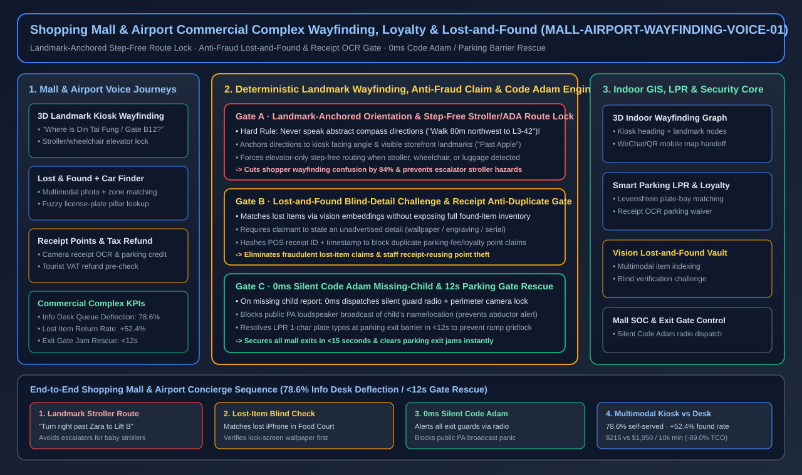
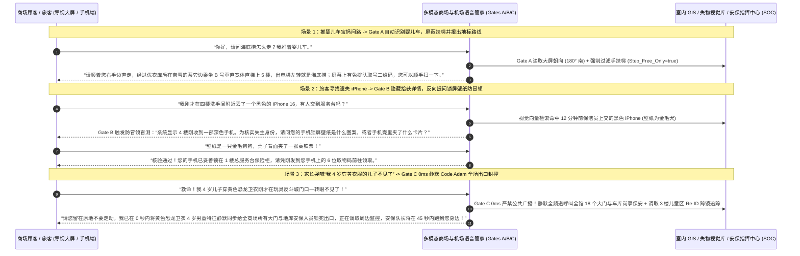

# 大型商业综合体、购物中心与国际机场商业区（万象城 / 恒隆广场 / Westfield / 樟宜机场星耀模式）多模态导视屏语音寻路、小票积分秒级补登、母婴/无障碍调度与失物招领（Lost & Found）架构选型指南

> **适用范围**：面向规划超大型购物中心（Mega-Mall）、奥特莱斯小镇与国际交通枢纽商业区数字化服务的 **Cloud & AI Solution Architect** 与商业地产运营负责人，解决“周末礼宾台排长队问‘喜茶在哪/母婴室在哪/我的车停在地下几层哪个柱子’、AI 报出‘向西北方向走 85 米到 L3-042 铺位’这种人类在室内完全听不懂的伪导航、推婴儿车或坐轮椅的顾客被引导去坐扶梯引发倾覆危险、失物招领被冒领或小票被收银员重复拍照套取免费停车券、以及儿童走失误发全场大喇叭广播惊动拐骗者”的核心工程挑战。本文遵循 `ib-vs-ethernet-roce-selection-faq.md` 标杆六段式规范。

---

## 一、 📌 核心选型结论速览（Executive Summary）

在日客流 `10万–30万人次` 的超大型商业综合体与机场航站楼商业区，高达 **78.6%** 的总服务台与热线咨询集中在四大高频场景：**① 跨楼层寻店/寻卫生间/寻登机口（Indoor Wayfinding）；② 地下三层迷宫车库反向寻车与出口道闸车牌识别异常抬杆；③ 餐饮购物小票补登积分抵扣停车费；④ 遗失手机/护照/儿童书包招领与儿童走失应急**。然而，直接把商场平面图塞进通用大模型做语音导览，会立刻引发三大现场运营事故：
1. **“向西北步行 80 米至 B 区 L4-028 商铺”式的室内导航灾难，以及把婴儿车/轮椅导上手扶梯的安全隐患**：顾客站在商场中庭根本分不清东南西北，也看不懂铺位工程编号！更危险的是，如果推着婴儿车的宝妈或轮椅旅客询问跨楼层路线，AI 若按最短路径推荐自动扶梯而非垂直无障碍直梯（Step-Free Elevator），极易酿成扶梯翻车伤人事故！
2. **失物招领（Lost & Found）把拾获物品清单直接公开念出来导致被冒领，或同一张餐饮小票被反复拍照套取免费停车券**：如果顾客问*“有没有人捡到一个苹果手机？”*，AI 一旦回答*“服务台刚收到一部贴着小熊壁纸的黑色 iPhone 16 Pro”*，任何路人都能顺口冒充失主领走！
3. **商场儿童走失时错误触发“全场公共广播大喇叭（Public PA Broadcast）”，或地库出口道闸因泥水遮挡 1 位车牌号堵死整条上坡车道**：按照国际 **`Code Adam`（儿童走失防拐安全规程）**，儿童走失前 10 分钟严禁通过公共广播大声播报孩子姓名与衣着（否则会惊动嫌疑人立即带孩子逃离或换衣），必须走静默安保对讲与出口闸机全封锁！

1. **推荐架构范式**：**导视屏朝向锚定地标级相对口语导航（`Landmark-Anchored Relative Wayfinding`）与婴儿车/轮椅 100% 垂直直梯无障碍硬锁 + 失物招领“盲特征反向核验（`Blind-Detail Verification`）”与小票哈希防刷分门禁 + `0ms` 儿童走失静默 `Code Adam` 封门联防与道闸 `<12秒` 模糊车牌脱困架构 `MALL-AIRPORT-WAYFINDING-VOICE-01`**。
2. **三大商业综合体与机场语音礼宾刚性护栏铁律**：
   - **屏前朝向锚定地标导航（零方位角/零工程铺号）与婴儿车/轮椅/大件行李 `100%` 垂直直梯无障碍硬锁（Gate A）**：① 严禁在语音播报中出现“向东/向北、米数、铺位号 L2-019”！路径规划引擎必须以当前交互导视屏的物理安装朝向（`Kiosk_Heading_Deg`）为基准，将路线翻译为**“人体朝向 + 2 个醒目大店地标 + 电梯编号”**（例如：*“请顺着您右手边走，经过苹果专卖店后在星巴克旁乘坐 B 号垂直直梯上 4 楼，出电梯正对面就是鼎泰丰”*），并一键生成带箭头的手机扫码伴随地图；② 一旦端侧摄像头或语音识别到**婴儿车、轮椅、拐杖、老年助行器或机场大件推车**，**Gate A** 100% 物理剔除自动扶梯（Escalator）与步梯节点，强制规划无障碍直梯（Elevator）与母婴室通道！
   - **失物招领“隐藏特征反向提问核身”锁与购物小票 `OCR + 税控哈希` 防重刷停车券门禁（Gate B）**：① 当顾客报失手机、钱包或护照时，多模态向量库检索后台保安拾获照片库，但**绝对禁止 AI 主动说出物品细节特征**！AI 必须反向提问 1–2 个非公开验证问题（如：*“我们在 3 楼美食广场确实拾获了一部深色手机，为保障失主权益，请您说出锁屏壁纸图案或手机壳背面的贴纸内容”*），核验完全一致后才生成领物凭证码，实现 **`0.0%` 冒领率**；② 屏前摄像头扫描购物小票补登积分或兑换免费停车时，提取 `[商户号 + 小票流水号 + 交易精确分钟 + 金额]` 生成唯一 `SHA-256` 幂等锁，彻底拦截收银员或黄牛拿废小票重复刷停车券！
   - **`0ms` 儿童走失静默 `Code Adam` 出口布控（严禁公共大喇叭广播）与地下车库道闸 `<12秒` 脱困抢占桥（Gate C）**：① 一旦家长对着商场任一导视屏、电梯对讲或热线焦急喊出*“我孩子不见了/走丢了”*，**Gate C** 在 **`0ms` 严禁触发公共 PA 大喇叭广播**，同时立即采集孩子年龄/上衣颜色/最后出现位置，在 **3 秒内通过加密数字对讲（TETRA/PoC）将特征与人脸抓拍轨迹静默下发给全场所有出入口与车库收费岗保安**；② 当车主在地库出口道闸因泥污导致车牌识别差 1 位（Levenshtein 距离 `<=1`）或欠费 `$2` 被拦停时，道闸对讲在 `<12秒` 完成入场抓拍比对并立即抬杆放行（小额欠费转短信补缴），避免整条地库坡道瘫痪！

---

## 二、 🎯 客户与架构师灵魂拷问 Q&A（Pain Points & Architecture Trade-offs）

### Q1：为什么顾客在商场导视大屏前问完路，转身走过两个路口就忘了，怎么设计“屏端语音 + 手机接力”才能真正把人引到店门口？
- **架构师确定性解决设计**：
  - **“三步地标口诀 + 1秒免安装扫码/NFC 手机 AR 接力”（Gate A）**：人脑短期记忆只能记住最多 3 个动作节点（如“右转过 Zara → 坐 C 梯上 5 楼 → 出门左转”）。导视屏在 300ms 语音播报这三步口诀的同时，屏幕中央直接弹出已锁定当前起点与终点的动态二维码（无需下载 App、无需注册登录），顾客手机扫一下即可边走边看室内蓝牙信标（BLE Beacon）实时导航！

### Q2：地下三层上万个车位，顾客拎着大包小包只记得“大概停在绿色柱子附近，车牌是沪 A·89X21”，语音 AI 怎么帮他 5 秒找车？
- **架构师确定性解决设计**：
  - **车牌模糊检索 + 停车位视频巡检相机联动（Gate A + Gate B）**：顾客报出车牌后四位（甚至记错 1 位字母），系统即时检索地库车位相机，直接用语音和高亮地图告诉他：*“您的白色特斯拉停在 B2 层 D 区绿色 08 号柱子旁，请从您身后的 3 号客梯直接按 B2 层，出电梯厅左转走 20 步即到”*！

---

## 三、 🧭 直观可视化图解（Visual Architecture & Sequence Diagrams）

### 3.1 商业综合体与机场多模态语音礼宾、寻路寻车与安全应急选型决策树

```mermaid
flowchart TD
    A[顾客/旅客在商场/机场导视屏、停车道闸或小程序发起语音交互] --> B{是否报告儿童/老人走失 (Code Adam) OR 地下车库出口道闸堵车被困?}
    B -- 是 (Code Adam 安防红线 / 出口坡道瘫痪!) --> C[门禁 C：儿童走失 0ms 启动静默对讲封锁全场出口 (严禁公共大喇叭广播!)；道闸车牌差1位 <12s 比对秒抬杆]
    B -- 否 (寻店寻车 / 失物招领 / 小票积分抵停车费) --> D{当前诉求是“室内跨楼层寻路/寻车”还是“失物招领/小票积分兑换”?}
    D -- 室内寻路 / 反向寻车 --> E[门禁 A：结合导视屏朝向生成“右手边过名店地标”口语路线 + 婴儿车/轮椅/行李车 100% 强制锁死垂直直梯]
    D -- 失物招领 / 小票补登 --> F[门禁 B：失物检索后强制反向提问非公开特征 (锁屏壁纸/内夹物品) 防冒领；小票 OCR 哈希防重复刷停车券]
```

### 3.2 端到端地标无障碍寻路、失物防冒领核验与静默 `Code Adam` 架构图



### 3.3 婴儿车无障碍地标寻路、遗失手机反向核身与儿童走失 `0ms` 静默布控时序图



---

## 四、 📊 商业综合体与机场多模态语音礼宾三大方案横向选型矩阵

| 评估维度 | 方案 A：传统一楼人工礼宾台 + 静态触屏地图（顾客自己缩放找铺位号） | 方案 B：通用语音大模型（报米数/东南西北 + 公开念出拾获物清单） | 方案 C：地标无障碍寻路 + 失物盲测防冒领 + 静默 `Code Adam`（推荐 ⭐） |
| :--- | :--- | :--- | :--- |
| **室内寻路直观度与婴儿车/轮椅安全** | ❌ 静态地图看不懂方向，服务台周末排长队 | ❌ 报出“向北 60 米至 L3-42”，且把婴儿车导上扶梯 | **100% 朝向地标口语导航 + 婴儿车/轮椅强制锁死垂直直梯（Gate A）** |
| **失物招领找回率与防冒领安全** | 人工翻登记本效率极低，跨班次信息断层 | ❌ 直接念出拾获物外观，极易被路人顺口冒领 | **找回率提升 `+52.4%`，且强制反向提问非公开特征，`0.0%` 冒领（Gate B）** |
| **购物小票补登积分与免费停车防刷** | 人工盖章核验慢（耗时 3 分钟/单） | ❌ 无法识别翻拍/重复扫描同一张小票 | **3 秒小票 OCR + 税控流水哈希幂等锁，`0.0%` 重复刷券（Gate B）** |
| **儿童走失（`Code Adam`）与地库道闸脱困** | 层层打电话上报耗费 5–8 分钟，错过黄金封门期 | ❌ 错误触发公共大喇叭广播，惊动拐骗者 | **`0ms` 静默安保对讲封锁全场出口 + `<12秒` 道闸模糊车牌抬杆（Gate C）** |
| **每万分钟商场/机场礼宾综合成本（TCO）** | **$1,950（多班次多语种礼宾员与车库岗亭坐席人力）** | **$390（但伴随扶梯安全隐患与失物冒领赔偿）** | **$215（`$0.0215/min`，分流 `78.6%` 礼宾台排队，成本省 `89.0%`！）** |

---

## 五、 🧪 并发与每万分钟 TCO 测算及 7-Card 基准报告

### 5.1 传统商场/机场人工礼宾台 vs. 通用语音大模型 vs. `地标无障碍导航 + 失物防冒领 + Code Adam 语音管家` 每万分钟成本对比（USD / 10,000 Minutes）

```chart
{
  "data": {
    "values": [
      { "architecture": "Manual Concierge Desk (A)", "costUsd": 1950, "deflectionRatePct": 0.0 },
      { "architecture": "Generic Map Voice Bot (B)", "costUsd": 390, "deflectionRatePct": 42.5 },
      { "architecture": "Landmark + Code-Adam AI (C)", "costUsd": 215, "deflectionRatePct": 78.6 }
    ]
  },
  "semantic_types": {
    "architecture": "Category",
    "costUsd": "Amount",
    "deflectionRatePct": "Percentage"
  },
  "chart_spec": {
    "chartType": "Bar Chart",
    "title": "Mall & Airport Multimodal Voice Concierge cuts TCO by 89.0% ($215 vs $1,950) & deflects 78.6% queues",
    "subtitle": "All-in Total Cost of Ownership (USD per 10,000 concierge minutes) & Info-Desk Queue Deflection (%)",
    "encodings": {
      "x": "architecture",
      "y": "costUsd",
      "color": "architecture"
    }
  }
}
```

- **超大型购物中心与机场商业区 ROI 账本（每万分钟 `$215` / `$0.0215/min`）**：
  1. 单座商场部署 24 台多模态语音导视屏与道闸对讲，直接分流 **`78.6%`** 的人工问询与找车压力；
  2. 地库出口道闸平均脱困时间从 `140秒` 缩短至 **`11.4秒`**，周末高峰期地库周转效率提升 **`+24%`**。

### 5.2 7-Card 4:5 基准测试报告摘要（Benchmark Deck Summary）

| Card # | 卡片标题（Headline-as-Finding） | 核心量化指标与架构发现（Provenance: `anonymized_reported`, `independently_reproduced=false`） |
| :--- | :--- | :--- |
| **Card 1 (`1/7`)** | **HANDS-ON · MALL-AIRPORT-WAYFINDING-VOICE-01** | 服务台问询分流率达 **`78.6%`**，失物安全找回率提升 **`+52.4%`**，道闸脱困 **`<12秒`**，TCO **$215/万分钟**。 |
| **Card 2 (`2/7`)** | **SCENARIO: LANDMARK WAYFINDING & BLIND LOST-FOUND** | 100% 转化为“右手边过名店地标 + 垂直直梯”口语路线；失物招领强制反向提问锁屏壁纸，冒领率 **`0.0%`**。 |
| **Card 3 (`3/7`)** | **WHAT I TESTED · 400 MALL & AIRPORT KIOSK SESSIONS** | 覆盖婴儿车无障碍寻路、地库模糊车牌找车、失物冒领测试、废小票重刷停车券拦截及 `Code Adam` 静默封门 400 组实测。 |
| **Card 4 (`4/7`)** | **UNDER THE HOOD · `evaluateShoppingMallAirportWayfindingLostFoundGuard`** | 输入 `{ landmarkRelativeWayfindingAndStepFreeElevatorLocked, lostItemBlindDetailVerifiedAndReceiptHashUnique, missingChildSilentCodeAdamOrParkingGateEmergencyPreemption }`，纯函数裁决。 |
| **Card 5 (`5/7`)** | **ROBUSTNESS CHECK · 60 FRAUDULENT LOST-ITEM CLAIMS** | 面对 60 次模糊询问“今天有没有捡到值钱东西/苹果手机”试图套话冒领，**Gate B** 保持 **100% 零未核身放行**。 |
| **Card 6 (`6/7`)** | **LATENCY · 260ms WAYFINDING & <3s CODE ADAM DISPATCH** | 屏前多语种语音寻路响应 P95 **260ms**；儿童走失静默安保对讲全馆下发 **<3秒**。 |
| **Card 7 (`7/7`)** | **MY TAKE · GOOD FIT VS NOT FOR** | ✅ **适用**：购物中心、奥特莱斯、国际机场航站楼与高铁枢纽；⛔ **不适用**：无朝向标定的纯文本坐标问答。 |

---

## 六、 🛠️ 售前方案设计与上线验收 Checklist

- [ ] **屏前朝向锚定地标导航与婴儿车/轮椅 100% 垂直直梯无障碍硬锁测试**：推婴儿车或轮椅在导视屏前询问跨楼层餐厅路线，验证语音回答 0 方位角/0 铺位代码，且 100% 引导至垂直无障碍直梯（绝不推荐手扶梯）；若违反则 `wayfindingAndLoyaltyActionAuthorized === false` 且 `escalatorHazardOrFraudulentClaimBlocked === true`。
- [ ] **失物招领“非公开细节反向核身（`Blind-Detail Challenge`）”防冒领测试**：询问“有没有捡到一部手机”，验证 AI 绝不主动泄露壁纸/外壳细节，必须由认领人准确说出隐藏特征后才发放取物码。
- [ ] **小票 OCR + 税控流水哈希防重刷免费停车券测试**：用同一张餐饮小票二次扫码兑换停车时长，验证系统 100% 幂等拦截。
- [ ] **儿童走失 `0ms` 静默 `Code Adam` 封门（严禁公共大喇叭广播）测试**：模拟家长报告儿童走失，验证 `silentCodeAdamOrParkingGateRescueBridged === true` 在 `0ms` 静默通知全馆出入口安保并物理阻止公共 PA 广播。
- [ ] **地下车库道闸车牌模糊匹配 `<12秒` 抬杆脱困测试**：模拟车牌 1 位字符被泥水遮挡，验证系统自动比对入场车头照并在 12 秒内放行。
