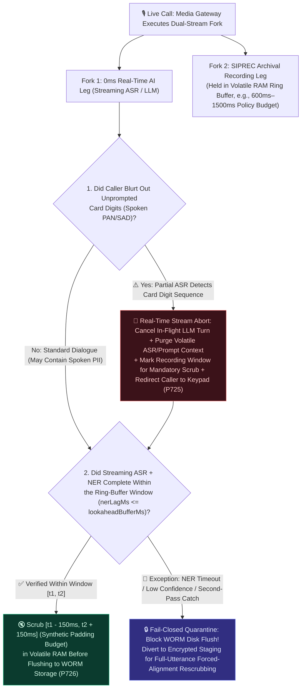
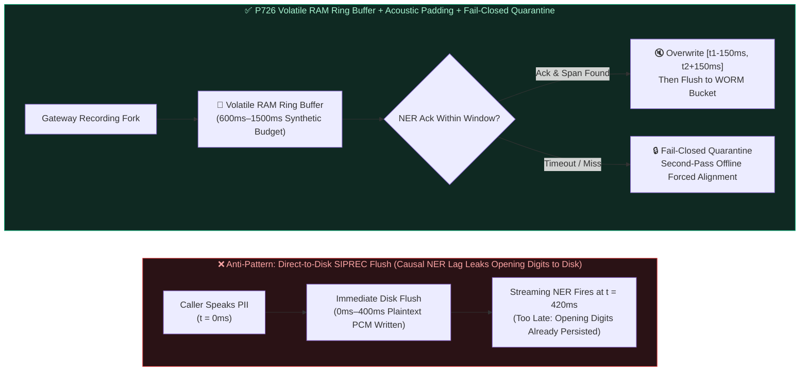
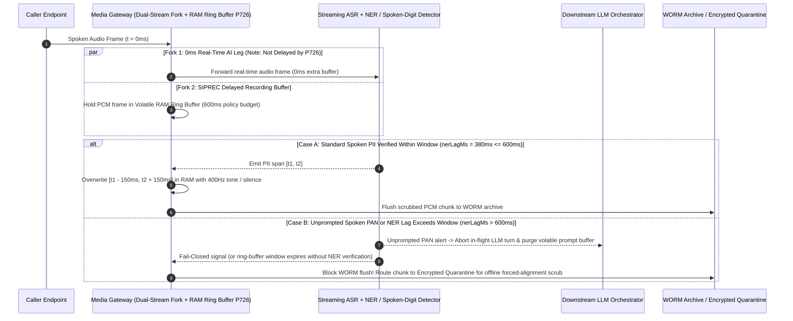

# Enterprise Voice Agent SIPREC Sensitive Audio Archival Redaction FAQ: How Does a Lookahead Ring Buffer Scrub Recorded Audio, and Why Can't It Replace Real-Time AI Stream Isolation?

> **Target Audience**: AI Solution Architects, Contact Center Compliance Architects, and Voice Platform Engineering Leads  
> **Standalone Single-Topic Scope**: This document is **Standalone Guide 6B (`Stage 366 · P726`)**, focusing specifically on **how Dual-Stream `SIPREC` Lookahead RAM Ring-Buffer Redaction, Pre/Post Acoustic Padding, and Fail-Closed Quarantine (`P726`) reduce spoken PII/sensitive audio residue in archived `.wav` recordings, and why redacting the recording fork never sanitizes the `0ms` real-time AI dialogue stream**. For **Edge `RFC 4733` DTMF Payment Capture Bypass & PCI-DSS Scope Demarcation (`P725`)**, see the companion standalone guide [`docs/voice-pci-dtmf-scope-faq.en.md`](./voice-pci-dtmf-scope-faq.en.md).  
> **Compliance & Measurement Disclaimer**: The `P726` gate in this repository is an **offline synthetic policy/configuration state-machine check (`synthetic`); it is not proof of live DSP execution or a PCI-DSS / HIPAA / GDPR compliance certification**.  
> **Language Versions**: [中文版](./siprec-pii-audio-redaction-faq.md) | [English Version](./siprec-pii-audio-redaction-faq.en.md)  
> **Visual Architecture Summary**: [`assets/svg/10-pci-dtmf-dual-stream-redaction-2026-11-08.svg`](../assets/svg/10-pci-dtmf-dual-stream-redaction-2026-11-08.svg)

---

## ① 📌 Executive Summary

1. **The Selection Boundary (Never Treat `SIPREC` Delayed Recording Redaction as Real-Time AI Stream Sanitization vs. Dual-Stream Forking + Fail-Closed Quarantine `P726`)**:
   - **Edge Payment Capture Bypass (`P725`) and `SIPREC` Delayed Recording Redaction (`P726`) Operate on Distinct, Composable Boundaries—They Are Not Mutually Exclusive Substitutes**: In a dual-stream media forking architecture, the **primary leg (`0ms` real-time AI dialogue stream) still forwards live spoken audio directly to streaming ASR and the LLM** to preserve low-latency conversation, while the **secondary leg (`SIPREC` archival recording stream) delays and redacts audio before writing `.wav` files to persistent WORM storage**. Consequently, **redacting the `SIPREC` recording stream alone never prevents spoken digits from entering ASR/LLM along the real-time leg, and architects must never claim "100% zero LLM exposure" if unredacted spoken PAN traverses the real-time stream**.
   - **How to Layer Both Controls**: For payment card collection, enforce [`P725` Edge `RFC 4733` DTMF Intercept + Upstream ASR/LLM Pause](./voice-pci-dtmf-scope-faq.en.md) so card digits are entered via keypad while the AI uplink is muted; simultaneously run **`P726` Lookahead RAM Ring-Buffer Redaction + Fail-Closed Quarantine** on the `SIPREC` recording fork to scrub spoken PII (national IDs, dates of birth, medical record numbers) and catch unprompted spoken card digits before archival disk flush.
2. **First Principle: Causal NER Recognition Lag, Acoustic Co-Articulation Padding, and Mandatory Fail-Closed Quarantine**:
   - **Why Streaming NER Always Trails Spoken Audio**: When a caller speaks a sensitive identifier at `t = 0ms`, streaming ASR and Named Entity Recognition (NER) typically require **`250ms–550ms`** of acoustic context and inference time to classify the span as sensitive PII. If the `SIPREC` recorder writes PCM frames straight to disk at `0ms`, the opening digits are already persisted on disk before the NER redaction signal arrives.
   - **Fixed Policy Budgets (`600ms–1,500ms` Lookahead + `150ms` Pre/Post Padding) Do Not Guarantee Zero Residue Under All Speaking Rates or NER Lags—Fail-Closed Is Mandatory**: The `>= 600ms` volatile RAM ring buffer and `>= 150ms` bidirectional acoustic padding verified in `P726` are **local `synthetic` engineering policy budgets**, not statutory constants. Under rapid speech, ASR/NER false negatives, or GPU queue spikes where **`nerLagMs > lookaheadBufferMs`**, an online sliding window can still miss or arrive late. Therefore, the archival gateway must enforce **Fail-Closed Quarantine**: any audio chunk whose NER verification times out or falls below confidence thresholds must be **withheld from WORM disk flush**, routed to encrypted quarantine staging, and subjected to second-pass full-utterance forced-alignment scrubbing before archival release.
3. **Timer Resolution (`1ms` Rounding Bucket) & Offline Synthetic Policy Check vs. Live DSP Measurement Boundary**:
   - In our unit test suite, `P726` (`evaluateDualStreamSiprecPiiAudioRedactionGate`) evaluates an **offline in-memory configuration/policy state machine (`synthetic`)**. A local timer reading of `0ms` under **`1ms` timer resolution only indicates that the in-memory policy check fell into the sub-resolution `0ms` rounding bucket (`[0ms, 1ms)`), NOT proof of true `<1ms` execution (nor `<1ms` live DSP audio processing), and offline `synthetic` policy checks do not measure end-to-end media latency or constitute regulatory certification**.
   - Live `SIPREC` RTP jitter, streaming ASR/NER GPU latency, biquad notch/masking DSP execution time, and WORM storage I/O latency are explicitly marked **`not_measured`**; external industry benchmarks are marked **`anonymized_reported` (`independently_reproduced=false`)**.

---

## ② 🎯 First-Principles & Plain-Language Architect Q&A (FAQ-Driven)

### Q1: Why does streaming audio directly to disk while running real-time NER always leak the first few spoken digits, and how does `P726`'s Lookahead Ring Buffer work like a broadcast television delay?

- **Plain-Language First Principle (Using a Volatile RAM Broadcast Delay on the Recording Fork to Beat Causal NER Lag)**:
  - In live television broadcasting, if a guest swears on air, pressing the censor button after hearing the word is too late—the opening syllables have already been broadcast. Studios solve this with a **broadcast delay buffer**: the live feed is held in memory for a short window while the censor monitors the real-time feed, allowing the system to mute the audio *before* it leaves the buffer.
  - **`P726` Dual-Stream Media Forking applies this exact principle at the media gateway**:
    1. **Fork 1 (`0ms` Real-Time AI Dialogue Leg)**: Incoming RTP audio frames are forwarded with zero extra buffering to streaming ASR and the LLM so conversational Turn-Taking / TTFA remains fast. **(Crucial caveat: this real-time leg is NOT delayed or scrubbed by `P726`!)**
    2. **Fork 2 (`SIPREC` Delayed Recording Buffer)**: The forked recording stream is **held in a volatile RAM Lookahead Ring Buffer (`600ms–1,500ms` local engineering policy budget)** before any bytes touch persistent disk.
    3. **Retroactive Masking with Bidirectional Acoustic Padding (`>= 150ms`)**: When streaming ASR + NER detects a spoken PII entity spanning `[t_start, t_end]` (e.g., at `380ms` lag), those PCM samples are still sitting inside the `600ms` RAM ring buffer. The redactor zeroes or overwrites `[t_start - 150ms, t_end + 150ms]` (applying `150ms` pre/post acoustic padding to scrub co-articulated consonant onsets and room-reverb tails) with a `400Hz` masking tone or digital silence before flushing to WORM storage.

### Q2: If a caller unexpectedly blurts out a credit card number aloud (unprompted spoken PAN), does `P726` prevent those digits from reaching the LLM?

- **Plain-Language First Principle (Never Confuse Archival Recording Redaction with Real-Time LLM Context Isolation)**:
  - **No! `P726` only delays and scrubs the `SIPREC` recording fork; it does not stop spoken audio on the `0ms` real-time leg from reaching streaming ASR or the LLM.**
  - **How Architects Must Handle Unprompted Spoken PAN/SAD (Defense-in-Depth Fallback)**:
    1. **Proactive Payment Window Isolation (`P725`)**: Before asking for payment details, pause the upstream ASR/LLM audio leg and require keypad `RFC 4733` entry.
    2. **Real-Time Stream Abort & Volatile Context Purge on Unprompted Spoken Digits**: If a caller blurts out card digits during normal conversation, a fast partial-transcript digit/Luhn detector on the ASR stream must **immediately abort the in-flight LLM turn**, **purge the unpersisted ASR transcript and prompt context from memory (preventing trace/log persistence)**, signal `P726` to scrub/quarantine the corresponding `SIPREC` ring-buffer window, and play a deterministic TTS prompt instructing the caller to use the keypad instead.

### Q3: What happens if streaming NER misses an entity (false negative) or experiences a latency spike (`nerLagMs > lookaheadBufferMs`)? How does Fail-Closed Quarantine prevent unredacted audio from flushing to WORM storage?

- **Plain-Language First Principle (Never Rely on Fixed Millisecond Buffers Alone—Enforce Fail-Closed Quarantine and Second-Pass Offline Scrubbing)**:
  - Fixed thresholds like a `600ms` ring buffer or `150ms` padding are **local `synthetic` policy budgets**, not a mathematical guarantee of zero residue across every speaking speed, accent, or GPU latency spike.
  - **Mandatory Three-Layer Fail-Closed Architecture**:
    1. **Fail-Closed on NER Timeout (`nerLagMs > lookaheadBufferMs`)**: If the RAM ring buffer reaches capacity before the streaming NER worker returns a verification ack for that audio window, the gateway **must never fail open by flushing unverified PCM frames to permanent WORM storage**. Instead, it fails closed by diverting the unverified segment into an **Encrypted Quarantine Staging Bucket** with strict TTL and zero general read access.
    2. **Second-Pass Full-Utterance Forced-Alignment Scrubbing**: Once the full utterance or call completes, an asynchronous high-accuracy NER + forced-alignment worker scans the quarantined audio, applies retroactive acoustic masking (plus safety padding) to any missed spans, and only promotes the segment to permanent `SIPREC` archival storage after verification passes.
    3. **Destruction of Unscrubbable SAD**: If any segment contains unredacted CVV/SAD that cannot be verifiably scrubbed, policy requires purging that audio segment rather than storing encrypted SAD (`PCI-DSS Req 3.3.1`).

---

## ③ 🧭 Visual Architecture Diagrams (Decision Tree + Naive Flush vs. Fail-Closed Ring Buffer + Sequence Diagram)

### 3.1 `SIPREC` Archival Redaction & Fail-Closed Exception Decision Tree (`flowchart TD`)

### 3.2 Direct-to-Disk Recording Leakage vs. `P726` Lookahead Ring Buffer + Fail-Closed Quarantine (`flowchart LR`)

### 3.3 Millisecond Sequence Diagram of `P726` Ring-Buffer Redaction, Unprompted PAN Abort & Fail-Closed Quarantine (`sequenceDiagram`)

---

## ④ 📊 Voice Architect Selection Decision Matrix

| Evaluation Dimension | Option A: Direct-to-Disk `SIPREC` + Post-Call Batch Scrubbing | Option B: Single-Stream Serial Delay (`+1s` Before ASR/LLM) | Option C: Dual-Stream Fork + `SIPREC` RAM Ring Buffer + Fail-Closed Quarantine (`P726`, Recommended) |
| :--- | :--- | :--- | :--- |
| **Primary Use Case** | Non-sensitive public inquiry lines only | ❌ Degrades conversational turn-taking; not recommended | **Regulated contact centers requiring both low-latency voice AI and scrubbed archival recordings** |
| **Impact on Conversational TTFA** | `0ms` extra buffer overhead | ❌ Adds `+600ms to +1,500ms` dead air to every turn | **`0ms` recording-buffer penalty on the real-time dialogue leg** |
| **Pre-Disk Acoustic PII Scrubbing** | ❌ Plaintext `.wav` hits disk first before batch job runs | ✅ Scrubs in RAM but ruins live conversation latency | **Scrubs `[t1 - 150ms, t2 + 150ms]` (policy budget) in volatile RAM before WORM flush** |
| **Protection of Real-Time ASR/LLM Context** | ❌ None | ⚠️ Delayed, but still enters LLM unless aborted | **Explicit boundary: `P726` protects only the recording fork; layer `P725` for keypad payment and real-time LLM abort/purge for unprompted spoken PAN** |
| **Handling of NER Lag Spikes or Misses** | ❌ Missed spans persist in plaintext | ⚠️ Timeouts stall live conversation | **Fail-Closed Quarantine: unverified chunks never flush to WORM; routed to offline forced-alignment rescrubbing** |
| **Archival Compliance & Risk Posture** | High risk (plaintext audio written to disk first) | High business cost (caller hang-ups due to latency) | **Optimal defense-in-depth balance** |

---

## ⑤ 🧪 Quantitative Evaluation & 7-Card Benchmark Findings (Stage 366 · `P726`)

> **Provenance & Timer Resolution Note**: Deterministic guardrail metrics below come from `evaluateDualStreamSiprecPiiAudioLookaheadRedactionGate` (`P726`) in `packages/business-core/enterprise-guardrails.ts` and `tests/presales-portal.test.ts`.
> 1. **`>= 600ms` lookahead ring buffer and `>= 150ms` pre/post acoustic padding are local `synthetic` engineering policy budgets**, not statutory constants, and require Fail-Closed quarantine fallback when live NER lag exceeds the window.
> 2. **A `0ms` reading under `1ms` clock resolution only indicates that the offline in-memory policy/configuration check fell into the sub-resolution `0ms` rounding bucket (`[0ms, 1ms)`), NOT proof of true `<1ms` execution (nor live DSP audio execution) or regulatory certification**; live media/DSP/storage latencies remain `not_measured`.

| Evaluation Metric / Probe | Under-Provisioned Baseline (`Lookahead=200ms, Pad=40ms`) | `P726` Dual-Stream Lookahead Ring Buffer & Padding Policy Gate | Verification Status & Provenance |
| :--- | :--- | :--- | :--- |
| **`SIPREC` RAM Lookahead Buffer Policy (`lookaheadBufferMs`)** | `200ms` (shorter than causal NER lag; flagged) | **Clamped to `>= 600ms` local policy budget (`600ms–1,500ms` range)** | `deterministic_guardrail_verified` · `synthetic` (offline config check) |
| **Bidirectional Acoustic Padding Policy (`prePostPaddingMs`)** | `40ms` (leaves co-articulated onset/reverb bleed; flagged) | **Clamped to `>= 150ms` pre/post padding policy budget** | `deterministic_guardrail_verified` · `synthetic` (offline config check) |
| **Offline Policy Check Timer Reading (`Config Check Time`)** | N/A | **`0ms` (falls within the `1ms` clock-resolution rounding bucket; not live DSP time)** | `synthetic` (`1ms`-resolution rounding bucket only) |
| **Live Streaming NER Lag & DSP Redaction Execution Latency** | Varies by speech rate & GPU load | **`not_measured` (Fail-Closed quarantine required when `nerLagMs > lookaheadBufferMs`)** | `not_measured` (policy PASS is not live DSP certification) |

---

## ⑥ 🛠️ Appendix: Production `SIPREC` Audio Redaction & Fail-Closed Launch Checklist

- [ ] **1. Never Substitute `SIPREC` Recording Redaction (`P726`) for Real-Time AI Stream Isolation (`P725`)**: Does your architecture documentation explicitly state that `P726` only scrubs the archival recording fork while the `0ms` real-time leg still feeds ASR/LLM, and that payment card collection must use [`P725` Edge `RFC 4733` DTMF Intercept with upstream ASR pause](./voice-pci-dtmf-scope-faq.en.md)?
- [ ] **2. Real-Time LLM Turn Abort & Context Purge on Unprompted Spoken PAN/SAD**: If a caller unexpectedly speaks card digits aloud outside a keypad window, does the runtime immediately abort the in-flight LLM turn, purge unpersisted ASR/prompt buffers from RAM (preventing trace/log persistence), trigger `P726` recording redaction, and redirect the caller to keypad entry?
- [ ] **3. Volatile RAM Ring-Buffer Window (`>= 600ms`) & Bidirectional Acoustic Padding (`>= 150ms`) Verification**: Is the `SIPREC` lookahead buffer held strictly in volatile RAM with a window exceeding your P99 streaming ASR+NER lag, and does redaction apply bidirectional pre/post padding to scrub co-articulated phoneme boundaries?
- [ ] **4. Fail-Closed Quarantine When NER Lags or Times Out (`nerLagMs > lookaheadBufferMs`)**: If streaming NER fails to acknowledge a buffer window before expiration, does the gateway fail closed by blocking WORM disk flush and diverting the unverified PCM chunk to encrypted quarantine staging?
- [ ] **5. Second-Pass Full-Utterance Forced-Alignment Fallback & SAD Purge**: Do you run an asynchronous second-pass forced-alignment scrubber over quarantined/completed utterances to catch online NER false negatives, and permanently destroy any audio segment containing unredacted CVV/SAD (`PCI-DSS Req 3.3.1`)?
