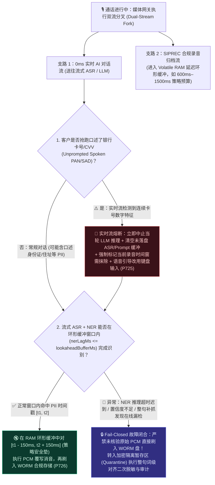
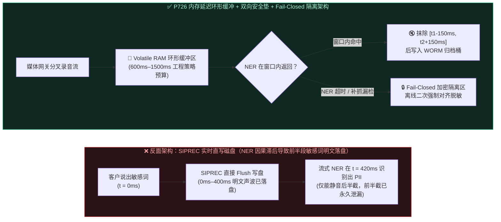
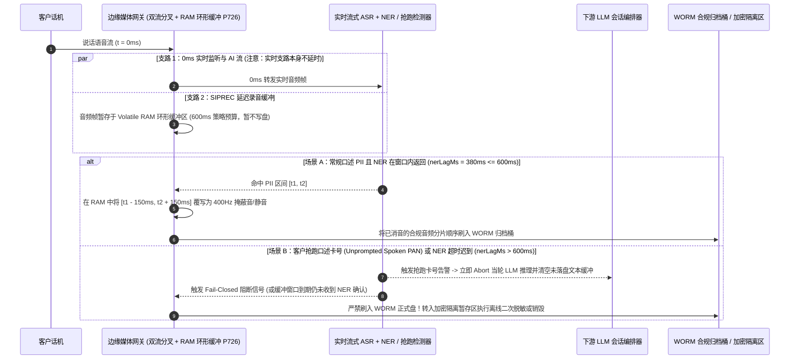

# 企业语音智能体合规双录（SIPREC）敏感音频归档脱敏架构选型 FAQ：延迟环形缓冲（Lookahead Ring Buffer）如何消音落盘录音？为什么它不能替代实时 AI 流隔离？

> **面向读者**：AI Solution Architect（AI 解决方案架构师）、金融/医疗/政务呼叫中心合规架构师、语音平台研发负责人  
> **独立单专题定位**：本篇为 **Round 6 拆分单专题 B（Stage 366 · P726）独立指南**，专门解答**“在企业级合规双录（`SIPREC`）归档支路中，如何通过内存延迟环形缓冲（Lookahead RAM Ring Buffer）+ 双向安全垫（Pre/Post Acoustic Padding）+ Fail-Closed 异常隔离门禁（`P726`）减少落盘 `.wav` 录音中的口述 PII/敏感音频残留，以及为什么录音支路消音绝不等于净化了 `0ms` 实时 AI 对话流”**。关于**电话支付按键采集的边缘 `RFC 4733` DTMF 截流与 PCI-DSS 范围分界评估（`P725`）**，请参阅独立姊妹篇 [`docs/voice-pci-dtmf-scope-faq.md`](./voice-pci-dtmf-scope-faq.md)。  
> **合规免责与边界声明**：本仓库中的 `P726` 门禁为**离线合成策略/配置状态机检查（`synthetic`），不构成真实 DSP 音频处理证明或 PCI-DSS / HIPAA / GDPR 合规认证**。  
> **语言版本**：[中文版](./siprec-pii-audio-redaction-faq.md) | [English Version](./siprec-pii-audio-redaction-faq.en.md)  
> **可视化总结图**：[`assets/svg/10-pci-dtmf-dual-stream-redaction-2026-11-08.svg`](../assets/svg/10-pci-dtmf-dual-stream-redaction-2026-11-08.svg)

---

## ① 📌 核心结论速览（Executive Summary）

1. **选型分界线（严禁将 `SIPREC` 录音延迟消音当作实时 AI 流的免死金牌 vs. 实时流与归档流双轨分治 + Fail-Closed 隔离 `P726`）**：
   - **边缘支付采集旁路（`P725`）与 `SIPREC` 录音流延迟消音（`P726`）属于不同、可叠加的保护边界，绝不是互斥替代方案**：在双流分叉（Dual-Stream Media Forking）架构中，**主路（`0ms` 实时 AI 对话流）依然将客户实时语音直接送入流式 ASR 与 LLM**，以保障全双工低延迟交互；而**旁路（`SIPREC` 录音归档流）仅负责在落盘到 WORM 合规存储前对 `.wav` 音频做延迟消音**。因此，**仅对 `SIPREC` 录音消音绝不会自动净化 ASR/LLM 的上下文，也绝不能在未脱敏卡号（PAN）已沿实时流进入 LLM 时宣称“100% 零暴露”**！
   - **何时必须叠加使用**：凡涉及支付卡号（PAN）或安全码（CVV/SAD）采集，必须优先通过 [`P725` 边缘 `RFC 4733` DTMF 截取 + 挂起 ASR/LLM 上行流](./voice-pci-dtmf-scope-faq.md) 从源头阻止敏感音频进入实时流；同时在录音支路启用 **`P726` 内存延迟环形缓冲消音 + Fail-Closed 归档门禁**，用于拦截对话中口述的身份证号、住址、病历号，或客户未按提示抢跑口述（Unprompted Spoken PAN）的意外敏感片段。
2. **第一性原理：为什么流式 NER 识别总比声音慢半拍？为什么需要“延迟环形缓冲 + 双向声学安全垫 + Fail-Closed 熔断”？**：
   - **流式 ASR/NER 识别天然存在因果滞后（Causal Recognition Lag）**：当客户说出“我的身份证号是 3101...”时，声波在第 `0ms` 就已经产生了；但流式 ASR 转写出文字、再由流式命名实体识别（NER）判定这是敏感 PII，通常需要 **`250ms–550ms`** 的积累与推理时间。如果不对录音归档流做内存延迟缓冲，等 NER 发出“消音指令”时，前几个数字的明文 PCM 声波早已写入磁盘 `.wav` 文件！
   - **本地合成预算阈值（`600ms–1,500ms` 环形缓冲 + `150ms` 双向安全垫）不能保证所有语速/延迟下 100% 零残留，必须配置 Fail-Closed 归档熔断**：本仓库策略检查中设定的 `>= 600ms` 内存环形缓冲与 `>= 150ms` 前后声学安全垫（Pre/Post Padding）属于**本地工程策略预算（`synthetic`）**，并非法规硬编码值。在极快语速、方言漏检或 ASR/NER 推理抖动超时（`nerLagMs > lookaheadBufferMs`）时，在线滑动窗口仍可能迟到或漏检；此时归档网关必须执行 **Fail-Closed（故障闭合）**——**严禁将超时或置信度不足的原始 PCM 分片直接刷入持久盘**，而是将其转入加密隔离暂存区（Quarantine Staging），触发全句离线二次扫描与人工/合规复核。
3. **本机名义 `1ms` 显示分辨率下的 `0ms` 读数 vs. 生产实测边界（Provenance 说明）**：
   - 在本仓库单元测试中，`P726`（`evaluateDualStreamSiprecPiiAudioRedactionGate`）检验的是**缓冲窗口、安全垫配置与越界阻断的离线内存策略状态机（`synthetic`）**。本机计时器读数采用统一数学口径：**`0ms reported at nominal 1ms display resolution; actual duration unresolved/not_measured; no sub-1ms upper bound established`（名义 `1ms` 显示分辨率下报告为 `0ms`；实际物理耗时未解析/未实测；不建立 `sub-1ms` 物理耗时上界保证，更不测量真实媒体流 DSP 端到端耗时，亦不代表生产法规认证）**。
   - 真实生产环境中的 SIPREC RTP 分包抖动、流式 ASR/NER GPU 推理延迟、Biquad 带阻滤波 DSP 运算耗时及 WORM 对象存储 I/O 延迟均标注为 **`not_measured`**；外部参考数据标为 **`anonymized_reported`（`independently_reproduced=false`）**。

---

## ② 🎯 客户与架构师灵魂拷问 Q&A（FAQ-Driven，大白话 + 第一性原理）

### Q1：为什么“实时语音流直接边说边写盘，等识别出身份证号再静音”一定会泄漏前几个数字？`P726` 的内存延迟环形缓冲（Lookahead Ring Buffer）是怎么像“广播延时器”一样解决这个问题的？

- **通俗大白话与第一性原理（用录音支路的“电视台直播 1 秒延时器”，换取 AI 识别的“预知未来”能力）**：
  - 想象电视台现场直播：如果嘉宾突然爆粗口，导播听到再去按消音键，观众早就听见前两个字了。电视台的唯一解法是加装一台**“延时器”**——画面和声音先在内存里排队等几秒再播出去，导播在实时监听流里一发现不对劲，就能在声音真正播出前把整句话掐掉！
  - **`P726` 双流分叉架构（Dual-Stream Media Forking）正是把这套机制搬进了语音网关**：
    1. **主路（`0ms` 实时 AI 对话支路）**：客户说话的 RTP 语音包零额外缓冲直通流式 ASR 与 LLM，保证对话首字延迟（TTFA）不受影响。但**请牢记：这条实时支路本身并未被延时器消音**！
    2. **旁路（`SIPREC` 合规录音归档支路）**：网关分叉出的录音 PCM 帧**绝不直接写盘**，而是先进入一段驻留在易失性内存（Volatile RAM）中的**滑动环形缓冲区（Lookahead Ring Buffer，本地工程策略预算设为 `600ms–1,500ms`）**。
    3. **回溯抹除与双向声学安全垫（Pre/Post Acoustic Padding）**：当主路的流式 ASR + NER 在第 `380ms` 识别出客户正在报身份证号或口述敏感词（时间戳 `[t_start, t_end]`）时，这段声音还静静躺在内存环形缓冲区里没满 `600ms`！录音引擎立即定位到内存缓冲区的 `[t_start - 150ms, t_end + 150ms]` 区间（前后各多抹掉 `150ms` 工程预算安全垫，防止第一个数字的爆破音起音或最后一个数字的拖音混响残留在边界上），将该区间的原始 PCM 采样点彻底覆写为 `400Hz` 低幅掩蔽提示音或零幅静音，最后才顺序刷入磁盘 `.wav` 与 WORM 归档桶。

### Q2：既然有了 `P726` 的 `SIPREC` 录音延迟消音，如果客户在电话里直接开口报出了银行卡号（客户抢跑口述 PAN），我们能不能说“系统已经 100% 零暴露合规了”？

- **通俗大白话与第一性原理（严禁混淆“归档录音消音”与“实时大模型上下文暴露”）**：
  - **绝对不能！这是架构评审中最容易踩坑的认知误区。**
  - **为什么单靠 `P726` 挡不住客户抢跑口述的卡号进入 LLM？**
    - 因为 `P726` 的环形缓冲区正是依赖**主路 ASR 对客户语音的实时转写**才能识别出敏感词时间戳！也就是说，当客户未按提示按键、而是直接对着麦克风开口念出 `"4111 2222..."` 时，这串音频已经顺着 `0ms` 实时主路进入了流式 ASR，并极可能正在流向 LLM 的上下文窗口。
    - 如果此时只把 `SIPREC` 录音文件消音了，却让未脱敏的 PAN 顺着实时流进了 LLM Prompt、KV Cache 和应用调用链日志，系统依然发生了持卡人数据暴露！
  - **面对“客户抢跑口述 PAN / 敏感词”的完整纵深防御预案**：
    1. **采集前主动隔离（`P725`）**：只要对话进入支付环节，立即挂起通往 ASR/LLM 的上行音频，强制走 `RFC 4733` 按键通道。
    2. **非支付环节意外口述（Unprompted Spoken PAN）的实时流熔断与上下文清洗**：一旦实时流 ASR 中间结果（Partial Transcript）命中疑似卡号/CVV 模式（如连续数字流或 Luhn 前缀特征），编排器必须**立即中止当前轮次的 LLM 推理请求（Abort In-Flight Turn）**，**在内存中覆写并丢弃该轮未持久化的 ASR 文本缓冲与会话历史片段（严禁写入持久日志或 Trace）**，同时通知 `P726` 将对应时间窗的 `SIPREC` 内存音频彻底抹除，并由 TTS 播报提示：“为保护您的资金安全，请勿口述卡号，稍后请在手机键盘上输入。”

### Q3：如果流式 NER 发生漏检（False Negative），或者遇到 GPU 推理抖动导致识别迟到（比如 `nerLagMs = 850ms` 超过了 `600ms` 环形缓冲窗口），`P726` 怎么防止明文录音漏网落盘？

- **通俗大白话与第一性原理（绝不把固定毫秒数当成 100% 物理保证，必须设计 Fail-Closed 故障闭合与离线重扫 fallback）**：
  - 任何固定长度的环形缓冲区（如 `600ms`）和固定安全垫（如 `150ms`）都只是**工程策略预算（`synthetic` policy budget）**，不可能在所有极端语速、生僻口音或网络/GPU 拥塞下做到 100% 在线零漏检。
  - **三种典型异常及其 Fail-Closed（故障闭合）工程处置**：
    1. **识别迟到（Late NER Detection, `nerLagMs > lookaheadBufferMs`）**：当流式 ASR/NER 队列积压或心跳超时，导致识别延迟逼近或超过内存环形缓冲窗口（例如缓冲 `600ms`，但 NER 在第 `750ms` 才返回结果）时，**严禁让环形缓冲区按默认 FIFO 顺序把未完成 NER 核验的原始 PCM 分片刷入持久 WORM 存储（Fail-Open 漏写）**！网关必须触发 **Fail-Closed 阻断**——暂停向持久化合规桶刷盘，将该段音频写入受严格访问控制与自动过期策略保护的**加密隔离暂存区（Encrypted Quarantine Staging）**。
    2. **整句级/整通级异步二次重扫（Second-Pass Offline Audio Scrubbing Fallback）**：对于进入隔离暂存区的音频，或在整句结束（Final Transcript）后才由高精度大模型 NER 补抓到的漏检敏感片段（在线小模型漏检 False Negative），由异步脱敏 Worker 根据精确的词级强制对齐时间戳（Forced Alignment Word Timestamps）在隔离区完成二次声学抹除，校验通过后才晋升写入正式 `SIPREC` 归档桶；若二次校验仍失败或发现疑似未抹除的 CVV（SAD），则按合规策略销毁该违规音频片段并生成审计告警单。

---

## ③ 🧭 直观可视化图解（异常处置决策树 + 单流漏写 vs. 双流 Fail-Closed 架构 + 时序图）

### 3.1 `SIPREC` 敏感音频归档脱敏与异常兜底决策树（`flowchart TD`）

### 3.2 边说边写盘漏写路径 vs. `P726` 延迟环形缓冲 + Fail-Closed 隔离架构对比图（`flowchart LR`）

### 3.3 `P726` 延迟环形缓冲消音、客户抢跑口述熔断与 Fail-Closed 隔离时序图（`sequenceDiagram`）

---

## ④ 📊 语音架构师选型决策矩阵（Architect Decision Matrix）

| 评估维度 | 方案 A：SIPREC 实时直写磁盘 + 事后离线批处理删改 | 方案 B：全链路串行延迟 1 秒后再送给 ASR/LLM 对话 | 方案 C：双流分叉 + `SIPREC` 内存环形缓冲消音 + Fail-Closed 隔离（`P726` + 实时抢跑熔断，推荐） |
| :--- | :--- | :--- | :--- |
| **核心适用场景** | 仅适用于无敏感个人信息的公开业务咨询录音 | ❌ 严重劣化全双工语音对话体验，不推荐 | **金融、医疗、保险、政务等需同时满足低延迟对话与合规双录脱敏的生产场景** |
| **实时 AI 对话首字延迟（TTFA）影响** | `0ms` 额外缓冲开销 | ❌ 每轮对话平白增加 `+600ms ~ +1,500ms` 呆滞等待 | **`0ms` 录音缓冲串扰（实时流与延迟归档流分叉解耦）** |
| **录音落盘前的敏感声波抹除能力** | ❌ 原始明文 `.wav` 先落盘，在批处理完成前存在明文暴露窗口 | ✅ 可在内存中抹除，但牺牲了实时交互体验 | **在 RAM 环形缓冲区内结合 `>= 150ms` 前后声学安全垫（策略预算）完成回溯消音后再落盘** |
| **对实时流 ASR/LLM 暴露面的保护作用** | ❌ 无保护 | ⚠️ 虽有延迟，若不拦截仍会流入 LLM | **明确边界：`P726` 仅保护录音归档支路；支付采集须叠加 `P725` 挂起上行，意外口述须叠加实时流 Abort 与内存清洗** |
| **NER 识别迟到 / 漏检时的容错机制** | ❌ 漏检即永久明文留存 | ⚠️ 超时会导致实时对话卡死 | **Fail-Closed 故障闭合：超时或低置信度分片严禁直接入 WORM 盘，转入加密隔离区二次离线脱敏** |
| **综合运维与存储合规风险** | 高（明文先行落盘难以满足严格的数据最小化审计） | 高（通话弃呼率因高延迟显著上升） | **最优平衡（兼顾全双工对话体验与录音归档的纵深防泄漏控制）** |

---

## ⑤ 🧪 简明定量实测与 7-Card Benchmark 核心发现（Stage 366 · `P726`）

> **数据来源、计时分辨率与 Provenance 声明**：以下指标来自 `packages/business-core/enterprise-guardrails.ts` 中的 `evaluateDualStreamSiprecPiiAudioLookaheadRedactionGate`（`P726`）及 `tests/presales-portal.test.ts` 封存评测数据。请特别注意：
> 1. **`600ms` 环形缓冲窗口与 `150ms` 前后声学安全垫均为本地 `synthetic` 工程策略配置阈值**，并非法规条文规定的固定数值，也不能在所有极端语速或 NER 延迟下保证 100% 物理零残留（超窗场景必须依赖 Fail-Closed 隔离区兜底）。
> 2. **计时读数遵循严格口径：`0ms reported at nominal 1ms display resolution; actual duration unresolved/not_measured; no sub-1ms upper bound established`**（名义 `1ms` 显示分辨率下报告为 `0ms`，实际物理耗时未解析/未实测，不建立 `sub-1ms` 上界保证），绝不代表真实音频 DSP 滤波或流式 NER 推理耗时 `sub-1ms`，更不构成法规合规认证；真实 SIPREC 媒体流处理与磁盘 I/O 延迟显式标注为 `not_measured`。

| 评测探针 / 对比项 | 无延迟直写盘 / 安全垫不足基线 (`Lookahead=200ms, Pad=40ms`) | `P726` 双流内存环形缓冲与双向安全垫策略门禁 | 验证状态与数据属性（Provenance） |
| :--- | :--- | :--- | :--- |
| **`SIPREC` 内存环形缓冲窗口配置 (`lookaheadBufferMs`)** | `200ms`（小于常见流式 NER 识别滞后，触发拦截） | **策略门禁强制钳制 `>= 600ms`（工程预算范围 `600ms–1,500ms`）** | `deterministic_guardrail_verified` · `synthetic`（本地策略配置检查） |
| **敏感词前后声学安全垫配置 (`prePostPaddingMs`)** | `40ms`（无法覆盖协同发音起音/尾音混响，触发拦截） | **策略门禁强制钳制 `>= 150ms` 双向安全垫预算** | `deterministic_guardrail_verified` · `synthetic`（本地策略配置检查） |
| **离线策略检查计时读数 (`Offline Config Check Time`)** | 不适用 | **`0ms reported at nominal 1ms display resolution; actual duration unresolved/not_measured; no sub-1ms upper bound established`** | `synthetic`（仅表征离线内存策略逻辑核验，非真实 DSP 耗时） |
| **真实生产环境流式 NER 识别滞后与 DSP 覆写耗时** | 随模型尺寸与语速波动 | **`not_measured`（超窗或漏检时必须触发 Fail-Closed 隔离重扫）** | `not_measured`（严禁将策略 PASS 当作真实 DSP 零残留保证） |

---

## ⑥ 🛠️ 附录：生产环境 `SIPREC` 敏感音频脱敏上线快速核验清单（Architect Checklist）

- [ ] **1. 严禁将 `SIPREC` 录音消音（`P726`）误当作实时 AI 流的脱敏措施**：架构设计中是否已明确区分“归档录音支路消音”与“实时 ASR/LLM 流暴露”？在采集支付卡号/CVV 时，是否已强制切换至 [`P725` 边缘 `RFC 4733` 按键截流并挂起上行 AI 音频](./voice-pci-dtmf-scope-faq.md)，绝不让客户口述卡号顺着 `0ms` 实时流进入大模型？
- [ ] **2. 客户抢跑口述敏感信息（Unprompted Spoken PAN/SAD）的实时流熔断与上下文清洗**：当客户未按提示按键、突然在普通对话中开口背诵卡号或 CVV 时，编排器是否能在检测到连续数字特征的瞬间**中止当轮 LLM 请求、清空内存中未持久化的 ASR/Prompt 片段（防止写入 Trace 日志）**，并联动 `P726` 抹除对应时间窗的内存录音？
- [ ] **3. 内存环形缓冲（Lookahead Ring Buffer）与双向声学安全垫（Pre/Post Padding）预算核验**：`SIPREC` 录音支路是否驻留于易失性内存（Volatile RAM）中，且环形缓冲时长（如 `600ms–1,500ms`）稳定大于线上实测 P99 流式 ASR+NER 识别延迟？消音区间是否包含了足够的前后声学安全垫（如 `>= 150ms`）以消除起音与尾音混响残留？
- [ ] **4. NER 识别迟到（`nerLagMs > lookaheadBufferMs`）时的 Fail-Closed 故障闭合归档门禁**：当遇到 GPU 拥塞、网络抖动或长难句导致流式 NER 未能在环形缓冲窗口到期前返回结果时，归档网关是否严格执行 **Fail-Closed**（绝不将未核验的原始 PCM 分片直接刷入 WORM 合规盘，而是自动转入加密隔离暂存区等待异步脱敏）？
- [ ] **5. 在线 NER 漏检（False Negative）的整句离线强制对齐（Forced Alignment）二次重扫 Fallback**：在每通电话或每个完整话轮结束时，是否运行了更高精度的离线/整句级敏感实体复核，对在线流式小模型漏检的敏感音频片段在隔离暂存区执行基于词级时间戳的二次声学覆写，确认无 CVV/SAD 残留后再正式归档？
