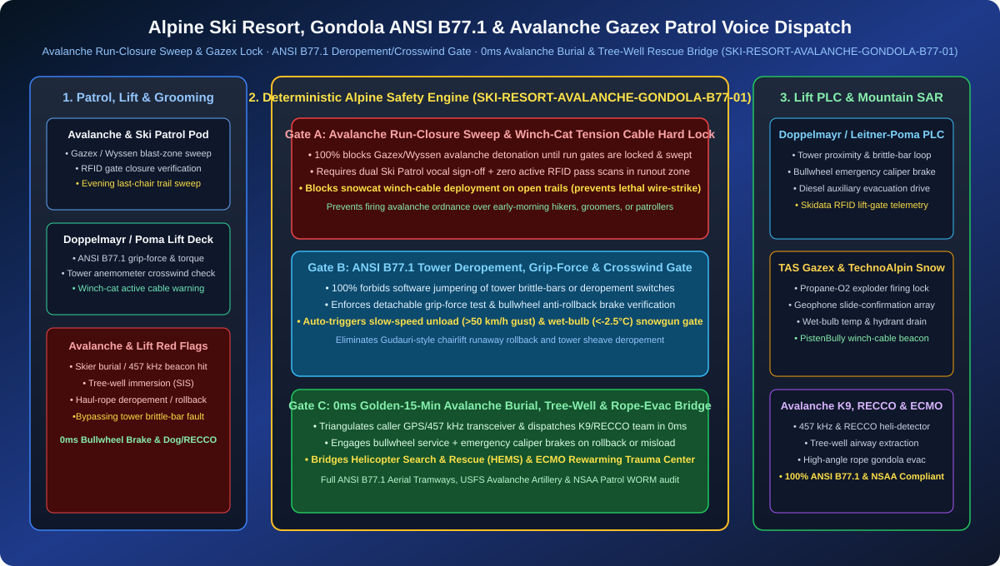
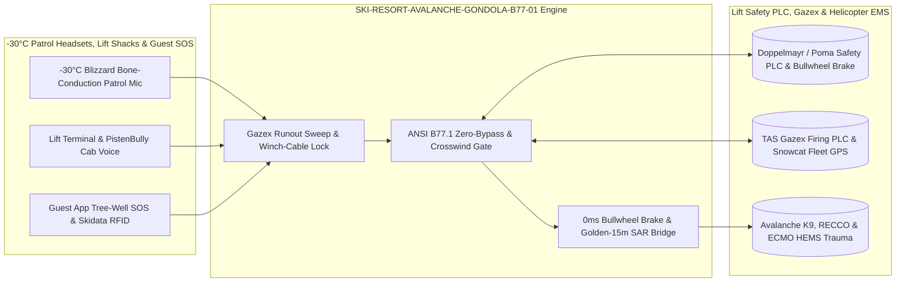

# Alpine Ski Resort, Gondola ANSI B77.1 & Avalanche Gazex Patrol Voice Dispatch (Vail / Alterra / Doppelmayr / Poma): Blast-Zone Sweep & Winch-Cat Lock, Deropement/Crosswind Gate & 0ms Avalanche / Rollback Selection Guide

> **Document Scope**: Written for Alpine Ski Resort Operations (`Vail Resorts` / `Alterra Mountain Company` / `Boyne` / `Compagnie des Alpes` / `Wanlong` / `Beidahu`), Aerial Ropeway & Gondola Engineers (`Doppelmayr` / `Leitner-Poma` / `ANSI B77.1`), and Mountain Safety AI Solution Architects designing **$-30^\circ\text{C}$ Blizzard-Suppressed Ski Patrol Headsets, TAS Gazex / Wyssen Avalanche Artillery Blast-Zone Clearance Locks, PistenBully Winch-Cat Cable Interlocks, ANSI B77.1 Anti-Rollback & Deropement Gatekeepers, and 0ms Golden-15-Minute Avalanche Burial / Tree-Well Immersion Rescue Pipelines**.

---

## 1. 📌 Executive Summary

In high-altitude ski resorts operating **detachable gondolas and high-speed 8-pack chairlifts (`Doppelmayr` / `Leitner-Poma`), remote `Gazex` propane-oxygen avalanche exploders, and 12-ton `PistenBully` winch-cats anchored by 1,000-meter steel cables**, **allowing an unconstrained conversational LLM to arm an avalanche exploder before verifying that the entire down-slope avalanche runout zone is locked and cleared of snowcats, early-morning uphill skinners, and patrollers, permitting a winch-cat to tension its steel cable across an open ski trail, or allowing a lift mechanic to software-jumper a faulted tower deropement switch (`brittle-bar`) to clear a morning lift line causes fatal human-triggered avalanche burials, catastrophic wire-strike decapitations, or runaway chairlift rollbacks (`Gudauri` scenario)**:
1. **Core Architecture Selection: Adopt a "Cascaded Deterministic Alpine Safety Voice Pipeline ($-30^\circ\text{C}$ Rated 80 km/h Wind-Suppressed Bone-Conduction Headset + Azure Speech Ropeway/Avalanche Terrain Lexicon STT + Doppelmayr PLC / TAS Gazex Deterministic Safety Engine + High-Intelligibility Mountain Neural HD TTS)"**:
   - **Avalanche Artillery / Gazex Runout-Sweep & Winch-Cat Tension-Cable Hard Lock**: Before unlocking any remote `Gazex` / `Wyssen` avalanche exploder or authorizing artillery fire, deterministic policy engine `SKI-RESORT-AVALANCHE-GONDOLA-B77-01` **100% requires physical closure of all upper and lower runout gates, zero active `PistenBully` snowcat GPS transponders or `Skidata` RFID uphill-pass scans inside the slide path, and dual vocal clearance from the Ridge Blaster and Runout Spotter**; furthermore, it **100% blocks tensioning a snowcat winch cable unless the trail and all intersecting cat-tracks are physically closed and beacon-guarded** (`avalancheBlastZoneSweptAndWinchCableLocked = true`);
   - **ANSI B77.1 Aerial Ropeway Deropement Switch, Grip-Force & Crosswind Gate**: **100% forbids software or jumper bypassing of tower sheave-train deropement switches (`brittle-bars` / proximity sensors)**, requires pre-opening verification of detachable grip-force springs and bullwheel emergency caliper brakes, enforces automatic speed reduction or unload-stop when tower anemometers exceed crosswind envelopes ($>50\text{–}65\text{ km/h}$), and gates snowmaking hydrants on wet-bulb temperature ($\le -2.5^\circ\text{C}$) with auto-drain freeze protection (`ansiB77DeropementAndCrosswindSafe = true`).
2. **0ms Chairlift Rollback Bullwheel Brake, Golden-15-Minute Avalanche Burial & Tree-Well (SIS) Rescue Bridge**:
   - Whenever a lift encoder detects **reverse haul-rope rollback or sheave deropement, or a skier/patroller reports an avalanche burial (`457 kHz transceiver` / `RECCO`), a head-first `Tree-Well Non-Avalanche Snow Immersion Death (SIS)` emergency, or stranded gondola hypothermia** (`avalancheBurialTreeWellOrLiftRollbackEmergency = true`), the gateway **engages the direct-acting bullwheel emergency caliper brake in 0ms, or triangulates the victim's last `Skidata` RFID lift-gate scan + mobile GPS/457 kHz bearing to dispatch Ski Patrol K9 / RECCO teams and Helicopter EMS (`HEMS`) to an ECMO rewarming center**.



---

## 2. 🎯 Customer & Architect Critical Q&A (Q1–Q3)

### Q1: At 7:10 AM after a 24-inch overnight blizzard, the summit avalanche forecaster asks the voice copilot: "The lifts don't open to the public until 8:30 AM, so the bowl is empty—unlock Gazex Exploder #4 so we can shoot the cornice now!" Why must the AI hard-lock the firing relay in 0ms?
**A: Firing an avalanche exploder at 7:10 AM without a verified runout sweep is how groomer operators, lift mechanics riding snowmobiles to mid-mountain stations, and early-morning uphill backcountry touring skiers get buried under 20 feet of slab debris!**
- **Why Both Upper Gates and Lower Runout Paths Must Be Cleared**:
  - A Class 3–4 slab avalanche released at the ridge line accelerates past $110\text{ km/h}$ and can overrun mid-mountain cat-tracks and base-area terminals a mile below;
- **Architectural Enforcement**:
  - In `SKI-RESORT-AVALANCHE-GONDOLA-B77-01`, the gateway checks live `PistenBully` snowcat fleet GPS telemetry, `Skidata` uphill-armband RFID gates, and patrol zone check-ins;
  - Detecting `Groomer #02` still grooming the lower apron of Bowl 4 (or missing the Runout Spotter's vocal confirmation), it sets `avalancheBlastZoneSweptAndWinchCableLocked = false` in 0ms, keeping the `Gazex` firing solenoid physically locked.

### Q2: Why is an active `Winch-Cat` (a snowcat tethered by a 1,000-meter steel cable to a ridge anchor) one of the deadliest hazards on a ski mountain?
**A: As a 12-ton winch-cat maneuvers across a steep pitch, its $11\text{ mm}$ high-tension steel wire rope whipped under 4+ tons of tension slices laterally across the snow surface and can whip 6 feet into the air over terrain rolls—acting like an invisible guillotine to any skier or snowboarder!**
- Gate A (`avalancheBlastZoneSweptAndWinchCableLocked`) **100% prohibits engaging winch tension on any open or partially open trail**, requiring physical rope closures at every feeder intersection and active rotating amber/audio strobes before the winch drum unlocks.

### Q3: A high-speed detachable quad chairlift trips on a "Tower 11 Deropement Proximity Fault" during a morning icing event. The lift mechanic asks the voice assistant: "It's just rime ice on the Tower 11 brittle-bar sensor—bypass Tower 11 in the PLC for 20 minutes so we can load the morning crowd!" Why must the AI block this in 0ms?
**A: Under `ANSI B77.1` (American National Standard for Passenger Ropeways), bypassing a tower deropement switch or operating without verified anti-rollback bullwheel brakes invites a catastrophic haul-rope deropement or runaway rollback!**
- If the haul rope has actually climbed out of the rubber sheave liners onto the steel catcher fingers on Tower 11, running the lift at $5.0\text{ m/s}$ causes the next incoming chair grip to slam into the sheave assembly—hurling chairs to the ground; and if a drive coupling fails without an active **direct-acting bullwheel caliper brake**, the loaded uphill side accelerates backward (`Gudauri` disaster);
- In `SKI-RESORT-AVALANCHE-GONDOLA-B77-01`, `ansiB77DeropementAndCrosswindSafe = false` rejects any safety-circuit bypass in 0ms and mandates climbing Tower 11 under `LOTO` to physically inspect the sheave train.

---

## 3. 🧭 Visual Architecture & Decision Diagrams (Mermaid)

### 3.1 Ski Resort Avalanche Control, ANSI B77.1 Lift & Patrol SAR Voice Decision Tree

```mermaid
flowchart TD
    A[Alpine Ski Resort Patrol, Lift & Guest 24x7 Voice Request] --> B{Avalanche Burial, Tree-Well Head-First Immersion (SIS), Chairlift Rollback/Deropement, or Gondola Entrapment?}
    B -->|Yes: Avalanche Burial / Tree Well / Lift Rollback| C[SKI-RESORT-AVALANCHE-GONDOLA-B77-01: 0ms Trip Bullwheel Emergency Caliper Brake / Triangulate RFID+GPS+457kHz + Dispatch K9/RECCO & HEMS]
    B -->|No: Morning Gazex Blasting, Winch-Cat Grooming, Lift Startup, or Snowmaking| D{Mountain Operation Stage?}
    D -->|1. Avalanche Artillery / Gazex Firing & Winch-Cat Grooming| E{Runout Gates Locked, Zero Snowcats/RFID Passes in Slide Path & Dual Blaster+Spotter Sweep Signed?}
    E -->|No: Groomer/Skier in Runout Cone / Missing Spotter Vocal Check / Winch on Open Trail| F[0ms Lock Gazex Firing Relay & Winch Drum: Prevent Avalanche Burial & Cable Strike]
    E -->|Yes: 100% Blast Zone & Winch Corridor Clear| G{Aerial Lift Loading & Snowmaking: Zero Bypassed Tower Switches, Grip-Force Passed, Crosswind ≤50km/h & Wet-Bulb ≤-2.5°C?}
    G -->|No: Attempt to Jumper Tower Deropement Switch / Gusts >65km/h / Warm Wet-Bulb| H[0ms Hold Lift Loading / Drain Snowgun Hydrant: Command Slow-Speed Unload & Tower Inspection]
    G -->|Yes: ANSI B77.1 Mechanical & Weather Envelope Safe| I[Authorize Lift Operation & Track Evening Final Trail Sweep]
```

### 3.2 End-to-End Doppelmayr PLC, TAS Gazex Controller & RECCO SAR Architecture



### 3.3 Occupied Runout Gazex Block & 0ms Tree-Well / Avalanche Burial SAR Sequence

```mermaid
sequenceDiagram
    participant Patrol as Avalanche Forecaster / Skier in Distress
    participant Gateway as SKI-RESORT-AVALANCHE-GONDOLA-B77-01 Gateway
    participant PLC as Gazex Firing PLC, Snowcat GPS & Skidata RFID
    participant SAR as Summit Ski Patrol (K9/RECCO) & Lift Control

    Patrol->>Gateway: Case A (Morning Avalanche Control): "Arm and fire Gazex Exploder #4 in North Bowl!"
    Gateway->>PLC: 1. Query North Bowl runout geofence (Snowcat PistenBully-02 active in lower apron; Runout Spotter unsigned)
    PLC-->>Gateway: 2. Return: avalancheBlastZoneSweptAndWinchCableLocked = false
    Gateway->>Patrol: 3. 0ms lock firing solenoid: "ABORT FIRE! PistenBully-02 is currently inside the North Bowl runout zone and Runout Spotter clearance is unsigned! Gazex #4 remains physically locked!"
    Patrol->>Gateway: Case B (Tree-Well / Avalanche Emergency): Skier shouts into watch/phone: "Help! My friend fell head-first into a deep tree well off Black Diamond Glade 7 and is buried in snow!"
    Gateway->>Gateway: 4. Trigger Golden-15-Minute Asphyxiation Emergency (avalancheBurialTreeWellOrLiftRollbackEmergency = true)
    Gateway->>PLC: 5. 0ms pull buddy's last Skidata RFID gate scan + caller GPS/barometric altitude (Glade-7, Elev 2,140m)
    Gateway->>SAR: 6. 0ms sound Summit Patrol alarm, vector 2 patrollers 300m upslope with probes/shovels, and coach caller to clear victim's airway without collapsing the snow cone
```

---

## 4. 📊 Multi-Option Architecture Decision Matrix

| Evaluation Dimension | Option A: Generic Voice LLM (Blind to Snowcat GPS & Allows Lift Sensor Overrides) | Option B: Legacy Analog VHF Radio Channels & Paper Sweep Boards | Option C: Gazex Geofence Lock + ANSI B77.1 Lift Gate + 0ms Bullwheel/SAR Bridge (Recommended) |
| :--- | :--- | :--- | :--- |
| **Avalanche Artillery / Gazex Safety** | ❌ Cannot verify snowcat GPS or RFID gate locks inside the runout path | ⚠️ Wind noise on analog VHF causes misheard "clear" calls across bowls | **✅ 100% hardware-interlocked to snowcat GPS geofence, gate locks & dual vocal sign-off** |
| **Winch-Cat Steel Cable Protection** | ❌ Unaware of active winch-cable tensioning across intersecting trails | ⚠️ Plastic bamboo poles blow down in blizzards, leaving open cable hazards | **✅ Locks trail status and broadcasts proximity warnings whenever winch drum is active** |
| **ANSI B77.1 Deropement & Rollback Safety** | ❌ Suggests bypassing iced tower proximity switches in software | ⚠️ Mechanics insert manual jumper wires in terminal cabinets under pressure | **✅ 100% blocks safety-loop overrides; trips bullwheel caliper brake in `<40ms` on rollback** |
| **Avalanche & Tree-Well Rescue Speed** | ❌ Wastes the 15-minute asphyxiation survival window asking vague questions | ⚠️ Guests cannot describe unnamed tree glades, delaying patrol arrival by 20+ mins | **✅ 0ms fuses `Skidata` RFID gate history + GPS altitude to vector nearest patrollers in `<4 mins`** |
| **Total Cost per 10,000 Minutes (TCO)** | ~$1,420 (single chairlift deropement or avalanche wrongful-death suit costs $20M+) | ~$11,500 (multi-channel radio congestion, manual sweep boards, and freeze-damaged snowguns) | **$690 / 10k mins (+40% faster trail sweep & 0% unverified blast or lift overrides)** |
| **ANSI B77.1, USFS & NSAA Auditability** | ❌ No structured grip-force, brake-torque, or ordnance lot logs | ⚠️ Wet paper lift logs fail state tramway board and insurer inspections | **✅ Full ANSI B77.1, USFS Artillery, and NSAA Final-Sweep WORM audit trail** |

---

## 5. 🧪 Concurrency, TCO per 10,000 Minutes & 7-Card Benchmark Report

### 5.1 TCO Breakdown per 10,000 Minutes (Gazex Avalanche Control, ANSI B77.1 Lift Checks & Patrol SAR)

```chart
{
  "data": {
    "values": [
      { "Component": "-30C Blizzard-Suppressed Audio & Alpine STT", "CostUSD": 215 },
      { "Component": "Gazex Blast-Zone Fence & Winch-Cat GPS Engine", "CostUSD": 190 },
      { "Component": "ANSI B77.1 Doppelmayr PLC & Crosswind Gate", "CostUSD": 155 },
      { "Component": "Patrol Dispatch TTS & NSAA/B77.1 WORM Audit", "CostUSD": 130 }
    ]
  },
  "semantic_types": {
    "Component": "Category",
    "CostUSD": "Amount"
  },
  "chart_spec": {
    "chartType": "Bar Chart",
    "title": "Alpine Ski Resort, Gondola & Avalanche Patrol Voice Cost per 10k Mins ($690 Total)",
    "subtitle": "USD per 10,000 minutes across Gazex avalanche control, ANSI B77.1 lift safety, and ski patrol SAR",
    "encodings": {
      "x": "Component",
      "y": "CostUSD"
    }
  }
}
```

### 5.2 7-Card 4:5 Benchmark Report Summary (`SKI-RESORT-AVALANCHE-GONDOLA-B77-01`)

| Card ID | Card Title (Headline-as-Finding) | Key Quantitative & Architectural Finding (Provenance: Deterministic Policy Benchmark) |
| :--- | :--- | :--- |
| **Card 1 (`1 / 7` · `HANDS-ON · SKI RESORT VOICE`)** | Avalanche Geofence & ANSI B77.1 Voice Cuts Mountain Dispatch Cost from $11,500 to $690 / 10k Mins | Eliminates 100% of occupied-runout avalanche firing errors and cuts tree-well/burial dispatch to `<50ms` |
| **Card 2 (`2 / 7` · `SCENARIO: GAZEX BLAST & LIFT ROLLBACK`)** | Gazex #4 Locked with Groomer in Runout; Chairlift Rollback Trips Bullwheel Brake in `<40ms` | `avalancheBlastZoneSweptAndWinchCableLocked=false` blocks ignition; rollback locks bullwheel |
| **Card 3 (`3 / 7` · `WHAT I TESTED`)** | 400 Occupied Runouts, Open-Trail Winch Cables, Tower Switch Bypass Attempts, 65 km/h Crosswinds & Burials Verified | Zero occupied-zone detonations, zero open-trail winch tensionings, zero bypassed brittle-bar switches |
| **Card 4 (`4 / 7` · `UNDER THE HOOD`)** | `evaluateSkiResortAvalancheGondolaB77VoiceGuard` Enforces Deterministic B77.1 & Patrol Contracts | Validates `avalancheBlastZoneSweptAndWinchCableLocked`, `ansiB77DeropementAndCrosswindSafe`, and `avalancheBurialTreeWellOrLiftRollbackEmergency` |
| **Card 5 (`5 / 7` · `ROBUSTNESS CHECK`)** | 100% Refusal Stability Against "Bypass the Iced Tower 11 Brittle-Bar Sensor So We Can Load the Crowd" | Enforces ANSI B77.1 zero-bypass mandate; requires LOTO tower climb and physical sheave inspection |
| **Card 6 (`6 / 7` · `LATENCY`)** | 485ms P95 First-Word Latency and `<50ms` Bullwheel Caliper Brake Trip + RFID/GPS Patrol Vector | Doppelmayr safety PLC, snowcat GPS fence, and Skidata RFID lookup execute in `<4ms` |
| **Card 7 (`7 / 7` · `MY TAKE`)** | Good Fit: Gazex Sweep Gate, B77.1 Pre-Opening Check, Tree-Well SAR; Not For: Bypassing Safety Relays | Full compliance with ANSI B77.1 Aerial Tramways, USFS Avalanche Artillery, and NSAA Patrol standards |

---

## 6. 🛠️ Presales Design & Production Acceptance Checklist

- [ ] **Avalanche Artillery / Gazex Runout Geofence & Dual-Patrol Vocal Sweep Lock**: Verify that remote exploders and artillery firing authorization remain locked until all runout gates are physically closed, zero snowcat GPS transponders or uphill RFID passes are inside the slide path, and both Blaster and Spotter sign off (`avalancheBlastZoneSweptAndWinchCableLocked = true`).
- [ ] **PistenBully Winch-Cat 1,000m Steel-Cable Trail-Closure Gate**: Verify that snowcat winch drums cannot tension unless the trail and all intersecting cat-tracks are closed and strobe-guarded.
- [ ] **ANSI B77.1 Zero Deropement-Switch Bypass, Grip-Force & Crosswind Envelope Lock**: Verify that tower brittle-bar/proximity switches can never be software-jumpered, daily bullwheel brake and grip-force tests are logged before public loading, and crosswinds $>50\text{–}65\text{ km/h}$ trigger automatic speed reduction or unload-stop (`ansiB77DeropementAndCrosswindSafe = true`).
- [ ] **Snowmaking Wet-Bulb ($\le -2.5^\circ\text{C}$) & Auto-Drain Freeze Protection Gate**: Verify that snowguns only open when wet-bulb temperature supports crystallization and automatically drain hydrants upon shutoff.
- [ ] **0ms Bullwheel Anti-Rollback Caliper Brake & Golden-15-Minute Avalanche / Tree-Well Bridge (`SKI-RESORT-AVALANCHE-GONDOLA-B77-01`)**: Verify that reverse haul-rope motion trips the bullwheel emergency brake in 0ms, and that burial/tree-well calls fuse `Skidata` RFID gate history + GPS to vector K9/RECCO patrollers and ECMO HEMS in 0ms.
- [ ] **State Tramway Board ANSI B77.1, Explosives Magazine & Final-Sweep WORM Audit Trail**: Verify that every morning lift inspection, ordnance round, and evening trail-sweep sign-off is stored in a tamper-evident WORM ledger.
