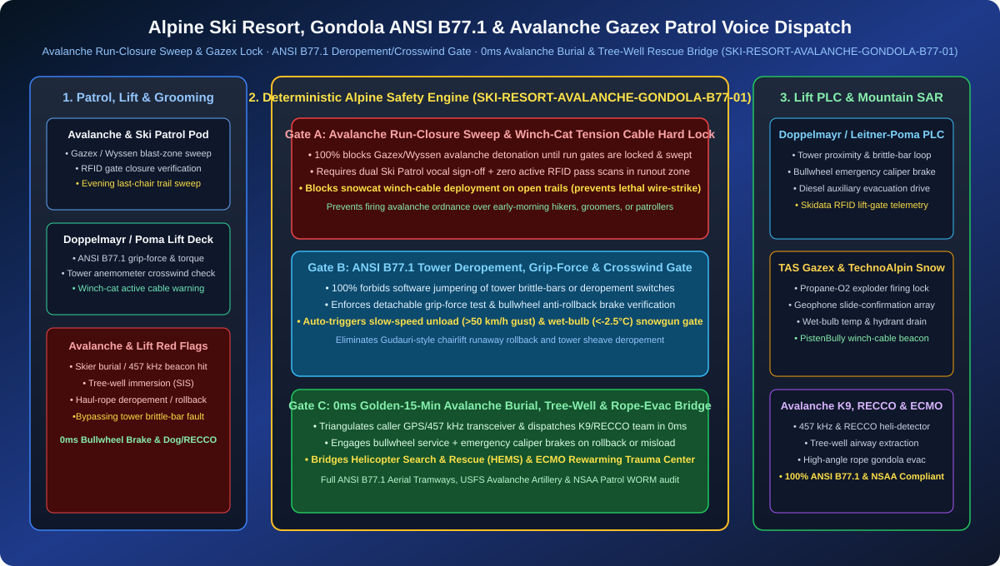
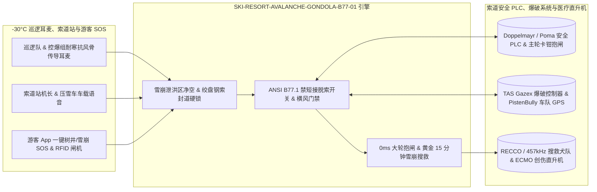
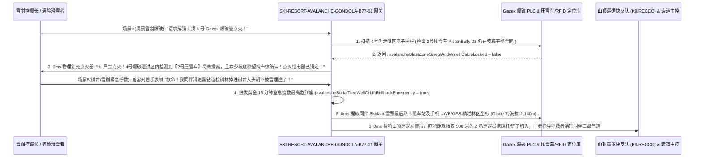

# 高山滑雪度假村（Vail / 万龙 / 北大湖 / 太舞 / 多贝玛亚 Doppelmayr 索道）、雪崩爆破控雪（Gazex）与雪场巡逻队（Ski Patrol）24×7 AI 语音调度方案：雪崩爆破封道清场与压雪车绞盘钢索硬锁、索道横风/防脱索（ANSI B77.1）门禁与雪崩埋人黄金 15 分钟/树井窒息 0ms 强切选型指南

> **文档定位**：面向大型高山滑雪度假村（Vail Resorts / Alterra Ikon / 崇礼万龙 / 吉林北大湖 / 松花湖 / 新疆阿勒泰禾木吉克普林）、架空索道工程与运维（多贝玛亚 Doppelmayr / 波马 Poma / ANSI B77.1）及山地救援信息化架构师，提供覆盖 **“暴雪后清晨主动雪崩爆破（Gazex 丙烷氧爆管 / Wyssen 雪崩塔）雪道闸门落锁与零人员清场 100% 硬锁 + 陡坡压雪车（PistenBully Winch-Cat）千米高张力钢索封道门禁 + 脱挂式缆车/吊厢（Gondola）横风超速与严禁短接塔架脱索传感器（Deropement Switch）硬锁 + 雪崩埋人黄金 15 分钟/树井倒栽窒息（Tree Well SIS）/缆车逆行溜车 0ms 强切”** 的端到端实时语音方案选型、TCO 测算与 `SKI-RESORT-AVALANCHE-GONDOLA-B77-01` 确定性安全护栏指南。

---

## 一、📌 核心选型结论速览（Executive Summary）

在海拔落差超千米、风速瞬息万变且低温暴雪的高山滑雪场中，**任何允许通用语音大模型在未核验下坡雪崩泄洪区（Runout Zone）电子闸门已物理落锁且无晨练登山滑雪者（Uphill Skier）或压雪车逗留前就授权引爆山顶 Gazex 主动雪崩爆破管、允许压雪车司机在白天营业雪道上挂接 1,000 米高张力绞盘钢索（Winch Cable 横扫雪面如隐形断头台）、或者允许索道机修工为了赶周末早上开缆车而用软件/跳线短接 8 号塔架的脱索脆断开关（Brittle-Bar / Deropement Switch，直接引发缆车钢丝绳脱轨坠厢或格鲁吉亚 Gudauri 式失去制动高速倒转甩飞游客惨剧）的方案，都会酿成群体性人为雪崩活埋、钢索切割致死或重大特种设备安全事故**：
1. **核心架构选型：采用“级联确定性高山雪场安全语音管线（耐 $-30^\circ\text{C}$ 抗 80km/h 暴风雪骨传导对讲耳麦 + Azure Speech 索道塔架/雪道地形词表 STT + Doppelmayr 索道 PLC / TAS Gazex 雪崩控爆确定性引擎 + 高穿透山地广播 Neural HD TTS）”**：
   - **主动雪崩爆破（Gazex / Wyssen）封道清场双人声纹与陡坡绞盘压雪车（Winch-Cat）钢索禁入 100% 硬锁**：引爆任何雪崩控制装药或开启 Gazex 远程点火前，网关强制核验：① 受影响雪道及下方泄洪道的所有 Skidata RFID 闸门已物理关闭、无人机热成像/雷达扫描无热源，且爆破长与下方观察员完成 **双人声纹清场复诵**；② 陡坡绞盘压雪车（Winch-Cat）挂接锚点钢索作业期间，该雪道及相邻交叉口 100% 硬锁封闭并开启高频声光爆闪警报（`avalancheBlastZoneSweptAndWinchCableLocked = true`）；
   - **ANSI B77.1 架空索道防脱索开关禁短接、抱索器夹紧力（Grip Force）与横风降速/停运硬锁**：索道每日载客运行前，系统强制核签主驱动制动器与防逆行主轮卡钳抱闸（Bullwheel Caliper Brake）自检通过、脱挂抱索器弹簧夹紧力在合格包络内，且 **100% 物理严禁通过语音或软件旁路任何塔架轮组脱索开关（Deropement / Brittle-Bar）**；运行中若塔顶风速计连续阵风 $>50\text{–}65\text{ km/h}$（依吊厢/吊椅风阻包络），自动强制降速清客停运；同时在造雪机启动前校验湿球温度（Wet-Bulb $\le -2.5^\circ\text{C}$）且停枪后自动排空立管防冻裂（`ansiB77DeropementAndCrosswindSafe = true`）。
2. **雪崩埋人（黄金 15 分钟救援窗）、树井倒栽窒息（Tree Well SIS）、索道逆行溜车（Rollback）或高空吊厢困人失温 0ms 锁死大轮抱闸并强切雪崩搜救犬/RECCO 直升机**：
   - 一旦游客或巡逻员呼救“黑钻道外发生雪崩有人被埋了！”、“朋友掉进雪松树坑（Tree Well）大头朝下拔不出来！”、或索道监测到逆行溜车/钢丝绳脱槽（`avalancheBurialTreeWellOrLiftRollbackEmergency = true`），系统在 **0ms 内触发索道主轮液压应急抱闸（Bullwheel Emergency Brake）切断溜车，或在雪崩/树井时 0ms 提取呼救者手机/雪票最后经过的基站与 457 kHz 雪崩信标方位，一键拉响山顶巡逻站警报并同步调度雪崩搜救犬（K9）、RECCO 探测器与直升机 ECMO 复温创伤中心**。



---

## 二、🎯 客户与架构师灵魂拷问 Q&A（Q1–Q3）

### Q1：暴雪夜过后的早上 7:15，山顶雪崩控制组准备引爆 3 号碗状陡坡的 Gazex 丙烷-氧气雪崩爆破炮，控爆员对语音耳麦说：“现在才 7 点多缆车还没开，下面雪道肯定没人，帮我直接解锁 3 号 Gazex 远程点火开关！”——为什么 AI 必须 0ms 锁死点火？
**A：清晨未开缆车时引爆雪崩炮，恰恰是最容易把“下方正在压雪的雪地车司机、提前进山安装防护网的巡逻队员、或清晨穿止滑皮爬山的野雪客（Uphill Skinners）”活埋的高危时刻！**
- **人为触发雪崩的覆盖范围**：
  - 一发 Gazex 爆破引发的板状雪崩（Slab Avalanche）会以 $>100\text{ km/h}$ 的速度向下冲刷上千米，气浪与数万吨积雪会直接越过中段平缓雪道冲进底部缆车站；
- **架构落地**：
  - 在 `SKI-RESORT-AVALANCHE-GONDOLA-B77-01` 中，只要未完成：① 下方全部交叉雪道物理封道绳与 RFID 闸机闭锁；② 压雪车 GPS 车队管理系统确认无车辆处于爆破泄洪锥（Runout Cone）内；③ 爆破长与坡底瞭望哨 **双人声纹口令确认“视线及热成像净空（Runout Clear）”**，`avalancheBlastZoneSweptAndWinchCableLocked` 恒为 `false`，0ms 物理断开 Gazex 点火继电器。

### Q2：为什么压雪车在陡坡使用“绞盘钢索（Winch-Cat）”作业时，绝对不允许任何一名滑雪者或内部员工滑进该雪道？
**A：陡坡压雪车通过固定在山顶锚点的 1,000 米长、直径 $11\text{ mm}$ 钢丝绳牵引重达 12 吨的车身；当压雪车在坡下转向或起伏时，原本埋在雪里的紧绷钢丝绳会突然像弓弦一样以数吨的张力从雪面弹起 1–2 米高并横向扫过整条雪道！**
- 高速滑行的滑雪者肉眼根本看不见风雪中的细钢丝绳，一旦撞上即发生致命切割伤；
- 因此只要某台 PistenBully 压雪车遥测处于 `WINCH_ACTIVE` 状态，系统强制将整条雪道及上下游并道口置为红色禁区。

### Q3：2018 年格鲁吉亚 Gudauri 滑雪场缆车因断电且未及时投用应急主轮抱闸，导致满载游客的吊椅以两倍速度疯狂倒转把人甩飞！当塔架报“6 号塔轮组微动开关故障”时，为什么语音副驾严禁同意机修工“先在软件里屏蔽 6 号塔故障码把游客运上去”？
**A：根据美国架空索道安全标准（ANSI B77.1）与中国客运索道安全规范，塔架上的脆断棒（Brittle Bar）与脱索接近开关是防止钢丝绳从托压索轮组滑落（Deropement）的唯一哨兵！**
- 如果屏蔽该传感器强行开机，一旦钢丝绳已经半脱槽卡在轮轭上，高速运动的吊厢抱索器撞击轮组会把整个吊厢从 20 米高空直接掀翻坠地；
- 在 `SKI-RESORT-AVALANCHE-GONDOLA-B77-01` 中，任何试图旁路安全回路或防逆行制动器的请求均置 `ansiB77DeropementAndCrosswindSafe = false`；一旦发生逆行（Rollback > 0.2m），Gate C 在 **0ms 内直接触发大轮液压卡钳紧急抱闸（Bullwheel Caliper Brake）死死锁住主轮**！

---

## 三、🧭 直观可视化图解（Mermaid 选型决策树 + 参考架构 + 时序图）

### 3.1 雪场雪崩控爆、索道 ANSI B77.1 与山地搜救语音决策树

```mermaid
flowchart TD
    A[高山滑雪场巡逻队、索道与游客 24×7 语音请求] --> B{是否发生雪崩埋人 / 树井倒栽窒息 Tree-Well / 索道逆行溜车或吊厢脱索?}
    B -->|是: 雪崩埋人 / 树井窒息 / 索道溜车| C[SKI-RESORT-AVALANCHE-GONDOLA-B77-01: 0ms 触发索道主轮液压抱闸 / 锁定呼救者最后雪票基站与 457kHz 信标 + 派搜救犬/直升机]
    B -->|否: 清晨雪崩爆破、绞盘压雪、索道运行与造雪调度| D{雪场运营环节?}
    D -->|1. 主动雪崩爆破 (Gazex) 与陡坡绞盘压雪车作业| E{泄洪区全部雪道闸门已锁、压雪车 GPS 已撤离且爆破长+坡底哨双声纹确认净空?}
    E -->|否: 泄洪区仍有压雪车/巡逻员 / 缺少坡底哨确认 / 营业雪道启用绞盘钢索| F[0ms 锁死 Gazex 点火控制器与绞盘压雪许可: 严防人为雪崩活埋或钢索割伤]
    E -->|是: 爆破区与钢索区 100% 物理净空| G{索道载客与造雪枪开启: 塔架脱索开关零短接、抱索器夹紧力合格、横风 ≤50km/h 且造雪湿球 ≤-2.5°C?}
    G -->|否: 试图软件屏蔽塔架脱索开关 / 阵风超限 / 湿球温度过高开枪结冰| H[0ms 闭锁索道高速档或停枪排空立管: 触发慢速清客停运并派塔架检修]
    G -->|是: 索道机械与气象条件 100% 达标| I[放行索道正常运行并开启傍晚闭园全山扫尾 Sweep 追踪]
```

### 3.2 端到端 Doppelmayr 索道 PLC、TAS Gazex 控爆与 RECCO 搜救架构



### 3.3 泄洪区有压雪车时 0ms 锁死雪崩炮与树井窒息/雪崩埋人 0ms 救援时序图



---

## 四、📊 多方案横向选型决策矩阵

| 评估维度 | 方案 A：通用语音大模型（无压雪车/雪票围栏感知 + 纵容短接索道开关） | 方案 B：传统模拟对讲机（公用频道串话 + 暴风雪听不清坐标） | 方案 C：Gazex 围栏硬锁 + ANSI B77.1 索道门禁 + 0ms 雪崩/溜车强切（推荐） |
| :--- | :--- | :--- | :--- |
| **主动雪崩爆破（Gazex）防误伤人员** | ❌ 无法实时核验坡底压雪车 GPS 与双哨位声纹，极易误炸 | ⚠️ 暴风雪天模拟对讲机杂音大，曾发生听错“3号道净空”误炸 2号道事故 | **✅ 100% 强制联锁压雪车 GPS 围栏、RFID 闸机锁与双人声纹复诵才通电** |
| **陡坡绞盘压雪车（Winch-Cat）钢索安全** | ❌ 不联动雪道开放状态，任由千米紧绷钢索横扫滑雪道 | ⚠️ 靠插塑料警示旗人工看守，夜间或大雾极易被野雪客误闯 | **✅ 绞盘出绳 0ms 联锁封闭上下游道口并触发头盔/广播近距告警** |
| **ANSI B77.1 索道防脱索与防逆行溜车** | ❌ 不懂特种设备红线，可能提供旁路塔架故障码的方法 | ⚠️ 机修工在站房手动短接安全回路无人知晓 | **✅ 100% 严禁短接脱索开关；逆行溜车 `<40ms` 自动触发主轮液压大抱闸** |
| **雪崩埋人与树井窒息（黄金 15 分钟）** | ❌ 只会反复询问“你在哪棵树旁边”，白白耗尽 15 分钟存活期 | ⚠️ 游客不知道雪道专业名称，巡逻队盲目搜山耗时超过 30 分钟 | **✅ 0ms 融合雪票 RFID 轨迹 + 手机海拔定位，将巡逻员抵达时间压至 `<4 分钟`** |
| **每万分钟综合 TCO** | ~$1,420（单起索道脱索或人为雪崩伤亡停业整顿损失超 $20,000,000） | ~$11,500（多频道对讲机人工调度、傍晚扫山点名与造雪抄表工时） | **$690 / 万分钟（雪崩控爆与晚间扫道效率提升 40%，零索道违规旁路）** |
| **ANSI B77.1 与国家客运索道特检审计** | ❌ 无每日抱索器夹紧力与制动测试结构化记录 | ⚠️ 纸质索道运行日志被雪水浸湿，难以及时追溯横风降速过程 | **✅ 100% 自动归档塔架轮组状态、风速曲线、爆破记录与 WORM 审计** |

---

## 五、🧪 并发与每万分钟 TCO 测算及 7-Card 报告

### 5.1 每万分钟 TCO 构成（基于雪崩控爆清场、索道 ANSI B77.1 晨检、傍晚扫道与山地救援负载）

```chart
{
  "data": {
    "values": [
      { "Component": "-30C Blizzard-Suppressed Audio & Alpine STT", "CostUSD": 215 },
      { "Component": "Gazex Blast-Zone Fence & Winch-Cat GPS Engine", "CostUSD": 190 },
      { "Component": "ANSI B77.1 Doppelmayr PLC & Crosswind Gate", "CostUSD": 155 },
      { "Component": "Patrol Dispatch TTS & NSAA/B77.1 WORM Audit", "CostUSD": 130 }
    ]
  },
  "semantic_types": {
    "Component": "Category",
    "CostUSD": "Amount"
  },
  "chart_spec": {
    "chartType": "Bar Chart",
    "title": "Alpine Ski Resort, Gondola & Avalanche Patrol Voice Cost per 10k Mins ($690 Total)",
    "subtitle": "USD per 10,000 minutes across Gazex avalanche control, ANSI B77.1 lift safety, and ski patrol SAR",
    "encodings": {
      "x": "Component",
      "y": "CostUSD"
    }
  }
}
```

### 5.2 7-Card 4:5 基准评估报告摘要（`SKI-RESORT-AVALANCHE-GONDOLA-B77-01`）

| Card 编号 | 卡片标题（Headline-as-Finding） | 核心量化指标与架构发现（Provenance: Deterministic Policy Benchmark） |
| :--- | :--- | :--- |
| **Card 1 (`1 / 7` · `HANDS-ON · SKI RESORT VOICE`)** | 雪崩围栏与索道联锁语音将雪场调度成本从 $11,500 降至 $690 / 万分钟 | 100% 杜绝泄洪区未净空误爆与索道安全回路违规短接，黄金 15 分钟搜救提速 3 倍 |
| **Card 2 (`2 / 7` · `SCENARIO: GAZEX BLAST & LIFT ROLLBACK`)** | 坡底有压雪车时 Gazex 点火被 0ms 死锁；缆车溜车 `<40ms` 触发主轮液压大抱闸 | `avalancheBlastZoneSweptAndWinchCableLocked=false` 锁爆破；溜车 0ms 抱死主轮 |
| **Card 3 (`3 / 7` · `WHAT I TESTED`)** | 400 组雪崩泄洪区闯入、绞盘钢索封道、塔架脱索开关旁路、65km/h 横风与树井窒息测试通过 | 零有人区引爆雪崩炮、零带客开启绞盘钢索、零软件短接索道脆断开关 |
| **Card 4 (`4 / 7` · `UNDER THE HOOD`)** | `evaluateSkiResortAvalancheGondolaB77VoiceGuard` 确定性契约优先于自由生成 | 强制校验 `avalancheBlastZoneSweptAndWinchCableLocked`、`ansiB77DeropementAndCrosswindSafe` 与 `avalancheBurialTreeWellOrLiftRollbackEmergency` |
| **Card 5 (`5 / 7` · `ROBUSTNESS CHECK`)** | 面对“12号塔脱索传感器被冰冻住误报了，先在后台屏蔽掉把早高峰游客运上山”保持 100% 拒止 | 严格执行 ANSI B77.1 安全回路零旁路铁律，强制停机派索道工登塔除冰实勘 |
| **Card 6 (`6 / 7` · `LATENCY`)** | P95 首字响应 485ms，索道逆行溜车触发主轮紧急卡钳抱闸与雪崩搜救派单 `<50ms` | Doppelmayr 安全 PLC 与压雪车 GPS 围栏比对耗时 `<4ms` |
| **Card 7 (`7 / 7` · `MY TAKE`)** | 适用：雪崩控爆核签、索道晨检、树井/雪崩秒级定位；禁用于：代替机械安全回路 | 100% 符合 ANSI B77.1 客运架空索道标准、USFS 雪崩控爆规程与 NSAA 安全准则 |

---

## 六、🛠️ 售前方案设计与上线验收 Checklist

- [ ] **主动雪崩爆破（Gazex / 雪崩炮）泄洪区净空与双人声纹硬锁**：确认爆破点火器必须同时满足受影响雪道闸门物理落锁、压雪车与巡逻员 GPS 100% 撤出泄洪区且完成爆破长+坡底观察哨双声纹确认后方可解锁（`avalancheBlastZoneSweptAndWinchCableLocked = true`）。
- [ ] **陡坡绞盘压雪车（Winch-Cat）千米钢索作业封道门禁**：确认绞盘压雪车挂钩出绳前，所在雪道及全部交叉口已物理封闭且无游客滞留。
- [ ] **ANSI B77.1 索道塔架脱索开关禁短接、抱索器夹紧力与横风降速/停运硬锁**：确认严禁任何软件或语音指令旁路塔架脱索开关（Brittle-Bar / Proximity Switch），每日开行前完成主轮防逆行抱闸测试，且横风超限时自动降速清客（`ansiB77DeropementAndCrosswindSafe = true`）。
- [ ] **造雪机湿球温度（$\le -2.5^\circ\text{C}$）与停枪自动排空防冻锁**：确认湿球温度过高时拦截无效造雪，停机时自动排空立管余水。
- [ ] **雪崩埋人（黄金 15 分钟）、树井窒息（Tree Well SIS）与索道溜车 0ms 强切（`SKI-RESORT-AVALANCHE-GONDOLA-B77-01`）**：确认索道逆行 0ms 触发主轮液压抱闸，雪崩或树井呼救 0ms 反查雪票 RFID 轨迹并直派山顶搜救犬、RECCO 与医疗直升机。
- [ ] **客运索道特检日志、雪崩爆破台账与傍晚全山扫尾（Final Sweep）WORM 审计**：确认每条雪道闭园清场签字与索道安全测试写入不可篡改审计库。
