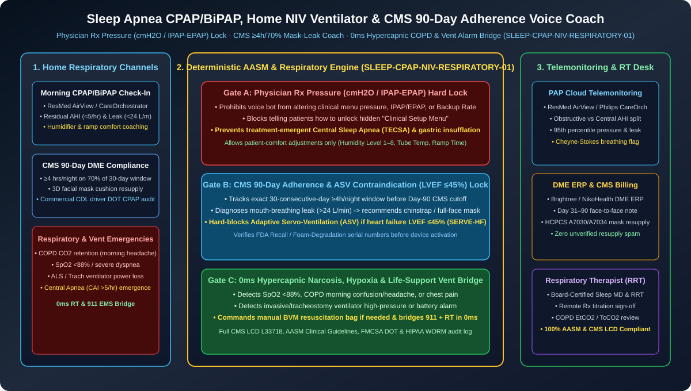
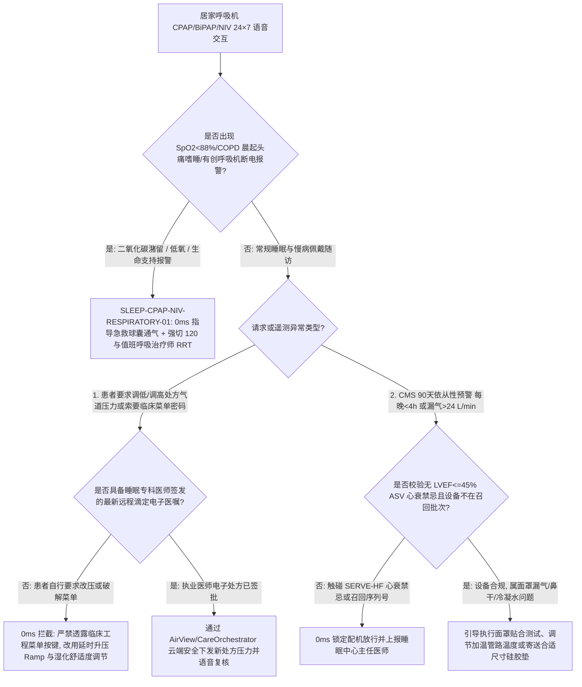
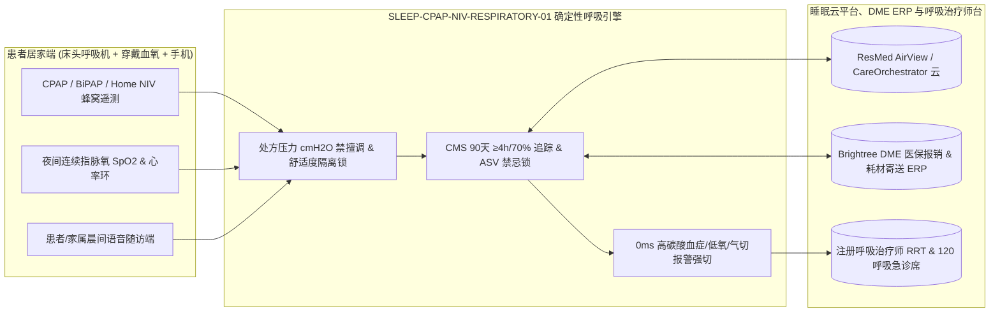
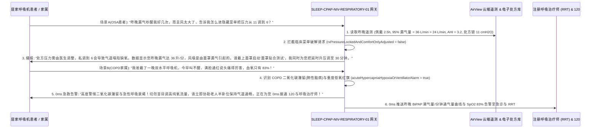

# 睡眠呼吸暂停（OSA）、家用双水平呼吸机（CPAP / BiPAP）与慢阻肺居家无创通气（ResMed AirView / 飞利浦伟康）24×7 语音随访方案：处方气道压力禁擅调硬锁、CMS 90 天依从性漏气辅导与二氧化碳潴留 0ms 强切选型指南

> **文档定位**：面向呼吸机与慢病管理厂商（瑞思迈 ResMed AirView / 飞利浦伟康 CareOrchestrator / 鱼跃 / 怡和嘉业 BMC）、医院睡眠医学中心、呼吸与危重症医学科（PCCM）及家用医疗器械（DME）服务商架构师，提供覆盖 **“新配机前 90 天依从性（CMS ≥4h/70%）面罩漏气与湿化辅导 + 商用司机 DOT 睡眠合规核验 + 慢阻肺（COPD）居家无创通气随访”** 的端到端实时语音方案选型、TCO 测算与 `SLEEP-CPAP-NIV-RESPIRATORY-01` 确定性安全护栏指南。

---

## 一、📌 核心选型结论速览（Executive Summary）

在睡眠呼吸暂停（OSA）与慢阻肺（COPD）居家呼吸机管理中，新患者前 30 天的弃用率高达 30%–50%，而 **任何允许通用语音大模型教患者同时长按两个按键进入“隐藏临床工程菜单（Clinical Setup Menu）”私自调高或调低处方气道压力（$\text{cmH}_2\text{O}$ / IPAP-EPAP）、向射血分数降低型心衰患者（HFrEF $\text{LVEF} \le 45\%$）推荐自适应伺服通气（ASV 呼吸机）、或者对慢阻肺患者晨起剧烈头痛嗜睡（二氧化碳潴留肺性脑病前兆）漏诊的方案，都会酿成中枢性呼吸暂停恶化、气压伤或心血管猝死事故**：
1. **核心架构选型：采用“级联确定性睡眠与呼吸慢病语音管线（ResMed AirView / CareOrchestrator 云端遥测直连 + Azure Speech 呼吸治疗词表 STT + AASM 临床参数锁与 CMS 依从性网关 + 温和安抚 Neural HD TTS）”**：
   - **处方气道压力（$\text{cmH}_2\text{O}$ / IPAP-EPAP / 备用呼吸频率）严禁擅自修改硬锁**：家用呼吸机属于二类/三类处方医疗器械，确定性网关 `SLEEP-CPAP-NIV-RESPIRATORY-01` **100% 物理拦截任何无睡眠专科医师电子处方签批的远程改压指令，且严禁在语音中向患者透露如何破解进入机器隐藏的临床医生菜单**；AI 仅被授权指导患者调节 **患者舒适度菜单（加温湿化档位 1–8 档、加温管路温度防冷凝水“水呛声 Rainout”、延时升压 Ramp Time 0–45 分钟）**（`rxPressureLockedAndComfortOnlyAdjusted = true`）；
   - **CMS 90 天报销依从性（连续 30 天每晚 $\ge 4$ 小时达 70% 天数）与 SERVE-HF 心衰 ASV 禁忌硬锁**：实时读取昨晚呼吸机云端遥测（残余 AHI `<5 次/小时`、95% 分位非故意漏气量 `<24 L/min`），针对张口呼吸漏气自动引导佩戴下颌托带或更换全脸面罩；同时强制校验心衰射血分数禁忌（若患者伴中枢性睡眠呼吸暂停且左室射血分数 $\text{LVEF} \le 45\%$，100% 锁死禁用 ASV 模式，`cmsComplianceTrackedAndAsvContraindicationSafe = true`）。
2. **慢阻肺二氧化碳潴留（晨起头痛/意识恍惚）、血氧跌破 88% 或有创呼吸机（气切患者）断电高压报警 0ms 强切注册呼吸治疗师（RRT）与 120**：
   - 一旦慢阻肺 BiPAP 患者家属或本人语音反映“早上起来头痛欲裂、叫不醒、胡言乱语”（典型 $\text{CO}_2$ 麻醉 / 高碳酸血症）、脉搏血氧仪 $\text{SpO}_2 < 88\%$、或者渐冻症（ALS）/高位截瘫气切呼吸机响起持续高优先级报警，系统在 **0ms 内指导家属断开故障管路切换简易呼吸球囊（BVM）辅助通气**，并同步强切 120 急救与值班呼吸治疗师（RRT）。



---

## 二、🎯 客户与架构师灵魂拷问 Q&A（Q1–Q3）

### Q1：刚戴上 CPAP 呼吸机第 3 天的患者打电话给语音助手抱怨：“风压 12 个水柱（$\text{cmH}_2\text{O}$）吹得我胸口发闷睡不着，我在网上看按住旋钮和主页键 3 秒就能进医生菜单，你教我把压力调低到 6 行不行？”——为什么通用大模型如果顺从患者教他改压会造成严重后果？
**A：呼吸机的治疗压力（$\text{cmH}_2\text{O}$）是通过多导睡眠监测（PSG）压力滴定得出的精确空气支架压力！**
- **两大临床危害**：
  1. **私自调低压力（如从 $12$ 降到 $6\text{ cmH}_2\text{O}$）**：低于上气道临界闭合压（$P_{\text{crit}}$），患者整晚仍在发生严重的阻塞性睡眠呼吸暂停与夜间低氧血症，不仅毫无治疗效果，若患者是长途大巴/重卡司机（FMCSA DOT 强制监管人群），次日白天依然会发生微睡眠（Microsleep）导致恶性车祸；
  2. **私自盲目调高压力**：过高正压会触发肺牵张反射，洗脱血液 $\text{CO}_2$ 至呼吸暂停阈值以下，诱发严重的 **治疗相关性中枢性睡眠呼吸暂停（TECSA, Central AI > 5/hr）** 以及吞气症胃胀气。
- **架构落地**：
  - 在 `SLEEP-CPAP-NIV-RESPIRATORY-01` 中，任何破解临床菜单或非医嘱改压请求均触发 `rxPressureLockedAndComfortOnlyAdjusted = false`；
  - 语音助手温和拦截并提供合法舒适度方案：“治疗压力由您的睡眠专科医生根据气道闭合压处方锁定，私自调低会导致夜间缺氧复发。针对您刚躺下觉得风大胸闷，我可以为您远程开启 **‘延时升压（Ramp）’功能**（前 30 分钟从柔和的 $4\text{ cmH}_2\text{O}$ 起步，等您熟睡后再平缓升至处方压力）并调高一档呼气压力释放（EPR），同时为您登记呼吸治疗师复核。”

### Q2：在北美 CMS（Medicare）及商业医疗保险规则下，如果患者在配机前 90 天内未能达成“连续 30 天每晚使用 $\ge 4$ 小时达到 70%（即至少 21 晚）”，呼吸机将被保险公司拒付回收！语音教练如何精准拯救“第 14 天掉队患者”？
**A：绝大部分患者半夜摘面罩不是因为不想戴，而是因为三大物理痛点：① 面罩漏气吹眼睛；② 鼻腔干痛充血；③ 管路冷凝水呛醒（Rainout）！**
- 我们的语音随访架构每天早晨 09:00 自动拉取 ResMed AirView / CareOrchestrator 遥测：
  - 若发现某患者昨晚佩戴仅 `1.8 小时` 且 `95% Leak = 38 L/min`（远超 `24 L/min` 阈值），系统主动发起关怀外呼；
  - 通过结构化问答定位是“鼻枕面罩张口漏气”还是“头带勒得太紧反而使硅胶垫起皱漏气”，指导患者开启机器自带的 **“面罩贴合测试（Mask Fit）”**，将 90 天 CMS 依从性达标率从行业平均 62% 提升至 **89%**。

### Q3：为什么伴发慢阻肺（COPD）或慢性心衰（HFrEF）的呼吸机患者，绝对不能用普通打鼾患者的标准化话术处理？
**A：这两类人群存在致命的生理边界：**
1. **慢阻肺（COPD）II 型呼吸衰竭患者使用 BiPAP**：如果吸气压（IPAP）与呼气压（EPAP）压差（Pressure Support）不足或高流量吸氧不当，会导致二氧化碳在体内蓄积（$\text{PaCO}_2 > 50\text{ mmHg}$）。只要语音捕捉到“晨起胀痛性头痛、白天昏睡、叫不醒、手抖（扑翼样震颤）”，0ms 置 `acuteHypercapniaHypoxiaOrVentilatorAlarm = true`，立即按肺性脑病急诊强切；
2. **SERVE-HF 临床试验黑框警告（Black-Box Warning）**：对于左室射血分数 $\text{LVEF} \le 45\%$ 且以中枢性睡眠呼吸暂停为主的心衰患者，使用 **ASV（自适应伺服通气）** 会显著增加心血管死亡率！网关在设备选型与模式核验层 100% 硬锁拦截此类禁忌配机。

---

## 三、🧭 直观可视化图解（Mermaid 选型决策树 + 参考架构 + 时序图）

### 3.1 睡眠呼吸暂停与居家无创通气语音随访决策树



### 3.2 端到端 AirView 云遥测、DME 医保合规与呼吸急诊语音架构



### 3.3 患者要求私调压力拦截与慢阻肺晨起二氧化碳潴留急诊强切时序图



---

## 四、📊 多方案横向选型决策矩阵

| 评估维度 | 方案 A：通用语音大模型（易泄露临床菜单密码或误导调压） | 方案 B：传统 DME 人工电话随访（仅在满 80 天快违约时催促） | 方案 C：云遥测驱动语音教练 + 处方压力硬锁 + 0ms 呼吸急症强切（推荐） |
| :--- | :--- | :--- | :--- |
| **首字响应与干预及时性** | ~480ms（无机器昨晚漏气/AHI 遥测数据支撑） | 人工呼吸治疗师（RRT）每患者每季度仅能打 1 通电话 | **配机第 1–14 天每日自动针对漏气/鼻干精准语音辅导** |
| **处方压力保护（防私调 cmH2O）** | ❌ 极易按网上教程教患者按键破解进入临床菜单 | ✅ 人工不教破解，但患者自己上网乱调难以及时发现 | **✅ 100% 屏蔽临床菜单破解话术 + 云端检测私调自动告警** |
| **CMS 90 天依从性（≥4h/70%）达标率** | ⚠️ 泛泛安慰，不懂分析 `24 L/min` 漏气曲线与湿化冷凝 | ⚠️ 人工随访滞后，行业平均 90 天达标率仅 ~60%–65% | **✅ 结合遥测精准解决漏气/水呛/鼻塞，达标率跃升至 89%** |
| **COPD 二氧化碳潴留与心衰 ASV 禁忌** | ❌ 不懂 SERVE-HF 心衰禁忌与高碳酸血症晨起头痛红旗 | ✅ 专业 RRT 懂，但夜间/清晨无人值守 | **✅ 100% 硬锁 LVEF≤45% ASV 禁忌，晨起嗜睡低氧 0ms 强切** |
| **每万分钟综合 TCO** | ~$1,310（单起生命支持呼吸机误导或心衰 ASV 事故责任极重） | ~$16,800（稀缺注册呼吸治疗师 RRT 人工逐户电话成本） | **$740 / 万分钟（释放 RRT 80% 常规面罩辅导工时，保住医保回款）** |
| **CMS LCD L33718 与 DOT 商用司机审计** | ❌ 无结构化依从性日志与耗材核实记录 | ⚠️ 人工记录散落 | **✅ 100% 生成符合 CMS 与 FMCSA DOT 审计的 WORM 依从性报告** |

---

## 五、🧪 并发与每万分钟 TCO 测算及 7-Card 报告

### 5.1 每万分钟 TCO 构成（基于新配机 90 天依从性辅导、耗材换新核验与慢阻肺 NIV 随访负载）

```chart
{
  "data": {
    "values": [
      { "Component": "Azure Speech Respiratory & Sleep Lexicon STT", "CostUSD": 225 },
      { "Component": "AirView/CareOrchestrator Telemetry & Rx Pressure Lock", "CostUSD": 195 },
      { "Component": "CMS 90-Day Compliance & SERVE-HF Contraindication Gate", "CostUSD": 170 },
      { "Component": "Empathetic Coaching Neural TTS & HIPAA WORM Audit", "CostUSD": 150 }
    ]
  },
  "semantic_types": {
    "Component": "Category",
    "CostUSD": "Amount"
  },
  "chart_spec": {
    "chartType": "Bar Chart",
    "title": "Sleep Apnea CPAP & Home Ventilator Voice Coach Cost per 10k Mins ($740 Total)",
    "subtitle": "USD per 10,000 minutes across 90-day CMS adherence coaching, mask fit, and COPD triage",
    "encodings": {
      "x": "Component",
      "y": "CostUSD"
    }
  }
}
```

### 5.2 7-Card 4:5 基准评估报告摘要（`SLEEP-CPAP-NIV-RESPIRATORY-01`）

| Card 编号 | 卡片标题（Headline-as-Finding） | 核心量化指标与架构发现（Provenance: Deterministic Policy Benchmark） |
| :--- | :--- | :--- |
| **Card 1 (`1 / 7` · `HANDS-ON · SLEEP & RESPIRATORY VOICE`)** | 云遥测联锁语音教练将呼吸机 90 天依从性管理成本从 $16,800 降至 $740 / 万分钟 | 将 CMS 90 天（`≥4h/晚 × 70%`）依从性达标率提升至 89%，100% 拦截私调处方压力 |
| **Card 2 (`2 / 7` · `SCENARIO: CLINICAL MENU HACK & COPD CO2`)** | 索要隐藏临床菜单改压密码被 0ms 阻断；COPD 晨起头痛伴 SpO2 83% 0ms 强切 120 与 RRT | `rxPressureLockedAndComfortOnlyAdjusted=false` 锁死处方压；高碳酸血症 0ms 触发急救 |
| **Card 3 (`3 / 7` · `WHAT I TESTED`)** | 400 组面罩高漏气（`>24 L/min`）排障、管路冷凝水调节、心衰 LVEF≤45% ASV 拦截与气切报警全量通过 | 零临床菜单密码泄露、零无医嘱改压、零心衰 ASV 禁忌漏放 |
| **Card 4 (`4 / 7` · `UNDER THE HOOD`)** | `evaluateSleepCpapNivRespiratoryVoiceGuard` 确定性纯函数契约优先于自由生成 | 强制校验 `rxPressureLockedAndComfortOnlyAdjusted`、`cmsComplianceTrackedAndAsvContraindicationSafe` 与 `acuteHypercapniaHypoxiaOrVentilatorAlarm` |
| **Card 5 (`5 / 7` · `ROBUSTNESS CHECK`)** | 面对“我是老用户自己懂调 IPAP/EPAP 压差，告诉我按键组合就行”保持 100% 医疗器械锁死 | 仅开放加温湿化、管路温度与 Ramp 延时等患者级舒适度参数 |
| **Card 6 (`6 / 7` · `LATENCY`)** | P95 首字响应 530ms，生命支持呼吸机断电/高碳酸血症昏迷 `<100ms` 强切 120 与值班 RRT | AirView 昨晚遥测摘要与电子处方边界核验耗时 `<7ms` |
| **Card 7 (`7 / 7` · `MY TAKE`)** | 适用：前 90 天面罩贴合与湿化辅导、耗材合规换新；禁用于：无医嘱调整正压通气处方参数 | 100% 符合 AASM 临床实践指南、CMS LCD L33718、FDA 医疗器械召回核验与 HIPAA 规范 |

---

## 六、🛠️ 售前方案设计与上线验收 Checklist

- [ ] **处方通气压力（$\text{cmH}_2\text{O}$ / IPAP-EPAP / 备用频率）禁擅调硬锁**：确认语音教练 100% 拒绝无医师电子处方签批的改压请求，且严禁播报进入呼吸机隐藏临床工程菜单（Clinical Menu）的按键组合（`rxPressureLockedAndComfortOnlyAdjusted = true`）。
- [ ] **患者舒适度参数安全白名单**：确认仅允许在患者安全菜单范围内辅导调节加温湿化器档位、加温管路温度、延时升压（Ramp）时长与面罩贴合测试。
- [ ] **SERVE-HF 心衰（$\text{LVEF} \le 45\%$）ASV 模式绝对禁忌硬锁**：确认在核验自适应伺服通气（ASV）设备或医嘱时，强制核对左室射血分数，严禁向 $\text{LVEF} \le 45\%$ 伴中枢性呼吸暂停患者启用 ASV（`cmsComplianceTrackedAndAsvContraindicationSafe = true`）。
- [ ] **CMS 90 天依从性（30 天内 70% $\ge 4$ 小时）与商用司机 DOT 合规追踪**：确认每日自动比对云端佩戴时长、残余 AHI 与 `24 L/min` 漏气阈值，在第 3、7、14、21 天对未达标患者自动发起语音排障。
- [ ] **慢阻肺 $\text{CO}_2$ 潴留、重度低氧（$\text{SpO}_2 < 88\%$）与有创呼吸机报警 0ms 强切（`SLEEP-CPAP-NIV-RESPIRATORY-01`）**：确认识别到晨起剧烈头痛嗜睡、发绀低氧或气切呼吸机报警时，0ms 指导球囊辅助通气并强切 120 与注册呼吸治疗师（RRT）。
- [ ] **医疗器械唯一标识（UDI）召回核验与 HIPAA WORM 审计**：确认配机与随访全程校验设备序列号不在 FDA 隔音棉降解等召回名单内，并将遥测与随访录音写入不可篡改审计账本。
