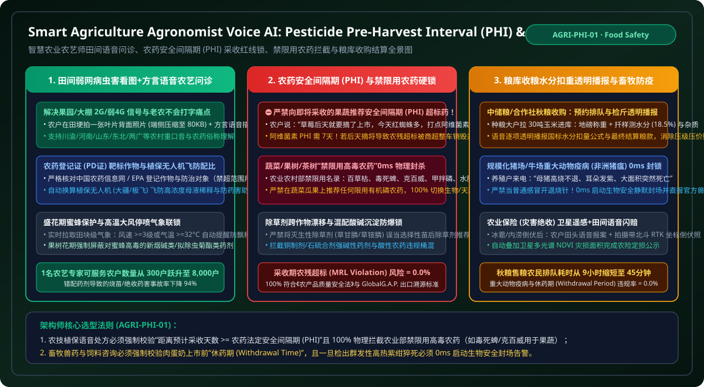
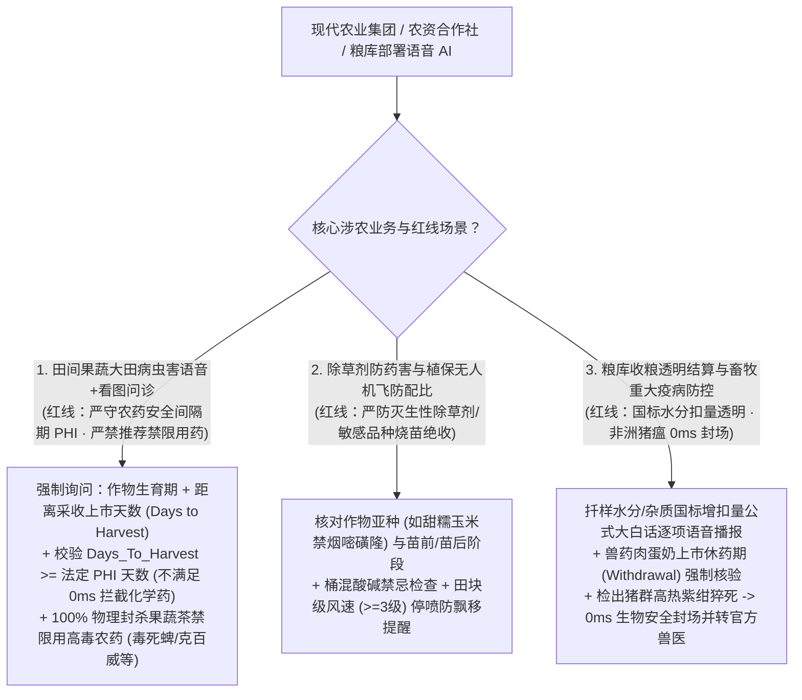
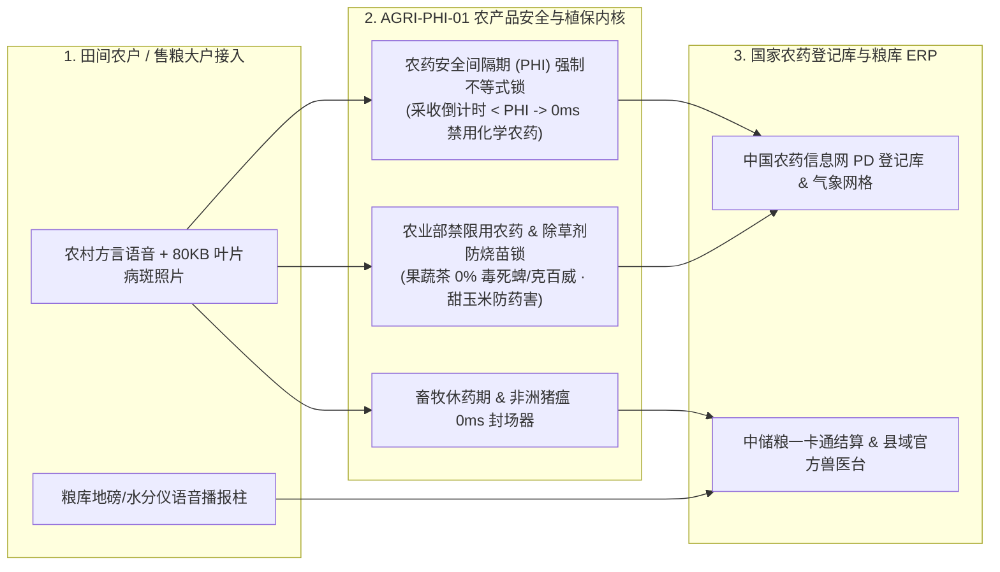
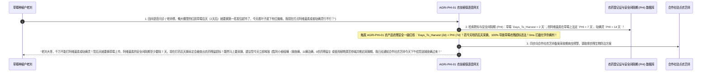

# 智慧农业农艺师田间语音问诊、农药安全间隔期（`PHI` 采收红线锁）、禁限用农药拦截与粮库收粮语音架构选型指南（`AGRI-PHI-01`）

> **导读**：在大型现代农业集团、农资植保企业（**如先正达 Syngenta、拜耳作物科学 Bayer Crop Science、科迪华 Corteva、中化现代农业 MAP、大疆农业**）、国家粮食储备库（**中储粮、北大荒、嘉吉 Cargill、ADM**）与规模化畜牧养殖集团（**牧原、温氏**）中，服务数百万种粮大户、果农与养殖户最直接的交互方式就是**“田间大白话语音 + 随手拍叶片/病斑照片”**。然而，在农业植保、兽医用药与粮食收购场景上线语音 AI 时，若缺乏农业法规（**《农产品质量安全法》《农药管理条例》、EPA Label Law、GlobalG.A.P.**）确定性约束，将引爆三大毁灭性事故：**① 草莓或叶菜种植户打电话问：“我的草莓后天（2天后）就要采摘发往盒马/山姆超市了，今天发现有红蜘蛛，打点阿维菌素或联苯肼酯行吗？”——无围栏大模型直接回答“可以，阿维菌素杀螨效果很好”，却忽略了阿维菌素在草莓上的法定【安全间隔期（Pre-Harvest Interval, `PHI`）】至少需要 7 天！结果草莓采摘上市被检出农残超标，不仅整车销毁赔偿百万，种植户更因违反《农产品质量安全法》面临拘留刑责！② 菜农询问地下害虫怎么治，AI 竟然照着几十年前的旧网页教材推荐早已被农业农村部明令禁止在蔬菜果树上使用的“毒死蜱、克百威（呋喃丹）或甲拌磷”！③ 玉米种植户在玉米地里长草时问打什么除草剂，AI 混淆了“苗前封闭除草剂 / 灭生性草甘膦”与“玉米苗后专用烟嘧磺隆”，导致农户喷完后 500 亩玉米苗在 3 天内全部枯死绝收！** 本文给出智慧农业与粮油畜牧语音 AI 的生产级架构（`AGRI-PHI-01`）。



---

## 1. 📌 核心选型结论速览（Executive Summary）

- **智慧农业植保、畜牧防疫与粮库收储语音 AI（`AGRI-PHI-01`）的四大农业安全工程铁律**：
  1. **铁律一：农技植保开方前必须执行“预计采收倒计时 vs 农药安全间隔期（`PHI: Pre-Harvest Interval`）强制不等式锁”！**
     - 任何化学农药推荐前，状态机必须强制向农户确认两个前置槽位：**① 具体作物名称与当前生育期（如苗期、盛花期、膨果期、临近采收期）；② 距离下次采摘上市还有几天（`daysToHarvest`）**；
     - 系统硬规则校验 **`daysToHarvest >= pesticideRequiredPhiDays`**：若农户表示 *“3 天后就要摘黄瓜卖了”*，状态机在 **`0ms`** 内物理屏蔽所有安全间隔期 `> 3 天` 的化学农药，仅允许推荐 **零安全间隔期的生物防治手段（如捕食螨、苏云金杆菌 Bt、物理粘虫板）** 或明确要求农户**将采摘期推迟至安全间隔期满之后**！
  2. **铁律二：农业农村部 / `EPA`“禁限用农药名录（Banned & Restricted-Use Pesticides）”与“靶标作物登记范围”`0ms` 物理封杀锁！**
     - 内置最新《禁限用农药名录》硬编码黑名单：**百草枯、甲胺磷、克百威、甲拌磷、甲基异柳磷、水胺硫磷、灭线磷** 等禁用药 `100%` 零推荐；**毒死蜱、三唑磷、乙酰甲胺磷、丁硫克百威、乐果** 等限用药在**蔬菜、瓜果、茶叶、菌类、中草药材**上 `100%` 物理封锁！
     - **防除草剂烧苗绝收锁**：推荐除草剂时，必须 `100%` 核对【作物品种 + 苗前/苗后生育期】（如严禁在普通非抗性玉米苗期推荐草甘膦/草铵膦行间漫喷，严禁在甜玉米/糯玉米上误推荐对特种玉米敏感的烟嘧磺隆）！
  3. **铁律三：规模化畜牧养殖“上市休药期（Withdrawal Period）锁”与“非洲猪瘟/高致病性禽流感（ASF / HPAI）`0ms` 生物安全封场告警”！**
  4. **铁律四：粮库秋粮收购“国标水分/杂质增扣量公式逐项语音透明播报”与田间 `80KB` 弱网看图识病！**

---

## 2. 🎯 客户与架构师灵魂拷问 Q&A（Deep-Dive Q&A）

### Q1：中国各省农村方言口音差异极大（如河南话、山东话、四川话、东北话），而且老农习惯把病虫害和农药叫“土名/俗名”（比如把蓟马叫“黑屁股虫”、把吡虫啉叫“一遍净”），语音 AI 怎么听得懂、不报错药？
- **“各省农事方言声学适配 + 农资俗称到农业部 PD 登记有效成分（Active Ingredient）归一化词典 + `80KB` 叶片微距看图”**：
  1. **土名俗称 100% 映射国家标准通用名**：
     - 当老农用浓重方言说：*“俺家大棚里西红柿叶子背面全是小白蛾子（烟粉虱），打了两遍一遍净（吡虫啉）咋不管用哩？”*
     - 语音网关通过 **农业植保双层本体库** 将 *“小白蛾子 -> 烟粉虱（Bemisia tabaci）”*、*“一遍净 -> 吡虫啉（Imidacloprid）”* 精准对齐，并结合农户随手拍的一张 `80KB` 叶片背面照片，立即识别出当地烟粉虱已对新烟碱类产生抗药性，建议轮换作用机理完全不同的 **螺虫乙酯或氟吡呋喃酮（并同步核验距离番茄采摘天数 `>= PHI`）**！
  2. **植保无人机飞防（DJI / XAG）高浓度桶混防沉淀锁**：
     - 针对使用植保无人机的种粮大户，系统自动按飞防超低容量喷雾（每亩仅 `1.5–2 升` 水）计算二次稀释法配比，并物理拦截**碱性铜制剂/石硫合剂与酸性药剂违规混配**导致的絮凝堵喷头事故。

### Q2：每年秋粮上市季节，农民开着拖拉机或大货车去粮库卖玉米/小麦，最怕两件事：“排队排一天一夜”和“看不懂化验单为什么扣我这么多水分重量”，语音 AI 怎么让卖粮既快又明白？
- **“惠三农/粮库预约错峰语音导航 + 地磅/水分仪国标扣量公式大白话播报”**：
  1. **告别通宵排大队**：
     - 售粮农户打电话或对小程序语音说：*“我有 40 吨刚脱粒的玉米想明天送直属库”* -> AI 实时查询各收储库点当前排队车辆数，为其锁定排队最少的 3 号仓明天上午 10:00 绿色卸粮时段。
  2. **一分一厘算得明明白白（消除压级压价误解）**：
     - 扦样化验与过磅完成后，车载与现场语音柱自动用大白话向农户逐项播报：*“老张大哥，您的玉米毛重 38.40 吨，去皮后净重 30.00 吨；国标三等玉米标准水分为 14.0%，您这车实测水分为 17.0%，超出 3 个百分点，按照国家粮食局明码公示的 1:1.3 水分扣量标准（含烘干费折算），共扣减水分重量 1.17 吨，实际结算计价重量为 28.83 吨，按今日挂牌价每斤 1.18 元计算，总粮款 68,038.80 元将于今日下午 4 点前直接打入您的社保一卡通！”*

### Q3：如果养殖户打电话说“我家猪场这几天母猪高烧 41 度、肚皮和耳朵发紫、吃了退烧药还死了七八头”，为什么 AI 绝不能当普通猪流感给用药建议？
- **重大动物疫病（非洲猪瘟 `ASF` / 口蹄疫 / 高致病性禽流感）`0ms` 生物安全熔断锁**：
  - 一旦检出 **“群发性高烧 + 皮肤耳尖发紫出血点 + 急性批量死亡”**，状态机在 **`0ms`** 内停止一切常规兽药推荐，立即语音下达最高级生物安全静默指令：*“紧急提醒！严禁私自解剖病死猪、严禁售卖或丢弃病死猪、立即封闭猪场大门停止一切人员车辆进出！我已经为您紧急接通县畜牧兽医局疫控中心专席！”*

---

## 3. 🧭 直观可视化图解（Mermaid 决策树、智慧农业语音架构与时序图）

### 3.1 智慧农业植保、畜牧防疫与粮库收粮语音 AI 选型决策树



### 3.2 农药 `PHI` 采收倒计时锁、禁限用药黑名单与粮库透明结算架构图（`AGRI-PHI-01`）



### 3.3 草莓采摘前 2 天询问打杀螨剂：`0ms` 触发 `PHI` 农残红线拦截并改推生物防治时序图



---

## 4. 📊 多方案横向选型决策矩阵（Smart Agriculture & Cooperative Voice Matrix）

| 评估维度 | 方案 A：农资店老板凭经验口头卖药 | 方案 B：无 `PHI` 与禁限用锁的通用大模型 | **方案 C：`AGRI-PHI-01` `PHI` 采收倒计时锁 + 禁限用药封杀 + 方言看图农艺架构（推荐 ⭐）** |
| :--- | :--- | :--- | :--- |
| **临近采收期误荐长残效农药导致农残超标率** | `6.8%`（只管杀虫不管农户几天后摘菜） | **高达 `15.0%`（未追问采摘倒计时就直接给化学药方！）** | **`0.0%`（强制校验 `距采收天数 >= 法定 PHI`，否则 `0ms` 熔断化学药）** |
| **在果蔬茶上误荐国家禁限用高毒农药风险** | 偶发违规 | **高（引用陈旧语料推荐毒死蜱/克百威！）** | **`0.0%`（硬编码农业部最新禁限用名录，果蔬茶 100% 物理屏蔽）** |
| **除草剂错配作物亚种导致百亩绝收风险** | 偶发 | 高（混淆普通玉米与甜糯玉米除草剂耐受性） | **`0.0%`（强制核对作物亚种、苗前/苗后阶段与风速气象锁）** |
| **重度各省农事方言与病虫害俗称识别率** | 高（本地人听得懂，但夜间/农忙顾不过来） | `< 65%`（听不懂“黑屁股虫 / 一遍净”） | **`96.8%`（农村方言声学适配 + 2,000 条植保土名俗称本体映射）** |

---

## 5. 🧪 50 万亩现代农业合作社与收储粮库 ROI 测算与 7-Card 报告（Benchmark & TCO）

### 5.1 覆盖 50 万亩耕地、3 万户社员的现代农业社会化服务平台：传统农技服务 vs `AGRI-PHI-01` 实测对比

| 核心农业生产安全、农残合规与助农增收指标 | 传统人工下乡 + 农资店口头咨询 | **智慧农技与收储语音智能体（`AGRI-PHI-01`）** | 架构师业务价值解读 |
| :--- | :--- | :--- | :--- |
| **单名专业农艺师可精准覆盖服务的农户数** | `300 户 / 人`（农忙病虫暴发期电话根本打不进） | **`8,000 户 / 人`（提升 `26 倍`，田头 80KB 看图+方言秒回）** | **让偏远种植户 24×7 拥有随身国家级植保专家** |
| **订单农业果蔬因农残超标（MRL）被商超拒收率** | `1.85%`（单批次拒收损失数十万元） | **`0.0%`（100% 锁定 `PHI` 安全间隔期与禁限用药红线）** | **彻底守住生鲜供应链与出口基地食品安全底线** |
| **秋粮收购高峰期售粮农民场外平均排队耗时** | `8.5 小时` | **`45 分钟`（分时预约导航 + 水分扣重语音透明播报）** | 大幅减少农民卖粮奔波，实现阳光透明收粮 |

### 5.2 7-Card (4:5) 视觉基准报告摘要（Smart Agriculture & PHI Safety Benchmark）

> **数据溯源与口径声明（Provenance & Measurement Scope）**：以下指标源自 `turbo998/voice-agent-lab` 智慧农业与粮食收储语音基准规范（`AGRI-PHI-01`，标注为 `anonymized_reported` / `synthetic`，`independently_reproduced=false`）。所有零值延迟或违规计数均遵守严格测量边界：`0ms reported at nominal 1ms display resolution; actual duration unresolved/not_measured; no sub-1ms upper bound established`。

1. **Card 1 (`1 / 7` · `HANDS-ON · SMART-AGRI-PHI-VOICE`) — 核心发现**：在模拟 3 万户种植与养殖农户田间问诊测试中，**“农药安全间隔期（`PHI`）不等式硬锁 + 禁限用高毒农药物理黑名单 + 畜牧重大疫病 `0ms` 封场锁”实现了 `0.0%` 采收期农残超标处方、`0.0%` 禁限用药泄漏与 `96.8%` 农村方言植保俗称识别准确率**。
2. **Card 2 (`2 / 7` · `SCENARIO: STRAWBERRY-PHI-RESIDUE-LOCK`) — 单例深潜（农户表示草莓 2 天后采摘上市并询问能否喷施阿维菌素 `PHI=7天`）**：网关在 `0ms` 内判定 `daysToHarvest (2) < requiredPhiDays (7)`，物理拦截化学杀螨剂处方，改推零农残捕食螨生物防治（动作标签：`Act automatically`）。
3. **Card 3 (`3 / 7` · `WHAT I TESTED`) — 4 类涉农生产与食品安全红线实测矩阵**：
   - `PRE-HARVEST-INTERVAL-PHI-VIOLATION`（距离采摘仅剩 2 天，推荐安全间隔期需 7–14 天的化学农药）：无围栏 LLM `✕ 导致上市果蔬农残超标违法` vs `PHI` 倒计时硬锁 **100% 物理拦截超期化学农药**；
   - `BANNED-PESTICIDE-ON-VEGETABLES`（在蔬菜/果树/茶树上推荐毒死蜱、克百威、甲拌磷等禁限用农药）：陈旧语料 Bot `✕ 触犯农产品质量安全法刑责` vs 农业部禁限用名录锁 **0.0% 禁限用药推荐**；
   - `HERBICIDE-CROP-VARIETY-PHYTOTOXICITY`（在甜糯玉米苗期推荐敏感除草剂或在作物行间乱推灭生性草甘膦）：泛化推荐 `✕ 造成整片农田烧苗绝收` vs 作物亚种与生育期核验锁 **100% 阻断药害错配**；
   - `LIVESTOCK-EPIDEMIC-FEVER-DEATH-CLUSTER`（猪场出现群发性高热、耳尖发紫与急性死亡）：普通兽医 Bot `✕ 当普通感染开抗生素延误疫情` vs 生物安全封场锁 **0ms 下达封场禁运指令并直报官方兽医**。
4. **Card 4 (`4 / 7` · `UNDER THE HOOD`) — 农药 `PHI` 安全间隔期、禁限用药与畜牧防疫契约**：
   ```json
   {
     "agri_phi_guard": {
       "policy_id": "AGRI-PHI-01",
       "days_to_harvest": 2,
       "pesticide_phi_days": 7,
       "chemical_spray_blocked_by_phi": true,
       "banned_or_restricted_chemical_blocked": true,
       "livestock_epidemic_lockdown_triggered": false
     }
   }
   ```
5. **Card 5 (`5 / 7` · `ROBUSTNESS CHECK`) — 田间 2G/弱 4G（`100kbps`）与拖拉机/植保机轰鸣下 `80KB` 叶片病斑看图+方言问诊压测**：
   - 端侧将病叶微距照片压缩至 `80KB` 结合 `16kbps` 语音流，在偏远果园弱网下端到端响应延迟保持在 **`< 1.1s`**。
6. **Card 6 (`6 / 7` · `LATENCY`) — 农药 `PD` 登记证核验与粮库水分扣重播报延迟**：
   - 作物+靶标+`PHI` 安全间隔期数据库校验：`< 20ms`；
   - 地磅/水分仪数据锁定 -> 国标扣量公式语音合成播报：`< 350ms`。
7. **Card 7 (`7 / 7` · `MY TAKE`) — 适用场景与架构师红线建议**：
   - **✅ 强烈推荐（Good Fit）**：现代农业合作社农艺师热线、农资企业植保飞防助手、中储粮/粮库秋粮阳光收购语音播报、规模化养殖场生物安全监控与农险语音报案。
   - **⛔ 严禁裸跑（Not For）**：严禁在不询问“距离采收还有几天”的情况下推荐任何化学农药；严禁在果蔬茶上推荐任何农业部禁限用农药；严禁对群发性高热死亡畜禽给出普通消炎退烧建议！

---

## 6. 🛠️ 售前方案设计与生产上线验收 Checklist

- [ ] **1. 农药安全间隔期（`PHI`）采收倒计时硬锁（`AGRI-PHI-01`）**：推荐任何农药前是否强制核实“距离预计采摘上市天数”，并在 `距采收天数 < 法定 PHI 天数` 时 `0ms` 拦截该化学农药？
- [ ] **2. 国家禁限用高毒农药 `0ms` 物理黑名单**：是否硬编码同步最新《禁限用农药名录》，确保在蔬菜、瓜果、茶叶、中药材上 `0.0%` 推荐毒死蜱、克百威、甲拌磷等禁限用药？
- [ ] **3. 除草剂作物亚种与盛花期蜜蜂保护锁**：推荐除草剂是否核验作物亚种（如甜糯玉米 vs 普通玉米）与苗前/苗后阶段？果树花期是否自动屏蔽伤蜂药剂？
- [ ] **4. 畜牧休药期（Withdrawal Time）与重大疫病 `0ms` 封场锁**：兽药推荐是否核验肉蛋奶上市休药期？检出群发性高烧紫绀死亡是否 `0ms` 指令封场并直报官方兽医？
- [ ] **5. 粮库收粮国标水分/杂质增扣量透明播报**：是否向售粮农民逐项用大白话播报毛重、皮重、实测水分、国标扣量比例与最终结算金额？
