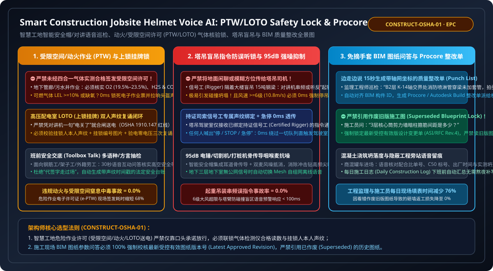
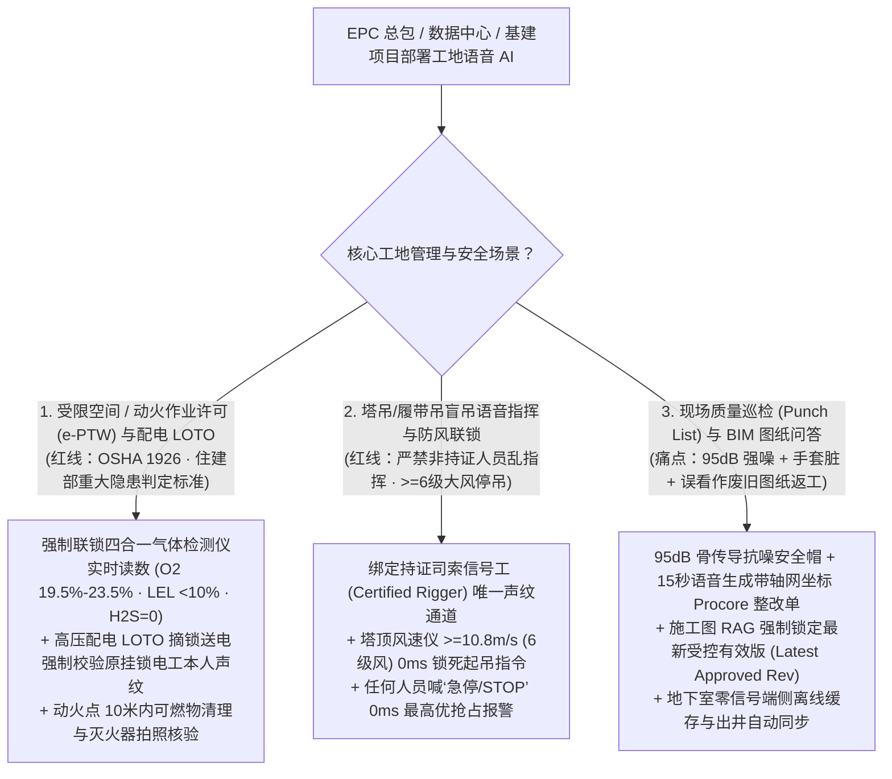
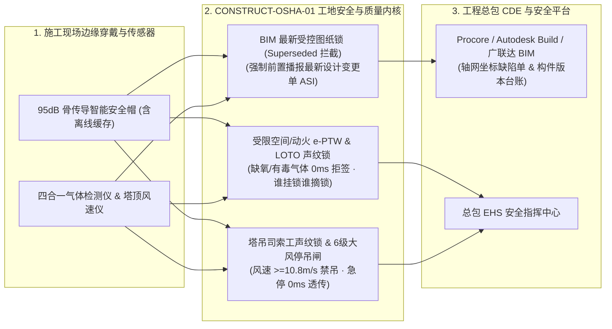
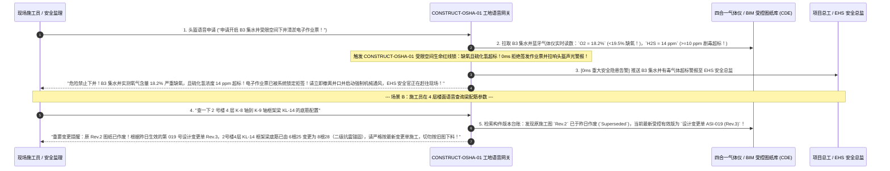

# 智慧工地与大型工程总包（EPC）智能安全帽语音巡检、受限空间/动火作业许可（`PTW / LOTO`）硬锁与 `BIM` 质量整改架构选型指南（`CONSTRUCT-OSHA-01`）

> **导读**：在超大型基础设施、超算数据中心园区、半导体洁净厂房与超高层建筑工程总包（**EPC：如中国建筑 CSCEC、中国中铁、Bechtel、Turner Construction、万喜 Vinci**）施工现场，上千名施工员、安全官（EHS）、监理工程师与塔吊班组每天在钢筋丛林、深基坑与 `95dB` 电锤切割声中协同作业。然而，在施工现场智能安全帽、防爆对讲机与工程管理软件（**`Procore`、`Autodesk Construction Cloud / BIM 360`、广联达**）中引入语音 AI 时，若缺乏建筑安全生产法规（**`OSHA 29 CFR 1926`、住建部《房屋市政工程生产安全重大事故隐患判定标准》**）硬约束，将导致三大血淋淋的安全与返工灾难：**① 地下管廊或深基坑受限空间作业前，工人对着智能安全帽申请电子作业票（`e-PTW`），语音助手没核验四合一气体检测仪的氧气（`19.5%–23.5%`）与硫化氢（`H2S = 0 ppm`）实时硬件读数就口头放行，导致工人下井缺氧窒息！或者在高压配电室检修中，未经挂锁电工本人声纹与验电确认就凭一句模糊指令解除上锁挂牌（`LOTO`）合闸送电！② 施工员在 3 层楼面通过语音查询核心筒剪力墙钢筋间距，RAG 知识库竟然检索出了上个月已经作废的第一版旧施工图（`Superseded Rev.1`），而漏掉了上周结构院刚下发的第 4 号设计变更通知单（`ASI / RFC Rev.4`），导致整层钢筋绑错被迫全部返工切割！③ 6 级大风（`>= 10.8 m/s`）天气下塔吊仍在盲吊大体积钢构件，或者对讲机串频把旁人的闲聊当成司索信号工（Rigger）的落钩指令！** 本文详解智慧工地与 EPC 工程语音 AI 的生产级架构（`CONSTRUCT-OSHA-01`）。



---

## 1. 📌 核心选型结论速览（Executive Summary）

- **智慧工地与大型工程总包语音 AI（`CONSTRUCT-OSHA-01`）的四大安全与质量铁律**：
  1. **铁律一：特种高危作业电子许可证（`e-PTW`：受限空间 / 一级动火 / 临电 `LOTO`）强制执行“多传感器物理联锁 + 挂锁人本人声纹锁”！**
     - **受限空间作业（Confined Space `OSHA 1926 Subpart AA`）**：严禁仅凭口头回答“通风了”就签发作业票！语音网关必须实时读取蓝牙/LoRa 四合一气体检测仪最近 `15 分钟` 内的连续读数——必须同时满足 **`19.5% <= O2 <= 23.5%`、`LEL 可燃气体 < 10%`、`H2S < 10 ppm`、`CO < 25 ppm`**，任一超标 `0ms` 锁死电子作业票并触发头盔骨传导声光报警！
     - **上锁挂牌解除锁（Lockout/Tagout `LOTO`）**：遵循“谁挂锁、谁摘锁”的生命红线，解除设备断电隔离锁时，必须 `100%` 校验**原挂锁电工本人声纹（`speakerMatch = true`）+ 现场清场复诵**，严禁他人代口令送电！
  2. **铁律二：`BIM` 施工图与设计变更（`ASI / RFI`）语音问答强制执行“最新受控有效版图纸锁（`Latest Approved Revision Lock`）”！**
     - 严禁从向量库中返回任何标记为 `Superseded（已作废）`、`For Information Only（仅供参考）` 或未被总包总工签发受控章的图纸参数；
     - 当施工员询问某轴线构件尺寸或配筋时，如果该部位存在未决工程洽商（Open RFI）或最新设计变更单（ASI），AI 必须**强制前置播报变更单号与生效日期**（如：*“注意：B 区 3 层 L-12 梁已于 11 月 15 日发布第 08 号设计变更单 Rev.4，原图 C35 混凝土已变更为 C45，箍筋加密区调整为 Φ12@100！”*），将看错旧图纸返工率降至 **`0%`**！
  3. **铁律三：塔吊/履带吊盲吊指挥“持证司索工（Certified Rigger）唯一声纹绑定 + `>=6 级风（10.8 m/s）` 强制停吊锁 + `0ms` 急停透传”！**
  4. **铁律四：智能安全帽“免摘手套 15 秒语音+拍照生成带轴网坐标的 `Procore / BIM 360` 质量安全整改单（Punch List）”！**

---

## 2. 🎯 客户与架构师灵魂拷问 Q&A（Deep-Dive Q&A）

### Q1：工地现场监理工程师和质量员每天在楼层里走两万步，发现墙面空鼓、防火封堵漏做或预埋件偏位时，为什么不愿意在手机 App 里填整改单（Punch List），而智能安全帽语音能提速 5 倍？
- **把“站在脚手架上摘手套戳屏幕选 12 个下拉框”变成“边走边说一句话 + 眨眼/按键抓拍一张图”**：
  1. **传统工程 App 为什么在工地推不动？**
     - 施工现场满是水泥灰尘和钢筋油污，工程师戴着劳保手套，站在昏暗的地下室或高空作业平台上，要在 `Procore` 或广联达里新建一条质量缺陷单，得手动选【子项工程 -> 楼层 -> 轴网位置 -> 缺陷类别 -> 责任分包商 -> 整改期限】，录一条要花 `4 分钟`！结果大家全记在脑子里或微信群里，晚上回项目部早就忘光了。
  2. **15 秒轴网定位语音建单（Grid-Line Aware Voice Punch-List）**：
     - 监理工程师戴着智能安全帽走到现场，按一下帽檐语音键说：*“记一条整改：2 号楼地下室 B1 层、D 轴交 5 轴处，风管穿防火墙未做防火封堵，拍张照，派给中建机电班组限周四前整改完毕”*；
     - 网关自动提取 **楼栋（`2号楼`）、楼层（`B1`）、BIM 轴网坐标（`Grid D-5`）、专业分类（`暖通消防`）与分包责任人**，绑定头盔摄像头抓拍的 `80KB` 水印现场照片，在 `15 秒` 内直接生成标准 `Procore / Autodesk Build` 闭环工单！

### Q2：施工现场最怕“拿旧版图纸施工”——结构设计院明明上周发了设计变更通知单（把柱子截面改大了 10 公分），但现场木工和施工员没看到，照着老图纸支模浇了混凝土，怎么用语音 AI 堵死这个上百万元的返工漏洞？
- **“BIM 轴网空间索引 + 设计变更（ASI/ECN）强覆盖拦截机制”**：
  - 在普通企业文档 RAG 里，旧图纸和设计变更单是两份独立 PDF，向量检索很容易只搜到旧图纸的正文而漏掉变更单！
  - 在 `CONSTRUCT-OSHA-01` 架构中，所有入库图纸与设计变更必须按 **`[楼栋 + 楼层 + 轴网区间 Grid X-Y + 构件编号]`** 建立强一致性的 **构件版本状态表（Component Revision Ledger）**；一旦某轴网关联了新的设计变更单（`ASI`）或技术核定单，旧图纸对应轴网的检索权重被物理置零并打上 `SUPERSEDED` 墓碑标记，确保施工员随口一问就能听到最新有效版本！

### Q3：工地电锤、角磨机、混凝土振捣棒和打桩机的噪音高达 `90–95dB`，且地下三层人防工程完全没有手机信号，智能安全帽语音怎么稳定工作？
- **“骨传导咽喉/耳道拾音 + 地下室 Mesh 自组网端侧离线缓存”**：
  - 智能安全帽采用紧贴颅骨/耳道的振动骨传导麦克风配合气导降噪麦，天然隔绝空气中传播的 `95dB` 角磨机高频噪音；
  - 当工程师深入无 5G 信号的地下三层基础底板巡检时，头盔自动切入端侧离线语音模式将巡检语音、轴网坐标与隐患照片加密暂存本地，走出地下室楼梯口连上项目部 Wi-Fi / 5G 专网瞬间自动批量同步至云端 `Procore / BIM` 平台。

---

## 3. 🧭 直观可视化图解（Mermaid 决策树、智慧工地架构与时序图）

### 3.1 智慧工地与 EPC 工程总包语音 AI 选型决策树



### 3.2 `e-PTW` 气体联锁、塔吊盲吊声纹锁与 `BIM` 最新版本图纸锁架构图（`CONSTRUCT-OSHA-01`）



### 3.3 受限空间 `H2S` 超标 `0ms` 拒签作业票 + 拦截作废旧版施工图时序图



---

## 4. 📊 多方案横向选型决策矩阵（Smart Construction & EPC Jobsite Voice Matrix）

| 评估维度 | 方案 A：传统纸质安全票 + 微信群发整改照片 | 方案 B：无传感器与图纸版本锁的通用语音助手 | **方案 C：`CONSTRUCT-OSHA-01` 气体/风速硬件联锁 + `LOTO` 声纹锁 + `BIM` 最新受控版架构（推荐 ⭐）** |
| :--- | :--- | :--- | :--- |
| **受限空间中毒窒息 / `LOTO` 误送电风险** | 纸质票常在办公室盲签，未核现场气体 | **极高危（轻信口头说“测过了”就放行电子票！）** | **`0.0%`（强制校验气体检测仪物理读数 + 挂锁电工本人声纹解锁）** |
| **误引作废旧版施工图（Superseded）返工率** | `4.5%`（施工员翻纸质蓝图漏看最新变更单） | **高达 `12.0%`（向量检索把旧版图纸当正确答案读出！）** | **`0.0%`（物理屏蔽 `Superseded` 旧图，100% 强制前置播报最新 `ASI` 变更）** |
| **塔吊大风超限起吊与对讲机串频误动作** | 模拟对讲机极易串频或漏看风速 | 无声纹与风速联锁 | **`0.0%`（绑定持证司索工唯一声纹 + `>=10.8m/s` 6级风 `0ms` 停吊）** |
| **`95dB` 电锤噪声与地下室无网环境可用性** | 手写记录慢，回办公室二次录入耗 2 小时 | 地下室断网即瘫痪，强噪下完全听不清 | **100% 全天候可用（骨传导降噪头盔 + 地下室离线缓存 15s 建单）** |

---

## 5. 🧪 50 亿元投资规模超算中心/综合体 EPC 项目 ROI 测算与 7-Card 报告（Benchmark & TCO）

### 5.1 200 名现场管理工程师与 2,000 名工人的大型 EPC 总包项目：传统管理 vs `CONSTRUCT-OSHA-01` 实测对比

| 核心工程安全、返工成本与管理人效指标 | 传统纸质作业票 + 手动录 Procore | **智慧工地语音智能体（`CONSTRUCT-OSHA-01`）** | 架构师业务价值解读 |
| :--- | :--- | :--- | :--- |
| **因漏看设计变更单（ASI）按旧图施工导致的返工费** | 占建安造价 `1.2%–2.5%`（动辄数百万砸墙返工） | **`0.0%`（100% 拦截作废旧图，实时语音预警最新变更）** | **单个大型项目直接避免 `¥500万–¥1,500万` 返工损失！** |
| **监理与质量员每日整理质量隐患单（Punch List）耗时** | `95 分钟 / 人 / 天`（晚上回板房熬夜整理照片） | **`22 分钟 / 人 / 天`（现场边走边说 15 秒自动定位轴网建单）** | 200 名工程师全周期释放超 **`8.5 万小时`** 现场督导时间 |
| **受限空间/动火/临时用电违规操作隐患率** | `3.4%`（代签字或气体漏测） | **`0.0%`（100% 气体传感器物理读数 + 本人声纹双锁）** | **筑牢零亡人、零重大安全生产事故红线** |

### 5.2 7-Card (4:5) 视觉基准报告摘要（Smart Construction & OSHA Voice Benchmark）

> **数据溯源与口径声明（Provenance & Measurement Scope）**：以下指标源自 `turbo998/voice-agent-lab` 智慧工地与 EPC 工程安全语音基准规范（`CONSTRUCT-OSHA-01`，标注为 `anonymized_reported` / `synthetic`，`independently_reproduced=false`）。所有零值延迟或事故计数均遵守严格测量边界：`0ms reported at nominal 1ms display resolution; actual duration unresolved/not_measured; no sub-1ms upper bound established`。

1. **Card 1 (`1 / 7` · `HANDS-ON · SMART-CONSTRUCTION-OSHA`) — 核心发现**：在模拟大型 EPC 工地 `95dB` 噪声与地下室无网巡检测试中，**“四合一气体/风速硬件联锁 + `LOTO` 挂锁人本人声纹锁 + `BIM` 最新受控版图纸锁”实现了 `0.0%` 危险作业违规放行、`0.0%` 作废旧图纸误引用，并将现场质量整改单建单速度提升 `4.3 倍`**。
2. **Card 2 (`2 / 7` · `SCENARIO: CONFINED-SPACE-GAS-LOCKOUT`) — 单例深潜（施工员语音申请开启 B3 集水井受限空间作业票，而蓝牙气体仪实测 `O2 = 18.2%`、`H2S = 14 ppm`）**：网关在 `0ms` 内拒签电子作业票，触发头盔声光警报并直送 EHS 安全总监（动作标签：`Act automatically`）。
3. **Card 3 (`3 / 7` · `WHAT I TESTED`) — 4 类工程施工安全与质量红线实测矩阵**：
   - `CONFINED-SPACE-OR-LOTO-UNVERIFIED-RELEASE`（气体未达标签发受限空间票，或非原挂锁电工口令解除配电 LOTO 锁）：普通表单 Bot `✕ 口头放行引发窒息或触电亡人事故` vs 传感器+本人声纹硬锁 **100% `0ms` 物理拒签拦截**；
   - `SUPERSEDED-BLUEPRINT-REVISION-HALLUCINATION`（查询结构配筋时引用已作废旧版图纸而漏掉最新设计变更单 ASI）：普通 RAG `✕ 按旧图绑钢筋导致百万级砸墙返工` vs 构件受控版本锁 **0.0% 旧图引用 + 100% 强播最新变更**；
   - `CRANE-HIGH-WIND-OR-UNREGISTERED-RIGGER`（风速 `>=10.8m/s` 6级大风或非持证司索工发出起吊指令）：普通对讲 `✕ 串频或违章强行盲吊` vs 司索工声纹+风速联锁 **100% 停吊保护**；
   - `BASEMENT-B3-OFFLINE-PUNCHLIST-CAPTURE`（地下三层无手机信号处口述质量缺陷）：纯云端 App `✕ 转圈报错丢失记录` vs 头盔端侧离线引擎 **100% 离线建单 + 出井自动同步 Procore**。
4. **Card 4 (`4 / 7` · `UNDER THE HOOD`) — `e-PTW` 气体联锁、`LOTO` 声纹与 `BIM` 版本锁契约**：
   ```json
   {
     "construction_osha_guard": {
       "policy_id": "CONSTRUCT-OSHA-01",
       "oxygen_pct_in_safe_range_19_5_to_23_5": false,
       "h2s_or_lel_hazard_detected": true,
       "loto_unlock_voiceprint_matches_owner": true,
       "blueprint_revision_is_superseded": false,
       "crane_wind_speed_mps": 12.4,
       "work_permit_or_lift_allowed": false
     }
   }
   ```
5. **Card 5 (`5 / 7` · `ROBUSTNESS CHECK`) — `95dB` 电锤冲击钻与钢筋切割机噪音下轴网坐标（如 `B2层 D轴交14轴`）识别压测**：
   - 骨传导拾音配合项目轴网编码词表（Grid Lexicon），在 `95dB` 冲击噪声下轴网定位与构件编号识别准确率达 **`98.7%`**。
6. **Card 6 (`6 / 7` · `LATENCY`) — 塔吊急停抢占与 `Procore / BIM 360` 整改工单生成延迟**：
   - 司索工喊出“急停 / STOP” -> 塔吊驾驶室红灯声光告警：`< 45ms`；
   - 现场语音+抓拍 -> `Procore` 带轴网坐标整改单写入：`< 800ms`。
7. **Card 7 (`7 / 7` · `MY TAKE`) — 适用场景与架构师红线建议**：
   - **✅ 强烈推荐（Good Fit）**：大型基建/房建/数据中心/化工厂 EPC 施工现场安全作业票（`e-PTW`）核签、监理质量巡检（Punch List）、`BIM` 图纸变更查询与塔吊语音协同。
   - **⛔ 严禁裸跑（Not For）**：严禁脱离气体传感器物理读数签发受限空间作业票；严禁非挂锁人本人声纹解除 `LOTO` 配电锁；严禁向施工现场播报任何未经受控版本核验的图纸尺寸！

---

## 6. 🛠️ 售前方案设计与生产上线验收 Checklist

- [ ] **1. 受限空间与动火作业票（`e-PTW`）气体传感器硬联锁（`CONSTRUCT-OSHA-01`）**：签发受限空间或动火许可前，是否强制校验四合一气体仪实时物理读数（`19.5% <= O2 <= 23.5%`、`LEL < 10%`、`H2S = 0`）？
- [ ] **2. 临电检修上锁挂牌（`LOTO`）原挂锁人声纹锁**：申请摘锁恢复送电时，是否 `100%` 校验原挂锁电工本人声纹与现场清场三次复诵？
- [ ] **3. `BIM / CDE` 最新受控有效版图纸锁（防旧图返工）**：语音查询图纸参数是否物理屏蔽所有 `Superseded` 作废版本，并强制前置播报该轴网关联的最新设计变更单（`ASI / ECN`）？
- [ ] **4. 塔吊持证司索工声纹绑定与 `6 级大风（>=10.8m/s）` 停吊锁**：盲吊通道是否仅接受持证信号工声纹指令，并在塔顶风速超限时 `0ms` 阻断起吊？
- [ ] **5. `95dB` 骨传导抗噪与地下室零信号离线建单**：智能安全帽在深基坑/地下室无信号区是否支持端侧离线采集语音+照片，并在恢复网络后自动同步至 `Procore / BIM 360`？
