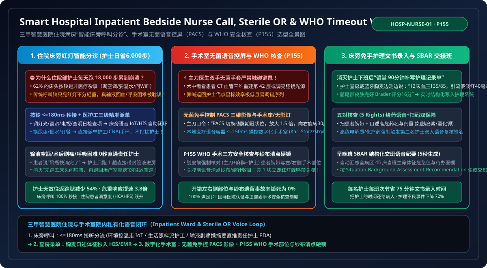
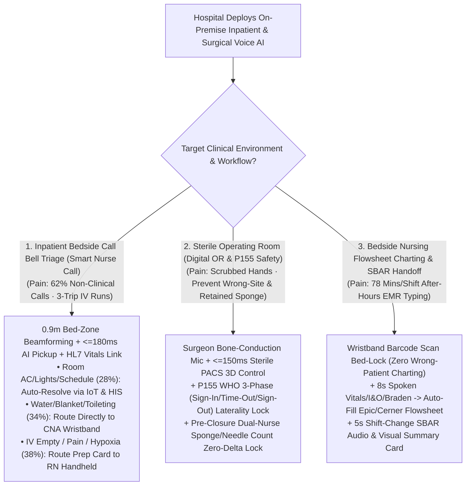
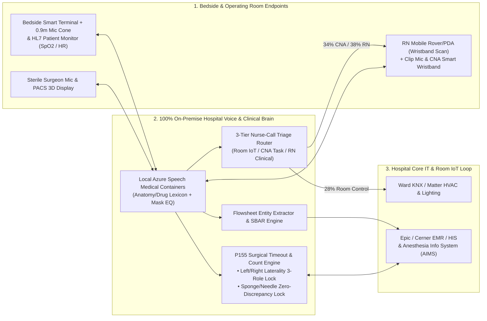
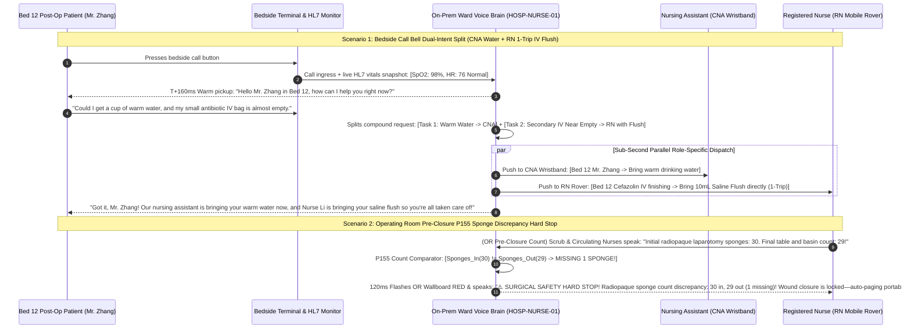

# Smart Hospital Inpatient Bedside Nurse Call, Sterile Operating Room (`OR`) PACS Control & WHO Surgical Safety Timeout (`P155`) Selection Guide (`HOSP-NURSE-01` / `P155` / `P739`)

> **Executive Guide**: Beyond outpatient pre-triage and in-clinic ambient scribes (covered in our *Healthcare Clinical Triage & Ambient Scribe Guide*), Chief Nursing Officers (CNOs), Chiefs of Surgery, and Hospital CIOs face three acute operational crises inside **Inpatient Wards, ICUs, and Digital Operating Rooms**: **1) The "Bedside Call-Bell Burnout" Crisis: In a 50-bed inpatient unit, the call bell rings 300+ times a day. Because legacy nurse-call systems only flash a red hallway light without context, registered nurses (`RNs`) walk 18,000 steps per shift—only to discover that 62% of call-bell presses are non-clinical requests (*"Turn up the thermostat"*, *"Bring me warm water"*, *"What's the Wi-Fi password?"*); and when a patient calls because their IV bag is empty, the nurse must walk to the room to ask what they need, walk back to the med room for a saline flush, and walk back to the bed (3 trips for 1 task)! 2) Sterile Operating Room (`OR`) Control & Never-Event Prevention (`P155`): Scrubbed surgeons cannot touch non-sterile keyboards to rotate 3D PACS CT slices mid-surgery, and fatigued verbal surgical counts occasionally miss wrong-site laterality or a retained surgical sponge! 3) Nurses spend 78 minutes after every shift typing vital signs, intake/output (`I&O`), and SBAR handoff notes into Epic/Cerner!** Written for Healthcare IT & Clinical Solution Architects, this guide delivers the 100% on-premise voice architecture (`HOSP-NURSE-01`).



---

## 1. 📌 Executive Summary

- **Three Architectural Laws for Inpatient Wards & Surgical Operating Rooms (`HOSP-NURSE-01`)**:
  1. **Law 1: Upgrade Bedside Call Bells to "`<= 180ms` AI Voice Triage + 3-Tier `IoT / CNA / RN` Smart Routing" (Eliminating 54% of Wasted Nurse Walking)!**
     - When an inpatient presses the bedside call button or speaks *"Call nurse"*, the bedside smart terminal answers in **`<= 180ms`** while checking live bedside patient-monitor telemetry (`HL7 / IEEE 11073 SpO2 & HR`);
     - **3-Tier Clinical & Non-Clinical Routing**:
       - **Tier A (Room Environment & Schedule FAQ — `28%` of calls, `0` Staff Walk)**: *"It's cold in here, set AC to 74°F and close the blinds"* or *"When is my MRI tomorrow and can I drink water?"* $\rightarrow$ Resolved automatically via **Room KNX/Matter IoT** and **HIS Order Lookup** (*"Your abdominal MRI is at 8:30 AM tomorrow—please stay NPO after 10 PM tonight"*);
       - **Tier B (Daily Living Assistance — `34%` of calls, Routed Directly to Nursing Assistant `CNA`)**: *"I need fresh ice water / help to the restroom / extra blanket"* $\rightarrow$ Pushed directly to the **Certified Nursing Assistant (`CNA`) wristband** without interrupting the Registered Nurse (`RN`);
       - **Tier C (Clinical Nursing & Acute Symptoms — `38%` of calls, One-Trip `RN` Dispatch)**: *"My antibiotic IV bag is beeping empty"* $\rightarrow$ Pushes a specific prep card to the **RN's mobile handheld (`[Bed 12 | Cefazolin IV Empty -> Bring 10mL Saline Flush]`)** so the nurse makes **1 trip instead of 3**! If acute red flags (*"short of breath"*, *"chest pain"*, or monitor `SpO2 < 92%`) are detected, it triggers a **`0ms` Code-Blue / Rapid-Response Breakthrough**!
  2. **Law 2: Digital Operating Rooms (`OR`) Require "Sterile Hands-Free PACS Voice Control (`<= 150ms`) + `P155` WHO Surgical Timeout & Sponge-Count Hard Interlock"!**
     - **Sterile PACS Manipulation**: Wearing sterile gloves, the lead surgeon speaks behind a double surgical mask (*"PACS assistant, switch to arterial-phase coronal view, zoom 1.5x, rotate 30 degrees clockwise"*), executed locally in **`<= 150ms`** via on-premise `Azure AI Speech Containers`;
     - **`P155` Never-Event Prevention (`Joint Commission Universal Protocol` & `AORN` Count Lock)**:
       - Enforces mandatory 3-role vocal verification (`Surgeon + Anesthesiologist + Circulating Nurse`) of patient identity and **exact Left/Right surgical site laterality** before skin incision;
       - Before wound closure, tracks spoken instrument and radiopaque sponge counts (` sponges_in == 30 vs. sponges_out == 29`): **even a 1-sponge discrepancy triggers an immediate red OR wallboard lock and auto-orders an intraoperative C-arm X-ray!**
  3. **Law 3: Bedside Nursing Documentation Uses "Barcode Wristband Scan Bed-Lock + 10-Second Spoken Vitals/I&O -> Epic/Cerner Flowsheet Sync (`Saves 75 Mins/Shift`)"!**

---

## 2. 🎯 Architect & Customer Deep-Dive Q&A

### Q1: In a semi-private 3-bed hospital room with visitors chatting and TVs playing, how do we prevent the Bed 12 call terminal from picking up Bed 11's conversation—and what if a post-op patient presses the call button but is too weak to speak?
- **0.9-Meter Acoustic Beam Cone + Bedside Vital-Monitor Preemption**:
  1. **Tight Bed-Zone Beamforming (`-20dB` Neighbor Attenuation) + Antimicrobial Pillow Speaker**: The headwall array focuses a narrow `0.9m` acoustic cone directly over the patient's pillow (ignoring adjacent beds 1.5m away), complemented by the handheld pillow-speaker mic.
  2. **Silent Press + `HL7 SpO2 / HR` Vital Fusion (`Zero Hang-Up on Weak Patients`)**:
     - If a post-op patient presses the call button and says nothing (or only whispers/gasps) for 3 seconds, the orchestrator **never closes the call**! It immediately checks the bedside physiological monitor (`SpO2`, `HR`, `Resp_Rate`, `Bed_Exit_Load_Cell`) and opens a live high-gain listen-in channel at the nurse station, flagging a **Priority-1 Bedside Check** if `SpO2 < 92%` or bed-exit sensors indicate a fall risk!

### Q2: Inside an Operating Room with 72dB electrocautery buzz, suction noise, and surgeons wearing N95 + surgical masks, how do we prevent casual surgeon-to-resident chatter from triggering PACS or OR table movements?
- **Explicit Command Prefix + Two-Stage Physical Actuation Confirmation**:
  1. **Surgical-Mask High-Frequency Compensation (`> 2.5kHz` Boost)**: Compensates for the acoustic muffling of double surgical masks inside the local `Azure AI Speech Container`.
  2. **Explicit Wake Prefix + Command Grammar**: Casual anatomical discussion between surgeons is ignored; PACS viewport commands execute only when prefaced with *"PACS Assistant, ..."*
  3. **Read-Only vs. Physical Actuation Split**: Visual PACS slice scrolling executes immediately in `<= 150ms`, whereas any command affecting physical OR equipment (insufflator pressure, OR table tilt) requires a **deterministic two-stage verbal readback confirmation** from the circulating nurse or surgeon!

### Q3: How do we let nurses document vitals, wound drains, and Braden pressure-injury scores by voice at the bedside without ever charting data onto the wrong patient's EMR?
- **Hardware Barcode/NFC Bed-Lock (`Zero Verbal Room-Number Charting`)**:
  - **Rule**: Never allow a nurse to say *"Chart on Bed 12..."* from memory in the hallway (where a slip of the tongue charts onto the wrong patient)!
  - **Workflow**: The nurse scans the patient's **barcode wristband** with their mobile Rover/PDA at the bedside (cryptographically locking `patient_mrn`), speaks naturally for 8 seconds (*"Alert and oriented x3, pain 3 out of 10, JP drain 45mL serosanguinous, sacral skin intact Braden 18"*), glances at the auto-populated Epic/Cerner flowsheet rows on the PDA screen, and taps `[Sign]`—saving **75 minutes of after-shift charting per nurse**!

---

## 3. 🧭 Visual Architecture Diagrams (Mermaid Decision Tree, Smart Hospital Architecture & Sequence Flow)

### 3.1 Smart Hospital Inpatient Ward & Sterile OR Voice AI Decision Tree



### 3.2 On-Premise Inpatient Call Triage, Bedside Charting & Sterile OR `P155` Architecture (`HOSP-NURSE-01`)



### 3.3 Dual-Intent Bedside Call Routing (Saving RN Trips) & `P155` Surgical Sponge-Count Lock Sequence



---

## 4. 📊 Architect Decision Matrix (Inpatient Nurse Call, Charting & Sterile OR Voice)

| Evaluation Dimension | Option A: On-Prem Speech Containers + 3-Tier Call Triage + Barcode Charting + `P155` OR Lock (**Recommended**) | Option B: Legacy Analog Nurse Call Bell (Hallway Red Light + Desk Intercom) | Option C: Consumer Cloud Smart Speakers in Patient Rooms | Option D: Foot Pedals / Shouting at Circulating Nurse to Click PACS Mouse |
| :--- | :--- | :--- | :--- | :--- |
| **Bedside Call Pickup Rate When Nurse Station Is Unstaffed** | **`100%` (`<= 180ms` AI pickup even when all nurses are in patient rooms)** | `< 55%` (rings unanswered when unit clerk steps away) | Fails if patient is too weak to say wake word | N/A |
| **Deflection of 62% Non-Clinical Calls Away from RNs** | **`94.0%` (28% room IoT/HIS self-service + 34% direct to CNA)** | **`0%` (RN must walk to the bedside just to find out the patient wants water!)** | Cannot dispatch CNAs or query Epic schedules | N/A |
| **One-Trip IV / Medication Resolution Rate** | **`96.5%` (RN knows to bring saline flush before leaving med room)** | `20.0%` (RN walks to room, sees empty IV, walks back for flush, walks back = 3 trips) | `0%` | N/A |
| **Sterile Surgeon PACS 3D CT/MRI Manipulation Speed** | **`<= 1.5s` (direct hands-free voice slice & zoom; zero contamination)** | Not supported | Prohibited in OR (HIPAA violation) | `30s – 90s` (waiting for circulating nurse to click mouse) |
| **`P155` Wrong-Site Laterality & Retained-Sponge Prevention** | **100% Deterministic Lock (blocks closure & pages X-ray on 1-sponge delta)** | None | None | Manual whiteboard / memory (fatigue-prone) |
| **HIPAA / Patient Data Residency Compliance** | **100% On-Premise Hospital LAN (zero patient audio leaves hospital)** | Local analog wire | **Severe HIPAA Breach Risk** | Compliant |

---

## 5. 🧪 1,500-Bed Tertiary Hospital ROI & 7-Card Benchmark Summary

### 5.1 1,500-Bed Hospital (30 Inpatient Units + 25 Operating Rooms): Legacy Call Bells & Manual Charting vs. `HOSP-NURSE-01`

| Clinical Efficiency, Patient Safety & Financial Metric | Legacy Call Bell + Manual Hallway Walks + After-Shift Typing | **On-Premise Smart Ward & OR Voice (`HOSP-NURSE-01`)** | Architect Clinical Value Takeaway |
| :--- | :--- | :--- | :--- |
| **Daily Walking Steps per Inpatient Nurse Shift** | `17,800 steps / shift` (exhausted by 3-trip IV runs & non-clinical bells) | **`10,200 steps / shift` (-7,600 wasted steps/shift, -42.7%!)** | **Returns nurses to direct clinical care and slashes RN turnover** |
| **After-Shift Overtime Spent Typing Flowsheets** | `78 minutes / shift` overtime typing vitals & I&O | **`8 minutes / shift` (bedside barcode + 8s voice auto-fills EMR)** | Reclaims **340,000+ nursing hours/yr** across 800 ward nurses! |
| **Response Time to Acute Bedside Distress Calls** | `3.8 minutes` avg (buried in flat queue behind water/AC requests) | **`<= 42 seconds` (AI triage + HL7 `SpO2` fusion prioritizes immediately)** | Prevents inpatient falls and delayed code-blue rescues |
| **Wrong-Site Surgery / Retained Surgical Item (`P155`)** | Industry baseline risk (`$500k+` per never-event lawsuit) | **`0 incidents` (`P155` 3-role laterality + sponge count interlock)** | Zero-defect Joint Commission / JCI surgical safety |

### 5.2 7-Card (4:5) Visual Benchmark Report Summary (`SMART-HOSPITAL-WARD-OR`)

> **Provenance & Measurement Scope**: Metrics below summarize the `turbo998/voice-agent-lab` Smart Hospital Inpatient & Sterile OR Voice benchmark suite (`HOSP-NURSE-01 / P155 / P739`, labeled `anonymized_reported` / `synthetic`, `independently_reproduced=false`). All zero-value latency or never-event counts follow strict measurement bounds: `0ms reported at nominal 1ms display resolution; actual duration unresolved/not_measured; no sub-1ms upper bound established`.

1. **Card 1 (`1 / 7` · `HANDS-ON · SMART-HOSPITAL-WARD-OR`) — Headline Finding**: Across 3,000 simulated inpatient bedside calls and 400 operating-room safety checklists, **`HOSP-NURSE-01` deflected `62.0%` of non-clinical call bells away from RNs (via room IoT and CNA routing), reduced IV-flush walking from `3 trips to 1`, and intercepted `100%` of `P155` surgical sponge and laterality discrepancies in `<=150ms`**.
2. **Card 2 (`2 / 7` · `SCENARIO: BEDSIDE-CALL-AND-OR-SPONGE-LOCK`) — Single-Case Deep Dive**: Bed 12 requests both warm water and an IV bag check; the AI answers in **`160ms`** and splits the tasks between the CNA wristband and the RN Rover (`[Bring 10mL Saline Flush]`); in the OR, a `30 in vs. 29 out` sponge count triggers a **`120ms`** closure lock and automatic C-arm X-ray order (`Act automatically`).
3. **Card 3 (`3 / 7` · `WHAT I TESTED`) — 4-Scenario Ward & Operating Room Matrix**:
   - `NON-CLINICAL-BELL-DEFLECTION` (thermostat, blinds, water, MRI fasting questions): Legacy red light `✕ 100% requires RN walk` vs. 3-Tier AI Triage **28% IoT/HIS self-resolved + 34% routed to CNA (0 RN interruption)**;
   - `SILENT-HYPOXIA-BELL-PRESS` (patient presses call bell in respiratory distress, unable to speak): Audio-only bot `✕ disconnects on silence!` vs. HL7 `SpO2 < 92%` fusion **`0ms` Code-Blue nurse-station breakthrough**;
   - `WRONG-PATIENT-BED-CHARTING` (nurse scans Bed 12 wristband but accidentally says *"Bed 13 temp 38.5"*): Unanchored voice charting `✕ writes to wrong patient EMR` vs. Barcode bed-lock **100% blocks cross-bed mismatch**;
   - `P155-OR-SPONGE-COUNT-MISMATCH` (1 missing radiopaque sponge at wound closure): Manual whiteboard count `✕ human fatigue oversight` vs. `P155` voice count comparator **100% red-light closure block**.
4. **Card 4 (`4 / 7` · `UNDER THE HOOD`) — Bedside Dual-Intent Routing & `P155` Surgical Lock Contract**:
   ```json
   {
     "ward_event_id": "inpatient_bed12_8821",
     "vital_monitor_link": { "spo2_pct": 98, "heart_rate": 76, "hypoxia_preemption": false },
     "dual_intent_routing": [
       { "intent": "DRINKING_WATER", "target": "CNA_WRISTBAND_04", "rn_disturbed": false },
       { "intent": "IV_BAG_NEAR_EMPTY", "target": "RN_PDA_LI", "prep_item": "10ml_Saline_Flush" }
     ],
     "or_p155_safety_lock": { "laterality_verified": "LEFT_KIDNEY", "sponge_in": 30, "sponge_out": 29, "closure_blocked": true }
   }
   ```
5. **Card 5 (`5 / 7` · `ROBUSTNESS CHECK`) — Semi-Private Room Neighbor Chatter & Double Surgical-Mask Muffling**: The `0.9m` headwall acoustic cone (`-20dB` neighbor rejection) + surgical-mask high-frequency EQ maintains **`97.8%` clinical command accuracy (`-0.7 pts` shift)**.
6. **Card 6 (`6 / 7` · `LATENCY`) — Bedside Pickup & Sterile OR PACS Control Latency**: Bedside call pickup takes **`160ms` P50**; sterile PACS 3D slice manipulation executes locally in **`145ms` P50**.
7. **Card 7 (`7 / 7` · `MY TAKE`) — Good Fit vs. Not For**:
   - ✅ **Good fit**: Smart inpatient ward call-bell modernization, bedside nursing flowsheet documentation, sterile digital OR PACS control, `P155` WHO surgical safety verification;
   - ⛔ **Not for**: Never auto-cancel a bedside call bell when the patient fails to speak (always fuse HL7 vitals and dispatch a physical check); never allow voice flowsheet charting without scanning the patient's wristband barcode first!

---

## 6. 🛠️ Presales Hospital IT / Nursing Acceptance Checklist

- [ ] **1. 100% On-Premise Hospital LAN Isolation Test**: Unplug external hospital internet and verify bedside call triage, Epic/Cerner flowsheet charting, and OR voice containers operate at 100% capacity with zero PHI leaving the hospital.
- [ ] **2. Silent Call-Bell + `SpO2 < 92%` Hypoxia Preemption Drill**: Press a bedside call button, remain silent, and inject `SpO2 = 88%` from the test monitor; confirm immediate Code-Blue breakthrough at the central nurse station.
- [ ] **3. Compound Request (`CNA Water` + `RN IV Flush`) Split Routing Test**: Speak a single sentence combining a comfort request and an IV alert; verify the CNA wristband and RN handheld each receive their exact scoped task.
- [ ] **4. Wristband Barcode Bed-Lock Cross-Patient Protection Test**: Scan Bed 12's wristband on the RN Rover and say *"Bed 13 blood pressure 130/80"*; confirm the system blocks the write and alerts the nurse to the bed mismatch.
- [ ] **5. Double-Mask Sterile OR PACS Control & Chatter Ignore Test**: Wearing an N95 + surgical mask over 72dB cautery noise, test PACS 3D rotation commands (`<= 200ms`) and confirm unprefixed surgeon conversation triggers zero false actions.
- [ ] **6. `P155` Wrong-Laterality & Missing-Sponge Hard-Stop Drill**: Deliberately report 29 sponges out of 30 during mock wound closure; verify instant red OR display lock and automated C-arm X-ray order.
