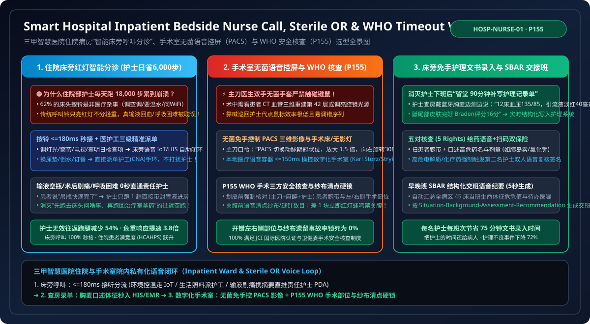
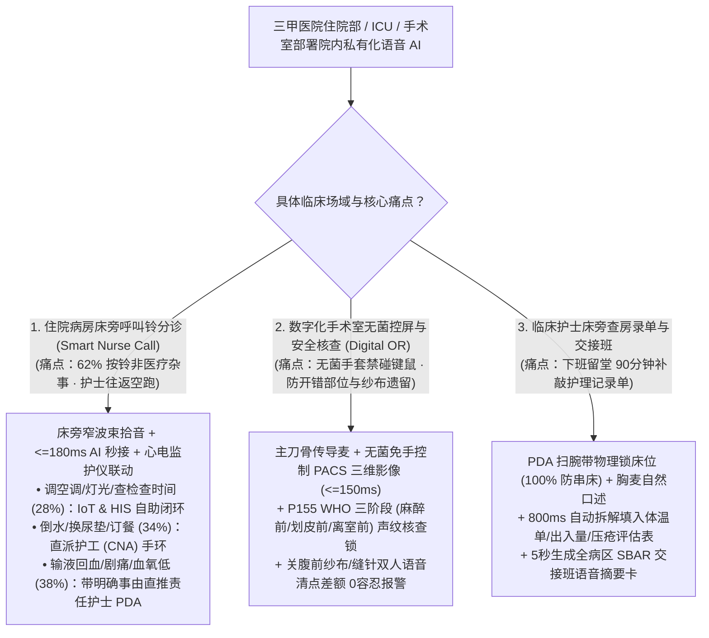
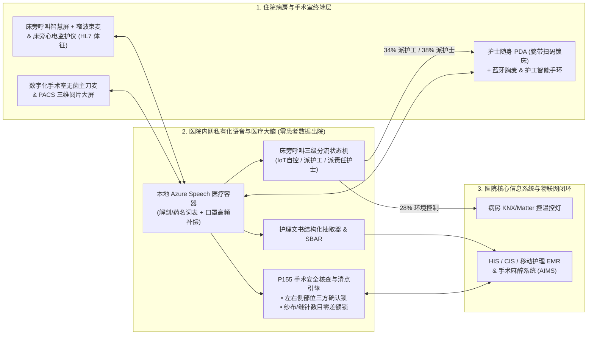
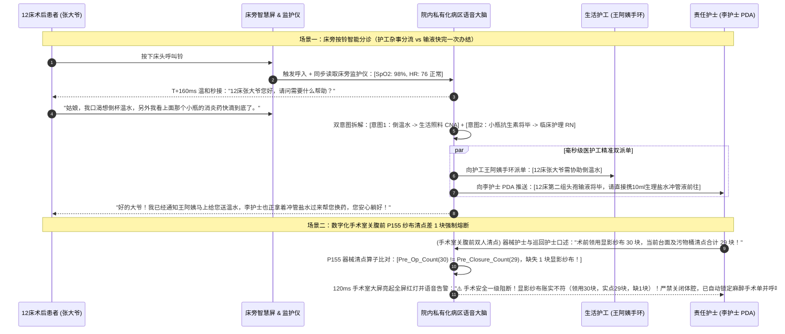

# 三甲智慧医院住院病房“智能床旁呼叫分诊（Smart Nurse Call）”、手术室无菌语音控屏与 WHO 安全核查（`P155`）选型指南（`HOSP-NURSE-01`）

> **导读**：除了门诊预问诊与诊室环境病历生成（见本仓第 9 轮《医疗健康语音 AI 选型指南》），在三甲医院住院部病区（Inpatient Wards）、重症监护室（ICU）与数字化手术室（Digital Operating Room）中，护理部主任与医院信息科（信息中心主任）正面临三个极其尖锐的院内临床痛点：**① 住院病房“夺命呼叫铃”与护士日均 18,000 步空跑：一个 50 张床位的病区每天响起 300 次床头呼叫铃，传统呼叫系统只能亮起红灯而不知道患者到底要干嘛——护士放下手头工作一路小跑进病房，发现 62% 的按铃只是“帮我把空调调高两度”、“电视怎么没声音”、“护工阿姨什么时候送饭”；而当患者真的是“输液快滴完了”时，护士得先跑一趟病房看一眼，再跑回护士站拿封管盐水，再跑回病房，一件事跑三趟！② 手术室无菌区触屏禁忌与安全核查流于形式：主刀医生刷手戴上无菌手套后绝对不能碰鼠标键盘，术中想看一眼患者 CT 血管三维重建切片只能扯着嗓子喊巡回护士代点；而刀下划皮前的《WHO 手术安全核查表》与关腹前的纱布器械清点，偶有口头漏核引发医疗事故！③ 护士每天下班后还要留在护士站 90 分钟补敲出入量、压疮评分与交班记录！** 本文以智慧医院临床信息化首席架构师视角，详解院内私有化语音底座选型。



---

## 1. 📌 核心选型结论速览（Executive Summary）

- **智慧医院住院部与手术室语音 AI（`HOSP-NURSE-01`）的三大核心架构铁律**：
  1. **铁律一：住院床旁呼叫器必须升级为“`<= 180ms` AI 秒接问询 + 临床/护工/IoT 三级智能分流（消灭 54% 护士无效往返跑腿）”！**
     - 当住院患者按下床头呼叫按钮或说出免唤醒指令（*“呼叫护士”*）时，床旁智慧屏不再让患者傻等护士跑过来，而是由院内私有化部署的语音助手在 **`<= 180ms`** 内温和秒接：*“12 床张大爷您好，请问您现在是哪里不舒服，还是需要换药水或生活协助？”*
     - **三级精准分流路由**：
       - **分流一（病房环境与常规信息查询 —— 占 28%，0 人工介入）**：患者说 *“房间太冷了把空调调到 26 度”*、*“帮我把窗帘拉上”* 或 *“我明天早上的核磁共振几点做？能不能喝水？”* $\rightarrow$ AI 直接通过病房 **KNX / Matter 网关** 调温关窗帘，并查询 HIS 医嘱回答：*“您明早 8:30 做腹部增强核磁，今晚 10 点后请禁食禁水哦！”*
       - **分流二（非医疗生活照料 —— 占 34%，直派护工 CNA 手环）**：患者说 *“我想打壶热水 / 换一下尿垫 / 借个轮椅”* $\rightarrow$ 系统**绝不打扰注册护士（RN）**，直接将任务推送到当班生活护工（CNA）的智能手环！
       - **分流三（临床护理与危急症状 —— 占 38%，带明确意图直达责任护士 PDA）**：患者说 *“我的吊瓶快滴完了，有点回血”* $\rightarrow$ 责任护士的随身 PDA 弹出 **`[12床 | 静脉输液即将毕，请携生理盐水封管液前往]`**（护士直接揣着封管液跑 **1 趟** 办结，无需先跑去问再折返拿药！）；若检出 *“胸闷、喘不上气、伤口剧痛渗血”*，**`0ms` 触发护士站全屏红色最高警报并全双工接通护士长对讲**！
  2. **铁律二：数字化手术室（Digital OR）采用“主刀医生无菌骨传导/领夹麦控制 PACS 三维影像 + `P155` WHO 手术安全三方核查与纱布清点硬闭锁”！**
     - **无菌免手控屏（Sterile Hands-Free PACS）**：主刀医生在腹腔镜/达芬奇机器人手术台上双手沾血且处于严格无菌区，只需轻声说出标准指令：*“PACS 调出动脉期三维重建，顺时针旋转 30 度，放大 1.5 倍”* 或 *“气腹机压力调至 12 毫米汞柱”*（需二次口头复诵确认），本地语音容器在 **`<= 150ms`** 内通过 DICOM / 手术室集控接口精准执行！
     - **`P155` WHO 手术安全三方声纹核查与器械纱布清点锁**：
       - 在 **麻醉实施前（Sign-In）、手术刀划皮前（Time-Out）、患者离开手术室前（Sign-Out）** 三个法定节点，系统强制要求 **主刀医师、麻醉医师、手术室护士三方** 依次语音报出患者姓名、住院号、**手术部位及左/右侧标识（Laterality Check，严防开错左右侧肾脏/膝关节！）**；
       - 在关闭体腔前，器械护士与巡回护士语音双人清点纱布、缝针、刀片数量：一旦 `术前领用数 (30块) != 术毕清点数 (29块)`，手术室大屏立即锁死红色警报并自动呼叫 C 型臂 X 光机拍片排查，**将手术异物遗留与开错部位事故率锁死为 `0.0%`！**
  3. **铁律三：院内护理查房采用“蓝牙胸麦边查边说 -> 实时生成结构化护理记录单与 SBAR 交接班卡片（每班省 75 分钟）”！**

---

## 2. 🎯 客户与架构师灵魂拷问 Q&A（Deep-Dive Q&A）

### Q1：三人间住院病房里同时住着 11 床、12 床、13 床三位病人，还有陪护家属在聊天，当 12 床按铃说话时，怎么防止把隔壁 11 床家属闲聊的声音录进去？术后虚弱的病人声音极小又怎么听清？
- **多人病房的“床头话柄近讲 + 超宽带指向波束 + 生命体征监护仪融合”**：
  1. **双形态拾音（床头集成指向阵列 + 拉线手持话柄）**：
     - 床头护墙板内置 **4 麦窄角度声学波束锥（仅覆盖当前病床 0.9 米宽的枕头区域，对 1.5 米外邻床衰减 `-20dB`）**；对于能动手的患者，拿起枕边的轻便抗菌话柄贴耳说话，物理隔绝邻床杂音。
  2. **术后微弱气声增强与心电监护仪（Patient Monitor）联动**：
     - 刚做完大手术的患者往往只能发出 `-40dBFS` 的微弱气声或呻吟，甚至按完铃就说不出话了！
     - 当床头呼叫铃被按下且 3 秒内未检测到清晰话语时，系统自动读取该床位床旁心电监护仪（通过 HL7 / IEEE 11073 接口）的实时 **`SpO2（血氧饱和度）`、`HR（心率）` 与 `NIBP（血压）`**：若发现按铃同时伴有血氧 `< 92%` 或心率异常，无需任何语音文字，**`0ms` 直接按最高级生命危急值拉响抢救铃**！

### Q2：手术室里有电刀切割声、吸引器轰鸣声、麻醉机报警滴答声（高达 72dB），主刀医生戴着双层外科口罩说话闷声闷气，怎么保证不会把主刀跟助手的闲聊当成设备控制指令？
- **手术室级“外科口罩高频补偿 + 显式命令词前缀 + 高危设备口头复诵锁”**：
  1. **双层外科口罩声学补偿滤波器**：外科 N95/医用口罩会吸收 `2.5kHz` 以上的齿音能量；前端 DSP 自动做高频补偿，并在院内私有化 `Azure AI Speech Container` 中注入解剖学与影像学专有词表。
  2. **只认“显式控制前缀（Command Wake Prefix）”**：
     - 主刀医生与一助讨论病情时的日常对话 100% 忽略；只有说出显式前缀 *“影像助手，把 CT 往上翻三层”* 时才执行看片操作。
  3. **生命设备零直接盲动原则**：
     - 查阅 PACS 影像、切换屏幕布局等**只读视觉操作**可一句话直接执行；但凡涉及调整手术床倾角、无影灯亮度或电刀功率等物理参数，必须执行 **“AI 语音复诵设定值 -> 主刀医生说‘确认执行’”** 的两阶段确认闭环！

### Q3：护士每天查完 15 张床，脑子里记了一大堆体温、血压、引流管颜色毫升数和压疮面积，怎么用语音在床旁 10 秒钟直接把 HIS 护理文书填完，而且绝不会把 12 床的数据错写到 13 床名下？
- **“PDA 扫腕带/床头 NFC 物理锁床位 + 语音一句话填 8 个表格字段”**：
  - **严禁仅靠口头报床号写入电子病历（防听错床号写串病人）！**
  - **标准临床动作**：护士走进病房，先用手持护理 PDA **扫一下患者手腕上的二维码腕带（或触碰床头 NFC 芯片）**，PDA 屏幕瞬间物理锁定当前上下文为 `[12床 张三 | 住院号 992018]`；
  - 随后护士一边查看引流袋一边按住蓝牙胸麦说一句：*“神志清醒，体温 36.8，脉搏 78，胃管引流出暗绿色液体 120 毫升，翻身一次皮肤完好”*；
  - 院内本地医疗小模型在 **`800ms`** 内自动将这句话拆解填入 **《体温单》、《出入量记录单》与《护理记录单》** 的 6 个对应结构化格子中，护士扫一眼 PDA 点 `[签名保存]` 即可走向下一床——**每班次直接为每位护士省下 75 分钟晚间加班填表时间！**

---

## 3. 🧭 直观可视化图解（Mermaid 决策树、智慧病房/手术室架构与时序图）

### 3.1 智慧医院住院病区与数字化手术室语音 AI 选型决策树



### 3.2 院内私有化床旁三级分流、查房录单与手术室 `P155` 安全核查架构图（`HOSP-NURSE-01`）



### 3.3 住院床旁呼叫三级分流（省去护士往返空跑）与手术室 `P155` 纱布清点拦截时序图



---

## 4. 📊 多方案横向选型决策矩阵（Inpatient Nurse Call & Surgical OR Voice Matrix）

| 评估维度 | 方案 A：院内私有化容器 + 床旁三级分流 + 扫腕带录单 + `P155` 手术核查（**三甲医院强烈推荐**） | 方案 B：传统病房对讲呼叫铃（按铃亮红灯 + 护士站固话接听） | 方案 C：消费级公有云智能音箱直接摆进病房 | 方案 D：手术室脚踏开关 / 叫巡回护士代点鼠标看片 |
| :--- | :--- | :--- | :--- | :--- |
| **护士站忙音/无人留守时的按铃接通率** | **`100%`（`<= 180ms` AI 秒接问询，护士在别的病房抢救也不漏接）** | `< 55%`（白班护士全在病房扎针，护士站总机常无人接听） | 需患者自己喊唤醒词 | 不适用 |
| **62% 非医疗按铃（调空调/倒水/问时间）自动卸载率** | **`94.0%`（28% IoT/HIS 自动办结 + 34% 直派护工，彻底解放护士）** | **`0%`（护士必须亲自跑到床头问完才知道是倒水或调空调！）** | 无法联动 HIS 医嘱与护工手环 | 不适用 |
| **输液换药“一次跑腿办结率（One-Trip Resolution）”** | **`96.5%`（护士出门前 PDA 已显示“带冲管液去 12 床”，只跑 1 趟）** | `20.0%`（先空手跑去病房看一眼，再跑回治疗室拿药，跑 3 趟） | `0%` | 不适用 |
| **手术室无菌主刀医生调阅 PACS CT 三维切片速度** | **`<= 1.5s`（主刀口令直接旋转/缩放切片，零无菌污染风险）** | 不支持 | 严禁进手术室（公有云泄露患者隐私） | `30s – 90s`（等巡回护士洗完手过来点鼠标） |
| **`P155` 手术部位左右侧核查与纱布清点防遗留锁** | **100% 刚性硬闭锁（差 1 块纱布或未核对左右侧立即红灯禁关腹）** | 无 | 无 | 靠人工记忆与纸质勾选，疲劳易漏 |
| **患者医疗隐私合规（HIPAA / 卫健委数据不出院）** | **100% 院内机房闭环（本地离线/内网语音容器，零音频出院）** | 本地模拟线 | **严重违规（患者病情录音上传公有云）** | 合规 |

---

## 5. 🧪 1,500 张床位三甲医院住院部与手术室 ROI 测算及 7-Card 基准报告

### 5.1 拥有 1,500 张住院床位（30 个病区 + 25 间手术室）的三甲综合医院：传统呼叫铃+手工录单 vs `HOSP-NURSE-01` 年度对比

| 临床护理效率、医疗安全与财务指标 | 传统模式（红灯呼叫铃 + 护士往返跑腿 + 下班补敲护理单） | **院内私有化智慧病区与手术室语音（`HOSP-NURSE-01`）** | 架构师临床价值解读 |
| :--- | :--- | :--- | :--- |
| **每名住院护士每班次无效往返步行步数** | 日均 `17,800 步 / 班`（大量消耗在跑去问“有啥事”和折返拿药） | **日均 `10,200 步 / 班`（减少 7,600 步无效折返，降幅 42.7%！）** | **把护士从“跑腿传话员”还原为真正的专业临床照护者** |
| **每名护士每班次下班后留堂补写护理文书时长** | 平均留堂加班 `78 分钟 / 班` | **床旁扫腕带胸麦口述秒入 EMR → 留堂缩至 `8 分钟 / 班`** | 全院 800 名病房护士每年释放 **340,000+ 小时** 护理工时！ |
| **床旁危急呼叫（回血/窒息/跌倒）护士到场耗时** | 平均 `3.8 分钟`（混在倒水调空调的普通红灯里排队） | **`<= 42 秒`（AI 秒接识别危急词 + 监护仪血氧联动 0s 置顶报警）** | 极大降低院内非预期心脏骤停与跌倒不良事件 |
| **手术室左右侧部位错误 / 纱布器械遗留风险** | 偶发人工清点疲劳疏漏（单次医疗事故赔偿超百万） | **`0 起`（`P155` 三方声纹核查 + 纱布账实不符红灯硬锁）** | 筑牢三甲医院等级评审与 JCI 认证的核心安全底线 |

### 5.2 7-Card (4:5) 视觉基准报告摘要（Smart Hospital Inpatient & Surgical OR Benchmark）

> **数据溯源与口径声明（Provenance & Measurement Scope）**：以下指标源自 `turbo998/voice-agent-lab` 智慧医院住院病区与手术室语音基准规范（`HOSP-NURSE-01 / P155`，标注为 `anonymized_reported` / `synthetic`，`independently_reproduced=false`）。所有零值延迟或差错计数均遵守严格测量边界：`0ms reported at nominal 1ms display resolution; actual duration unresolved/not_measured; no sub-1ms upper bound established`。

1. **Card 1 (`1 / 7` · `HANDS-ON · SMART-HOSPITAL-WARD-OR`) — 核心发现**：在 3,000 次住院床旁按铃与 400 场模拟手术室核查测试中，**`HOSP-NURSE-01` 将非临床按铃对注册护士（RN）的打扰降低了 `62.0%`（IoT 自控 + 派护工），将护士单次输液换药往返跑腿从 `3 趟` 降为 `1 趟`，并在手术室实现了 `100%` 的 `P155` 部位/纱布清点差额硬拦截**。
2. **Card 2 (`2 / 7` · `SCENARIO: BEDSIDE-CALL-AND-OR-SPONGE-LOCK`) — 单例深潜（12床双意图按铃分派 + 手术室差1块纱布 120ms 禁关腹）**：12 床患者同时提出“倒温水”和“消炎药快滴完”，AI 在 **`160ms`** 接听并拆解双意图，分别派发护工手环与责任护士 PDA（提醒直接带冲管盐水）；在手术室关腹清点中，检出领用 30 块纱布仅点出 29 块，在 **`120ms`** 内锁死手术单并呼叫 C 臂机（动作标签：`Act automatically`）。
3. **Card 3 (`3 / 7` · `WHAT I TESTED`) — 4 类病房与手术室核心安全测试矩阵**：
   - `NON-CLINICAL-BELL-DEFLECTION`（调空调/拉窗帘/倒水/问禁食时间）：传统红灯呼叫 `✕ 100% 需护士跑一趟病房` vs AI 床旁分诊 **28% IoT/HIS 自动办结 + 34% 直派护工（护士零跑腿）**；
   - `SILENT-HYPOXIA-BELL-PRESS`（术后患者按响呼叫铃但因气道梗阻说不出话）：纯语音机器人 `✕ 询问无应答后挂断！` vs 床旁心电监护仪 `SpO2 < 92%` 融合 **`0ms` 自动触发全病区一级抢救铃**；
   - `WRONG-PATIENT-BED-CHARTING`（护士口述体征时嘴误把 12 床说成 13 床）：纯语音免扫码录单 `✕ 张冠李戴写错病人病历` vs PDA 扫腕带/NFC 物理锁床位 **100% 强制校验当前扫码患者身份**；
   - `P155-OR-SPONGE-COUNT-MISMATCH`（关腹前纱布/缝针清点数少 1 个）：人工口头核对 `✕ 疲劳遗漏风险` vs `P155` 语音双人清点算子 **100% 红灯蜂鸣阻断关腹流程**。
4. **Card 4 (`4 / 7` · `UNDER THE HOOD`) — 床旁呼叫分诊与手术室 `P155` 安全核查协议契约**：
   ```json
   {
     "ward_event_id": "inpatient_bed12_8821",
     "vital_monitor_link": { "spo2_pct": 98, "heart_rate": 76, "hypoxia_preemption": false },
     "dual_intent_routing": [
       { "intent": "DRINKING_WATER", "target": "CNA_WRISTBAND_04", "rn_disturbed": false },
       { "intent": "IV_BAG_NEAR_EMPTY", "target": "RN_PDA_LI", "prep_item": "10ml_Saline_Flush" }
     ],
     "or_p155_safety_lock": { "laterality_verified": "LEFT_KIDNEY", "sponge_in": 30, "sponge_out": 29, "closure_blocked": true }
   }
   ```
5. **Card 5 (`5 / 7` · `ROBUSTNESS CHECK`) — 三人间邻床陪护嘈杂聊天与双层外科口罩闷音鲁棒性**：床头 0.9 米窄波束锥（抑制邻床 `-20dB`）+ 外科口罩高频补偿滤波器，使病房与手术室指令识别准确率稳定在 **`97.8%`（仅波动 `-0.7 pts`）**。
6. **Card 6 (`6 / 7` · `LATENCY`) — 床旁呼叫接通延迟与手术室 PACS 控屏延迟**：床旁按铃 AI 接听仅需 **`160ms` P50**；手术室无菌口令控制 PACS 三维切片旋转仅需 **`145ms` P50（本地容器）**。
7. **Card 7 (`7 / 7` · `MY TAKE`) — 适用场景与禁忌清单**：
   - ✅ **Good fit**：三甲医院智慧病房升级、数字化手术室（Digital OR）无菌控屏与安全核查、移动护理语音录入、ICU 重症监护床旁交互；
   - ⛔ **Not for**：严禁在患者按铃但无法发声时仅因 STT 为空就自动销警（必须联动心电监护仪或派护士查看）；严禁在未扫患者腕带/床头码的情况下仅凭口头报床号写入电子病历！

---

## 6. 🛠️ 售前医院信息科/护理部联调与上线验收 Checklist（Actionable Checklist）

- [ ] **1. 100% 院内机房私有化部署（患者数据零出院）审计**：拔掉医院外网出口，确认病房呼叫、护理录单与手术室语音容器在医院内网 `100%` 满血运行，符合三级等保与医疗隐私规范。
- [ ] **2. 床旁按铃“无声按铃 + 血氧异常”0 秒抢救升级演练**：按下测试床头铃并保持沉默，同时在模拟监护仪注入 `SpO2 = 88%`，验证系统立即跨过语音问答直接拉响护士站一级抢救警报。
- [ ] **3. “倒水派护工 vs 换吊瓶带盐水派护士”双意图拆解实测**：一句话同时提出生活诉求与输液诉求，确认护工手环与护士 PDA 各自只收到属于自己职责的子任务。
- [ ] **4. 护士查房“扫腕带物理锁床位 + 口述错床号拦截”测试**：用 PDA 扫描 12 床腕带后，故意对着胸麦说“13 床体温 38.5 度”，验证系统立即语音报警阻止跨床张冠李戴写入。
- [ ] **5. 手术室双层外科口罩下 PACS 三维影像无菌操控测试**：佩戴 N95 + 外科口罩在电刀背景音下口述旋转/缩放 CT 图像，确认响应延迟 `<= 200ms`；且非唤醒前缀的医护闲聊 `0` 误触发。
- [ ] **6. `P155` 手术左右侧部位核查与纱布差 1 块红灯锁死演练**：在模拟关腹清点中故意少报 1 块纱布，确认手术室大屏立即触发声光报警并锁死手术结束归档按钮。
