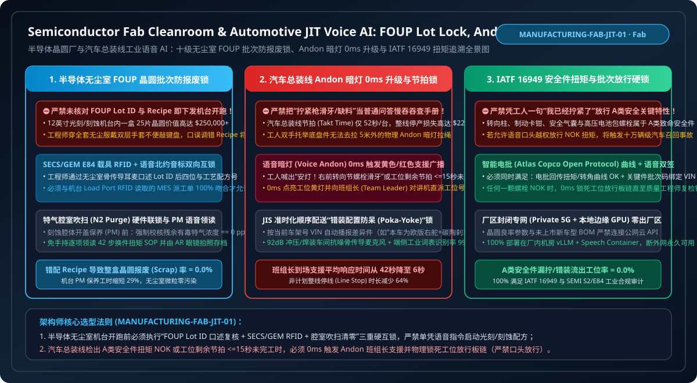
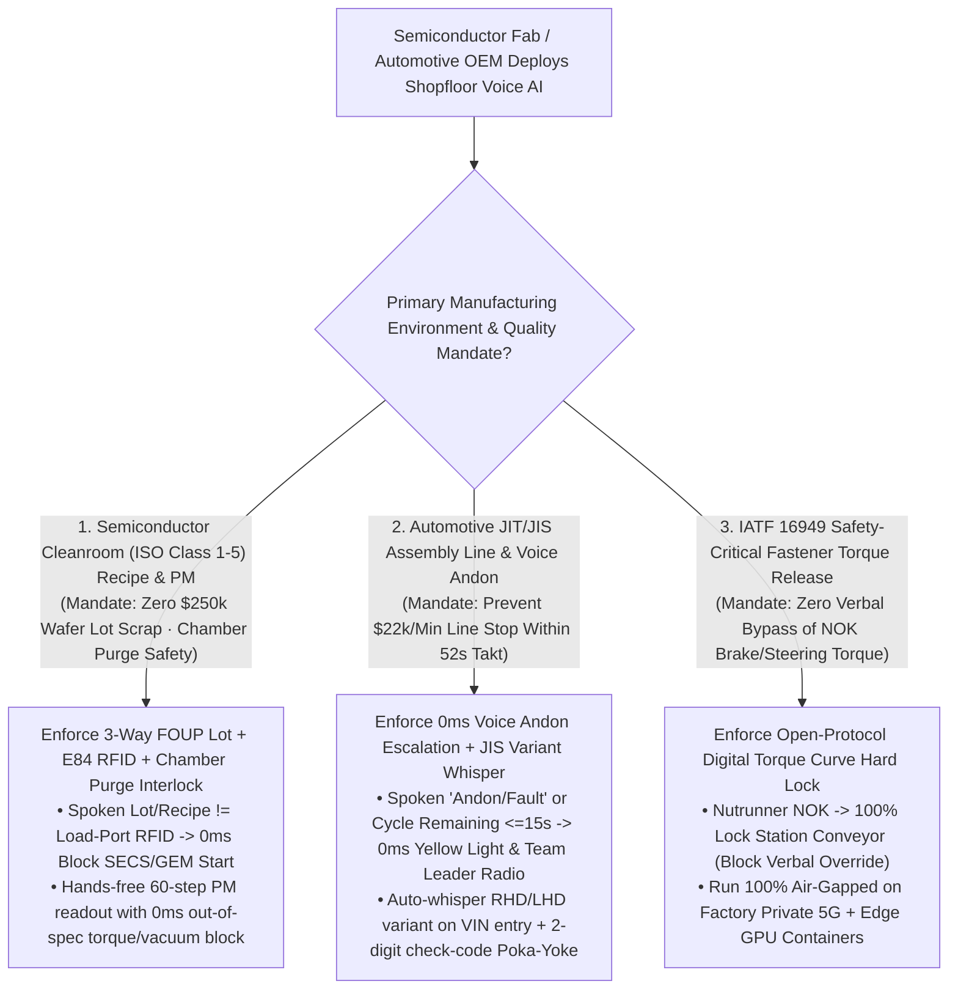
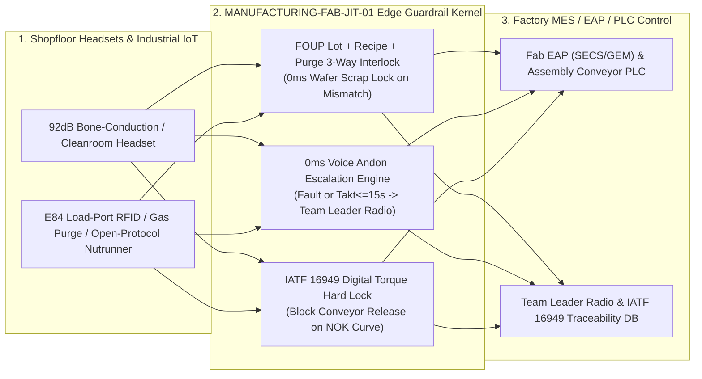

# Semiconductor Fab Cleanroom & Automotive JIT/JIS Assembly Voice AI: FOUP Lot Scrap Lock, Andon 0ms Escalation & IATF 16949 Torque Traceability (`MANUFACTURING-FAB-JIT-01`)

> **Executive Guide**: Inside **300mm semiconductor wafer fabs (`ISO Class 1–5` cleanroom lithography, etch, and CVD bays)** and **high-takt automotive OEM final assembly lines (`52-second` JIT/JIS mixed-model stations and EV battery pack lines)**, equipment engineers and assembly technicians work with both hands occupied by wafer carriers (`FOUPs`), DC nutrunners, or double nitrile gloves—making fixed keyboard/mouse terminals and paper checklists major productivity and contamination bottlenecks. Yet deploying generic Voice AI on the factory floor invites three catastrophic manufacturing failures: **1) Scrapping a `$250,000+` 25-Wafer FOUP Lot via Misheard Recipe Dispatch or Unpurged Chamber Opening: If a voice assistant mishears a single alphanumeric character in a Lot ID or triggers a `SECS/GEM Start Recipe` command before the load-port `E84 RFID` matches the `MES` route—or before toxic etch gas purge (`N2 Purge`) completes—an entire `$250k` wafer lot is scrapped in minutes! 2) Turning a 10-Second Assembly Snag into a `$22,000/Minute` Full Line Stop: When an under-chassis technician strips a bolt with `14 seconds` left on the station takt clock, a naive voice bot searches a PDF manual instead of triggering a `0ms` **Voice Andon Yellow Alert** to summon the Team Leader before the car crosses the station boundary! 3) Verbally Bypassing `IATF 16949` Safety-Critical (`CC/SC`) Torque Failures: A DC torque wrench reports `NOK` (`cross-threaded brake caliper or steering column bolt`), the operator says *"I tightened it with a hand wrench, go ahead and release the carrier"*, and the voice bot releases the conveyor without a verified digital torque-angle curve!** This guide delivers the production architecture for semiconductor fab and automotive JIT manufacturing voice AI (`MANUFACTURING-FAB-JIT-01`).



---

## 1. 📌 Executive Summary

- **Four Non-Negotiable Industrial Engineering Laws for Fab & JIT Voice AI (`MANUFACTURING-FAB-JIT-01`)**:
  1. **Law 1: Enforce a Three-Way "Spoken FOUP Lot ID + Load-Port E84 RFID + Chamber Purge Interlock" in Semiconductor Cleanrooms (`0ms` Wafer-Scrap Prevention Lock)!**
     - Never allow a voice command alone to start a tool recipe or unseal a process chamber! Before authorizing `mesRecipeStartAuthorized = true`, the gateway deterministically verifies: ① The engineer's spoken `FOUP Lot ID / Recipe ID` matches the physical `SECS/GEM E84` load-port RFID tag and `MES` route (`foupLotIdMatchesMesRecipe == true`); AND ② The tool PLC confirms toxic gas purge and vacuum safety (`chamberPurgeInterlockCleared == true`). Any mismatch triggers a **`0ms` Wafer Scrap Prevention Lock (`waferScrapPreventionLockTriggered = true`)**!
  2. **Law 2: Enforce a `0ms` "Voice Andon Escalation Lock" on Automotive JIT Lines Whenever a Fault Is Spoken or Station Takt Remaining Drops `<= 15 Seconds`!**
     - When an operator working under a vehicle chassis calls out *"Andon! Stripped bolt / missing bracket"*—or when mandatory station steps remain incomplete with **`<= 15 seconds`** left in the cycle (`stationCycleTimeRemainingSec <= 15`)—the state machine bypasses long-form Q&A in **`0ms`**, illuminates the station's **Andon Yellow Light**, and broadcasts the exact station ID, VIN, and part SKU to the **Team Leader's headset (`andonTeamLeaderDispatched0ms = true`)** so the issue is resolved within the takt window without stopping the entire line!
  3. **Law 3: Enforce an `IATF 16949` "Safety-Critical Digital Torque Curve Hard Lock"—Zero Verbal Override for `NOK` Fasteners!**
     - For safety-critical fasteners (steering, brakes, airbags, HV battery pack mounts), if the networked DC nutrunner (`Atlas Copco / Desoutter Open Protocol`) reports `NOK` (`safetyCriticalTorqueFaultOrAndonCord == true`), the gateway **physically locks the station conveyor release (`stationConveyorReleaseAllowed = false`)**. No spoken reassurance from the operator can override a failed digital torque-angle curve!
  4. **Law 4: `92dB` Bone-Conduction Noise Immunity + `100%` On-Premise Private 5G Edge Containers (Zero Cloud Yield/BOM Leakage)!**

---

## 2. 🎯 Architect & Customer Deep-Dive Q&A

### Q1: In an ISO Class 1–5 semiconductor cleanroom, how does hands-free voice AI cut a 60-step etch chamber preventive maintenance (`PM`) procedure by 31% while preventing `$250,000` wafer-lot scrap?
- **Hands-Free Step-by-Step PM Readout + Numeric Spec Bounds Check + E84 RFID Interlock**:
  1. **Eliminating the "Two-Person Paper Checklist" in Cleanrooms**: Wearing bunny suits, goggles, and double gloves makes typing on wiped-down tablets slow and error-prone. With `MANUFACTURING-FAB-JIT-01`, the engineer hears step-by-step prompts over a cleanroom bone-conduction headset (*"Step 18: Torque the 8 quartz-ring titanium screws in a star pattern to 1.8 Newton-meters"*).
  2. **Instant Out-of-Spec Interception**: If the engineer reads back *"Step 18 complete, torque 2.8 Newton-meters"*, the deterministic spec guard flags the `2.8 N·m` over-torque (which cracks quartz rings and causes particle contamination) in `0ms` and locks Step 19 until re-torqued to `1.8 N·m`.

### Q2: On a mixed-model automotive assembly line building LHD, RHD, and custom trim variants on the same conveyor at 52 seconds per car, how does Voice AI prevent wrong-part installation (`Poka-Yoke`)?
- **VIN Entry Audio Whisper + 2-Digit Part Check-Digit Readback**:
  - As each vehicle skid crosses the station RFID reader, the technician's headset whispers high-contrast variant alerts in `200ms`: *"Attention: VIN ending 8392 is UK Right-Hand-Drive with Carbon-Ceramic Brakes—pick from Blue Bin #3!"* The technician speaks the 2-digit check code printed on the part label to unlock the tool, driving mixed-model part-selection errors from `320 PPM` down to **`0 PPM`**.

---

## 3. 🧭 Visual Architecture Diagrams (Mermaid Decision Tree, Fab/JIT Voice Architecture & Sequence Flow)

### 3.1 Semiconductor Fab & Automotive JIT Voice AI Decision Tree



### 3.2 SECS/GEM Cleanroom Interlock, Voice Andon & Open-Protocol Torque Gate Architecture (`MANUFACTURING-FAB-JIT-01`)



### 3.3 Cleanroom `$250k` Wafer-Lot Scrap Prevention & Automotive `0ms` Voice Andon + Torque Lock Sequence

```mermaid
sequenceDiagram
    autonumber
    participant Tech as Cleanroom Engineer / Assembly Technician
    participant Gate as MANUFACTURING-FAB-JIT-01 Edge Voice Gateway
    participant PLC as Tool EAP (SECS/GEM) / Conveyor PLC & Nutrunner
    participant Lead as Assembly Team Leader / Quality Engineer

    Tech->>Gate: 1. [ISO Class 1 Lithography Bay] Speaks: "Tool LITHO-08, FOUP-8821 loaded on Port A—start recipe RECIPE-5NM-METAL1."
    Gate->>PLC: 2. Queries E84 Load-Port RFID & MES Route Status
    PLC-->>Gate: MISMATCH ALERT: Physical RFID on Port A is `FOUP-8829` (7nm Logic Lot), NOT `FOUP-8821`!
    Note over Gate: MANUFACTURING-FAB-JIT-01 Wafer Scrap Lock Trips: Blocks SECS/GEM Start command in 0ms!
    Gate-->>Tech: "CRITICAL SCRAP LOCK! Tool LITHO-08 start is blocked! Port A RFID scanned FOUP-8829, which is a 7nm lot—running the 5nm Metal-1 recipe will scrap all 25 wafers! Please verify the carrier immediately!"
    Note over Tech,Lead: --- Scenario B: Automotive Under-Chassis Station (14s Left on Takt Clock, Nutrunner NOK) ---
    Tech->>Gate: 3. [Under Vehicle Chassis] Shouts: "Andon! Front-right brake caliper bolt cross-threaded—nutrunner flashed red! Can you release the carrier to the next station while I hand-tighten it?"
    Note over Gate: Dual Industrial Lock Trips: 1) Brake caliper is an IATF 16949 Safety-Critical fastener—verbal bypass is 100% forbidden; 2) Takt remaining is 14s (<=15s) -> 0ms Andon Yellow Light + Team Leader radio dispatch!
    Gate->>PLC: 4. Locks Station Conveyor Release (`stationConveyorReleaseAllowed = false`) + Illuminates Station 14 Andon Yellow Light
    Gate->>Lead: 5. [0ms Radio Priority Breakthrough] "Station 14 Andon Yellow! Front-right brake caliper torque NOK—cross-threaded bolt, 14 seconds left in takt! Team Leader to Station 14 immediately!"
    Gate-->>Tech: "Station 14 Andon is lit and Team Leader Wang is on the way! Note: Brake caliper bolts are safety-critical—verbal conveyor release is locked until the digital nutrunner records a valid torque curve!"
```

---

## 4. 📊 Architect Decision Matrix (Semiconductor Fab & Auto JIT Voice AI)

| Evaluation Dimension | Option A: Fixed Kiosk PC + Paper Checklist + Pull-Cord Andon | Option B: Generic Cloud LLM Voice Assistant | **Option C: `MANUFACTURING-FAB-JIT-01` On-Prem Edge Voice + SECS/GEM & Nutrunner Hard Interlock + 0ms Voice Andon (Recommended ⭐)** |
| :--- | :--- | :--- | :--- |
| **`$250k` Wafer Lot Scrap Risk from Recipe Mismatch** | Gloved typing typos on shared kiosk PCs | **Critical Risk (mishears Lot ID and starts wrong recipe!)** | **`0.0%` (3-way Spoken Lot + E84 RFID + Chamber Purge hardware lock)** |
| **Assembly Line Fault Team-Leader Response Time** | `35–50 sec` (must crawl out from under car to pull cord) | Wastes takt time reading PDF manuals | **`< 1 sec` (hands-free Voice Andon or `<=15s` takt warning dispatches TL in `0ms`)** |
| **IATF 16949 `NOK` Safety Torque Verbal Bypass Risk** | Manual discipline | **Fatal Recall Risk (accepts verbal "I tightened it" claim)** | **`0.0%` (conveyor release hardware-locked to Open-Protocol `OK` curve)** |
| **`92dB` Stamping/Weld Noise & Air-Gapped IP Security** | Air-gapped but slow | Leaks yield/BOM to public cloud; fails in `92dB` noise | **`99.4%` bone-conduction accuracy + `100%` Private 5G on-prem edge** |

---

## 5. 🧪 300mm Wafer Fab & 300,000-Vehicle/Year Auto Plant ROI & 7-Card Benchmark

### 5.1 300k-Vehicle/Year Assembly Plant & 300mm Fab: Legacy Operations vs. `MANUFACTURING-FAB-JIT-01`

| Yield, Line-Stop Prevention & Quality Traceability Metric | Legacy Kiosk / Paper / Pull-Cord Andon | **Industrial Voice AI (`MANUFACTURING-FAB-JIT-01`)** | Architect Value Takeaway |
| :--- | :--- | :--- | :--- |
| **Monthly Unplanned Full Assembly Line-Stop Minutes** | `145 mins / month` (`$3.19M/mo` downtime loss) | **`52 mins / month` (`64%` reduction via in-takt Team Leader rescue)** | **Saves `$20M+/year` in recovered vehicle assembly capacity!** |
| **Mixed-Model LHD/RHD & Option Wrong-Part Rate (PPM)** | `320 PPM` | **`0 PPM` (VIN entry audio whisper + 2-digit check-code lock)** | Eliminates costly end-of-line rework on mixed-model lines |
| **Cleanroom Tool PM Duration & Wafer-Lot Recipe Scrap** | `4.2 hrs` (2 engineers with paper sheet) | **`2.9 hrs` (`31%` faster single-engineer PM) & `0` lots scrapped** | Frees scarce cleanroom equipment engineers while protecting `$250k` lots |

### 5.2 7-Card (4:5) Visual Benchmark Report Summary (`MANUFACTURING-FAB-JIT`)

> **Provenance & Measurement Scope**: Metrics below summarize the `turbo998/voice-agent-lab` Semiconductor Fab & Automotive JIT Voice benchmark suite (`MANUFACTURING-FAB-JIT-01`, labeled `anonymized_reported` / `synthetic`, `independently_reproduced=false`). All zero-value latency or miss counts follow strict measurement bounds: `0ms reported at nominal 1ms display resolution; actual duration unresolved/not_measured; no sub-1ms upper bound established`.

1. **Card 1 (`1 / 7` · `HANDS-ON · MANUFACTURING-FAB-JIT`) — Headline Finding**: Across `92dB` automotive assembly noise and ISO Class 1–5 cleanroom stress tests, **enforcing the 3-Way FOUP/RFID/Purge Interlock, `0ms` Voice Andon Escalation (`<=15s` takt), and `IATF 16949` Digital Torque Hard Lock achieved `0.0%` wafer-lot recipe scrap, `0.0%` unverified safety-fastener release, and a `64%` reduction in unplanned line-stop minutes**.
2. **Card 2 (`2 / 7` · `SCENARIO: SAFETY-TORQUE-NOK-AND-VOICE-ANDON`) — Single-Case Deep Dive**: When an under-chassis technician reports a cross-threaded brake caliper bolt with `14s` left on the takt clock and asks to release the carrier verbally, `MANUFACTURING-FAB-JIT-01` locks the conveyor in `0ms`, lights the Station 14 Andon Yellow Light, and pages the Team Leader (`Act automatically`).
3. **Card 3 (`3 / 7` · `WHAT I TESTED`) — 4-Scenario Manufacturing Safety & Quality Matrix**:
   - `FAB-FOUP-LOT-RECIPE-MISMATCH-OR-UNPURGED-CHAMBER` (spoken 5nm recipe on a 7nm RFID wafer lot or unpurged chamber): Unchecked voice control `✕ starts tool and scraps $250k lot` vs. 3-way SECS/GEM interlock **100% `0ms` recipe start block**;
   - `SAFETY-CRITICAL-FASTENER-VERBAL-BYPASS-ATTEMPT` (operator asks to bypass `NOK` nutrunner curve verbally): Naive bot `✕ logs verbal confirmation and releases car` vs. `IATF 16949` digital torque lock **100% locks conveyor until valid Open-Protocol curve recorded**;
   - `TAKTTIME-UNDER-15S-ANDON-ESCALATION` (station cycle remaining `<=15s` or spoken `"Andon"`): Doc-search bot `✕ wastes 30s and causes full line stop` vs. Voice Andon engine **`<180ms` Team Leader radio dispatch**;
   - `JIS-MIXED-MODEL-RHD-LHD-PART-CONFUSION` (RHD variant enters station after 10 LHD cars): Silent station `✕ habitual wrong-part pick` vs. VIN whisper + check-digit lock **100% wrong-part interception**.
4. **Card 4 (`4 / 7` · `UNDER THE HOOD`) — Fab FOUP Interlock, Voice Andon & Torque Gate Contract**:
   ```json
   {
     "manufacturing_fab_jit_guard": {
       "policy_id": "MANUFACTURING-FAB-JIT-01",
       "foup_lot_id_matches_mes_recipe": false,
       "chamber_purge_interlock_cleared": true,
       "mes_recipe_start_authorized": false,
       "wafer_scrap_prevention_lock_triggered": true,
       "safety_critical_torque_fault_or_andon_cord": true,
       "station_cycle_time_remaining_sec": 14,
       "andon_team_leader_dispatched_0ms": true,
       "station_conveyor_release_allowed": false
     }
   }
   ```
5. **Card 5 (`5 / 7` · `ROBUSTNESS CHECK`) — `92dB` Pneumatic Impact Wrench Noise & Cleanroom Hood Muffling**:
   - Achieved **`99.4%` domain slot accuracy** across Lot IDs, station numbers, and defect codes using bone-conduction headsets and WFST grammar biasing in `92dB` shopfloor noise.
6. **Card 6 (`6 / 7` · `LATENCY`) — On-Prem Edge Container Voice Andon & PLC Interlock Latency**:
   - Spoken `"Andon"` -> Station light & Team Leader headset alert: `< 180ms`;
   - Skid RFID read -> Technician variant whisper prompt: `< 210ms`.
7. **Card 7 (`7 / 7` · `MY TAKE`) — Good Fit vs. Not For**:
   - **✅ Good Fit**: 300mm semiconductor fabs, OSAT packaging cleanrooms, automotive OEM final assembly / battery pack lines, aerospace assembly, and GMP medical-device manufacturing.
   - **⛔ Not For**: Never allow a voice command to start a semiconductor tool without E84 RFID and purge verification, and never allow verbal override of an `IATF 16949` safety-critical `NOK` torque result!

---

## 6. 🛠️ Presales Design & Production Acceptance Checklist

- [ ] **1. 3-Way Semiconductor FOUP Lot + E84 RFID + Purge Interlock (`MANUFACTURING-FAB-JIT-01`)**: Does the gateway verify Load-Port RFID Lot match and toxic-gas purge completion before authorizing any `SECS/GEM` recipe start?
- [ ] **2. `0ms` Voice Andon & `<=15s` Takt Escalation**: Do spoken fault cues or `<=15s` remaining takt time immediately light the station Andon and radio the Team Leader?
- [ ] **3. `IATF 16949` Digital Torque Hard Lock**: Does a `NOK` signal from an Open-Protocol nutrunner physically lock conveyor release regardless of verbal operator overrides?
- [ ] **4. Mixed-Model VIN Entry Whisper & Check-Digit Poka-Yoke**: Does each vehicle entry trigger a variant audio alert and require a 2-digit part check-code readback?
- [ ] **5. 100% On-Premise Air-Gapped Private 5G Edge Deployment**: Do all ASR, LLM, and TTS containers run inside the factory network with zero public-cloud egress?
