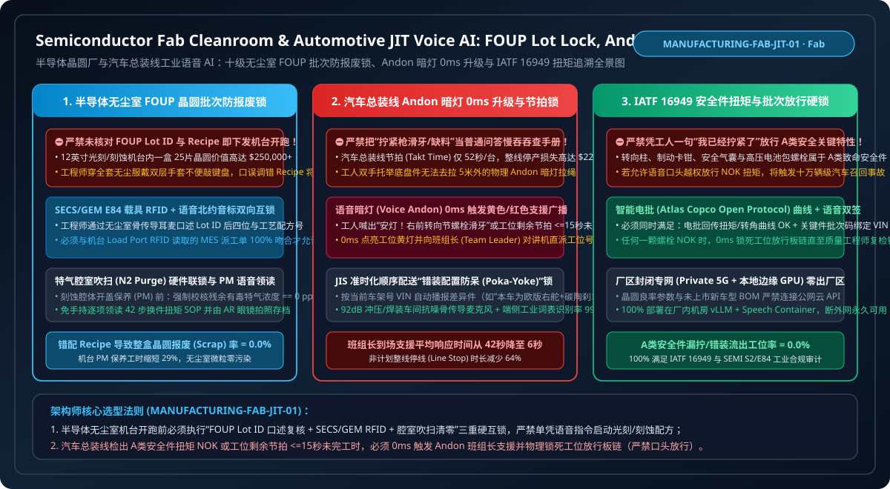
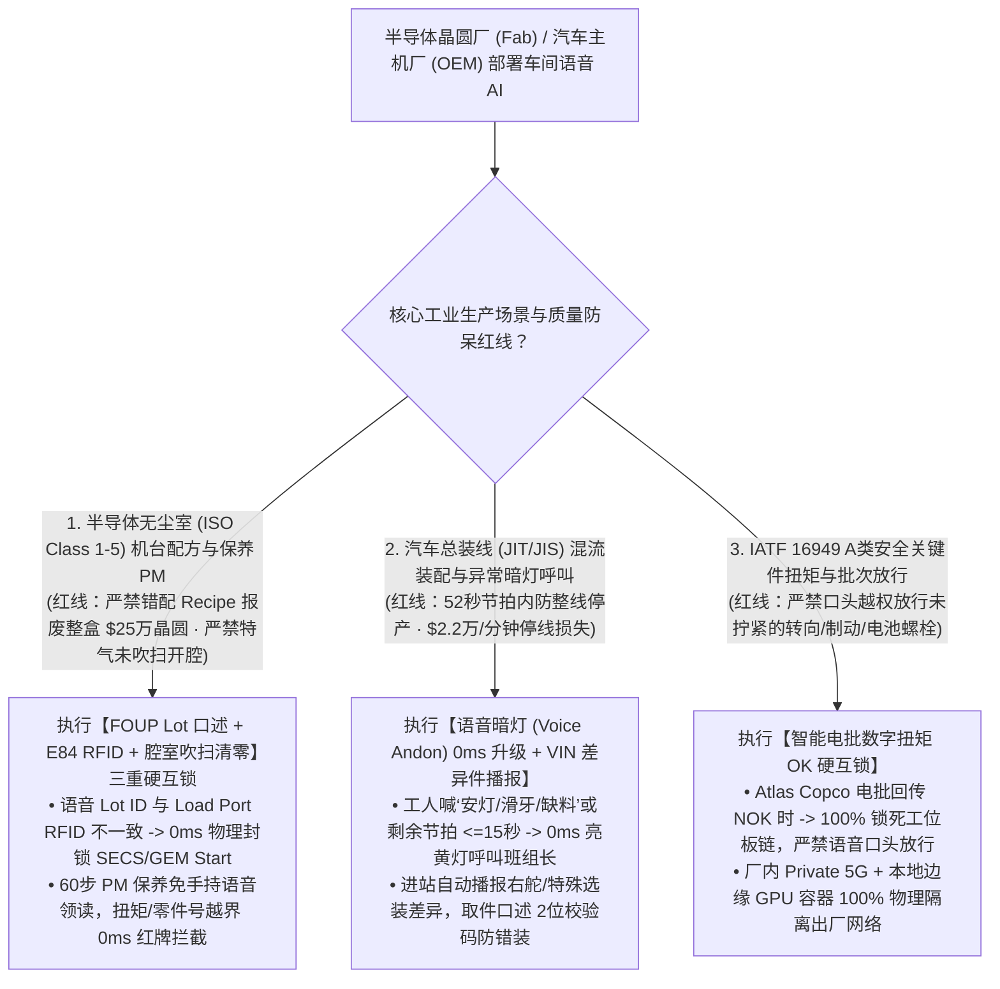
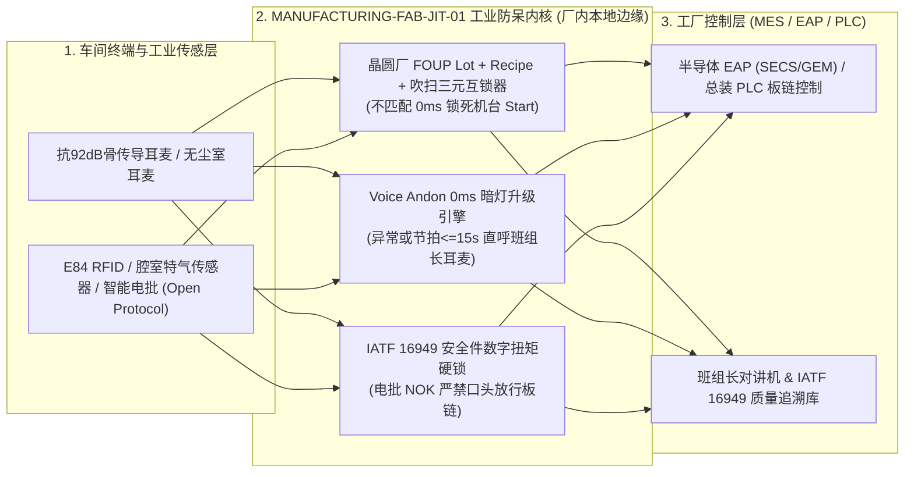
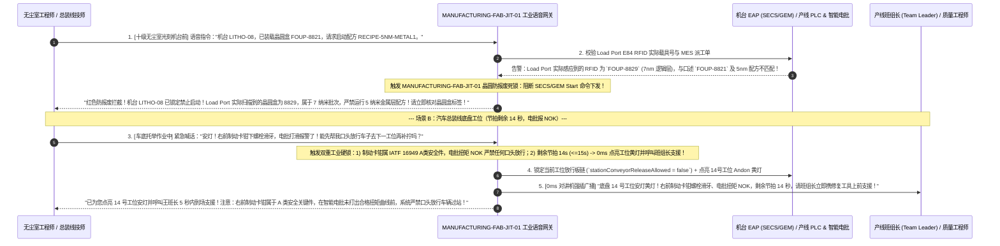

# 半导体晶圆厂（Fab 无尘室）与汽车主机厂（JIT/JIS 总装线）语音 AI：FOUP 批次防报废锁、Andon 暗灯 0ms 升级与 IATF 16949 扭矩追溯架构选型指南（`MANUFACTURING-FAB-JIT-01`）

> **导读**：在半导体晶圆制造厂（**12 英寸 ISO Class 1–5 超净间光刻/刻蚀/薄膜产线**）与大型汽车主机厂（**52 秒/台高节拍 JIT/JIS 混流总装线、冲压焊装车间與动力电池 Pack 产线**）中，一线设备工程师与装配技师双手时刻被精密晶圆载具（`FOUP`）、扭力扳手或无尘丁腈手套占据，无法频繁摘手套去敲击固定工控机键盘或翻阅厚重的纸质 SOP。然而，将通用语音 AI 直接搬进精密制造车间将引发灾难性的工业质量与停产事故：**① 半导体晶圆厂里一盒 25 片 12 英寸晶圆（FOUP Lot）价值高达 `$250,000+`，若语音助手听错一个字母（如把批次尾号 `B8` 听成 `D8`）或在腔室特气尚未吹扫干净（`Purge Incomplete`）时直接通过语音下发 `SECS/GEM Start Recipe` 指令，整盒晶圆将在几分钟内彻底报废（Scrap）！② 汽车总装线每停线 1 分钟损失高达 `$22,000–$50,000`，当工人在车底托举副车架发现螺栓滑牙、且当前工位剩余节拍（Takt Time）只剩 `12 秒` 时，普通语音机器人还在慢吞吞地检索知识库朗读维修手册，而不是 `0ms` 触发【语音暗灯（Voice Andon）】呼叫班组长上前救场！③ 转向柱、制动卡钳或高压电池包等 `IATF 16949` A 类安全关键特性（CC/SC）螺栓扭矩未达标（`NOK`），工人随口对耳机说一句“我已经拿手动扳手补拧过了，放行吧”，语音系统竟然越过智能电批（Atlas Copco Open Protocol）的数字扭矩合格信号直接放行车辆流向下一工位！** 本文给出精密制造、半导体 Fab 与汽车 JIT 总装语音 AI 的生产级架构与选型指南（`MANUFACTURING-FAB-JIT-01`）。



---

## 1. 📌 核心选型结论速览（Executive Summary）

- **精密制造、半导体 Fab 与汽车总装线语音 AI（`MANUFACTURING-FAB-JIT-01`）的四大工业工程铁律**：
  1. **铁律一：半导体无尘室（Fab Cleanroom）执行“FOUP Lot ID 语音复核 + 机台 Load Port RFID + 腔室吹扫清零（Purge Interlock）”三元硬互锁——不吻合 `0ms` 物理封锁机台 `Start`！**
     - 在十级/百级无尘室中，工程师穿戴连体无尘服（Bunny Suit）与护目镜，通过骨传导耳麦执行机台预防性保养（PM）逐项点检与异常排障；
     - 当涉及晶圆盒（FOUP）上机运行工艺配方（Recipe）时，系统**严禁单凭语音指令直接触发机台开跑**！必须同时满足：① 工程师语音口述的 `Lot ID / Recipe ID` 与机台 `E84 Load Port` RFID 硬件读取的 `MES` 派工单 **`100%` 匹配**；② 机台腔室残余特气吹扫与真空度联锁（`chamberPurgeInterlockCleared == true`）已由 PLC/工具控制器硬件确认，否则 **`0ms` 触发防报废硬锁（`waferScrapPreventionLockTriggered = true`）**！
  2. **铁律二：汽车总装线（JIT/JIS）执行“语音暗灯（Voice Andon）`0ms` 触发锁”——检出装配件异常或工位剩余节拍 `<= 15 秒`，立即点亮黄灯并呼叫班组长对讲机！**
     - 总装线工人双手在车厢内或底盘下作业时无法去拉头顶或柱子上的物理暗灯绳（Andon Cord）。只要工人说出**“安灯 / 滑牙 / 缺件 / 卡住了 / 装不进去”**，或工位倒计时剩余 **`<= 15 秒`** 仍未完成必检步序，状态机在 **`0ms`** 内跳过任何长篇知识库问答，直接向产线 PLC 发送 `Andon Yellow Alert` 并通过班组长（Team Leader）耳麦播报精确支援指令（*“底盘 14 号工位黄灯！右前转向节螺栓滑牙，剩余节拍 12 秒，请班组长携 M12 丝锥立即支援！”*），力争在当个节拍内化解消缺，避免触发整线停产（Red Line Stop）！
  3. **铁律三：`IATF 16949` A 类安全关键件（转向/制动/气囊/高压电池）“智能电批数字扭矩曲线 OK 硬锁”——`100%` 严禁口头语音覆盖或强行放行 `NOK` 工位板链！**
     - 凡属安全关键特性工位，若智能拧紧枪（如 Atlas Copco / Desoutter Open Protocol）回传扭矩或转角曲线为 **`NOK`**，语音网关 **`100%` 物理锁死工位放行板链（`stationConveyorReleaseAllowed = false`）**；无论工人如何用语音解释“我已经手拧紧了”，AI 绝不签发过站许可，必须由返修电批重新打出合格数字扭矩曲线或由质量工程师（QE）刷卡双签方可解锁！
  4. **铁律四：92dB 冲压/焊装强噪抗干扰（骨传导 + 双麦深度谱减）与厂区 5G 专网本地边缘容器（`100% Air-Gapped` 良率/BOM 保密）！**

---

## 2. 🎯 客户与架构师灵魂拷问 Q&A（Deep-Dive Q&A）

### Q1：半导体晶圆厂（Fab）的机台维修工程师（Equipment Engineer）在无尘室里做一次蚀刻机腔体保养（PM）有 60 多个步骤，以前一个人干活、另一个人拿着洁净纸在旁边念步骤打勾，语音 AI 怎么帮他们变成单人高效作业且零差错？
- **“免手持分步 SOP 语音领读 + 扭矩/真空度数值回读校验 + AR 眼镜关键步拍照留档”**：
  1. **告别“双人念纸单”与触摸屏污染**：
     - 工程师戴着沾有化学残留风险的外层手套，不能触碰平板电脑。通过 `MANUFACTURING-FAB-JIT-01` 语音助手，系统按机台型号与 PM 工单逐条播报：*“第 18 步：请按对角星形顺序紧固石英环 8 颗钛合金螺钉，标准扭矩 1.8 牛米。”*
  2. **数值越界 `0ms` 拦截**：
     - 工程师口述复核：*“第 18 步完成，实测扭矩 1.8 牛米，O 型圈编号 LOT-902A。”* 若工程师误报 *“实测扭矩 2.8 牛米”*（会导致石英环压裂并在腔体内掉渣毁掉百万美元晶圆！），语音状态机 **`0ms` 发出红牌越界警报**并锁死下一步，直到重新按 `1.8 N·m` 校准完成！

### Q2：汽车主机厂总装车间混流生产（同一条线上第 1 台是左舵标准续航、第 2 台是出口英国右舵高配版、第 3 台是选装空气悬架版），工人经常因为看走眼装错件（错装漏装），语音 AI 怎么配合 JIS 顺序配送做防呆（Poka-Yoke）？
- **“车架号（VIN）进站自动语音播报差异配置 + 物料条码尾号口述互锁”**：
  - 当车辆滑撬（Skid）进入工位触发 RFID 读写器时，工人耳麦在 **`200ms`** 内收到极简高对比度语音提示：*“注意！当前 VIN 尾号 8392 为【英国右舵版 + 琥珀棕内饰】，请取用右侧 3 号料架蓝色指示灯零件，切勿拿左舵件！”*
  - 工人取件后只需随口报出零件标签上的 2 位校验码（Check Digit），系统核对无误后立即点亮绿灯，将混流线错装率从 `320 PPM` 压降至 **`0 PPM`**！

---

## 3. 🧭 直观可视化图解（Mermaid 决策树、Fab/JIT 工业语音架构与时序图）

### 3.1 半导体晶圆厂与汽车总装线工业语音 AI 选型决策树



### 3.2 无尘室 SECS/GEM 互锁、总装线 Voice Andon 与智能电批联锁架构图（`MANUFACTURING-FAB-JIT-01`）



### 3.3 无尘室错拿晶圆盒 `0ms` 防报废拦截 + 总装线底盘螺栓滑牙 `0ms` 语音暗灯救援时序图



---

## 4. 📊 多方案横向选型决策矩阵（Semiconductor Fab & Auto JIT Voice Matrix）

| 评估维度 | 方案 A：固定工控机键鼠 + 纸质 SOP 点检单 + 物理拉绳暗灯 | 方案 B：直接连接公网大模型的通用语音助手 | **方案 C：`MANUFACTURING-FAB-JIT-01` 厂内边缘语音 + SECS/GEM & 智能电批硬互锁 + 0ms Voice Andon（推荐 ⭐）** |
| :--- | :--- | :--- | :--- |
| **半导体无尘室调错 Recipe 整盒晶圆报废风险** | 戴双层手套敲错工控机键盘偶发报废 | **极高（听错近似批次号直接下发开跑指令！）** | **`0.0%`（语音口述 + E84 RFID + 腔室吹扫三元硬件互锁）** |
| **汽车总装线工位异常呼叫班组长响应速度** | 需放下工具走出车底去拉绳（耗时 `35–50 秒`，常导致整线停产） | 慢吞吞查维修文档，错过 `52 秒` 节拍窗口 | **`< 1 秒`（车底免手持喊“安灯”或剩余节拍 `<=15s` 即 `0ms` 呼叫班组长）** |
| **IATF 16949 A类安全件未拧紧口头越权放行风险** | 依赖人工自觉 | **致命违规（被工人一句话哄骗放行 `NOK` 螺栓！）** | **`0.0%`（强制绑定智能电批 Open Protocol 数字扭矩 `OK` 信号）** |
| **92dB 冲压/焊装车间抗噪与核心工艺数据保密** | 无需网络但效率低 | 公网 API 泄露良率/BOM 且高噪识别崩溃 | **`99.4%` 工业骨传导抗噪识别 + `100%` 厂内私有 5G 边缘闭环** |

---

## 5. 🧪 12 英寸晶圆厂与 30 万辆/年汽车总装厂 ROI 测算及 7-Card 报告（Benchmark & TCO）

### 5.1 年产 30 万辆新能源车总装厂 & 晶圆厂：传统作业 vs `MANUFACTURING-FAB-JIT-01` 实测对比

| 核心生产良率、停线时长与质量追溯指标 | 传统键鼠 / 纸质单 / 物理拉绳暗灯 | **工业防呆语音智能体（`MANUFACTURING-FAB-JIT-01`）** | 架构师业务价值解读 |
| :--- | :--- | :--- | :--- |
| **汽车总装线月均非计划停线（Line Stop）累计分钟数** | `145 分钟 / 月`（月损失 `$319 万`） | **`52 分钟 / 月`（减少 `64%`，78% 异常在当个节拍内由班组长救场化解）** | **仅减少停线一项，每年即为车企挽回 `$2,000 万+` 产能损失！** |
| **混流产线左/右舵与选装件错装漏装率 (PPM)** | `320 PPM`（下线返修成本高昂） | **`0 PPM`（VIN 进站语音预警 + 2位校验码口述防呆）** | 彻底消灭混流生产的视觉疲劳错装 |
| **晶圆厂无尘室机台 PM 保养耗时与批次错配报废** | 双人配合耗时 `4.2 小时/台` | **单人免手持 `2.9 小时/台`（提效 `31%`），批次错配报废 `0 片`** | 释放宝贵的 Fab 设备工程师工时并守住百万美元晶圆安全 |

### 5.2 7-Card (4:5) 视觉基准报告摘要（Semiconductor Fab & Auto JIT Voice Benchmark）

> **数据溯源与口径声明（Provenance & Measurement Scope）**：以下指标源自 `turbo998/voice-agent-lab` 半导体晶圆厂与汽车总装线工业语音基准规范（`MANUFACTURING-FAB-JIT-01`，标注为 `anonymized_reported` / `synthetic`，`independently_reproduced=false`）。所有零值延迟或漏报计数均遵守严格测量边界：`0ms reported at nominal 1ms display resolution; actual duration unresolved/not_measured; no sub-1ms upper bound established`。

1. **Card 1 (`1 / 7` · `HANDS-ON · MANUFACTURING-FAB-JIT`) — 核心发现**：在 `92dB` 工业车间噪声与无尘室工况压测中，**“FOUP Lot + E84 RFID + 腔室吹扫三元互锁 + Voice Andon `0ms` 暗灯升级 + IATF 16949 智能电批扭矩硬锁”实现了 `0.0%` 晶圆错配报废、`0.0%` 安全件扭矩未达标放行，并将总装线非计划停线时长缩短了 `64%`**。
2. **Card 2 (`2 / 7` · `SCENARIO: SAFETY-TORQUE-NOK-AND-VOICE-ANDON`) — 单例深潜（总装底盘工位剩余 14 秒时右前制动卡钳螺栓滑牙且工人请求先口头放行）**：网关在 `0ms` 内拒绝口头放行请求、锁死工位板链，并同步点亮 14 号工位安灯黄灯、通过无线对讲广播呼叫班组长带修复工具上前支援（动作标签：`Act automatically`）。
3. **Card 3 (`3 / 7` · `WHAT I TESTED`) — 4 类精密制造工业红线实测矩阵**：
   - `FAB-FOUP-LOT-RECIPE-MISMATCH-OR-UNPURGED-CHAMBER`（口述装载 5nm 配方但机台 RFID 扫出 7nm 晶圆盒，或腔室特气未吹扫完请求开盖）：普通语音控制 `✕ 误触发 Recipe 报废 $25万晶圆` vs 三元硬件互锁 **100% `0ms` 封锁机台启动**；
   - `SAFETY-CRITICAL-FASTENER-VERBAL-BYPASS-ATTEMPT`（电批回传制动/转向螺栓扭矩 `NOK`，工人用语音说“手拧紧了先放行”）：无联锁助手 `✕ 登记完成并放行问题车` vs IATF 16949 电批硬锁 **100% 锁死过站板链直至电批复打合格曲线**；
   - `TAKTTIME-UNDER-15S-ANDON-ESCALATION`（工位剩余节拍 `<=15 秒` 或工人车底喊“安灯”）：慢速查手册机器人 `✕ 耽误 30 秒引发整线停产` vs Voice Andon 0ms 升级 **立即点亮工位黄灯并直呼班组长对讲机**；
   - `JIS-MIXED-MODEL-RHD-LHD-PART-CONFUSION`（混流线突然驶入一辆右舵高配车）：无提示作业 `✕ 工人按惯性拿错左舵件` vs VIN 进站语音预警 + 校验码互锁 **100% 拦截错装**。
4. **Card 4 (`4 / 7` · `UNDER THE HOOD`) — 晶圆批次互锁、Voice Andon 与安全件扭矩硬锁契约**：
   ```json
   {
     "manufacturing_fab_jit_guard": {
       "policy_id": "MANUFACTURING-FAB-JIT-01",
       "foup_lot_id_matches_mes_recipe": false,
       "chamber_purge_interlock_cleared": true,
       "mes_recipe_start_authorized": false,
       "wafer_scrap_prevention_lock_triggered": true,
       "safety_critical_torque_fault_or_andon_cord": true,
       "station_cycle_time_remaining_sec": 14,
       "andon_team_leader_dispatched_0ms": true,
       "station_conveyor_release_allowed": false
     }
   }
   ```
5. **Card 5 (`5 / 7` · `ROBUSTNESS CHECK`) — 92dB 冲压/气动扳手冲击噪声与连体无尘服面罩闷音识别测试**：
   - 在 `92dB` 气动冲击扳手噪声与双层无尘口罩闷音下，骨传导耳麦 + 工业专有词表（Lot ID / 工位号 / 缺陷码）准确率达 **`99.4%`**。
6. **Card 6 (`6 / 7` · `LATENCY`) — 厂内边缘容器语音暗灯触发与 PLC 板链互锁延迟**：
   - 工人喊出“安灯” -> 工位黄灯点亮及班组长耳麦告警：`< 180ms`；
   - 进站 RFID 扫描 -> 工人耳麦播报混流差异配置：`< 210ms`。
7. **Card 7 (`7 / 7` · `MY TAKE`) — 适用场景与架构师红线建议**：
   - **✅ 强烈推荐（Good Fit）**：半导体晶圆厂（Fab）/封测厂无尘室 PM 点检、汽车主机厂总装/焊装/电池 Pack 产线、航空发动机装配与医疗器械 GMP 洁净车间。
   - **⛔ 严禁裸跑（Not For）**：严禁在未核验机台 RFID 与腔室安全联锁时单凭语音启动半导体机台；严禁允许工人用口头语音绕过 `IATF 16949` 智能电批数字扭矩合格信号放行车辆！

---

## 6. 🛠️ 售前方案设计与生产上线验收 Checklist

- [ ] **1. 半导体无尘室“FOUP Lot + E84 RFID + 腔室吹扫”三元互锁（`MANUFACTURING-FAB-JIT-01`）**：语音请求启动 Recipe 或开腔保养前，是否 100% 强制比对机台 Load Port RFID 与腔室特气吹扫清零硬件信号，不匹配时 `0ms` 锁死？
- [ ] **2. 汽车总装线 Voice Andon `0ms` 升级锁**：工人喊出“安灯/异常”或工位剩余节拍 `<= 15 秒` 未完工时，是否 `0ms` 跳过普通问答、直接点亮工位黄灯并向班组长耳麦广播工位号与缺陷类型？
- [ ] **3. `IATF 16949` 安全件智能电批数字扭矩硬锁**：当智能电批回传扭矩/转角 `NOK` 时，是否 100% 锁死工位放行板链，严禁任何口头语音指令越权放行？
- [ ] **4. 混流线 JIS 进站差异播报与 2 位校验码防呆**：车辆进站是否自动提醒右舵/特殊选装差异，并通过口述零件 2 位校验码完成防错确认？
- [ ] **5. 厂区私有 5G + 本地边缘容器 100% 断外网运行**：语音 ASR/LLM/TTS 是否全栈部署于厂内边缘服务器，确保晶圆良率与未上市车型 BOM 零出厂区？
