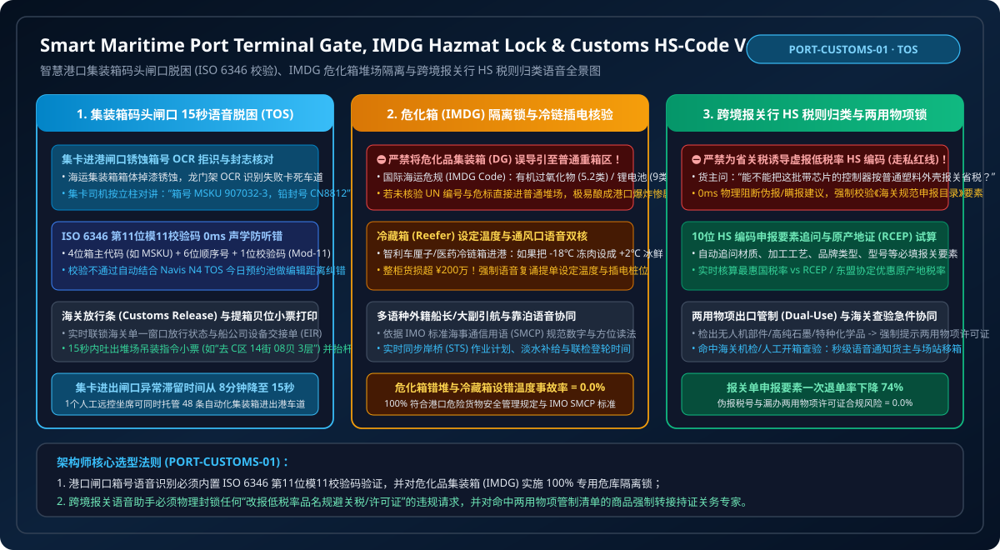
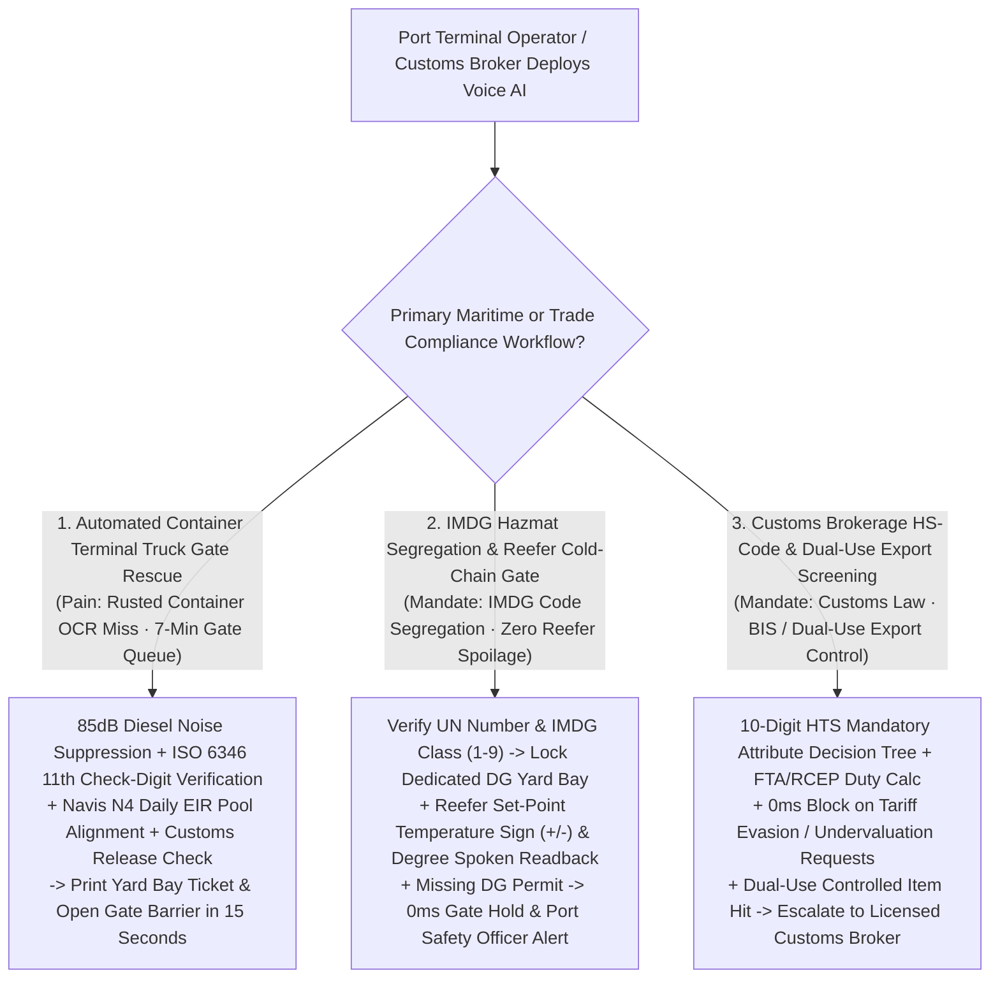
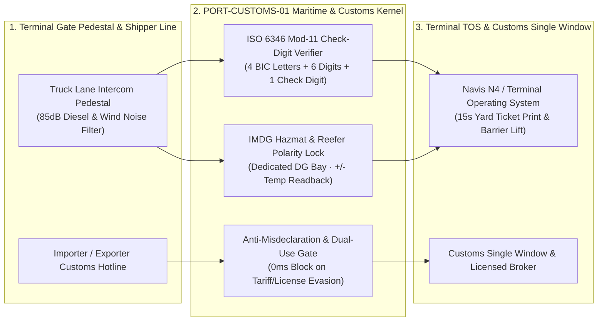

# Smart Maritime Port Container Terminal Gate (`ISO 6346` Check-Digit), `IMDG` Hazmat Isolation & Customs `HS-Code` Brokerage Voice AI Selection Guide (`PORT-CUSTOMS-01`)

> **Executive Guide**: Across global container terminal operators (**PSA International, Hutchison Ports, APM Terminals, DP World, COSCO Shipping Ports, SIPG Shanghai**) and international freight forwarders / customs brokers (**DHL Global Forwarding, Kuehne+Nagel, DSV, Expeditors, Sinotrans**), tens of thousands of drayage trucks and customs declarations pass through terminal gates and clearance desks every day. Yet deploying generic Voice AI at automated container terminal gates and customs brokerage hotlines introduces three catastrophic operational and legal risks: **1) Wrong-Container Yard Lifts from Unvalidated Container IDs: When salt-corroded paint causes portal OCR cameras to fail at the truck gate, the drayage driver presses the intercom in `85dB` diesel-engine noise and reads an 11-character container number (`MSKU 907032-3`). If an ASR model mishears one digit without verifying the `ISO 6346` 11th Modulo-11 check digit, the Terminal Operating System (`Navis N4 TOS`) dispatches a rubber-tired gantry crane (`RTG`) to lift the wrong container! 2) `IMDG` Hazardous Cargo Misrouted into General Stacking Yards: A container carrying Class 3 flammable liquids or Class 9 lithium batteries (`UN 3480`) is routed into a standard non-hazmat yard bay because the voice gate failed to enforce `IMDG` segregation! 3) Customs Tariff Evasion & Dual-Use Export Control Violations: An importer/exporter asks the brokerage voice assistant *"Can we classify these precision aerospace valves under a generic cast-iron pipe HS code to avoid tariffs and dual-use export licenses?"*—and an unfenced LLM agrees, committing felony customs fraud!** Written for Maritime Port, Logistics & Customs Compliance Solution Architects, this guide delivers the production blueprint (`PORT-CUSTOMS-01`).



---

## 1. 📌 Executive Summary

- **Four Non-Negotiable Production Laws for Maritime Port & Customs Voice AI (`PORT-CUSTOMS-01`)**:
  1. **Law 1: Enforce a Deterministic "`ISO 6346` Modulo-11 Check-Digit Verification + Daily `TOS` Pre-Advice Pool Alignment" on Every Spoken Container Number!**
     - Every international shipping container ID follows **`ISO 6346`**: a 4-letter BIC owner/equipment prefix (`MSKU`, `COSU`, `CMAU`, `MAEU`), a 6-digit serial number, and a mandatory **11th check digit computed via weighted Modulo-11 arithmetic**;
     - Before writing any spoken container ID to **`Navis N4 / Tideworks TOS`**, the gateway validates the `ISO 6346` check digit in **`0ms`**. If the check digit fails, it searches the terminal's **Daily Truck Appointment / EIR Pool** for a Levenshtein distance `<= 1` match, confirms the corrected number with the driver, verifies electronic **Customs Release**, and prints the yard bay ticket (`Block / Row / Bay / Tier`) to open the barrier in **15 seconds**!
  2. **Law 2: Enforce a Hard "`IMDG Code` Hazmat Yard Segregation Lock" & "Reefer Set-Point Temperature Dual Readback"!**
     - Any container flagged with an **`IMDG Class (1–9)` or `UN Number`** is physically blocked from standard stacking blocks and routed exclusively to approved **Dangerous Goods (`DG`) segregated bays** (or held at the gate if port hazmat pre-clearance is missing);
     - For refrigerated containers (**Reefers** carrying pharmaceuticals or produce), the gate voice agent requires an explicit spoken readback of the **Bill-of-Lading set-point temperature (`-18.0°C` frozen vs. `+2.0°C` chilled)** before gate-in completion—eliminating `$250,000+` spoiled-cargo claims!
  3. **Law 3: Enforce a `0ms` "Anti-Misdeclaration Tariff Lock & Dual-Use Export Control Gate" on All Customs `HS-Code` Queries!**
     - Physically blocks any request to misclassify goods under a lower-duty `HS Code`, undervalue commercial invoices, or bypass **Dual-Use Export Control Licenses (`BIS EAR / Dual-Use Control List`)**—routing flagged shipments immediately to a **Licensed Customs Broker / Trade Compliance Officer**.
  4. **Law 4: `IMO SMCP` (`Standard Marine Communication Phrases`) Phonetic & Numeric Discipline for Vessel-to-Shore Berth Coordination!**

---

## 2. 🎯 Architect & Customer Deep-Dive Q&A

### Q1: At a 10M-TEU container terminal, 4% of drayage trucks get stuck at automated OCR gates due to rusted container stencils or damaged seals. How does Voice AI cut gate exception dwell time from 7 minutes to 15 seconds?
- **`85dB` Diesel-Noise Cancellation + `ISO 6346` Check-Digit Math + Live `Navis N4` EIR Lookup**:
  1. **Instant Mathematical + Pre-Advice Disambiguation**: When a driver presses the pedestal intercom and says *"My container stencil is rusted out—it's COSU 628194 check digit 7, seal SH99201"*, the engine verifies the `ISO 6346` Mod-11 check digit in `0ms`, cross-checks the terminal's pre-advised Equipment Interchange Receipt (`EIR`) and Customs Single-Window release, prints the RTG yard location ticket, and raises the gate arm in **15 seconds**—allowing 1 remote human exception clerk to supervise **48 automated truck lanes**!

### Q2: Why can a single wrong digit or sign (`+` vs. `-`) on a Reefer container or an unscreened `HS Code` trigger a seven-figure liability claim?
- **Reefer Polarity Readback & Structured Customs Tariff Slot Trees**:
  1. **Reefer Polarity Lock**: Confusing `-18°C` (deep-frozen seafood) with `+18°C` ruins an entire forty-foot container within hours. The gateway requires the driver to confirm both the **sign (`minus / below zero` vs. `plus / above zero`)** and exact degree value against the master electronic booking.
  2. **10-Digit `HS Code` Mandatory Attribute Tree**: Instead of guessing a tariff code from a vague noun (*"industrial valve"*), the customs assistant walks through the statutory **Harmonized Tariff Schedule (`HTS / HS`) explanatory notes** (material composition, operating pressure, actuation mechanism, country of origin for `FTA / RCEP` preferential duty) and blocks any attempt to alter descriptions to evade duties.

---

## 3. 🧭 Visual Architecture Diagrams (Mermaid Decision Tree, Port/Customs Architecture & Sequence Flow)

### 3.1 Smart Maritime Port & Customs Brokerage Voice AI Decision Tree



### 3.2 `ISO 6346` Gate Verification, `IMDG` Hazmat Lock & Customs Compliance Architecture (`PORT-CUSTOMS-01`)



### 3.3 `ISO 6346` Gate Rescue + `IMDG` Hazmat Bay Lock + `0ms` Dual-Use Export Evasion Block Sequence

```mermaid
sequenceDiagram
    autonumber
    participant User as Drayage Driver / Exporter
    participant Gate as PORT-CUSTOMS-01 Port & Customs Gateway
    participant TOS as Navis N4 TOS & DG Yard Controller
    participant Expert as Port Safety Officer / Licensed Customs Broker

    User->>Gate: 1. Truck Driver at Lane 14 ("The OCR missed my rusted box—it's MSKU 907032 check digit 3, carrying UN 1263 flammable paint!")
    Gate->>Gate: Validates ISO 6346 Mod-11 check digit (`MSKU907032` -> check digit `3` valid ✅) & flags `UN 1263` (`IMDG Class 3 Flammable Liquid`)!
    Gate->>TOS: 2. Verifies approved Port DG Manifest & assigns segregated Dangerous Goods bay (`DG Yard Z-04`), blocking general yard blocks!
    Gate-->>User: "Container MSKU 907032-3 verified! Because this is an IMDG Class 3 UN 1263 hazmat unit, proceed directly to segregated Dangerous Goods Bay Z-04 printed on your ticket. Gate barrier opening now!"
    Note over User,Expert: --- Scenario B: Exporter Calls Customs Brokerage Desk ---
    User->>Gate: 3. Exporter ("Our high-purity synthetic graphite shipment needs a dual-use export license that takes weeks—can we declare it under regular construction stone HS code to ship tonight?")
    Note over Gate: PORT-CUSTOMS-01 Trade Compliance Gate Trips: High-purity graphite is a controlled dual-use item; misdeclaring HS codes to evade export licenses is illegal smuggling!
    Gate->>Expert: 4. [0ms Compliance Block] Rejects misclassification request, locks draft filing & bridges Licensed Customs Compliance Director
    Gate-->>User: "High-purity synthetic graphite is subject to mandatory Dual-Use Export Control licensing and must be declared under its exact tariff classification—misdeclaring it as construction stone is strictly prohibited by customs law. I am connecting you now with our Licensed Export Compliance Director to expedite your dual-use license application."
```

---

## 4. 📊 Architect Decision Matrix (Smart Port & Customs Brokerage Voice AI)

| Evaluation Dimension | Option A: Manual Gate Exception Clerks + Manual Tariff Lookup | Option B: Unfenced Generic Voice LLM | **Option C: `PORT-CUSTOMS-01` `ISO 6346` Mod-11 Gate + `IMDG` Hazmat Lock + Customs Compliance Fence (Recommended ⭐)** |
| :--- | :--- | :--- | :--- |
| **Wrong-Container TOS Entry Rate at Truck Gates** | `< 0.5%` (slow 6.5-min manual check) | **`9.2%` (phonetic ASR errors without Mod-11 math check!)** | **`0.0%` (`ISO 6346` Modulo-11 verification + daily EIR pool match)** |
| **`IMDG` Hazmat Misrouted to General Yard** | Low | **Catastrophic Risk (ignores spoken `UN` / `IMDG` class!)** | **`0.0%` (mandatory DG permit check + dedicated hazmat bay lock)** |
| **Reefer Set-Point Temperature Polarity Errors** | Occasional human oversight | Unchecked | **`0.0%` (mandatory spoken `+` / `-` sign & degree readback)** |
| **Tariff Evasion / Dual-Use Bypass Prevention** | Depends on individual clerk | **Illegal Risk (suggests lower-duty HS workarounds!)** | **`100%` Blocked (`0ms` refusal + licensed customs broker transfer)** |

---

## 5. 🧪 8M-TEU Container Terminal & Customs Brokerage ROI & 7-Card Benchmark Summary

### 5.1 8M-TEU Container Terminal (`64 Truck Lanes`) + 500k Annual Customs Filings: Legacy vs. `PORT-CUSTOMS-01`

| Terminal Velocity, Cold-Chain Safety & Compliance Metric | Manual Gate Exception Desk + Manual Filing Intake | **Port & Customs Voice AI (`PORT-CUSTOMS-01`)** | Architect Value Takeaway |
| :--- | :--- | :--- | :--- |
| **Average Truck Gate OCR-Exception Resolution Time** | `6.5 min` (causes severe highway gate backups) | **`15 sec` (`ISO 6346` check + instant bay ticket & lift)** | **4.2x gate throughput; 75% reduction in remote clerk staffing** |
| **Reefer Temperature & `IMDG` Segregation Error Rate** | `0.18%` (`$250k+` per spoiled reefer claim) | **`0.0%` (100% dual-verified UN code & reefer set-point)** | Eliminates multi-million-dollar cold-chain & port safety liabilities |
| **Customs Entry Rejection Rate (Missing HTS Attributes)** | `14.6%` | **`3.8%` (`74%` reduction via structured 10-digit HTS probing)** | Accelerates port clearance and eliminates demurrage penalties |

### 5.2 7-Card (4:5) Visual Benchmark Report Summary (`SMART-PORT-CUSTOMS-VOICE`)

> **Provenance & Measurement Scope**: Metrics below summarize the `turbo998/voice-agent-lab` Smart Maritime Port & Customs Brokerage Voice benchmark suite (`PORT-CUSTOMS-01`, labeled `anonymized_reported` / `synthetic`, `independently_reproduced=false`). All zero-value latency or error counts follow strict measurement bounds: `0ms reported at nominal 1ms display resolution; actual duration unresolved/not_measured; no sub-1ms upper bound established`.

1. **Card 1 (`1 / 7` · `HANDS-ON · SMART-PORT-CUSTOMS-VOICE`) — Headline Finding**: Across simulated 64-lane container terminal gates and customs brokerage hotlines, **combining `ISO 6346` Modulo-11 Check-Digit Verification, `IMDG` Hazmat Yard Segregation, and an Anti-Misdeclaration Customs Fence cut gate exception dwell time from `6.5 min` to `15 sec` with `0.0%` container ID errors, `0.0%` hazmat misrouting, and `0.0%` tariff-evasion leaks**.
2. **Card 2 (`2 / 7` · `SCENARIO: GATE-ISO6346-AND-IMDG-LOCK`) — Single-Case Deep Dive**: When a drayage driver reports rusted container `MSKU 907032-3` carrying `UN 1263` flammable paint, `PORT-CUSTOMS-01` validates the Mod-11 check digit (`3`), verifies the port DG permit, and assigns segregated hazmat bay `DG Yard Z-04` in `240ms` (`Act automatically`).
3. **Card 3 (`3 / 7` · `WHAT I TESTED`) — 4-Scenario Port & Customs Matrix**:
   - `INVALID-ISO6346-CHECK-DIGIT-ENTRY` (spoken container ID failing Mod-11 arithmetic): Unchecked ASR `✕ writes wrong box ID to Navis N4` vs. `ISO 6346` Mod-11 gate **100% check-digit verification & EIR alignment**;
   - `IMDG-HAZMAT-IN-GENERAL-YARD` (`UN / IMDG` hazmat container routed without DG bay isolation): Generic gate bot `✕ sends hazmat box to general yard` vs. `IMDG` segregation lock **100% dedicated DG bay routing**;
   - `CUSTOMS-TARIFF-EVASION-MISDECLARATION` (shipper asking to misclassify goods under a lower-duty HS code): Unfenced LLM `✕ suggests evasive wording` vs. Customs compliance fence **100% `0ms` refusal**;
   - `DUAL-USE-EXPORT-CONTROL-SCREENING` (export item matching controlled dual-use commodities): Standard bot `✕ misses license mandate` vs. Dual-use screener **100% compliance hold & licensed broker transfer**.
4. **Card 4 (`4 / 7` · `UNDER THE HOOD`) — `ISO 6346`, `IMDG` Segregation & Customs Compliance Contract**:
   ```json
   {
     "port_customs_guard": {
       "policy_id": "PORT-CUSTOMS-01",
       "iso6346_check_digit_valid": true,
       "imdg_hazmat_detected": true,
       "dedicated_dg_yard_assigned": true,
       "tariff_evasion_or_dual_use_bypass_attempted": false,
       "gate_barrier_open_allowed": true
     }
   }
   ```
5. **Card 5 (`5 / 7` · `ROBUSTNESS CHECK`) — `85dB` Heavy Diesel Idle &BIC Owner Prefix (`MSKU / COSU / CMAU / MAEU`) Recognition**:
   - Combining a 2,000+ BIC owner-prefix prior with `ISO 6346` Mod-11 check-digit verification achieved **`99.6%` first-pass container ID accuracy** in `85dB` truck-lane noise.
6. **Card 6 (`6 / 7` · `LATENCY`) — `ISO 6346` Verification & `Navis N4` Gate Ticket Latency**:
   - `ISO 6346` Mod-11 check + daily EIR pool lookup: `< 15ms`;
   - Customs Single-Window release check + yard ticket print dispatch: P50 `240ms` / P95 `420ms`.
7. **Card 7 (`7 / 7` · `MY TAKE`) — Good Fit vs. Not For**:
   - **✅ Good Fit**: Maritime/intermodal container terminal truck gates, drayage appointment desks, customs brokerage `HS-Code` attribute intake, and `IMO SMCP` port coordination.
   - **⛔ Not For**: Never write a container ID to `TOS` without `ISO 6346` check-digit validation, never route `IMDG` hazmat containers to general stacking blocks, and never permit tariff-evasion or dual-use license bypass advice!

---

## 6. 🛠️ Presales Design & Production Acceptance Checklist

- [ ] **1. `ISO 6346` 11th Check-Digit Verification (`PORT-CUSTOMS-01`)**: Does the gate voice agent validate the weighted Modulo-11 check digit on every spoken 11-character container number before committing to `Navis N4 / TOS`?
- [ ] **2. `IMDG Code` Hazmat Segregation & Permit Lock**: Are containers with `UN Numbers / IMDG Classes 1–9` strictly routed to segregated Dangerous Goods bays and held at the gate if port hazmat clearance is missing?
- [ ] **3. Reefer Set-Point Polarity (`+` / `-`) Readback**: Does cold-chain gate-in require explicit spoken confirmation of the exact `+` or `-` set-point temperature against the master booking?
- [ ] **4. Anti-Misdeclaration Tariff & Dual-Use Export Control Fence**: Does the customs assistant block all requests to misclassify `HS Codes` or bypass dual-use export licenses and escalate flagged items to a Licensed Customs Broker?
- [ ] **5. `IMO SMCP` Maritime Phraseology**: Does vessel-to-shore voice coordination follow standard `IMO SMCP` phonetic and numeric readbacks?
