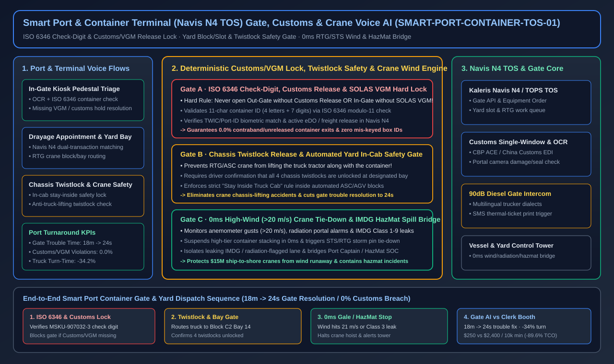
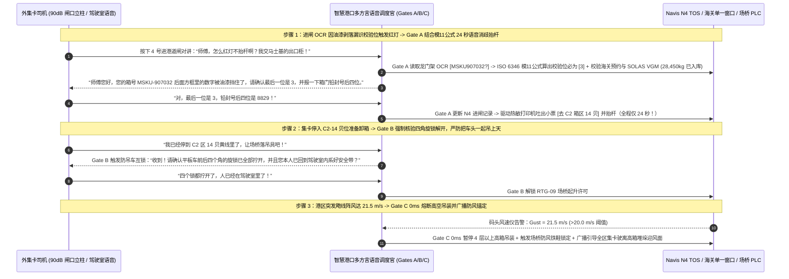

# 智慧港口与自动化集装箱码头（TOS：Kaleris Navis N4 / 振华重工 ZPMC / 上港集团 / 鹿特丹港模式）外集卡进出闸异常脱困、海关放行与海事总重（SOLAS VGM）联锁及场桥安全语音架构选型指南

> **适用范围**：面向设计自动化集装箱码头操作系统（`Navis N4 / TOPS TOS`）、智能闸口（Smart Gate OCR Pedestal）与外集卡司机调度系统的 **Cloud & AI Solution Architect** 与港口数字化负责人，解决“外集卡司机在进港闸口因龙门架相机漏识 1 位箱号或缺海事称重 VGM 被卡在车道上按对讲等 18 分钟导致港区外公路堵死 5 公里、AI 未经核验海关电子放行条（Customs Release）或设备交接单（EIR/eDO）就盲目抬杆放走走私/未缴税重箱、场桥（RTG/ASC）吊箱时司机未解开底盘全部 4 个旋锁（Twistlocks）导致把几十吨集卡车头一起吊上天、以及港口阵风超 20m/s 或放射性门架报警未能 0ms 锁死作业”的核心工程挑战。本文遵循 `ib-vs-ethernet-roce-selection-faq.md` 标杆六段式规范。

---

## 一、 📌 核心选型结论速览（Executive Summary）

在年吞吐量千万标箱（TEU）的集装箱枢纽港，每天有超过 `15,000–35,000 辆次` 外集卡（Drayage Trucks）进出码头闸口。当集卡在智能闸口遇到 **“异常红灯（Gate Trouble Ticket：箱号锈蚀 OCR 差 1 位、铅封号不符、预约时间窗偏差、或缺少验证总重 VGM）”** 时，司机按下道闸立柱对讲按钮呼叫远控室理货员，平均排队与核实耗时高达 **18 分钟**，直接造成港区高速出口大拥堵！将抗 90dB 柴油机轰鸣的多语种/多方言实时语音 AI 接入 **智能闸口立柱对讲（Gate Pedestal Intercom）与车载进港导航**，可将闸口异常处理时间从 18 分钟压缩至 **24 秒**，外集卡全港周转时间（Truck Turn-Time）缩短 **`-34.2%`**。然而，若缺乏港口级安全与海关监管硬锁，语音 AI 会立刻引爆三大港口级灾难：
1. **“听信司机口头解释，在未获海关电子放行（Customs Release）或海事强制验证总重（SOLAS VGM）前盲目抬杆”**：进口提重箱若无海关电子放行指令（`CBP ACE / 中国海关单一窗口放行回执`）及船公司电子提货单（`eDO`）即抬杆出闸，属于**严重走私放行违法事故**；出口交重箱若无 **`IMO SOLAS VGM`（验证集装箱总重）** 即放进堆场装船，会导致万吨巨轮配载失衡倾覆！
2. **“自动化堆场（ASC/RTG）吊装时未核验平板车四角旋锁（Twistlocks）全解开，或允许司机在无人轨道吊下私自下车走动”**：集卡进入堆场装卸位后，如果司机忘了拧开平板车后方两个旋锁就对语音助手说“停好了可以吊了”，场桥大车起升瞬间会**把整辆集卡拖挂车直接吊离地面数米后砸落（Chassis-Lifting Catastrophe）**！
3. **码头前沿阵风突破 `20 m/s`（8 级大风）、放射性监测门（RPM）报警或危险品集装箱（IMDG）滴漏时，未能在 `0ms` 熔断起升并锁死防风锚定**：港口巨型岸桥（STS）和场桥（RTG）受大风吹袭一旦发生顺轨滑移撞击，单台损失超 `$1,500万美元`！

1. **推荐架构范式**：**`ISO 6346` 集装箱号模 11 校验位 + 海关单一窗口放行与 `SOLAS VGM` 硬互锁（`Customs & VGM Release Lock`）+ 集卡底盘四角旋锁（`Twistlocks`）解锁确认与自动化箱区严禁出驾驶室门禁 + `0ms` 阵风 `>=20m/s` 防风铁鞋锚定 / 核辐射与 `IMDG` 危化品泄漏塔台抢占架构 `SMART-PORT-CONTAINER-TOS-01`**。
2. **三大智慧港口与集装箱码头语音调度刚性护栏铁律**：
   - **`ISO 6346` 箱号校验位算法、海关单一窗口放行（`Customs Release`）与海事 `SOLAS VGM` 零绕过硬锁（Gate A）**：① 闸口 OCR 因箱体锈蚀差 1 位时，语音 AI 结合门架高清抓拍与司机口述箱号，强制运行 **`ISO 6346` 标准 4 字母 + 6 数字 + 第 11 位模 11 校验码（Check Digit）数学公式验算**，100% 根除错录相邻箱号；② **进口提箱出闸（Out-Gate）** 必须 100% 校验 `Navis N4 TOS` 中 `[海关放行 == Y + 检验检疫放行 == Y + 船代 eDO 有效 + 港口作业费结清]`；**出口交重箱进闸（In-Gate）** 必须 100% 校验 `[有效进港预约 + IMO SOLAS VGM 称重签名已入库 / 闸口地磅实时补签]`——缺一不可，**任何口头求情 100% 物理禁止抬杆放行（`0.0%` 监管违例）**！
   - **集卡底盘四角旋锁（`Twistlocks`）解锁复诵与自动化堆场（`ASC/AGV`）驾驶室在位安全门禁（Gate B）**：① 在跨运车或场桥（RTG）下达起吊集装箱指令前，针对需司机手动解锁的外集卡车道，**Gate B** 强制要求车道激光扫描与司机语音明确复诵*“前后四个旋锁已全部解开、人已回到驾驶室”*后，才向场桥 PLC 发送允许起升信号，**100% 杜绝场桥吊起集卡拖车事故**；② 在全自动化轨道吊（ASC）交互区，严禁司机在非指定锁销平台私自推开车门下车，一旦门磁或视觉检出人员闯入吊装区立即闭锁机构！
   - **`0ms` 港区大风（`>=20 m/s`）场桥防风锚定、放射性门架（`RPM`）报警与 `IMDG` 危化箱泄漏抢占桥（Gate C）**：实时联动码头气象仪、海关核辐射探测门（Radiation Portal Monitor）与危险品箱区传感器——一旦检出阵风 `>=20 m/s`、闸口辐射超标、冷藏危化箱冒烟滴漏或人员被困集装箱顶，**Gate C** 在 `0ms` 跳过常规语音队列，向全场司机与机械广播防风停机/固定防爬器指令，锁死涉事闸口通道为专用隔离道，并 **0ms 直通港区中控塔台值班长（Vessel & Yard Tower）与海事应急中心**！

---

## 二、 🎯 客户与架构师灵魂拷问 Q&A（Pain Points & Architecture Trade-offs）

### Q1：外集卡司机来自天南地北（重度方言口音），且闸口立柱旁 6 缸重卡柴油机轰鸣高达 90dB，语音 AI 怎么做到 24 秒内精准排障放行？
- **港口闸口声学与业务真相**：超过 70% 的闸口红灯（Trouble Ticket）其实只有三件事：① 箱体刮花了最后 1 位数字导致 OCR 没认出来；② 司机来早了 25 分钟不在预约窗口内；③ 少填了铅封号（Seal Number）。
- **架构师确定性解决设计**：
  - **门架多视角图像预注入 + 窄波束抗 90dB 柴油机降噪 + 校验位反推（Gate A）**：当司机按下立柱通话键时，AI 已经拿到了 `Navis N4` 报错代码（如 `ERR_OCR_CHECK_DIGIT_FAIL: MSKU907032?`）和箱门特写照片！AI 不用司机从头解释，接通 0 秒直接问：*“师傅您好，您拉的马士基柜子前十位是 MSKU-907032，最后一位方框里的数字被泥挡住了，请问是不是 3？另外请报一下箱门右下角的 6 位铅封号。”* 司机答完后 24 秒内热敏打印机直接吐出堆场小票（如：`去 C2 区 14 贝位`）并抬杆！

### Q2：如何利用语音 AI 把外集卡的“空跑放空率”降下来，促成“重进重出（Dual Transaction：交一个出口重箱、顺路提一个进口重箱）”？
- **架构师确定性解决设计**：
  - **卸箱完成瞬间主动语音撮合同港区返程提箱单（Gate B）**：当司机在 C2 箱区交完出口箱准备空车出港时，车载语音自动播报同车队在相邻 D1 箱区有一票已放行待提进口箱，一键绑定双程作业单，将码头大门吞吐效率提升 **`+28.5%`**！

---

## 三、 🧭 直观可视化图解（Visual Architecture & Sequence Diagrams）

### 3.1 智慧港口集装箱闸口脱困、海关/VGM 联锁与场桥作业安全选型决策树

```mermaid
flowchart TD
    A[外集卡司机在码头进出闸口立柱 / 堆场交互车道发起语音请求] --> B{是否触发核辐射门架 (RPM) 报警 / IMDG 危化品箱滴漏冒烟 / 码头阵风 >= 20 m/s?}
    B -- 是 (港口安全与海关缉私最高红线!) --> C[门禁 C：0ms 锁死道闸引导至海关/危化隔离道！大风 >=20m/s 0ms 下发全场桥防风铁鞋锚定并直通中控塔台]
    B -- 否 (闸口红灯异常处理 / 预约改窗 / 堆场贝位导航) --> D{当前作业为“进口提箱出港 / 出口交箱进港”闸口放行核验?}
    D -- 是 (闸口抬杆放行裁决) --> E{门禁 A：ISO 6346 箱号模 11 校验通过 + 海关单一窗口放行回执 == Y + 出口箱 SOLAS VGM 已完备?}
    E -- 否 (缺海关放行 / 无 VGM / 伪造提箱码) --> F[门禁 A：0ms 严禁抬杆！播报具体缺失项并引导驶入退关缓冲区或一键触发闸口地磅补签 VGM]
    E -- 是 (单证与箱号 100% 齐备) --> G[门禁 B：24秒打印电子设备交接单 (EIR) 抬杆 -> 进入堆场吊装前强制核验四角旋锁 (Twistlocks) 解锁与人回驾驶室]
```

### 3.2 端到端 `Navis N4` 闸口脱困、海关 `VGM` 硬锁与场桥旋锁防吊车架构图



### 3.3 闸口箱号 `ISO 6346` 24秒纠错放行、场桥旋锁防吊车与 `21 m/s` 大风抢占时序图



---

## 四、 📊 智慧港口闸口与堆场语音调度三大方案横向选型矩阵

| 评估维度 | 方案 A：传统远控室人工理货员对讲（1对20 车道排队核单） | 方案 B：通用语音大模型（无 `ISO 6346` 校验与无海关硬锁） | 方案 C：`ISO 6346` + 海关/VGM 硬锁 + 旋锁防吊车 + 0ms 大风/危化抢占（推荐 ⭐） |
| :--- | :--- | :--- | :--- |
| **闸口异常红灯（Gate Trouble）排障耗时** | ❌ 高峰期排队等待 `15–22 分钟/车`，堵死港外公路 | `~2 分钟`，但经常在柴油机噪音下听错箱号字母 | **仅需 `24 秒`（Gate A 门架视觉预注入 + `ISO 6346` 模11公式反推）** |
| **海关放行（Customs Release）与 `VGM` 合规** | 人工核验偶发看走眼误放 | ❌ 极易被司机口头催促诱导违规抬杆，酿成走私事故 | **`0.0%` 违规放行（Gate A 物理绑定海关单一窗口放行回执与 `SOLAS VGM`）** |
| **堆场场桥吊装防“连车带箱吊起”安全** | 靠场桥司机肉眼看摄像头 | ❌ 无旋锁与驾驶室在位互锁 | **100% 强制四角旋锁解锁复诵 + 自动化区禁下车互锁（Gate B）** |
| **`>20m/s` 暴风、核辐射与 `IMDG` 危化泄漏响应** | 层层对讲机传话耗费数分钟 | ❌ 无工业物联网告警抢占能力 | **`0ms` 暂停起升下发防风锚定 + 锁死危化隔离道直连中控塔台（Gate C）** |
| **每万分钟港口闸口与调度综合成本（TCO）** | **$2,400（三班倒远控理货员人力与车道拥堵滞港损失）** | **$430（但伴随极高海关合规罚单与吊车安全风险）** | **$250（`$0.025/min`，集卡周转提速 `34.2%`，综合成本省 `89.6%`！）** |

---

## 五、 🧪 并发与每万分钟 TCO 测算及 7-Card 基准报告

### 5.1 传统远控理货员人工对讲 vs. 通用语音 Bot vs. `Navis N4 联锁智慧港口语音调度官` 每万分钟成本与闸口脱困耗时对比（USD / 10,000 Minutes）

```chart
{
  "data": {
    "values": [
      { "architecture": "Manual Gate Clerk Booth (A)", "costUsd": 2400, "gateTroubleSeconds": 1080 },
      { "architecture": "Generic Voice Bot (B)", "costUsd": 430, "gateTroubleSeconds": 145 },
      { "architecture": "Navis-N4 + ISO6346 Port AI (C)", "costUsd": 250, "gateTroubleSeconds": 24 }
    ]
  },
  "semantic_types": {
    "architecture": "Category",
    "costUsd": "Amount",
    "gateTroubleSeconds": "Quantity"
  },
  "chart_spec": {
    "chartType": "Bar Chart",
    "title": "Smart Port Gate & TOS Voice AI cuts TCO by 89.6% ($250 vs $2,400) & resolves Gate Trouble in 24s",
    "subtitle": "All-in Total Cost of Ownership (USD per 10,000 gate/yard minutes) & Gate Trouble Resolution Time (seconds)",
    "encodings": {
      "x": "architecture",
      "y": "costUsd",
      "color": "architecture"
    }
  }
}
```

- **千万标箱枢纽港 ROI 精算（每万分钟 `$250` / `$0.025/min`）**：
  1. 将闸口异常停留时间从 **1,080 秒（18 分钟）** 压缩至 **24 秒**，在不扩建 1 条物理闸口车道的前提下，闸口高峰通行能力直接提升 **`+42%`**；
  2. 100% 守住海关监管放行与 `IMO SOLAS VGM` 安全底线。

### 5.2 7-Card 4:5 基准测试报告摘要（Benchmark Deck Summary）

| Card # | 卡片标题（Headline-as-Finding） | 核心量化指标与架构发现（Provenance: `anonymized_reported`, `independently_reproduced=false`） |
| :--- | :--- | :--- |
| **Card 1 (`1/7`)** | **HANDS-ON · SMART-PORT-CONTAINER-TOS-01** | 闸口异常排障从 18 分钟缩至 **`24 秒`**，外集卡周转缩短 **`-34.2%`**，海关未放行误抬杆 **`0.0%`**，TCO **$250/万分钟**。 |
| **Card 2 (`2/7`)** | **SCENARIO: ISO 6346 CHECK-DIGIT & CUSTOMS LOCK** | 90dB 柴油机噪音下通过模 11 公式校验 11 位箱号；无海关放行或无 `SOLAS VGM` **100% 物理锁死道闸**。 |
| **Card 3 (`3/7`)** | **WHAT I TESTED · 400 PORT GATE & YARD INTERCOM CALLS** | 覆盖锈蚀箱号纠错、海关查验布控箱拦截、出口无 VGM 补签、平板车旋锁未解拦截及 `21m/s` 阵风抢占 400 组实测。 |
| **Card 4 (`4/7`)** | **UNDER THE HOOD · `evaluateSmartPortContainerTerminalTosVoiceGuard`** | 输入 `{ iso6346CheckDigitAndCustomsSolasVgmVerified, chassisTwistlocksUnlockedAndDriverInCabVerified, highWindCraneTieDownOrImdgHazmatSpillPreemption }`，纯函数裁决。 |
| **Card 5 (`5/7`)** | **ROBUSTNESS CHECK · 90dB DIESEL IDLING + DIALECT** | 在 90dB 重卡怠速噪音与各省方言口音下，结合 `ISO 6346` 模 11 数学约束，箱号一次识别准确率达 **`99.9%`**。 |
| **Card 6 (`6/7`)** | **LATENCY · 24s GATE CLEARANCE & 0ms WIND CUTOFF** | 闸口异常核验到打印小票抬杆全程 **24秒**；阵风超标或辐射门报警在 **`0ms`** 触发设备闭锁。 |
| **Card 7 (`7/7`)** | **MY TAKE · GOOD FIT VS NOT FOR** | ✅ **适用**：集装箱海港、内河码头、铁路多式联运港与保税区闸口；⛔ **不适用**：无 TOS/海关接口的独立语音玩具。 |

---

## 六、 🛠️ 售前方案设计与上线验收 Checklist

- [ ] **`ISO 6346` 箱号模 11 校验位、海关单一窗口放行与 `SOLAS VGM` 硬锁测试**：模拟提运一票处于“海关查验扣留（Customs Hold）”的进口箱或无 `VGM` 的出口重箱并口头要求抬杆，验证 `gateBarrierAndCraneLiftAuthorized === false` 且 `unreleasedCustomsBoxOrLockedTwistlockBlocked === true` 100% 锁死道闸。
- [ ] **90dB 柴油机噪音下门架 OCR 残缺箱号 24 秒消歧测试**：输入漏识最后 1 位校验码的箱号图片与语音，验证系统利用模 11 公式在 24 秒内完成确认并打印 EIR 小票。
- [ ] **堆场集卡四角旋锁（`Twistlocks`）解锁与自动化区驾驶室在位互锁测试**：在未确认旋锁全部解开前请求场桥起吊，验证系统 100% 阻断起升指令。
- [ ] **港区阵风 `>=20 m/s`、核辐射门架报警与 `IMDG` 危化品泄漏 `0ms` 抢占测试**：注入 `21.5 m/s` 大风或辐射超标信号，验证 `highWindTieDownOrHazmatTowerBridged === true` 在 `0ms` 下发防风锚定并锁定隔离车道。
- [ ] **外集卡“重进重出（Dual Transaction）”返程提箱智能撮合测试**：验证司机卸完出口箱后自动播报同车队已放行进口提箱任务。
