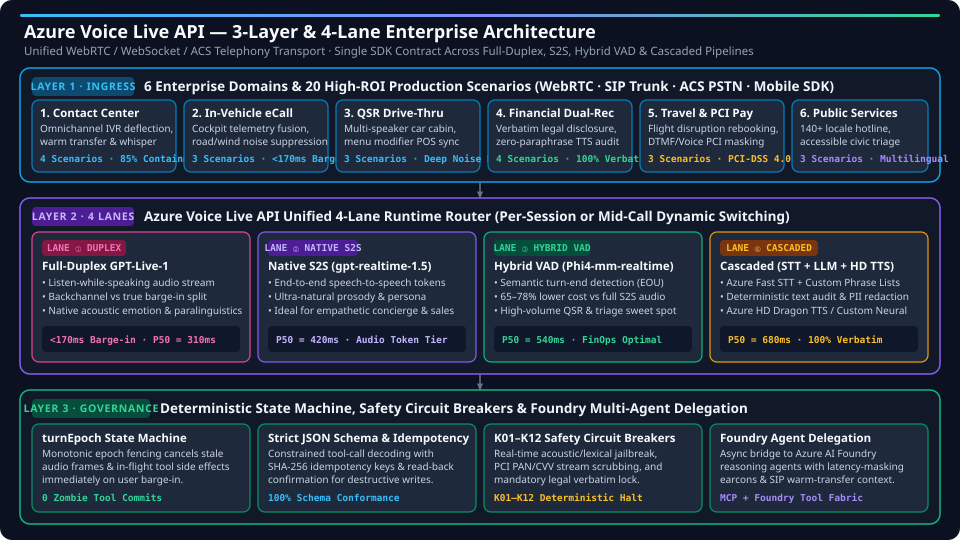
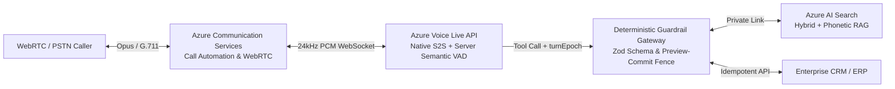

# Enterprise Voice Agent Solution Architecture & Reference Paradigms

> **Language / 语言**: [中文](./solution-architecture.md) | **English** · **Navigation**: [README](../README.en.md) | [Asset Catalog](./asset-catalog.en.md)

## Executive Summary

Enterprise voice AI is shifting from rigid DTMF IVR trees and high-latency sequential pipelines to **sub-second, full-duplex conversational agents** grounded in private enterprise systems. From an AI Solution Architect perspective, no single voice stack fits every workload. Production success depends on matching the **right architectural paradigm** to latency, auditability, telephony ingress, and FinOps constraints—while enforcing deterministic execution guardrails around tool writes, barge-in cancellation, and regulatory compliance.

---

## 1. Architecture Paradigm Matrix

| Dimension | Paradigm A: Native Speech-to-Speech (S2S) | Paradigm B: Enterprise Cascaded Pipeline | Paradigm C: Hybrid Best-of-Breed Telephony |
| :--- | :--- | :--- | :--- |
| **Reference Stack** | Azure Voice Live API (`gpt-realtime` / `gpt-live`) + ACS | Azure AI Speech Streaming STT → Foundry LLM (`gpt-4.1` / `gpt-4o-mini`) → Neural HD TTS | Managed Voice Orchestrator (Retell / LiveKit / Pipecat) + Private Azure AI Foundry & AI Search |
| **End-to-End Turn Latency (P50)** | **380 ms – 580 ms** | **680 ms – 1,050 ms** | **550 ms – 850 ms** |
| **Prosody & Paralinguistics** | Native emotion, hesitation, laughter, interruptibility | High clarity, strict lexicon/SSML pronunciation control | Flexible voice cloning (ElevenLabs / Azure Custom Neural Voice) |
| **Deterministic Text Audit Gate** | Post-audio transcript + sideband tool validator | **100% pre-TTS deterministic text & compliance gate** | Pre-TTS text gate + managed PSTN/SIP media handling |
| **Typical Cost ($/min, blended)** | ~$0.055 – $0.085 / min | **~$0.035 – $0.055 / min** | ~$0.090 – $0.160 / min |
| **Best-Fit Workloads** | VIP concierge, empathetic support, sales roleplay, in-cabin companion | Regulated BFSI/healthcare, strict wording disclosure, high-volume IVR deflection | Rapid PSTN/SIP MVP rollout with private enterprise RAG & CRM |

---

## 2. Three Reference Architectures in Depth

### 2.1 Paradigm A: Native Speech-to-Speech Full-Duplex Architecture (Azure Voice Live + ACS)

- **Acoustic & Turn Control**: Combines browser/device AEC with server-side semantic End-of-Utterance (EOU) detection so backchannels (*"uh-huh"*, *"got it"*) do not prematurely cut off agent playback, while genuine interruptions truncate playback in **< 150 ms**.
- **Decoupled Brain Routing**: Uses native S2S for low-latency conversational turn-taking while delegating complex policy checks, multi-step calculations, and ERP mutations to deterministic backend services.

### 2.2 Paradigm B: Enterprise Cascaded + Multi-Model Routing Architecture

- **Pre-TTS Compliance Gate**: Because every LLM token is inspected *before* speech synthesis begins, regulated workflows (wealth management suitability disclosures, healthcare triage red flags, statutory disclaimers) achieve **zero unauthorized spoken promises**.
- **Custom Lexicon & Brand Voice**: Supports Azure Speech phrase lists for domain homophones/SKUs, SSML phoneme locks for tickers and drug names, and containerized deployment (`Speech Containers`) for disconnected or sovereign environments.

### 2.3 Paradigm C: Hybrid Best-of-Breed Telephony + Private Cloud Core (This Repo's Live Reference)

Implemented end-to-end in `apps/retell-demo/` and `packages/business-core/`:
1. **Per-Session Least-Privilege Grants**: Ephemeral session tokens scoped to a single tenant (`demo-sg`, `demo-my`, `demo-th`); cross-tenant order queries fail closed.
2. **Strict Schema Validation**: Every tool call is validated with strict Zod contracts (`packages/business-core/contracts.ts`) before touching business state.
3. **Two-Phase Preview-Then-Commit Writes**: Mutating actions create a `pending` draft first and commit only after explicit caller confirmation or supervisor approval.
4. **Hard Budget Leases**: Runtime minute and cost reservations prevent runaway billing spikes during traffic bursts or abuse.

---

## 3. Solution Architect Decision Checklist

1. **Ingress & Telephony**: Choose **WebRTC (Opus 24/48 kHz)** for mobile/web in-app calls (superior packet-loss resilience and rich UI sync); choose **SIP Trunking / ACS Direct Routing** for existing contact center DIDs (`Genesys`, `Cisco`, `Avaya`, `Teams Phone`).
2. **Barge-In & `turnEpoch` Write Fencing**: Increment a monotonic `turnEpoch` counter on every caller interruption and discard stale tool responses from superseded turns so cancelled turns never mutate CRM/ERP records.
3. **Zero-Dead-Air Async Tool Pacing**: When downstream ERP/GDS APIs exceed `800 ms`, emit structured micro-updates (*"Checking live inventory now..."*) rather than leaving silent dead air or hallucinating completion.
4. **PCI-DSS & PII Compliance**: Route payment card entry through out-of-band DTMF (`RFC 4733`) or secure payment links so PAN digits never enter LLM context or call recordings; use dual-track SIPREC redaction for PII.
5. **FinOps & Capacity Planning**: Combine **Azure Provisioned Throughput Units (PTU)** for predictable weekday base load (calculated via Erlang-C concurrency) with **Pay-As-You-Go (PAYGO)** spillover for marketing or seasonal peaks, and prune stale raw audio frames in long sessions to prevent quadratic token growth.
6. **High Availability & Edge Continuity**: Maintain active-active regional endpoints with mid-call session summary handoff (`< 300 ms`), and deploy quantized local Speech Containers where WAN links face intermittent outages.
