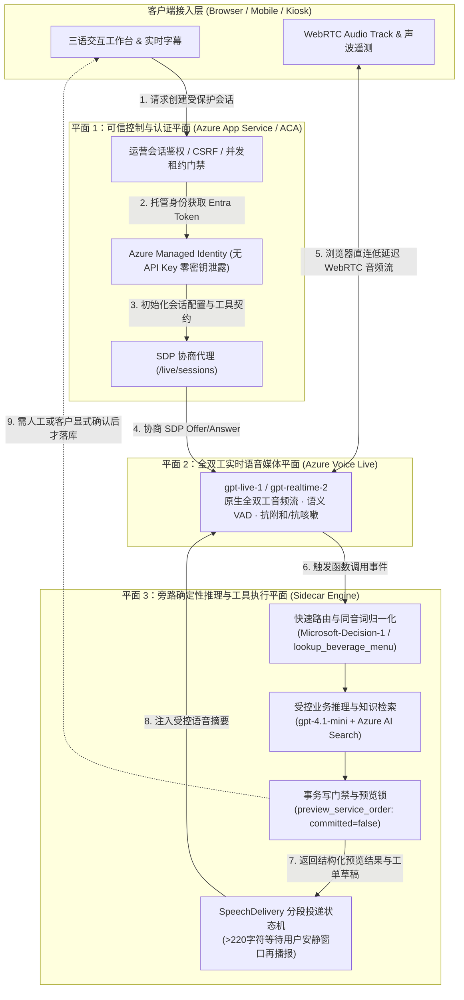
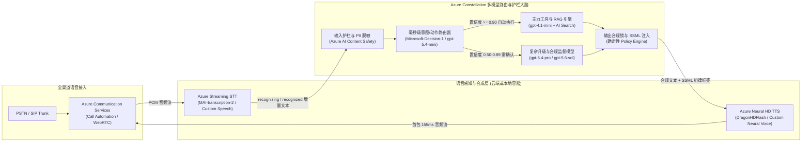
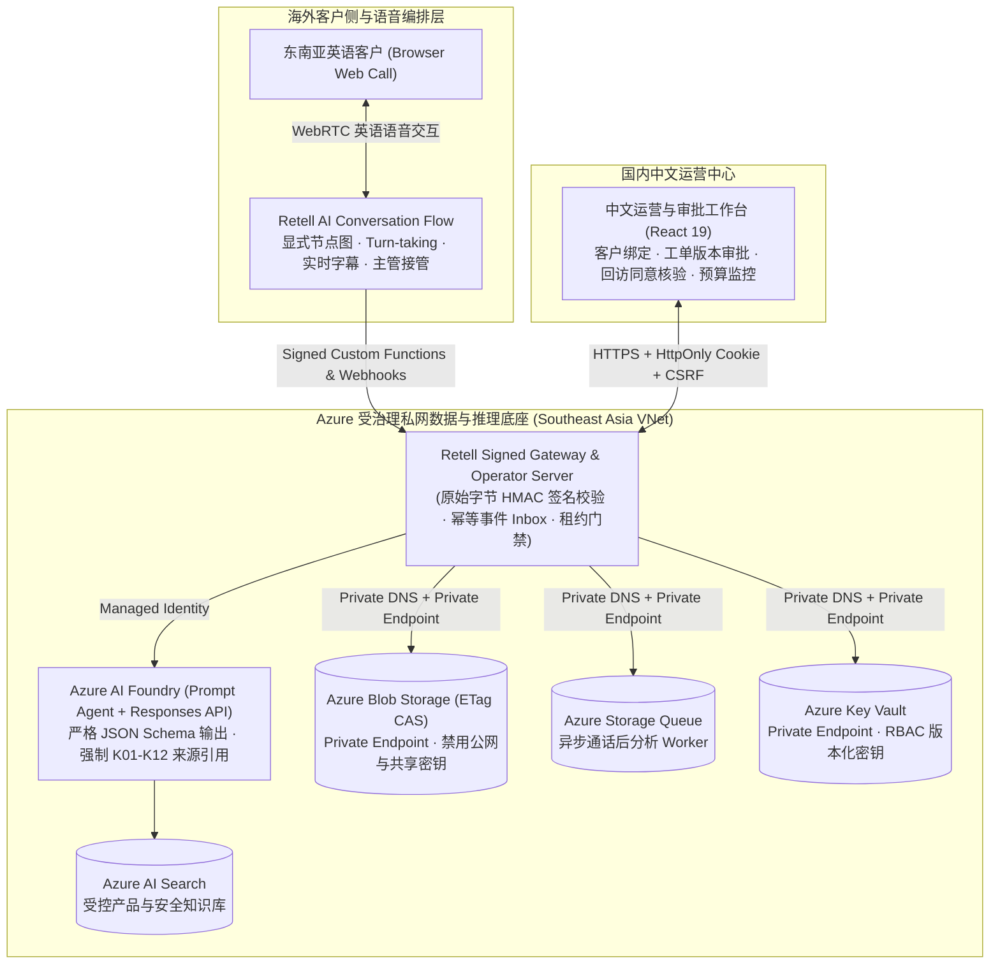

# 企业级 Voice Agent 方案设计与三大参考架构指南

> **文档定位**：从解决方案架构师（Cloud Solution Architect）与前线部署工程师（Forward Deployed Engineer）视角，系统化定义企业级 Voice Agent 的三大技术架构范式、多模型协同路由（Constellation Routing）、关键事务安全边界与混合云/容器部署规范。

---

## 1. 架构选型总览：三大主流技术范式对比

在企业级 Voice Agent 落地过程中，不存在“一套架构打天下”。我们需要根据客户对 **端到端延迟、情绪与副语言感知、文本级合规审计、电信 PSTN/SIP 集成速度、以及单分钟 TCO** 的优先级，从以下三大参考架构中精准选型或组合：

| 架构维度 | 范式 A：Native S2S 端到端实时流式架构 | 范式 B：Enterprise Cascaded 企业级级联编排架构 | 范式 C：Hybrid Best-of-Breed 商业编排 + Azure 底座 |
| :--- | :--- | :--- | :--- |
| **核心技术栈** | `Azure Voice Live API` + `gpt-live-1` / `gpt-realtime-2` + 旁路推理 (`gpt-4.1-mini` / `gpt-5.4`) | `Azure AI Speech (Streaming STT / MAI-transcription-2)` + `Foundry Agent` + `DragonHDFlash / TTS HD 3.0` | `Retell AI / LiveKit Agents` (SIP/Turn-taking/Flow) + `Azure AI Foundry` (RAG / Guardrail / 私有数据面) |
| **端到端延迟 (TTFA P50)** | **350 ms – 590 ms**（极致自然） | **650 ms – 1,100 ms**（流式分段优化后） | **500 ms – 800 ms**（取决于跨云 Webhook 距离） |
| **打断与抗噪能力** | **原生声学+语义全双工**（精准识别咳嗽、附和与插话） | 依赖 VAD 静音阈值（100–5000ms）+ 语义断句分类器 | 编排平台专利 Turn-taking 模型 + 节点级打断控制 |
| **情绪理解与语音表现力** | **原生理解叹气、焦急语调并动态调整语气** | 文本中间层丢失原始声学情绪，需额外情感分析模型辅助 | 取决于所挂载 TTS（可挂载 ElevenLabs / Azure HD Voices） |
| **可解释性与文本合规审计** | 音频直出，需依赖旁路转写与工具门禁保障确定性 | **100% 文本中间层可见**，支持在 TTS 合成前做正则/PII/合规词过滤 | 显式 Conversation Flow 节点状态机，每步跳转可追踪 |
| **专有词表与自定义发音** | 依赖 Prompt 与旁路工具归一化（如 `lookup_beverage_menu`） | **原生支持 Custom Speech 短语表 + SSML / Custom Lexicon 音标控制** | 支持 Boosted Keywords 与 TTS 发音替换规则 |
| **私有化与混合部署能力** | 云端 Global / DataZone 托管（通过可信后端代理 WebRTC/WSS） | **支持 Azure Speech 本地 Docker 容器（联网计量或离线许可）** | 语音编排在 SaaS（或自托管 LiveKit），核心知识与数据留在 Azure VNet |
| **首选适用场景** | 智能零售点单、VIP 伴随式顾问、高情绪互动客服 | 银行保险强合规热线、医疗分诊、政企内网服务台 | 出海企业快速接通全球本地电话号码（PSTN/SIP）+ 国内中文后台运营 |

---

## 2. 三大参考架构深度解析

### 2.1 范式 A：Native S2S 三平面全双工架构（Azure Voice Live API + `gpt-live-1`）

这是目前交互体验最接近真人的旗舰架构。为了解决纯端到端语音模型“容易产生业务幻觉、难以直接安全操作数据库”的痛点，我们设计了 **“控制平面 + 媒体平面 + 旁路推理与工具治理平面”** 的三平面解耦架构（已在 `turbo998/gpt-live-1-demo` 与 `https://gpt-live-demo-0922-qc.azurewebsites.net/` 实装验证）：

#### 核心架构设计亮点：
1. **媒体流直连、控制流收口**：浏览器完成 SDP 握手后，WebRTC 音频流直连 Azure 边缘媒体节点（消除应用服务器中转音频带来的 150–300ms 额外抖动），同时模型凭据 100% 留在服务端（使用 Managed Identity 动态签发 Entra ID 令牌，浏览器零密钥）。
2. **说话与做事分离（Voice-Action Decoupling）**：`gpt-live-1` 专注于低延迟接话、打断处理与安抚话术（Filler Speech，如“好的，我马上帮您查一下这笔订单”），耗时或需要严谨计算的查询交由旁路 `gpt-4.1-mini` 与确定性 TypeScript 工具执行。
3. **`SpeechDelivery` 长文本防冲突投递机**：当后台工具返回超过 220 字符的复杂排障说明时，系统不会在客户正在插话时强行朗读，而是监控声学安静窗口分段播报，并在客户打断时优雅降级为界面卡片展示。

---

### 2.2 范式 B：Enterprise Cascaded + Constellation 多模型路由架构

针对金融、保险、政企等要求 **“合成出来的每一个字都必须先经过合规审查”** 或 **“需要本地容器混合部署”** 的场景，我们采用对标 Sierra Constellation 理念的 **多模型路由级联架构**：

#### 核心架构设计亮点：
1. **三级置信度门禁（Auto / Confirm / Human Escalate）**：
   - 使用轻量级决策模型（如我们在订阅中实测的 `Microsoft-Decision-1` 与 `gpt-5.4-mini`）在 **80–160ms** 内输出结构化置信度分布：
   - **Confidence $\ge 0.90$ (`Act automatically`)**：直接执行只读查询（查目录、查绑定订单、标准 2.4GHz 排障）。
   - **$0.50 \le$ Confidence $< 0.90$ (`Confirm`)**：生成不可变版本草稿（`draft_support_ticket` / `preview_service_order`），要求客户二次确认或运营主管审批。
   - **Confidence $< 0.50$ 或触发物理安全红线 (`Send to a human`)**：立即熔断 AI 自助流程，执行 Warm Transfer 转接人工坐席并推送完整上下文摘要。
2. **DragonHDFlash 超低延迟高自然度 TTS**：
   - 采用最新一代 `DragonHDFlash`（如 `hdflash_xiaoqi`），在呼叫中心多轮盲测中 MOS 分高达 **4.34**（超越真人坐席录音基准 4.08），同时首字节合成延迟（`SynthesisFirstByteLatencyMs`）控制在 **~155ms**。

---

### 2.3 范式 C：Hybrid Best-of-Breed 混合架构（Retell AI + Azure AI Foundry 私网底座）

许多出海企业既看重 **Retell AI** 极致的海外电话网（Twilio/Telnyx SIP）开箱即用体验与可视化 Conversation Flow 节点编辑器，又必须遵守母公司或跨国监管对 **客户数据隐私、企业私有知识库（Azure AI Search）与 Azure 统一账单/私网治理（VNet + Private Endpoint）** 的要求。本仓库 (`turbo998/voice-agent-lab`) 完整实现了这一生产级混合参考架构：

#### 六大企业级工程硬核边界（已在 `tests/*.test.ts` 66 项测试中 100% 验证）：
1. **原始字节签名与防重放（Raw-body Signature & Timestamp Verification）**：所有来自 Retell 的工具调用与 Webhook 必须先通过指定 Signer 的原始字节签名与时间窗校验，再执行持久化的 `Accept-Before-ACK` 去重投递。
2. **乱序事件防护（Out-of-order Event Immunity）**：迟到的 `call_started` 事件绝不会把已进入 `call_analyzed` 或 `ended` 终态的通话状态回滚。
3. **打断不等于事务回滚（Voice Barge-in $\neq$ Transaction Rollback）**：用户挂断电话或中途插话不会导致半途而废的脏写，也不允许已结束或已被人工接管（Takeover）的会话继续执行迟到的业务写入。
4. **防提示词注入越权（Anti-Prompt Injection via Strict Zod Schemas）**：工具参数 Schema（`packages/business-core/contracts.ts`）显式剥离身份字段（不允许模型在参数中传入 `customerId` 或 `approved: true`），所有身份与审批状态仅从服务端可信存储（Blob ETag CAS）读取。
5. **不可逆主管接管状态机（Irreversible Supervisor Takeover）**：一旦主管触发接管，AI 永久停止向该通话注入后续工具结果，若供应商侧接管状态返回不确定（Uncertain），系统自动进入 Fail-closed 保护态。
6. **原子预算租约与自动关停控制（Atomic Budget Lease & Independent Deactivation Controller）**：通话创建前原子预留额度上限，未知异常绝不盲目释放并发名额；独立控制器 Job 在运行窗口到期后自动将 Container Apps 副本停用归零（Deactivate Revision）。

---

## 3. 架构师选型决策树（Presales Decision Tree）

在售前咨询现场，可通过以下 4 个问题在 3 分钟内帮客户锁定目标架构：

1. **Q1：业务是否要求 100% 本地内网不出网（或仅允许计费元数据出站）？**
   - **是** $\rightarrow$ 选择 **范式 B（Azure Speech 本地容器 + 内网/专线大模型）**。注意遵守 `*.cognitive.microsoft.com` 与 `*.cognitiveservices.azure.com` 的 TCP 443 出站计量白名单（每 10–15 分钟上报一次，不上传音频与文本），或申请 Disconnected Containers 离线承诺包。
2. **Q2：场景是否高度依赖副语言特征（情绪识别、叹气、背景噪音过滤、高频自然打断）且追求 <550ms 极致交互？**
   - **是** $\rightarrow$ 选择 **范式 A（Azure Voice Live API + `gpt-live-1` 三平面架构）**，通过旁路 `gpt-4.1-mini` 处理确定性工具与预览门禁。
3. **Q3：客户是否已经有现成的海外电话外呼团队在使用 Retell AI / LiveKit，或者希望 1 周内快速上线跨国 SIP 电话流程？**
   - **是** $\rightarrow$ 选择 **范式 C（Retell AI / LiveKit + Azure AI Foundry 混合架构）**，不强行要求客户推翻前端语音编排，而是用 Azure AI Foundry + AI Search + Private VNet 承接核心 RAG 诊断、安全合规护栏与工单系统集成（Co-sell 最佳切入点）。
4. **Q4：场景是否为金融/医疗等高合规标准流程，需要对每个合成句子做精确 SSML 发音控制与事前文本过滤，且追求最低单分钟成本？**
   - **是** $\rightarrow$ 选择 **范式 B（Azure Streaming STT + Constellation 多模型路由 + DragonHDFlash TTS）**。
