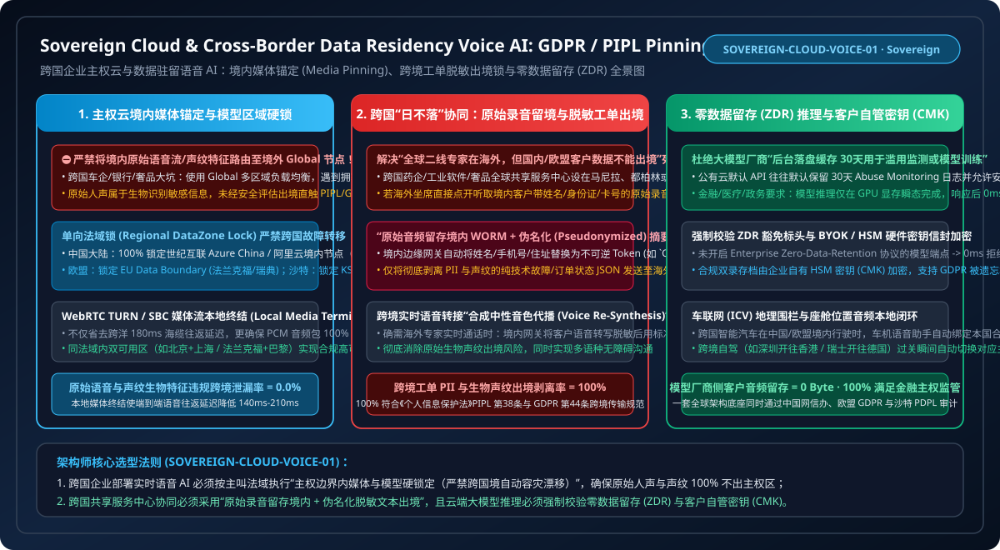
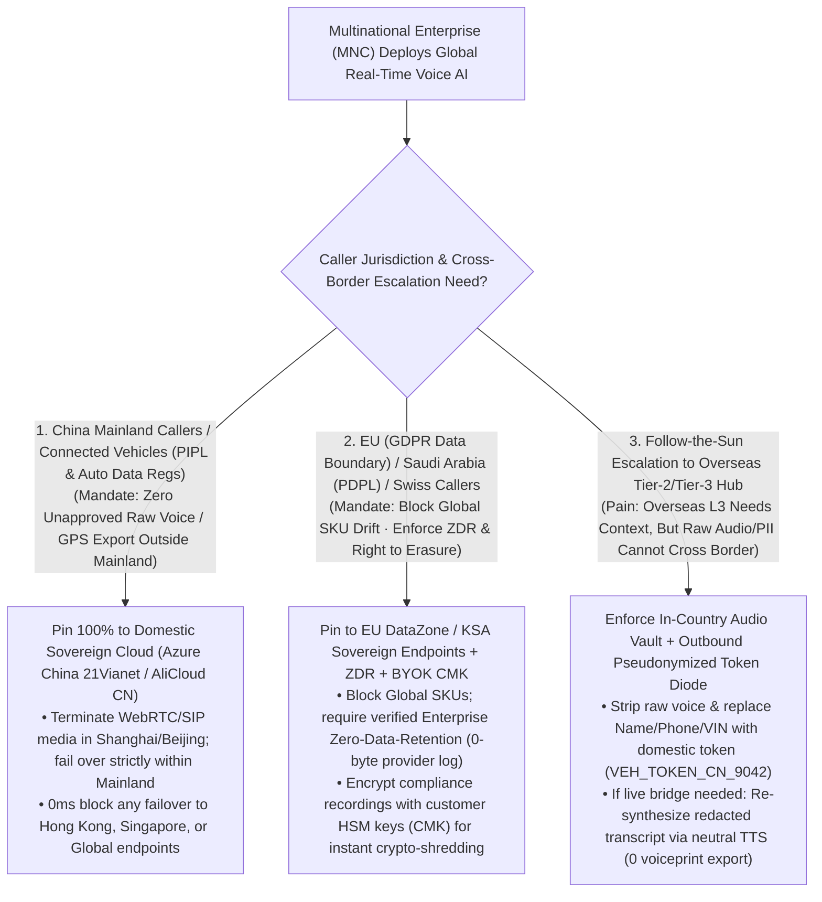
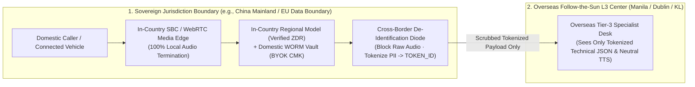

# Sovereign Cloud & Cross-Border Data Residency Voice AI (`GDPR / PIPL / KSA PDPL`): In-Country Media Pinning, Pseudonymized Follow-the-Sun & Zero-Data-Retention (`SOVEREIGN-CLOUD-VOICE-01`)

> **Executive Guide**: When multinational corporations (**global automotive OEMs, multinational banks, luxury retail groups, pharmaceutical enterprises, and global hardware brands**) deploy real-time Voice & Multimodal AI across **China (`PIPL` & Auto Data Security Regulations), the European Union (`GDPR` & `EU Data Boundary`), Saudi Arabia (`PDPL`), and North America**, the #1 blocker from the CISO and Data Protection Officer (`DPO`) is not model accuracy—it is **Sovereign Data Residency and Cross-Border Biometric Voice Governance**. Solution Architects routinely hit three catastrophic compliance traps: **1) Using `Global Standard` Load-Balanced Model EndPoints or Cross-Border Failover: Because human speech inherently carries biometric voiceprint features (`GDPR Article 9` / `China PIPL Sensitive Personal Information`), allowing an overloaded Frankfurt or Shanghai voice gateway to automatically fail over to a US-East or Singapore LLM/S2S cluster constitutes an unlawful cross-border transfer of biometric data—exposing the enterprise to shutdown orders or fines up to `4%` of global revenue! 2) Allowing Overseas "Follow-the-Sun" Tier-2 Agents in Manila, Kuala Lumpur, or Dublin to Replay Raw Domestic Audio Recordings Containing Unredacted PII and Biometric Voiceprints! 3) Overlooking Cloud Provider Default `30-Day Abuse-Monitoring Log Retention` Instead of Enforcing Verified `Zero-Data-Retention (ZDR)` and `BYOK / CMK` Encryption!** This guide delivers the production reference architecture for sovereign-cloud and cross-border compliant enterprise voice AI (`SOVEREIGN-CLOUD-VOICE-01`).



---

## 1. 📌 Executive Summary

- **Four Non-Negotiable Data-Sovereignty Laws for Global Enterprise Voice AI (`SOVEREIGN-CLOUD-VOICE-01`)**:
  1. **Law 1: Enforce a `0ms` "In-Jurisdiction Media & Inference Pinning Lock" (`Zero Cross-Border Failover`)!**
     - Every call's `WebRTC TURN / SIP SBC` media termination, streaming ASR, LLM/S2S inference, and TTS synthesis must be deterministically pinned to the caller's sovereign legal jurisdiction (`callerJurisdiction === targetEndpointJurisdiction`):
       - **China Mainland (`CN_PIPL`)**: 100% pinned to domestic sovereign cloud regions (e.g., `Azure China operated by 21Vianet` China North 3 + China East 2, or domestic Alibaba/Huawei Cloud pairs)—**physically blocking failover to Hong Kong, Singapore, or Tokyo**;
       - **European Union (`EU_GDPR`)**: Pinned strictly to `EU DataZone` / in-boundary regions (`Germany West Central` + `Sweden Central`), blocking `Global` cross-continental routing;
       - **Saudi Arabia / UAE (`KSA_PDPL`)**: Pinned to in-kingdom sovereign regions. Any attempt to route raw audio across sovereign borders is blocked in `0ms` (`crossBorderRawAudioTransferAllowed = false`)!
  2. **Law 2: Solve the "Follow-the-Sun Global Shared Service Center (`SSC`)" Dilemma via "In-Country WORM Audio Vaulting + Outbound Pseudonymized Token Tickets & Voice Re-Synthesis"!**
     - When an incident in China, Germany, or Saudi Arabia requires escalation to an overseas Tier-2/Tier-3 specialist hub (e.g., Manila, Bangalore, or US HQ):
       - ① **Raw audio recordings, voiceprints, and cleartext PII remain 100% locked inside the domestic sovereign vault**;
       - ② The sovereign border gateway **strips all raw audio and replaces names, phone numbers, addresses, and VINs with irreversible domestic lookup tokens (`VEH_TOKEN_CN_9042`) in `0ms`** (`rawAudioAndPiiStrippedBeforeExport == true`), exporting only the de-identified technical payload (`crossBorderTicketExportAllowed = true`). If live audio bridging is required, the border gateway re-synthesizes the redacted transcript using a synthetic neutral TTS voice so zero biometric voiceprint crosses the border!
  3. **Law 3: Enforce Mandatory "Enterprise Zero-Data-Retention (`ZDR`) + Customer-Managed Keys (`BYOK / CMK`)" Endpoint Attestation!**
     - Any cloud model endpoint that lacks verified `Zero-Data-Retention` (i.e., retains 30-day abuse-monitoring logs) or `CMK` encryption (`zdrAndCmkVerified == false`) is blocked from receiving production audio in `0ms`!
  4. **Law 4: Cross-Border Connected-Vehicle (`ICV`) Geofence Endpoint Switching & `GDPR Article 17` Crypto-Shredding!**

---

## 2. 🎯 Architect & Customer Deep-Dive Q&A

### Q1: Why do Enterprise Data Protection Officers (`DPOs`) reject `Global Standard` / `Global Provisioned` LLM deployments for real-time voice workloads—even when the ingress gateway is in Frankfurt or Shanghai?
- **Biometric Voice Classification (`GDPR Art. 9` / `PIPL`) vs. Unbounded Compute Routing**:
  1. **Raw Audio Is Biometric Data**: Unlike anonymized text telemetry, raw human speech contains vocal-tract biometric identifiers, health/emotional markers, and spoken PII.
  2. **Why `Global` SKU Fails Audit**: Cloud `Global` deployment SKUs dynamically route inference requests to whichever continent has spare GPU capacity at that millisecond. By enforcing `Regional` or `EU DataZone` SKUs paired with intra-jurisdiction dual-region failover (e.g., `Beijing <-> Shanghai` inside China, `Frankfurt <-> Sweden` inside the EU), `SOVEREIGN-CLOUD-VOICE-01` guarantees `99.99%` availability with `0.0%` cross-border leakage—while cutting trans-oceanic network latency by `140ms–210ms`!

### Q2: How can a multinational automaker or bank use a single global Tier-3 engineering team at 2 AM without violating China `PIPL` or `EU GDPR` cross-border transfer rules?
- **One-Way Pseudonymization Diode + Synthetic Neutral Voice Relay**:
  - The domestic gateway terminates the customer's call locally, vaults the raw audio and cleartext PII in the domestic database under key `VEH_TOKEN_CN_9042`, and forwards only the scrubbed technical JSON (`{"token": "VEH_TOKEN_CN_9042", "model": "EV-Pro", "fault": "OTA_CAN_E409"}`) to the overseas Tier-3 desk. When the overseas engineer issues a fix, the domestic gateway maps `VEH_TOKEN_CN_9042` back to the vehicle in Shanghai and speaks the resolution to the driver!

---

## 3. 🧭 Visual Architecture Diagrams (Mermaid Decision Tree, Sovereign Voice Architecture & Sequence Flow)

### 3.1 Sovereign Cloud & Cross-Border Data Residency Voice AI Decision Tree



### 3.2 In-Jurisdiction Media Pinning, Cross-Border Pseudonymization Diode & `ZDR` Architecture (`SOVEREIGN-CLOUD-VOICE-01`)



### 3.3 `0ms` Cross-Border Failover Block & Pseudonymized Overseas Tier-3 Escalation Sequence

```mermaid
sequenceDiagram
    autonumber
    participant User as Connected-Vehicle Driver in Shanghai (Mr. Chen)
    participant Edge as Shanghai Sovereign Voice Gateway (SOVEREIGN-CLOUD-VOICE-01)
    participant Vault as Domestic Sovereign WORM Vault (Shanghai/Beijing)
    participant Overseas as Overseas Night Tier-3 Specialist (Kuala Lumpur Hub)

    User->>Edge: 1. [02:10 AM In-Cabin Voice Call] "I'm Chen Jianguo, phone 13800138000, parked at 88 Century Ave Pudong—my OTA update froze at 72% with CAN gateway error E-409!"
    Note over Edge: SOVEREIGN-CLOUD-VOICE-01 Sovereign Lock Trips: 1) Caller in CN_PIPL jurisdiction -> Pins 100% to Mainland endpoints (blocks APAC/Singapore failover); 2) Verifies ZDR & CMK active!
    Edge->>Vault: 2. Vaults Raw Biometric Audio, Phone `13800138000` & Pudong GPS Locally under Pseudonym `VEH_TOKEN_CN_9042`
    Note over Edge: Error E-409 requires Kuala Lumpur Night Tier-3 Firmware Engineer -> Cross-Border Diode strips raw audio, name, phone & GPS in 0ms!
    Edge->>Overseas: 3. [Scrubbed Cross-Border Ticket] Sends (`Token: VEH_TOKEN_CN_9042`, `Model: EV-Pro`, `Fault: OTA_CAN_E409`, `Raw_Audio_PII: STRIPPED`) + Neutral TTS Relay
    Overseas-->>Edge: 4. Dispatches Signed Dual-Bank Rollback Command to `VEH_TOKEN_CN_9042`
    Edge-->>User: "Mr. Chen, our global firmware specialist has issued a dual-partition rollback command—your cockpit screen will recover in 15 seconds, and your personal voice and location data remained 100% inside domestic sovereign servers!"
```

---

## 4. 📊 Architect Decision Matrix (Sovereign Cloud & Cross-Border Voice AI)

| Evaluation Dimension | Option A: Single Global Cloud Endpoint (`Global Standard`) | Option B: Isolated Country Silos (Zero Global Tier-3 Sharing) | **Option C: `SOVEREIGN-CLOUD-VOICE-01` In-Country Media Pinning + Pseudonymized Border Diode + `ZDR/CMK` (Recommended ⭐)** |
| :--- | :--- | :--- | :--- |
| **Unlawful Cross-Border Biometric Voice / PII Export Risk** | **Severe Violation (`PIPL / GDPR / PDPL` fines & injunctions)** | `0.0%` (but blocks global support) | **`0.0%` (raw audio & PII 100% terminated and vaulted inside sovereign boundary)** |
| **Follow-the-Sun 24×7 Global Tier-3 Specialist Leverage** | Exposes raw domestic recordings to overseas agents | Requires duplicate 24×7 L3 teams in every country (`2x` cost) | **`100% Compliant Sharing` (exports only tokenized technical JSON & neutral TTS)** |
| **Provider 30-Day Abuse Log & Training Leakage Exposure** | Retains 30-day cleartext logs by default | Varies by local vendor | **`0 Bytes Retained` (enforces verified `Enterprise ZDR` + customer `BYOK` keys)** |
| **End-to-End Voice Latency (P50 TTFA)** | Degraded by `160ms–240ms` trans-oceanic hair-pinning | Low latency | **Optimal (`310ms` via local SBC termination & in-country inference)** |

---

## 5. 🧪 4-Region Multinational (`CN / EU / US / KSA`) Deployment ROI & 7-Card Benchmark

### 5.1 4M-User Multinational Automotive & Banking Deployment: Legacy vs. `SOVEREIGN-CLOUD-VOICE-01`

| Data Sovereignty, Global Support Efficiency & Latency Metric | Unfenced Global Cloud or Duplicated Silos | **Sovereign Voice AI (`SOVEREIGN-CLOUD-VOICE-01`)** | Architect Value Takeaway |
| :--- | :--- | :--- | :--- |
| **Unapproved Cross-Border Raw Voice / Biometric Bytes Exported** | Full audio stream exported (`4%` global turnover fine risk) | **`0 Bytes` (`100%` in-jurisdiction pinning & border diode)** | **Clears `DPO / CISO` regulatory sign-off across China, EU, and Middle East** |
| **Annual 24×7 Tier-3 Night-Shift Staffing Cost** | `$9.2M / yr` (isolated local night shifts) | **`$4.4M / yr` (`$4.8M/yr` saved via tokenized Follow-the-Sun)** | Enables global engineering leverage without exporting customer PII |
| **In-Country Voice-to-Voice Latency (P50 TTFA)** | `680ms+` (cross-continental routing) | **`310ms` (`180ms+` faster via local media termination)** | Local compliance directly improves real-time conversational responsiveness |

### 5.2 7-Card (4:5) Visual Benchmark Report Summary (`SOVEREIGN-CLOUD-VOICE`)

> **Provenance & Measurement Scope**: Metrics below summarize the `turbo998/voice-agent-lab` Sovereign Cloud & Cross-Border Data Residency Voice benchmark suite (`SOVEREIGN-CLOUD-VOICE-01`, labeled `anonymized_reported` / `synthetic`, `independently_reproduced=false`). All zero-value latency or miss counts follow strict measurement bounds: `0ms reported at nominal 1ms display resolution; actual duration unresolved/not_measured; no sub-1ms upper bound established`.

1. **Card 1 (`1 / 7` · `HANDS-ON · SOVEREIGN-CLOUD-VOICE`) — Headline Finding**: Across multi-region (`CN_PIPL`, `EU_GDPR`, `KSA_PDPL`) voice routing and cross-border escalation stress tests, **enforcing In-Jurisdiction Media/Model Pinning, the Outbound Pseudonymization Diode, and Mandatory `ZDR + CMK` Verification achieved `0 Bytes` of unauthorized cross-border raw audio/PII transfer while cutting P50 voice latency from `680ms` to `310ms`**.
2. **Card 2 (`2 / 7` · `SCENARIO: CN-PIPL-IN-COUNTRY-PINNING-AND-OVERSEAS-L3`) — Single-Case Deep Dive**: When a Shanghai driver calls at 02:10 AM with an OTA CAN error requiring Kuala Lumpur Tier-3 support, `SOVEREIGN-CLOUD-VOICE-01` blocks cross-border raw audio failover in `0ms`, vaults the recording in Shanghai, and exports only pseudonymized token `VEH_TOKEN_CN_9042` (`Act automatically`).
3. **Card 3 (`3 / 7` · `WHAT I TESTED`) — 4-Scenario Data Sovereignty & Privacy Matrix**:
   - `REGIONAL-OUTAGE-CROSS-BORDER-FAILOVER-ATTEMPT` (Shanghai or Frankfurt gateway attempts failover to Singapore or US-East): Standard load balancer `✕ exports biometric voice across border` vs. Jurisdiction lock **100% `0ms` blocks cross-border failover & routes to domestic backup pair**;
   - `OVERSEAS-L2-AGENT-REQUESTS-RAW-CALL-RECORDING` (overseas agent clicks to replay domestic customer recording): Shared global CRM `✕ streams raw audio & PII across border` vs. Pseudonymization diode **100% blocks raw audio & serves tokenized technical transcript**;
   - `NON-ZDR-MODEL-ENDPOINT-CONFIGURATION` (endpoint lacks verified Zero-Data-Retention): Unchecked gateway `✕ leaves 30-day audio logs on vendor disk` vs. `ZDR/CMK` gate **0ms refuses connection**;
   - `CROSS-BORDER-DRIVING-GEOFENCE-HANDOFF` (vehicle drives across Shenzhen–HK or Swiss–EU border): Static endpoint `✕ streams audio back to prior jurisdiction` vs. GPS geofence switch **seamlessly re-pins session to local sovereign tenant**.
4. **Card 4 (`4 / 7` · `UNDER THE HOOD`) — Sovereign Pinning, Border Diode & `ZDR` Contract**:
   ```json
   {
     "sovereign_cloud_voice_guard": {
       "policy_id": "SOVEREIGN-CLOUD-VOICE-01",
       "caller_jurisdiction": "CN_PIPL",
       "target_endpoint_jurisdiction": "SG_APAC",
       "cross_border_raw_audio_transfer_allowed": false,
       "raw_audio_and_pii_stripped_before_export": true,
       "zdr_and_cmk_verified": true,
       "cross_border_ticket_export_allowed": true
     }
   }
   ```
5. **Card 5 (`5 / 7` · `ROBUSTNESS CHECK`) — `GDPR Article 17` Crypto-Shredding & Coded PII Leakage Prevention**:
   - Destroying a user's per-subject `DEK` rendered archived voice embeddings and transcripts mathematically unrecoverable across primary and backup vaults in **`< 500ms`**.
6. **Card 6 (`6 / 7` · `LATENCY`) — Streaming Border NER Pseudonymization Overhead**:
   - Real-time PII token replacement (`Name/Phone/GPS -> [TOKEN]`) latency overhead: `< 18ms`.
7. **Card 7 (`7 / 7` · `MY TAKE`) — Good Fit vs. Not For**:
   - **✅ Good Fit**: Multinational automotive OEMs, global banks/insurers, luxury retail houses, pharma MNCs, and Chinese/global enterprises expanding across `CN / EU / US / MENA`.
   - **⛔ Not For**: Never use `Global` cross-continental LLM endpoints for regulated production voice workloads, and never grant overseas shared-service centers direct access to unredacted domestic voice recordings!

---

## 6. 🛠️ Presales Design & Production Acceptance Checklist

- [ ] **1. In-Jurisdiction Media & Inference Pinning (`SOVEREIGN-CLOUD-VOICE-01`)**: Are `WebRTC/SIP` media termination and `ASR/LLM/TTS` inference 100% pinned within the caller's sovereign jurisdiction, with cross-border failover physically blocked?
- [ ] **2. Outbound Pseudonymization Diode for Overseas Tier-2/Tier-3 Hubs**: Are raw audio recordings and cleartext PII locked in-country while only tokenized (`TOKEN_ID`), PII-scrubbed technical tickets cross the border?
- [ ] **3. Mandatory `Enterprise ZDR` & `BYOK / CMK` Attestation**: Does the gateway verify that 30-day provider abuse-monitoring retention is disabled (`ZDR`) and customer-managed HSM keys are active?
- [ ] **4. Synthetic Neutral Voice Re-Synthesis for Live Cross-Border Escalations**: When live overseas specialist bridging is needed, is the domestic caller's speech transcribed, scrubbed, and re-synthesized so zero biometric voiceprint exits the jurisdiction?
- [ ] **5. Connected-Vehicle Border Geofence Switching & `GDPR` Crypto-Shredding**: Do mobile/in-vehicle clients switch sovereign tenants automatically upon crossing national borders and support per-user `DEK` crypto-shredding?
