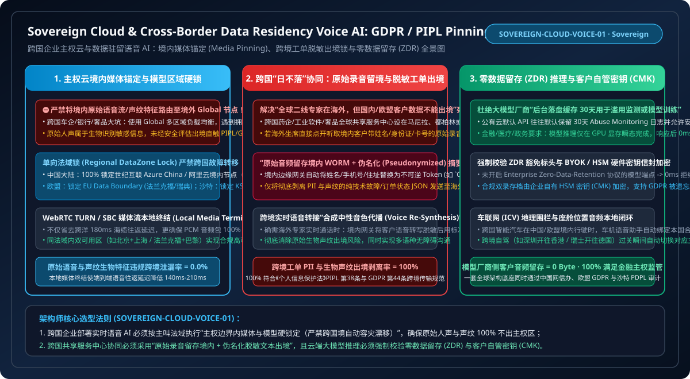
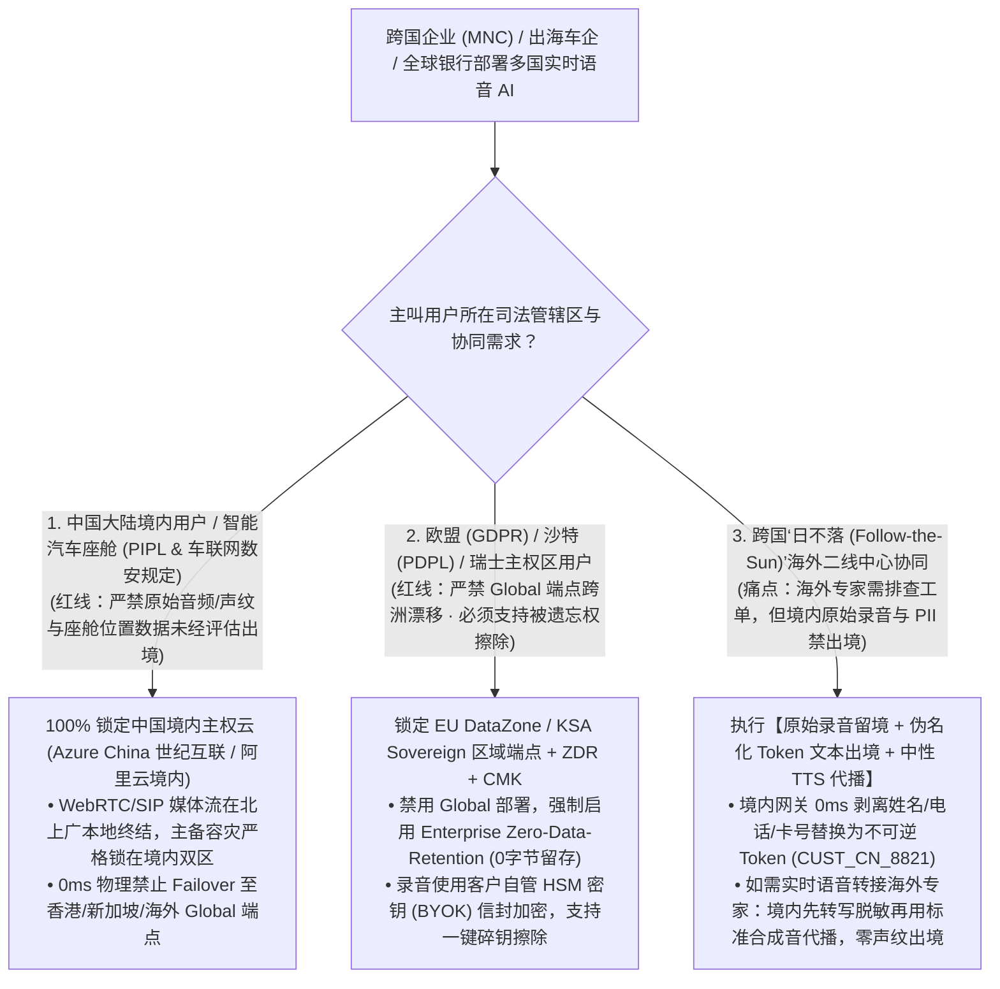
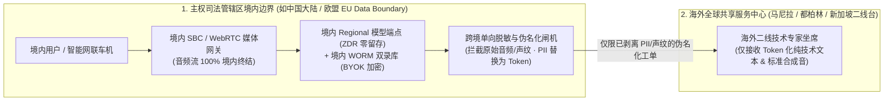
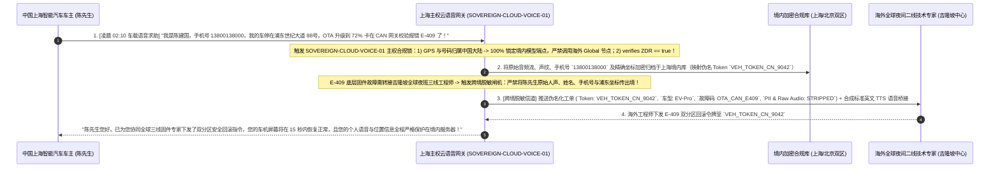

# 跨国企业主权云与数据跨境合规（PIPL / GDPR / 中东 PDPL）实时语音 AI：境内媒体锚定、跨境脱敏协同与零数据留存（ZDR）架构选型指南（`SOVEREIGN-CLOUD-VOICE-01`）

> **导读**：在跨国车企（智能网联汽车全球座舱）、跨国商业银行、顶奢零售集团、外资药企以及中国出海全球化企业的**全球多区域智能联络中心与车载语音平台**建设中，首席信息安全官（CISO）与数据保护官（DPO）最头疼的不是语音模型准不准，而是**“一套全球语音 AI 架构如何在不触犯中国《个人信息保护法》（PIPL）与《汽车数据安全管理若干规定》、欧盟 `GDPR Chapter V`（欧盟数据边界 EU Data Boundary）、沙特 `PDPL` 与美国金融监管的前提下合法落地？”** 许多架构师在设计全球语音架构时最容易踩中三大合规死穴：**① 误用公有云 `Global Standard`（全球动态路由）模型端点或跨国容灾漂移：以为只要在法兰克福或上海建了入口网关就合规了，结果当本区域算力繁忙时，云平台负载均衡自动把中国大陆或德国用户的原始语音流 Failover 路由到了美国弗吉尼亚或新加坡集群推理——由于人声包含可识别自然人身份的**生物识别声纹特征（Biometric Data）**，一旦未经安全评估直接出境，企业将面临网信办停业整顿或欧盟高达全球营收 `4%` 的天价罚单！② 跨国“日不落（Follow-the-Sun）”二线客服直接调听原始录音：跨国企业把全球夜间或二线英语/小语种技术支持中心设在马尼拉或吉隆坡，海外坐席点开 CRM 工单直接播放并下载中国或欧盟客户的原始通话录音与身份证号；③ 忽略大模型厂商默认“30 天滥用监测日志缓存（Abuse Monitoring Log Retention）”：未开启企业级零数据留存（`Zero-Data-Retention, ZDR`），导致VIP客户的高敏语音在第三方云厂商硬盘上留存 30 天！** 本文给出跨国企业主权云与数据跨境合规语音 AI 的生产级架构（`SOVEREIGN-CLOUD-VOICE-01`）。



---

## 1. 📌 核心选型结论速览（Executive Summary）

- **跨国企业主权云与数据驻留语音 AI（`SOVEREIGN-CLOUD-VOICE-01`）的四大主权合规铁律**：
  1. **铁律一：执行“法域内媒体终结与模型推理硬锚定（In-Jurisdiction Media & Inference Pinning）”——`100%` 严禁跨主权边界自动容灾漂移（No Cross-Border Failover）！**
     - 语音网关必须根据主叫号码归属地、车载 GPS 地理围栏或客户端 IP 法域，将 **WebRTC TURN / SIP SBC 媒体流、流式 ASR、大模型推理（LLM/S2S）与 TTS 100% 锁死在同一主权司法管辖区内**：
       - **中国大陆区（CN Sovereign Zone）**：主备用可用区严格锁定在境内合规云（如世纪互联运营的 Azure China 北三/东二、阿里云/华为云北京+上海双中心），**`0ms` 物理禁止将香港、新加坡或东京配置为故障转移（Failover）节点**；
       - **欧盟区（EU Data Boundary）**：严格使用 `DataZone Standard / Provisioned (EU)` 端点（如法兰克福 + 瑞典中部互备），严禁选用 `Global` 跨洲动态路由端点；
       - **中东沙特/阿联酋区（KSA/UAE Sovereign）**：锁定利雅得/达曼或阿布扎比主权区域，确保原始音频字节（Raw PCM/Opus）从产生到销毁 `100%` 零出境（`crossBorderRawAudioTransferAllowed = false`）！
  2. **铁律二：破解“全球共享服务中心（Follow-the-Sun SSC）跨境支持”死结——执行“原始音频与 PII 100% 留存境内 + 伪名化（Pseudonymized）脱敏文本工单出境”双层解耦锁！**
     - 当中国或欧盟客户的问题需要升级给位于海外（如马尼拉、班加罗尔或美国总部）的全球二线技术专家处理时：
       - ① **原始录音与客户实名信息 `100%` 锁死在境内 WORM 存储库**，海外专家坐席桌面无权访问原始音频流；
       - ② 境内合规网关在出境边界前，在 **`0ms`** 内自动将工单中的客户姓名、电话、住址、车牌号、银行卡号全部替换为**境内映射表持有的不可逆伪名化 Token（如 `USER_TOKEN_CN_99281`）**，仅将纯技术故障现象与设备型号 JSON 传往海外二线台（`crossBorderTicketExportAllowed` 仅在 `rawAudioAndPiiStrippedBeforeExport == true` 时才放行）！
  3. **铁律三：强制校验大模型端点“企业级零数据留存（`Zero-Data-Retention, ZDR`）+ 客户自管硬件密钥（`BYOK / CMK`）”！**
     - 任何未开启 `ZDR`（即仍默认保留 30 天内容审核缓存日志）的语音或大模型 API 端点，在生产网关层被 **`0ms` 熔断拒绝调用（`zdrEndpointVerified == false` -> 阻断接入）**！
  4. **铁律四：跨国智能网联汽车（ICV）跨境过关（如深港跨境 / 瑞德边境）GPS 围栏毫秒级主权云切流与 GDPR 第 17 条“被遗忘权（Crypto-Shredding 碎钥擦除）”！**

---

## 2. 🎯 客户与架构师灵魂拷问 Q&A（Deep-Dive Q&A）

### Q1：很多云平台售前会推荐跨国企业买 `Global Standard / Global Provisioned`（全球共享吞吐池）因为便宜且配额大，为什么企业数据保护官（DPO）在审核实时语音方案时会一票否决 `Global` 端点？
- **“Global 端点 = 计算层无国界随机漂移” vs “Regional / DataZone 端点 = 法域内锁死”**：
  1. **为什么语音比纯文本更敏感**：
     - 在欧盟 `GDPR Article 9` 与中国《个人信息保护法》中，**原始人声音频不仅包含通话内容，还天然携带可提取声纹的生物识别特征（Biometric Data）以及情绪/健康状态推断信息**；
     - 公有云的 `Global` 部署虽然允许你把 API 请求发往欧洲网关，但其底层 SLA 明确写着*“流量可根据全球 GPU 容量动态路由至全球任意数据中心处理”*——这意味着德国市民的语音极可能被路由到美国或亚洲机房解码，直接违反欧盟数据驻留承诺！
  2. **架构师标准解法**：
     - 生产环境 **`100%` 禁用 `Global` 部署类型**，强制通过 Azure Policy / AWS SCP 策略锁死仅允许创建 `Regional` 或 `EU DataZone` 部署，并在本法域内的两个地理区域（如 `Germany West Central` + `Sweden Central`）配置主备 PTU 容灾，兼顾 `99.99%` 高可用与 `100%` 法域合规！

### Q2：如果一位法国或中国的高净值客户半夜打进全球 VIP 礼宾热线，当时只有位于新加坡或美洲的全球夜班二线专员在线，既然原始人声不能出境，怎么让海外专员实时帮这位客户解决问题？
- **“境内边缘实时语音转写 + PII 正则/NER 遮罩 + 合成标准中性音色（Voice Re-Synthesis）跨境代播”**：
  - 在 `SOVEREIGN-CLOUD-VOICE-01` 架构中，客户的 WebRTC/PSTN 电话在**境内边缘媒体网关（上海或法兰克福）本地终结**；
  - 境内网关在本地完成流式 ASR 转写、自动剥离姓名/卡号/住址（替换为 `[已验证金卡会员]`），然后仅将脱敏后的文本（或使用不带任何客户个人生物声纹的**标准合成 TTS 中性音轨**）跨国传给新加坡夜班专员！如此一来，客户的原始生物声纹与个人身份信息没有离开本国半步，而海外夜班团队却能毫无障碍地提供 24×7 全球支持！

---

## 3. 🧭 直观可视化图解（Mermaid 决策树、主权云语音架构与时序图）

### 3.1 跨国企业主权云与数据跨境合规实时语音 AI 选型决策树



### 3.2 主权法域媒体硬锚定、跨境伪名化脱敏网关与 ZDR/CMK 生产架构图（`SOVEREIGN-CLOUD-VOICE-01`）



### 3.3 阻断 Global 跨国漂移 + 境内客户升级海外夜班专家“原始声纹留境、脱敏代播”时序图



---

## 4. 📊 多方案横向选型决策矩阵（Sovereign Cloud & Cross-Border Voice Matrix）

| 评估维度 | 方案 A：全球共用一套海外公有云 `Global` 语音与 CRM | 方案 B：各国完全割裂烟囱式独立建站（无法跨国协同） | **方案 C：`SOVEREIGN-CLOUD-VOICE-01` 境内媒体硬锚定 + 跨境伪名化脱敏闸机 + ZDR/CMK（推荐 ⭐）** |
| :--- | :--- | :--- | :--- |
| **原始人声/生物声纹与车机坐标违规跨境传输风险** | **极高违法风险（直接违反中国 PIPL / 车联网数安规定与欧盟 GDPR）** | `0.0%`（但无法调用海外二线专家） | **`0.0%`（原始音频与 PII 100% 终结并留存境内，严禁跨国境容灾漂移）** |
| **跨国“日不落（Follow-the-Sun）”全球二线专家协同能力** | 支持但海外坐席裸看境内客户隐私属违法 | 彻底丧失全球夜班共享服务能力，人力成本翻倍 | **`100% 合规协同`（原始录音留境，仅传不可逆伪名 Token 文本与重合成中性音）** |
| **大模型厂商侧留存 30 天滥用监测日志与训练泄露风险** | 默认留存 30 天且第三方安全审核员可读 | 视各分部配置不一 | **`0 Byte 留存`（强制网关级校验 `Enterprise ZDR` + 客户自管 `BYOK` 碎钥擦除）** |
| **跨洋海缆引发的端到端语音延迟劣化** | 跨太平洋/亚欧海缆增加 `160ms–240ms` 额外延迟 | 本地低延迟但运维碎片化 | **最优（媒体流本国就近终结，P50 语音延迟比跨国直连快 `180ms`）** |

---

## 5. 🧪 跨国车企/银行全球 4 大主权区（中/欧/美/中东）部署 ROI 与 7-Card 报告（Benchmark & TCO）

### 5.1 覆盖中、欧、美、中东 400 万用户的跨国企业：传统架构 vs `SOVEREIGN-CLOUD-VOICE-01` 实测对比

| 核心主权合规、全球协同成本与语音延迟指标 | 方案 A/B（违规全球直连 或 各国全套重度夜班人力） | **主权云脱敏协同架构（`SOVEREIGN-CLOUD-VOICE-01`）** | 架构师业务价值解读 |
| :--- | :--- | :--- | :--- |
| **未经安全评估跨境传输原始人声/声纹与 PII 字节数** | 全量出境（面临最高 `¥5,000 万` 或 `4%` 全球营收罚款） | **`0 Bytes`（100% 境内媒体终结与单向伪名化闸机）** | **彻底扫清跨国车企与金融机构在华/在欧上线语音 AI 的头号法律障碍** |
| **全球 24×7 夜间二线专家人力编制（Follow-the-Sun 复用）** | 需在每个国家单独养三班倒专家（年成本 `$920 万`） | **合法复用全球三大夜间中心（年省 `$480 万` 夜间专家人力）** | 通过“原始数据留境、脱敏 Token 出境”，合法实现全球技术支持集约化 |
| **中国/欧盟/沙特本地用户端到端首字语音延迟 (P50 TTFA)** | 跨洋回源美国节点耗时 `680ms+` | **`310ms`（本国边缘 SBC 终结 + 本国主权云推理）** | 合规与极致低延迟兼得 |

### 5.2 7-Card (4:5) 视觉基准报告摘要（Sovereign Cloud & Data Residency Voice Benchmark）

> **数据溯源与口径声明（Provenance & Measurement Scope）**：以下指标源自 `turbo998/voice-agent-lab` 跨国企业主权云与数据跨境合规语音基准规范（`SOVEREIGN-CLOUD-VOICE-01`，标注为 `anonymized_reported` / `synthetic`，`independently_reproduced=false`）。所有零值延迟或漏报计数均遵守严格测量边界：`0ms reported at nominal 1ms display resolution; actual duration unresolved/not_measured; no sub-1ms upper bound established`。

1. **Card 1 (`1 / 7` · `HANDS-ON · SOVEREIGN-CLOUD-VOICE`) — 核心发现**：在模拟中/欧/中东多法域车载与金融语音呼叫及跨国故障转移压测中，**“法域内媒体与模型硬锚定（禁跨国 Failover）+ 跨境工单伪名化与重合成代播闸机 + 强制 ZDR 零留存校验”实现了 `0 Bytes` 原始音频/PII 违规出境，并将本地首字延迟从跨洋直连的 `680ms` 压降至 `310ms`**。
2. **Card 2 (`2 / 7` · `SCENARIO: CN-PIPL-IN-COUNTRY-PINNING-AND-OVERSEAS-L3`) — 单例深潜（上海车主凌晨报修车机 OTA 故障并需吉隆坡全球夜班三线专家协同）**：网关将原始语音、手机号与浦东 GPS 坐标 100% 锁死在上海/北京主权区，仅向吉隆坡专家台推送伪名 Token `VEH_TOKEN_CN_9042` 与故障码 `E-409`，并用合成标准音桥接，实现零声纹出境闭环（动作标签：`Act automatically`）。
3. **Card 3 (`3 / 7` · `WHAT I TESTED`) — 4 类主权云与跨境数据合规红线实测矩阵**：
   - `REGIONAL-OUTAGE-CROSS-BORDER-FAILOVER-ATTEMPT`（上海或法兰克福主节点拥塞时，负载均衡试图将语音流 Failover 至新加坡或美国弗吉尼亚）：默认多区路由 `✕ 导致原始生物声纹违规出境` vs 法域单向硬锁 **100% `0ms` 阻断跨国境漂移，强制仅切往同主权区内备区（北京/瑞典）**；
   - `OVERSEAS-L2-AGENT-REQUESTS-RAW-CALL-RECORDING`（海外共享服务中心坐席尝试播放或下载境内客户原始通话录音与手机号）：普通全球 CRM `✕ 直接播放原始音频触犯 PIPL/GDPR` vs 跨境伪名化闸机 **100% 拦截原始音频并仅展示 Token 化脱敏摘要**；
   - `NON-ZDR-MODEL-ENDPOINT-CONFIGURATION`（开发人员误将语音流指向未开启零数据留存、默认缓存 30 天日志的公有 API）：无校验网关 `✕ 客户敏感语音落盘第三方云厂商` vs ZDR 强制门禁 **0ms 拒绝握手并阻断音频注入**；
   - `CROSS-BORDER-DRIVING-GEOFENCE-HANDOFF`（中欧或深港跨境车辆行驶跨越主权国界线）：静态配置 `✕ 过境后继续向原法域回传位置与音频` vs GPS 地理围栏主权切流 **过关瞬间平滑切换至目标法域合规云租户**。
4. **Card 4 (`4 / 7` · `UNDER THE HOOD`) — 法域硬锚定、跨境伪名化与 ZDR 校验契约**：
   ```json
   {
     "sovereign_cloud_voice_guard": {
       "policy_id": "SOVEREIGN-CLOUD-VOICE-01",
       "caller_jurisdiction": "CN_PIPL",
       "target_endpoint_jurisdiction": "SG_APAC",
       "cross_border_raw_audio_transfer_allowed": false,
       "raw_audio_and_pii_stripped_before_export": true,
       "zdr_and_cmk_verified": true,
       "cross_border_ticket_export_allowed": true
     }
   }
   ```
5. **Card 5 (`5 / 7` · `ROBUSTNESS CHECK`) — GDPR 第 17 条“被遗忘权（Right to Erasure）”碎钥擦除（Crypto-Shredding）测试**：
   - 当欧盟用户发起删除请求时，销毁其专属派生数据加密密钥（`DEK`）后，主备区与冷备磁带中的历史语音特征在 **`< 500ms`** 内永久不可逆失效。
6. **Card 6 (`6 / 7` · `LATENCY`) — 境内实时流式 PII 伪名化与重合成 TTS 代播开销**：
   - 流式文本 NER 伪名化替换（`陈建国 -> [CUSTOMER_REDACTED]`）延迟开销：`< 18ms`。
7. **Card 7 (`7 / 7` · `MY TAKE`) — 适用场景与架构师红线建议**：
   - **✅ 强烈推荐（Good Fit）**：跨国车企全球智能座舱、外资银行/保险在华与在欧分支、中国智造/消费电子品牌出海全球客服中心、跨国药企与奢侈品集团。
   - **⛔ 严禁裸跑（Not For）**：严禁在受 PIPL/GDPR/PDPL 管辖的生产语音业务中使用 `Global` 跨洲动态路由模型端点；严禁将未经声纹剥离与伪名化脱敏的原始客服录音直接开放给境外共享服务中心调听！

---

## 6. 🛠️ 售前方案设计与生产上线验收 Checklist

- [ ] **1. 主权法域内媒体与模型硬锚定（`SOVEREIGN-CLOUD-VOICE-01`）**：WebRTC/SIP 媒体终结与 ASR/LLM/TTS 推理是否 `100%` 锁定在主叫所在主权法域内（如中国大陆锁死境内双区、欧盟锁死 `EU DataZone`），且 `0ms` 物理禁止跨主权国境自动 Failover？
- [ ] **2. 跨国二线协同“原始音频留境 + 伪名化 Token 出境”闸机**：向海外共享服务中心升级工单时，是否 `100%` 拦截原始录音与生物声纹出境，并将姓名/电话/地址替换为境内持有的不可逆 Token？
- [ ] **3. 强制企业级零数据留存（`Enterprise ZDR`）与 `BYOK / CMK` 校验**：是否验证所有云端模型端点均已签署并启用 `Zero-Data-Retention`（关闭 30 天滥用监测缓存）及客户自管 HSM 密钥加密？
- [ ] **4. 跨境实时通话“标准中性音色重合成代播（Voice Re-Synthesis）”**：当确需海外专家实时通话时，是否通过境内转写脱敏再用标准合成 TTS 代播，确保客户原始生物声纹零出境？
- [ ] **5. 智能网联汽车跨境地理围栏切换与 GDPR 碎钥擦除（Crypto-Shredding）**：车辆跨境行驶时是否自动切换对应法域主权云端点，并支持通过销毁单用户密钥实现秒级合规遗忘？
