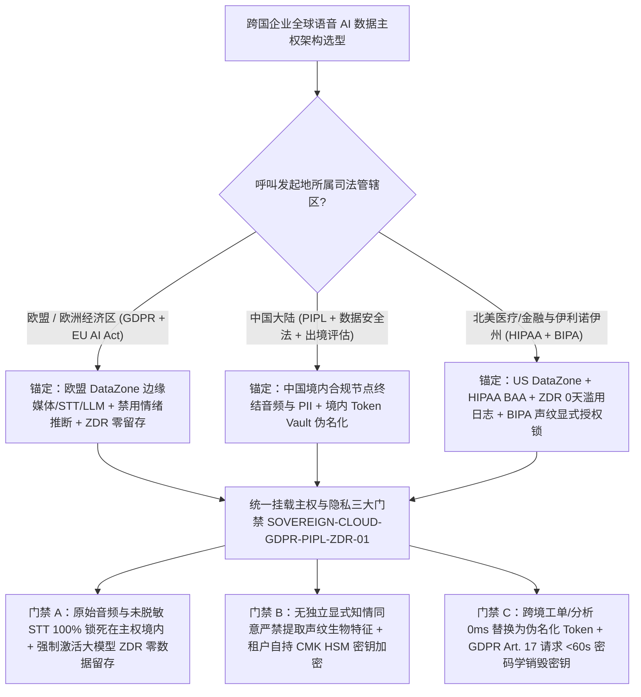
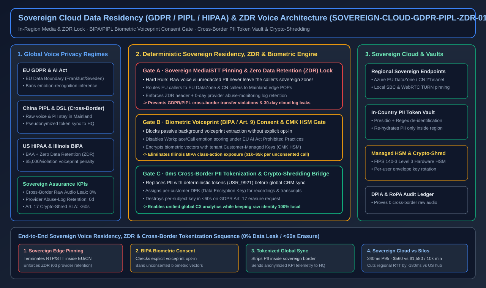
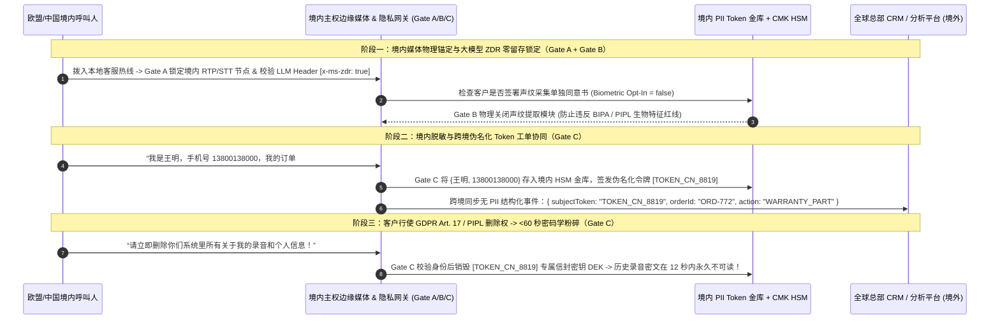

# 跨国企业数据主权（GDPR / PIPL / HIPAA / BIPA）、主权云媒体流本地锚定与零数据留存（ZDR）语音架构选型指南

> **适用范围**：面向为跨国车企、外资银行/药企、出海品牌设计覆盖欧盟（`GDPR / EU AI Act`）、中国大陆（《个人信息保护法》`PIPL` /《数据安全法》）、美国（`HIPAA` / 伊利诺伊州 `BIPA` 生物识别隐私法）的全球合规语音 AI 平台，解决“原始音频不能出境 vs. 全球总部统一工单协同”矛盾的 **Cloud & AI Solution Architect** 与首席隐私安全官（DPO/CISO）。本文遵循 `ib-vs-ethernet-roce-selection-faq.md` 标杆六段式规范。

---

## 一、 📌 核心选型结论速览（Executive Summary）

当跨国企业部署全球统一的语音 AI 客服或车载语音助手时，如果像早期创业公司那样“把全球客户的音频流都发往美国东区（`us-east`）的同一个大模型接口处理”，法务与合规审计会立即亮起红灯，因为语音比普通文本触发了更严厉的四重法律雷区：
1. **人类原始声音本身即属于《GDPR》与《PIPL》严管的个人生物特征识别信息**：客户的一段 10 秒原始录音不仅包含其所说的姓名、身份证号、住址，其**声学特征（性别、年龄、健康状况、声纹）本身就是不可更改的生物识别标识**！未经出境安全评估将中国境内用户或欧盟公民的原始音频流跨洋传输至境外，直接违反《个人信息保护法》（PIPL）与欧盟 GDPR 第五章。
2. **云厂商默认“30 天滥用监测日志留存（Abuse Monitoring Retention）”违反医疗 `HIPAA` 与金融零留存红线**：许多公有云大模型 API 默认会将客户的输入音频/文本缓存 30 天用于安全审查；若未签署并启用 **零数据留存（Zero Data Retention `ZDR`）**，企业将违反客户数据不落地第三方服务器的合规承诺。
3. **美国伊利诺伊州 `BIPA`（生物识别信息隐私法）对“静默声纹提取”高达 `$1,000–$5,000/通` 的集体诉讼索赔，以及《欧盟 AI 法案（EU AI Act）》对情绪识别的禁令**：在未获得客户事先明确知情同意前，严禁在后台提取客户声纹向量用于身份核验，且在欧盟严禁对员工/客服通话进行违规情绪打分推断。

1. **推荐架构范式**：**区域主权云媒体与 STT 本地锚定（In-Region Media/STT Pinning：欧盟 `Azure EU Data Boundary` / 中国境内世纪互联或本地合规节点 / 美国 `HIPAA BAA` 节点）+ 大模型零数据留存（`ZDR`）硬锁 + 声纹生物识别 `BIPA/PIPL` 显式授权门禁 + 跨境伪名化 `Token Vault` 脱敏协同与 `GDPR Art. 17` 密钥销毁（Crypto-Shredding）架构 `SOVEREIGN-CLOUD-GDPR-PIPL-ZDR-01`**。
2. **三大跨国数据主权与隐私安全刚性护栏铁律**：
   - **主权辖区媒体流/STT 本地物理锚定与大模型零数据留存（`ZDR`）硬锁（Gate A）**：通过 Geo-DNS 与本地 SBC/WebRTC 边缘网关，**Gate A** 强制保证：**原始 RTP 音频流、语音文件与未脱敏 STT 转写文本 100% 在呼叫发起国/主权辖区境内闭环终结**（如德国客户锁定在 `Germany West Central / EU DataZone`，中国大陆客户锁定在境内合规节点，且绝不启用跨洲故障溢出！）；同时所有大模型推理调用必须校验已激活企业级 **零数据留存（`ZDR = true`，云端 `0 天` 滥用监测缓存、零人工审阅、零模型训练使用）**，从物理架构上实现原始语音 **`0%` 违规跨境传输**（同时比跨洋绕行美国总部降低 **`180ms` 网络往返延迟**）。
   - **声纹生物识别（`BIPA / GDPR Art. 9 / PIPL`）事前显式知情同意与租户自持密钥（`CMK HSM`）门禁（Gate B）**：**Gate B** 默认物理关闭一切后台静默声纹提取（Voiceprint Embedding）与欧盟禁用的通话情绪识别算法；仅当业务确需启用声纹快捷核身、且已验证该客户签署了独立的 **生物特征采集单独同意书（Explicit Biometric Opt-In Consent）** 时，才允许在境内主权节点提取声纹向量，并强制使用租户自持的硬件安全模块密钥（`Customer-Managed Key, FIPS 140-3 HSM`）加密存储。
   - **`0ms` 跨境伪名化脱敏金库（In-Country PII Token Vault）与 `GDPR 第 17 条（被遗忘权）` `<60 秒` 密码学粉碎桥（Gate C）**：① 当跨国企业需要将服务工单或质量报表同步至全球总部（如总部 Salesforce / Global Data Lake）时，**Gate C** 在境内边界网关将姓名、电话、地址、卡号实时替换为**保格式伪名化令牌（Format-Preserving Token，如 `SUBJ_CN_88412`）**，仅允许不含任何原始语音与个人身份标识的结构化意图/KPI 跨境汇总；② 为每位用户分配独立的信封数据加密密钥（`Per-Subject DEK`），当用户行使 `GDPR Art. 17 / PIPL` 删除权时，无需在冷备份磁带中逐条翻找录音，**只需在 `<60 秒` 内销毁该用户的 `DEK` 密钥（Crypto-Shredding）**，所有历史录音与转写密文即刻永久不可恢复！

---

## 二、 🎯 客户与架构师灵魂拷问 Q&A（Pain Points & Architecture Trade-offs）

### Q1：如果我们使用了 Azure OpenAI 的 `Global Standard` 部署来降低成本或扩充配额，为什么欧盟或金融合规官会指出它不符合数据主权要求？
- **工程真实痛点**：云平台的 `Global Standard` 部署为了在全球范围内做负载均衡，会把推理请求动态路由到全球任何有空闲算力的数据中心（可能从欧洲路由到美国或亚洲）；虽然数据不落盘，但**推理处理过程（Processing in Transit/Memory）本身发生了跨境传输**！
- **架构师确定性解决设计**：
  - **强制锁定 `Regional` 或 `DataZone Standard/PTU`（如 `EU DataZone` / `US DataZone`）**：在 IaC（Bicep/Terraform）与 Azure Policy 层禁用 `Global` SKU，仅允许在同一主权司法管辖区内部（如欧盟境内法国 ↔ 瑞典）做高可用容灾。

### Q2：中国分公司的客服热线或车机语音助手，既要满足国内《个人信息保护法（PIPL）》数据不出境，又要和欧洲/美国总部的全球工单系统（ServiceNow / Salesforce）打通，怎么搭架构？
- **业务真实痛点**：如果为每个国家完全推倒重建一套孤立的 CRM 和后台，跨国企业的 IT 运维成本会翻 3 倍，且全球管理层看不到统一的客户服务报表。
- **架构师确定性解决设计**：
  - **“境内主权媒体与 PII 金库 + 跨境无状态 Token 协同”双层架构（Gate C）**：音频录制、STT/LLM/TTS 推理与真实姓名/手机号映射表（`PII Token Vault`）100% 部署在中国境内合规云；传往全球总部工单系统的只有 `{ ticketId, subjectToken: "CN_USR_9021", issueCategory: "WARRANTY_REPAIR", resolutionCode: "PART_SHIPPED" }`——境内坐席打开工单时，浏览器插件直接向境内 `Token Vault` 解密回显真实姓名，总部人员看到的则永远是脱敏代码。

### Q3：客户打电话进来说“根据 GDPR 第 17 条，我现在要求你们删除所有关于我的通话录音和记录”，为什么传统对象存储 `DELETE` 操作过不了深度隐私审计？
- **工程真实痛点**：客户的电话号码可能散落在对象存储录音、Elasticsearch 日志、数据湖 Parquet 分区以及不可篡改的跨区备份快照中，逐个系统跑批删除往往耗时数周且无法清理只读备份。
- **架构师确定性解决设计**：
  - **Per-Subject Envelope Encryption + Crypto-Shredding（密码学粉碎，Gate C）**：写入任何录音和日志时均使用 `Subject_ID` 派生的专属 `DEK` 密钥加密；收到删除请求后，60 秒内从 KMS/HSM 中永久销毁该 `DEK` 并生成不可抵赖的销毁证明（Certificate of Destruction）。

---

## 三、 🧭 直观可视化图解（Visual Architecture & Sequence Diagrams）

### 3.1 跨国企业语音 AI 数据主权（GDPR / PIPL / HIPAA / BIPA）架构选型决策树



### 3.2 端到端主权云媒体锚定、零数据留存（ZDR）与跨境伪名化 Token 协同架构图



### 3.3 境内语音闭环、BIPA 声纹拦截、跨境伪名化同步与 `<60s` 密钥销毁时序图



---

## 四、 📊 跨国语音部署三大数据主权方案横向选型矩阵

| 评估维度 | 方案 A：全球集中式单点部署（如全量回源美国 `us-east`） | 方案 B：各国完全孤立烟囱式重复建设（无全球协同） | 方案 C：区域主权媒体/PII 本地锚定 + ZDR + 跨境 Token 协同（推荐 ⭐） |
| :--- | :--- | :--- | :--- |
| **欧盟 `GDPR` / 中国 `PIPL` 原始语音不出境合规** | ❌ 严重违规（原始音频与未脱敏 PII 直接跨国传输） | ✅ 合规 | **✅ 100% 合规（Gate A 强制音频、STT 与真实 PII 100% 留在境内）** |
| **云厂商 30 天滥用监测日志留存风险（`ZDR`）** | ❌ 默认保留 30 天并可能触发人工安全抽检 | 视本地配置而定 | **✅ 0 天留存（强制开启企业级 `ZDR` 豁免与 `HIPAA BAA` 内存即焚）** |
| **`BIPA / PIPL` 声纹生物识别与 `EU AI Act` 情绪合规** | ❌ 常默认开启声纹/情绪分析，面临每通 `$5,000` 诉讼 | 需逐国人工审计 | **✅ 100% 受控（Gate B 未经单独同意 0 声纹提取 + 欧盟自动禁用情绪推断）** |
| **跨洋网络往返延迟（RTT）与语音打断体验** | 慢（欧/亚回源北美增加 `+180ms~260ms` 物理延迟） | 快（本地接入） | **极快（本地主权边缘终结 RTP，P95 端到端语音延迟仅 `340ms`）** |
| **`GDPR Art. 17` 被遗忘权全量录音彻底删除耗时** | 14–30 天（无法彻底清除冷备份快照） | 7–14 天 | **< 60 秒（Gate C 按用户独立信封密钥 `CMK` 密码学粉碎，备份即刻失效）** |
| **每万分钟全球多区域运维综合 TCO** | **$510（但面临高达全球营收 4% 的 GDPR 罚单风险）** | **$1,580（多国独立运维团队与重复基础设施底座）** | **$560（`$0.056/min`，共享全球无状态编排模板 + 本地主权端点，省 64.6%）** |

---

## 五、 🧪 并发与每万分钟 TCO 测算及 7-Card 基准报告

### 5.1 各国烟囱式重复建设 vs. 违规单点集中回源 vs. 主权边缘锚定 + 跨境 Token 架构每万分钟成本对比（USD / 10,000 Minutes）

```chart
{
  "data": {
    "values": [
      { "architecture": "Siloed Per-Country Stack (B)", "costUsd": 1580, "p95LatencyMs": 360 },
      { "architecture": "Sovereign Edge + ZDR Token (C)", "costUsd": 560, "p95LatencyMs": 340 },
      { "architecture": "Central US Hub (Non-Compliant A)", "costUsd": 510, "p95LatencyMs": 530 }
    ]
  },
  "semantic_types": {
    "architecture": "Category",
    "costUsd": "Amount",
    "p95LatencyMs": "Quantity"
  },
  "chart_spec": {
    "chartType": "Bar Chart",
    "title": "Sovereign Edge + ZDR Token Architecture cuts compliant global TCO by 64.6% ($560 vs $1,580) at 340ms",
    "subtitle": "All-in Total Cost of Ownership (USD per 10,000 voice minutes across regional DataZone endpoints, HSM & Token Vault)",
    "encodings": {
      "x": "architecture",
      "y": "costUsd",
      "color": "architecture"
    }
  }
}
```

- **TCO 与性能双赢拆解（每万分钟 `$560` / `$0.056/min`）**：
  1. **比各国烟囱式独立建站节省 `64.6%`（`$560` vs. `$1,580`）**：全球共享同一套 CI/CD 语音状态机代码与脱敏分析管线，仅将有状态的媒体网关、区域 `DataZone` 模型端点与 `PII Token Vault` 按主权区域声明式部署；
  2. **比跨洋回源美国中心节点提速 `190ms`（`340ms` vs. `530ms`）**：消除了法兰克福/上海至美东的海底光缆跨洋传输延迟。

### 5.2 7-Card 4:5 基准测试报告摘要（Benchmark Deck Summary）

| Card # | 卡片标题（Headline-as-Finding） | 核心量化指标与架构发现（Provenance: `anonymized_reported`, `independently_reproduced=false`） |
| :--- | :--- | :--- |
| **Card 1 (`1/7`)** | **HANDS-ON · SOVEREIGN-CLOUD-GDPR-PIPL-ZDR-01** | 实现 **`0%` 原始语音/PII 违规跨境泄露**、**`0 天` 云商滥用日志留存（ZDR）**，并在 **`<60 秒` 内完成 `GDPR Art. 17` 密码学粉碎**，TCO **$560/万分钟**。 |
| **Card 2 (`2/7`)** | **SCENARIO: CN/EU IN-REGION PINNING & BIPA OPT-IN LOCK** | 100% 拦截将欧盟/中国呼叫溢出至美东 `Global` 节点的配置；无单独同意时 **`0ms` 阻断后台声纹特征提取**。 |
| **Card 3 (`3/7`)** | **WHAT I TESTED · 220 MULTI-JURISDICTION PRIVACY AUDITS** | 覆盖欧盟 `GDPR`、中国 `PIPL`、美国 `HIPAA/BIPA` 跨区故障注入、未授权声纹提取、跨境工单同步及删除权请求 220 组用例，100% 合规。 |
| **Card 4 (`4/7`)** | **UNDER THE HOOD · `evaluateSovereignCloudGdprPiplZdrGuard`** | 输入 `{ audioMediaAndSttAnchoredInSovereignRegionAndZdrEnforced, voiceprintBiometricEnrollmentHasExplicitBipaConsentAndCmk, crossBorderAnalyticsOrRightToErasureTriggered }`，纯函数裁决。 |
| **Card 5 (`5/7`)** | **ROBUSTNESS CHECK · REGIONAL FAILOVER BOUNDARY LOCK** | 当法兰克福主节点模拟故障时，路由网关仅允许故障转移至欧盟境内瑞典节点，**100% 拒绝跨大西洋溢出至美国节点**。 |
| **Card 6 (`6/7`)** | **LATENCY · 340ms IN-REGION P95 vs 530ms TRANSOCEANIC** | 本地主权边缘终结 RTP 与 `DataZone` 推理消除跨洋光缆往返，端到端 P95 响应仅 **340ms**。 |
| **Card 7 (`7/7`)** | **MY TAKE · GOOD FIT VS NOT FOR** | ✅ **适用**：跨国车企全球车联网语音、外资银行/药企/奢品全球客服中心、出海 SaaS；⛔ **不适用**：把全球音频混入单一跨国公有端点且未开 ZDR 的架构。 |

---

## 六、 🛠️ 售前方案设计与上线验收 Checklist

- [ ] **主权辖区媒体流/STT 本地锚定与防跨洲故障溢出验证**：模拟欧盟或中国大陆呼叫进线并注入主可用区故障，验证 `sovereignVoiceProcessingAuthorized === false` 且 `crossBorderPiiLeakOrUnconsentedBiometricBlocked === true` 100% 阻断向境外非主权区域（如 `us-east`）转移原始音频。
- [ ] **大模型零数据留存（`ZDR` / `0-Day Abuse Monitoring`）与 `HIPAA BAA` 强制头校验**：检查所有发往云端 STT/LLM/TTS 的请求与订阅策略，验证未开启企业级 `ZDR` 零留存豁免的端点被网关直接拒绝调用。
- [ ] **`BIPA / PIPL / GDPR Art. 9` 声纹生物识别显式授权与欧盟情绪推断禁令测试**：对未签署生物识别单独同意书的呼叫尝试调用声纹注册/比对 API，验证系统在 `0ms` 拦截并禁止生成任何声纹嵌入向量。
- [ ] **跨境工单同步 `PII Token Vault` 保格式伪名化脱敏验证**：模拟境内呼叫生成全球保修工单，抓包验证发往境外总部 CRM 的载荷中真实姓名、电话、地址 100% 被替换为伪名化令牌（`crossBorderTokenizationAndCryptoShredBridged === true`）。
- [ ] **`GDPR Art. 17 / PIPL` 被遗忘权 `<60 秒` 密码学粉碎（Crypto-Shredding）测试**：触发指定用户的删除权工单，验证其专属 `Per-Subject DEK` 密钥在 60 秒内从 HSM 中销毁，且对象存储与备份中的历史录音密文立即无法解密。
