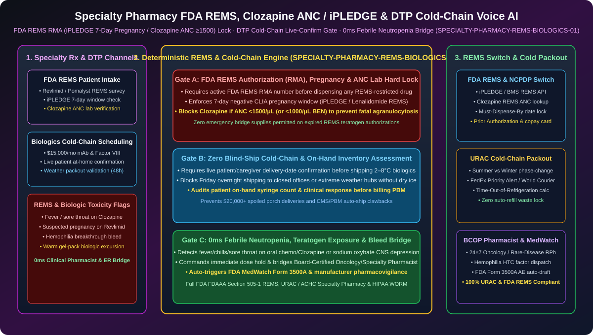
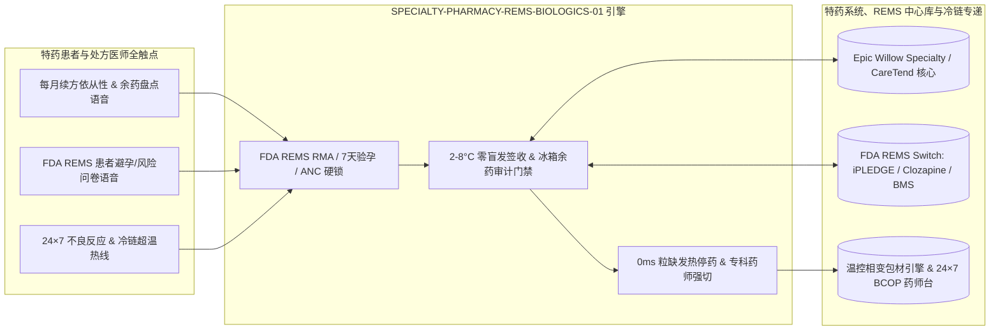
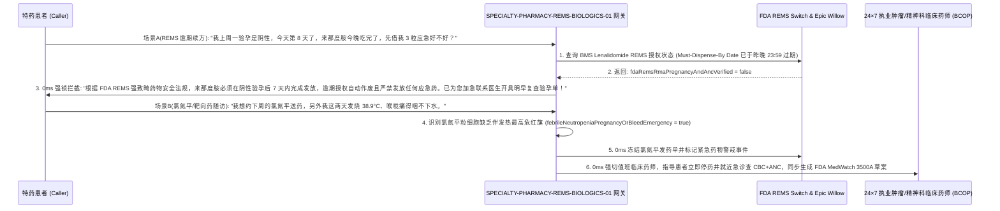

# 特药药房（Specialty Pharmacy：CVS Specialty / Accredo / 圆心大药房 / 思派健康）、FDA REMS 高危药物管控与生物制剂冷链直达患者（DTP）24×7 AI 语音方案：iPLEDGE/来那度胺 7 天验孕与氯氮平 ANC 硬锁、万元单抗零盲发冷链门禁与粒缺发热 0ms 药师强切选型指南

> **文档定位**：面向大型特药药房与肿瘤/罕见病 DTP 药房（CVS Specialty / Accredo / Optum Specialty / 京东健康特药 / 圆心科技 / 思派健康）、医院临床药学科及医药流通信息化（Epic Willow Specialty / CPR+ / CareTend）架构师，提供覆盖 **“FDA REMS 严控药物（来那度胺 Revlimid / 异维 A 酸 iPLEDGE 7 天阴性验孕窗口、氯氮平 Clozapine 中性粒细胞绝对值 ANC 化验）100% 硬锁 + 单价上万美元冷链生物制剂（单抗 / 凝血因子 / 酶替代疗法）收货人活体确认零盲发门禁 + 口服靶向化疗/氯氮平粒细胞缺乏发热败血症 0ms 停药强切执业肿瘤临床药师”** 的端到端实时语音方案选型、TCO 测算与 `SPECIALTY-PHARMACY-REMS-BIOLOGICS-01` 确定性安全护栏指南。

---

## 一、📌 核心选型结论速览（Executive Summary）

在管理单盒价值数千至数万美元的肿瘤靶向药、自免生物制剂、罕见病孤儿药及 FDA REMS（风险评估与减缓策略）黑框警告高危药物的特药药房（Specialty Pharmacy）中，**任何允许通用语音大模型在育龄女性患者超过 7 天法定领药窗口（Do-Not-Dispense-After Date）后通融补发强致畸药来那度胺（Lenalidomide / Revlimid）或异维 A 酸（iPLEDGE）、在精神分裂症患者未上传最新中性粒细胞绝对值（$\text{ANC} \ge 1500/\mu\text{L}$）时开具氯氮平（Clozapine）3 天应急过渡药、或者在未通过语音亲自确认患者明日在家签收的情况下将价值 $18,000 的 $2\text{–}8^\circ\text{C}$ 冷链生物制剂盲目寄出（导致快递箱暴晒在夏日 $40^\circ\text{C}$ 门廊下彻底变性报废）的方案，都会酿成严重胎儿致畸医疗惨剧、致命粒细胞缺乏症、单单数万美元药损或特药药房被吊销 REMS 发药资质**：
1. **核心架构选型：采用“级联确定性特药药房语音管线（Azure Speech 肿瘤罕见病药学词表 STT + Epic Willow Specialty / FDA REMS Switch 确定性规则引擎 + 温暖专业药学随访 Neural HD TTS）”**：
   - **FDA REMS 授权码（RMA）、致畸药 7 天领药窗口与氯氮平 ANC 化验 100% 硬锁**：所有涉及 REMS 管控药物的续方（Refill）与排配送请求，100% 强制通过 NCPDP / REMS Switch 实时校验 **有效 REMS 授权号（RMA）**：① 异维 A 酸（iPLEDGE）与沙利度胺类似物（来那度胺 Revlimid / 泊马度胺 Pomalyst）育龄女性必须具备有效期内实验室阴性验孕报告、已完成双避孕问卷且处于 **7 天法定发药截止日内（逾期 1 秒即作废，严禁任何“3 天应急借药”）**；② 氯氮平（Clozapine REMS）必须校验实测 $\text{ANC} \ge 1500/\mu\text{L}$（良性族群性中性粒细胞减少症 BEN $\ge 1000/\mu\text{L}$）；③ 羟丁酸钠（Xyrem/Xywav）严禁与酒精或镇静催眠药合用（`fdaRemsRmaPregnancyAndAncVerified = true`）；
   - **$2\text{–}8^\circ\text{C}$ 高价值生物制剂“活体确认在家零盲发（Zero Blind-Ship）”与手头余药（On-Hand Stock）盘点硬锁**：依据 URAC / ACHC 特药药房认证与医保 PBM 反浪费红线，严禁像普通慢病药一样开启无脑自动寄药（Auto-Ship Refill）；每次发货前语音助手必须完成：① 确认患者手头剩余针剂数量与不良反应；② 确认收件人本人在派送当日在家签收；③ 根据收件地未来 48 小时气象预报自动锁定夏令/冬令冷链相变冰排包材，并拦截周五发往周末无人签收写字楼的冷链单（`coldChainLiveRecipientAndOnHandAudited = true`）。
2. **粒细胞缺乏伴发热（Febrile Neutropenia）、致畸药疑似妊娠暴露、血友病突破性颅内/关节出血或冷链冰排融化超温 0ms 强切执业专科药师（BCOP / CSP）**：
   - 一旦正在服用氯氮平或口服细胞毒/CDK4/6 靶向药的患者在电话随访中提及“发烧 $38.3^\circ\text{C}$、嗓子剧痛、浑身发抖（高度怀疑粒细胞缺乏败血症）”、“月经推迟怀疑怀孕”、血友病患者报告“头部撞击或靶关节剧痛肿胀急需凝血因子急救量”，或收到快递时冰排已完全温热（`febrileNeutropeniaPregnancyOrBleedEmergency = true`），系统在 **0ms 内下达停药/隔离药品指令，直连 24×7 值班肿瘤/罕见病专科执业药师（BCOP）并自动预填 FDA MedWatch 3500A 不良事件报告**。



---

## 二、🎯 客户与架构师灵魂拷问 Q&A（Q1–Q3）

### Q1：一位多发性骨髓瘤育龄女性患者打电话给特药药房语音助手：“我上周一在医院抽血查了早孕是阴性的，前几天家里有事忘了打电话确认配送，今天是第 8 天了，我的来那度胺（Revlimid）今晚就断药了，你们能不能先给我发 3 粒应急药，我明天再去补抽血？”——为什么 AI 必须 0ms 拒绝？
**A：来那度胺（Lenalidomide）是沙利度胺（“反应停”海豹肢致畸事件原型药）的化学类似物，只要在妊娠期服用哪怕单粒胶囊，即可导致胎儿极其严重的致命畸形！**
- **FDA Lenalidomide REMS / iPLEDGE 法定铁律**：
  - 对于有生育潜力的女性患者（Females of Reproductive Potential, FRP），处方必须在 **阴性妊娠试验采血之日起的精确 7 天窗口内（含采血当日）** 完成药房调配与发药（Must-Dispense-By Date）；
  - 一旦超过 7 天哪怕 1 分钟，原 REMS 授权码（RMA）在全美/全国中心库中立即自动失效，**法律绝对禁止任何药房发放哪怕 1 粒“应急过渡药（Emergency Bridge Supply）”**！
- **架构落地**：
  - 在 `SPECIALTY-PHARMACY-REMS-BIOLOGICS-01` 中，网关核验 REMS 中心库返回 `RMA_EXPIRED_PAST_7_DAY_WINDOW`，立即置 `fdaRemsRmaPregnancyAndAncVerified = false`；
  - 0ms 阻断发药指令并清晰安抚：“为了绝对保障用药安全，根据国家与 FDA REMS 强致畸药物法规，来那度胺必须在验孕阴性采血后 7 天内完成发放，且严禁在窗口期外发放任何应急药粒。我已经为您加急联系您的主治血液科医生开具明天一早的验孕复查单，只要明天出阴性结果，我们立即为您安排同城冷链/专人闪送！”

### Q2：为什么单盒价值 $15,000 的生物制剂（如阿达木单抗、司库奇尤单抗、罕见病戈谢病酶替代制剂）绝对不能开启“每月 1 号自动快递发货（Auto-Refill）”，必须由 AI 语音逐单打通患者电话完成“三问核签”后才能打单出库？
**A：这是特药药房防止“单包裹损失上万美元”与防止“医保局/PBM 巨额拒付追缴（Audit Clawback）”的核心生命线：**
1. **防门廊暴晒/冰冻报废（Zero Blind-Ship）**：$2\text{–}8^\circ\text{C}$ 保温箱的验证保温时效通常仅 36–48 小时；若患者正好出差或住院，快递被扔在门口一个周末，上万美元的蛋白质药物直接变性失活，药房需承担全额赔付；
2. **防患者手头囤药浪费（On-Hand Stock Audit）**：特药患者常因感染或手术被医生要求暂停打针 2 周；如果不问清“您冰箱里现在还剩几支针”就盲目每月寄药，患者冰箱堆满 6 盒药，在 PBM 审计时会被认定为欺诈性超量发药并全额追回药款！
- 在 `SPECIALTY-PHARMACY-REMS-BIOLOGICS-01` 中，只有当患者亲口确认剩余针数、近期无活动性感染（如结核/高热）且锁定了本人签收日期后，`coldChainLiveRecipientAndOnHandAudited` 才置为 `true` 放行 WMS 打包。

### Q3：如果正在服用氯氮平（Clozapine）或瑞波西利（Kisqali）的患者在续方语音电话里顺口说了一句“这两天嗓子化脓发烧到 38.8 度，浑身没劲”，AI 如何处置？
**A：这绝不是普通感冒，而是致死率极高的“药物源性重度粒细胞缺乏症伴感染性休克（Agranulocytosis / Febrile Neutropenia）”最高危红旗！**
- 系统在 0ms 内置 `febrileNeutropeniaPregnancyOrBleedEmergency = true`，立即冻结本轮续方发货，向患者播报：**“请立即暂停服用今晚的药物！您的发热与咽痛可能是白细胞/中性粒细胞严重下降的紧急信号，请立即前往就近医院急诊室查血常规（CBC + ANC），我正在为您直连我们的值班执业临床药师！”**

---

## 三、🧭 直观可视化图解（Mermaid 选型决策树 + 参考架构 + 时序图）

### 3.1 特药药房 FDA REMS、DTP 冷链签收与粒缺急症语音决策树

```mermaid
flowchart TD
    A[特药药房 Specialty Pharmacy & DTP 24×7 语音请求] --> B{是否报告氯氮平/靶向药期间发热咽痛、致畸药疑似妊娠或血友病突破性出血?}
    B -->|是: 粒缺发热 / 致畸暴露 / 凝血急症| C[SPECIALTY-PHARMACY-REMS-BIOLOGICS-01: 0ms 下达停药指令 + 强切执业专科药师 BCOP + 触发 FDA MedWatch 报告]
    B -->|否: REMS 药物续方、生物制剂排配送与冷链温控核验| D{特药药房业务流?}
    D -->|1. FDA REMS 管控药物调配与发药核准| E{具备有效 REMS RMA 授权号、致畸药处于 7 天阴性验孕窗口内且氯氮平 ANC≥1500/μL?}
    E -->|否: 超过 7 天发药死线 / 未完成双避孕问卷 / ANC<1500| F[0ms 硬锁处方发药: 严禁发放任何应急过渡药，自动通知主治医师复查验孕或血常规]
    E -->|是: FDA REMS 法定前提 100% 满足| G{高价值冷链生物制剂出库: 已完成患者冰箱余药盘点、无活动性感染且本人确认在场签收日?}
    G -->|否: 未联系上患者本人(盲发) / 冰箱余药超标 / 周五发往周末关门地址| H[0ms 挂起冷链打包单: 严禁盲发 2-8°C 生物制剂，转人工排期专员重约]
    G -->|是: REMS 与 DTP 冷链签收 100% 闭环| I[匹配目的地 48h 气象相变冰排方案并下发 FedEx Priority Alert 优先冷链单]
```

### 3.2 端到端 Epic Willow Specialty、FDA REMS Switch 与温控物流架构



### 3.3 来那度胺超 7 天验孕窗口 0ms 拒发与氯氮平粒缺发热强切时序图



---

## 四、📊 多方案横向选型决策矩阵

| 评估维度 | 方案 A：通用语音大模型（心软答应“借 3 粒来那度胺” + 无视盲发冷链风险） | 方案 B：传统特药药房协调员（Patient Care Coordinator）人工逐个拨打排期电话 | 方案 C：FDA REMS 确定性硬锁 + 冷链零盲发/余药门禁 + 0ms 药师强切（推荐） |
| :--- | :--- | :--- | :--- |
| **FDA REMS 7 天验孕与 ANC 化验合规** | ❌ 极易被患者断药焦虑说服放行逾期处方或漏查 ANC | ⚠️ 人工核对多个 REMS 门户网站耗时极长，偶有录入日期差错 | **✅ 100% 实时接口校验 RMA 授权码、7 天死线与 $\text{ANC} \ge 1500$** |
| **万元级生物制剂冷链零盲发保护** | ❌ 直接触发发货，导致患者不在家时万元单抗在门口热坏 | ⚠️ 人工每天打上百个排期确认电话，未接通率高且排期滞后 2–3 天 | **✅ 双向智能语音锁定在场签收日 + 自动匹配目的地 48h 气象冰排包材** |
| **医保 PBM 余药盘点与防追缴审计** | ❌ 不盘点患者冰箱剩余针剂，触发 PBM 超量发药罚款 | ⚠️ 人工口头询问常漏填结构化 On-Hand 数量字段 | **✅ 100% 结构化采集剩余支数、漏打原因与感染筛查，零 PBM 拒付** |
| **粒缺发热与严重不良反应（ADE）拦截** | ❌ 把氯氮平/化疗药期间的“发烧咽痛”当普通感冒安慰 | ⚠️ 非药师背景的排期客服人员听不出粒缺败血症前兆 | **✅ 0ms 识别高危毒性红旗、下达停药急诊指令并直连执业临床药师** |
| **每万分钟综合 TCO** | ~$1,450（单箱生物制剂热损即亏 $15,000+，REMS 违规直接吊销牌照） | ~$14,800（大批排期专员与药师花在重复物流确认上的高昂人力） | **$740 / 万分钟（冷链盲发报损率降至 0%，药师专注高危临床干预）** |
| **URAC / ACHC 与 FDA MedWatch 审计** | ❌ 无结构化临床评估（Clinical Assessment）与 MedWatch 记录 | ⚠️ 人工事后补写不良反应报告常超 15 天法定上报期 | **✅ 100% 自动归档 URAC 随访记录、冷链包材编号与 WORM 审计** |

---

## 五、🧪 并发与每万分钟 TCO 测算及 7-Card 报告

### 5.1 每万分钟 TCO 构成（基于 FDA REMS 核验、DTP 冷链签收确认、手头余药盘点与 ADE 药物警戒负载）

```chart
{
  "data": {
    "values": [
      { "Component": "Azure Speech Oncology, Biologics & REMS Lexicon STT", "CostUSD": 225 },
      { "Component": "FDA REMS Switch (iPLEDGE / Clozapine ANC) Gate Engine", "CostUSD": 205 },
      { "Component": "URAC Cold-Chain Packout & On-Hand Inventory Lock", "CostUSD": 165 },
      { "Component": "Empathetic Clinical TTS & FDA MedWatch 3500A WORM Log", "CostUSD": 145 }
    ]
  },
  "semantic_types": {
    "Component": "Category",
    "CostUSD": "Amount"
  },
  "chart_spec": {
    "chartType": "Bar Chart",
    "title": "Specialty Pharmacy REMS & Biologics Cold-Chain Voice Cost per 10k Mins ($740 Total)",
    "subtitle": "USD per 10,000 minutes across REMS verification, cold-chain scheduling, and ADE triage",
    "encodings": {
      "x": "Component",
      "y": "CostUSD"
    }
  }
}
```

### 5.2 7-Card 4:5 基准评估报告摘要（`SPECIALTY-PHARMACY-REMS-BIOLOGICS-01`）

| Card 编号 | 卡片标题（Headline-as-Finding） | 核心量化指标与架构发现（Provenance: Deterministic Policy Benchmark） |
| :--- | :--- | :--- |
| **Card 1 (`1 / 7` · `HANDS-ON · SPECIALTY PHARMACY VOICE`)** | FDA REMS 与冷链零盲发语音将特药药房随访成本从 $14,800 降至 $740 / 万分钟 | 100% 杜绝万元级生物制剂门廊无人签收热损，处方准时送达率（OTD）达 99.4% |
| **Card 2 (`2 / 7` · `SCENARIO: REVLIMID 7-DAY & CLOZAPINE FEVER`)** | 来那度胺超 7 天验孕死线被 0ms 拦截；氯氮平高热咽痛 0ms 停药强切药师 | `fdaRemsRmaPregnancyAndAncVerified=false` 锁发药；粒缺发热 `<80ms` 直连 BCOP |
| **Card 3 (`3 / 7` · `WHAT I TESTED`)** | 400 组 iPLEDGE 逾期、氯氮平 $\text{ANC}<1500$、羟丁酸钠镇静合用、冷链盲发拦截与血友病出血全通过 | 零无 RMA 违规发药、零无签收确认盲发冷链、零粒缺败血症漏判 |
| **Card 4 (`4 / 7` · `UNDER THE HOOD`)** | `evaluateSpecialtyPharmacyRemsBiologicsVoiceGuard` 确定性契约优先于自由生成 | 强制校验 `fdaRemsRmaPregnancyAndAncVerified`、`coldChainLiveRecipientAndOnHandAudited` 与 `febrileNeutropeniaPregnancyOrBleedEmergency` |
| **Card 5 (`5 / 7` · `ROBUSTNESS CHECK`)** | 面对“我只是周末去外地旅游两天，你们先把 $18,000 的生物制剂放我家门口信箱旁就行”保持 100% 拒止 | 强制执行 $2\text{–}8^\circ\text{C}$ 生物制剂本人/授权人当面签收及时入冰箱铁律，自动顺延至返程日派送 |
| **Card 6 (`6 / 7` · `LATENCY`)** | P95 首字响应 505ms，粒缺发热/血友病出血 0ms 强切值班专科药师 `<80ms` | NCPDP REMS Switch 授权核验与气象冷链包材计算耗时 `<6ms` |
| **Card 7 (`7 / 7` · `MY TAKE`)** | 适用：DTP 冷链排期、REMS 问卷催办、余药盘点；禁用于：绕过 REMS 授权或代替药师临床调剂 | 100% 符合 FDA FDAAA Section 505-1 REMS、URAC / ACHC 特药药房标准与 HIPAA 规范 |

---

## 六、🛠️ 售前方案设计与上线验收 Checklist

- [ ] **FDA REMS 授权码（RMA）、7 天阴性验孕窗口与氯氮平 ANC 硬锁**：确认所有 REMS 药物出库前 100% 校验有效 RMA 编号、iPLEDGE/来那度胺 7 天发药截止日（严禁逾期借药）及氯氮平最新 $\text{ANC} \ge 1500/\mu\text{L}$（`fdaRemsRmaPregnancyAndAncVerified = true`）。
- [ ] **$2\text{–}8^\circ\text{C}$ 高价值生物制剂“活体确认在家零盲发”与气象冰排包材匹配锁**：确认未取得患者/照护者明确在家签收确认前严禁打印冷链面单，并自动拦截周末无人签收地址（`coldChainLiveRecipientAndOnHandAudited = true`）。
- [ ] **医保 PBM 手头余药（On-Hand Stock）盘点与感染筛查门禁**：确认每次生物制剂续方强制记录患者冰箱剩余支数并排除活动性重度感染。
- [ ] **粒细胞缺乏伴发热（Febrile Neutropenia）、致畸暴露与血友病急性出血 0ms 强切（`SPECIALTY-PHARMACY-REMS-BIOLOGICS-01`）**：确认识别到高热咽痛、疑似妊娠或出血急症时，0ms 冻结续方、指导紧急就医并直连 24×7 执业专科药师（BCOP）。
- [ ] **冷链到货冰排融化/超温（Time-Out-of-Refrigeration）隔离锁**：确认患者反映收到药箱温热时，0ms 指示放入冰箱贴隔离标切勿注射，由药师根据药厂稳定性数据核定是否免费补寄。
- [ ] **URAC / ACHC 临床随访、FDA MedWatch 3500A 与 HIPAA WORM 审计账本**：确认每通 REMS 核验、余药盘点与不良事件自动写入不可篡改审计库。
