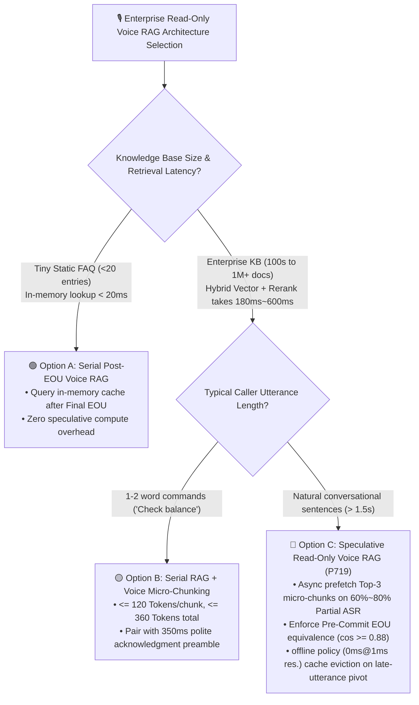
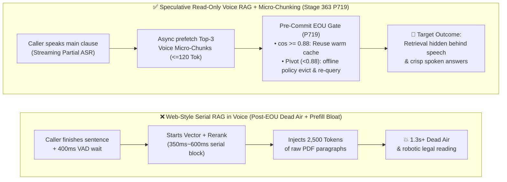
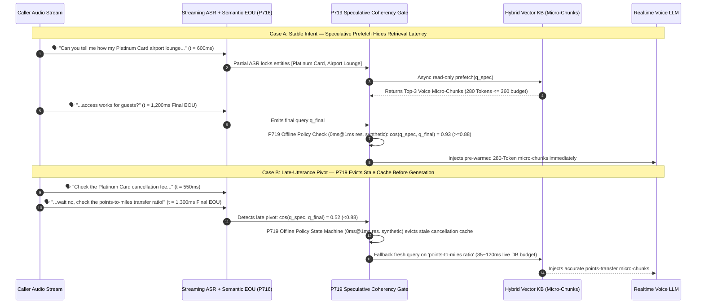

# Enterprise Voice Agent Knowledge Retrieval Selection FAQ: Serial Post-EOU Voice RAG vs. Speculative Read-Only Voice RAG, and How Do Voice Micro-Chunking & Pre-Commit EOU Verification Work Under the Hood?

> **Single-Topic Scope (Round 3A)**: Focused strictly on **Read-Only Knowledge Retrieval (Voice RAG) architecture selection**—when to use serial post-EOU retrieval vs. streaming partial-ASR speculative prefetching, and how Voice Micro-Chunking and Pre-Commit EOU Equivalence Verification (`P719`) eliminate both dead air and stale-cache hallucinations.  
> **Companion Guide (State-Mutating Tool Cancellation & Rollbacks)**: For asynchronous state-mutating tool execution, monotonic `turnEpoch` write fences, and Saga compensation on barge-in (`P720`), see [`docs/voice-tool-epoch-fence-faq.en.md`](./voice-tool-epoch-fence-faq.en.md).  
> **Data Provenance Note**: Industry retrieval latency and cost ranges are tagged `anonymized_reported` (`independently_reproduced=false`). The `0ms reported at nominal 1ms display resolution; actual duration unresolved/not_measured; no sub-1ms upper bound established` latency for `P719` refers strictly to **offline in-memory policy state-machine evaluation (`synthetic`)**; **live production vector database re-query network round-trip latency (`35ms–120ms` production budget) is `not_measured` in local unit tests**.

---

## ① 📌 Executive Summary

1. **Read-Only Voice RAG Selection Boundary (Serial Post-EOU RAG vs. Speculative Read-Only Voice RAG)**:
   - When your knowledge base is tiny (`< 20` cached FAQs served from memory in `< 20ms`) or user utterances are single-word commands, **Serial Post-EOU Voice RAG** is sufficient and avoids speculative query overhead.
   - When querying large enterprise policy manuals, airline fare rules, or troubleshooting guides (where hybrid vector + full-text retrieval and reranking take `180ms–600ms`), waiting until after End-of-Utterance (EOU) stacks an extra `500ms+` of dead air onto the turn—architects should adopt **Speculative Read-Only Voice RAG (`P719`)** to prefetch candidate chunks on stable Partial ASR prefixes while the caller is still finishing their sentence.
2. **Why Copying Web-Chat Text RAG Directly into Voice Calls Causes Sluggish, Robotic Responses**:
   - Web-chat RAG pipelines routinely inject 5 chunks of `500–800 Tokens` each (`2,500+ Tokens` total). In real-time voice conversations, oversized context bloats LLM prefill Time-to-First-Audio (TTFA) and causes the TTS to read dense legal prose aloud. Voice RAG requires **Voice Micro-Chunking (`P719` guardrail: `<= 120 Tokens` per chunk, `<= 360 Tokens` total injected context)** pre-distilled into spoken-style summaries at ingestion time.
3. **The Mandatory Safety Gate for Speculative Prefetching (Pre-Commit EOU Equivalence Gate `P719`)**:
   - Callers frequently pivot or negate their intent in the final 500ms of an utterance (*"Check the cancellation fee... actually never mind, check tomorrow's change fee instead"*). Speculatively prefetched chunks **must never be injected blindly**: at Final EOU, `P719` verifies semantic equivalence (`cosineSimilarity >= 0.88` with no polarity/entity flip). The offline policy state machine evicts stale caches in `0ms reported at nominal 1ms display resolution; actual duration unresolved/not_measured; no sub-1ms upper bound established` (`synthetic`) and falls back to a clean Final-EOU retrieval (live production vector re-query latency is `not_measured` in local unit tests).

---

## ② 🎯 Customer & Architect Soul-Searching Q&A (FAQ-Driven)

### Q1: When building an enterprise voice knowledge assistant, when should we choose Serial Post-EOU Voice RAG vs. Speculative Read-Only Voice RAG?

- **Plain-Language First Principles**:
  - **Why do standard voice bots pause awkwardly before answering policy questions?**
    - In **Serial Post-EOU RAG**, latency stages add up sequentially: `Caller finishes speaking` ➔ `300ms–500ms EOU detection` ➔ `250ms–500ms hybrid vector search + reranking` ➔ `350ms–600ms LLM prefill + first TTS audio frame`. The caller experiences `1.1s–1.6s` of dead air before hearing a single syllable.
  - **What is Speculative Read-Only Voice RAG?**
    - Just as a skilled human agent starts typing *"Platinum Card lounge access"* into their knowledge portal the moment the caller says *"Can you tell me how many times my Platinum Card lets me into..."*, Speculative Voice RAG triggers an asynchronous **read-only prefetch** as soon as streaming Partial ASR locks onto the core entity and intent. By the time the caller finishes the last words of their question 400ms later, the Top-3 micro-chunks are already warm in memory.

---

### Q2: What if the caller changes their mind at the end of the sentence? Won't Speculative Voice RAG feed stale, wrong policy chunks into the LLM?

- **Plain-Language First Principles**:
  - **Yes—if you lack a Pre-Commit EOU Equivalence Gate (`P719`), late-utterance pivots cause Stale Speculative Cache Poisoning.**
  - **How does `P719` prevent stale prefetches from reaching the voice model?**
    1. **Strict Read-Only Speculation**: `P719` blocks any state-mutating tool from firing during partial ASR speculation.
    2. **Pre-Commit EOU Semantic Equivalence Verification**: When Final EOU (`P716`) fires, the gateway computes cosine similarity between the speculative query `q_spec` and final query `q_final` (`cos(q_spec, q_final)`):
       - **Cache Hit (`cos >= 0.88`, no negation pivot)**: The pre-warmed micro-chunks are injected immediately with near-zero post-EOU retrieval wait.
       - **Late Pivot Eviction (`cos < 0.88` or polarity flip)**: The `P719` offline policy state machine evicts the stale cache in `0ms reported at nominal 1ms display resolution; actual duration unresolved/not_measured; no sub-1ms upper bound established` (`synthetic`) and falls back to querying `q_final` fresh (`35ms–120ms` live DB budget; `not_measured` in local unit tests).

---

### Q3: Why is "Voice Micro-Chunking" (`<= 120 Tokens/chunk`) mandatory for real-time voice RAG?

- **Plain-Language First Principles**:
  - Unlike visual web chat where users scan paragraphs, audio is a strictly linear time stream:
    1. **Prefill TTFA Penalty**: Injecting `2,500 Tokens` of raw PDF text inflates real-time LLM prefill latency by hundreds of milliseconds on every turn.
    2. **Auditory Overload**: Reading raw tables or legal boilerplate over the phone confuses callers.
  - **Voice Micro-Chunking (`P719`)**: Pre-summarize documents during indexing into `40–120 Token` spoken answer cards, and cap total injected RAG context at `<= 360 Tokens` per turn.

---

## ③ 🧭 Visual Architecture Diagrams (Mermaid Decision Tree + Pipeline Comparison + Sequence Diagram)

### 3.1 Read-Only Voice RAG Architecture Decision Tree (`flowchart TD`)

### 3.2 Legacy Web-Style Serial RAG vs. Stage 363 Speculative Micro-Chunk Voice RAG (`flowchart LR`)

### 3.3 Millisecond Speculative Cache Hit vs. Late-Pivot Cache Eviction Sequence (`sequenceDiagram`)

---

## ④ 📊 Architect Decision Matrix

| Dimension | Option A: Web-Style Serial Long-Chunk RAG | Option B: Serial Voice Micro-Chunk RAG | Option C: Unverified Speculative RAG | Option D: Speculative Read-Only Micro-Chunk RAG with EOU Gate (`P719`) |
| :--- | :--- | :--- | :--- | :--- |
| **Best-Fit Scenarios** | Text chatbots only (**Not for live voice**) | Tiny static FAQs (`< 20` items) or 1-word commands | Demo scripts only (fails when real callers change their mind mid-sentence) | **Banking advisory, airline policy hotlines, hardware troubleshooting, healthcare & public-sector FAQs** |
| **Post-EOU Retrieval Wait** | `500ms – 1,200ms+` | `200ms – 450ms` | `< 30ms` on hit | **Near-zero extra post-EOU wait on ~80%+ stable turns; safe fallback re-query (`35ms – 120ms`) on ~15–20% pivoted turns** |
| **Immunity to Late-Utterance Pivots** | 🟢 High (waits for EOU) | 🟢 High (waits for EOU) | 🔴 **Low (answers the wrong question on late pivots)** | 🟢 **High (`P719` enforces `cos >= 0.88` pre-commit check and evicts stale caches in `0ms` @ nominal `1ms` res. (`synthetic`, actual duration unresolved))** |
| **LLM Prefill Token Load** | 🔴 Heavy (`2,000+ Tokens`) | 🟢 Light (`<= 360 Tokens`) | 🟡 Unbounded | 🟢 **Light (`<= 120 Tokens/chunk`, `<= 360 Tokens` total)** |
| **Vector DB Compute Cost** | 1.0x baseline | 1.0x baseline | 2.0x – 3.0x | **~1.25x – 1.4x (`< $0.001/min` incremental TCO with entity-locked debouncing)** |

---

## ⑤ 🧪 Quantitative Evaluation & 7-Card Benchmark Findings

| Probe Scenario | Unprotected / Web-Style RAG Baseline | Stage 363 (`P719`) Guarded Pipeline | Data Provenance & Engineering Notes |
| :--- | :--- | :--- | :--- |
| **Caller pivots intent in final 500ms (`cos=0.52 < 0.88`)** | Stale speculative cache injected into LLM prompt | **`P719` offline policy state machine (`0ms reported at nominal 1ms display resolution; actual duration unresolved/not_measured; no sub-1ms upper bound established`, `synthetic`) evicts stale cache and triggers fresh EOU retrieval** | Live vector DB fallback re-query latency (`35ms–120ms` budget) is `not_measured` in local unit tests |
| **Retriever returns `165 Tokens/chunk` (`420 Tokens` total)** | Inflates real-time LLM prefill TTFA | **`P719` (`0ms` @ nominal `1ms` res., `synthetic`, actual duration unresolved) clamps micro-chunk budget to `<= 120 Tokens/chunk` and `<= 360 Tokens` total** | Prevents prefill latency spikes on voice models |
| **Partial ASR attempts state-mutating tool call** | Premature mutation before caller finishes speaking | **`P719` (`0ms` @ nominal `1ms` res., `synthetic`, actual duration unresolved) blocks state-mutating tools during speculation** | Enforces strict read-only speculation |

---

## ⑥ 🛠️ Appendix: Production Voice RAG Launch Checklist (Architect Checklist)

- [ ] **1. Read-Only Speculation Isolation (`P719`)**: Are all state-mutating tools hard-blocked during Partial ASR speculation?
- [ ] **2. Pre-Commit EOU Semantic Equivalence Gate (`cos >= 0.88`)**: Does the gateway verify semantic similarity and negation-free alignment between the speculative query and Final EOU query before injecting cached chunks?
- [ ] **3. Voice Micro-Chunking Budget (`<= 120 Tokens/chunk`, `<= 360 Tokens total`)**: Are documents pre-summarized into spoken micro-chunks at ingestion time with hard token clamping?
- [ ] **4. Entity-Locked Prefetch Debouncing**: Is speculative prefetching debounced to fire at most 1–2 times per turn after core entities stabilize?
