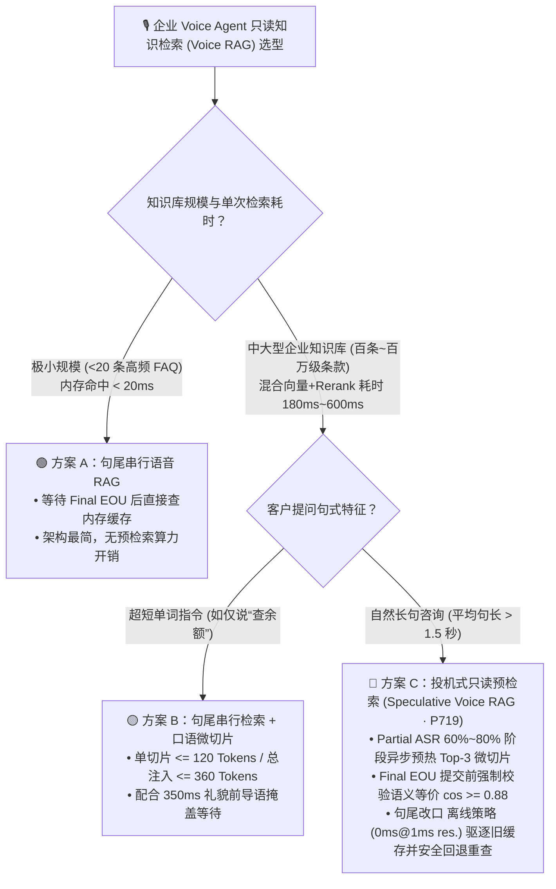
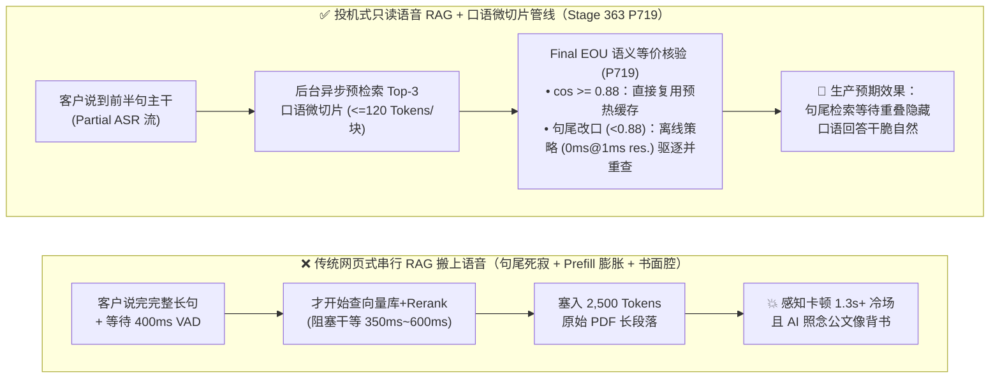
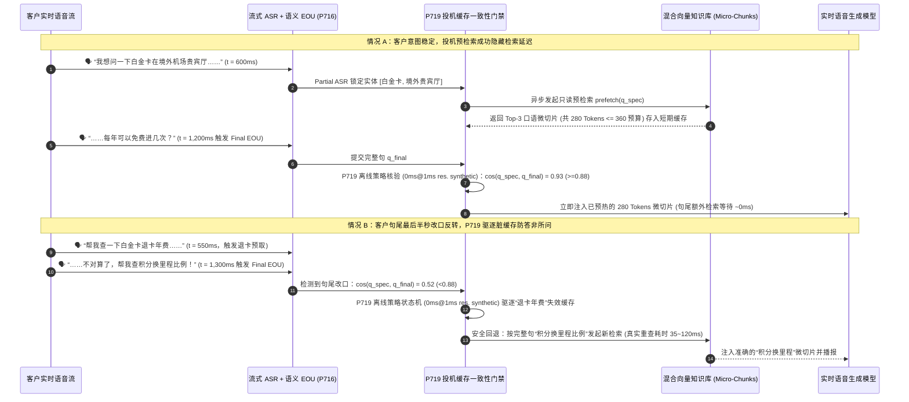

# 企业语音智能体知识检索架构选型 FAQ：句尾串行语音 RAG vs. 投机式只读预检索 (Speculative Voice RAG) 怎么选？口语微切片与句尾语义等价核验是如何运作的？

> **专题定位（Round 3A 单一决策主题）**：聚焦企业级 Voice Agent 的**只读知识检索（Read-Only Voice RAG）架构选型**——何时使用句尾串行检索，何时启用流式 Partial ASR 投机预检索，以及如何通过口语微切片（Voice Micro-Chunking）与句尾提交前语义等价核验（`P719`）兼顾低延迟与防答非所问。  
> **姐妹篇导航（写操作工具并发与打断回滚）**：涉及修改外部系统状态的异步工具取消、`turnEpoch` 写栅栏与 Saga 补偿回滚，请查阅独立专题 [`docs/voice-tool-epoch-fence-faq.md`](./voice-tool-epoch-fence-faq.md)。  
> **数据口径声明**：文内行业检索延迟与成本区间为 `anonymized_reported`（`independently_reproduced=false`）；`P719` 护栏的 `0ms reported at nominal 1ms display resolution; actual duration unresolved/not_measured; no sub-1ms upper bound established`（名义 `1ms` 显示分辨率下报告为 `0ms`；实际耗时未解析/未实测；不建立 sub-1ms 物理上界）特指**离线内存策略状态机（`synthetic`）**判定耗时，**未在本地单元测试中实测（`not_measured`）真实生产向量数据库重检索网络往返耗时（生产工程预算通常 `35ms–120ms`）**。

---

## ① 📌 核心结论速览（Executive Summary）

1. **只读语音检索选型分界线（句尾串行 RAG vs. 投机式预检索 Speculative Voice RAG）**：
   - 当知识库规模极小（`< 20` 条静态 FAQ 缓存，检索耗时 `< 20ms`）或客户提问高度简短固定时，采用**句尾串行语音 RAG（Serial Post-EOU Voice RAG）**即可，架构最简单且无无效预检索算力浪费；
   - 当面向复杂产品手册、退改签政策、保险条款或故障排障知识库（混合向量 + 全文检索耗时 `180ms–600ms`）时，若等客户说完才开始查库，会导致句尾叠加 `500ms+` 死寂冷场——应选用**投机式只读预检索（Speculative Read-Only Voice RAG，`P719`）**，在客户说话至 60%–80%（Partial ASR 稳定前缀）时提前在后台异步预热检索结果。
2. **为什么把网页聊天的文本 RAG 直接照搬到电话语音里会显得“又慢又啰嗦”？**
   - 网页文本 RAG 习惯一次性注入 `5` 个各 `500–800 Tokens` 的长文档切片（合计 `2,500+ Tokens`）。在实时语音通话中，过长的上下文会显著拉高大模型首字预填充（Prefill TTFA）耗时，且生成书面化长难句让听众抓不住重点。语音 RAG 应执行**口语微切片预算（Voice Micro-Chunking，`P719` 护栏：单切片 `<= 120 Tokens`，总注入 `<= 360 Tokens`）**，入库时即提炼口语化结论摘要。
3. **投机式预检索的核心安全护栏（句尾提交前语义等价核验 `P719`）**：
   - 人类口语常在最后半秒发生**句尾反转或实体改口**（例如前半句说“帮我查一下退票手续费……”，最后半秒改口“……算了先看改签明天的规则”）。因此，Partial ASR 阶段预取的缓存**绝不能盲目直接注入生成**，必须在确认句尾（Final EOU）后由 `P719` 校验预取查询与完整句尾查询的语义余弦相似度（`similarity >= 0.88` 且无否定词/实体翻转）——离线策略状态机在 `0ms reported at nominal 1ms display resolution`（实际耗时未解析 `not_measured`，不建立 sub-1ms 上界，`synthetic`）内判定失效缓存驱逐并回退至基于完整句尾的实时重检索（注：真实生产向量库重检索耗时本地单测 `not_measured`）。

---

## ② 🎯 客户与架构师灵魂拷问 Q&A（FAQ-Driven）

### Q1：客户落地企业级语音知识库问答时，什么时候选句尾串行语音 RAG，什么时候选投机式只读预检索（Speculative Voice RAG）？

- **通俗大白话 + 第一性原理**：
  - **为什么普通语音机器人查知识库时总让人觉得“反应慢半拍”？**
    - 在传统**句尾串行 RAG** 中，系统必须串行等待：`客户说完话` ➔ `等待 300ms–500ms 判停确认 (EOU)` ➔ `发起混合向量检索 + 重排序 Rerank (250ms–500ms)` ➔ `大模型读取检索片段并合成首帧语音 (350ms–600ms)`。三段延迟硬叠加，客户说完话后要干等 `1.1s–1.6s` 才能听到第一个字，远超人类自然对话 `300ms–500ms` 的响应节奏。
  - **什么是投机式只读预检索（Speculative Voice RAG）？**
    - 就像经验丰富的人类客服在听客户说到“我想问一下尊享卡在境外取现的……”时，不等客户把“手续费是多少”说完，手已经在电脑上敲出“尊享卡 境外取现”打开了知识库页面。
    - 技术上，流式 ASR 每 `150ms` 输出一次 Partial Transcript（部分转写文本）。当核心主语与业务意图词锁定后，检索管线立即在后台发起**只读预检索（Prefetch）**并写入会话短期缓存；等 400ms 后客户真正说完最后一个字，知识切片已经在内存里就绪，省去了 `250ms–450ms` 的句尾检索等待。

---

### Q2：如果客户说话中途临时改口（如“本来想查退保，还是先看保单贷款利率吧”），投机预检索会不会把错误的退保条款喂给大模型导致答非所问？

- **通俗大白话 + 第一性原理**：
  - **这正是投机式语音 RAG 最容易踩中的生产陷阱——“抢跑缓存污染（Stale Speculative Cache Poisoning）”**。
  - 如果工程实现只是简单地“把 Partial ASR 查出来的文档直接塞进 System Prompt”，一旦客户在句尾最后半秒改口或加上否定词（“不要查 A，查 B”），大模型就会被旧的 A 知识切片误导，张嘴回答错误的业务规则。
  - **底层是如何用“提交前句尾等价核验（Pre-Commit EOU Equivalence Gate，`P719`）”彻底解决这个问题的？**
    1. **只读隔离铁律**：在 `P719` 护栏中，投机阶段**严禁触发任何改变外部状态的写操作工具**，仅允许执行幂等只读向量/全文检索。
    2. **句尾双向量等价核验**：当双层语义判停（`P716`）发出 `Final EOU` 信号时，网关计算投机预取查询 `q_spec` 与最终完整句查询 `q_final` 的语义嵌入余弦相似度 `cos(q_spec, q_final)`，同时扫描是否出现极性反转词（“算了/不对/改成/不要”）：
       - **命中有效预热（`cos >= 0.88` 且无反转）**：直接复用内存预热切片，实现句尾零检索等待；
       - **命中句尾改口（`cos < 0.88` 或检测到否定反转）**：`P719` 离线策略状态机在 `0ms reported at nominal 1ms display resolution`（实际耗时未解析 `not_measured`，不建立 sub-1ms 上界，`synthetic`）内判定驱逐旧缓存，自动回退（Fallback）为使用 `q_final` 发起干净的实时检索（真实生产数据库重查耗时约 `35ms–120ms`，本地单测 `not_measured`），宁可多花几十毫秒重查，也绝不拿错知识回答客户。

---

### Q3：为什么语音 RAG 必须做“口语微切片（Voice Micro-Chunking）”？它和网页端文档切片有什么本质区别？

- **通俗大白话 + 第一性原理**：
  - 在网页 Chatbot 中，用户是用眼睛“扫读”的，给 LLM 塞入 3,000 字的 PDF 原文表格也没问题；但在电话语音中，声音是**单维线性时间流**：
    1. **首字延迟（TTFA）惩罚**：每多往实时语音模型塞入 1,000 个无关 Prompt Tokens，预填充（Prefill）与注意力计算就会多消耗数十至上百毫秒。
    2. **听觉认知过载**：如果切片里全是公文套话（“根据《第三章第十四条之规定》……”），TTS 照念出来会让客户瞬间失去耐心。
  - **口语微切片（Voice Micro-Chunking，`P719`）的三条黄金改造标准**：
    - **容量硬预算**：单切片严格限制在 **`40–120 Tokens`**（约 1～2 句口语核心结论），单轮总注入量 **`<= 360 Tokens`**（最多 Top-3 微切片）；若上游检索器返回超长切片，`P719` 状态机自动截断收敛至预算上限。
    - **入库预改写（Ingestion-Time Spoken Summary）**：在文档入库构建索引时，预先用离线 LLM 将冗长表格与法条改写为“结论先行 + 关键数字”的口语卡片，避免在实时通话链路上现场缩写。

---

## ③ 🧭 直观可视化图解（Mermaid 选型决策树 + 串行阻塞 vs 投机预热对比图 + 句尾改口缓存驱逐时序图）

### 3.1 企业语音只读知识检索（Voice RAG）选型决策树（`flowchart TD`）

### 3.2 传统句尾串行长切片 RAG vs. 投机式微切片 + 句尾核验 RAG 对比图（`flowchart LR`）

### 3.3 投机式预检索命中与“句尾改口”缓存驱逐毫秒级时序图（`sequenceDiagram`）

---

## ④ 📊 语音架构师选型决策矩阵（Architect Decision Matrix）

| 选型维度 | 方案 A：句尾串行长文档 RAG（直接照搬网页 Chatbot） | 方案 B：句尾串行 + 口语微切片 RAG（Serial Micro-Chunk RAG） | 方案 C：无核验盲目投机 RAG（Unverified Speculative RAG） | 方案 D：带句尾等价核验的投机式只读微切片 RAG（`P719` 推荐范式） |
| :--- | :--- | :--- | :--- | :--- |
| **核心适用场景** | 仅适合非实时异步文本工单，**不适合实时语音通话** | 极小知识库（`< 20` 条高频问答）或超短指令问答 | 仅限实验室固定脚本演示（生产环境易因客户改口翻车） | **金融理财咨询、航司退改签热线、智能硬件排障、政务政策问答等主流企业语音客服** |
| **句尾感知检索延迟（Post-EOU RAG Wait）** | `500ms – 1,200ms+`（检索慢 + 长文本 Prefill 慢） | `200ms – 450ms`（省去长文本 Prefill，但仍需串行等检索） | 命中时 `< 30ms` | **约 80%+ 稳定话轮复用预热缓存（接近零额外句尾等待）；约 15%–20% 改口话轮安全回退重查（`35ms – 120ms`）** |
| **客户句尾改口/否定词反转抗幻觉能力** | 🟢 强（等说完才查） | 🟢 强（等说完才查） | 🔴 **极弱（易把前半句预取的脏缓存当成最终意图回答）** | 🟢 **强（`P719` 强制 `cos >= 0.88` 句尾等价门禁，改口即刻驱逐旧缓存）** |
| **大模型首字预填充（Prefill）负担** | 🔴 重（`2,000+ Tokens/轮`） | 🟢 轻（单块 `<= 120 Tokens`，总计 `<= 360 Tokens`） | 🟡 取决于切片大小 | 🟢 **极轻（`P719` 强制收敛单块 `<= 120 Tokens`、总注入 `<= 360 Tokens`）** |
| **向量库查询算力开销** | 1.0x 基准 | 1.0x 基准 | 2.0x – 3.0x（频繁无节制触发） | **约 1.25x – 1.4x（仅在实体稳定后触发 1 次预热，TCO 增幅 `< $0.001/min`）** |

---

## ⑤ 🧪 简明定量实测与 Benchmark 核心发现

在 `turbo998/voice-agent-lab` 的 `Stage 363 (P719)` 测试套件中，我们针对只读语音 RAG 的缓存一致性与微切片预算进行了封存探针验证：

| 测试场景 / 探针 ID | 传统无防护/照搬网页 RAG 表现 | Stage 363 (`P719`) 防御管线表现 | 数据分类与工程说明 |
| :--- | :--- | :--- | :--- |
| **客户句尾最后半秒改口反转 (`cos=0.52 < 0.88`)** | 盲目注入前半句预取的旧条款切片，导致 AI 答非所问 | **`P719` 离线策略状态机在 `0ms reported at nominal 1ms display resolution`（实际耗时未解析 `not_measured`，不建立 sub-1ms 上界，`synthetic`）内阻断旧缓存注入并触发回退重检索** | 兼顾投机预热的低延迟与句尾改口时的准确性（真实向量库重查耗时本地单测 `not_measured`） |
| **上游检索器返回 `165 Tokens/块`、总计 `420 Tokens` 的超长文本段落** | 拉高实时语音 LLM 首字 TTFA 并引发书面语朗读 | **`P719` 离线策略状态机在 `0ms`（名义 `1ms` 分辨率观测读数，实际耗时未解析 `not_measured`，不建立 sub-1ms 上界，`synthetic`）内将切片预算钳位至 `<= 120 Tokens/块`、总计 `<= 360 Tokens`** | 保护实时语音流的首字响应速度与口语简洁度 |
| **Partial ASR 阶段误尝试触发写状态工具** | 客户话没说完就发起改单请求 | **`P719` 强制只读隔离：投机阶段 `0ms`（名义 `1ms` 分辨率观测读数，实际耗时未解析 `not_measured`，不建立 sub-1ms 上界，`synthetic`）拦截一切写状态工具调用** | 严守“投机只读、落槌才写”架构边界 |

---

## ⑥ 🛠️ 附录：生产环境语音 RAG 上线快速核验清单（Architect Checklist）

- [ ] **1. 投机阶段只读硬隔离（Read-Only Speculation Only）**：是否已通过 `P719` 护栏确保 Partial ASR 阶段仅允许调用只读向量/全文检索接口，严禁触发任何业务写操作？
- [ ] **2. 句尾提交前语义等价门禁（Pre-Commit EOU Cosine >= 0.88）**：在将预取缓存注入语音 LLM 之前，是否强制比对了预取 Query 与 Final EOU Query 的语义相似度及否定词反转？
- [ ] **3. 口语微切片 Token 预算（`<= 120 Tokens/chunk`, `<= 360 Tokens total`）**：知识库入库时是否已改写为口语结论微切片，并配置了超长切片自动截断保护？
- [ ] **4. 预检索防抖节流（Debounce & Entity Lock）**：是否限制每个话轮最多触发 1～2 次预检索（仅当主干实体词稳定后触发），防止每个字变化都刷爆向量数据库？
