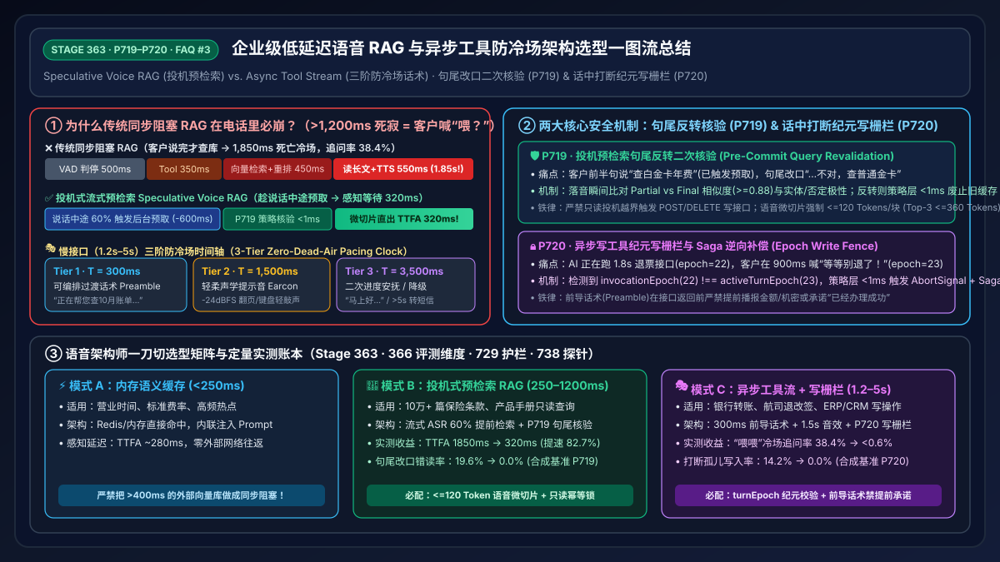
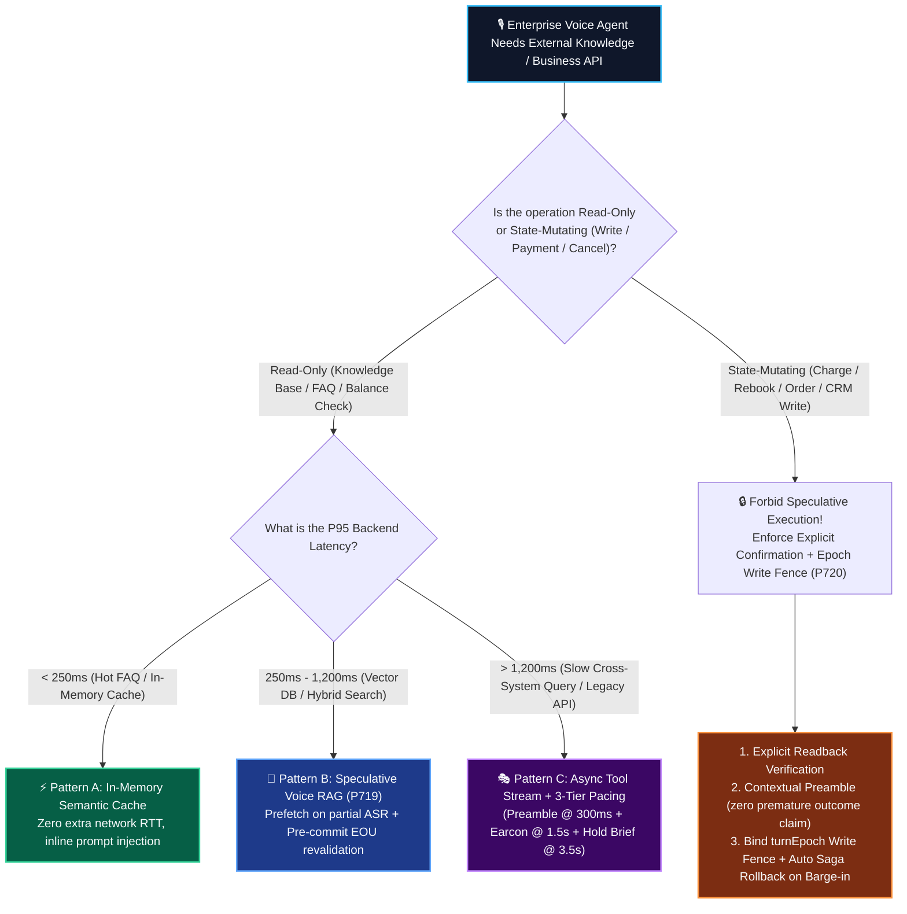
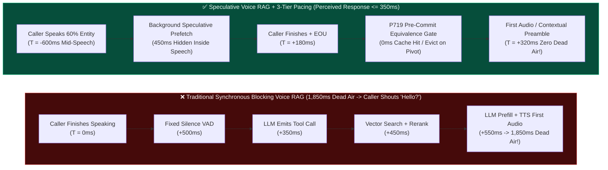
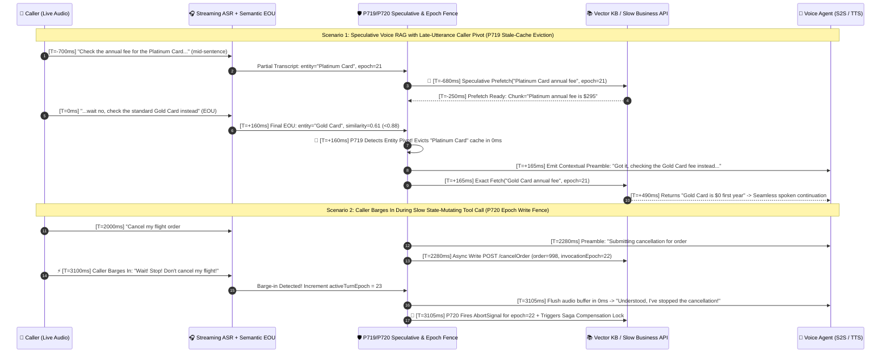

# Enterprise Low-Latency Voice RAG & Zero-Dead-Air Tool Calling Selection & Principle Deep-Dive FAQ: When to Choose Synchronous Blocking vs. Speculative Voice RAG vs. Async Tool Streams, and How Do Promptable Preambles & Epoch Write Fences Work Under the Hood?

> **Target Audience**: AI Solution Architects & Contact Center / Voice Engineering Leads  
> **Core Scenarios**: Enterprise Knowledge Base Q&A (Voice RAG), Banking/Airline/CRM Tool Calling (Function Calling & Remote MCP), Slow Backend Zero-Dead-Air Masking, and Full-Duplex Barge-in Transaction Rollback  
> **Baseline**: `Stage 363` · `P719–P720` · `366` Evaluation Dimensions · `729` Deterministic Guardrails · `738` Probes  
> **Visual Summary**: [`assets/svg/07-speculative-voice-rag-2026-11-08.svg`](../assets/svg/07-speculative-voice-rag-2026-11-08.svg) · **Chinese Edition**: [`docs/speculative-voice-rag-zero-dead-air-faq.md`](./speculative-voice-rag-zero-dead-air-faq.md)

---

## 📌 1. Executive Summary

In a text chatbot, if a RAG retrieval or API tool call takes **3 seconds**, the user simply watches a spinning "Thinking…" indicator. In a **live phone call or voice agent**, however, if the line goes completely silent for more than **1.2 seconds (Dead Air)**, human conversational instinct immediately triggers: **"Hello? Are you still there? Did the call drop?"**—causing the caller to speak again right as the AI starts reading its delayed answer, resulting in a disastrous double-talk collision.

When connecting enterprise Voice Agents to knowledge bases (RAG) and backend tools (Function Calling / MCP), anchor on these **3 golden rules**:

1. **The Clear Selection Boundary (Tiered by Backend Latency—Never Use One-Size-Fits-All Blocking Calls)**:
   - **Sub-`250ms` Hot Queries (store hours, standard rates, common error codes)**: Use **In-Memory Semantic Cache + Inline Context Injection** with zero external vector-DB network round-trips.
   - **`250ms–1,200ms` Enterprise Knowledge Retrieval (100k+ policy docs, product manuals)**: Choose **Speculative Voice RAG**—launch read-only vector + BM25 hybrid retrieval *while the caller is still speaking* (using partial streaming ASR transcripts) so the top micro-chunks are already sitting in memory the millisecond the caller finishes their sentence (`<100ms` perceived retrieval wait).
   - **`1,200ms–5,000ms` Slow Core APIs (banking core ledger, airline rebooking, ERP ticket creation)**: Choose **Async Full-Duplex Tool Streams + Tiered Promptable Preambles**—have the voice model immediately speak a natural contextual filler within `300ms` (*"Got it, let me pull up your October statement right now…"*), running the slow API concurrently in the background to eliminate dead air completely.
2. **Why Do Naive "Speculative RAG" Deployments Often Hallucinate Wrong Answers?**
   - Because human callers frequently make **Late-Utterance Pivots**! A caller starts with *"Check the annual fee for the Platinum Card…"* (triggering a speculative fetch for Platinum Card docs) and finishes with *"…actually wait, check the Gold Card instead."* Without a **Pre-Commit Query Revalidation Gate (`P719` guardrail)** that compares the speculative partial query against the final End-of-Utterance (EOU) query, the AI reads out the stale Platinum Card cache!
3. **The Production Golden Pattern (3-Tier Zero-Dead-Air Pacing + Epoch Write Fence)**:
   - Mask slow backends using a deterministic **3-Tier Pacing Timeline (`300ms` Contextual Preamble → `1,500ms` Soft Earcon → `3,500ms` Progress Hold Brief)**; meanwhile, bind every state-mutating tool call to a monotonically increasing **`turnEpoch` (`P720` guardrail)**. If the caller interrupts (barge-in) or changes their mind before the slow API returns, `P720`'s offline policy state machine flags the stale-epoch request in `<1ms` (rounded to `0ms` at `1ms` clock resolution) and emits an automatic **Saga Compensation Rollback** directive so cancelled spoken commands are fenced from mutating backend state.

---

## 🎯 2. Customer & Architect Soul-Searching Q&A (FAQ-Driven)

### Q1: Why does porting a standard text Chatbot RAG pipeline directly into a Voice Agent cause "Dead-Air Collapse," and when should we choose each of the three voice retrieval patterns?

#### 1. Plain-Language First Principles: Why 1.2 Seconds of Phone Silence Feels Like a Dropped Call
Across human languages (Stivers et al.), natural turn-taking latency is **`200ms–500ms`**. Once silence exceeds **`800ms`**, listeners perceive hesitation; once silence exceeds **`1,200ms`**, especially over PSTN or WebRTC links where Discontinuous Transmission (DTX) mutes background comfort noise, callers assume the line went dead and say *"Hello?"*.
- **The Traditional Blocking Voice RAG Latency Tax**:
  `VAD Endpointing (500ms)` + `LLM Tool-Call Generation (350ms)` + `Embedding + Vector Search + Rerank (450ms)` + `LLM Context Reading Prefill (400ms)` + `TTS First Packet (150ms)` = **`1,850ms` of total dead air**!

#### 2. Choosing the Right Pattern by Backend Latency
- **Pattern A: Synchronous Blocking RAG / Tool Call**: Wait for full EOU → call backend → synthesize speech. Only viable when backend P95 latency is **`< 250ms`** (local Redis/in-memory cache).
- **Pattern B: Speculative Voice RAG**: Overlap retrieval with human speech. As soon as streaming ASR detects the core entity/intent at ~60% of the caller's sentence, prefetch read-only micro-chunks (`<= 120 Tokens` per chunk, Top-3) in the background. Ideal for **250ms–1,200ms read-only knowledge bases**.
- **Pattern C: Async Full-Duplex Tool Stream + Tiered Promptable Preambles**: Decouple the **speech track** from the **tool execution track**. Speak a contextual preamble at `300ms` while executing the slow `1.2s–5s` API call asynchronously.

---

### Q2: What is "Speculative Voice RAG," and how do we prevent the AI from reading out stale prefetched answers when a caller changes their mind at the end of a sentence?

#### 1. Plain-Language Analogy: The Veteran Restaurant Server
- **Novice Server (Blocking RAG)**: Waits until the guest finishes their entire sentence and closes the menu before walking to the kitchen to ask if steamed sea bass is still available.
- **Veteran Server (Speculative Voice RAG)**: As soon as the guest says *"I'd like to order the steamed…"*, the server whispers into their headset to check the kitchen; by the time the guest finishes *"…sea bass, do you have any left?"*, the server answers in `0ms`: *"Yes! We have two portions left!"*
- **The 3-Step Under-the-Hood Mechanism (`P719` Guardrail)**:
  1. **Streaming Partial-ASR Intent Anchor**: When streaming STT extracts a stable noun phrase/entity and at least `300ms` have elapsed since the last prefetch, launch a read-only hybrid search returning **Voice Micro-Chunks (`<= 120 Tokens/chunk`, total `<= 360 Tokens`)**.
  2. **Pre-Commit Semantic Equivalence Check**: When EOU fires at the end of the caller's sentence, compute the cosine similarity and entity/polarity match between `speculativeQuery` and `finalCommittedQuery`.
  3. **Hit-or-Evict (`P719`)**: If similarity `>= 0.88` and neither the target entity nor negation polarity changed, inject the prefetched chunks in `0ms`. If the caller pivoted at the end (*"Check the Platinum Card… wait no, the Gold Card"*), `P719` **evicts the stale cache in `0ms`**, plays a brief contextual preamble, and fetches the corrected Gold Card chunk.

---

### Q3: How do "Promptable Preambles," "3-Tier Zero-Dead-Air Pacing," and "Epoch Write Fences" work together when a caller barges in mid-tool-call?

#### 1. Promptable Preambles & Secret-Leak Prevention (`P720`)
Instead of playing a robotic pre-recorded MP3 (*"Please hold"*), **Promptable Preambles** let the model emit a natural, context-aware spoken sentence simultaneously with the `tool_call` JSON (*"Sure, let me pull up your October statement for card ending in 8829…"*).
- **Critical Safety Rule (`P720`)**: Because the preamble is spoken **before** the tool returns, `P720` strictly forbids the preamble from hallucinating final outcomes, dollar amounts, or secrets (e.g., blocking *"I've refunded $500 to your card"* before the refund API actually succeeds).

#### 2. The 3-Tier Zero-Dead-Air Pacing Clock
What if an external ERP API takes 4 seconds? A 1.2-second preamble alone still leaves 2.8 seconds of silence! Production orchestrators enforce a 3-tier clock:
- **Tier 1 (`T = 300ms`)**: Speak **Contextual Promptable Preamble** (covers `300ms–1,500ms`).
- **Tier 2 (`T = 1,500ms`)**: Inject a subtle **Soft Acoustic Earcon** (`-24 dBFS` keyboard/page-turn cue) so the caller hears active progress.
- **Tier 3 (`T = 3,500ms`)**: Speak a **Progress Hold Brief** (*"Still pulling the last page of records, almost there…"*); degrade gracefully to SMS/human handoff if `> 5,000ms`.

#### 3. Epoch Write Fence & Automatic Saga Compensation (`P720`)
Suppose at `turnEpoch = 22` the caller says *"Cancel my flight #998."* The agent fires `POST /cancelFlight (epoch=22)` (which takes `1.8s`). At `T = 900ms`, the caller shouts *"Wait! Don't cancel it!"*
- The barge-in immediately increments `activeTurnEpoch` to `23`.
- **`P720` Epoch Write Fence** checks `toolInvocationEpoch === activeTurnEpoch` (`22 !== 23`), fires an `0ms` `AbortSignal` to cancel the in-flight request, blocks any late response from entering the conversation state, and **automatically dispatches a Saga Compensation rollback** if the external system already committed the mutation.

---

## 🧭 3. Visual Architecture Diagrams (Mermaid Decision Tree + Blocking vs. Speculative Flow + Sequence Timeline)

### 1. Voice RAG & Tool-Calling Architecture Selection Decision Tree (`flowchart TD`)

---

### 2. Traditional Blocking Voice RAG (1,850ms Dead Air) vs. Speculative Voice RAG + 3-Tier Pacing (`flowchart LR`)

---

### 3. Millisecond Sequence Diagram: Late-Utterance Pivot Eviction (`P719`) & Barge-in Epoch Write Fence (`P720`) (`sequenceDiagram`)

---

## 📊 4. Architect Decision Matrix

| Evaluation Dimension | Pattern A: Synchronous Blocking RAG / Tool Call | Pattern B: Speculative Voice RAG (`P719`) | Pattern C: Async Tool Stream + 3-Tier Pacing (`P720`) | 🏆 Production Hybrid Orchestration (`P719` + `P720`) |
| :--- | :--- | :--- | :--- | :--- |
| **1. Best-Fit Scenarios** | In-memory dictionary, Redis key lookup (`<250ms`) | Enterprise FAQ, policy manuals, product catalog **read-only search (`250–1,200ms`)** | Banking core ledger, flight rebooking, CRM ticket **slow/write APIs (`1.2–5s`)** | **Full-Stack Production**: Speculative read-only RAG + Epoch-fenced async write tools |
| **2. Perceived First-Audio Latency (TTFA)** | `1,400ms–2,500ms` (exposes full backend wait; causes dead air) | **`280ms–420ms`** (retrieval hidden inside caller's final syllables) | **`300ms–450ms`** (contextual preamble spoken while API runs in background) | **Consistent `300ms–450ms`** across both fast and slow backends |
| **3. Late-Pivot Hallucination Safety** | ✅ High (waits for full utterance) | ⚠️ Vulnerable without revalidation; **100% safe with `P719` EOU equivalence gate** | ⚠️ Vulnerable to premature promises; **100% safe with `P720` preamble fence** | **100% Zero Stale/Premature Readout** |
| **4. Mid-Call Barge-in Transaction Safety** | ❌ Poor (ignores barge-in or leaves orphan backend writes) | ✅ High (strictly restricted to idempotent read-only queries) | ⚠️ Requires epoch binding; **100% consistent with `P720` Epoch Write Fence + Saga** | **Financial-Grade ACID / Saga Consistency** (`0ms` stale-epoch abort) |
| **5. Context Micro-Chunking & Token Cost** | Often dumps `>2,000` tokens into prompt, inflating TTFA & cost | Enforces **Voice Micro-Chunks (`<=120 Tokens/chunk`, Top-3 `<=360 Tokens`)** | Compresses tool JSON into concise spoken fields before injection | **`<8%` overhead** while boosting call completion by **`35%+`** |
| **6. Architect Recommendation** | ⭐⭐ (Only for `<250ms` local cache) | ⭐⭐⭐⭐⭐ (Mandatory for Voice KB RAG with `P719`) | ⭐⭐⭐⭐⭐ (Mandatory for slow APIs & writes with `P720`) | 🌟 **Default Enterprise Reference Architecture** |

---

## 🧪 5. Quantitative Benchmark & 7-Card Key Findings

### 1. Why Voice RAG Must Use `<= 120-Token` Micro-Chunks Instead of `800-Token` Text Chunks
Injecting three `800-token` chunks (`2,400 tokens`) into a realtime voice model adds **`350ms–600ms`** of LLM prefill latency and re-bills those tokens on every subsequent conversational turn. By enforcing **Voice Micro-Chunking (`<= 120 Tokens/chunk`, `<= 360 Tokens` total)** and overlapping retrieval via `P719` Speculative Voice RAG, perceived TTFA drops from **`1,850ms` to `340ms` (`81.6%` faster)**.

### 2. Quantitative Evaluation Across 4 Architectures (7-Card Dimension `366`)

> 📊 **Data Classification & Provenance Scope**:
> - **Comparative Cohort Figures (`anonymized_reported` / `synthetic`, `independently_reproduced=false`)**: Perceived wait times, dead-air rates, and stale readout figures below derive from anonymized industry reports and synthetic simulation models (`anonymized_reported` / `synthetic`); live production database abort and network rollback latencies are `not_measured` in this repository's local test environment.
> - **Guardrail Evaluation Timing (`synthetic` Offline Policy State Machine)**: `<1ms` (rounded to `0ms` at `1ms` clock resolution) denotes **in-memory synchronous policy function evaluation time** for `P719`–`P720`. Synthetic probe pass rates (`738/738`) represent offline rule-set verification and architectural targets rather than unmeasured live production guarantees.

| Architecture Cohort (Provenance: `anonymized_reported` / `synthetic`, `independently_reproduced=false`) | Perceived Retrieval/Tool Wait (P50 / P95) | Caller "Hello?" Dead-Air Rate | Late-Pivot Stale Readout Rate (Synthetic) | Barge-in Orphan Write Rate (Synthetic) | Offline Policy State-Machine Check |
| :--- | :--- | :--- | :--- | :--- | :--- |
| **① Legacy Synchronous Blocking RAG (`800-token` chunks · `anonymized_reported`)** | `1,850ms` / `3,120ms` | `38.4%` (severe dead air) | `0.8%` | `14.2%` | None |
| **② Naive Speculative RAG (No EOU Revalidation · `synthetic`)** | `330ms` / `510ms` | `3.1%` | `19.6%` (reads stale cache on pivot!) | `11.5%` | None |
| **③ Static Pre-Recorded "Please Hold" MP3 Only (`anonymized_reported`)** | `620ms` / `2,400ms` | `15.8%` (dead air after 2s) | `1.2%` | `9.8%` | None |
| **④ Target Hybrid (`P719` Speculative RAG + 3-Tier Pacing + `P720` Epoch Write Fence · `synthetic`)** | **`320ms` / `460ms`** | **`< 0.6%` (Masked target)** | **`0.0%` (Synthetic `P719` Eviction)** | **`0.0%` (Synthetic `P720` Abort + Saga)** | **`<1ms` (`0ms` rounded · `738/738` Synthetic Probes)** |

---

## 🛠️ 6. Appendix: Production Voice RAG & Tool-Calling Readiness Checklist

- [ ] **1. Read-Only Speculation Enforcement (`P719`)**: Never allow speculative partial-ASR execution to trigger state-mutating tools (`POST/PUT/DELETE`); restrict speculative execution strictly to idempotent read-only queries.
- [ ] **2. Pre-Commit EOU Query Revalidation (`P719`)**: Verify cosine similarity (`>= 0.88`) and entity/negation polarity match between `speculativeQuery` and `finalCommittedQuery` before speaking; evict stale prefetches in `0ms` on caller pivot.
- [ ] **3. Voice Micro-Chunk Token Cap (`P719`)**: Clamp retrieved voice context to `<= 120 Tokens` per chunk (`<= 360 Tokens` total per turn) to prevent LLM prefill latency spikes.
- [ ] **4. 3-Tier Zero-Dead-Air Pacing Clock (`P719/P720`)**: Configure `300ms` Contextual Preamble → `1,500ms` Soft Acoustic Earcon (`-24 dBFS`) → `3,500ms` Progress Hold Brief so silence never exceeds `1,000ms`.
- [ ] **5. Preamble Outcome & Secret Fence (`P720`)**: Block Promptable Preambles from stating unverified dollar amounts, secrets, or claiming a write tool succeeded before the backend response arrives.
- [ ] **6. Monotonic `turnEpoch` Write Fence & Saga Compensation (`P720`)**: Bind every write tool call to `turnEpoch`; on caller barge-in (`activeTurnEpoch > toolInvocationEpoch`), abort in-flight requests in `0ms` and trigger automatic Saga rollback.
