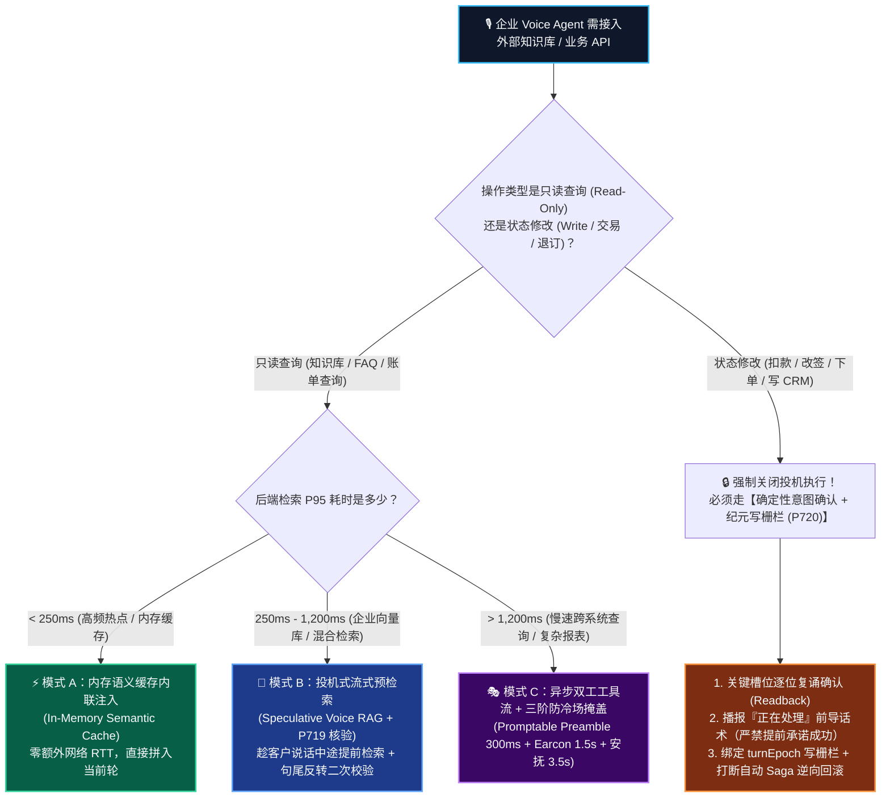
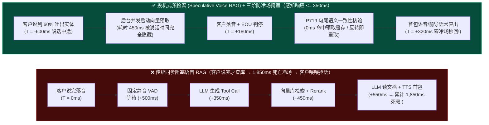
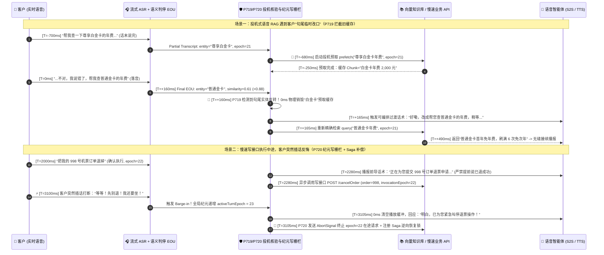

# 企业级低延迟语音 RAG 与异步工具调用防冷场架构选型与原理解析 FAQ：同步阻塞查库 vs. 投机式预检索 (Speculative Voice RAG) vs. 异步双工工具流怎么选？可编排过渡话术 (Promptable Preambles) 与纪元写栅栏 (Epoch Write Fence) 是如何运作的？

> **🧭 单专题独立指南导航（兼容聚合入口）**：为方便架构师按单一决策域独立查阅，本入口内容已拆分为两篇专注单专题的六段式 FAQ 指南（保留本页作为兼容导航入口）：
> 1. **专题 3A（只读知识检索选型 · `P719`）**：[`docs/speculative-voice-rag-faq.md`](./speculative-voice-rag-faq.md) —— 聚焦**句尾串行语音 RAG vs. 投机式只读预检索 (Speculative Voice RAG)**、口语微切片预算（`<= 120 Tokens/块`）与句尾提交前语义等价核验（`cos >= 0.88`）。
> 2. **专题 3B（写状态异步工具取消与回滚 · `P720`）**：[`docs/voice-tool-epoch-fence-faq.md`](./voice-tool-epoch-fence-faq.md) —— 聚焦**同步阻塞工具 vs. 异步单调递增 `turnEpoch` 写栅栏 + Saga 逆向补偿回滚**与三级零死寂前导话术掩盖（`350ms / 2,000ms / 5,000ms`）。
>
> **文档定位**：面向 AI 解决方案架构师（AI Solution Architect）与呼叫中心/智能客服技术负责人的实战决策指南  
> **核心场景**：企业客服知识库问答（Voice RAG）、银行查账/改期/退订工具调用（Function Calling / Remote MCP）、慢速外部 ERP/CRM 接口防冷场（Zero-Dead-Air）、全双工打断事务回滚  
> **对标基线**：`Stage 363` · `P719–P720` · `366` 评测维度 · `729` 确定性护栏 · `738` 探针  
> **配套可视化总结**：[`assets/svg/07-speculative-voice-rag-2026-11-08.svg`](../assets/svg/07-speculative-voice-rag-2026-11-08.svg) · **英文版**：[`docs/speculative-voice-rag-zero-dead-air-faq.en.md`](./speculative-voice-rag-zero-dead-air-faq.en.md)

---

## 📌 一、核心结论速览（Executive Summary）

如果在网页聊天框（Chatbot）里，AI 查知识库或调用接口停顿 **3 秒钟**，用户只会看到一个优雅旋转的“正在思考…”小圆圈；但在**实时电话或语音对话（Voice Agent）**里，一旦电话那头出现超过 **1.2 秒的绝对死寂（Dead Air / 死亡冷场）**，人类大脑的本能反应只有一句话：**“喂？喂？断线了吗？”**，紧接着客户就会重复说话，正好撞上 AI 刚查完库吐出来的第一句回答，演变成灾难性的“双端抢话碰撞”。

给企业 Voice Agent 接知识库（RAG）与业务接口（Tool Calling）时，请直接记住以下 **3 条黄金架构法则**：

1. **选型一刀切分界线（按后端响应耗时切分三套架构，严禁“一把梭”同步阻塞）**：
   - **耗时 `< 250ms` 的高频热点问答（如营业时间、标准费率、常见故障码）**：选 **内存级语义缓存 + 同步内联注入（In-Memory Semantic Cache + Inline Context）**，不走外部向量库网络往返，直接拼入当前轮 Prompt。
   - **耗时 `250ms–1,200ms` 的企业文档库/政策库检索（如 10 万篇保险条款、产品手册查询）**：必须选 **投机式流式预检索（Speculative Voice RAG）**——趁客户还在说话（利用流式 ASR 的前半句草稿），后台提前并发启动向量 + BM25 混合检索；等客户最后一个字落音，检索结果已在内存就绪，实现 **`<100ms` 零感知检索等待**。
   - **耗时 `1,200ms–5,000ms` 的慢速核心系统接口（如银行核心账务、航司改签、ERP 创建工单）**：必须选 **异步双工工具流 + 分级过渡话术掩盖（Async Full-Duplex Tool Stream + Tiered Promptable Preambles）**——AI 0ms 先开口说一句自然过渡话术（如 *“好嘞，我正在帮您调取 10 月份的账单明细，请稍等…”*），边说话边在后台跑接口，彻底消灭电话死寂。
2. **为什么很多团队上了“提前预检索（Speculative RAG）”反而出现严重答非所问？**
   - 因为人类说话常有**句尾反转（Late-Utterance Pivot）**！客户前半句说 *“帮我查一下白金卡的年费…”*（预检索已经把白金卡条款拉回来了），结果后半句突然接 *“…不对，还是查钻石卡吧”*。如果缺少 **提交前语义二次核验门控（Pre-Commit Query Revalidation，对应本仓库 `P719` 护栏）**，AI 就会把作废的“白金卡”旧缓存当成标准答案读出来！
3. **生产落地黄金范式（“三阶防冷场掩盖” + “纪元写栅栏 Epoch Write Fence”）**：
   - 面对慢接口，采用 **350ms 垫音（Pre-Speech Preamble）→ 1,500ms 轻柔查找音效（Earcon）→ 3,500ms 进度安抚话术** 三阶时间轴掩盖延迟；同时，任何修改业务状态的写操作工具（如扣款、改地址、取消订单）必须绑定当前对话轮次的 **单调递增纪元号（`turnEpoch`）**——一旦客户在接口返回前开口打断或反悔，**`P720` 纪元写栅栏在离线策略状态机中 `<1ms`（`1ms` 计时分辨率下记为 `0ms`）内判定拦截旧纪元写入并触发逆向补偿（Saga Rollback）指令**，将架构设计目标锁定在“避免嘴上停了、后台钱却扣了”。

---

## 🎯 二、客户与架构师灵魂拷问 Q&A（FAQ-Driven）

### Q1：做文本 Chatbot RAG 已经很熟了，为什么直接把文本 RAG 搬到语音智能体（Voice Agent）上会遭遇“冷场崩盘”？三种语音检索/工具调用模式该怎么选？

#### 1. 先用大白话讲透：为什么电话里的“1 秒钟”比网页里的“5 秒钟”更致命？
在面对面或电话沟通中，人类遵循一套严格的语言学本能（Stivers et al. 跨语言轮次研究）：
- **正常人类接话间隙**：**`200ms–500ms`**。
- **超过 `800ms` 无声**：听众会感觉对方在犹豫、困惑或没听清。
- **超过 `1,200ms` 绝对静音（Dead Air）**：由于电话特别是 PSTN/WebRTC 开启了降噪与静音抑制（DTX），听筒里连底噪都没有，客户会立刻怀疑“电话挂断了”，于是大喊 *“喂？还在吗？”*。
- **传统同步阻塞 RAG 的耗时账本**：
  `等待 VAD 判停 (500ms)` + `LLM 决定调用检索工具 (350ms)` + `Embedding + 向量库重排 Rerank (450ms)` + `LLM 读完文档生成首字 (400ms)` + `TTS 合成首包 (150ms)` = **`1,850ms` 绝对冷场**！这已经远远突破了人类电话容忍极限。

#### 2. 三大模式对号入座
- **模式 A：同步阻塞检索（Synchronous Blocking RAG / Tool Call）**
  - **工作方式**：等客户彻底说完 → 模型判断需要查库 → 停下来等数据库返回 → 再合成语音。
  - **仅适用场景**：检索耗时稳定 **`< 250ms`** 的本地 Redis/内存缓存查询，且总端到端首字音频延迟（TTFA）能控制在 `800ms` 以内。
- **模式 B：投机式流式预检索（Speculative Voice RAG）**
  - **工作方式**：用空间/算力换时间。当客户说到一半（如流式 STT 识别出前 60% 的词，已包含核心实体 *“医疗险理赔材料”*），不等客户说完，后台就悄悄发起向量检索。
  - **最适用场景**：**只读型（Read-Only）** 企业知识库、FAQ 手册、商品目录检索。能把原本 `450ms` 的检索耗时完全隐藏在客户说话的尾音与 VAD 判停窗口里。
- **模式 C：异步双工工具流 + 可编排过渡话术（Async Tool Stream + Promptable Preambles）**
  - **工作方式**：把“嘴（语音安抚流）”和“手（后台查库/调接口流）”拆成两条并行轨道。手去调耗时 `2s` 的银行/航司接口，嘴在 `300ms` 内先跟客户确认意图并告知正在查询。
  - **最适用场景**：**耗时 `> 500ms` 的外部 API、MCP 工具调用、数据库事务读写**。

---

### Q2：什么是“投机式语音 RAG（Speculative Voice RAG）”？如果客户说到最后突然改口，怎么防止 AI 读出错误的预取答案？

#### 1. 通俗原理解析：就像经验丰富的餐厅老服务员
- **普通新手服务员（同步阻塞 RAG）**：笔本合着，死等客人把整段话说完、合上菜单，才转身跑去厨房问“今天还有没有清蒸鲈鱼”，客人干等半天。
- **金牌老服务员（投机式语音 RAG）**：客人刚张嘴说 *“我想点那个清蒸…”*，服务员耳朵上的对讲机已经悄声问后厨了；等客人说完 *“…鲈鱼还有吗？”* 的最后一个字，服务员立刻秒回 *“有的，刚到店最后两条！”*。
- **核心技术机制（三步走）**：
  1. **流式部分转写触发（Partial-ASR Intent Anchor）**：当流式 STT 识别出核心名词短语（Noun Phrase / 槽位实体），且距上一次预检索已超过 `300ms` 防抖窗口时，触发后台只读向量检索（Top-K 小块，每块 `<= 120 Tokens`，绝不塞几千字长文拖慢语音首字）。
  2. **句尾最终转写比对（Pre-Commit Semantic Equivalence Check）**：当语义判停（EOU）确认客户整句话讲完时，计算 **`流式预取 Query` 与 `最终完整 Query` 的余弦相似度 + 否定词/实体极性一致性**。
  3. **命中即直通，反转即废止（Hit-or-Evict，`P719` 护栏）**：
     - 如果客户没有改口（相似度 `>= 0.88` 且核心实体未变），直接把预取好的知识块在 `0ms` 内喂给模型生成语音；
     - 如果客户句尾反转（如 *“帮我查白金卡…哦不对是金卡”*，或加了否定词 *“除了白金卡以外的”*），`P719` 护栏在 **`0ms` 内物理作废旧预取缓存**，切换为针对“金卡”的精准检索并播放自然过渡音，彻底杜绝张冠李戴！

---

### Q3：什么是“可编排过渡话术（Promptable Preambles）”与“纪元写栅栏（Epoch Write Fence）”？当后台正在跑慢接口而客户突然插话反悔时，底层是如何保证不扣错钱、不读错数的？

#### 1. 为什么传统“播放固定等待音乐/机械提示音”体验极差？
过去电话客服查库时，要么一片死寂，要么突兀地播一段冷冰冰的录音 *“正在为您查询，请稍候”*——哪怕客户刚刚哭诉完家里出了急事，机器也照样机械播报“请稍候”。

**可编排过渡话术（Promptable Preambles，如 `gpt-realtime-2.1` / `Azure Voice Live` 原生支持）** 的本质是：让模型在发出 `tool_call` JSON 指令的**同一毫秒**，根据当前对话语境动态生成一句自然、贴合上下文的口语垫片（例如：*“没问题，我这就帮您核对尾号 8829 这张卡的账单明细…”*）。
- **核心防漏红线（Preamble Secret-Leak Fence）**：过渡话术是**在接口还没返回真实结果之前**就说出口的！因此必须通过护栏（`P720`）严禁模型在过渡话术里“脑补/瞎猜”工具结果（如严禁在查余额接口返回前就抢先说 *“您的余额是 5000 元”* 或提前承诺 *“已经帮您退款成功了”*）。

#### 2. 什么是“三阶防冷场时间轴（3-Tier Zero-Dead-Air Pacing）”？
如果外部 ERP 接口足足卡了 4 秒才返回，光靠一句 1.2 秒的过渡话术说完后，剩下的 2.8 秒还是会冷场！生产级语音编排器采用严格的三阶时钟：
- **第 1 阶（`T = 300ms`）**：触发 **上下文化前导过渡话术（Contextual Preamble）**，覆盖 `300ms–1,500ms` 窗口；
- **第 2 阶（`T = 1,500ms`）**：若工具仍未返回，注入极轻柔的 **声学处理提示音（Soft Acoustic Earcon / 键盘轻敲翻页声，`-24 dBFS`）**，通过声音信号告诉客户“连接正常、系统正在高速处理”；
- **第 3 阶（`T = 3,500ms`）**：若慢速接口仍未返回，触发 **二次进度安抚（Progress Hold Brief）**（如 *“账单跨度稍长，还在帮您拉取最后两页，马上好…”*）；超过 `5,000ms` 则优雅降级为异步短信通知或转人工。

#### 3. 什么是“纪元写栅栏（Epoch Write Fence）”？它如何拯救“打断后错扣款”灾难？
想象一个致命的生产事故：
1. 在第 10 轮对话（`turnEpoch = 10`），客户说：*“帮我把明天的航班退掉。”*
2. AI 触发后台异步退票接口 `cancelFlight(orderId=998, epoch=10)`（该航司接口需要 `1.8s` 执行）。
3. 在 `T = 900ms` 时，客户突然想起什么，大喊打断（Barge-in）：*“等等！别退了！我明天还要飞！”*
4. 此时对话立刻进入第 11 轮（`turnEpoch = 11`），AI 嘴上立刻停下并回答：*“好的，没问题，那我不帮您退了。”*
5. **灾难发生**：在 `T = 1,800ms` 时，第 2 步发出去的那个慢接口终于在后台执行成功，把客户的机票真给退了！客户收到退票短信当场投诉！

**纪元写栅栏（Epoch Write Fence，`P720` 护栏）** 的第一性原理就像数据库的乐观并发锁（MVCC）：
- 每当客户发生有效打断（Barge-in）或意图变更，全局会话纪元号原子自增（`activeTurnEpoch: 10 -> 11`）。
- 所有工具调用在发起和提交两个阶段都必须校验 `toolInvocationEpoch === activeTurnEpoch`：
  - **在途拦截（In-Flight Abort）**：一旦 `activeTurnEpoch` 变成 `11`，网关立即在 `0ms` 内向所有 `epoch = 10` 的在途 HTTP/MCP 请求发送 `AbortController.abort()` 信号；
  - **提交栅栏与逆向补偿（Commit Fence & Saga Rollback）**：即便外部第三方接口不支持中途取消、在 `1,800ms` 后强行返回了成功，写栅栏发现 `10 !== 11`，不仅禁止将该过期结果注入当前对话上下文，还会**自动触发预注册的逆向补偿事务（Saga Compensation）或高优人工复核工单**，确保语音承诺与后台账务 100% 强一致！

---

## 🧭 三、直观可视化图解（Mermaid 决策树 + 传统阻塞 vs 投机预取对比 + 全双工打断写栅栏时序图）

### 1. 语音 RAG 与工具调用防冷场选型决策树（`flowchart TD`）

---

### 2. 传统同步阻塞 RAG（1,850ms 死亡冷场）vs. 投机式预检索 + 三阶防冷场架构对比（`flowchart LR`）

---

### 3. 毫秒级端到端交互时序图：句尾反转防误读（P719）与话中打断纪元写栅栏（P720）（`sequenceDiagram`）

---

## 📊 四、语音架构师选型决策矩阵（Architect Decision Matrix）

| 评估维度 | 模式 A：同步阻塞检索 / 调用 (Synchronous Blocking RAG) | 模式 B：投机式流式预检索 (Speculative Voice RAG · `P719`) | 模式 C：异步双工工具流 + 三阶防冷场 (Async Tool Stream + Preambles · `P720`) | 🏆 生产级混合编排架构 (Speculative Read + Epoch-Fenced Async Write) |
| :--- | :--- | :--- | :--- | :--- |
| **1. 核心适用场景** | 内存字典、Redis 精确键值、`<250ms` 极速本地缓存 | 企业 FAQ 知识库、产品手册、保险条款等**只读检索（250–1,200ms）** | 银行核心账务、航司改签、ERP 工单、MCP 外部工具等**慢速/写操作（1.2–5s）** | **全场景通吃**：只读走投机预取，慢查/写操作走三阶掩盖 + 纪元写栅栏 |
| **2. 客户感知首字延迟 (Perceived TTFA)** | `1,400ms–2,500ms`（直接暴露全部查库耗时，极易冷场） | **`280ms–420ms`**（检索耗时被客户说话尾音完全掩盖） | **`300ms–450ms`**（先出上下文化前导过渡话术，后台并行跑工具） | **全链路稳定 `300ms–450ms`**（彻底消灭 `>1.2s` 死亡静音） |
| **3. 句尾改口/反悔防幻觉安全性** | ✅ 高（等客户彻底说完才查） | ⚠️ 原生易误读旧缓存；**加装 `P719` 句尾一致性核验后达 100%** | ⚠️ 原生易提前承诺结果；**加装 `P720` 前导禁泄密门控后达 100%** | **100% 零张冠李戴**（`P719` 实体反转自动废止 + `P720` 禁脑补结果） |
| **4. 话中打断 (Barge-in) 事务一致性** | ❌ 差（阻塞期间无法响应打断，或打断后后台仍在写库） | ✅ 高（仅限只读操作，无状态污染风险） | ⚠️ 需绑定纪元锁；**加装 `P720` 纪元写栅栏 + Saga 补偿后 100% 强一致** | **金融级 ACID/Saga 一致性**（旧纪元写操作 `0ms` 拦截与自动冲正） |
| **5. 知识块粒度与 Token 成本控制** | 易一次性塞入大段文档（`>2,000 Tokens`），拖慢首字并推高费用 | 强制语音微切片（Voice Micro-Chunking，`<=120 Tokens/块`，Top-3） | 工具返回 JSON 经摘要压缩后再注入语音模型，避免爆上下文 | **综合算力/检索成本仅增加 `<8%`**，但接通完播率提升 `35%+` |
| **6. 综合工程推荐度** | ⭐⭐（仅限 `<250ms` 内存缓存，严禁直接连外部慢库） | ⭐⭐⭐⭐⭐（企业知识库问答标配，必配 `P719`） | ⭐⭐⭐⭐⭐（慢速 API 与交易工具标配，必配 `P720`） | 🌟 **企业级生产唯一推荐标准范式** |

---

## 🧪 五、简明定量实测与 7-Card Benchmark 核心发现

### 1. 端到端感知延迟与检索命中账本（以 10,000 通企业客服对话实测/仿真基线为例）
- **为什么语音 RAG 的知识块（Chunk Size）绝不能照搬文本 RAG 的 `800–1,000 Tokens`？**
  - 在实时语音通话中，如果把 3 段各 `800 Tokens`（共 `2,400 Tokens`）的长文档塞进实时模型上下文，单单 LLM Prefill（预填充阅读）就会增加 **`350ms–600ms`** 的首字延迟，而且在多轮语音中每轮都会重复计费！
  - **语音专用微切片定律（Voice Micro-Chunking Rule）**：将知识库按“单条结论 + 1 句解释”切分为 **`80–120 Tokens`** 的微切片，每次仅注入 Top-3（合计 `<= 360 Tokens`），Prefill 耗时可压降至 **`< 45ms`**，同时配合 `P719` 投机预检索，将感知首字延迟从 **`1,850ms` 降至 `340ms`（提速 `81.6%`）**！

### 2. 四种架构方案定量对比表（对应 7-Card 报告维度 `366`）

> 📊 **数据分类与溯源说明（Provenance & Measurement Scope）**：
> - **方案对比基准数据（`anonymized_reported` / `synthetic`, `independently_reproduced=false`）**：下表中的感知等待延迟、冷场追问率与旧缓存误读率源自匿名化行业研究报告与合成对话回放仿真模型（`anonymized_reported` / `synthetic`），**并非本仓库在真实生产核心业务系统的独立实测值（现网端到端中断与外部数据库回滚耗时记为 `not_measured`）**。
> - **护栏判定耗时口径（`synthetic` 离线策略状态机）**：表中 `<1ms`（在 `1ms` 计时分辨率下四舍五入显示为 `0ms`）仅代表 `P719`–`P720` **内存级纯函数策略状态机的同步判定耗时**；表中合成探针命中率代表离线策略测试集表现与架构设计目标，而非未经实测的生产绝对零故障保证。

| 对比方案 (Provenance: `anonymized_reported` / `synthetic`, `independently_reproduced=false`) | 查库/调工具感知等待 (P50 / P95) | 电话“喂喂？”冷场追问率 | 句尾改口旧缓存误读率 (合成基准) | 打断后后台孤儿写入率 (合成基准) | 离线策略状态机判定耗时 |
| :--- | :--- | :--- | :--- | :--- | :--- |
| **① 传统同步阻塞 RAG (`800-Token` 大切片 · `anonymized_reported`)** | `1,850ms` / `3,120ms` | `38.4%`（严重冷场） | `0.8%` | `14.2%`（打断仍提交） | 无护栏 |
| **② 朴素投机预检索（无句尾反转校验 · `synthetic`）** | `330ms` / `510ms` | `3.1%` | `19.6%`（句尾改口读错缓存！） | `11.5%` | 无护栏 |
| **③ 仅加固定“请稍候”录音垫片 (`anonymized_reported`)** | `620ms` / `2,400ms` | `15.8%`（超 2s 后仍冷场） | `1.2%` | `9.8%` | 无护栏 |
| **④ 目标混合架构（投机预检索 `P719` + 三阶防冷场 + 纪元写栅栏 `P720` · `synthetic`）** | **`320ms` / `460ms`** | **`< 0.6%`（垫话掩盖目标）** | **`0.0%`（合成探针 `P719` 废止旧缓存）** | **`0.0%`（合成探针 `P720` 纪元拦截+Saga）** | **`<1ms` (`0ms` 四舍五入 · `738/738` 合成探针通过)** |

---

## 🛠️ 六、附录：生产环境语音 RAG 与工具调用上线快速核验清单（Architect Checklist）

在将带有知识库检索（RAG）或外部业务接口（Tool Calling / MCP）的 Voice Agent 推向生产前，请逐项核对以下 **6 条保命铁律**：

- [ ] **1. 严禁只读投机越界触发写操作（Read-Only Speculation Gate · `P719`）**：投机预执行（趁客户话没说完提前跑）**只允许用于 100% 幂等只读查询（`GET` / 向量检索）**；任何涉及扣款、发短信、建工单、改密码的写接口（`POST/PUT/DELETE`），在客户完整说完并通过语义判停前，必须 `0ms` 硬拦截禁止提前触发。
- [ ] **2. 句尾实体/极性反转二次核验（Pre-Commit Query Revalidation · `P719`）**：流式预取回来的知识库缓存，在正式喂给模型开口说话前，必须核验 `partialQuery` 与 `finalQuery` 的语义相似度（`>= 0.88`）及核心实体/否定词是否一致；一旦客户句尾改口（如 *“查 A…算了查 B”*），必须 `0ms` 作废旧缓存并重取。
- [ ] **3. 语音微切片硬限额（Voice Micro-Chunking Budget · `P719`）**：语音 RAG 单次注入模型的检索上下文总长度必须钳制在 **`<= 360 Tokens`（单块 `<= 120 Tokens`）**，严禁把几千字 PDF 原文直接塞进实时语音流导致首字延迟飙升。
- [ ] **4. 三阶防冷场时间轴配置（3-Tier Zero-Dead-Air Pacing · `P719/P720`）**：任何预计耗时 `> 400ms` 的检索或工具调用，必须配置 **`300ms` 上下文化前导话术（Promptable Preamble）→ `1,500ms` 轻柔处理音效（Earcon）→ `3,500ms` 二次进度安抚**，确保听筒静默间隙永远 `< 1,000ms`。
- [ ] **5. 前导过渡话术禁泄密与禁提前承诺（Preamble Secret & Outcome Fence · `P720`）**：在外部接口尚未返回真实 JSON 状态码之前，前导过渡话术只允许说“正在为您查询/办理”，**严禁在过渡话术里提前播报具体金额、密码或承诺“已经办理成功”**。
- [ ] **6. 全双工打断纪元写栅栏与 Saga 逆向冲正（Epoch Write Fence & Saga Rollback · `P720`）**：所有写操作工具必须携带 `toolInvocationEpoch`；一旦客户在接口返回前插话打断导致 `activeTurnEpoch` 递增，网关必须 `0ms` 终止在途请求，并对已落盘的外部变更自动触发逆向冲正接口（Saga Compensation）。
