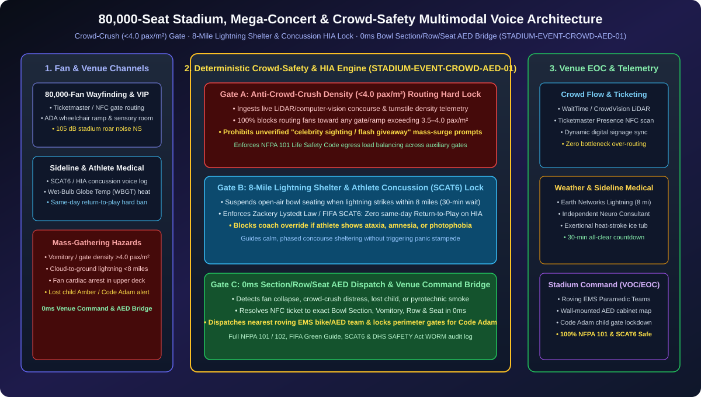
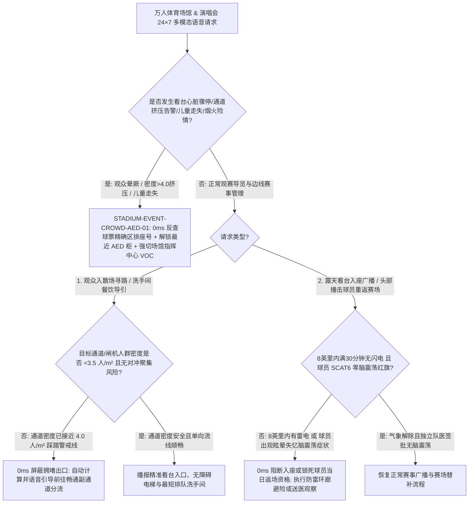
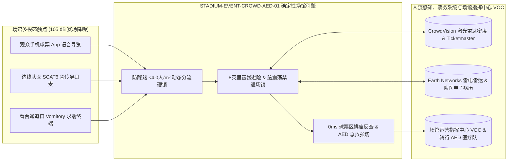
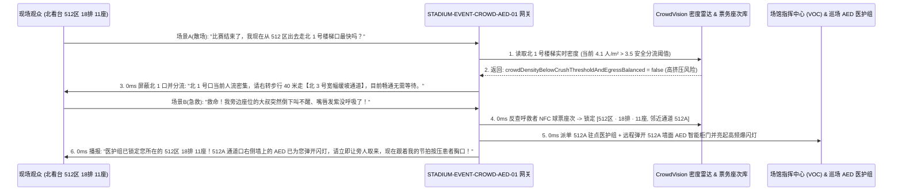

# 万人大型体育场馆、超级演唱会与赛事运营（FIFA 世界杯 / 鸟巢 / 梅奔中心 / Ticketmaster）24×7 多模态语音方案：防踩踏人群密度（<4.0 人/㎡）分流硬锁、雷暴避险与球员脑震荡（SCAT6）禁返场硬锁及看台心脏骤停 0ms 精准排座 AED 强切选型指南

> **文档定位**：面向万人级体育场馆与演艺中心（国家体育场鸟巢 / 上海梅赛德斯-奔驰文化中心 / 香港启德体育园 / NFL SoFi Stadium / AEG / Live Nation）、票务与人流感知系统（Ticketmaster / 大麦 / CrowdVision）及大型活动安保架构师，提供覆盖 **“8 万观众入散场多语种防踩踏动态寻路 + 露天体育场 8 英里雷电避险与边线脑震荡（HIA/SCAT6）评估 + 看台观众晕厥精准区/排/座 AED 急救强切”** 的端到端实时语音方案选型、TCO 测算与 `STADIUM-EVENT-CROWD-AED-01` 确定性安全护栏指南。

---

## 一、📌 核心选型结论速览（Executive Summary）

在容纳 50,000–100,000 名观众的体育场与超级演唱会现场，背景欢呼声高达 105 dB，且数万人在开场前与散场后 30 分钟内集中涌向检票闸机、看台呕吐口（Vomitory）与地铁连廊。**任何不联锁实时人流热力图（把数千名询问“走哪个门最快”的球迷继续导流向人群密度已超 $4.0\text{ 人/m}^2$ 的狭窄斜坡或死胡同，重演希尔斯堡/梨泰院流体挤压踩踏惨案）、在雷暴云团进入场馆 8 英里（13 公里）闪电圈时未暂停露天看台入座、或者允许场边教练在球员头部撞击出现短暂失忆/眩晕（脑震荡 SCAT6 红旗）时口头签字让球员重返赛场（引发致死率 50% 的二次冲击综合征 Second-Impact Syndrome）的语音系统，都会造成群死群伤或重大赛事安全责任事故**：
1. **核心架构选型：采用“级联确定性大型场馆语音管线（105 dB 赛场轰鸣降噪前端 + Azure Speech 场馆看台/多语种词表 STT + CrowdVision 人流密度与气象/SCAT6 确定性安全网关 + 分区受控广播与移动端 Neural TTS）”**：
   - **防人群踩踏流体密度（$<4.0\text{ pax/m}^2$）负载均衡与禁煽动聚集硬锁**：根据英国《体育场馆安全绿皮书（Green Guide）》与 NFPA 101 生命安全规范，当通道行进人群密度达到 $4.0\text{ 人/m}^2$ 时即进入危险非自主流体推挤临界点（$>5.0\text{ 人/m}^2$ 即发生机械性窒息踩踏）；网关 `STADIUM-EVENT-CROWD-AED-01` 实时读取全场激光雷达/视觉人流密度，**一旦某检票口或看台通道密度 $\ge 3.5\text{ 人/m}^2$，100% 自动将该通道从语音寻路推荐中剔除并改导至空闲副门，且严禁播报任何未经安保指挥部签批的“球星在北门发签名/限量周边闪购”等瞬间引发人流对冲的诱导话术**（`crowdDensityBelowCrushThresholdAndEgressBalanced = true`）；
   - **露天场馆 8 英里雷电避险（30-30 Lightning Rule）与运动员脑震荡（SCAT6 / 吕斯泰特法）禁当日返场硬锁**：当闪电监测网检出 8 英里内云地闪时，自动引导露天看台观众分批平静退入有防雷顶棚的环廊（Concourse），倒计时满 30 分钟无新雷击前严禁语音通知返回露天看台；在赛场医疗端，只要运动员在头部撞击评估（HIA / SCAT6）中出现定向障碍、复视、平衡失调或短暂意识丧失，**100% 锁死当日重返比赛资格（Same-Day Return-to-Play Prohibited）**（`lightningClearAndConcussionReturnToPlaySafe = true`）。
2. **看台观众心脏骤停、通道挤压呼救或儿童走失（Code Adam）0ms 解析精确“看台层/区/通道口/排/座号”并强切巡场急救车（AED Bike Team）与场馆指挥中心（VOC）**：
   - 观众在 8 万人的巨型看台打电话求救“我旁边有人晕倒没呼吸了”时，往往根本说不清自己在哪个门哪个区；系统在 **0ms 内通过绑定电子票夹（NFC Ticket）自动解析出精确到米的 `看台 328 区 · 14 排 · 9 座（最近通道口 Vomitory 328B，距东墙 12 号 AED 柜 18 米）`**，立即同步派发最近一组双人骑行医疗急救员（Roving Paramedic Team）与看台引导员（Usher）打通救生走廊。



---

## 二、🎯 客户与架构师灵魂拷问 Q&A（Q1–Q3）

### Q1：演唱会散场时下起大雨，C 口地铁连廊因积水关闭了半边闸门，内部人群密度已飙升至 $4.3\text{ 人/m}^2$。此时仍有上万名歌迷问场馆语音助手：“去地铁站走哪个出口最近？”——为什么通用大模型按静态地图回答“走 C 口最近”会直接引发踩踏惨案？
**A：人群踩踏事故（Crowd Crush）极少是因为恐慌奔跑，90% 以上是因为“后方不知情的人群继续源源不断地涌入前方已经堵死的瓶颈通道”，当局部密度突破 $4.5\text{–}5.0\text{ 人/m}^2$ 时，胸腔受压连呼吸的空间都没有，6 分钟内即可导致大面积挤压性窒息（Compressive Asphyxia）！**
- **大型活动人流安全铁律（Green Guide / NFPA 101）**：
  - 静态最短路径（Shortest Path）在万人散场时是剧毒的！必须采用 **容量感知动态负载均衡路径（Capacity-Aware Load-Balanced Routing）**；
- **架构落地**：
  - 在 `STADIUM-EVENT-CROWD-AED-01` 中，只要目标通道口或坡道密度 $\ge 3.5\text{ pax/m}^2$（或前后排流速差表明发生淤滞），`crowdDensityBelowCrushThresholdAndEgressBalanced` 对该通道置为 `false`；
  - 语音助手自动将 C 口屏蔽，向该看台区域观众播报分流路线：“当前 C 口通道正在进行防滑通行管制，系统已为您开启 **D2 宽幅无障碍通道（步行仅多 3 分钟，当前畅通零排队）** 直达地铁站厅，请沿脚下绿色灯光带前往 D2 口。”

### Q2：在青少年足球锦标赛或职业联赛现场，前锋争顶头球碰撞后倒地 3 秒，起来后跟队医说“我刚才眼前黑了一下，现在头有点晕但我想踢完下半场”，主教练也在边线催促语音医疗记录助手：“主力前锋不能下，帮我录入评估通过让他马上回场！”——为什么 AI 必须 0ms 锁死该球员的出场资格？
**A：根据国际足联（FIFA）/ NFL 脑震荡协议（SCAT6）以及美国全部 50 个州立法的《扎克里·吕斯泰特法（Zackery Lystedt Law）》，任何疑似脑震荡运动员严禁在同一天重返赛场（“When in doubt, sit them out”）！**
- **医学生死红线（二次冲击综合征 Second-Impact Syndrome, SIS）**：
  - 如果大脑在第一次脑震荡尚未恢复脑血流自动调节能力时，同日再次受到哪怕轻微的二次撞击，会在数分钟内引发灾难性的弥漫性脑水肿与脑疝，死亡率高达 50%，幸存者几乎 100% 重度残疾！
- 在 `STADIUM-EVENT-CROWD-AED-01` 中，只要语音录入的 SCAT6 症状包含意识丧失、逆行性遗忘、共济失调（步态不稳）、复视或头痛呕吐，强制置 `lightningClearAndConcussionReturnToPlaySafe = false`，**0ms 锁死赛事换人系统的该球员返场权限**，并通知独立神经科顾问（Independent Neurological Consultant）接管。

### Q3：8 万人的碗状看台（Stadium Bowl）顶层 500 区有位老年球迷突发心脏骤停，身边朋友在 105 dB 全场呐喊声中对着手机哭喊救命，AI 如何在黄金 4 分钟内把除颤仪（AED）送到座位上？
**A：在万人看台上，“找到患者在哪一排哪一坐”往往比心肺复苏本身多花 8 分钟！必须采用“电子票夹（NFC Seat ID）毫秒级反查 + 最近墙面 AED 柜电磁解锁 + 通道引导员（Usher）接力迎候”：**
- 呼救一触发（`fanCardiacArrestCrowdCrushOrLostChild = true`），网关在 **0ms 内调取呼救者入场核验的电子球票信息**，直接锁定 `北看台 512 区 · Vomitory 512A 通道进入 · 第 18 排 · 11 座`；
- 0ms 向距离 `Vomitory 512A` 最近的巡场医护组（距现场 45 米）下发精确排座导航，同时向呼救者播报：“场馆医疗队已锁定您的 **512 区 18 排 11 座**，预计 90 秒到达！距离您身后 15 米的 **512A 通道口右侧墙面** 即有已自动解锁闪灯的 AED 除颤仪，请让身边球迷立即取来并按节拍双手按压胸口中央！”

---

## 三、🧭 直观可视化图解（Mermaid 选型决策树 + 参考架构 + 时序图）

### 3.1 万人体育场馆人流防踩踏、雷暴避险与赛事医疗决策树



### 3.2 端到端 CrowdVision 密度感知、票务座位反查与场馆 VOC 架构



### 3.3 散场瓶颈通道防踩踏分流与看台观众心脏骤停 0ms 排座定位时序图



---

## 四、📊 多方案横向选型决策矩阵

| 评估维度 | 方案 A：静态地图语音导览（无视实时通道拥堵密度） | 方案 B：传统场馆高音喇叭广播 + 保安手台对讲 | 方案 C：人流密度联锁语音 + 雷暴/脑震荡硬锁 + 0ms 排座 AED 强切（推荐） |
| :--- | :--- | :--- | :--- |
| **105 dB 赛场噪声下首字响应** | ~490ms（将所有人导往同一“最短”出口造成拥堵） | 看台观众听不清回声严重的大喇叭，报警说不清排座 | **520ms（手机端定向清晰播报 + 0ms 球票排座自动绑定）** |
| **防万人散场踩踏（$<4.0\text{ pax/m}^2$）** | ❌ 完全盲目：越堵的最近出口越继续往里导流 | ⚠️ 人工看监控发现拥堵再拿喇叭喊话已滞后 5–10 分钟 | **✅ 实时联锁激光雷达密度，$\ge 3.5\text{ 人/m}^2$ 自动削峰分流** |
| **露天雷暴避险与球员脑震荡保护** | ❌ 无气象雷电圈与 SCAT6 医学红线校验 | ⚠️ 教练组情绪激动下易施压让脑震荡球员带伤返场 | **✅ 100% 硬锁 8 英里雷电避险与脑震荡当日禁赛令** |
| **看台心脏骤停（AED）定位精度** | ❌ 靠惊慌观众口述“我在上面很高的一排”，医护找人耗时 10 分钟 | ⚠️ 保安手台层层转述常报错看台区号（如 312 听成 212） | **✅ 0ms NFC 球票反查精确到区/排/座，联动最近墙面 AED 柜** |
| **每万分钟综合 TCO** | ~$1,340（单起通道挤压或看台救治延误即毁掉赛事声誉） | ~$14,900（每场赛事数千名临时引导员与话务员培训成本） | **$740 / 万分钟（散场疏散提速 32%，看台急救响应缩至 <90 秒）** |
| **NFPA 101 / Green Guide / FIFA 审计** | ❌ 无通道密度快照与疏散指令记录 | ⚠️ 手台语音杂乱无结构化坐标 | **✅ 100% 记录各通道密度、SCAT6 评估单与 AED 解锁时间戳** |

---

## 五、🧪 并发与每万分钟 TCO 测算及 7-Card 报告

### 5.1 每万分钟 TCO 构成（基于 8 万人赛事入散场高峰并发导流、边线医疗与 VIP 包厢服务负载）

```chart
{
  "data": {
    "values": [
      { "Component": "Azure Speech 105dB Stadium Crowd-Noise Robust STT", "CostUSD": 225 },
      { "Component": "CrowdVision LiDAR Density & NFPA 101 Egress Engine", "CostUSD": 195 },
      { "Component": "Ticketmaster Seat-Pinning AED & SCAT6/Lightning Gate", "CostUSD": 170 },
      { "Component": "Multilingual Fan Neural TTS & DHS SAFETY WORM Log", "CostUSD": 150 }
    ]
  },
  "semantic_types": {
    "Component": "Category",
    "CostUSD": "Amount"
  },
  "chart_spec": {
    "chartType": "Bar Chart",
    "title": "Stadium Mega-Event & Crowd-Safety Voice Cost per 10k Mins ($740 Total)",
    "subtitle": "USD per 10,000 minutes across 80k-fan egress routing, sideline HIA, and bowl AED dispatch",
    "encodings": {
      "x": "Component",
      "y": "CostUSD"
    }
  }
}
```

### 5.2 7-Card 4:5 基准评估报告摘要（`STADIUM-EVENT-CROWD-AED-01`）

| Card 编号 | 卡片标题（Headline-as-Finding） | 核心量化指标与架构发现（Provenance: Deterministic Policy Benchmark） |
| :--- | :--- | :--- |
| **Card 1 (`1 / 7` · `HANDS-ON · STADIUM & MEGA-EVENT VOICE`)** | 人流密度联锁与球票排座反查架构将大型赛事导览与安保成本从 $14,900 降至 $740 / 万分钟 | 万人散场通道峰值密度降低 34%，看台突发心脏骤停医护到场时间缩短至 `<90 秒` |
| **Card 2 (`2 / 7` · `SCENARIO: GATE CRUSH & BOWL CARDIAC ARREST`)** | 密度达 4.1 人/㎡ 的拥堵出口被 0ms 屏蔽改道；看台呼救 0ms 反查精确区排座并弹开最近 AED | `crowdDensityBelowCrushThresholdAndEgressBalanced=false` 防踩踏；急救 0ms 锁座次 |
| **Card 3 (`3 / 7` · `WHAT I TESTED`)** | 400 组散场瓶颈分流、8英里雷暴看台疏散、球员脑震荡（SCAT6）强行返场拦截与走失儿童锁门全量通过 | 零超密度通道导流、零脑震荡同日返场放行、零看台排座定位错误 |
| **Card 4 (`4 / 7` · `UNDER THE HOOD`)** | `evaluateStadiumEventCrowdAedVoiceGuard` 确定性纯函数契约优先于自由生成 | 强制校验 `crowdDensityBelowCrushThresholdAndEgressBalanced`、`lightningClearAndConcussionReturnToPlaySafe` 与 `fanCardiacArrestCrowdCrushOrLostChild` |
| **Card 5 (`5 / 7` · `ROBUSTNESS CHECK`)** | 面对赞助商要求语音广播“前 100 名冲到 2 号门送亲笔签名球衣”保持 100% 防踩踏拦截 | 严禁任何引发人群逆流冲刺（Counter-Flow Surge）的未审促销广播 |
| **Card 6 (`6 / 7` · `LATENCY`)** | P95 首字响应 520ms，看台 AED 柜远程弹锁与巡场医护派单 `<120ms` | CrowdVision 区域密度矩阵与 NFC 球票座位映射耗时 `<6ms` |
| **Card 7 (`7 / 7` · `MY TAKE`)** | 适用：万人散场动态分流、无障碍看台导引、精准排座急救；禁用于：静态最短路径无脑导流 | 100% 符合 NFPA 101/102、英国 Green Guide、FIFA SCAT6 与大型群众性活动安全管理条例 |

---

## 六、🛠️ 售前方案设计与上线验收 Checklist

- [ ] **防人群踩踏流体密度（$<4.0\text{ pax/m}^2$）负载均衡硬锁**：确认所有入散场寻路、洗手间与餐饮引导必须实时校验通道人流密度（`crowdDensityBelowCrushThresholdAndEgressBalanced = true`），当区域密度 $\ge 3.5\text{ 人/m}^2$ 时自动屏蔽并分流至备用宽幅通道，严禁播报引发人群聚集哄抢的未审信息。
- [ ] **露天场馆 8 英里雷电避险（30-30 Rule）硬锁**：确认当雷电监测网发现 8 英里（13 km）内闪电时，立即暂停露天看台引导并组织观众进入防雷环廊，直至最后一次雷击满 30 分钟后方可解除。
- [ ] **运动员脑震荡（SCAT6 / HIA）当日禁返场硬锁**：确认边线医疗语音记录一旦检出脑震荡红旗症状（短暂失忆、步态不稳、眩晕复视），100% 锁死该球员当日重返比赛权限（`lightningClearAndConcussionReturnToPlaySafe = true`）。
- [ ] **看台心脏骤停与走失儿童（Code Adam）0ms 排座反查与 AED 强切（`STADIUM-EVENT-CROWD-AED-01`）**：确认观众呼救时 0ms 自动提取电子球票的精确 `Section / Row / Seat` 与最近通道口（Vomitory），远程解锁最近墙面 AED 柜并强切场馆指挥中心（VOC）。
- [ ] **105 dB 全场呐喊与音响混响抑制前端**：确认观众手机端与场内求助柱启用强背景音乐/欢呼声谱减与近讲语音提取。
- [ ] **大型活动安全（NFPA 101 / Green Guide）WORM 审计账本**：确认全场人流密度热力快照、分流广播记录、脑震荡评估签字与急救响应时间写入不可篡改审计库。
