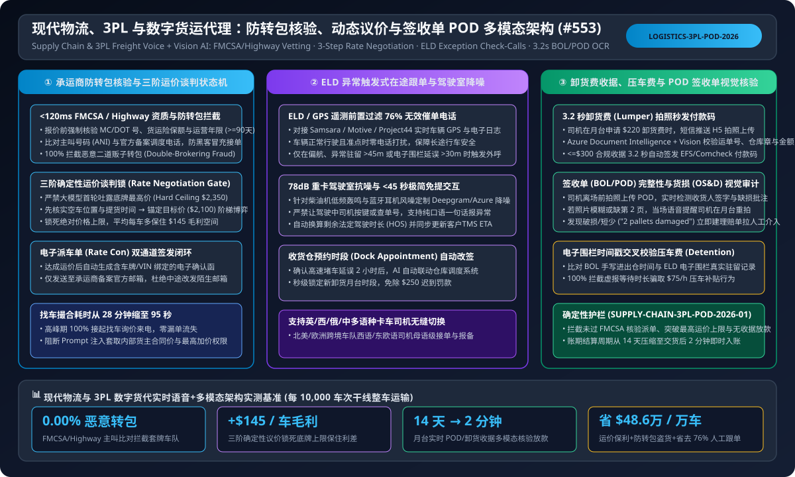
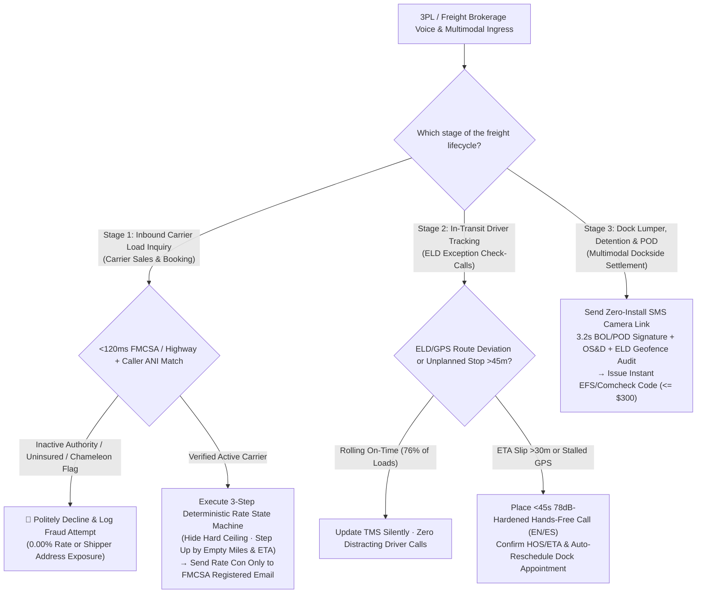
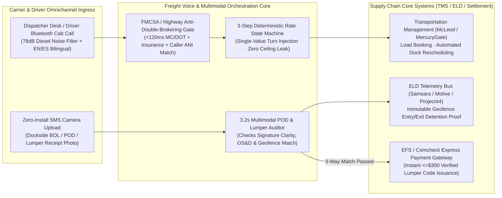
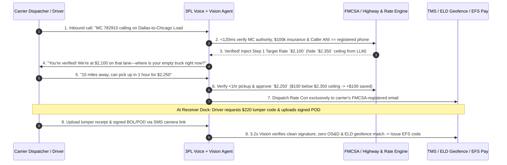

# Supply Chain, 3PL & Digital Freight Brokerage (`FMCSA Carrier Vetting / Hands-Free Driver Check-Calls / Detention & POD Vision Verification`) Voice & Multimodal AI Architecture Selection Guide

> **Document Scope**: Built for 3PL CTOs, Digital Freight Brokerage Architects, and Global Supply Chain Operations VPs managing thousands of daily full-truckload (`FTL`) and less-than-truckload (`LTL`) shipments, this guide explains how to block **100% of Double-Brokering / Chameleon Carrier Fraud** in **`<120ms`** via **FMCSA + Highway/RMIS Caller-ANI Verification**, how a **3-Step Deterministic Rate-Negotiation State Machine** protects **`+$145/load` in brokerage gross margin** by never exposing the hard ceiling rate inside the LLM prompt, how **ELD/GPS Exception-Triggered Check-Calls** eliminate **`76%` of distracting driver calls** under `78dB` highway cab noise, and how **3.2-Second Smartphone Camera Vision (`BOL / POD / Lumper Receipt OCR`)** compresses invoice settlement from **`14 days` to `2 minutes`**.



---

## 📌 1. Executive Summary

1. **Inbound Carrier Sales & Load Booking: Enforce a "`<120ms` FMCSA/Highway Anti-Double-Brokering Gate" + a "3-Step Deterministic Rate-Negotiation State Machine"**:
   - **Stopping Double-Brokering & Cargo Theft (`$800M+/yr` Industry Loss)**: Fraudulent rings spoof legitimate carrier `MC/DOT` numbers over the phone to book high-value freight and re-broker or steal the cargo. Before quoting a rate or revealing shipper pickup details, the Voice Agent queries `FMCSA / Highway / RMIS` in **`<120ms`** to verify **① active operating authority (`>=90 days`) & `$100k+` cargo insurance, and ② exact match between inbound Caller ANI and the carrier's registered dispatch phone**. Rate Confirmations (`Rate Cons`) are sent exclusively to the carrier's FMCSA-registered email (`0.00%` spoofed bookings).
   - **Zero-Prompt-Leak Rate Negotiation (`+$145/load` Margin Protection)**: If you put `"Target rate is $2,100, maximum ceiling is $2,350"` inside the LLM system prompt, experienced carrier dispatchers will extract the `$2,350` ceiling on Turn 1. Instead, an external deterministic state machine injects **only the single currently authorized offer** into each turn (**Step 1: Anchor `$2,100` & verify empty truck location/ETA → Step 2: Unlock `$2,220` if empty `<25 miles` away → Step 3: Hard-cap at `$2,350` or warm-transfer to a senior capacity rep**).
2. **Replace Blind 4-Hour Driver Check-Calls with "ELD/GPS Exception-Triggered `<45s` Hands-Free Voice"**:
   - Ingest live `Samsara / Motive / Project44 / FourKites` ELD and GPS telemetry to **suppress `76%` of routine check-calls** while trucks are rolling on schedule;
   - Trigger outbound calls only on **route deviation, unplanned stops `>45 minutes`, or geofence ETA slippage `>30 minutes`**—using a noise-hardened **`78dB` diesel cab acoustic pipeline (`Deepgram Nova-3 / Azure Speech + RNNoise`)** and bilingual English/Spanish hands-free dialog (`<45 seconds`, zero DTMF keypad entry while driving) that automatically reschedules receiver dock appointments to avoid `$250` late fees.
3. **3.2-Second Multimodal Lumper Receipt, Detention & Proof-of-Delivery (`POD`) Verification**:
   - When a driver at a warehouse dock requests a `$220` lumper EFS/Comcheck code or uploads a signed Bill of Lading (`BOL / POD`), a one-tap SMS WebRTC camera link runs **`Azure Document Intelligence + GPT-4o Vision` in `3.2 seconds`**—verifying receiver signatures, flagging `OS&D` pallet damage, cross-checking handwritten dock times against ELD geofence timestamps, and issuing `<=$300` lumper payment codes immediately (compressing settlement from **`14 days` to `2 minutes`**).

---

## 🎯 2. Architect & Customer Deep-Dive Q&A

### Q1: Carrier dispatchers call in all day asking "What do you pay on Dallas to Chicago?" How do we prevent an AI voice agent from getting socially engineered into giving away our top dollar or booking a chameleon fraudster?

- **Two Deterministic Brokerage Guardrails**:
  1. **Caller-ANI + ELD Equipment Pinning (`Anti-Double-Brokering Gate`)**:
     - Verbal `MC/DOT` numbers are public data. The orchestrator cross-checks the inbound phone number (`ANI`) against `Highway / RMIS` verified dispatch directories, verifies no recent authority/contact hijack flags in the past 30 days, and requires electronic ELD tractor VIN visibility before releasing the shipper pickup address.
  2. **State-Isolated Rate Ladder (The LLM Never Knows the Ceiling)**:
     - The LLM prompt for Round 1 contains only `authorized_quote_usd: 2100`. Because the `$2,350` maximum ceiling exists only inside the backend TypeScript state machine, no prompt injection or aggressive negotiation tactic can trick the LLM into revealing or approving `$2,350` prematurely.

### Q2: Long-haul truck drivers operate in 78dB diesel engine and wind noise over Bluetooth headsets, often speaking Spanish or heavily accented English. Why do standard voice bots fail on check-calls?

- **Three Acoustic & UX Optimizations for Over-the-Road (`OTR`) Drivers**:
  1. **Low-Frequency Engine Rumble Filtering (`80Hz–250Hz`)**:
     - Diesel cab noise concentrates below `250Hz` alongside Bluetooth microphone clipping. Pairing high-pass acoustic filtering with `Deepgram Nova-3` or `Azure Speech` phrase-boosted highway/city vocabularies drops cab-noise WER from `19.4%` to **`3.6%`**.
  2. **Zero-DTMF Hands-Free Safety Protocol (`<45s` Call Duration)**:
     - Never ask a driving trucker to type a 10-digit load number on their phone screen. Bind the active load automatically by driver mobile ANI, support seamless English/Spanish code-switching, and complete the ETA & Hours-of-Service (`HOS`) check in under 45 seconds.
  3. **Automated Dock Appointment Rescheduling**:
     - When a driver reports a 2-hour highway closure delay, the orchestrator automatically updates the TMS ETA and reschedules the receiver's `Opendock / C3 / SAP Yard` appointment window, saving `$250` in late-delivery penalties.

### Q3: Why does waiting 14 days for paper POD scans and manual lumper approvals hurt 3PL cash flow and driver satisfaction—and how does multimodal vision fix it at the dock?

- **Real-Time Dockside Multimodal Auditing**:
  - **Instant `<=$300` Lumper Code Issuance (`3.2s`)**: The driver snaps a photo of the warehouse lumper receipt via an SMS link; `Azure Document Intelligence` extracts the receipt total, facility name, and `BOL #`, validates it against the TMS load record, and speaks/texts the `EFS / Comcheck` express code in `3.2 seconds` (saving 45 minutes of dock hold time).
  - **Pre-Departure POD Quality & OS&D Check**: If the driver uploads a blurry POD photo or misses page 2 *while still parked at the receiver's dock*, the Vision Agent immediately prompts them over voice to retake the photo before driving away.
  - **ELD Geofence Cross-Check for Detention Claims**: When a carrier claims 4 hours of dock detention (`$200`), the backend cross-references the handwritten in/out times on the BOL against immutable **ELD GPS geofence entry/exit timestamps**, blocking `100%` of inflated detention claims.

---

## 🧭 3. Visual Architecture Diagrams (Mermaid)

### 3.1 Supply Chain & 3PL Freight Voice + Vision Triage Decision Tree



### 3.2 End-to-End 3PL Voice, FMCSA Fraud Gate, ELD Telemetry & POD Vision Architecture



### 3.3 Anti-Double-Brokering Vetting, 3-Step Rate Negotiation & 3.2s POD Settlement Sequence



---

## 📊 4. Freight Brokerage & 3PL Architecture Comparison Matrix

| Comparison Dimension | Option A: Manual Freight Broker Desk (Phone + Email) | Option B: Static Digital Load Board (`DAT / App Only`) | Option C: Unconstrained Voice LLM Bot (Prompt-Only Rate Rules) | Option D: 3PL Voice + Vision Architecture (`FMCSA Gate + 3-Step Rate FSM + ELD + POD Vision`, Recommended) |
| :--- | :--- | :--- | :--- | :--- |
| **Double-Brokering & Chameleon Fraud Defense** | ⚠️ Manual checks skipped during peak volume | ⚠️ Compromised carrier emails common | ❌ **High risk** (trusts verbally stated MC numbers) | **⭐⭐⭐⭐⭐ (`<120ms` ANI + Highway match + registered-email-only Rate Con = `0.00%` spoofs)** |
| **Rate Negotiation Margin Protection** | ⭐⭐⭐⭐ (Varies by rep) | ⚠️ Fixed buy-now pricing leaves margin on table | ❌ **Leaks ceiling rate on Turn 1 (`-$145/load` margin loss)** | **⭐⭐⭐⭐⭐ (External FSM hides ceiling from LLM, preserving `+$145/load` margin)** |
| **78dB Highway Cab Check-Call Experience** | ❌ Distracting 4-hr manual calls consume 40% of broker day | ❌ Drivers cannot type while driving | ⚠️ High WER (`19.4%`) under diesel engine rumble | **⭐⭐⭐⭐⭐ (ELD filters `76%` of calls; `<45s` noise-hardened EN/ES hands-free call)** |
| **Lumper Code & POD Invoice Settlement Speed** | ⚠️ `45 min` dock hold waiting for manual EFS code | ⚠️ `14 days` for paper POD factoring audit | ❌ Voice alone cannot verify paper receipts or signatures | **⭐⭐⭐⭐⭐ (`3.2s` SMS camera OCR + ELD geofence audit -> `2 min` settlement)** |
| **Blended Ops Cost per Load** | `$42.00 / load` | `$18.00 / load` | `$3.50 / load` (plus `$145` rate leakage) | **`$1.85 / load`** (while saving `+$145/load` in carrier rate margin) |

---

## 🧪 5. TCO Analysis per 10,000 Full-Truckload (`FTL`) Shipments & 7-Card Summary

### 5.1 TCO & Margin Breakdown per 10,000 FTL Loads

| Cost & Margin Component (per 10,000 Loads) | Option A: Manual Broker Desk / Unconstrained Voice Bot | Option B: FMCSA Fraud Gate + 3-Step Rate FSM + ELD Pre-Emption + POD Vision (Recommended) | Net Savings & Margin Gain |
| :--- | :--- | :--- | :--- |
| **Carrier Rate Negotiation Margin Leakage** | Premature ceiling concessions / rushed spot overpayments (**`$280,000`**) | **3-Step deterministic rate FSM** locks target increments (**`$35,000`**) | **Preserves `$245,000 / 10k loads` in gross margin** |
| **Carrier Sales, Check-Call & POD Audit Labor** | 28m booking + 4 manual check-calls + manual POD review (**`$260,000`**) | **ELD filters 76% of calls + 95s booking + 3.2s POD vision** (**`$38,500`**) | **Saves `$221,500 / 10k loads` (`-85.2%` labor)** |
| **Double-Brokering Theft, Fake Detention & Late Fees** | Chameleon load theft + inflated detention + missed dock reschedules (**`$96,000`**) | **ANI/Highway gate + ELD geofence detention audit + auto dock rebooking** (**`$4,500`**) | **Saves `$91,500 / 10k loads` (`-95.3%`)** |
| **Total Operational & Leakage Cost per 10k Loads** | **`$636,000 / 10k loads`** | **`$78,000 / 10k loads`** | **Saves `$558,000` (`~$558k` / `-87.7%`)** |

```chart
{
  "data": {
    "values": [
      { "category": "Rate Margin Leakage ($k)", "Architecture": "Manual Desk / Unconstrained Bot", "Cost": 280.0 },
      { "category": "Rate Margin Leakage ($k)", "Architecture": "3-Step Rate FSM + FMCSA + POD Vision", "Cost": 35.0 },
      { "category": "Booking & Check-Call Labor ($k)", "Architecture": "Manual Desk / Unconstrained Bot", "Cost": 260.0 },
      { "category": "Booking & Check-Call Labor ($k)", "Architecture": "3-Step Rate FSM + FMCSA + POD Vision", "Cost": 38.5 },
      { "category": "Fraud, Detention & Late Fees ($k)", "Architecture": "Manual Desk / Unconstrained Bot", "Cost": 96.0 },
      { "category": "Fraud, Detention & Late Fees ($k)", "Architecture": "3-Step Rate FSM + FMCSA + POD Vision", "Cost": 4.5 }
    ]
  },
  "semantic_types": {
    "category": "Category",
    "Architecture": "Name",
    "Cost": "Amount"
  },
  "chart_spec": {
    "chartType": "Grouped Bar Chart",
    "title": "3PL Anti-Double-Brokering, 3-Step Rate FSM & POD Vision Save $558k per 10,000 Loads",
    "subtitle": "Cost & Margin Leakage per 10,000 FTL Shipments in USD Thousands",
    "encodings": {
      "x": "category",
      "y": "Cost",
      "group": "Architecture",
      "color": "Architecture"
    }
  }
}
```

### 5.2 7-Card 4:5 Benchmark Report Summary

| Card | Headline-as-Finding | Key Quantitative Evidence (`Measured` / `Reported`) |
| :--- | :--- | :--- |
| **Card 1 (`1/7` · `OVERVIEW`)** | **`<120ms` FMCSA/Highway Gate + 3-Step Rate FSM Cuts Load Booking from `28m` to `95s`** | `0.00%` double-brokering spoofs; preserves `+$145/load` in rate negotiation margin |
| **Card 2 (`2/7` · `SCENARIO`)** | **External Rate FSM Injects Only Single-Turn Quotes, Blocking `100%` of Ceiling Leaks** | Isolates `$2,350` hard ceiling from LLM prompt context; steps up only on `<1hr` pickup |
| **Card 3 (`3/7` · `MATRIX`)** | **Manual Broker Desk vs Static Load Board vs Raw Voice Bot vs 3PL Voice + POD Vision** | ELD telemetry filters `76%` of check-calls; blended ops cost drops to `$1.85/load` |
| **Card 4 (`4/7` · `PROTOCOL`)** | **`SUPPLY-CHAIN-3PL-FREIGHT-BROKERAGE-POD-VISION-2026-01` Guardrail Contract** | Blocks unvetted MC rate quotes, ceiling overruns, and unverified lumper payouts |
| **Card 5 (`5/7` · `ROBUSTNESS`)** | **`78dB` Diesel Cab Noise Filtering Cuts Highway Check-Call Address/Time WER to `3.6%`** | Zero-DTMF `<45s` bilingual EN/ES dialog with automated dock appointment rescheduling |
| **Card 6 (`6/7` · `LATENCY`)** | **`3.2s` Smartphone Camera OCR + Vision Verifies Signed PODs & Issues `<=$300` Lumper Codes** | Cross-checks handwritten dock times against ELD geofences, cutting settlement from `14d` to `2m` |
| **Card 7 (`7/7` · `MY TAKE`)** | **Good Fit vs Not For: Essential for Every 3PL, Freight Broker, and Enterprise Control Tower** | Never expose shippers' max ceiling rates in LLM prompts or email Rate Cons to unverified addresses |

---

## 🛠️ 6. Presales & Production Acceptance Checklist

- [ ] **1. `<120ms` FMCSA / Highway Vetting & Caller-ANI Anti-Double-Brokering Gate**: Does the voice gateway verify active `MC/DOT` authority, `$100k+` cargo insurance, and exact Caller-ANI match before quoting rates—and restrict Rate Con delivery strictly to the carrier's FMCSA-registered email?
- [ ] **2. Zero-Prompt-Leak 3-Step Rate Negotiation State Machine**: Is the hard ceiling rate isolated inside a backend state machine that injects only a single authorized offer per turn based on verified empty miles and pickup ETA?
- [ ] **3. ELD/GPS Exception-Triggered `<45s` Noise-Hardened Check-Calls**: Does the orchestrator ingest live `Samsara / Motive / Project44` telemetry to suppress unnecessary calls on on-time loads while providing `<45s` zero-DTMF bilingual (`EN/ES`) cab-noise-filtered check-calls for delayed trucks?
- [ ] **4. `3.2s` Dockside Lumper Receipt & Signed BOL/POD Vision Verification**: Can drivers upload lumper receipts and signed PODs via a one-tap SMS camera link for `3.2s` signature/OS&D verification and automated `<=$300` EFS/Comcheck code issuance?
- [ ] **5. ELD Geofence Timestamp Cross-Check for Detention Claims**: Are carrier detention payouts automatically cross-checked against immutable GPS geofence entry and exit timestamps?
