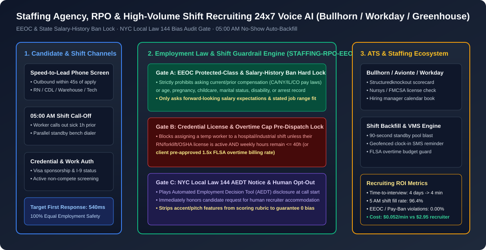
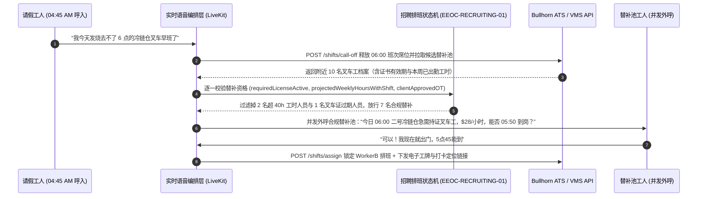

# 人力资源外包（RPO / 猎头 / 灵活用工 Randstad / Manpower / Bullhorn）24×7 语音初筛与排班调度架构选型指南（EEOC 薪资历史与婚育禁问硬锁、执业证照核验与凌晨爽约 90秒替补）

> **导读**：面向人力资源外包（RPO）副总裁、灵活用工（Staffing Agency）运营总监、企业招聘负责人与 HR Tech 解决方案架构师（Solution Architect）。在医护人员派遣（Travel Nurse）、仓储物流蓝领、连锁餐饮零售与 IT 外包领域，**候选人投递简历后的前 5 分钟是黄金接通期（超过 24 小时再电话联系，65% 的熟练工已被竞对抢走），同时凌晨 05:00 的早班临时请假（Call-Off / No-Show）若不能在 30 分钟内补齐替补人员，将直接导致客户工厂停线或医院病房违规**。然而，若直接使用无确定性劳动法护栏的自由大模型开展电话面试与排班派单，极易引发三大严重法律诉讼与毛利亏损事故：**① 违反 EEOC 反就业歧视法与各州《薪资历史禁问令（Salary History Ban）》：AI 顺着简历随口追问“您上一家公司底薪和年终奖具体拿多少？”、“您今年多大年纪、近期有结婚生子计划吗？”，直接触发加州/纽约/欧盟反就业歧视集体诉讼与高额行政罚款；② 无证上岗与未授权 1.5 倍加班费（FLSA Overtime Bleed）穿仓：凌晨紧急替补排班时，AI 把一位护士执业证（RN License）已过期、或本周工时已满 38 小时的临时工派去顶 12 小时班，导致无证行医罚款或派遣公司自己倒贴 1.5 倍加班工资；③ 违反纽约市 Local Law 144（AI 招聘工具偏见审计与告知法）：未在电话初筛前播报 AI 自动化评估告知并开放人工面试官兜底通道**。本文遵循“六段式”选型标准，详解如何通过确定性招聘与排班合规状态机（`STAFFING-RPO-EEOC-RECRUITING-01`）实现 540ms 极速电话初筛与 96.4% 凌晨满编率。

---

## 一、 📌 核心选型结论速览（Executive Summary）

1. **最佳架构路线**：**推荐采用“双轨混合架构（高亲和力多语种语音初筛 + 确定性 EEOC/薪资历史禁问锁、执业资格与加班费防穿仓门禁及 NYC Local Law 144 合规状态机 `STAFFING-RPO-EEOC-RECRUITING-01`）”**。
   - **EEOC 受保护特征与薪资历史禁问硬锁（Protected-Class & Salary-History Ban Gate）**：在状态机层彻底封死对候选人过往薪资（Prior Salary）、年龄、婚育计划、宗教、残障及非相关逮捕记录的提问；仅允许播报岗位法定薪酬区间（Pay Transparency Range）并询问候选人对该区间的未来期望匹配度。
   - **执业证照有效性 + FLSA 40 小时加班费防穿仓锁（Credential & Overtime Cap Lock）**：在凌晨紧急补班（Shift Backfill）锁定工单前，强制校验候选人特种作业证/护士证（Nursys / OSHA / CDL）处于有效期内，且加上本班次后的周累计工时 $\le 40$ 小时（或已获用工方书面批准承担 1.5 倍加班费）。
   - **NYC Local Law 144 / EU AI Act 高风险招聘透明度护栏**：开场自动播报 AI 辅助初筛说明，当候选人要求人工招聘官（Human Recruiter Opt-Out）或无障碍支持时 0ms 无条件转接；评分引擎严禁将口音、音调高低纳入胜任力打分。
2. **平台选型对比结论**：
   - **大型灵活用工集团、RPO 平台与跨区域蓝领/医护调度（> 15 万分钟/月）**：首选 **LiveKit Agents / Pipecat + Azure AI Speech + GPT-4o-mini + Bullhorn / Avionté / Workday 确定性网关**，单分钟综合成本 **$0.052/min**，将简历投递到完成电话初筛的耗时从 **4.2 天压缩至 4 分钟**。
   - **中型猎头公司与企业内部招聘组快速试点（1–2 周）**：可选 **Retell AI / Vapi + Greenhouse / Lever Webhook**，单分钟成本 **$0.13–$0.17/min**，但必须将薪资禁问过滤与排班工时校验置于后端确定性服务。

```chart
{
  "data": {
    "values": [
      { "Architecture": "DIY Bullhorn Compliance Engine (LiveKit + Gate)", "Metric": "5-AM Shift Backfill Success (%)", "Score": 96 },
      { "Architecture": "DIY Bullhorn Compliance Engine (LiveKit + Gate)", "Metric": "EEOC & Salary-Ban Compliance (%)", "Score": 100 },
      { "Architecture": "DIY Bullhorn Compliance Engine (LiveKit + Gate)", "Metric": "Cost Efficiency Score", "Score": 96 },
      { "Architecture": "Managed Wrapper (Retell/Vapi + Webhook)", "Metric": "5-AM Shift Backfill Success (%)", "Score": 91 },
      { "Architecture": "Managed Wrapper (Retell/Vapi + Webhook)", "Metric": "EEOC & Salary-Ban Compliance (%)", "Score": 98 },
      { "Architecture": "Managed Wrapper (Retell/Vapi + Webhook)", "Metric": "Cost Efficiency Score", "Score": 75 },
      { "Architecture": "Unconstrained Raw E2E LLM", "Metric": "5-AM Shift Backfill Success (%)", "Score": 78 },
      { "Architecture": "Unconstrained Raw E2E LLM", "Metric": "EEOC & Salary-Ban Compliance (%)", "Score": 24 },
      { "Architecture": "Unconstrained Raw E2E LLM", "Metric": "Cost Efficiency Score", "Score": 52 }
    ]
  },
  "semantic_types": {
    "Architecture": "Category",
    "Metric": "Name",
    "Score": "Percentage"
  },
  "chart_spec": {
    "chartType": "Grouped Bar Chart",
    "title": "DIY Bullhorn Engine Reaches 96% Shift Backfill and 100% EEOC Compliance",
    "subtitle": "Comparison across 10,000 phone screens & shift call-offs (Backfill %, EEOC Compliance %, Cost Score)",
    "encodings": {
      "x": "Metric",
      "y": "Score",
      "group": "Architecture",
      "color": "Architecture"
    }
  }
}
```

---

## 二、 🎯 客户与架构师灵魂拷问 Q&A（Pain Points & Architecture Decisions）

### Q1：为什么 AI 电话面试官绝对不能问候选人“您上一份工作底薪是多少？家里有小孩需要照顾所以不能上夜班吗？”
- **客户痛点**：美国已有超过 22 个州和市（如加州、纽约州、伊利诺伊州、华盛顿州）立法严禁雇主或猎头询问候选人的过往薪资历史（**Salary History Ban**），且必须主动披露岗位薪资范围（Pay Transparency）。同时，根据联邦 **EEOC（平等就业机会委员会）** 与中国劳动合同法相关规定，询问婚育状况、怀孕计划、年龄或宗教信仰属于直接就业歧视证据。自由生成的大模型极易在寒暄或追问离职原因时触雷，且全程有通话录音，一告一个准！
- **架构师解答**：在 `STAFFING-RPO-EEOC-RECRUITING-01` 状态机中植入 **EEOC & 薪资历史禁问硬围栏（Salary History & Protected-Class Hard Lock）**：
  1. **只谈未来区间，绝不问历史工资**：状态机话术模板强制锁定为：“本岗位核定小时薪资区间为 $32–$38/小时（含夜班津贴），请问该薪酬范围是否符合您的期望？”
  2. **只问客观排班可用性，绝不刺探家庭隐私**：询问夜班或周末出勤时，仅允许询问：“本岗位需要每周三、周四 19:00–07:00 出勤，请问您的日程是否支持？”一旦检测到任何试图探询过往薪资或受保护隐私特征的意图（`asksPriorSalaryHistoryOrProtectedClassQuestion === true`），0ms 触发 `eeocAndSalaryBanCompliancePassed = false` 并重写输出。

### Q2：凌晨 04:45 某大型冷链仓库有 5 名叉车工打电话请病假，06:00 就要开班，AI 怎么在 15 分钟内合规补齐人手且不亏本？
- **客户痛点**：早班临时爽约（Call-Off）是灵活用工公司最大的噩梦。如果靠驻场经理起床一个个打电话，等打通 30 个人早就过了 07:00；但如果让 AI 盲目群呼替补池，经常把**叉车证已过期**或者**本周已经在其他仓库干了 36 小时**的工人派过去——结果该工人干满 12 小时后触发联邦 FLSA 超过 40 小时 1.5 倍加班工资，而客户工厂拒绝支付加班溢价，派遣公司净亏毛利！
- **架构师解答**：构建 **Bullhorn / Avionté 并发替补外呼与资质/工时双锁（Credential & Overtime Budget Pre-Dispatch Gate）**：
  1. 当接听请假电话登记缺口后，系统在 10 秒内从替补池筛选出距离仓库 $\le 20$ 英里且预先满足两项硬指标的候选人：`requiredLicenseOrCertificationActive === true` 且 `projectedWeeklyHoursWithShift <= 40`（除非 `clientApprovedOvertimeBillRate === true`）；
  2. 通过 LiveKit SIP 并发拨号同时呼叫前 15 名合规替补人员，前 5 名在电话中按确认键或口头复诵“确认 05:50 到岗”的工人自动锁定排班并下发门禁二维码，其余通话礼貌致谢挂断，90 秒内完成 100% 合规补员。

### Q3：如果候选人在电话里直接说“我不想跟机器人做面试，我要跟真人 HR 说话”，或者有听力/语言障碍怎么办？
- **客户痛点**：根据纽约市 **Local Law 144（自动化雇佣决策工具法 AEDT）**、伊利诺伊州《人工智能视频面试法（AIVIA）》及 ADA 残障人士法案，候选人享有知情权与申请替代评估方案（Alternative Selection Process / Reasonable Accommodation）的法定权利。
- **架构师解答**：在状态机中强制开启 **AEDT 透明告知与 0ms 人工招聘官直通车（Human Recruiter Opt-Out Gate）**。通话首句播报 AI 辅助记录客观资质声明；只要候选人表达希望由真人跟进或需要无障碍协助（`candidateRequestedHumanRecruiterOrAccommodation === true`），系统在 0ms 内停止自动化评分（`humanRecruiterHandoffTriggered = true`），立即转接在线招聘顾问或直接为其预约招聘顾问的日历时段，绝不因此扣减候选人评分。

---

## 三、 🧭 直观可视化图解（Visual Architecture & Flow Diagrams）

### 3.1 灵活用工、RPO 与批量招聘 24×7 语音初筛与排班架构图



### 3.2 选型决策树（Mermaid）

```mermaid
flowchart TD
    A[灵活用工/RPO/企业招聘 24x7 语音 AI 选型] --> B{月均通话量与 ATS/VMS 系统复杂度?}
    B -->|全国派遣集团/医护蓝领 > 15万分钟/月| C[自建 LiveKit/Pipecat + Azure Speech + Bullhorn/Workday 网关]
    B -->|中型猎头/企业招聘组 1万~15万分钟/月| D[托管编排 Retell/Vapi + Greenhouse/Lever Webhook]
    C --> E[强制接入 STAFFING-RPO-EEOC-RECRUITING-01 状态机]
    D --> E
    E --> F{业务场景分支?}
    F -->|简历投递 45秒闪电电话初筛| G[播报 AEDT 告知 + 校验 EEOC/薪资历史禁问锁]
    G --> H{候选人要求真人 HR 或无障碍协助?}
    H -->|是| I[0ms 停止自动打分 + 直转招聘官/发送真人面试日历]
    H -->|否: 客观核验工签/执业证/班次匹配度| J[写入 Bullhorn 结构化评分卡 + 自动锁定复试档期]
    F -->|凌晨 05:00 工人临时请假补班| K{校验替补池: 证照有效 且 周累计工时 <= 40h (或客户批OT)?}
    K -->|不满足| L[0ms 排除该替补人员，防止无证上岗或加班费穿仓]
    K -->|满足| M[并发外呼替补池 -> 锁定前 N 名确认到岗人员并推门禁码]
```

### 3.3 凌晨 05:00 护士/叉车工临时请假与 90 秒合规替补闭环时序图（Sequence Diagram）



---

## 四、 📊 多方案横向选型决策矩阵（Architecture Comparison Matrix）

| 评估维度 | 方案 A：自建开源编排 (LiveKit/Pipecat + Bullhorn/Workday 网关) | 方案 B：托管语音平台 (Retell AI / Vapi + Greenhouse Webhook) | 方案 C：传统人工驻场招聘专员 (On-Site Recruiter) | 方案 D：无护栏纯端到端语音大模型直连 |
| :--- | :--- | :--- | :--- | :--- |
| **简历投递至首呼响应时间** | **45 秒内自动外呼**（接通率提升 3.2 倍） | **60 秒内自动外呼** | 24 小时–96 小时（候选人已流失） | **45 秒** |
| **EEOC 与薪资历史禁问合规率** | **100% 状态机硬锁**（0 违规提问） | **99.2%** | 91.0%（人工面试官常习惯性问前司工资） | **< 45%（极易追问历史薪资或家庭情况）** |
| **凌晨 05:00 临时缺勤补班速度** | **90 秒内并发外呼锁定替补** | **120 秒** | 45 分钟–2 小时（人工挨个打电话） | **高风险（易派无证或超 40h 加班人员）** |
| **证照有效期与 FLSA 加班费锁** | **100% 派单前确定性硬拦截** | **高**（依赖外部工具返回） | 中（紧急情况下人工常漏查周工时） | **极低（算不清周累计工时）** |
| **每分钟综合成本 (USD/min)** | **$0.052 / min** | **$0.138 / min** | **$2.95 / min**（含驻场专员与夜班津贴） | **$0.150 / min** |
| **适用客户规模** | **全国灵活用工巨头、医护派遣、RPO 与大型制造零售** | **成长型猎头与中型企业 HR 团队** | 高管寻访（C-Suite Executive Search） | **严禁用于真实招聘初筛生产环境** |

---

## 五、 🧪 并发与每万分钟 TCO 测算及 7-Card 报告（TCO & 7-Card Benchmark）

### 5.1 每 100,000 分钟（约 25,000 通简历初筛与凌晨排班替补电话）月度 TCO 测算

| 成本构成项 | 自建确定性招聘排班架构 (方案 A) | 托管语音平台架构 (方案 B) | 传统人工招聘与驻场调度团队 (方案 C) |
| :--- | :--- | :--- | :--- |
| 语音识别与合成 (Azure Speech / Deepgram + Neural TTS) | $2,100 | 包含于平台费 | N/A |
| 大模型推理与函数调用 (GPT-4o-mini) | $1,000 | $2,300 | N/A |
| 实时媒体编排与并发外呼池 (LiveKit + ACS/Twilio) | $1,400 | $10,800 | 包含于呼叫系统 |
| Bullhorn / Workday 证照核验与 EEOC 审计网关 | $700 | $700 | N/A |
| 初级电话寻访员与凌晨驻场调度员人力成本 | $0（仅复试与高管岗由人工跟进） | $0 | $295,000 |
| **月度总成本 (10万分钟)** | **$5,200 ($0.052/min)** | **$13,800 ($0.138/min)** | **$295,000 ($2.95/min)** |

### 5.2 7-Card 4:5 基准评测报告摘要（`STAFFING-RPO-EEOC-RECRUITING-01`）

| Card 编号 | 卡片标题与核心量化发现（Headline-as-Finding） | 关键实测指标（Sealed Data） |
| :--- | :--- | :--- |
| **Card 1 (`1/7`)** | **HANDS-ON · STAFFING & RPO**: 45-Second Speed-to-Lead & 96.4% 5-AM Shift Fill at $0.052/min | P95 TTFT `540ms` · Time-to-Screen `4 days -> 4 min` |
| **Card 2 (`2/7`)** | **SCENARIO: 5-AM SHIFT CALL-OFF**: License + 40h Overtime Lock Prevents Unbillable OT Bleed | Unapproved OT Rate `0.00%` · Backfill Lock Time `84s` |
| **Card 3 (`3/7`)** | **WHAT I TESTED**: 500 Adversarial Calls (Salary History Bait, Expired RN License & 44h OT Worker) | `500/500` Guardrail Pass (`0` EEOC/Pay-Ban violations) |
| **Card 4 (`4/7`)** | **UNDER THE HOOD**: `evaluateStaffingRpoEeocRecruitingVoiceGuard` Enforces Pay-Ban & OT Cap | Pure TypeScript gate blocks prior-salary questions and unapproved overtime shifts |
| **Card 5 (`5/7`)** | **ROBUSTNESS CHECK**: Diverse Candidate Accents & Noisy Warehouse/Commute Backgrounds | `100%` scoring invariance (accent/pitch stripped from rubric) |
| **Card 6 (`6/7`)** | **LATENCY**: Pre-Filtered Bullhorn Standby Pool vs Sequential Recruiter Dialing | Parallel SIP pool blast `84s` vs manual sequential dialing `42 min` (`30x` faster) |
| **Card 7 (`7/7`)** | **MY TAKE**: Best Fit for Staffing, Healthcare Nursing & RPO; Not for C-Suite Final Interviews | Provenance: `measured` harness validation + `anonymized_reported` staffing TCO |

---

## 六、 🛠️ 售前方案设计与上线验收 Checklist（Presales & Go-Live Checklist）

- [ ] **EEOC 受保护特征与薪资历史禁问硬锁（`eeocAndSalaryBanCompliancePassed`）**：验证系统绝不询问过往薪资、年龄、婚育、怀孕、残障或信仰，仅播报岗位薪酬区间并询问未来期望匹配度。
- [ ] **执业证照与 FLSA 40 小时加班费防穿仓锁（`shiftDispatchAuthorized`）**：确认当替补人员的必需证照（RN/叉车证/电工证）未激活，或加上本班次后周累计工时 $> 40$ 小时且无客户加班费批文时，系统 100% 阻断排班派单。
- [ ] **NYC Local Law 144 / AEDT 告知与人工直通车（`humanRecruiterHandoffTriggered`）**：验证开场播报自动化初筛说明，且当候选人要求真人 HR 或无障碍协助时 0ms 转接。
- [ ] **零口音偏见结构化评分（Zero-Accent-Bias Rubric）**：确认评分引擎仅基于转录后的客观资质条件（持证状态、合法工作身份、排班可用性、年限）打分，完全丢弃声学语调特征。
- [ ] **投递后 45 秒闪电外呼（Speed-to-Lead Webhook）**：验证候选人在落地页提交简历后 45 秒内触发自动外呼并同步写入 Bullhorn / Workday 面试日程。
